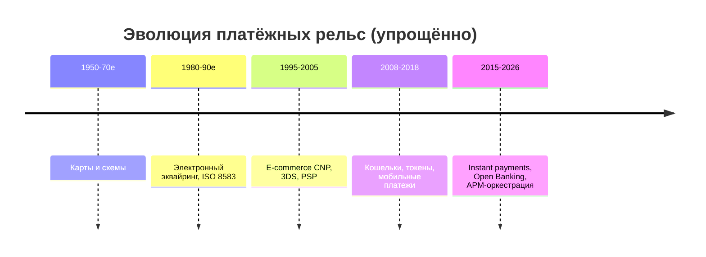
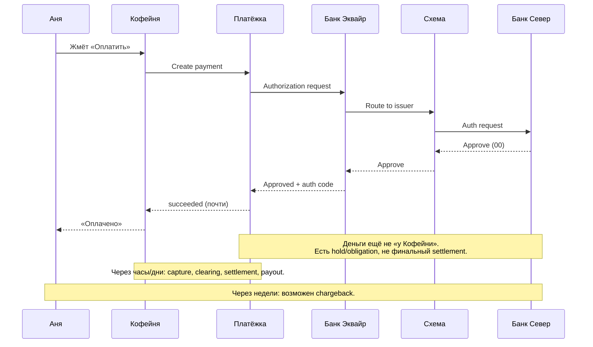
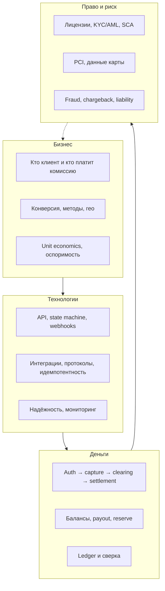
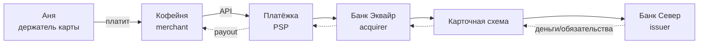

# Глава 01. Как устроена индустрия онлайн-платежей

Представь: Аня сидит дома, выбирает на сайте «Кофейни» пачку эфиопского зерна за 42,50 EUR и жмёт «Оплатить». Через пару секунд на экране — зелёная галочка. Кофе приедет завтра. Для Ани всё просто. Для инженера, который впервые открывает логи PSP «Платёжка», эта «пара секунд» выглядит как перестрелка сообщений между полудюжиной организаций. PSP (Payment Service Provider) — платёжный провайдер: компания, через которую магазин подключает приём платежей; её место среди банков и других посредников разберём в [главе 02](02-ecosystem-participants.md). «Платёжка», «Кофейня» и банки нашей истории вымышлены.

Эта книга — про то, что происходит между кнопкой и зелёной галочкой. И про то, что происходит *после*: когда деньги ещё не на счёте продавца, когда покупатель оспаривает списание, когда регулятор спрашивает, кто в конечном счёте владеет компанией, когда webhook пришёл дважды, а заказ уже отгружен. Webhook здесь — HTTP-уведомление от провайдера магазину об изменении платежа; о его доставке и повторах поговорим в [главе 07](07-states-async-idempotency.md).

Глава 01 — входная дверь. Подробные форматы банковских сообщений и различия между моделями платёжных посредников оставим для следующих глав. Здесь нужна **карта местности**: зачем индустрия вообще существует, откуда она выросла, сколько в ней денег, почему «просто вызвать API банка» — опасная иллюзия, и на каких четырёх уровнях одновременно живёт любой платёж. Плюс — как читать остальную книгу, чтобы не утонуть в деталях.

## В этой главе

- Зачем нужна платёжная индустрия и какую проблему она решает
- Краткая история: от наличных до instant payments и open banking
- Масштаб отрасли: обороты, комиссии, кто на чём зарабатывает (обзорно)
- Почему платежи сложнее, чем «вызвать API банка»
- Четыре уровня взгляда: бизнес, технологии, деньги, право
- Как устроена эта книга и как её читать
- Сквозной пример: Аня покупает кофе — что видно с разных высот

---

## Зачем вообще нужна платёжная индустрия

### Проблема, которая старше интернета

Деньги — это обещание. Наличка обещает ценность тому, кто её держит. Банковский счёт обещает, что банк отдаст тебе «цифровые» деньги по первому требованию. Карта обещает, что эмитент (issuer) — банк или другая организация, выпустившая карту — заплатит по правилам карточной схемы, если продавец сделал всё правильно. Схема — платёжная система, например Visa или Mastercard: она объединяет участников общими правилами и инфраструктурой. Роли подробно разберём в [главе 02](02-ecosystem-participants.md), схемы — в [главе 04](04-card-networks.md). Платёжная индустрия — это огромный механизм превращения *обещаний* в *перемещения ценности* между людьми и организациями, которые друг другу не доверяют и часто даже не знают друг друга.

Когда Аня отдаёт кассиру купюру, доверие локальное и мгновенное: купюра в руке, товар в руке, сделка закрыта. Когда Аня платит на сайте «Кофейни» картой «Банка Север», участники сделки разделены:

- Аня и «Кофейня» никогда не встречались лично.
- «Кофейня» не знает, настоящая ли карта и хватит ли на ней денег.
- «Банк Север» не знает, настоящий ли сайт «Кофейни» и отдадут ли кофе.
- Деньги должны дойти не «когда-нибудь», а предсказуемо — и с возможностью спора, если что-то пойдёт не так.

Индустрия существует, чтобы **свести чужих людей к одной сделке**, распределив риски, комиссии и ответственность между специализированными игроками. Без этого интернет-коммерция либо не взлетела бы, либо превратилась бы в бесконечные предоплаты наличными и «переведите на карту физлица».

### Что индустрия продаёт на самом деле

На поверхности — «приём платежей». Глубже — пакет услуг:

1. **Доверие и аутентификация.** Убедиться (насколько возможно), что платит именно держатель карты или владелец счёта.
2. **Авторизация (authorization) обязательства.** Эмитент одобряет операцию; обычно сумма резервируется, но продавец ещё не получил деньги.
3. **Перемещение денег.** При клиринге участники обмениваются сведениями об операциях и рассчитывают, кто кому должен. При сеттлменте (settlement) закрывают эти обязательства переводом средств. Выплата продавцу (payout) доставляет деньги на его банковский счёт. Различия шагов — в [главе 06](06-payment-lifecycle.md), путь денег — в [главе 12](12-flow-of-funds.md).
4. **Разруливание конфликтов.** Продавец может сам вернуть оплату (refund), а покупатель — оспорить её через эмитента. Такой спор может привести к chargeback (возвратному платежу): сумму взыщут по правилам схемы. Это разные механизмы; подробнее — [глава 17](17-chargebacks-and-disputes.md).
5. **Соблюдение правил.** Правила схем, требования регуляторов и санкции. AML (Anti-Money Laundering) — меры против отмывания денег, а PCI DSS — стандарт защиты карточных данных; их разберём в [главе 18](18-regulation-and-compliance.md) и [главе 19](19-payment-security-pci.md).
6. **Операционный слой для бизнеса.** Отчёты, сверки, мультивалютность, подписки, маркетплейсы.

PSP «Платёжка» для «Кофейни» — это не «кнопка оплаты». Это аутсорс банковских отношений, соблюдения обязательных требований (compliance), защиты от мошенничества (антифрода), валют, возвратов и ночных сверк. Сверка (reconciliation) сопоставляет записи разных систем: например, ожидаемые выплаты магазина и поступления в банке ([глава 13](13-ledger-and-reconciliation.md)). Именно поэтому индустрия разрослась в отдельную экосистему, а не осталась «фичей внутри каждого банка».

### Почему нельзя «просто перевести»

Инженер часто думает: «есть счёт Ани, есть счёт „Кофейни“, сделаем transfer». В реальности:

- У Ани может не быть счёта в том же банке, что у продавца.
- Продавец может быть в другой стране и другой валюте.
- Аня хочет платить «картой», а не знать IBAN магазина — международный идентификатор банковского счёта ([глава 10](10-bank-based-methods.md)).
- Магазин хочет получить деньги завтра, а не ждать, пока Аня найдёт реквизиты.
- Если товар не приехал, нужен понятный механизм возврата — не «напишите в поддержку банка и ждите две недели».
- Государство хочет знать, не отмываются ли через этот поток деньги и не нарушаются ли санкции.

Платёжная индустрия — это **стандартизированные протоколы доверия** поверх хаоса банков, юрисдикций и привычек покупателей. Карточная схема, мгновенные банковские переводы в евро SEPA Instant, кошелёк Apple Pay, бразильская система мгновенных переводов Pix — разные ответы на одну и ту же задачу: сделать так, чтобы чужой человек заплатил чужому бизнесу с приемлемым риском и UX. Банковские методы разберём в [главе 10](10-bank-based-methods.md), кошельки — в [главе 11](11-wallets-bnpl-local-methods.md).

### Три энтропии, которые убивают «простой перевод»

Если совсем приземлить: индустрия чинит три вида хаоса.

**Хаос идентичности.** Кто Аня? Кто «Кофейня»? Кто конечный владелец компании, которая внезапно хочет принимать карты? Без KYC (Know Your Customer), проверки личности клиента, и KYB (Know Your Business), проверки бизнеса, поток быстро становится трубой для мошенничества и отмывания. Эти проверки разберём в [главе 18](18-regulation-and-compliance.md). Продавца также называют мерчантом (merchant); его идентификатор в системе эквайера часто называется MID (Merchant ID), подробнее — [глава 25](25-merchant-domain.md).

**Хаос обязательств.** В момент кнопки ещё нет «денег у продавца» — есть цепочка обещаний. После авторизации магазин обычно должен отправить capture — подтверждение, что одобренную сумму нужно предъявить к списанию. Дальше идут клиринг, сеттлмент и payout: разные юридические и бухгалтерские факты. В [главе 06](06-payment-lifecycle.md) пройдём эту цепочку шаг за шагом. Индустрия стандартизирует, *когда* обещание считается достаточно твёрдым, чтобы отгрузить товар, и *когда* можно считать, что деньги «свои».

**Хаос исключений.** Частичный возврат, chargeback, повторный запрос авторизации, дублированный capture, корректировка при обмене валют, отклонённая выплата — нормальная жизнь, не авария. Обмен валют дальше будем называть FX (foreign exchange; [глава 14](14-currencies-and-fx.md)). Без индустрии каждый магазин изобретал бы свой протокол «а что если». С индустрией хотя бы есть общий язык и общие окна ответственности.

Отсюда важный вывод для карьеры: человек, который «умеет Stripe API», полезен. Человек, который понимает эти три хаоса, незаменим, когда API ведёт себя «странно» — а оно будет.

### Зачем отдельная индустрия, а не только банки

Банки умеют платежи десятилетиями. Почему же выросли PSP, компании защиты от мошенничества и платформы оркестрации — сервисы, которые выбирают провайдера или метод для конкретной оплаты ([глава 20](20-platform-architecture.md))?

Потому что банку удобно работать с крупными, понятными, долгоживущими клиентами и со своими каналами. Интернет-магазину нужна скорость подключения, десятки методов, вебхуки, песочница, документация для разработчиков, дашборд для саппорта и возможность сменить эквайера без переписывания checkout — формы и процесса оформления оплаты. Эквайер (acquirer) — участник, который обеспечивает продавцу приём карточных платежей и расчёты по ним ([глава 02](02-ecosystem-participants.md)). Банку часто тяжело одновременно давать финансовую инфраструктуру, удобные инструменты разработчику и продукт для малого бизнеса. Нишу заполнили компании, которые стыкуют банковский мир с продуктовым.

«Платёжка» в нашей книге — как раз такой стык. Она не отменяет банки; она переводит их язык на язык инженеров «Кофейни».

---

## Краткая история: как мы сюда попали

История нужна не для экзамена. Она объясняет, почему сегодняшние системы выглядят так странно: почему рядом живут ISO 8583 — стандарт сообщений о карточных операциях, выросший из банковской инфраструктуры 1980-х, — и JSON-webhook 2020-х, почему «карта» до сих пор центр вселенной в Европе и США, и почему в Бразилии и Индии картина уже другая. Формат ISO 8583 подробно разберём в [главе 22](22-integrations.md).

### Наличные и чеки: мир офлайна

До массовых карт экономика крутилась вокруг наличных и чеков. Наличные решают задачу мгновенно, но плохо масштабируются на расстояние и плохо дружат с учётом. Чеки добавили отложенное доверие («я обещаю, что в банке есть деньги»), но принесли клиринг, возвраты чеков и мошенничество. Уже здесь видно зерно будущих проблем онлайн-платежей: **обещание ≠ деньги на счёте**, а спор о сделке может прийти позже оплаты.

Интересная деталь для инженера: чековая культура научила банки жить с **асинхронностью и оспоримостью**. Карточный chargeback — родственник этой логики, только ускоренный и завернутый в схемы правил. Когда кто-то говорит «банк должен делать только мгновенные финальные переводы», он спорит не с технологией, а с десятилетиями потребительской защиты и привычек риска.

### Банковские карты: сеть поверх банков

Кредитные и дебетовые карты появились как способ платить у незнакомого продавца, не нося пачку купюр и не выписывая чек. В простом приближении дебетовая карта использует деньги на счёте покупателя, кредитная — предоставленный ему кредит ([глава 03](03-bank-card-anatomy.md)). Ключевой ход — **четырёхсторонняя модель** (её подробно разберём в [главе 02](02-ecosystem-participants.md)): держатель карты, продавец, банк-эмитент, банк-эквайер, а между ними — карточная сеть (Visa, Mastercard и другие).

Сеть не «хранит деньги Ани». Она задаёт правила: как выглядит авторизация, кто несёт убыток при мошенничестве, какие комиссии, какие сроки клиринга. Interchange — межбанковская комиссия, обычно в пользу эмитента; scheme fee — сбор самой карточной схемы ([глава 15](15-fees-and-economics.md)). Эквайер «Банк Эквайр» подключает продавцов. Эмитент «Банк Север» выпускает карты и решает, пропускать ли операцию. Продавец получает не «перевод от Ани», а обязательство по правилам схемы и договору с эквайером, которое потом превращается в деньги на его счёте.

Появилось разделение ролей, без которого онлайн не взлетел бы:

- эмитент знает Аню и её риск;
- эквайер знает продавца и его риск;
- схема даёт общий язык и бренд доверия («эту карту примут»);
- продавец не обязан дружить с тысячами банков покупателей.

Инженерный след этой эпохи — сообщения авторизации в духе ISO 8583 и ночные клиринговые файлы. В логах встретятся BIN — начальные цифры номера карты, по которым определяют её эмитента и продукт, — и MCC, код категории бизнеса продавца ([глава 03](03-bank-card-anatomy.md)). Там же будет authorization code — код одобрения операции, выданный авторизующей стороной ([глава 09](09-declines-and-response-codes.md)). Многое из этого родилось ещё когда интернет был научной игрушкой. Трёхсторонние (three-party) схемы вроде классической модели American Express устроены иначе — там одна организация совмещает роли схемы, эмитента и эквайера. Для большинства e-commerce в Европе и США четырёхсторонняя (four-party) модель остаётся отправной точкой. Подробнее о схемах — в [главе 04](04-card-networks.md).

### E-commerce: карта без карты в руках

Когда магазины переехали в браузер, появился Card Not Present (CNP), платёж без предъявления карты: продавец не может проверить её через терминал, Аня вводит номер с клавиатуры (или из парольного менеджера). Риск мошенничества вырос. Индустрия ответила CVV — проверочным кодом карты ([глава 03](03-bank-card-anatomy.md)), проверкой платёжного адреса (Address Verification) и 3-D Secure (3DS) — протоколом, по которому эмитент проверяет, действительно ли платит держатель карты ([глава 08](08-3ds-and-sca.md)). Токенизация заменяет номер карты специальным идентификатором ([глава 05](05-card-contexts-and-tokens.md)), а fraud-скоринг оценивает риск мошенничества ([глава 16](16-fraud.md)). Появились и правила liability shift — переноса ответственности за отдельные виды мошеннических операций между участниками; к их условиям вернёмся в главе 08.

Параллельно вырос класс посредников: платёжные шлюзы (gateway) передают запросы магазина дальше, процессоры обрабатывают платёжные сообщения, PSP собирают нужные услуги в продукт для продавца ([глава 02](02-ecosystem-participants.md)). Магазину «Кофейня» незачем становиться прямым участником Visa. Проще заключить договор с «Платёжкой», которая уже дружит с эквайерами, помогает сократить PCI scope — круг систем, на которые распространяются требования PCI DSS, — и шлёт webhooks, когда статус платежа меняется. Границы PCI scope разберём в [главе 19](19-payment-security-pci.md).

Именно в e-commerce закрепилась привычка инженеров: «интегрировали Stripe-подобный API — и платежи готовы». Привычка полезная для скорости запуска и опасная, если под капотом не понимать, *что* именно API прячет.

Врезка по духу эпохи: ранний e-commerce часто хранил PAN (Primary Account Number), номер карты, в своей базе «потому что так проще для повторных покупок» ([глава 03](03-bank-card-anatomy.md)). Потом индустрия и PCI DSS объяснили цену этой простоты. Сегодня credentials on file — платёжные реквизиты, сохранённые для будущих оплат, — и токены являются отдельной дисциплиной ([глава 05](05-card-contexts-and-tokens.md)), а «полезно себе сохранить номер карты» — красный флаг на собеседовании.

### Кошельки и «кнопка вместо карты»

Дальше покупателю надоело вводить номер карты. Появились цифровые кошельки (digital wallets): Apple Pay, Google Pay, локальные приложения, кошельки с предварительно пополняемым балансом. Снаружи — одна кнопка. Под капотом часто всё та же карточная инфраструктура, только вместо PAN едет network token — заменитель номера карты, поддерживаемый карточной сетью, — и криптограмма, криптографическое подтверждение для конкретной операции (подробнее — [глава 05](05-card-contexts-and-tokens.md) и [глава 11](11-wallets-bnpl-local-methods.md)).

Кошельки изменили UX и частично антифрод (устройство, биометрия), но не отменили экономику схем и не сделали платежи «просто переводом между людьми». Для «Кофейни» оплата картой через Apple Pay — всё ещё карточный платёж с особым способом передачи платёжных реквизитов.

Полезно различать:

- **pass-through wallet** — кошелёк подставляет токен карты в существующую рельсу;
- **staged wallet** — деньги сначала живут в балансе кошелька, потом едут к мерчанту (другие риски, другой баланс, иногда другая регуляторика).

Если в продуктовом тикете написано «добавить кошелёк», уточни, *какой* — иначе спроектируешь не тот леджер (ledger), учётную книгу денежных обязательств и движений ([глава 13](13-ledger-and-reconciliation.md)).

### Instant payments и open banking: банк снова в центре

В 2010–2020-е годы в разных регионах выстрелили мгновенные банковские переводы: британская Faster Payments, SEPA Instant в евро, бразильская Pix, индийская UPI и другие. Идея простая и мощная: деньги со счёта на счёт за секунды, часто 24/7, с высокой финальностью — то есть перевод быстро становится окончательным в обычном процессе системы ([глава 10](10-bank-based-methods.md)). Для части сценариев это сильный конкурент карт: другая комиссия, другой риск мошенничества, другой UX (часто QR или bank redirect — переход в приложение либо на сайт банка для подтверждения).

Open Banking, предоставление доступа к банковским данным и операциям через API с согласия клиента, добавило ещё один слой. Платёжная инициация (PIS, Payment Initiation Services) позволяет уполномоченному провайдеру инициировать перевод из банка Ани с её согласием, не собирая реквизиты карты ([глава 10](10-bank-based-methods.md)). Европейская директива о платёжных услугах PSD2 создала правовую основу для такого доступа; PSD3/PSR — обозначения пакета её обновления, который на момент написания развивается. Суть регулирования разберём в [главе 18](18-regulation-and-compliance.md).

Важно: instant и open banking **не заменили** карты глобально. Они добавили параллельные рельсы. Зрелый приём платежей в 2026 году — это оркестрация методов: карта + кошелёк + локальный банковский метод + иногда BNPL (Buy Now, Pay Later), оплата покупки позднее или частями через отдельного провайдера ([глава 11](11-wallets-bnpl-local-methods.md)), с маршрутизацией по стране, сумме и риску.

Появился и новый класс инженерных задач: переход покупателя в приложение или на сайт банка (bank redirect), срок действия его согласия, статусы «деньги ушли, но мерчант ещё не сверил», возвраты в системах с высокой финальностью. Финальность означает, насколько окончателен перевод по правилам системы и можно ли отменить его в обычном платёжном процессе; она не исключает отдельного возврата или правового требования. Chargeback-логика карты сюда не копируется один в один. Об этом — [глава 10](10-bank-based-methods.md).

### Что история значит для инженера



На схеме APM (Alternative Payment Methods) — общее название методов за пределами обычного ввода карты: банковских переводов, кошельков и других локальных способов ([глава 11](11-wallets-bnpl-local-methods.md)). Каждый слой не исчез — он лёг поверх предыдущего. Поэтому в сегодняшней платформе могут соседствовать EMV — семейство спецификаций чиповых карт и связанных платёжных технологий ([глава 03](03-bank-card-anatomy.md)), — 3DS2, второе поколение 3-D Secure, JSON API «Платёжки» и webhook, который магазин затем публикует в Kafka. Платежи — это археология протоколов, которая всё ещё обслуживает живые деньги.

---

## Масштаб и деньги: почему вокруг столько шума

### Обороты и комиссии — порядок величин

Цифры в платёжной отрасли огромны, но их легко перепутать. Нужно разделять:

- **Платёжный оборот (TPV, Total Payment Volume)** — сколько денег *прошло через* платёжную инфраструктуру. Это не выручка платёжной компании. Не путай его с GMV (Gross Merchandise Value), стоимостью проданных товаров: объём заказов и обработанных платежей может различаться.
- **Выручка платёжного сервиса** — комиссии, наценка провайдера (markup), доход от обмена валют, продажи инструментов защиты от мошенничества и т.п. FX-спред — разница между курсом для клиента и выбранным ориентиром ([глава 14](14-currencies-and-fx.md)).
- **Interchange и scheme fees** — составляющие карточных комиссий: первая обычно идёт эмитенту, вторая — схеме; их расчёт разберём в [главе 15](15-fees-and-economics.md).

Для иллюстрации порядка (не как точная статистика на 2026 год): глобальный карточный и e-commerce оборот измеряется десятками триллионов долларов в год; take rate PSP, отношение его выручки к обработанному обороту, часто выглядит «мелочью» в процентах и центах, но на миллиардах транзакций превращается в серьёзный бизнес. Условный платёж Ани на 42,50 EUR может стоить «Кофейне» порядка 1–3% плюс фиксированная сумма (зависит от региона, типа карты, международного характера операции — cross-border, 3DS и модели ценообразования). Детали экономики разберём в [главе 15](15-fees-and-economics.md).

Смысл для инженера: небольшое улучшение конверсии (conversion), доли покупателей, завершивших оплату, или снижение комиссии на 5 базисных пунктов (bps, basis points; 5 bps = 0,05 процентного пункта) на масштабе меняет прибыль бизнеса. Поэтому в платежах горячо спорят о повторных попытках и о том, какой эквайер лучше принимает польские дебетовые карты Visa.

### Иллюстративный разрез платежа Ани

Возьмём 42,50 EUR. Цифры ниже — учебные, «порядка», не тариф реального договора:

| Компонент | Пример порядка | Кто получает |
|---|---|---|
| Сумма с Ани | 42,50 EUR | — |
| Interchange | ~0,10–0,30 EUR | эмитент (порядок зависит от региона/типа карты) |
| Scheme fee | центы | схема |
| Эквайер / процессор | центы…десятки центов | «Банк Эквайр» / процессор |
| Markup PSP | центы…десятки центов | «Платёжка» |
| Итого комиссия продавца (MDR) | условно ~1–3% + фикс | суммарно цепочка |
| Нетто продавцу до прочих холдов | ~41,5–42,0 EUR | «Кофейня» |

MDR (Merchant Discount Rate) — комиссия за приём платежа, которую платит продавец. В таблице «нетто» означает остаток после вычетов, а холд — временное удержание суммы. На одном платеже разница невелика. На 100 000 таких заказов в месяц выбор маршрута и тарифа — уже зарплаты команды и маркетинговый бюджет. Поэтому платёжная оптимизация — не только машинное обучение против мошенничества, но и корректная передача типа операции и выбор эквайера в нужной стране ([главы 05](05-card-contexts-and-tokens.md) и [27](27-cross-border-payments.md)).

Ещё один слой денег, который новички пропускают: **стоимость исключений**. Один chargeback может стоить сумму операции, дополнительную комиссию (fee) и операционное время. При высокой доле споров добавляются последствия программ контроля схем ([глава 17](17-chargebacks-and-disputes.md)). Десять «успешных» мошеннических платежей могут съесть маржу сотни честных. Экономика платежей — про хвосты, не только про среднюю комиссию.

### Кто на чём зарабатывает (очень сверху)

| Участник | На чём зарабатывает (упрощённо) |
|---|---|
| Эмитент | Interchange, кредитный процент, карточный сервис |
| Схема (Visa/MC и др.) | Scheme fees, услуги, брендинг |
| Эквайер / процессор | Эквайринговая комиссия, процессинг |
| PSP | Наценка на себестоимость, подписка на сервис, обмен валют, дополнительные услуги |
| Fraud/3DS-вендоры | Подписка / per-transaction |
| Продавец | Маржа товара минус MDR и операционные потери (fraud, chargeback) |

Аня «платит 42,50». «Кофейня» получает меньше. Разница расползается по цепочке. Если рисовать только стрелку «Аня → Кофейня», экономика невидима — а она определяет, почему одни методы включают по умолчанию, а другие прячут в «ещё способы оплаты».

### Индустрия как инфраструктура интернета

Платежи — рядом с рекламой, облаками и логистикой — стали **инфраструктурным слоем digital-экономики**. Подписки, маркетплейсы, gig-economy, in-app purchases, кросс-бордер SaaS — всё упирается в способность провести платёж и потом честно развести деньги между сторонами.

Отсюда и кадровая правда: компания может делать «не платежи», но иметь платёжную команду. Или наоборот — называть себя fintech, а на деле быть тонкой обёрткой над чужим PSP. Читать эту книгу имеет смысл в обоих случаях: либо ты строишь рельсы, либо едешь по ним и обязан понимать, где вагон может сойти.

### Где в отрасли вообще водятся инженеры

Грубо говоря, технические роли живут в нескольких «домах»:

- **Разработка на стороне продавца (merchant engineering)** — «Кофейня»: checkout, подписки, биллинг, сверка заказов с выплатами.
- **Разработка PSP или платформы** — «Платёжка»: платёжный API, маршрутизация, леджер, коннекторы к эквайерам, обработка сигналов мошенничества.
- **Эквайер / эмитент / процессор** — банковская обработка операций, сообщения по стандартам ISO, системы принятия решений об авторизации и расписания клиринга.
- **Инструменты риска и операционной команды (risk & ops)** — правила, очереди алертов, работа со спорами покупателей (disputes; [глава 17](17-chargebacks-and-disputes.md)).
- **Встроенные финансовые услуги (embedded finance)** — платежи внутри нефинансового продукта. При модели BaaS (Banking as a Service) финансовую инфраструктуру предоставляет внешний банк или провайдер; границы ролей — в [главе 02](02-ecosystem-participants.md).

Глава 01 намеренно не углубляется в org chart. Но полезно сразу понять: спор «как правильно сделать идемпотентность» в merchant-команде и в PSP-команде звучит похоже, а цена ошибки — разная. У мерчанта цена — один бизнес и его клиенты. У PSP — тысячи мерчантов сразу.

---

## Почему платежи сложнее, чем «вызвать API банка»

Это центральный тезис главы. Если после неё останется одна мысль — пусть будет она.

### Иллюзия одного API

Типичный путь разработчика «Кофейни»:

1. Зарегистрировались в «Платёжке».
2. Вставили форму оплаты и создали Payment Intent — объект, который хранит намерение оплатить покупку и помогает провести его через необходимые шаги ([глава 20](20-platform-architecture.md)).
3. Настроили webhook `payment.succeeded`.
4. Отгрузили кофе.
5. «Готово, платежи работают».

До первого chargeback. До первой выплаты, которая не сошлась с выпиской или отчётом провайдера (statement). До первой страны, где привычнее местный способ оплаты. До таймаута, в котором авторизация на стороне эмитента прошла, а ответ до «Кофейни» не доехал — и пользователь нажал «Оплатить» ещё раз.

API банка или PSP — это **фасад**. За ним:

- Другой юридический мир (лицензии, договоры, PCI).
- Другой временной мир (auth — сокращение от authorization — за секунды, settlement за дни, chargeback за месяцы).
- Другой мир идентичности (кто покупатель, кто продавец, кто конечный владелец бизнеса).
- Другой мир денег: ожидаемые суммы (pending), доступные к выплате (available), удерживаемый резерв (reserve), отрицательный баланс — долг продавца провайдеру ([глава 12](12-flow-of-funds.md)).

### Деньги и данные расходятся во времени



На диаграмме `Approve (00)` означает одобрение; `00` — распространённый код ответа, а `auth code` — отдельный код одобрения конкретной операции ([глава 09](09-declines-and-response-codes.md)). Hold означает резервирование суммы, obligation — обязательство участников. Пользователь видит «оплачено» в момент успешной авторизации (или даже раньше — по оптимистичному UI). Бухгалтерия продавца видит деньги позже. Риск-менеджер видит хвост событий ещё позже. Если спроектировать систему вокруг одного статуса `paid`, вы смешаете три разные реальности.

### Много сторон — много отказов

В обычном CRUD «сервис недоступен» — одна причина. В платеже отказ может прийти:

- от эмитента (недостаточно средств, подозрение на мошенничество, утраченная карта);
- от схемы (ошибка маршрутизации или решение при обработке запроса вместо недоступного эмитента — stand-in; [глава 04](04-card-networks.md));
- от эквайера (лимиты продавца, санкционные ограничения, техническая ошибка);
- от PSP (антифрод, ошибка конфигурации, ограничение до завершения проверки клиента);
- от 3DS (покупатель не прошёл проверку или не завершил её вовремя);
- от сети между вами (timeout при неизвестном исходе).

Каждый класс отказа требует **разной** реакции: иногда retry, иногда другая карта, иногда «извините, попробуйте завтра», иногда ручной review. Подробно — в [главе 09](09-declines-and-response-codes.md). Сейчас важно понять: «error: false» в HTTP 200 от PSP ещё ничего не гарантирует про деньги, а HTTP 500 ещё не значит, что деньги не списали.

### Идемпотентность — не приятное дополнение, а закон выживания

Аня нажала «Оплатить», интернет моргнул, UI показал спиннер, она нажала ещё раз. Или ваш worker ретраится после таймаута. Или webhook доставили дважды.

В платежах дубликат — это не «ещё одна запись в таблице», а **двойное списание** или **двойная отгрузка**. Поэтому idempotency key, ключ одной логической операции, по которому система узнаёт её повторные запросы, дедупликация webhook, сверка и state machine — базовая гигиена, а не «когда-нибудь допилим». Этому посвящена [глава 07](07-states-async-idempotency.md).

### Регуляторика встроена в продукт

В обычном SaaS регуляторика часто «где-то сбоку». В платежах она определяет, можно ли вообще запускать фичу:

- SCA (Strong Customer Authentication), усиленная аутентификация клиента, требует сочетания независимых факторов подтверждения личности. 3DS помогает выполнить эти требования для онлайн-оплаты картой; это влияет на конверсию и распределение ответственности ([глава 08](08-3ds-and-sca.md)).
- KYC/KYB блокирует онбординг «Кофейни».
- Проверка участников по санкционным спискам (sanctions screening) может остановить выплату.
- PCI DSS определяет, имеете ли вы право трогать PAN.

Игнорировать это — не «технический долг», а риск лицензии и уголовных историй. Обзор — в [главе 18](18-regulation-and-compliance.md) и [главе 19](19-payment-security-pci.md).

### Локальность убивает «один глобальный checkout»

Карта Visa «везде» — маркетинговый слоган, не инженерная правда. В Нидерландах важен iDEAL — оплата через подтверждение в банке покупателя ([глава 10](10-bank-based-methods.md)). В Бразилии важен Pix. В некоторых странах популярны ваучеры: покупатель получает код, вносит наличные в точке приёма, а магазин узнаёт об оплате позже ([глава 11](11-wallets-bnpl-local-methods.md)). Приём через эквайера другой страны (cross-border acquiring) может работать, но стоить дороже и давать больше отказов ([глава 27](27-cross-border-payments.md)).

Поэтому платежи — это всегда **продукт + география + метод + риск**, а не одна интеграция.

### Несколько источников истины

В обычном сервисе заказов часто есть «главная БД». В платежах одновременно живут:

- состояние в системе управления заказами «Кофейни» (OMS, Order Management System);
- состояние платежа в «Платёжке»;
- состояние авторизации у эквайера/эмитента;
- бухгалтерские проводки и settlement-файлы;
- иногда ещё баланс кошелька или BNPL-провайдера.

Они *должны* сходиться, но сходятся через время и через сверку (reconciliation), а не через одну ACID-транзакцию на весь мир. Отсюда культура леджеров и регулярных задач сопоставления записей (matching). Для надёжной отправки событий применяют outbox: событие сохраняют в одной транзакции с изменением данных, а публикуют отдельным процессом. Подробности — в [главе 13](13-ledger-and-reconciliation.md) и [главе 21](21-distributed-systems-and-money.md).

Если коротко сформулировать отличие платёжного инженера от «просто бэкенд-инженера»: первый проектирует системы, которые остаются честными, когда источники истины временно врут друг другу.

### UX лжёт ради конверсии — и это надо учитывать

Продукт хочет показать «успех» как можно раньше. Риск и finance хотят «успех» как можно позже и надёжнее. Инженер сидит между ними. Типичные компромиссы:

- показать success после authorization, а capture сделать асинхронно;
- провести 3DS без действий покупателя (frictionless) или запросить допустимое исключение из SCA (exemption). Это разные механизмы: проверка без дополнительного шага и исключение из требования проверки ([глава 08](08-3ds-and-sca.md));
- повторить оплату при устранимом отказе (soft decline) с учётом его причины, но не повторять вслепую окончательный отказ (hard decline; [глава 09](09-declines-and-response-codes.md));
- приостановить отгрузку при высокой оценке риска, даже если авторизация прошла ([глава 16](16-fraud.md)).

Каждый компромисс — осознанный trade-off, а не баг. Если trade-off не задокументирован, через полгода никто не вспомнит, почему «иногда заказ paid, а на складе статус fraud_review».

### Врезка: как это бывает в жизни

Команда «Кофейни» запустила оплату за неделю. Конверсия отличная. Через месяц finance говорит: «по банку пришло на 1 840 EUR меньше, чем в админке заказов». После двух бессонных ночей выясняется: часть платежей в статусе `authorized`, но не `captured`; часть refund отразилась в PSP, но заказ в OMS не закрыли; один chargeback съел не только сумму, но и fee. API «работал». Деньги — нет. Индустрия наказывает за наивную модель статуса сильнее, чем за кривой CSS кнопки.

---

## Четыре уровня взгляда на один платёж

Любую тему в книге полезно смотреть сразу с четырёх высот. Если видишь только одну — обязательно врежешься в другую.



### Уровень бизнеса

Вопросы: зачем «Кофейня» принимает платежи? Какие методы дают конверсию в Германии и в Польше? Что дороже — потерять 2% покупателей на 3DS challenge, дополнительной проверке с участием покупателя, или принять больше мошеннических платежей? Нужен ли PayFac (Payment Facilitator), посредник, который подключает продавцов под своей платёжной моделью и договором с эквайером, или хватит обычного PSP? Кто Merchant of Record (MoR), юридический продавец перед покупателем, для подписки на кофейную «коробку месяца»? Разницу PayFac и MoR разберём в [главе 02](02-ecosystem-participants.md).

На этом уровне живут продуктовые решения, ценообразование, выбор провайдера, политика возвратов. Технически идеальный платёж, который никто не завершает из-за UX, — провал.

### Уровень технологий

Вопросы: как разделить намерение оплатить (Payment Intent), платёжное поручение (Payment Order) и отдельную операцию (Transaction)? Эти названия зависят от API; нашу модель разберём в [главе 20](20-platform-architecture.md). Как выглядят статусы? Что делать при таймауте? Как версионировать API? Как маршрутизировать на нескольких эквайеров? Где граница PCI scope?

Здесь книга проведёт вас через части III, IV и VIII. Но уже сейчас зафиксируйте: платёжный бэкенд — это не CRUD с колонкой `amount`. Это распределённый протокол с деньгами на концах.

### Уровень денег

Вопросы: когда обязательство становится деньгами? Почему available balance меньше суммы успешных платежей? Куда делась комиссия? Почему refund возможного «вчерашнего» платежа упирается в нехватку баланса? Как свести ledger «Платёжки» с файлом сеттлмента «Банка Эквайр»?

Многие инженеры годы пишут checkout и ни разу не смотрят settlement report. Это как писать биржевой матчинг и не знать, что такое clearing. Части V книги исправляют этот перекос.

### Уровень права и риска

Вопросы: имеем ли мы право инициировать этот платёж? Прошли ли SCA? Не под санкциями ли конечный владелец бизнеса? Кто несёт ответственность, если покупатель оспаривает собственную покупку как чужую — при так называемом friendly fraud ([глава 16](16-fraud.md))? Какие доказательства (evidence) собрать для representment — ответа продавца на chargeback с просьбой пересмотреть взыскание ([глава 17](17-chargebacks-and-disputes.md))?

Этот уровень неприятный, потому что не рисуется красивым sequence diagram, но он определяет, останетесь ли вы в бизнесе. Части VI–VII — про него.

### Как пользоваться четырьмя уровнями

Когда читаешь любую следующую главу, периодически останавливайся и спрашивай:

1. Какую бизнес-проблему это решает?
2. Как это выглядит в API и состоянии системы?
3. Как двигаются деньги и остатки?
4. Какие правила и риски здесь сидят?

Если ответ на один из пунктов «не знаю» — ты ещё не понял тему, даже если RFC прочитал.

### Мини-пример: refund на этих уровнях

Аня вернула пачку кофе (не тот помол). «Кофейня» жмёт «вернуть 42,50 EUR».

- **Бизнес:** политика возвратов, срок, частичный или полный, кто платит за доставку.
- **Технологии:** API refund, идемпотентность, статус `refund_pending` → `refunded`, webhook, обновление заказа.
- **Деньги:** хватает ли баланса продавца? Не уйдёт ли он в минус? Когда деньги реально уйдут Ане? Как отразить комиссию?
- **Право/риск:** не выглядит ли серия возвратов как злоупотребление? Нужны ли дополнительные проверки для крупных сумм?

Одна кнопка в админке — четыре разных проекта. Так устроена индустрия.

---

## Обзор экосистемы (тема №2 — с высоты птичьего полёта)

Полный разбор участников — в [главе 02](02-ecosystem-participants.md). Здесь — минимальная карта, без которой нельзя говорить даже обзорно.

### Минимальный набор ролей для платежа Ани



- **Аня (cardholder)** — покупатель, владеет картой «Банка Север».
- **«Кофейня» (merchant)** — продавец, хочет получить деньги за товар.
- **«Платёжка» (PSP)** — технологический и операционный посредник: API, checkout, antifraud, отчёты, иногда агрегирует мерчантов.
- **«Банк Эквайр» (acquirer)** — банк/лицензированный участник, который принимает карточные операции в пользу продавца и дружит со схемой.
- **Схема (card network)** — правила, бренд, маршрутизация, клиринг между сторонами.
- **«Банк Север» (issuer)** — банк Ани: выпускает карту, авторизует операции, потом списывает/кредитует её счёт по своим правилам.

Рядом существуют процессоры, шлюзы, PayFac, MoR, маркетплейс-платформы — это не синонимы. Маркетплейс объединяет независимых продавцов и покупателей и может участвовать в распределении платежа ([глава 26](26-marketplace-and-split-payments.md)). Путать эти роли — классическая ошибка онбординга в индустрии. Запомни ощущение «здесь больше ролей, чем я думал»; имена и границы — в следующей главе.

### Не только карты

Та же «Кофейня» может принимать:

- SEPA Instant / open banking payment;
- Apple Pay (часто как токенизированная карта);
- BNPL на крупный набор посуды для заваривания;
- локальный метод на новом рынке.

Рельсы разные, бизнес-цель одна: превратить намерение Ани заплатить в деньги (или отказ) с понятным статусом. Оркестрация методов — часть современной платёжной платформы, не «факультатив для энтерпрайза».

---

## Сквозной пример: 42,50 EUR за кофе с четырёх высот

Разберём одну покупку так, как она будет возвращаться по всей книге.

### Сцена

- Покупатель: Аня, карта Visa debit «Банка Север», Испания (для примера).
- Продавец: интернет-магазин «Кофейня», юрлицо в Германии; для примера — категория специализированной розничной торговли (не точное название или номер MCC).
- Сумма: **42,50 EUR**.
- PSP: «Платёжка».
- Эквайер: «Банк Эквайр».
- Заказ: `order_coffee_1042`.
- Платёж в PSP: `pay_7f3a91`.

### Что видит Аня

Открыла checkout → ввела карту (или Apple Pay) → возможно, короткий 3DS challenge → «Спасибо, заказ оформлен». В выписке через день-два: `COFFEEHOUSE BERLIN` или похожий statement descriptor — подпись операции, по которой покупатель узнаёт продавца ([глава 25](25-merchant-domain.md)), — на 42,50 EUR.

### Что видит «Кофейня» (бизнес + техника магазина)

```json
{
  "order_id": "order_coffee_1042",
  "amount": 4250,
  "currency": "EUR",
  "payment_id": "pay_7f3a91",
  "status": "paid",
  "method": "card",
  "customer_email": "anya@example.com"
}
```

В JSON сумма задана в минимальных единицах валюты: `4250` евроцентов = 42,50 EUR ([глава 14](14-currencies-and-fx.md)). Магазин отгружает кофе. В админке статус `paid`. Финансовая команда увидит эту сумму в payout не сегодня, а по расписанию «Платёжки» — например, T+2, через два дня после принятой в договоре исходной даты T, — минус комиссия. Учитываются ли календарные или рабочие дни, тоже определяет договор. Если Аня через три недели скажет «я не заказывала», придёт dispute, и 42,50 могут уехать обратно вместе с дополнительной комиссией.

### Что видит «Платёжка»

Цепочка состояний (упрощённо): `created → authenticated? → authorized → captured → settled → paid_out`. То есть платёж создан, при необходимости проверена личность покупателя, получено одобрение, подтверждено списание, завершены расчёты и выполнена выплата продавцу. Это учебная схема, не универсальные статусы API. Параллельно система хранит оценку риска, результат 3DS, идентификатор операции у эквайера (acquirer reference), начисленные комиссии (fee accrual) и учётные записи о деньгах — проводки леджера (ledger postings; [глава 13](13-ledger-and-reconciliation.md)).

Иллюстративный кусок внутреннего события:

```json
{
  "payment_id": "pay_7f3a91",
  "merchant_id": "merch_coffeehouse",
  "amount": 4250,
  "currency": "EUR",
  "auth_code": "A12B3C",
  "scheme": "visa",
  "issuer_bin": "476173",
  "result": "approved",
  "liability": "issuer",
  "fees_estimated_eur": 76
}
```

`auth_code` — код одобрения, `issuer_bin` — начальные цифры номера карты, `scheme` — карточная сеть. Поле `liability` в этом учебном событии обозначает предполагаемую сторону, несущую ответственность за определённый мошеннический спор; `issuer` здесь означает эмитента. Это допущение примера: само одобрение не переносит ответственность, а условия переноса зависят, в частности, от результата 3DS ([глава 08](08-3ds-and-sca.md)).

`fees_estimated_eur: 76` — порядка 0,76 EUR в евроцентах (иллюстративно): смесь interchange, scheme fee и markup «Платёжки». Суффикс `_eur` указывает валюту, а единицу измерения нужно закрепить в контракте поля. Точные компоненты «Кофейня» может не видеть, если у неё blended pricing — единый тариф, объединяющий несколько составляющих комиссии ([глава 15](15-fees-and-economics.md)).

### Что происходит с деньгами (очень грубо)

1. **Authorization:** «Банк Север» холдирует 42,50 EUR на карте/счёте Ани.
2. **Capture / clearing:** операция входит в клиринговый поток схемы.
3. **Settlement:** закрываются нетто-позиции — итоговые суммы взаимных обязательств после зачёта встречных платежей; «Банк Эквайр» получает средства по результатам расчёта ([глава 12](12-flow-of-funds.md)).
4. **Merchant balance:** у «Кофейни» в «Платёжке» растёт баланс (часто сначала pending).
5. **Payout:** «Платёжка» переводит на расчётный счёт «Кофейни» сумму минус комиссии и минус резервы/холды, если они есть.

Пока идёт этот марафон, UX Ани уже давно на этапе «жду курьера».

### Таймлайн

| Время | Событие |
|---|---|
| T+0 с | Аня жмёт «Оплатить» |
| T+1–3 с | Auth approved, UI success |
| T+0–24 ч | Capture (если не auto) |
| T+1–3 д | Settlement / баланс становится available |
| T+2–7 д | Payout на счёт «Кофейни» (зависит от договора) |
| T+ до 120 д | Окно риска chargeback (зависит от reason/scheme; порядок величин — месяцы) |

Именно эта растянутость во времени делает платежи отдельной дисциплиной.

### Что может пойти не так на этом же платеже

Учебный каталог неприятностей — чтобы сразу почувствовать ширину поля:

1. **Soft decline** от эмитента → причина иногда устранима: например, требуется дополнительная проверка покупателя. Повтор возможен только с учётом причины и правил; смена маршрута сама по себе её не устраняет. При hard decline повтор обычно не поможет ([глава 09](09-declines-and-response-codes.md)).
2. **3DS timeout** → Аня бросает checkout; конверсия падает без «технического падения» API.
3. **Auth success, capture forgotten** → холд снимется, денег не будет, кофе уже едет.
4. **Duplicate webhook** → две отгрузки, если нет дедупа.
5. **Refund после payout** → баланс мерчанта уходит в минус, «Платёжка» компенсирует из следующих продаж или просит долить.
6. **Chargeback «fraud»** → при споре с заявлением «я не платила» придётся собирать доказательства. Это может быть реальная кража реквизитов, ошибка покупателя или оспаривание собственной покупки; название причины ещё не доказывает, что произошло ([главы 16](16-fraud.md) и [17](17-chargebacks-and-disputes.md)).
7. **FX-сюрприз** → если Аня платит в USD, а сеттлмент мерчанта в EUR, цифры в отчётах «не бьются» на глаз.

Все эти сюжеты книга разберёт отдельно. Здесь достаточно увидеть: индустрия — про управление хвостами, не про счастливый path на демо.

---

## Как устроена эта книга

Книга построена как путь от карты местности к деталям и снова к целому — через сценарии.

### Часть I — карта

Глава 01 (ты здесь) и [глава 02](02-ecosystem-participants.md): кто есть кто и зачем индустрия существует.

### Часть II — карты как предмет

[Главы 03–05](03-bank-card-anatomy.md): анатомия карты, схемы, оплата с предъявлением карты (CP, Card Present) и без него (CNP), токены. Даже если вы больше любите open banking, карточный мир всё ещё задаёт язык индустрии.

### Часть III — путь платежа

[Главы 06–09](06-payment-lifecycle.md): жизненный цикл, статусы и webhooks, 3DS/SCA, отказы. Это «ежедневный хлеб» интеграционного инженера.

### Часть IV — не только карты

[Главы 10–11](10-bank-based-methods.md): bank transfers, open banking, кошельки, BNPL, локальные методы.

### Часть V — деньги

[Главы 12–15](12-flow-of-funds.md): flow of funds, ledger и сверка, FX, комиссии. Здесь обычно происходит просветление у тех, кто раньше видел только checkout.

### Часть VI — риск

[Главы 16–17](16-fraud.md): fraud и chargeback. Без этого нельзя понять, почему «просто одобрять всё» нельзя, а «резать всё подозрительное» убивает бизнес.

### Часть VII — право и безопасность

[Главы 18–19](18-regulation-and-compliance.md): регуляторика и PCI DSS.

### Часть VIII — инженерия платформы

[Главы 20–24](20-platform-architecture.md): архитектура, распределённые системы, интеграции, надёжность, мониторинг.

### Часть IX — бизнес-модели поверх платежей

[Главы 25–27](25-merchant-domain.md): мир мерчанта, маркетплейсы, cross-border.

### Часть X — справочник и сценарии

[Главы 28–30](28-glossary.md): глоссарий и сквозные сюжеты, где всё сходится.

### Как читать в зависимости от роли

- **Новичок в индустрии.** Читай подряд части I–VI, затем сценарии ([29](29-scenarios-part-1.md)–[30](30-scenarios-part-2.md)). Остальное — по потребности.
- **Инженер платёжного бэкенда.** После 01–02 прыгай в 06–07, потом в часть VIII, параллельно держи 12–13 открытыми как Библию денег.
- **Аналитик / продакт.** 01–02, 06, 09, 15–17, 24. Сценарии — обязательно.
- **Онбординг / собес.** [Глава 28](28-glossary.md) и сценарии 29–30, а эту главу — чтобы не учить термины без картины.

### Правила сквозных героев

По всей книге встречаются:

- **Аня** — покупательница, карта эмитента «Банк Север»;
- **«Кофейня»** — интернет-магазин, merchant;
- **«Платёжка»** — вымышленный PSP;
- **«Банк Эквайр»** — эквайер;
- **«Банк Север»** — эмитент.

Суммы и валюты (EUR, USD, иногда GBP/PLN) иллюстративные. Все эти компании вымышленные; публичные бренды (Visa, Apple Pay, SEPA и т.д.) упоминаются как общеизвестные явления рынка, без претензии на их внутреннюю кухню.

---

## Что это значит для инженера

1. **Не проектируй платёж как булевый флаг `is_paid`.** Минимум — явная state machine и понимание, какой статус означает «можно отдавать товар», какой — «деньги точно наши», какой — «ещё может прилететь chargeback».

2. **Считай время гражданином первого класса.** Секунды (auth), часы (capture), дни (settlement/payout), месяцы (disputes) — разные контуры данных и алертов.

3. **Таймаут ≠ отказ.** После обрыва связи с PSP/эквайером нельзя слепо ретраить «новый» платёж без идемпотентности и без проверки статуса. Иначе Аня увидит два списания, а ты — один очень злой тикет.

4. **Логируй идентификаторы сквозные.** `order_id`, `payment_id`, `idempotency_key`, acquirer/scheme references — это кислород расследований. Без них сверка превращается в шаманизм.

5. **Заложи место под методы и страны.** Даже если сегодня только карты EUR, завтра бизнес скажет «выходим в Бразилию». Абстракция payment method окупается быстро.

6. **Дружи с finance и risk с первого дня.** Если инженеры и бухгалтерия смотрят в разные «правды», инцидент уже сидит в процессе — просто ещё не взорвался.

7. **Учи язык индустрии постепенно, но не откладывай картину.** Термин без контекста бесполезен; контекст без терминов неудобен. Эта глава дала контекст — дальше наращивай точность.

8. **Помни про четыре уровня.** Любой дизайн-док по платежам, где нет блока про деньги/риск/регуляторику, почти наверняка дырявый.

Практический чеклист на старте фичи «прием оплаты»:

- Какие статусы и кто их источник истины?
- Что делаем при двойном клике и двойном webhook?
- Когда можно выполнять заказ и отгружать товар (fulfillment)?
- Как пойдёт refund и откуда возьмутся деньги на него?
- Какие методы в каких странах?
- Что попадёт в PCI scope?
- Какие метрики скажут, что мы сломались: доля одобренных авторизаций (auth rate), конверсия, задержка выплат (payout delay), доля chargeback (chargeback ratio)? Способы расчёта — в [главе 24](24-monitoring-and-operations.md).

### С чего начать, если ты новенький в команде «Платёжки» или «Кофейни»

Не пытайся выучить всё сразу. За первую неделю полезнее сделать четыре вещи:

1. Провести один тестовый платёж и выписать все ID, которые появились в системах.
2. Найти settlement/payout отчёт и сопоставить его с этим платежом руками.
3. Прочитать договор и тарифы: единая ставка (blended) или раздельные interchange, сборы схемы и наценка (IC++; [глава 15](15-fees-and-economics.md))? Какая часть поступлений временно удерживается в скользящем резерве (rolling reserve; [глава 12](12-flow-of-funds.md))?
4. Спросить команды риска и операций: какая сейчас доля chargeback и какие причины отказов (decline codes) встречаются чаще всего ([глава 09](09-declines-and-response-codes.md))?

После этого текст следующих глав перестанет быть абстракцией.

---

## Типичные ошибки и грабли

### «Мы просто интегрируем платёжный API»

Интеграция checkout — 10% работы. Остальное: сверка, возвраты, диспуты, отчёты, поддержка, онбординг мерчантов, мониторинг decline reasons, повторные попытки, бухгалтерские хвосты. Если в roadmap только «подключить провайдера», вас ждёт сюрприз на втором месяце.

### Путаница оборота и выручки

«Мы процессим миллиард» звучит гордо, но экономика одной операции (unit economics) зависит от take rate, себестоимости обработки (cost per transaction) и потерь от мошенничества и chargeback. Инженерные приоритеты надо стыковать с маржой, иначе команда оптимизирует красивый дашборд TPV и ухудшает финансовый результат, отражённый в отчёте о прибылях и убытках (P&L, Profit and Loss; [глава 15](15-fees-and-economics.md)).

### Один статус на все случаи жизни

`SUCCESS` после authorization — ещё не payout. `FAILED` после timeout — ещё не факт, что эмитент не одобрил. Склейка разных фаз в один enum — источник двойных отгрузок и «пропавших» денег.

### Игнор географии

Запуск «глобального» магазина с одним карточным эквайером в одной стране часто даёт низкую долю одобрений (approval rate) за рубежом. Платежи локальны даже когда бренд глобален.

### Надежда, что банк «сам разберётся»

Банки и схемы работают по правилам и файлам, а не по вашей бизнес-логике. Если вы не сделали capture, не передали признаки того, что списание инициирует продавец по ранее полученному согласию (MIT, Merchant-Initiated Transaction) или что это регулярная оплата (recurring; [глава 05](05-card-contexts-and-tokens.md)), не сохранили доказательства для спора — «ну вы же банк» не поможет.

### Смешение ролей участников

Называть PSP банком, эквайера схемой, PayFac обычным gateway — путь к неверным ожиданиям по рискам и деньгам. Если не уверен — загляни в [главу 02](02-ecosystem-participants.md) и [глоссарий](28-glossary.md).

### Оптимизм по поводу финальности

В карточных CNP-платежах финальность мягче, чем кажется: chargeback может переиграть «успех». В некоторых instant bank payments финальность жёстче, зато другие failure modes. Не переноси свойства одного метода на другой.

### Культура «главное — конверсия»

Конверсия священна, но без риск-контура вы купите её мошенническими транзакциями. Баланс fraud vs conversion — не лозунг, а ежедневная настройка; см. [главу 16](16-fraud.md).

### Врезка: для любопытных

Почему в платежах так много «древнего»? Потому что менять рельсы, по которым бегут триллионы, страшно и дорого. Новые API появляются по краям (PSP → merchant), а ядро (issuer ↔ scheme ↔ acquirer) эволюционирует осторожно. Отсюда гибрид: снаружи REST и JSON, внутри — десятилетиями обкатанные сообщенийные форматы и клиринговые окна. Инженер современной «Платёжки» — переводчик между эпохами.

---

## Итоги главы

1. Платёжная индустрия нужна, чтобы проводить ценность между сторонами, которые друг другу не доверяют, распределяя риск, правила и комиссии.
2. История рельс (наличные → карты → e-commerce → кошельки → instant/open banking) объясняет сегодняшний зоопарк протоколов и методов: слои не сменяются, а наслаиваются.
3. Масштаб отрасли огромный, но для практики важнее различать оборот, выручку и цепочку комиссий на одном платеже.
4. «Вызвать API банка/PSP» — фасад; за ним время, деньги, право, многосторонние отказы и идемпотентность.
5. Один платёж живуч на четырёх уровнях сразу: бизнес, технологии, деньги, право/риск.
6. Минимальная экосистема карты — holder, merchant, PSP, acquirer, scheme, issuer; детали и вариации — дальше по книге.
7. Успех в UI ≠ деньги на счёте продавца ≠ конец истории с риском.
8. Книга идёт от карты к деталям и возвращается к целому в сценариях; герои Аня и «Кофейня» будут с вами до конца.
9. Инженерная зрелость в платежах начинается с state machine, идентификаторов, сверок и уважения к регуляторике — не с красивой кнопки Pay.
10. Следующий шаг — разобрать участников экосистемы поимённо: кто что делает, кто на чём зарабатывает и кто несёт риск, когда Аня нажимает «Оплатить».

---

## Связанные главы

- [Глава 02. Участники платёжной экосистемы](02-ecosystem-participants.md) — подробный разбор ролей, gateway/PSP/PayFac/MoR.
- [Глава 06. Жизненный цикл карточного платежа](06-payment-lifecycle.md) — auth, capture, clearing, settlement.
- [Глава 07. Состояния платежа, sync/async, webhooks, idempotency, retries](07-states-async-idempotency.md) — почему статус и ретраи — это всё.
- [Глава 12. Что происходит с деньгами](12-flow-of-funds.md) — от hold до payout.
- [Глава 15. Комиссии и экономика платежей](15-fees-and-economics.md) — разрез комиссий на одной транзакции.
- [Глава 28. Глоссарий и идентификаторы](28-glossary.md) — термины одним полотном.
- [Глава 29. Сквозные сценарии I](29-scenarios-part-1.md) — практика на живых сюжетах.
