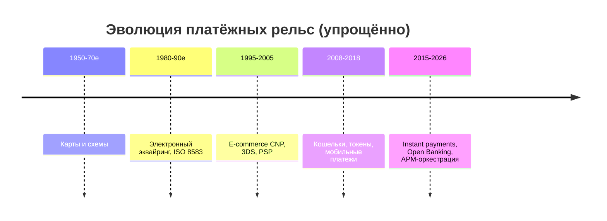
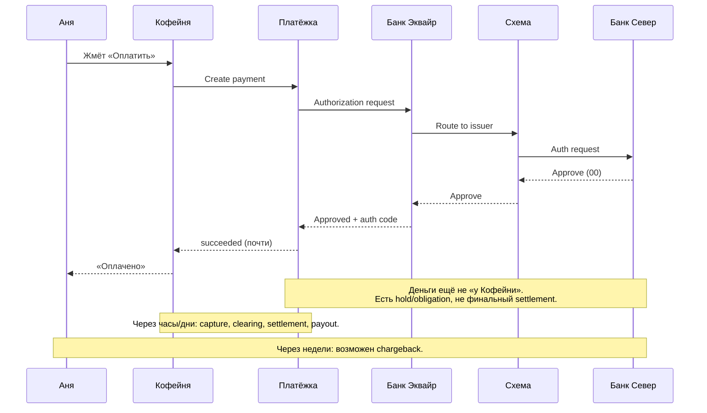
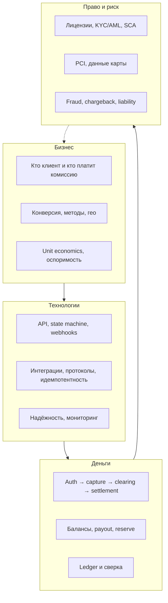
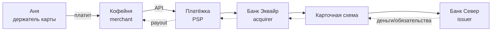

# Глава 01. Как устроена индустрия онлайн-платежей

Представь: Аня сидит дома, выбирает на сайте «Кофейни» пачку эфиопского зерна за 42,50 EUR и жмёт «Оплатить». Через пару секунд на экране — зелёная галочка. Кофе приедет завтра. Для Ани всё просто. Для инженера, который впервые открывает логи PSP «Платёжка», эта «пара секунд» выглядит как перестрелка сообщений между полудюжиной организаций, ни одна из которых не является «банком Ани» в привычном смысле слова «мой банк».

Эта книга — про то, что происходит между кнопкой и зелёной галочкой. И про то, что происходит *после*: когда деньги ещё не на счёте продавца, когда покупатель оспаривает списание, когда регулятор спрашивает «а кто у вас UBO», когда webhook пришёл дважды, а заказ уже отгружен.

Глава 01 — входная дверь. Мы не будем разбирать ISO 8583 по полям и не будем сравнивать PayFac с MoR (это [глава 02](02-ecosystem-participants.md)). Здесь нужна **карта местности**: зачем индустрия вообще существует, откуда она выросла, сколько в ней денег, почему «просто вызвать API банка» — опасная иллюзия, и на каких четырёх уровнях одновременно живёт любой платёж. Плюс — как читать остальную книгу, чтобы не утонуть в деталях.

## В этой главе

- Зачем нужна платёжная индустрия и какую проблему она решает
- Краткая история: от наличных до instant payments и open banking
- Масштаб отрасли: обороты, комиссии, кто на чём зарабатывает (обзорно)
- Почему платежи сложнее, чем «вызвать API банка»
- Четыре уровня взгляда: бизнес, технологии, деньги, право
- Как устроена эта книга и как её читать
- Сквозной пример: Аня покупает кофе — что видно с разных высот

---

## Зачем вообще нужна платёжная индустрия

### Проблема, которая старше интернета

Деньги — это обещание. Наличка обещает ценность тому, кто её держит. Банковский счёт обещает, что банк отдаст тебе «цифровые» деньги по первому требованию. Карта обещает, что эмитент (issuer) заплатит по правилам схемы, если продавец сделал всё правильно. Платёжная индустрия — это огромный механизм превращения *обещаний* в *перемещения ценности* между людьми и организациями, которые друг другу не доверяют и часто даже не знают друг друга.

Когда Аня отдаёт кассиру купюру, доверие локальное и мгновенное: купюра в руке, товар в руке, сделка закрыта. Когда Аня платит на сайте «Кофейни» картой «Банка Север», участники сделки разделены:

- Аня и «Кофейня» никогда не встречались лично.
- «Кофейня» не знает, настоящая ли карта и хватит ли на ней денег.
- «Банк Север» не знает, настоящий ли сайт «Кофейни» и отдадут ли кофе.
- Деньги должны дойти не «когда-нибудь», а предсказуемо — и с возможностью спора, если что-то пойдёт не так.

Индустрия существует, чтобы **свести чужих людей к одной сделке**, распределив риски, комиссии и ответственность между специализированными игроками. Без этого интернет-коммерция либо не взлетела бы, либо превратилась бы в бесконечные предоплаты наличными и «переведите на карту физлица».

### Что индустрия продаёт на самом деле

На поверхности — «приём платежей». Глубже — пакет услуг:

1. **Доверие и аутентификация.** Убедиться (насколько возможно), что платит именно держатель карты или владелец счёта.
2. **Авторизация обязательства.** Эмитент говорит: «да, я готов заплатить эту сумму».
3. **Перемещение денег.** Клиринг, сеттлмент, выплаты продавцу (payout).
4. **Разруливание конфликтов.** Возвраты, chargeback (возвратный платёж), споры.
5. **Соблюдение правил.** Схемы, регуляторы, AML, PCI DSS, санкции.
6. **Операционный слой для бизнеса.** Отчёты, сверки, мультивалютность, подписки, маркетплейсы.

PSP «Платёжка» для «Кофейни» — это не «кнопка оплаты». Это аутсорс банковских отношений, compliance, антифрода, валют, возвратов и ночных сверк. Именно поэтому индустрия разрослась в отдельную экосистему, а не осталась «фичей внутри каждого банка».

### Почему нельзя «просто перевести»

Инженер часто думает: «есть счёт Ани, есть счёт „Кофейни“, сделаем transfer». В реальности:

- У Ани может не быть счёта в том же банке, что у продавца.
- Продавец может быть в другой стране и другой валюте.
- Аня хочет платить «картой», а не знать IBAN магазина.
- Магазин хочет получить деньги завтра, а не ждать, пока Аня найдёт реквизиты.
- Если товар не приехал, нужен понятный механизм возврата — не «напишите в поддержку банка и ждите две недели».
- Государство хочет знать, не отмываются ли через этот поток деньги и не нарушаются ли санкции.

Платёжная индустрия — это **стандартизированные протоколы доверия** поверх хаоса банков, юрисдикций и привычек покупателей. Карточная схема, SEPA Instant, Apple Pay, Pix — разные ответы на одну и ту же задачу: сделать так, чтобы чужой человек заплатил чужому бизнесу с приемлемым риском и UX.

### Три энтропии, которые убивают «простой перевод»

Если совсем приземлить: индустрия чинит три вида хаоса.

**Хаос идентичности.** Кто Аня? Кто «Кофейня»? Кто бенефициар за LLC на Сейшелах, которое внезапно хочет принимать карты? Без KYC/KYB и без устойчивых идентификаторов мерчанта (MID и всё, что вокруг) поток быстро становится трубой для мошенничества и отмывания.

**Хаос обязательств.** В момент кнопки ещё нет «денег у продавца» — есть цепочка обещаний. Авторизация, клиринг, сеттлмент, payout — разные юридические и бухгалтерские факты. Индустрия стандартизирует, *когда* обещание считается достаточно твёрдым, чтобы отгрузить товар, и *когда* можно считать, что деньги «свои».

**Хаос исключений.** Возврат, частичный refund, chargeback, retried auth, duplicate capture, FX-корректировка, rejected payout — нормальная жизнь, не авария. Без индустрии каждый магазин изобретал бы свой протокол «а что если». С индустрией хотя бы есть общий язык и общие окна ответственности.

Отсюда важный вывод для карьеры: человек, который «умеет Stripe API», полезен. Человек, который понимает эти три хаоса, незаменим, когда API ведёт себя «странно» — а оно будет.

### Зачем отдельная индустрия, а не только банки

Банки умеют платежи десятилетиями. Почему же выросли PSP, PayFac, fraud-вендоры, orchestration-платформы?

Потому что банку удобно работать с крупными, понятными, долгоживущими клиентами и со своими каналами. Интернет-магазину нужна скорость подключения, десятки методов, вебхуки, песочница, документация для разработчиков, дашборд для саппорта и возможность сменить эквайера без переписывания checkout. Банку часто тяжело быть simultaneous «лицензией + разработческим DX + продуктом для SMB». Нишу заполнили компании, которые стыкуют банковский мир с продуктовым.

«Платёжка» в нашей книге — как раз такой стык. Она не отменяет банки; она переводит их язык на язык инженеров «Кофейни».

---

## Краткая история: как мы сюда попали

История нужна не для экзамена. Она объясняет, почему сегодняшние системы выглядят так странно: почему рядом живут ISO 8583 из 1980-х и JSON-webhook 2020-х, почему «карта» до сих пор центр вселенной в Европе и США, и почему в Бразилии и Индии картина уже другая.

### Наличные и чеки: мир офлайна

До массовых карт экономика крутилась вокруг наличных и чеков. Наличные решают задачу мгновенно, но плохо масштабируются на расстояние и плохо дружат с учётом. Чеки добавили отложенное доверие («я обещаю, что в банке есть деньги»), но принесли клиринг, возвраты чеков и мошенничество. Уже здесь видно зерно будущих проблем онлайн-платежей: **обещание ≠ деньги на счёте**, а спор о сделке может прийти позже оплаты.

Интересная деталь для инженера: чековая культура научила банки жить с **асинхронностью и оспоримостью**. Карточный chargeback — родственник этой логики, только ускоренный и завернутый в схемы правил. Когда кто-то говорит «банк должен делать только мгновенные финальные переводы», он спорит не с технологией, а с десятилетиями потребительской защиты и привычек риска.

### Банковские карты: сеть поверх банков

Кредитные и дебетовые карты появились как способ платить у незнакомого продавца, не нося пачку купюр и не выписывая чек. Ключевой ход — **четырёхсторонняя модель** (её подробно разберём в [главе 02](02-ecosystem-participants.md)): держатель карты, продавец, банк-эмитент, банк-эквайер, а между ними — карточная сеть (Visa, Mastercard и другие).

Сеть не «хранит деньги Ани». Она задаёт правила: как выглядит авторизация, кто несёт убыток при мошенничестве, какие комиссии (interchange, scheme fee), какие сроки клиринга. Эквайер «Банк Эквайр» подключает продавцов. Эмитент «Банк Север» выпускает карты и решает, пропускать ли операцию. Продавец получает не «перевод от Ани», а обязательство сети/эквайера, которое потом превращается в деньги на его счёте.

Появилось разделение ролей, без которого онлайн не взлетел бы:

- эмитент знает Аню и её риск;
- эквайер знает продавца и его риск;
- схема даёт общий язык и бренд доверия («эту карту примут»);
- продавец не обязан дружить с тысячами банков покупателей.

Инженерный след этой эпохи — сообщения авторизации в духе ISO 8583, BIN-диапазоны, MCC, authorization code, ночные клиринговые файлы. Многое из того, что ты увидишь в логах «Платёжки», родилось ещё когда интернет был научной игрушкой. Закрытые (three-party) схемы вроде классической модели American Express устроены иначе — там бренд чаще совмещает роли, — но для большинства e-commerce в Европе и США именно four-party остаётся ментальной моделью по умолчанию. Подробнее о схемах — в [главе 04](04-card-networks.md).

### E-commerce: карта без карты в руках

Когда магазины переехали в браузер, появился Card Not Present (CNP): продавец не видит пластик, не может снять отпечаток чипа, Аня вводит номер с клавиатуры (или из парового менеджера). Риск мошенничества взлетел. Индустрия ответила CVV, Address Verification, 3-D Secure, токенизацией, fraud-скорингом, правилами liability shift — и целой профессией «платёжный риск».

Параллельно вырос класс посредников: платёжные шлюзы (gateway), процессоры, PSP. Магазину «Кофейня» незачем становиться прямым участником Visa. Проще заключить договор с «Платёжкой», которая уже дружит с эквайерами, умеет PCI scope уменьшать и шлёт webhooks, когда статус платежа меняется.

Именно в e-commerce закрепилась привычка инженеров: «интегрировали Stripe-подобный API — и платежи готовы». Привычка полезная для скорости запуска и опасная, если под капотом не понимать, *что* именно API прячет.

Врезка по духу эпохи: ранний e-commerce часто хранил PAN в своей базе «потому что так проще для повторных покупок». Потом индустрия и PCI DSS объяснили цену этой простоты. Сегодня credentials on file и токены — отдельная дисциплина ([глава 05](05-card-contexts-and-tokens.md)), а «полезно себе сохранить номер карты» — красный флаг на собеседовании.

### Кошельки и «кнопка вместо карты»

Дальше покупателю надоело вводить 16 цифр. Появились digital wallets: Apple Pay, Google Pay, локальные супер-аппы, staged wallets вроде классических prepaid-кошельков. Снаружи — одна кнопка. Под капотом часто всё та же карточная рельса, только вместо PAN едет network token и криптограмма (подробнее — [глава 05](05-card-contexts-and-tokens.md) и [глава 11](11-wallets-bnpl-local-methods.md)).

Кошельки изменили UX и частично антифрод (устройство, биометрия), но не отменили экономику схем и не сделали платежи «просто P2P-переводом». Для «Кофейни» Apple Pay — всё ещё card payment с особым способом передачи credentials.

Полезно различать:

- **pass-through wallet** — кошелёк подставляет токен карты в существующую рельсу;
- **staged wallet** — деньги сначала живут в балансе кошелька, потом едут к мерчанту (другие риски, другой баланс, иногда другая регуляторика).

Если в продуктовом тикете написано «добавить кошелёк», уточни, *какой* — иначе спроектируешь не тот ledger.

### Instant payments и open banking: банк снова в центре

В 2010–2020-е годы в разных регионах выстрелили мгновенные банковские переводы: Faster Payments, SEPA Instant, Pix, UPI и другие. Идея простая и мощная: деньги со счёта на счёт за секунды, часто 24/7, с высокой финальностью. Для части сценариев это убийца карт: ниже комиссия, другой fraud-профиль, другой UX (часто QR или bank redirect).

Open Banking / платёжная инициация через API (PIS) добавила ещё один слой: «Кофейня» или «Платёжка» может инициировать перевод из банка Ани с её согласием, не собирая реквизиты карты. Регуляторика (в Европе — PSD2 и то, что на момент написания развивается как PSD3/PSR) здесь не приложение, а двигатель рынка.

Важно: instant и open banking **не заменили** карты глобально. Они добавили параллельные рельсы. Зрелый приём платежей в 2026 году — это оркестрация методов: карта + кошелёк + локальный bank method + иногда BNPL, с маршрутизацией по стране, сумме и риску.

Появился и новый класс инженерных задач: bank redirect UX, согласие и consent TTL, статусы «деньги ушли, но мерчант ещё не сверил», возвраты в системах с высокой финальностью (где chargeback-логика карты не копируется один в один). Об этом — [глава 10](10-bank-based-methods.md).

### Что история значит для инженера



Каждый слой не исчез — он лёг поверх предыдущего. Поэтому в одной транзакции Ани могут встретиться: EMV-логика 90-х, 3DS2 2010-х, JSON API «Платёжки» и webhook в Kafka «Кофейни». Платежи — это археология протоколов, которая всё ещё обслуживает живые деньги.

---

## Масштаб и деньги: почему вокруг столько шума

### Обороты и комиссии — порядок величин

Цифры в платёжной отрасли огромны, но их легко перепутать. Нужно разделять:

- **Платёжный оборот (TPV / GMV processed)** — сколько денег *прошло через* рельсы. Это не выручка платёжной компании.
- **Выручка платёжного сервиса** — комиссии, markup, FX-спред, продажи fraud-инструментов и т.п.
- **Interchange и scheme fees** — деньги, которые распределяются между эмитентом, схемой и эквайером внутри карточной экономики.

Для иллюстрации порядка (не как точная статистика на 2026 год): глобальный карточный и e-commerce оборот измеряется десятками триллионов долларов в год; take rate PSP часто выглядит «мелочью» в процентах и центах, но на миллиардах транзакций превращается в серьёзный бизнес. Условный платёж Ани на 42,50 EUR может стоить «Кофейне» порядка 1–3%+фикс (зависит от региона, типа карты, cross-border, 3DS, модели ценообразования) — детали экономики разберём в [главе 15](15-fees-and-economics.md).

Смысл для инженера: **оптимизация на 0,1% conversion или 5 bps комиссии** на масштабе — это не микрооптимизация, а P&L. Поэтому в платежах спорят о retry-стратегиях, soft decline и «какой acquirer лучше для польских Visa debit» с горячностью, которая со стороны выглядит странно.

### Иллюстративный разрез платежа Ани

Возьмём 42,50 EUR. Цифры ниже — учебные, «порядка», не тариф реального договора:

| Компонент | Пример порядка | Кто получает |
|---|---|---|
| Сумма с Ани | 42,50 EUR | — |
| Interchange | ~0,10–0,30 EUR | эмитент (порядок зависит от региона/типа карты) |
| Scheme fee | центы | схема |
| Эквайер / процессор | центы…десятки центов | «Банк Эквайр» / процессор |
| Markup PSP | центы…десятки центов | «Платёжка» |
| Итого «Кофейня» может увидеть как MDR | условно ~1–3% + фикс | суммарно цепочка |
| Нетто продавцу до прочих холдов | ~41,5–42,0 EUR | «Кофейня» |

На одном платеже это мелочь. На 100 000 таких заказов в месяц разница между «хорошим» и «плохим» routing/pricing — уже зарплаты команды и маркетинговый бюджет. Поэтому платёжная оптимизация — не только антифрод-ML, но и скучные вещи вроде правильного indicator для MIT и локального эквайринга.

Ещё один слой денег, который новички пропускают: **стоимость исключений**. Один chargeback может стоить сумму операции + fee + операционное время + иногда штрафные программы схем при плохом ratio. Десять «успешных» мошеннических платежей могут съесть маржу сотни честных. Экономика платежей — про хвосты, не только про среднюю комиссию.

### Кто на чём зарабатывает (очень сверху)

| Участник | На чём зарабатывает (упрощённо) |
|---|---|
| Эмитент | Interchange, кредитный процент, карточный сервис |
| Схема (Visa/MC и др.) | Scheme fees, услуги, брендинг |
| Эквайер / процессор | Эквайринговая комиссия, процессинг |
| PSP / PayFac | Markup поверх costs, SaaS, FX, value-added |
| Fraud/3DS-вендоры | Подписка / per-transaction |
| Продавец | Маржа товара минус MDR и операционные потери (fraud, chargeback) |

Аня «платит 42,50». «Кофейня» получает меньше. Разница расползается по цепочке. Если рисовать только стрелку «Аня → Кофейня», экономика невидима — а она определяет, почему одни методы включают по умолчанию, а другие прячут в «ещё способы оплаты».

### Индустрия как инфраструктура интернета

Платежи — рядом с рекламой, облаками и логистикой — стали **инфраструктурным слоем digital-экономики**. Подписки, маркетплейсы, gig-economy, in-app purchases, кросс-бордер SaaS — всё упирается в способность провести платёж и потом честно развести деньги между сторонами.

Отсюда и кадровая правда: компания может делать «не платежи», но иметь платёжную команду. Или наоборот — называть себя fintech, а на деле быть тонкой обёрткой над чужим PSP. Читать эту книгу имеет смысл в обоих случаях: либо ты строишь рельсы, либо едешь по ним и обязан понимать, где вагон может сойти.

### Где в отрасли вообще водятся инженеры

Грубо говоря, технические роли живут в нескольких «домах»:

- **Merchant engineering** — «Кофейня»: checkout, подписки, биллинг, сверка заказов с выплатами.
- **PSP / platform engineering** — «Платёжка»: Payment API, маршрутизация, ledger, коннекторы к эквайерам, antifraud pipeline.
- **Acquirer / issuer / processor** — банковский и околобанковский процессинг, ISO-сообщения, авторизационные хосты, клиринговые окна.
- **Risk & ops tooling** — правила, очереди алертов, case management для disputes.
- **Embedded finance / BaaS** — платежи как фича внутри нефинансового продукта.

Глава 01 намеренно не углубляется в org chart. Но полезно сразу понять: спор «как правильно сделать идемпотентность» в merchant-команде и в PSP-команде звучит похоже, а цена ошибки — разная. У мерчанта цена — один бизнес и его клиенты. У PSP — тысячи мерчантов сразу.

---

## Почему платежи сложнее, чем «вызвать API банка»

Это центральный тезис главы. Если после неё останется одна мысль — пусть будет она.

### Иллюзия одного API

Типичный путь разработчика «Кофейни»:

1. Зарегистрировались в «Платёжке».
2. Вставили checkout / Payment Intent.
3. Настроили webhook `payment.succeeded`.
4. Отгрузили кофе.
5. «Готово, платежи работают».

До первого chargeback. До первой выплаты, которая не сошлась со statement. До первой страны, где карта «не проходит без локального метода». До таймаута, в котором авторизация на стороне эмитента прошла, а ответ до «Кофейни» не доехал — и пользователь нажал «Оплатить» ещё раз.

API банка или PSP — это **фасад**. За ним:

- Другой юридический мир (лицензии, договоры, PCI).
- Другой временной мир (auth за секунды, settlement за дни, chargeback за месяцы).
- Другой мир идентичности (кто такой customer, кто merchant, кто beneficial owner).
- Другой мир денег (pending vs available, reserve, negative balance).

### Деньги и данные расходятся во времени



Пользователь видит «оплачено» в момент успешной авторизации (или даже раньше — по оптимистичному UI). Бухгалтерия продавца видит деньги позже. Риск-менеджер видит хвост событий ещё позже. Если спроектировать систему вокруг одного статуса `paid`, вы смешаете три разные реальности.

### Много сторон — много отказов

В обычном CRUD «сервис недоступен» — одна причина. В платеже отказ может прийти:

- от эмитента (недостаточно средств, suspected fraud, lost card);
- от схемы (routing/stand-in quirks — редко, но бывает в общей картине отказов);
- от эквайера (лимиты мерчанта, sanitции, technical);
- от PSP (fraud engine, misconfiguration, KYC hold);
- от 3DS (challenge failed, timeout);
- от сети между вами (timeout при неизвестном исходе).

Каждый класс отказа требует **разной** реакции: иногда retry, иногда другая карта, иногда «извините, попробуйте завтра», иногда ручной review. Подробно — в [главе 09](09-declines-and-response-codes.md). Сейчас важно понять: «error: false» в HTTP 200 от PSP ещё ничего не гарантирует про деньги, а HTTP 500 ещё не значит, что деньги не списали.

### Идемпотентность — не приятное дополнение, а закон выживания

Аня нажала «Оплатить», интернет моргнул, UI показал спиннер, она нажала ещё раз. Или ваш worker ретраится после таймаута. Или webhook доставили дважды.

В платежах дубликат — это не «ещё одна запись в таблице», а **двойное списание** или **двойная отгрузка**. Поэтому idempotency key, дедуп webhook, сверка и state machine — базовая гигиена, а не «когда-нибудь допилим». Этому посвящена [глава 07](07-states-async-idempotency.md).

### Регуляторика встроена в продукт

В обычном SaaS регуляторика часто «где-то сбоку». В платежах она определяет, можно ли вообще запускать фичу:

- SCA / 3DS в Европе влияет на conversion и на liability.
- KYC/KYB блокирует онбординг «Кофейни».
- Sanctions screening может стопнуть выплату.
- PCI DSS определяет, имеете ли вы право трогать PAN.

Игнорировать это — не «технический долг», а риск лицензии и уголовных историй. Обзор — в [главе 18](18-regulation-and-compliance.md) и [главе 19](19-payment-security-pci.md).

### Локальность убивает «один глобальный checkout»

Карта Visa «везде» — маркетинговый слоган, не инженерная правда. В Нидерландах без iDEAL будет больно. В Бразилии без Pix вы странный. В некоторых странах популярны ваучеры и cash-to-code. Cross-border acquiring может пройти, но дороже и с большим decline rate.

Поэтому платежи — это всегда **продукт + география + метод + риск**, а не одна интеграция.

### Несколько источников истины

В обычном сервисе заказов часто есть «главная БД». В платежах одновременно живут:

- состояние в OMS «Кофейни»;
- состояние платежа в «Платёжке»;
- состояние авторизации у эквайера/эмитента;
- бухгалтерские проводки и settlement-файлы;
- иногда ещё баланс кошелька или BNPL-провайдера.

Они *должны* сходиться, но сходятся через время и через сверку (reconciliation), а не через одну ACID-транзакцию на весь мир. Отсюда культура ledger'ов, outbox-паттернов и ночных matching job'ов — см. [главу 13](13-ledger-and-reconciliation.md) и [главу 21](21-distributed-systems-and-money.md).

Если коротко сформулировать отличие платёжного инженера от «просто бэкенд-инженера»: первый проектирует системы, которые остаются честными, когда источники истины временно врут друг другу.

### UX лжёт ради конверсии — и это надо учитывать

Продукт хочет показать «успех» как можно раньше. Риск и finance хотят «успех» как можно позже и надёжнее. Инженер сидит между ними. Типичные компромиссы:

- показать success после authorization, а capture сделать асинхронно;
- пустить frictionless 3DS там, где можно exemption;
- smart retry на soft decline, но не на hard decline;
- holdfulfillment при high-risk score, даже если auth прошёл.

Каждый компромисс — осознанный trade-off, а не баг. Если trade-off не задокументирован, через полгода никто не вспомнит, почему «иногда заказ paid, а на складе статус fraud_review».

### Врезка: как это бывает в жизни

Команда «Кофейни» запустила оплату за неделю. Конверсия отличная. Через месяц finance говорит: «по банку пришло на 1 840 EUR меньше, чем в админке заказов». После двух бессонных ночей выясняется: часть платежей в статусе `authorized`, но не `captured`; часть refund отразилась в PSP, но заказ в OMS не закрыли; один chargeback съел не только сумму, но и fee. API «работал». Деньги — нет. Индустрия наказывает за наивную модель статуса сильнее, чем за кривой CSS кнопки.

---

## Четыре уровня взгляда на один платёж

Любую тему в книге полезно смотреть сразу с четырёх высот. Если видишь только одну — обязательно врежешься в другую.



### Уровень бизнеса

Вопросы: зачем «Кофейня» принимает платежи? Какие методы дают конверсию в Германии и в Польше? Что дороже — потерять 2% покупателей на 3DS challenge или принять больше fraud? Нужен ли им PayFac-партнёр или хватит обычного PSP? Кто Merchant of Record для подписки на кофейную «коробку месяца»?

На этом уровне живут продуктовые решения, ценообразование, выбор провайдера, политика возвратов. Технически идеальный платёж, который никто не завершает из-за UX, — провал.

### Уровень технологий

Вопросы: какая доменная модель — Payment Intent, Order, Transaction? Как выглядят статусы? Что делать при таймауте? Как версионировать API? Как маршрутизировать на нескольких эквайеров? Где граница PCI scope?

Здесь книга проведёт вас через части III, IV и VIII. Но уже сейчас зафиксируйте: платёжный бэкенд — это не CRUD с колонкой `amount`. Это распределённый протокол с деньгами на концах.

### Уровень денег

Вопросы: когда обязательство становится деньгами? Почему available balance меньше суммы успешных платежей? Куда делась комиссия? Почему refund возможного «вчерашнего» платежа упирается в нехватку баланса? Как свести ledger «Платёжки» с файлом сеттлмента «Банка Эквайр»?

Многие инженеры годы пишут checkout и ни разу не смотрят settlement report. Это как писать биржевой матчинг и не знать, что такое clearing. Части V книги исправляют этот перекос.

### Уровень права и риска

Вопросы: имеем ли мы право инициировать этот платёж? Прошли ли SCA? Не под санкциями ли бенефициар? Кто несёт ответственность при дружественном фроде? Какие evidence собрать на representment?

Этот уровень неприятный, потому что не рисуется красивым sequence diagram, но он определяет, останетесь ли вы в бизнесе. Части VI–VII — про него.

### Как пользоваться четырьмя уровнями

Когда читаешь любую следующую главу, периодически останавливайся и спрашивай:

1. Какую бизнес-проблему это решает?
2. Как это выглядит в API и состоянии системы?
3. Как двигаются деньги и остатки?
4. Какие правила и риски здесь сидят?

Если ответ на один из пунктов «не знаю» — ты ещё не понял тему, даже если RFC прочитал.

### Мини-пример: refund на этих уровнях

Аня вернула пачку кофе (не тот помол). «Кофейня» жмёт «вернуть 42,50 EUR».

- **Бизнес:** политика возвратов, срок, частичный или полный, кто платит shipping.
- **Технологии:** API refund, идемпотентность, статус `refund_pending` → `refunded`, webhook, обновление заказа.
- **Деньги:** хватает ли merchant balance? Не упрёмся ли в negative balance? Когда деньги реально уйдут Ане? Как отразить fee?
- **Право/риск:** не выглядит ли серия refund как abuse? Нужны ли дополнительные проверки для high-value?

Одна кнопка в админке — четыре разных проекта. Так устроена индустрия.

---

## Обзор экосистемы (тема №2 — с высоты птичьего полёта)

Полный разбор участников — в [главе 02](02-ecosystem-participants.md). Здесь — минимальная карта, без которой нельзя говорить даже обзорно.

### Минимальный набор ролей для платежа Ани



- **Аня (cardholder)** — покупатель, владеет картой «Банка Север».
- **«Кофейня» (merchant)** — продавец, хочет получить деньги за товар.
- **«Платёжка» (PSP)** — технологический и операционный посредник: API, checkout, antifraud, отчёты, иногда агрегирует мерчантов.
- **«Банк Эквайр» (acquirer)** — банк/лицензированный участник, который принимает карточные операции в пользу продавца и дружит со схемой.
- **Схема (card network)** — правила, бренд, маршрутизация, клиринг между сторонами.
- **«Банк Север» (issuer)** — банк Ани: выпускает карту, авторизует операции, потом списывает/кредитует её счёт по своим правилам.

Рядом существуют processor, gateway, PayFac, MoR, маркетплейс-платформы — это не синонимы. Путать их — классическая ошибка онбординга в индустрии. Запомни ощущение «здесь больше ролей, чем я думал»; имена и границы — в следующей главе.

### Не только карты

Та же «Кофейня» может принимать:

- SEPA Instant / open banking payment;
- Apple Pay (часто как токенизированная карта);
- BNPL на крупный набор посуды для заваривания;
- локальный метод на новом рынке.

Рельсы разные, бизнес-цель одна: превратить намерение Ани заплатить в деньги (или отказ) с понятным статусом. Оркестрация методов — часть современной платёжной платформы, не «факультатив для энтерпрайза».

---

## Сквозной пример: 42,50 EUR за кофе с четырёх высот

Разберём одну покупку так, как она будет возвращаться по всей книге.

### Сцена

- Покупатель: Аня, карта Visa debit «Банка Север», Испания (для примера).
- Продавец: интернет-магазин «Кофейня», юрлицо в Германии, MCC условно «specialty retail».
- Сумма: **42,50 EUR**.
- PSP: «Платёжка».
- Эквайер: «Банк Эквайр».
- Заказ: `order_coffee_1042`.
- Платёж в PSP: `pay_7f3a91`.

### Что видит Аня

Открыла checkout → ввела карту (или Apple Pay) → возможно, короткий 3DS challenge → «Спасибо, заказ оформлен». В выписке через день-два: `COFFEEHOUSE BERLIN` или похожий statement descriptor на 42,50 EUR.

### Что видит «Кофейня» (бизнес + техника магазина)

```json
{
  "order_id": "order_coffee_1042",
  "amount": 2490,
  "currency": "EUR",
  "payment_id": "pay_7f3a91",
  "status": "paid",
  "method": "card",
  "customer_email": "anya@example.com"
}
```

Магазин отгружает кофе. В админке статус `paid`. Finance увидит эту сумму в payout не сегодня, а по расписанию «Платёжки» — например, T+2 — минус комиссия. Если Аня через три недели скажет «я не заказывала», придёт dispute, и 42,50 могут уехать обратно вместе с fee.

### Что видит «Платёжка»

Цепочка состояний (упрощённо): `created → authenticated? → authorized → captured → settled → paid_out`. Параллельно: fraud score, 3DS result, acquirer reference, fee accrual, ledger postings.

Иллюстративный кусок внутреннего события:

```json
{
  "payment_id": "pay_7f3a91",
  "merchant_id": "merch_coffeehouse",
  "amount": 2490,
  "currency": "EUR",
  "auth_code": "A12B3C",
  "scheme": "visa",
  "issuer_bin": "476173",
  "result": "approved",
  "liability": "issuer",
  "fees_estimated_eur": 76
}
```

`fees_estimated_eur: 76` — то есть порядка 0,76 EUR (иллюстративно): смесь interchange, scheme fee и markup «Платёжки». Точные компоненты «Кофейня» может не видеть, если у неё blended pricing.

### Что происходит с деньгами (очень грубо)

1. **Authorization:** «Банк Север» холдирует 42,50 EUR на карте/счёте Ани.
2. **Capture / clearing:** операция входит в клиринговый поток схемы.
3. **Settlement:** нетто-позиции между банками/схемой закрываются; «Банк Эквайр» получает свою часть картины.
4. **Merchant balance:** у «Кофейни» в «Платёжке» растёт баланс (часто сначала pending).
5. **Payout:** «Платёжка» переводит на расчётный счёт «Кофейни» сумму минус комиссии и минус резервы/холды, если они есть.

Пока идёт этот марафон, UX Ани уже давно на этапе «жду курьера».

### Таймлайн

| Время | Событие |
|---|---|
| T+0 с | Аня жмёт «Оплатить» |
| T+1–3 с | Auth approved, UI success |
| T+0–24 ч | Capture (если не auto) |
| T+1–3 д | Settlement / баланс становится available |
| T+2–7 д | Payout на счёт «Кофейни» (зависит от договора) |
| T+ до 120 д | Окно риска chargeback (зависит от reason/scheme; порядок величин — месяцы) |

Именно эта растянутость во времени делает платежи отдельной дисциплиной.

### Что может пойти не так на этом же платеже

Учебный каталог неприятностей — чтобы сразу почувствовать ширину поля:

1. **Soft decline** от эмитента → имеет смысл умный retry или другая сеть/метод; hard decline — нет.
2. **3DS timeout** → Аня бросает checkout; конверсия падает без «технического падения» API.
3. **Auth success, capture forgotten** → холд снимется, денег не будет, кофе уже едет.
4. **Duplicate webhook** → две отгрузки, если нет дедупа.
5. **Refund после payout** → баланс мерчанта уходит в минус, «Платёжка» компенсирует из следующих продаж или просит долить.
6. **Chargeback «fraud»** → даже при честной Ане (friendly fraud) придётся собирать evidence.
7. **FX-сюрприз** → если Аня платит в USD, а сеттлмент мерчанта в EUR, цифры в отчётах «не бьются» на глаз.

Все эти сюжеты книга разберёт отдельно. Здесь достаточно увидеть: индустрия — про управление хвостами, не про счастливый path на демо.

---

## Как устроена эта книга

Книга построена как путь от карты местности к деталям и снова к целому — через сценарии.

### Часть I — карта

Глава 01 (ты здесь) и [глава 02](02-ecosystem-participants.md): кто есть кто и зачем индустрия существует.

### Часть II — карты как предмет

[Главы 03–05](03-bank-card-anatomy.md): анатомия карты, схемы, CP/CNP, токены. Даже если вы больше любите open banking, карточный мир всё ещё задаёт язык индустрии.

### Часть III — путь платежа

[Главы 06–09](06-payment-lifecycle.md): жизненный цикл, статусы и webhooks, 3DS/SCA, отказы. Это «ежедневный хлеб» интеграционного инженера.

### Часть IV — не только карты

[Главы 10–11](10-bank-based-methods.md): bank transfers, open banking, кошельки, BNPL, локальные методы.

### Часть V — деньги

[Главы 12–15](12-flow-of-funds.md): flow of funds, ledger и сверка, FX, комиссии. Здесь обычно происходит просветление у тех, кто раньше видел только checkout.

### Часть VI — риск

[Главы 16–17](16-fraud.md): fraud и chargeback. Без этого нельзя понять, почему «просто одобрять всё» нельзя, а «резать всё подозрительное» убивает бизнес.

### Часть VII — право и безопасность

[Главы 18–19](18-regulation-and-compliance.md): регуляторика и PCI DSS.

### Часть VIII — инженерия платформы

[Главы 20–24](20-platform-architecture.md): архитектура, распределённые системы, интеграции, надёжность, мониторинг.

### Часть IX — бизнес-модели поверх платежей

[Главы 25–27](25-merchant-domain.md): мир мерчанта, маркетплейсы, cross-border.

### Часть X — справочник и сценарии

[Главы 28–30](28-glossary.md): глоссарий и сквозные сюжеты, где всё сходится.

### Как читать в зависимости от роли

- **Новичок в индустрии.** Читай подряд части I–VI, затем сценарии ([29](29-scenarios-part-1.md)–[30](30-scenarios-part-2.md)). Остальное — по потребности.
- **Инженер платёжного бэкенда.** После 01–02 прыгай в 06–07, потом в часть VIII, параллельно держи 12–13 открытыми как Библию денег.
- **Аналитик / продакт.** 01–02, 06, 09, 15–17, 24. Сценарии — обязательно.
- **Онбординг / собес.** [Глава 28](28-glossary.md) и сценарии 29–30, а эту главу — чтобы не учить термины без картины.

### Правила сквозных героев

По всей книге встречаются:

- **Аня** — покупательница, карта эмитента «Банк Север»;
- **«Кофейня»** — интернет-магазин, merchant;
- **«Платёжка»** — вымышленный PSP;
- **«Банк Эквайр»** — эквайер;
- **«Банк Север»** — эмитент.

Суммы и валюты (EUR, USD, иногда GBP/PLN) иллюстративные. Все эти компании вымышленные; публичные бренды (Visa, Apple Pay, SEPA и т.д.) упоминаются как общеизвестные явления рынка, без претензии на их внутреннюю кухню.

---

## Что это значит для инженера

1. **Не проектируй платёж как булевый флаг `is_paid`.** Минимум — явная state machine и понимание, какой статус означает «можно отдавать товар», какой — «деньги точно наши», какой — «ещё может прилететь chargeback».

2. **Считай время гражданином первого класса.** Секунды (auth), часы (capture), дни (settlement/payout), месяцы (disputes) — разные контуры данных и алертов.

3. **Таймаут ≠ отказ.** После обрыва связи с PSP/эквайером нельзя слепо ретраить «новый» платёж без идемпотентности и без проверки статуса. Иначе Аня увидит два списания, а ты — один очень злой тикет.

4. **Логируй идентификаторы сквозные.** `order_id`, `payment_id`, `idempotency_key`, acquirer/scheme references — это кислород расследований. Без них сверка превращается в шаманизм.

5. **Заложи место под методы и страны.** Даже если сегодня только карты EUR, завтра бизнес скажет «выходим в Бразилию». Абстракция payment method окупается быстро.

6. **Дружи с finance и risk с первого дня.** Если инженеры и бухгалтерия смотрят в разные «правды», инцидент уже сидит в процессе — просто ещё не взорвался.

7. **Учи язык индустрии постепенно, но не откладывай картину.** Термин без контекста бесполезен; контекст без терминов неудобен. Эта глава дала контекст — дальше наращивай точность.

8. **Помни про четыре уровня.** Любой дизайн-док по платежам, где нет блока про деньги/риск/регуляторику, почти наверняка дырявый.

Практический чеклист на старте фичи «прием оплаты»:

- Какие статусы и кто их источник истины?
- Что делаем при двойном клике и двойном webhook?
- Когда можно fulfill?
- Как пойдёт refund и откуда возьмутся деньги на него?
- Какие методы в каких странах?
- Что попадёт в PCI scope?
- Какие метрики скажут, что мы сломались: auth rate, conversion, payout delay, chargeback ratio?

### С чего начать, если ты новенький в команде «Платёжки» или «Кофейни»

Не пытайся выучить всё сразу. За первую неделю полезнее сделать четыре вещи:

1. Провести один тестовый платёж и выписать все ID, которые появились в системах.
2. Найти settlement/payout отчёт и сопоставить его с этим платежом руками.
3. Прочитать договор/pricing page: blended это или IC++, какой rolling reserve.
4. Спросить risk/ops: какой сейчас chargeback ratio и какие топ decline codes.

После этого текст следующих глав перестанет быть абстракцией.

---

## Типичные ошибки и грабли

### «Мы просто интегрируем платёжный API»

Интеграция checkout — 10% работы. Остальное: сверка, возвраты, диспуты, отчёты, поддержка, онбординг мерчантов, мониторинг decline reasons, повторные попытки, бухгалтерские хвосты. Если в roadmap только «подключить провайдера», вас ждёт сюрприз на втором месяце.

### Путаница оборота и выручки

«Мы процессим миллиард» звучит гордо, но unit economics живёт в take rate, cost per transaction и потерях на fraud/chargeback. Инженерные приоритеты надо стыковать с маржой, иначе команда оптимизирует красивый дашборд TPV и банкротит P&L.

### Один статус на все случаи жизни

`SUCCESS` после authorization — ещё не payout. `FAILED` после timeout — ещё не факт, что эмитент не одобрил. Склейка разных фаз в один enum — источник двойных отгрузок и «пропавших» денег.

### Игнор географии

Запуск «глобального» магазина с одним карточным acquirer в одной стране часто даёт ужасный approval rate за рубежом. Платежи локальны даже когда бренд глобален.

### Надежда, что банк «сам разберётся»

Банки и схемы работают по правилам и файлам, а не по вашей бизнес-логике. Если вы не сделали capture, не отправили корректные indicators для MIT/recurring, не сохранили evidence — «ну вы же банк» не поможет.

### Смешение ролей участников

Называть PSP банком, эквайера схемой, PayFac обычным gateway — путь к неверным ожиданиям по рискам и деньгам. Если не уверен — загляни в [главу 02](02-ecosystem-participants.md) и [глоссарий](28-glossary.md).

### Оптимизм по поводу финальности

В карточных CNP-платежах финальность мягче, чем кажется: chargeback может переиграть «успех». В некоторых instant bank payments финальность жёстче, зато другие failure modes. Не переноси свойства одного метода на другой.

### Культура «главное — конверсия»

Конверсия священна, но без риск-контура вы купите её мошенническими транзакциями. Баланс fraud vs conversion — не лозунг, а ежедневная настройка; см. [главу 16](16-fraud.md).

### Врезка: для любопытных

Почему в платежах так много «древнего»? Потому что менять рельсы, по которым бегут триллионы, страшно и дорого. Новые API появляются по краям (PSP → merchant), а ядро (issuer ↔ scheme ↔ acquirer) эволюционирует осторожно. Отсюда гибрид: снаружи REST и JSON, внутри — десятилетиями обкатанные сообщенийные форматы и клиринговые окна. Инженер современной «Платёжки» — переводчик между эпохами.

---

## Итоги главы

1. Платёжная индустрия нужна, чтобы проводить ценность между сторонами, которые друг другу не доверяют, распределяя риск, правила и комиссии.
2. История рельс (наличные → карты → e-commerce → кошельки → instant/open banking) объясняет сегодняшний зоопарк протоколов и методов: слои не сменяются, а наслаиваются.
3. Масштаб отрасли огромный, но для практики важнее различать оборот, выручку и цепочку комиссий на одном платеже.
4. «Вызвать API банка/PSP» — фасад; за ним время, деньги, право, многосторонние отказы и идемпотентность.
5. Один платёж живуч на четырёх уровнях сразу: бизнес, технологии, деньги, право/риск.
6. Минимальная экосистема карты — holder, merchant, PSP, acquirer, scheme, issuer; детали и вариации — дальше по книге.
7. Успех в UI ≠ деньги на счёте продавца ≠ конец истории с риском.
8. Книга идёт от карты к деталям и возвращается к целому в сценариях; герои Аня и «Кофейня» будут с вами до конца.
9. Инженерная зрелость в платежах начинается с state machine, идентификаторов, сверок и уважения к регуляторике — не с красивой кнопки Pay.
10. Следующий шаг — разобрать участников экосистемы поимённо: кто что делает, кто на чём зарабатывает и кто несёт риск, когда Аня нажимает «Оплатить».

---

## Связанные главы

- [Глава 02. Участники платёжной экосистемы](02-ecosystem-participants.md) — подробный разбор ролей, gateway/PSP/PayFac/MoR.
- [Глава 06. Жизненный цикл карточного платежа](06-payment-lifecycle.md) — auth, capture, clearing, settlement.
- [Глава 07. Состояния платежа, sync/async, webhooks, idempotency, retries](07-states-async-idempotency.md) — почему статус и ретраи — это всё.
- [Глава 12. Что происходит с деньгами](12-flow-of-funds.md) — от hold до payout.
- [Глава 15. Комиссии и экономика платежей](15-fees-and-economics.md) — разрез комиссий на одной транзакции.
- [Глава 28. Глоссарий и идентификаторы](28-glossary.md) — термины одним полотном.
- [Глава 29. Сквозные сценарии I](29-scenarios-part-1.md) — практика на живых сюжетах.
