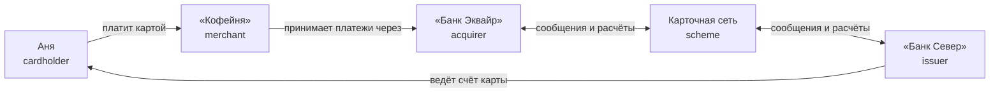
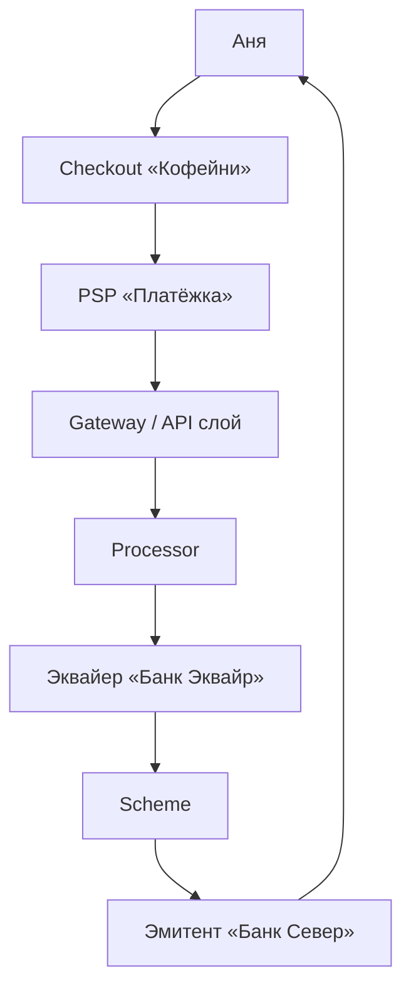
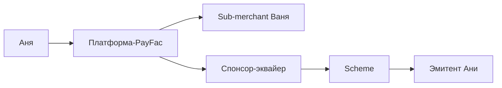
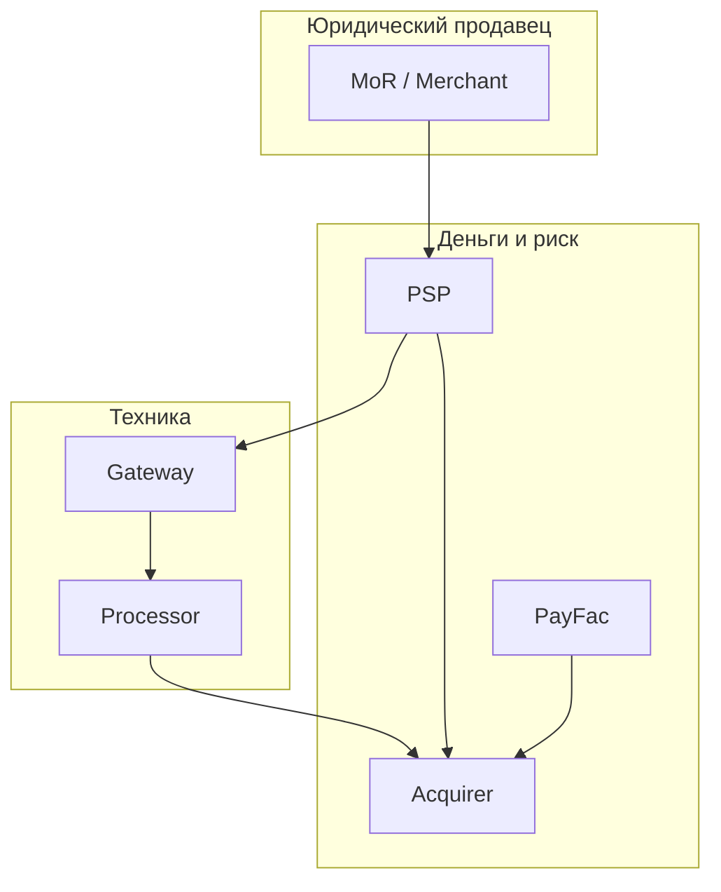
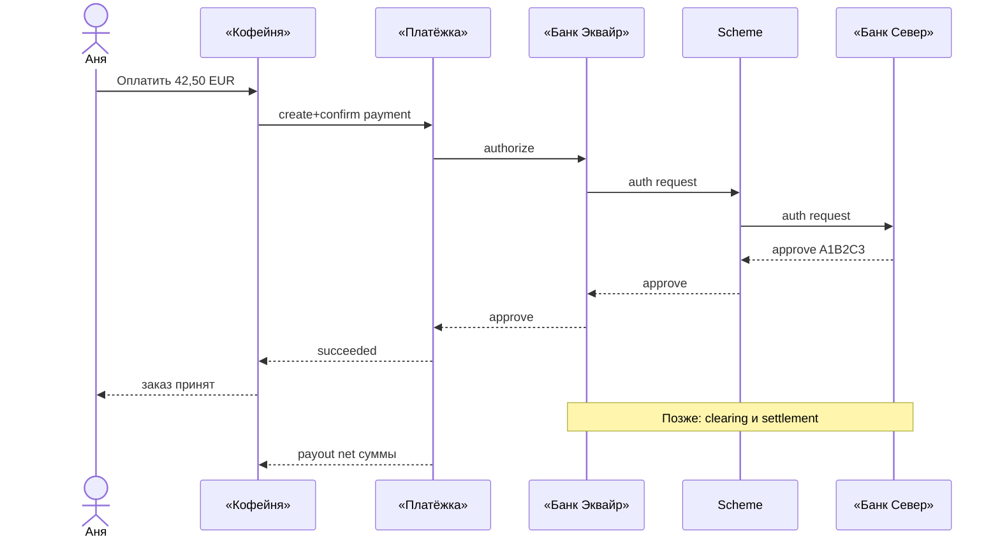

# Глава 02. Участники платёжной экосистемы

В [главе 01](01-industry-overview.md) мы нарисовали карту индустрии с высоты птичьего полёта: зачем платежи вообще существуют, как они эволюционировали и почему «вызвать API банка» — это почти никогда не вся история. Теперь спустимся на уровень персонажей. Потому что платёж — это не функция и не endpoint. Это договорённость между несколькими организациями, у каждой из которых свой счёт, свой риск, свой регулятор и свой интерес в комиссии.

Представьте: Аня открывает сайт «Кофейни», кладёт в корзину килограмм эфиопской арабики за 42,50 EUR и жмёт «Оплатить». На экране проходит пара секунд, появляется зелёная галочка — и кажется, что деньги «просто ушли». На самом деле в эти секунды (и в следующие дни) в игру входят держатель карты, продавец, эмитент, эквайер, карточная сеть, процессор, шлюз, а часто ещё PSP, PayFac или Merchant of Record. Кто-то говорит «да» или «нет» авторизации — запросу разрешения на оплату у эмитента ([глава 06](06-payment-lifecycle.md)). Кто-то двигает деньги. Кто-то хранит PAN (Primary Account Number, номер карты; [глава 03](03-bank-card-anatomy.md)). Кто-то отвечает перед Аней, если кофе не приедет. Кто-то отвечает перед «Банком Север», если платёж окажется мошенническим.

Путаница в ролях — одна из самых дорогих ошибок в платёжных проектах. Команда проектирует интеграцию «с банком», а на деле общается с gateway — платёжным шлюзом, который передаёт данные в банковскую инфраструктуру. Думают, что PSP — это эквайер, а потом удивляются, почему settlement — расчёты по проведённым операциям — приходит не туда ([глава 06](06-payment-lifecycle.md)). Путают PayFac и marketplace и получают регуляторный сюрприз. Эта глава разводит участников по полочкам: кто они, зачем появились, что делают в жизни платежа Ани, кто несёт риск, кто получает деньги и кто «владеет» клиентом.

В этой главе:

- четырёхсторонняя модель и почему в реальности сторон больше;
- cardholder, merchant, issuer, acquirer, scheme — базовая пятёрка;
- processor, gateway, PSP, PayFac, MoR — «прослойки», которые путают чаще всего;
- marketplace и платёжная инфраструктура вокруг;
- большая сравнительная таблица ролей и типовые стеки компаний;
- сквозной платёж Ани через «Платёжку» с таймлайном и диаграммами.

---

## Зачем вообще считать участников

Если бы Аня платила наличными в офлайн-кофейне, участников двое: она и кассир. Карта усложнила картину намеренно. Банк Ани не хочет доверять каждому магазину на планете доступ к её счёту. Магазин не хочет держать договор с каждым банком мира. Между ними появилась инфраструктура доверия: банки, сети, процессоры, лицензированные посредники.

Онлайн добавил ещё один слой сложности. Нет пластика в ридере, нет чипа, нет PIN (секретного кода держателя) на месте. Есть браузер, токены — заменители номера карты для оплаты ([глава 05](05-card-contexts-and-tokens.md)), 3-D Secure — проверка держателя банком ([глава 08](08-3ds-and-sca.md)), webhooks — уведомления сервера о событиях оплаты — и асинхронные статусы ([глава 07](07-states-async-idempotency.md)). Роли, которые в терминале были почти невидимы (gateway, PSP), в e-commerce выходят на первый план — именно с ними работает инженер мерчанта.

Поэтому глава начинается не с «списка терминов», а с модели: кто с кем связан юридически, кто с кем — технически, и где между этими связями щели, в которые проваливаются деньги и ответственность.

---

## Четырёхсторонняя модель (и почему сторон больше четырёх)

Классическая схема карточных платежей называется четырёхсторонней (four-party model). Четыре угла:

1. **Держатель карты (cardholder)** — Аня.
2. **Продавец (merchant)** — «Кофейня».
3. **Эмитент (issuer)** — «Банк Север», который выпустил карту Ани.
4. **Эквайер (acquirer)** — «Банк Эквайр», который принимает платежи для «Кофейни».

Между эмитентом и эквайером стоит **карточная сеть / платёжная система (card network, scheme)** — Visa, Mastercard и аналоги. Сеть не всегда считают «пятой стороной» в названии модели: формально модель «четырёхсторонняя», а сеть — рельсы и правила. Но без сети четырёхсторонка не работает: эмитент и эквайер разных банков не обязаны знать друг друга лично.



Словами: Аня связана договором с «Банком Север». «Кофейня» связана договором с «Банком Эквайр» (или с тем, кто стоит перед ним). Сеть связывает банки правилами, сообщениями авторизации и клирингом — обменом данными, по которым рассчитывают обязательства банков ([глава 06](06-payment-lifecycle.md)). Деньги в итоге идут по цепочке расчётов между банками, а не «из приложения Ани сразу на расчётный счёт магазина» — подробнее путь денег разберём в [главе 12](12-flow-of-funds.md).

### Открытые и закрытые схемы

Четырёхсторонняя модель — это **открытая схема (open-loop)**: эмитент и эквайер могут быть разными организациями, а сеть — общим стандартом. Visa и Mastercard устроены так.

Есть и **закрытые схемы (closed-loop)**: один и тот же игрок и выпускает «карты» (или счета), и принимает платежи у мерчантов. Классический пример духа closed-loop — старые подарочные карты магазинов или некоторые кошельки, где «эквайер» и «эмитент» — одна экосистема. American Express исторически ближе к трёхсторонней модели (сеть + эмитент + эквайер в одной группе сильнее, чем у открытых схем), хотя на практике картина нюансирована и зависит от продукта и региона. Детали схем — в [главе 04](04-card-networks.md).

### Почему в e-commerce «сторон» становится семь–десять

На диаграмме выше нет PSP «Платёжка», нет payment gateway, нет процессора, нет Apple Pay, нет marketplace. В реальном чекауте «Кофейни» типичная цепочка выглядит иначе:



Юридически Аня всё ещё платит «Кофейне» (или Merchant of Record — об этом ниже). Технически её браузер говорит с фронтом магазина и SDK/hosted page «Платёжки» — её встроенной формой или отдельной страницей оплаты. «Платёжка» говорит с процессором или сразу с эквайером. Эквайер говорит со схемой. Схема — с эмитентом.

Инженер мерчанта чаще всего видит **одного** контрагента в API — PSP. Но в инциденте «деньги списали, заказ не создался» важно понимать, *на каком хопе* что сломалось. Отсюда и эта глава: роли как слои ответственности, а не как словарные статьи.

---

## Держатель карты — cardholder

**Держатель карты (cardholder)** — человек или организация, которой эмитент выпустил платёжный инструмент. В нашей истории это Аня: у неё дебетовая карта (покупки оплачиваются средствами на её счёте, а не отдельным кредитным лимитом; [глава 03](03-bank-card-anatomy.md)) «Банка Север», номинал в EUR, лимиты на онлайн-покупки, возможность 3DS-подтверждения в приложении банка.

### Зачем эта роль выделена отдельно

Кажется очевидным: «ну покупатель же». Но в платежах покупатель ≠ cardholder всегда. Платит мама картой сына. Платит сотрудник корпоративной картой. Платит Аня, а товар получает коллега. Для fraud (мошенничества; [глава 16](16-fraud.md)) и chargeback (оспаривания операции через банк; [глава 17](17-chargebacks-and-disputes.md)) это критично: спор «я не совершал эту покупку» — это спор *держателя карты* с *эмитентом*, который потом прилетает мерчанту.

Cardholder — сторона, чьи деньги (или кредитный лимит) ставятся под риск в момент авторизации. Именно его банк говорит «approve» (одобрено) или «decline» (отказано). Именно он видит списание в выписке со statement descriptor — названием продавца в выписке — вроде `COFFEE*ORDER 1042`. Именно он инициирует chargeback, если считает операцию ошибочной или мошеннической ([глава 17](17-chargebacks-and-disputes.md)).

### Что cardholder «делает» в системе

С точки зрения инженерии cardholder редко бывает сущностью с богатой моделью на стороне мерчанта. Чаще есть `Customer` в CRM магазина и отдельно платёжные credentials — реквизиты или заменяющий их токен карты. Но поведение держателя карты определяет продуктовые требования:

- он может бросить checkout на 3DS;
- он может нажать «оплатить» дважды;
- он может оспорить платёж через 30–120 дней (сроки зависят от схемы и reason code — кода причины спора; [глава 17](17-chargebacks-and-disputes.md));
- он читает выписку и звонит в банк, если видит непонятное имя мерчанта.

### Кто владеет отношением

Отношение «Аня ↔ „Банк Север“» принадлежит эмитенту: договор карточного счёта, приложение, SMS, dispute process. Отношение «Аня ↔ „Кофейня“» принадлежит мерчанту: заказ, доставка, поддержка. PSP обычно **не** владеет отношением с Аней как с покупателем кофе — если только PSP не выступает Merchant of Record (тогда юридически продавец — он).

---

## Продавец — merchant

**Продавец / мерчант (merchant)** — организация (или ИП/самозанятый в локальных конструкциях), которая принимает оплату за товары или услуги. «Кофейня» продаёт зерно и подписку на свежую обжарку.

### Зачем мерчанту вся эта машина

Мерчант хочет одно: получить деньги предсказуемо и не сесть на fraud и штрафы схем. Сам по себе он не может «списать карту Ани» — у него нет доступа к эмитенту. Он подключается к эквайеру или к PSP и проходит onboarding: предоставляет документы и проверку бизнеса (KYB, Know Your Business; [глава 18](18-regulation-and-compliance.md)). Эквайер назначает MCC (Merchant Category Code, код категории продавца) и открывает merchant account — аккаунт для приёма платежей — с MID (Merchant ID, идентификатором продавца у эквайера). После этого можно принимать платежи.

MCC — четырёхзначный код категории бизнеса, который влияет на interchange — комиссию в пользу эмитента ([глава 15](15-fees-and-economics.md)), риск и правила схем. Для «Кофейни» это что-то вроде grocery/food retail (конкретный код зависит от классификации эквайера). Подробнее про MCC — в [главе 03](03-bank-card-anatomy.md).

### Что мерчант делает в платеже

1. Показывает checkout и собирает согласие на оплату.
2. Создаёт платёж у PSP/эквайера (часто через Payment Intent / Payment Order — объекты намерения оплатить заказ и платёжного поручения; см. [главу 20](20-platform-architecture.md)).
3. Получает результат: успех, отказ, «нужен 3DS», pending.
4. Отдаёт товар/услугу (или бронирует) согласно своей политике риска.
5. Получает payout (выплату) на расчётный счёт — не мгновенно после approve, а по циклу settlement/payout ([глава 12](12-flow-of-funds.md)).
6. Обрабатывает refunds (возвраты по инициативе продавца; [глава 06](06-payment-lifecycle.md)) и disputes (споры по оплате; [глава 17](17-chargebacks-and-disputes.md)).

### Кто несёт риск

Мерчант почти всегда несёт **коммерческий риск**: не тот товар, не та доставка, дружественный фрод («не помню эту покупку»). В card-not-present (интернет) при отсутствии liability shift — переноса ответственности за определённые мошеннические операции на эмитента после 3DS ([глава 08](08-3ds-and-sca.md)) — мерчант часто первым отвечает за fraud chargeback. Эквайер/PSP страхуются резервами и холдами — суммами, удержанными до выплаты, — задержкой payout и лимитами ([глава 12](12-flow-of-funds.md)) — но экономически давление всё равно передаётся мерчанту через комиссии и удержания.

### Деньги

Мерчант получает не «42,50 EUR целиком». Из суммы вычитаются комиссии, иногда резервы. Общую цену приёма карты называют MDR; в тарифе IC++ её компоненты показывают отдельно, а blended предлагает пакетную ставку. Подробный расчёт — в [главе 15](15-fees-and-economics.md). В выписке PSP Аня платит 42,50; «Кофейня» через два дня видит на балансе, условно, 42,50 минус 0,76 EUR комиссии (цифры иллюстративные).

---

## Эмитент — issuer

**Эмитент (issuer)** — банк или лицензированная организация, которая выпускает карту (или токенизированный инструмент) и ведёт счёт/кредитную линию держателя. У Ани это «Банк Север».

### Зачем эмитент нужен экосистеме

Эмитент — хранитель денег и доверия к карте. Он решает: хватит ли средств/лимита, не похоже ли на фрод, нужна ли SCA (Strong Customer Authentication, сильная аутентификация клиента с независимыми факторами; [глава 08](08-3ds-and-sca.md)), не в санкционном ли списке мерчант. Без эмитента авторизация — пустой звук: некому сказать «да, эту сумму можно обещать продавцу».

### Что делает эмитент шаг за шагом

Когда до «Банка Север» доходит auth-запрос (через схему):

1. Проверяет реквизиты карты, срок, статус (не заблокирована ли).
2. Проверяет баланс/лимит и валютные правила.
3. Гоняет антифрод и, при необходимости, запрашивает 3DS через ACS (Access Control Server, сервер проверки держателя у эмитента; [глава 08](08-3ds-and-sca.md)).
4. Отвечает кодом: approve (`00` в банковских сообщениях ISO 8583 — стандарта формата карточного обмена; [глава 22](22-integrations.md)) или decline (`05`, `51`, … — [глава 09](09-declines-and-response-codes.md)).
5. При approve ставит hold (холд) на сумму — деньги ещё не «ушли» окончательно, но недоступны Ане для других трат.
6. Позже, на clearing/settlement, списывает со счёта и участвует в расчётах со схемой.

### Деньги и комиссии

Эмитент зарабатывает в том числе на **interchange** — комиссии, которую в типичной открытой схеме платит сторона эквайера/мерчанта в пользу эмитента (упрощённо; детали и исключения — в [главе 15](15-fees-and-economics.md)). Зачем? Эмитент несёт кредитный риск, fraud risk, стоимость funding (финансирования расчётов) и обслуживания карты. Interchange — его «кусок пирога».

### Отношения

Эмитент владеет карточным отношением с Аней. Он же — входная точка chargeback: Аня звонит не в «Кофейню», а в «Банк Север» и говорит «это не я».

---

## Эквайер — acquirer

**Эквайер (acquirer)** — банк или лицензированное учреждение, которое привлекает мерчантов к приёму карт и обеспечивает им доступ к карточным сетям. В нашей книге это «Банк Эквайр».

### Зачем эквайер появился

Мерчанту нужен кто-то, кто:

- заключит договор приёма карт;
- выдаст MID (merchant ID) и настроит терминалы/интернет-эквайринг;
- будет отправлять авторизации в сети;
- будет получать clearing-файлы и переводить деньги мерчанту;
- будет разгребать chargeback'и со стороны банка.

Эквайер — «домашний банк продавца» в мире карт. Он спонсирует мерчанта перед схемой: по сути говорит Visa/Mastercard «этот магазин наш, мы за него отвечаем в рамках правил».

### Что делает эквайер

1. Onboarding и underwriting — подключение и оценка риска мерчанта (риск: не примет ли магазин платежи и не исчезнет ли с деньгами).
2. Технический приём транзакций (сам или через процессора).
3. Маршрутизация в схему по BIN (Bank Identification Number, префиксу номера карты, указывающему на эмитента/программу; [глава 03](03-bank-card-anatomy.md)), продукту, региону.
4. Settlement мерчанту (или PSP, если мерчант сидит за PSP).
5. Управление disputes, штрафами схем, PCI-обязательствами на своей стороне: PCI DSS — стандарт безопасности карточных данных ([глава 19](19-payment-security-pci.md)).

### Риск эквайера

Эквайер рискует деньгами и лицензией. Если «Кофейня» набрала chargeback'ов и обанкротилась, схема всё равно может требовать разборов — а эквайер уже выплатил мерчанту. Отсюда rolling reserve — удержание части оборота на время для будущих возвратов, delayed settlement — задержка расчётов ([глава 12](12-flow-of-funds.md)), жёсткий KYB. PSP и PayFac часто берут на себя часть этого underwriting, но «последний» банковский риск обычно ближе к эквайеру/спонсору.

### Эквайер ≠ «тот, кому мерчант стучится по HTTP»

Важная инженерная ловушка. В договоре может быть написано «эквайринг от Банка Эквайр», а API ключи выдаёт «Платёжка», а сообщения в схему шлёт процессор X. Для отладки auth timeout вам нужен правильный слой; для спора по settlement file — другой.

---

## Карточная сеть / схема — payment network / scheme

**Карточная сеть / платёжная система (card network, scheme)** — организация, задающая правила, бренды и рельсы обмена сообщениями и расчётов между эмитентами и эквайерами. Visa, Mastercard, национальные системы вроде Мир, и другие — подробный разбор в [главе 04](04-card-networks.md).

### Зачем сеть, если есть два банка

Потому что два банка без общего языка и суда не доверяют друг другу. Сеть даёт:

- единый формат авторизаций и клиринга;
- правила liability (кто виноват при фроде);
- бренд, которому доверяет Аня на дверце магазина;
- взаимозачёт обязательств между тысячами банков (net settlement);
- сертификации, fee schedules, dispute frameworks.

Сеть **обычно не держит** депозитный счёт Ани и **обычно не является** магазином. Она продаёт участие в экосистеме и инфраструктуру доверия. (Исключения и гибриды — снова к closed-loop и к моделям вроде Amex.)

### Где сеть в таймлайне платежа Ани

На авторизации — миллисекунды: эквайер ↔ scheme ↔ issuer. На клиринге — пакеты операций. На settlement — деньги между банками-участниками. На chargeback — process по rules схемы. Инженер мерчанта сеть «в лицо» почти не видит — если только не строит эквайеринг или процессор.

Схема — отдельный участник со своими сборами (scheme fee) и правом менять правила, от которых внезапно ломается conversion. Путать scheme с процессором или с PSP — системная ошибка онбординга команд.

---

## Процессор — processor

**Процессор (payment processor)** — технологическая и операционная прослойка, которая обрабатывает транзакции от имени эквайера (иногда и эмитента: issuer processor). Процессор умеет ISO 8583, соединение со схемами, суточные clearing-файлы, стоящие рядом antifraud-коннекторы, переключение каналов.

### Зачем процессор, если есть эквайер

Банк-эквайер хочет быть банком: лицензия, баланс, риск, капитал. Тащить у себя 24/7 низколатентный auth-switch на все схемы — дорого. Процессоры выросли как фабрики обработки: много эквайеров и мерчантов на одной платформе.

Граница размыта: крупный эквайер может процессить сам; процессор может иметь банковские партнёрства и выглядеть как «эквайринг под ключ». Для мерчанта в договоре часто написано одно брендовое имя, за которым — связка processor + acquiring bank.

### Issuer processor vs acquirer processor

- **Acquirer processor** — обрабатывает входящие платежи мерчантов, говорит со схемами на стороне приёма.
- **Issuer processor** — авторизует операции по картам банка: core для «Банка Север», когда Аня платит где угодно.

Один вендор может делать оба бизнеса — но это разные продукты и разные риски.

### Что именно «процессит» процессор

На стороне эквайера процессор обычно:

- принимает сообщение от gateway/PSP в своём API или внутреннем протоколе;
- нормализует его в формат схемы (часто мир ISO 8583 или спецификации сети — [глава 22](22-integrations.md));
- выбирает маршрут: какая схема, какой канал, какой backup;
- контролирует таймауты и standalone retries на своём участке (осторожно с идемпотентностью!);
- пишет транзакцию в свой journal для последующего clearing;
- отдаёт response code обратно вверх по стеку.

На клиринге процессор собирает batch'и, сверяет их со схемой, готовит данные для settlement accounting эквайера. Если вы строите PSP, «коннектор к процессору» — один из самых дорогих модулей: не из-за HTTP, а из-за краевых случаев void/reversal, partial capture и расхождений конца дня.

### Что может пойти не так

Процессор — частая точка технического decline: таймаут до схемы, дубли STAN/RRN — номеров для трассировки и поиска сетевых сообщений — при ретраях ([глава 28](28-glossary.md)), «файл клиринга не сошёлся». Мерчант видит это как `processor_error` у PSP. Без понимания слоя команда чинит не тот контур.

Ещё одна классика: процессор ответил timeout, а эмитент на самом деле успел approve. Вверх ушёл «неизвестно», Аню могли списать по hold, заказ не создался. Разбор такого инцидента без карты участников превращается в переписку «это вы» / «это они» между четырьмя саппортами. Паттерны идемпотентности и inquiry — в [главах 07](07-states-async-idempotency.md) и [21](21-distributed-systems-and-money.md).

---

## Шлюз — payment gateway

**Платёжный шлюз (payment gateway)** — программный интерфейс приёма платёжных данных и маршрутизации их в процессор/эквайер. Исторически gateway — это «безопасная труба»: принять карту с сайта, пропустить через PCI-контур, отдать дальше.

### Зачем gateway появился

В нулевых и десятых мерчанту нужно было:

- не хранить PAN у себя (или хранить меньше);
- говорить по HTTP/JS с браузером, а дальше — по банковским протоколам;
- иметь единый API на несколько банков.

Gateway решил задачу «последней мили» от интернет-магазина до банковского мира.

### Чем gateway не является

Gateway **сам по себе** часто не держит деньги мерчанта, не делает underwriting и не является банком. Это software + PCI scope — область систем, к которым применяются требования PCI DSS. Деньги и риск — у эквайера/PSP. На практике маркетинг размыл слово: многие PSP называют gateway весь продукт. Инженеру полезно спрашивать: «А settlement кто делает? А договор эквайринга с кем?»

### Типичные функции gateway

- Hosted payment page / fields / tokenization — отдельная страница или встроенные поля провайдера, где реквизиты заменяются токеном.
- Routing на одного или нескольких процессоров.
- 3DS Server — компонент, запускающий проверку держателя по 3-D Secure, — или коннектор к нему ([глава 08](08-3ds-and-sca.md)).
- Webhooks мерчанту о статусе.
- Базовый fraud scoring — оценка риска мошенничества (иногда; [глава 16](16-fraud.md)).

«Кофейня» может интегрировать «сырой» gateway эквайера. Но чаще она берёт PSP, внутри которого gateway — один из модулей.

### Gateway в архитектуре фронта

С точки зрения фронтенда «Кофейни» gateway проявляется так:

- iframe или JS SDK собирает PAN так, чтобы номер не касался серверов магазина;
- mobile SDK делает то же для приложения;
- redirect на hosted page — самый простой и самый «ломкий» для UX путь;
- server-to-server с уже токенизированными credentials — когда карта уже on file — сохранена для последующих оплат с согласия клиента ([глава 05](05-card-contexts-and-tokens.md)).

Выбор влияет на PCI SAQ тип (Self-Assessment Questionnaire, форму самооценки соблюдения требований PCI DSS), на conversion и на то, сколько состояния платежа живёт у мерчанта vs у провайдера ([глава 19](19-payment-security-pci.md), [глава 07](07-states-async-idempotency.md)). Gateway здесь — граница доверия: «где кончается наш PCI scope».

---

## PSP — Payment Service Provider

**PSP (Payment Service Provider)** — провайдер, который упаковывает для мерчанта приём платежей «как сервис»: API, onboarding, методы оплаты, reporting, payout, часто fraud и 3DS. В книге — вымышленная **«Платёжка»**.

### Какую проблему решает PSP

«Кофейне» не нужен прямой договор с «Банком Эквайр», сертификация ISO 8583 и отдельный коннектор под iDEAL, Blik и карты. Ей нужно: ключ API, документация, sandbox, вывод денег раз в N дней, кабинет с возвратами.

PSP агрегирует:

- эквайеринг (свой или партнёрский);
- gateway;
- иногда лицензию PI/EMI (Payment Institution / Electronic Money Institution: платёжного учреждения / организации электронных денег; [глава 18](18-regulation-and-compliance.md));
- оркестрацию APM (alternative payment methods, методов помимо обычного карточного ввода; [глава 11](11-wallets-bnpl-local-methods.md));
- операционку: support, reconciliation files, dashboards.

### Кто такой PSP юридически

Зависит от юрисдикции и модели:

- агент/технический посредник при эквайере;
- платёжное учреждение с лицензией;
- EMI с защитой client funds;
- смесь: карты через bank partner, методы вроде open banking — сам.

Публичные ориентиры по модели продукта (не «внутренняя кухня»): Stripe, Adyen и похожие игроки показывают, насколько широкий бывает спектр — от «чистого» tech до полного financial stack. Мы не разбираем их внутреннее устройство; важно понять класс сервиса.

### Риск и деньги

PSP часто держит **merchant balance**: логический остаток «Кофейни» внутри платформы. Реальные деньги лежат на safeguarded/settlement-счетах — счетах для защищённого хранения клиентских средств и для расчётов — по правилам лицензии. PSP решает, когда делать payout, сколько резервировать, кого выключить за fraud. Для инженера «Кофейни» PSP — и API, и касса, и иногда «банк» в бытовом смысле (хотя банком он может не быть).

### Отношения с клиентом

Обычный PSP **не** становится продавцом кофе. На выписке Ани может светиться `PLATEZHKA*COFFEE` или дескриптор «Кофейни» — зависит от настроек и модели. Клиентская поддержка по заказу — у «Кофейни»; по списанию карты — у эмитента; по статусу платежа в API — у «Платёжки».

### Что PSP делает для инженера «Кофейни» день за днём

Практически интеграция выглядит так:

1. Регистрация мерчанта, KYB, подписание оферты, получение `merchant_id` и ключей.
2. Выбор режима: payment page (redirect), embedded fields, server-to-server с токенами.
3. Создание платежа, обработка `requires_action` (3DS), идемпотентные подтверждения.
4. Подписка на webhooks: success, fail, refund, chargeback, payout paid.
5. Сверка: API list + settlement report + банк «Кофейни».
6. Операции: refund, void (если ещё не capture), запрос доказательств (evidence) для спора (dispute).

PSP прячет схему и процессор — и в этом его ценность. Цена абстракции: когда что-то ломается «ниже», без хороших reference id и account manager вы слепы. Поэтому на этапе выбора провайдера смотрите не только на SDK, но и на качество сырых отчётов и поддержку RRN и ARN (Acquirer Reference Number, ссылки эквайера для поиска операции после клиринга; [глава 28](28-glossary.md)).

### Агрегация vs dedicated MID

Упрощённо бывают два полюса:

- **Агрегированный приём** — много мерчантов под зонтиком платформы (близко к PayFac-логике).
- **Выделенный merchant account** — у «Кофейни» свой MID у эквайера, PSP лишь tech/оператор.

От полюса зависят дескриптор в выписке, скорость onboarding, гибкость pricing (blended vs IC++) и то, насколько эквайер «видит» бизнес «Кофейни» отдельно. Инженеру это важно для настройки fraud rules и для переговоров о лимитах.

---

## PayFac — Payment Facilitator

**PayFac (Payment Facilitator)** — модель, в которой платформа принимает платежи от имени множества мелких субмерчантов под своим «зонтиком» у эквайера/схемы. PayFac — мастер-мерчант (или близкая конструкция), а парикмахерская / ремесленник / маленький продавец на платформе — sub-merchant.

### Зачем PayFac

Классический эквайринг плохо масштабируется на тысячи микробизнесов: каждый MID, каждый underwriting, долго. PayFac говорит эквайеру: «я проведу KYB субмерчантов, я мониторю риск, я отвечаю в рамках правил схем». Эквайер спонсирует одного крупного игрока вместо десяти тысяч крошечных.

Типичные миры PayFac: SaaS для ресторанов, платформы записи к врачам, некоторые e-commerce конструкторы — где приём платежей встроен в продукт.

### Чем PayFac отличается от «просто PSP»

PSP может работать по модели «каждый мерчант — свой merchant account» (или близко к этому) и не быть PayFac. PayFac — **конкретная схема онбординга и ответственности** в карточных правилах: субмерчанты, onboarding requirements схем, лимиты на объёмы, обязательства по мониторингу.

На практике маркетинг снова всё смешал. Правильный вопрос: «Мы registered Payment Facilitator в схеме X, или мы технический интегратор к эквайеру, или мы marketplace с split payments?»

### Риск

PayFac несёт усиленный риск: субмерчант-мошенник горит на его репутации и деньгах. Поэтому жёсткий KYB, лимиты, задержки выплат, автоматическое глушение. Для инженера PayFac-платформы onboarding и risk — не «админка ради галочки», а ядро продукта.

### Как выглядит поток для субмерчанта

Допустим, «Кофейня» внезапно стала SaaS-платформой для мини-обжарщиков. Каждый обжарщик — sub-merchant. Аня платит обжарщику Ване через витрину платформы.



Платформа проводит KYB Вани, назначает ему внутренний `sub_merchant_id`, показывает его имя в дескрипторе (насколько позволяет схема), режет комиссию платформы и выплачивает Ване net. Эквайер и схема в первую очередь смотрят на PayFac как на ответственного участника: превысил chargeback ratio по портфелю — санкции на весь зонтик.

Правила схем для Payment Facilitators детальны и меняются; на момент написания книги (2026) имеет смысл читать актуальные программы схем и требования спонсора, а не копировать блог 2018 года. Здесь — принцип: PayFac = ответственность за портфель субмерчантов.

---

## Merchant of Record — MoR

**Merchant of Record (MoR)** — юридическое лицо, которое является продавцом в транзакции для платёжной системы, налогового и потребительского контура. Именно MoR фигурирует как merchant of record в эквайринге: он принимает деньги покупателя и несёт связанные обязательства.

### Зачем нужна эта роль

«Кофейня» может продавать сама (тогда она MoR). А может работать через партнёра, который формально продаёт цифровой товар покупателю по всему миру, а «Кофейне» потом перечисляет net revenue. Зачем? Налоги, локальный эквайринг, PCI, consumer law, лицензии в сложных юрисдикциях. MoR-провайдеры часто встречаются в software / gaming / digital goods.

### Кто владеет клиентом

В модели MoR юридический продавец — MoR. Это меняет:

- кто отвечает за refund по закону о защите прав потребителей (зависит от региона — нужна юридическая оценка);
- чей дескриптор в выписке;
- кто фигурирует в chargeback;
- как строится бухгалтерия «Кофейни» (часто это не «выручка от Ани», а агентское/партнёрское вознаграждение — опять же, к юристам и бухгалтерам).

### MoR vs PSP vs PayFac

- PSP обрабатывает платёж для мерчанта-MoR.
- PayFac помогает субмерчантам принимать платежи, но субмерчант часто остаётся продавцом услуги (детали зависят от договора и схемы).
- MoR **сам** продавец. Это не «трубы», это смена стороны договора купли-продажи.

Путаница MoR и PSP в продуктах — источник сюрпризов в бухгалтерии и в support: Аня пишет в «Кофейню», а chargeback идёт на юрлицо MoR в другой стране.

### Когда «Кофейне» вообще думают про MoR

Типичные триггеры:

- продажи digital goods в десятки стран с разным VAT (налогом на добавленную стоимость) / sales tax (налогом с продаж);
- нет желания расширять PCI и эквайринг-договоры;
- нужны локальные методы «под ключ», а команда из пяти человек;
- маркетплейс хочет упростить жизнь селлерам, став единственным продавцом для покупателя (осторожно с регуляторикой).

Цена: меньше контроля над checkout UX, зависимость от политики MoR, другой P&L (profit and loss, отчёт о прибылях и убытках). Инженерная интеграция часто проще карточного эквайринга — зато accounting и support сложнее объяснить внутри компании.

---

## Marketplace и платёжная инфраструктура

**Marketplace** — площадка, где покупатель платит за товары/услуги множества продавцов. Пример духа: «Аня покупает кофе у обжарщика А и кружку у продавца Б на одной витрине». Деньги нужно **разделить (split)**: комиссия площадки, выплата селлерам, иногда эскроу — условное удержание средств до выполнения условий, например доставки. Его отличие от обычного платёжного баланса разберём в [главе 26](26-marketplace-and-split-payments.md).

Marketplace — не то же самое, что PayFac, хотя технологии пересекаются. Marketplace может:

- быть MoR и платить селлерам как поставщикам;
- использовать connected accounts — отдельные аккаунты продавцов в платёжной платформе — / split payments — распределение суммы одной оплаты между ними — у PSP;
- строить собственный PayFac;
- уйти в модель, где селлеры — полноценные мерчанты.

Регуляторно граница скользкая: в какой момент площадка начинает «хранить деньги чужих лиц» и ей нужна платёжная лицензия. Это тема [главы 26](26-marketplace-and-split-payments.md) и [главы 18](18-regulation-and-compliance.md) — здесь достаточно запомнить: marketplace — бизнес-роль плюс платёжный паттерн, а не синоним PSP.

### Платёжная инфраструктура вокруг

Кроме «звёздных» ролей есть вспомогательные участники, без которого прод не живёт:

- **BIN sponsors / banking-as-a-service** — банк, на чьей лицензии выпускаются карты нео-банка.
- **Card manufacturer / personalization bureau** — физический пластик (нам почти не видно в e-commerce).
- **3DS Server, Directory Server, ACS** — аутентификация ([глава 08](08-3ds-and-sca.md)).
- **Fraud vendors** — поставщики антифрод-систем; device fingerprinting — сбор признаков устройства для оценки риска ([глава 16](16-fraud.md)).
- **Token requestors / network token services** — стороны, запрашивающие токен карты, и сервисы выпуска токенов карточной сети ([глава 05](05-card-contexts-and-tokens.md)).
- **Settlement banks, correspondent banks** — расчётные банки и банки, через счета которых другие банки проводят переводы ([главы 12](12-flow-of-funds.md) и [27](27-cross-border-payments.md)).
- **Регуляторы и карточные схемы как rule-makers**.

Инженер платёжной платформы проектирует не «интеграцию с одним API», а граф зависимостей: кто может отвалиться и какой fallback допустим.

---

## Договоры, идентификаторы и «кто кому подчиняется»

Роли оживают не на диаграмме, а в реквизитах и ID, которые летают в логах.

### Юридический граф для «Кофейни» + «Платёжки»

Типичный (упрощённый) набор договоров:

| Связь | Тип отношения | Что фиксирует |
|---|---|---|
| Аня ↔ «Банк Север» | Карточный договор | Счёт, лимиты, disputes |
| Аня ↔ «Кофейня» | Купля-продажа / оферта | Товар, доставка, возврат товара |
| «Кофейня» ↔ «Платёжка» | Договор эквайринга/платёжных услуг | Тарифы, payout, SLA, PCI |
| «Платёжка» ↔ «Банк Эквайр» | Спонсорство / acquiring | MID-пул, риск, settlement |
| «Банк Эквайр» ↔ Scheme | Членство / лицензия участника | Правила, fee, compliance |
| «Банк Север» ↔ Scheme | Членство эмитента | То же с другой стороны |

Пока граф не нарисован на одной доске, команда путает «мы не прошли PCI» с «нас схема оштрафовала через эквайера» — разные рёбра графа.

### Идентификаторы, которые привязаны к ролям

Полный словарь — в [главе 28](28-glossary.md), здесь — связь с участниками:

- **MID (Merchant ID)** — идентификатор мерчанта у эквайера/процессора. «Кофейня» может иметь несколько MID (по странам, каналам, MCC).
- **TID (Terminal ID)** — идентификатор терминала или виртуального терминала; в e-commerce часто логическая сущность.
- **Merchant account / account id у PSP** — то, что видит инженер в API «Платёжки»; внутри может мапиться на один или много MID.
- **BIN** — указывает на эмитента и продукт карты ([глава 03](03-bank-card-anatomy.md)).
- **RRN / ARN / auth code** — следы прохождения через acquirer/scheme; нужны саппорту и chargeback.
- **Sub-merchant id** — в PayFac/marketplace: кто из портфеля принял платёж.

Если в инциденте у вас есть только `pay_9f3c2a` без acquirer reference, вы уже потеряли час на «найдите, пожалуйста, транзакцию у себя».

### Кто «владеет» клиентом — три смысла слова

Люди говорят «наш клиент» и имеют в виду разное:

1. **Покупатель товара** — клиент мерчанта (или MoR).
2. **Держатель карты** — клиент эмитента.
3. **Мерчант как клиент платёжного сервиса** — клиент PSP/эквайера.

Fraud, analytics и CRM ломаются, когда эти три сущности склеивают в одну таблицу без типа связи. Аня-покупатель кофе и Аня-cardholder — обычно один человек, но юридически и по данным это разные отношения.

---

## Большое сравнение: gateway, processor, PSP, PayFac, MoR

Это самая частая каша в онбординге команд. Сведём в одну картину.

| Роль | Главная работа | Типично держит деньги мерчанта? | Underwriting мерчанта | Владеет отношением с покупателем как продавец? | С кем договор у интернет-магазина |
|---|---|---|---|---|---|
| Gateway | Приём данных, PCI-труба, маршрутизация | Обычно нет | Обычно нет | Нет | Часто косвенно, через PSP/эквайера |
| Processor | Auth/clearing со схемами | Иногда operationally | Частично / для эквайера | Нет | Редко напрямую |
| Эквайер | Доступ к схемам, settlement, риск | Да (settlement) | Да | Нет | Да, если прямой эквайринг |
| PSP | Продукт приёма платежей под ключ | Часто да (balance) | Да (свой или через банк) | Обычно нет | Да — самый частый случай |
| PayFac | Зонтик для субмерчантов | Да | Да, усиленно | Обычно нет (продавец — субмерчант) | Да, с платформой-PayFac |
| MoR | Юридический продавец | Да (как выручка) | N/A (сам продавец) | **Да** | Партнёрский договор, не «эквайринг» |

### Кто что делает в одном платеже

Возьмём 42,50 EUR Ани за кофе.

| Вопрос | Ответ в типичной модели «Кофейня» + «Платёжка» + «Банк Эквайр» + Visa + «Банк Север» |
|---|---|
| Кто показывает checkout? | «Кофейня» (+ hosted fields «Платёжки») |
| Кто токенизирует карту? | Gateway-слой «Платёжки» |
| Кто шлёт auth в схему? | Processor / эквайер за «Платёжкой» |
| Кто говорит approve? | «Банк Север» (issuer) |
| Кто несёт fraud chargeback без 3DS liability shift? | Часто «Кофейня» (через баланс у PSP) |
| Кто получает 42,50 на входе? | Поток расчётов: эмитент → схема → эквайер → PSP → payout мерчанту |
| Кто «продавец» для Ани? | «Кофейня» (если не MoR-партнёр) |
| Кто владеет API-отношением с инженером магазина? | «Платёжка» |

### Сдвиг ответственности



Словами: двигаясь слева направо и снизу вверх по «ценности», вы добавляете не фичи API, а обязательства. Gateway почти ничего не должен мерчанту по деньгам. PSP должен balance и payout. PayFac должен ещё и за субмерчантов. MoR должен за товар и за покупателя как продавец.

---

## Типовые «стеки» компаний

Реальные бренды комбинируют роли. Ниже — **типовые узоры**, без претензии на описание внутренней структуры конкретных фирм.

### Стек A: прямой эквайринг крупного ритейлера

«Кофейня» выросла в сеть. Юристы заключили договор с «Банком Эквайр». Технически стоит gateway банка или независимый gateway → процессор банка → схемы. PSP нет. Плюс: контроль, иногда цена. Минус: долгий onboarding, сами пишете оркестрацию методов, сами PCI-scope шире.

### Стек B: классический PSP для малого и среднего бизнеса (SME)

«Кофейня» интегрирует «Платёжку». За «Платёжкой» — один или несколько эквайеров и процессоров, возможно разные по странам. Мерчант видит один API. Это самый частый стек для инженера e-commerce.

### Стек C: оркестратор + несколько эквайеров

Крупный мерчант или сам PSP верхнего уровня: gateway/orchestrator маршрутизирует платежи на Adyen-подобный контур, локальный эквайринг в PL, отдельный процессор для Amex. Цель — conversion и стоимость. Цена сложности — reconciliation из нескольких источников ([глава 13](13-ledger-and-reconciliation.md)).

### Стек D: PayFac внутри SaaS

Продукт «сайт под ключ для кофеен» встраивает платежи. Каждая кофейня — sub-merchant. Платформа — PayFac (или использует PayFac-возможности крупного PSP). Риск и onboarding — продукт платформы.

### Стек E: marketplace split

Площадка принимает платёж, делит между селлерами и собой. Юридически может быть MoR, Collecting PSP (провайдером, который собирает деньги для дальнейшего распределения), или использовать connected accounts. Инженерная сложность — split ledger и payouts селлерам ([глава 26](26-marketplace-and-split-payments.md)).

### Стек F: MoR для digital

Студия продаёт приложение глобально через MoR-партнёра. Покупатель платит MoR; студия получает отчёты и net. Карточный стек «под капотом» MoR студию почти не волнует — пока не начнут сходиться цифры в accounting.

### Стек G: кошелёк / staged wallet

Аня пополняет кошелёк (внутри — bank transfer или карта), потом платит с баланса кошелька в «Кофейне». Появляются роли wallet issuer, иногда отдельный MoR. Карточная четырёхсторонка используется на funding — пополнении кошелька, а не обязательно на каждом «клике оплатить».

---

## Сквозной пример: Аня покупает кофе через «Платёжку»

Соберём роли в один платёж. Сумма: **42,50 EUR**. Заказ: `ORD-2026-0918-0042`. Карта Ани: BIN «Банка Север», схема Visa (иллюстративно). PSP: «Платёжка». Эквайер за PSP: «Банк Эквайр».

### Таймлайн

| Время | Что происходит | Кто главный |
|---|---|---|
| T+0.0 с | Аня жмёт «Оплатить», фронт «Кофейни» создаёт Payment Intent | Merchant → PSP |
| T+0.2 с | Hosted fields токенизируют PAN, мерчант получает `tok_…`, не PAN | Gateway (PSP) |
| T+0.4 с | «Кофейня» подтверждает оплату Intent'а | Merchant → PSP |
| T+0.5 с | «Платёжка» запускает 3DS2: тихая проверка (frictionless) или подтверждение покупателем (challenge) при необходимости | PSP ↔ issuer ACS |
| T+1.5 с | Auth уходит в процессор → «Банк Эквайр» → Visa → «Банк Север» | Acquirer/processor/scheme/issuer |
| T+1.8 с | Approve, auth code `A1B2C3`, hold 42,50 EUR на счёте Ани | Issuer |
| T+2.0 с | PSP отвечает sync success + позже webhook `payment.succeeded` | PSP → merchant |
| T+2.1 с | «Кофейня» создаёт заказ и показывает success page | Merchant |
| T+1 день | Clearing/settlement между банками по правилам схемы | Scheme, banks |
| T+2 дня | На merchant balance «Кофейни» появляется net сумма | PSP |
| T+3 дня | Payout 41,74 EUR (иллюстративно) на расчётный счёт «Кофейни» | PSP → merchant bank |

### Сообщения (иллюстративно)

Запрос мерчанта к PSP:

```json
{
  "amount": 4250,
  "currency": "EUR",
  "payment_method": "tok_1AnyaCoffee042",
  "merchant_order_id": "ORD-2026-0918-0042",
  "customer_id": "cus_anya_001",
  "statement_descriptor": "COFFEE*ORDER 1042",
  "capture_method": "automatic"
}
```

В JSON `amount: 4250` — 42,50 EUR в центах (минорных единицах валюты; [глава 14](14-currencies-and-fx.md)), `payment_method` — ссылка на токен карты, `capture_method: automatic` — запрос на автоматический capture, то есть перевод одобренной операции к списанию ([глава 06](06-payment-lifecycle.md)).

Ответ PSP (успех):

```json
{
  "id": "pay_9f3c2a",
  "status": "succeeded",
  "amount": 4250,
  "currency": "EUR",
  "authorization_code": "A1B2C3",
  "card": {
    "brand": "visa",
    "last4": "4242",
    "issuer_country": "DE"
  },
  "merchant_id": "mch_coffee_01"
}
```

Заметьте, чего нет в ответе: имени процессора, бинарного ISO 8583, settlement batch id. Это появится в отчётах и в операционке PSP — мерчанту для выдачи кофе достаточно `succeeded` и идемпотентности ([глава 07](07-states-async-idempotency.md)).

### Sequence diagram



### Где кто заработал (иллюстративно)

Цифры условные, чтобы увидеть *направление*, не тариф 2026 года:

- Аня: −42,50 EUR (hold → списание).
- Interchange эмитенту: порядка долей процента (в ЕЭЗ для многих consumer debit есть регуляторные потолки — см. [главу 15](15-fees-and-economics.md)).
- Scheme fee: мелкая фиксированная/процентная доля.
- Эквайер/процессор: своя доля.
- «Платёжка»: markup поверх или пакет IC++.
- «Кофейня»: остаток net.

Один клик Ани кормит всю цепочку. Поэтому споры «почему MDR 1,2%» нельзя объяснить без понимания участников.

### Тот же платёж, но сломался

Допустим, на T+1.6 с «Банк Север» отвечает `05` (do not honor) — иллюстративный decline. Кто что видит:

| Участник | Что знает |
|---|---|
| Аня | «Оплата не прошла» (если UX честный) |
| «Кофейня» | `pay_… status=failed`, decline code от PSP |
| «Платёжка» | mapping processor code → свой код, логи 3DS |
| «Банк Эквайр»/processor | ISO response от схемы |
| Scheme | транспорт |
| «Банк Север» | почему именно decline: fraud rule, lost card, … |

Мерчанту редко отдают истинную причину эмитента — только то, что схема/процессор разрешили. Отсюда важность Merchant Advice Codes — рекомендаций эмитента/схемы о допустимости и условиях повторной попытки — и аккуратных retry ([глава 09](09-declines-and-response-codes.md)): роль эмитента проявляется даже когда вы «интегрированы только с PSP».

Другой сценарий: auth успешен, webhook потерян. Аня видит списание в приложении банка (hold), «Кофейня» — нет заказа. Участники те же, но чинить нужно идемпотентный GET статуса и reconciliation, а не «ещё раз нажмите оплатить» (иначе будет второй auth). Роли подсказывают: источник истины по деньгам ближе к эмитенту/схеме; источник истины по заказу — у мерчанта; мост — PSP.

---

## Врезка: как это бывает в жизни

Команда «Кофейни» подключает новый рынок — Польша. Продакт говорит: «Нам нужен польский эквайер». Инженер слышит: «Новый API». Юрист слышит: «Новый договор и KYB». Бухгалтер слышит: «Новые файлы сверки». В «Платёжке» же это может быть просто новый routing rule на локальный acquiring внутри того же API-ключа — или отдельный legal entity мерчанта.

Пока участники внутри команды не разведут роли, в Jira будет тикет «интегрировать банк», который на самом деле «включить метод Blik» или «открыть MID в PL». Язык ролей экономит месяцы.

---

## Для любопытных: трёхсторонние и n-сторонние модели

Трёхсторонняя модель (three-party): сеть сама (или группа) эмитирует и эквайрит сильнее, покупатель и мерчант подключаются к одной экосистеме. N-party в open banking и APM ещё интереснее: банк Ани, банк «Кофейни», PISP (провайдер инициирования перевода), ASPSP (провайдер, обслуживающий счёт) — без карточной схемы вовсе ([глава 10](10-bank-based-methods.md)). Карточная четырёхсторонка — не единственная вселенная, но лучший «скелет», чтобы потом навешивать исключения.

---

## Что это значит для инженера

1. **Моделируйте контрагентов явно.** В доменной модели заведите не только `Merchant` и `Payment`, но и понимание `Provider`, `AcquirerAccount`, `SettlementSource`. Когда придёт второй эквайер, вы скажете спасибо.

2. **Не храните в голове «банк = API».** Логируйте provider reference, acquirer reference, scheme RRN/ARN где доступны — для саппорта и reconciliation ([глава 28](28-glossary.md) соберёт идентификаторы в одном месте).

3. **Разделяйте sync-ответ и деньги.** `succeeded` от PSP ≠ money on bank account. UI заказа можно закрывать на auth; финансовый учёт — на settlement/payout events.

4. **PCI scope зависит от того, с кем интегрируетесь.** Hosted fields / redirect снижают scope мерчанта; сырой PAN в своём POST — наоборот ([глава 19](19-payment-security-pci.md)).

5. **Онбординг — платёжная фича.** Смена роли (стали PayFac, добавили marketplace split) меняет KYB, лимиты, отчётность, а не только endpoints.

6. **Тестируйте отказы по слоям.** Issuer decline, acquirer timeout, PSP 500, webhook duplicate — разные runbooks ([главы 09](09-declines-and-response-codes.md) и [23](23-reliability.md)).

7. **Statement descriptor и support.** Аня звонит в банк с текстом из выписки. Если дескриптор «Платёжки» без имени «Кофейни», поддержка магазина утонет в «я не узнаю списание».

8. **Юридическую модель не угадывайте по API.** MoR vs agent vs PayFac решает counsel + лицензии, не OpenAPI-спека.

---

## Типичные ошибки и грабли

**«Мы интегрировались с эквайером» — а в договоре PSP.** Потом ждут settlement file формата банка и получают CSV кабинета PSP. Сверка плывёт неделями.

**Считать gateway кассой.** Выключили payout thinking «шлюз же работает» — платежи проходят, деньги мерчанту не едут. Разные подсистемы.

**PayFac vs marketplace в одном слайде инвестора.** Регулятор и схема читают не слайд, а кто удерживает средства и кто sub-merchant. Получите требования, к которым архитектура не готова.

**Продать MoR как „просто PSP с налогами“.** Меняется сторона договора с покупателем. Chargeback, refunds, VAT — другой контур. Без юристов не копировать.

**Игнорировать эмитента в UX.** «Отказ банка» для Ани должен звучать человечески; retry на hard decline эмитента вреден ([глава 09](09-declines-and-response-codes.md)).

**Один MID на всё.** Смешали high-risk SKU и кофе на одном мерчанте — риск-движок эквайера душит весь объём. Участники и MCC — это и про структуру аккаунтов.

**Думать, что схема „где-то там“.** Scheme rules меняют 3DS, surcharge, token requirements. PSP пришлёт migration notice за N недель — это тоже работа инженера.

**Склеить customer_id магазина и cardholder.** Потеряли карту / сменили держателя — fraud и dispute analysis идут по неверным сущностям.

**Не зафиксировать, кто Merchant of Record в тестовом и проде.** В sandbox все «как мерчант», в проде внезапно дескриптор и юрлицо партнёра — сыпятся письма «кто списал деньги».

**Считать, что Apple Pay заменяет эквайера.** Wallet — способ аутентификации/токена; деньги всё равно идут через acquiring stack ([глава 11](11-wallets-bnpl-local-methods.md)).

---

## Итоги главы

1. Карточный мир опирается на четырёхстороннюю модель: cardholder, merchant, issuer, acquirer — плюс scheme как рельсы и правила.
2. В e-commerce поверх базы лежат gateway, processor, PSP, иногда PayFac, MoR и marketplace-сплиты; инженер мерчанта чаще всего видит PSP.
3. Роли различаются по четырём осям: техника, деньги, риск, юридическое отношение с покупателем.
4. Gateway — труба; processor — завод сообщений со схемами; эквайер — банковский доступ и settlement; PSP — продукт; PayFac — зонтик субмерчантов; MoR — продавец записи.
5. Marketplace — бизнес-модель разделения денег и ответственности, а не синоним PSP или PayFac.
6. Один платёж Ани на 42,50 EUR проходит через всю цепочку; commission пирог кормит каждого участника по дороге.
7. Путаница ролей бьёт по архитектуре данных, сверке, PCI, support и лицензиям.
8. Типовые стеки компаний — комбинации ролей; читайте договоры и money flow, не только маркетинговые названия.
9. Дальше логично разобрать сам инструмент — карту: номер, BIN, CVV, MCC и то, что можно и нельзя хранить.

Следующая глава — [Глава 03. Банковская карта: анатомия](03-bank-card-anatomy.md): из чего состоит карта Ани и почему PSP старается никогда не увидеть полный PAN.

---

## Связанные главы

- [Глава 01. Как устроена индустрия онлайн-платежей](01-industry-overview.md) — зачем индустрия и как читать книгу.
- [Глава 03. Банковская карта: анатомия](03-bank-card-anatomy.md) — PAN, BIN, CVV, MCC.
- [Глава 04. Карточные сети и схемы](04-card-networks.md) — Visa, Mastercard и правила схем.
- [Глава 06. Жизненный цикл карточного платежа](06-payment-lifecycle.md) — auth, capture, clearing, settlement.
- [Глава 12. Что происходит с деньгами](12-flow-of-funds.md) — settlement, balance, payout.
- [Глава 15. Комиссии и экономика платежей](15-fees-and-economics.md) — interchange, scheme fee, MDR.
- [Глава 18. Регуляторика и compliance](18-regulation-and-compliance.md) — лицензии PI/EMI, KYB.
- [Глава 26. Marketplace и split payments](26-marketplace-and-split-payments.md) — сплиты и селлеры.
- [Глава 28. Глоссарий и идентификаторы](28-glossary.md) — роли и ID в одном месте.
