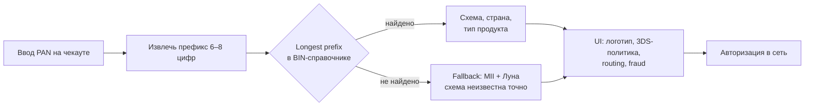
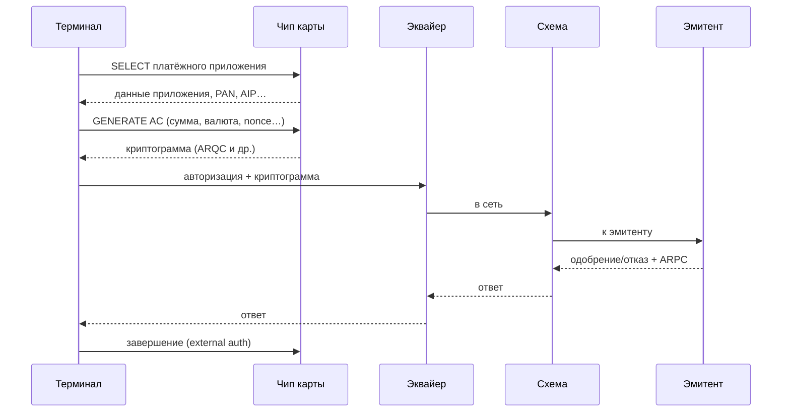
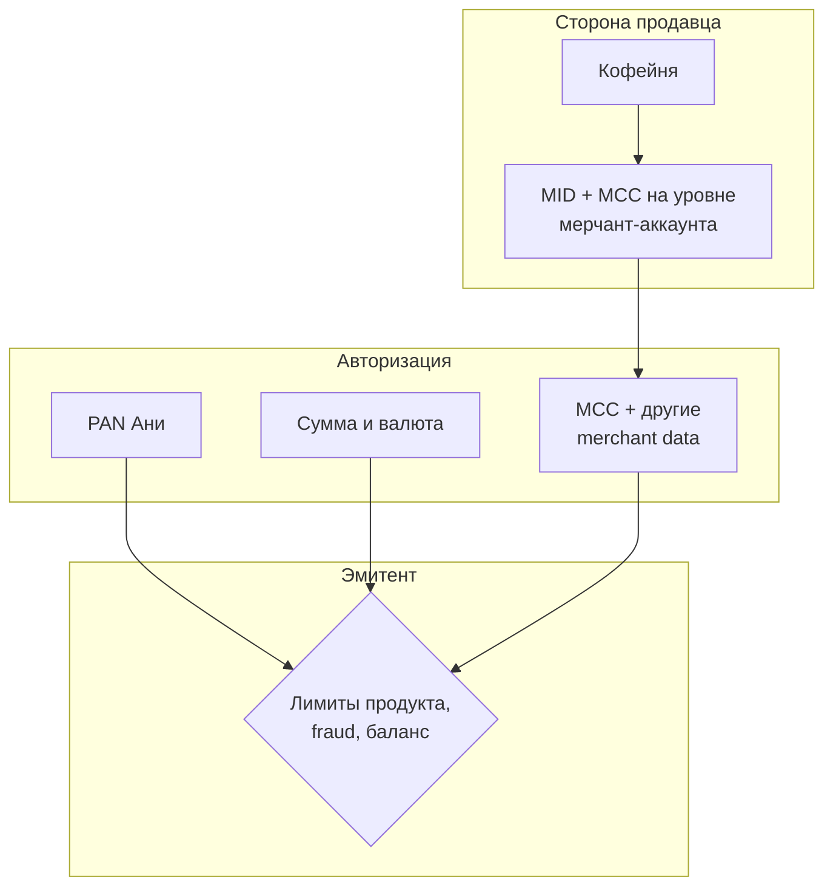

# Глава 03. Банковская карта: анатомия

До сих пор мы смотрели на платёжную индустрию сверху: кто в ней играет и зачем она вообще существует. Теперь спустимся к тому предмету, вокруг которого крутится львиная доля онлайн-платежей, — к банковской карте. Не к «пластику в кармане» как к фетишу, а к данным, которые карта несёт, и к правилам, по которым эти данные читают терминалы, браузеры, PSP и банки.

Если вы когда-нибудь вводили номер карты на чекауте и думали: «ну, просто длинное число плюс срок и три цифры сзади», — эта глава объяснит, почему за этим «просто» прячется целая маршрутизационная система, слой мошеннических проверок и жёсткие правила хранения. Номер карты — это не пароль и не счёт в привычном смысле. Это адрес, по которому платёжная сеть находит банк-эмитент, плюс идентификатор конкретного продукта и конкретного счёта внутри этого банка. От того, как вы обращаетесь с этими полями в коде, зависит и конверсия, и PCI-скоуп (область систем, к которым применяются требования безопасности карточных данных PCI DSS; [глава 19](19-payment-security-pci.md)), и то, попадёте ли вы в ночной разбор инцидента с украденными данными.

Сквозной герой главы — карта Ани из «Банка Север». Аня покупает килограмм эфиопского зерна в интернет-магазине «Кофейня» через PSP «Платёжка». Мы разберём, что написано на её карте, что из этого видит «Кофейня», что уходит в эквайер «Банк Эквайр», и почему CVV — код безопасности карты — исчезает из системы раньше, чем кофе окажется в кофемолке.

В этой главе мы почти не говорим о «пути денег» и про авторизацию как сетевой обмен — этим займутся [глава 06](06-payment-lifecycle.md) и дальше. Здесь — анатомия: что такое карта как объект данных и как физический носитель.

## В этой главе

- Что такое карта логически и физически, и чем PAN отличается от «номера счёта в банке»
- Структура PAN, BIN/IIN, check digit и алгоритм Луна
- Срок действия и CVV/CVC: зачем они нужны и почему CVV нельзя хранить
- Магнитная полоса, чип EMV и бесконтакт — что читают терминалы
- Credit, debit, prepaid: разница для инженера, а не для маркетинга
- MCC: как категория продавца влияет на маршрут, комиссии и риск
- Кто что видит в номере карты на каждом шаге цепочки

---

## Карта — это не пластик, а набор данных с маршрутом

Когда Аня достаёт карту из кошелька, она видит прямоугольник пластика с логотипом Visa или Mastercard, именем, номером, сроком и голограммой. Когда «Кофейня» принимает оплату онлайн, пластика нет вообще: есть поля формы и несколько байт в HTTPS-запросе. Для платёжной системы оба случая — про одно и то же ядро: **идентификатор счёта/продукта (PAN)**, **срок действия**, **криптографический или секретный код подтверждения** (CVV на карте, криптограмма на чипе — криптографическое доказательство конкретной операции, токен в кошельке — заменитель карточного номера ([глава 05](05-card-contexts-and-tokens.md))) и **контекст использования** (терминал в кафе или браузер дома).

Исторически карта появилась как удобный способ сказать кассиру: «спишите с моего банковского счёта / кредитной линии», не передавая наличные и не заполняя бумажный чек. Сначала это были зарядные пластины магазинов, потом универсальные карты банков, потом сети вроде Visa и Mastercard, которые научили банки доверять друг другу на расстоянии. Подробнее о сетях — в [главе 04](04-card-networks.md); участники четырёхсторонней модели уже разобраны в [главе 02](02-ecosystem-participants.md). Здесь важно другое: **карта — это интерфейс к отношениям между держателем и эмитентом**, а эмитент уже решает, откуда брать деньги (депозит, кредит, предоплаченный баланс).

Физический носитель менялся быстрее, чем логика номера. Магнитная полоса, чип EMV, бесконтакт, потом «карта» внутри Apple Pay / Google Pay без пластика вовсе. Онлайн-магазин чаще всего работает с **Card Not Present (CNP)**-сценарием — оплатой без предъявления карты терминалу: данных карты достаточно, чтобы начать авторизацию, но «железа» нет. Различие CP/CNP и токены разберём в [главе 05](05-card-contexts-and-tokens.md). Пока запомните формулу:

> Карта = PAN + метаданные продукта + секреты подтверждения + канал предъявления.

Всё остальное — оболочка.

### Что на лицевой и оборотной стороне (и чего уже нет)

Классическая карта несёт:

- **PAN** — Primary Account Number, основной номер счёта/карты (обычно 16 цифр, бывает 15 у Amex, 19 у некоторых продуктов).
- **Имя держателя** — необязательно для онлайн-авторизации в многих схемах, но часто запрашивается как слабый fraud-сигнал.
- **Expiration date** — месяц и год, до которого эмитент считает карту валидной для использования.
- **CVV2 / CVC2** — трёх- или четырёхзначный код, обычно на обороте (у Amex — на лицевой стороне).
- **Логотип схемы**, голограмма, контактные площадки чипа, антенна бесконтакта (невидима), иногда QR или дополнительные номера для специфических рынков.

Чего на карте **нет**, хотя новички часто ждут: явного «типа» credit/debit крупными буквами (иногда есть, часто — нет), BIN-метки для человека, MCC (это атрибут продавца, не карты), и уж точно нет PIN в читаемом виде — PIN знает держатель, а его проверку обслуживает HSM (Hardware Security Module, защищённый аппаратный модуль для криптографических операций) эмитента ([глава 19](19-payment-security-pci.md)). Панель кассира PIN в читаемом виде не показывает.

Для инженера важнее не дизайн пластика, а **какие поля попадают в API** и **какой у них lifecycle хранения**.

---

## PAN: Primary Account Number

**PAN (Primary Account Number)** — это номер, который вы вводите в форму оплаты. В индустрии его называют именно PAN, а не «card number» в спецификациях схем и PCI, хотя в UI везде будет «Номер карты».

PAN — не произвольный идентификатор вроде UUID. Он построен так, чтобы по префиксу можно было понять: какая схема (Visa, Mastercard, …), какой банк-эмитент (или программа), какой продукт, и чтобы по всему номеру плюс контрольной цифре отсеять опечатки ещё до похода в сеть.

### Структура номера

Типичный 16-значный PAN выглядит так:

```text
4  0  0  0  0  0  1  2  3  4  5  6  7  8  9  0
└──────────┘  └─────────────────────┘  └──┘
   IIN/BIN         account / product     check
                   identifier            digit
```

Разберём слои:

1. **Первая цифра (иногда первые)** — намёк на схему/индустрию по исторической таблице MII (Major Industry Identifier). Например, `4` традиционно ассоциируется с Visa, `5` и часть `2` — с Mastercard, `3` — с Amex/Diners в определённых диапазонах. Это **эвристика**, а не жёсткий закон на все времена: схемы расширяют диапазоны, появляются национальные продукты, и надёжный источник истины — BIN-таблица, а не «первая цифра = схема».
2. **IIN / BIN** — Issuer Identification Number / Bank Identification Number: префикс, который идентифицирует эмитента или карточную программу. Классически говорили про 6 цифр; индустриальный стандарт ISO/IEC 7812 давно двигается к **8-значному IIN**. На практике в 2020-х вы встретите и 6, и 8 — системы маршрутизации обязаны уметь оба.
3. **Оставшиеся цифры кроме последней** — идентификатор счёта/карты внутри эмитента. Эмитент сам решает, как их кодировать: продукт, регион выпуска, номер счёта, контрольные поля внутри банка.
4. **Последняя цифра** — **check digit**, контрольная сумма по алгоритму Луна (Luhn). Она не шифрует и не прячет секрет: она ловит опечатки и простые ошибки ввода.

Длина PAN:

| Длина | Где встречается (ориентир) |
|------:|----------------------------|
| 15 | American Express (часто) |
| 16 | Visa, Mastercard, многие национальные схемы |
| 13–19 | Допустимый диапазон по ISO 7812; у отдельных продуктов встречается 19 |

Для кода это означает: **не хардкодьте `length == 16`**. Валидируйте диапазон, Луна и — по возможности — BIN/длину из справочника.

### Сквозной пример: карта Ани

Пусть у Ани дебетовая карта «Банка Север» в схеме Visa. Возьмём **вымышленный** номер, прошедший Луна (он не принадлежит реальному человеку и банку):

```text
PAN:        4000001234567899
Срок:       09/28
CVV2:       123
Держатель:  ANNA KOVALEVA
```

Разбор «на салфетке»:

- `400000` — выглядят как BIN (в учебных примерах часто используют тестовые диапазоны вроде `400000…`; в проде у «Банка Север» был бы реальный выделенный BIN/IIN).
- `123456789` — «тело» номера внутри эмитента.
- `9` — check digit.

Когда Аня на чекауте «Кофейни» вводит эти цифры, фронт «Платёжки» может сразу:

1. Отформатировать ввод группами по 4.
2. Проверить Луна локально — отсечь опечатку без круглого трипа до банка.
3. По BIN понять схему и, иногда, тип продукта (debit/credit) и страну эмитента — для подсказки UI (логотип Visa) и для fraud-правил.
4. Решить, нужен ли 3-D Secure (это уже [глава 08](08-3ds-and-sca.md)), какой эквайер выгоднее (маршрутизация), какой FX-сценарий (foreign exchange, конвертация валют; [глава 14](14-currencies-and-fx.md)).

Но до сети ещё рано: сначала разберём BIN отдельно.

---

## BIN и IIN: адрес эмитента в номере

**BIN (Bank Identification Number)** и **IIN (Issuer Identification Number)** — по сути один и тот же префикс PAN, разными эпохами и документами. В разговорной речи индустрии почти всегда говорят «BIN», в стандартах ISO чаще «IIN». В этой книге будем использовать **BIN** как привычное слово и помнить, что юридически/стандартно это IIN.

### Зачем BIN нужен

BIN отвечает на вопрос: **куда слать авторизацию**. Карточная сеть и процессоры смотрят на префикс и понимают: этот PAN обслуживает такой-то эмитент / такая-то программа. Без BIN четырёхсторонняя модель не взлетела бы: эквайер «Банк Эквайр» не держит прямое соединение с каждым банком мира — он говорит со схемой, а схема знает, какой эмитент стоит за диапазоном `400000…`.

Кроме маршрутизации BIN используют для:

- **определения схемы** (Visa / Mastercard / …) на стороне PSP до отправки;
- **типа продукта** (consumer debit, commercial credit, prepaid…) — с оговоркой, что справочники врут и устаревают;
- **страны эмитента** — важно для cross-border (международной операции; [глава 27](27-cross-border-payments.md)), SCA (сильной аутентификации клиента; [глава 08](08-3ds-and-sca.md)) и антифрода;
- **подсказок UI** — логотип схемы после первых 6–8 цифр;
- **fraud-правил** — «BIN из страны X + доставка в Y + новый девайс»;
- **ценообразования** — interchange и scheme fees зависят от продукта и географии (см. [главу 15](15-fees-and-economics.md)).

### 6 или 8 цифр?

Долгое время индустриальным де-факто были **6 цифр BIN**. Когда эмитентов и программ стало слишком много, ISO/IEC 7812 и схемы перешли к более длинным IIN: **8 цифр**. На момент написания (2026) вы обязаны проектировать системы так, будто префикс может быть 8-значным, а справочники — смешанными.

Практическое следствие для инженера:

- Храните в конфиге/БД не «магическую шестёрку», а **наибольший подходящий префикс** (longest prefix match): сначала ищете 8 цифр, потом 7, потом 6…
- Не маскируйте PAN, отрезая «всё после 6-й» для логов так, будто BIN всегда 6 — вы потеряете точность аналитики. Маскирование для PCI — отдельная история (ниже).

### BIN-справочники

PSP вроде «Платёжки» обычно покупают или лицензируют BIN-базу у вендора / схемы / агрегатора. В записи примерно бывает:

| Поле | Пример смысла |
|------|----------------|
| bin | `40000000` |
| scheme | visa |
| issuer_name | Bank Sever (вымышленный) |
| country | PL / DE / … |
| card_type | debit / credit / prepaid |
| card_brand_product | классик, голд, коммерческая… |
| prepaid | true/false |
| commercial | true/false |

Справочник **не является источником истины уровня блокчейна**. Эмитенты перевыпускают диапазоны, продают портфели, ошибаются в атрибутах. Хорошая практика: использовать BIN для UX и эвристик, но **не строить критичную бизнес-логику** вида «если debit — запретить pre-auth (предварительную авторизацию с резервированием суммы; [глава 06](06-payment-lifecycle.md))» без подтверждения ответом эмитента и продуктовых правил.



Пояснение: BIN-lookup — локальная разведка до сетевого вызова. Окончательный вердикт «эта карта жива и платёж можно провести» даёт только эмитент (и схема) на авторизации.

---

## Алгоритм Луна: быстрый фильтр опечаток

**Алгоритм Луна (Luhn algorithm, mod 10)** — контрольная сумма, встроенная в последнюю цифру PAN. Его придумал Hans Peter Luhn в 1950-х; сегодня он стоит почти на каждой карте и на куче других номеров (IMEI и пр.).

Важно сразу сказать, чем Луна **не** является:

- это **не** криптография;
- это **не** доказательство, что карта существует;
- это **не** защита от мошенника, который генерирует валидные по Луну номера пачками (carding как раз так и работает — см. [главу 16](16-fraud.md)).

Луна ловит **случайные опечатки** и перестановки соседних цифр с высокой вероятностью. Для UX чекаута это золото: зачем слать заведомо кривой PAN в эквайер и жечь лимиты/репутацию?

### Как считается check digit

Алгоритм (для проверки уже готового PAN):

1. Идём по цифрам справа налево.
2. Каждую **вторую** цифру удваиваем.
3. Если удвоение дало число > 9, складываем его цифры (или вычитаем 9 — то же самое).
4. Суммируем все получившиеся значения.
5. Если сумма кратна 10 — номер проходит Луна.

Иллюстрация на учебном `4000001234567899`. Идём **справа налево**, удваиваем каждую вторую цифру (начиная со второй справа; check digit уже входит в проверку как «первая справа» и сам не удваивается):

```text
PAN справа налево:  9  9  8  7  6  5  4  3  2  1  0  0  0  0  0  4
Удваивать?          ·  ×  ·  ×  ·  ×  ·  ×  ·  ×  ·  ×  ·  ×  ·  ×
После удвоения:     9 18  8 14  6 10  4  6  2  2  0  0  0  0  0  8
Свести >9:          9  9  8  5  6  1  4  6  2  2  0  0  0  0  0  8
Сумма = 60, 60 mod 10 = 0 → номер проходит Луна.
```

Если Аня вместо последней `9` введёт `8`, сумма перестанет делиться на 10 — чекаут может подсветить ошибку ещё до HTTP-запроса. Если же бот перебирает номера, соблюдая Луна, ваш фронт его не остановит: нужны velocity-лимиты (ограничения частоты попыток), 3DS и антифрод эмитента — см. [главу 16](16-fraud.md).

В коде обычно пишут короткую функцию без магии. Псевдокод:

```python
def luhn_ok(pan: str) -> bool:
    digits = [int(c) for c in pan if c.isdigit()]
    if len(digits) < 12:
        return False
    total = 0
    parity = len(digits) % 2
    for i, d in enumerate(digits):
        if i % 2 == parity:
            d *= 2
            if d > 9:
                d -= 9
        total += d
    return total % 10 == 0
```

(Конкретная реализация удвоения «чёт/нечёт» зависит от того, с какого конца вы итерируете — тестируйте на известных валидных/невалидных номерах, включая тестовые карты схем.)

### Где применять Луна

| Место | Делать? | Зачем |
|-------|---------|-------|
| Браузер / SDK чекаута | Да | Мгновенный фидбек пользователю |
| Backend мерчанта | Да, если PAN вообще касается вашего сервера | Защита от мусора |
| PSP до маршрутизации | Да | Экономия и чистота логов |
| Вместо авторизации | Нет | Луна ≠ «карта настоящая» |

### Для любопытных: почему именно mod 10

Луна хорошо ловит одиночные ошибки цифры и большинство перестановок соседних. Он дешёвый для людей с карандашом и для калькуляторов 1950-х. Для современного криптоанализа он бесполезен — и не обязан быть полезным. Секретность карты держится на других механизмах: CVV, 3DS, токены, чиповые криптограммы, мониторинг эмитента.

---

## Expiration date: срок действия

**Expiration date** (срок действия) — месяц и год, до которого эмитент обещает обслуживать карту в штатном режиме. На пластике обычно `MM/YY`, в API — часто `exp_month` + `exp_year` (двузначный или четырёхзначный год — договоритесь в контракте API и не смешивайте).

Зачем он нужен, если есть PAN?

1. **Перевыпуск и ротация.** Карты стареют, компрометируются, меняют продукт. Срок ограничивает жизнь конкретного PAN в обороте.
2. **Слабый секрет.** Знание срока чуть усложняет жизнь тому, кто списал только номер (но только чуть — срок часто угадываем и лежит в дампах вместе с PAN).
3. **Операционный якорь.** Эквайеры и эмитенты сверяют срок с тем, что записано у эмитента; несовпадение → decline.

### Типичные грабли со сроком

- **Конец месяца.** Карта `09/28` обычно валидна **весь сентябрь 2028**, до последнего дня включительно. Проверка «сегодня > первого числа месяца экспирации» — классический баг, который внезапно отрезает валидные карты.
- **Часовые пояса.** Если вы «убиваете» карту по UTC, а держатель в UTC+12, получите ложные отказы в последние часы месяца. Ориентир: считайте валидность по календарной дате в разумной политике (часто — «месяц истёк, когда наступил следующий месяц по UTC или по дате эмитента»), но главное — **не отсекать в начале месяца экспирации**.
- **Год 2 vs 4 цифры.** `28` и `2028` должны означать одно и то же в вашем парсере.
- **Обновление card-on-file (сохранённой карты).** У сохранённых карт срок кончается; эмитенты и схемы дают механизмы обновления учётных данных (account updater) — об этом ближе к [главе 05](05-card-contexts-and-tokens.md).

Срок **можно** хранить вместе с токеном/маскированным PAN в рамках PCI (это не CVV). Но хранить «на всякий случай» сырой PAN + срок без необходимости — расширять скоуп безопасности.

### PIN: то, чего нет в онлайн-форме (обычно)

**PIN** — секрет держателя для Card Present и некоторых дебетовых сценариев. В классическом e-commerce по схемам Visa/Mastercard PIN **не вводят** в браузере: его некуда безопасно девать без сертифицированного PIN Entry Device. Путать PIN и CVV — частая бытовая ошибка пользователей; в UX-подсказках лучше писать «три цифры на обороте», а не «пин-код карты». Исключения существуют в локальных схемах и bank-redirect потоках, но это уже не «просто поле на чекауте».

---

## CVV, CVC и семейство кодов безопасности

На обороте карты Ани — три цифры. В разговоре все называют их «CVV», хотя у разных схем разные официальные имена:

| Имя | Схема / контекст | Где живёт |
|-----|------------------|-----------|
| CVV2 | Visa | Обычно оборот, печать |
| CVC2 | Mastercard | Обычно оборот |
| CID | Amex (часто 4 цифры на лицевой) | Лицевая сторона |
| CVV / CVC | Разговорное обобщение | — |
| CVV1 / CVC1 | Код в данных магнитной полосы | Track 2, не напечатан |
| iCVV / Chip CVC | Код, связанный с чипом | Не равен CVV2 |
| Динамический код | Некоторые банки / виртуальные карты | Меняется в приложении |

Для онлайн-платежей (CNP) критичен именно **CVV2/CVC2/CID** — тот, что человек вводит с пластика. Он доказывает (слабо, но лучше, чем ничего): «у меня сейчас есть карта или её фото/дап», а не только утёкший номер из старой базы.

### Почему CVV нельзя хранить

Правила PCI DSS и правила схем однозначны в духе: **CVV2/CVC2 нельзя сохранять после авторизации**. Ни в логах, ни в БД «для повторных платежей», ни в скриншотах саппорта, ни в «временно в Redis на сутки».

Логика простая: PAN + срок уже опасны; если к ним липнет ещё и CVV, украденный дамп становится готовым набором для CNP-мошенничества. Повторные списания (подписка, card-on-file) делают **без CVV**, опираясь на сохранённые credentials и правила MIT/CIT (merchant-initiated / cardholder-initiated transactions: списаний по инициативе продавца / держателя) — снова [глава 05](05-card-contexts-and-tokens.md) и [глава 19](19-payment-security-pci.md).

Практический checklist для «Платёжки»:

1. Поле CVV уходит в платёжный запрос.
2. Процессор/эквайер использует его в авторизации.
3. После ответа CVV **должен быть уничтожен** во всех слоях, которыми вы управляете.
4. Логгеры маскируют/вырезают поля `cvv`, `cvc`, `card_security_code` по имени и по эвристикам.
5. Ошибки приложения не включают body запроса целиком «для отладки».

Если саппорт «Кофейни» просит Аню «пришлите фото карты с CVV» — это уже операционный антипаттерн. Правильный саппорт работает с маской `7899` и статусами платежа, не с секретами карты.

### CVV1 ≠ CVV2

На магнитной полосе лежит другой код (CVV1): он проверяется в Card Present при прокате полосы. После утечек треков мошенники иногда пытаются использовать данные полосы в онлайне — эмитенты и схемы давно ужесточили проверки. Чиповый iCVV тоже другой. Вывод для инженера: **не считайте «CVV» одним полем на все случаи жизни**; в API CNP вы работаете с printed CVV2.

### Динамические коды и «CVV в приложении»

Некоторые эмитенты показывают в мобильном банке CVV, который меняется. Для чекаута это всё ещё «то, что ввёл пользователь сейчас». Для вашей модели данных это по-прежнему **не хранить**. Если вы строите эмитентский продукт — динамический CVV живёт в HSM/сервисе генерации, а не в Postgres интернет-магазина.

---

## Физический носитель: полоса, чип, бесконтакт

Онлайн-разработчику редко нужно парсить track-данные. Но понимать физику полезно: от неё зависят типы мошенничества, коды отказов и то, почему «карта прошла в терминале, но не проходит в интернете».

### Магнитная полоса

Магнитная полоса (magstripe) хранит данные в дорожках (tracks). Для платежей обычно важны **Track 1** и **Track 2**:

- Track 2 (упрощённо): `PAN = expiry = service_code = … CVV1 …`
- Service code намекает, среди прочего, на ограничения использования.

Прокат полосы — старый Card Present. Полосу легко скопировать скимером; поэтому мир ушёл в чип. В ряде регионов полоса остаётся fallback’ом («если чип не читается»), и этот fallback — любимая мишень мошенников.

Для чистого e-commerce track-данные **не должны** появляться. Если ваш интернет-магазин вдруг принимает «сырой track» — вы либо в странном MOTO (Mail Order / Telephone Order, заказе по почте или телефону; [глава 05](05-card-contexts-and-tokens.md)) с железом, либо уже в инциденте.

### Чип EMV

**EMV** (Europay, Mastercard, Visa — историческое название) — семейство спецификаций взаимодействия карты и терминала. Соответствующий им чип — микропроцессор на карте, который умеет:

- участвовать в криптографическом диалоге с терминалом;
- генерировать **одноразовую криптограмму** на транзакцию;
- хранить приложения карты (платёжное приложение схемы);
- ограничивать операции офлайн/онлайн по правилам эмитента.

В диаграмме ниже AIP (Application Interchange Profile) описывает возможности приложения карты; GENERATE AC — команда генерации криптограммы; ARQC — криптограмма запроса авторизации от чипа, ARPC — криптографический ответ эмитента. Они иллюстрируют обмен доказательствами между чипом и банком, а не новые этапы движения денег.

Упрощённый Card Present-поток (оплаты с предъявлением карты терминалу) с чипом:



Пояснение словами: терминал не «списывает с полосы молча» — он заставляет чип посчитать криптограмму на конкретную сумму и случайность. Подделать это, имея только фото карты, нельзя. Поэтому кража пластика для CP-мошенничества всё ещё работает (если нет PIN/биометрии), а вот клонирование чипа на порядок сложнее клонирования полосы.

Детали ISO 8583-полей и транспортных сообщений — в [главе 22](22-integrations.md); жизненный цикл auth/capture — в [главе 06](06-payment-lifecycle.md).

### Бесконтакт (contactless / NFC)

Бесконтакт — тот же EMV-мир, но по радиоканалу NFC (Near Field Communication, связи на небольшом расстоянии). Карта (или телефон с токеном) отдаёт данные приложения и криптограмму без касания контактов. Лимиты без PIN, «два касания», CDCVM (Consumer Device Cardholder Verification Method, проверка держателя на его устройстве, например биометрией) — всё это политики региона и эмитента.

Для онлайн-инженера бесконтакт важен так:

- **Apple Pay / Google Pay** в браузере или in-app часто выглядят как «карта», но на сеть уходит **токен (DPAN, Device PAN — карточный номер-токен устройства)** и криптограмма кошелька, а не сырой PAN Ани — см. [главу 05](05-card-contexts-and-tokens.md) и [главу 11](11-wallets-bnpl-local-methods.md).
- Антифрод и 3DS для токенов кошелька ведут себя иначе, чем для ручного ввода PAN.

### Card Present vs «данные с карты руками»

| Канал | Что предъявляется | Типичная защита |
|-------|-------------------|-----------------|
| CP, chip | PAN + криптограмма EMV | Криптография чипа, иногда PIN |
| CP, contactless | То же / токен устройства | Криптография + лимиты |
| CP, magstripe | Track + CVV1 | Слабее; вымирает |
| CNP, e-com | PAN + expiry + CVV2 | 3DS/SCA, fraud engine |
| CNP, card-on-file | Токен/PAN + expiry, без CVV | Исходная аутентификация, MIT-правила |

«Кофейня» в нашей истории — в основном CNP. Но если завтра откроют офлайн-точку со своим терминалом, те же люди из бэкенда столкнутся с другим набором полей и другим PCI-скоупом.

### Offline vs online: зачем эмитенту вообще «одобрять без сети»

Чип умеет принимать решение **офлайн** в рамках лимитов, которые эмитент зашил в карту (офлайн-лимиты, счётчики, risk parameters). В метрополитене или в самолёте это спасает оборот. Для интернет-эквайринга «Платёжки» офлайн-одобрение почти нерелевантно: вы всегда online к эквайеру. Но знать об этом полезно, когда сравниваете decline-коды POS (Point of Sale, торгового терминала) и e-com или читаете отчёт «транзакция прошла офлайн, а потом эмитент её не признал».

### Service code и «что карта разрешает»

В track-данных и частично в чиповых данных живёт **service code** — несколько цифр, намекающих, например, требует ли карта онлайн-авторизацию, разрешён ли международный приём, нужен ли PIN. Онлайн-форма «Кофейни» service code не спрашивает: его нет напечатанным крупно на пластике для ручного ввода. Но если вы пишете софт для терминалов или парсите chargeback-evidence с POS, service code всплывёт.

### Врезка: история в двух абзацах

Магнитная полоса победила бумажные импринты («клише» с слипом), потому что кассиру стало лень крутить валик, а банку — приятнее получить данные в электронном виде. Чип победил полосу, потому что скимеры научились копировать полосу быстрее, чем индустрия успевала разбирать fraud. Бесконтакт и кошельки побеждают чип-в-слот по UX: люди ненавидят вставлять. Онлайн всё это время жил своей жизнью — на CVV и 3DS — и только сейчас всё сильнее сближается с токенами сетей, где «карта» снова становится криптографическим объектом, а не набором статичных цифр.

---

## Credit, debit, prepaid: три разные экономики под одним пластиком

С точки зрения чекаута все три — «карта с номером». С точки зрения денег и риска — разные животные.

### Credit (кредитная)

Эмитент даёт Ане кредитный лимит. Покупка в «Кофейне» увеличивает задолженность Ани перед «Банком Север». Аня потом погашает долг из зарплаты. Для продавца на авторизации это обычно выглядит так же, как debit: «одобрено / отказано». Разница всплывает в:

- interchange (часто иной, чем у debit; в ЕС consumer debit/credit регулируются потолками по-разному — детали в [главе 15](15-fees-and-economics.md));
- chargeback-поведении и ожиданиях держателя;
- проверках баланса: у credit нет «денег на счёте», есть available credit.

### Debit (дебетовая)

Деньги списываются со счёта Ани (или холдируются с него). Нет денег — decline `51` (insufficient funds) или родственники этой темы — см. [главу 09](09-declines-and-response-codes.md). В некоторых странах debit в POS ходит через внутренние дебетовые сети с PIN; в e-commerce тот же пластик может идти как обычная схемная карта.

### Prepaid (предоплаченная)

На карте — заранее внесённый баланс. Подарочные, travel, зарплатные в некоторых программах, «анонимные» prepaid с жёсткими AML-лимитами (ограничениями для противодействия отмыванию денег; [глава 18](18-regulation-and-compliance.md)). Для мерчанта prepaid часто **выше риск** (fraud, chargeback complexity, слабая KYC-проверка личности на стороне выпуска ([глава 18](18-regulation-and-compliance.md))). BIN-справочник может пометить `prepaid=true` — fraud-команды это любят читать.

### Как отличить на практике

1. BIN-атрибут `card_type` — эвристика.
2. Ответ схемы/эквайера иногда содержит product indicators.
3. Поведение: declining на нулевом балансе сильнее похоже на debit/prepaid.

Не обещайте продукту «мы всегда знаем credit vs debit до авторизации» — не всегда.

### Врезка: как это бывает в жизни

Команда «Кофейни» захотела «запретить prepaid, у нас много чарджбэков». Нарисовали правило по BIN. Через месяц отвалилась часть легитимных корпоративных карт, у которых в справочнике криво проставлен тип, и пара зарубежных debit-диапазонов. Правило ослабили: prepaid не бан, а +N к fraud-скору и ручной review выше порога. Мораль: **тип карты — сигнал, а не приговор**.

### Commercial vs consumer

Отдельно от credit/debit лежит ось **consumer / commercial (corporate)** — личная потребительская карта / карта для бизнеса. Корпоративная карта отдела закупок «Кофейни» (когда они сами что-то покупают оптом) и личная карта Ани могут быть обе debit или обе credit, но:

- interchange и scheme fees часто другие;
- контроль эмитента жёстче (MCC-блоки на travel/alcohol/gambling);
- holder name может быть названием юрлица;
- fraud-паттерны иные (не «украли у физлица», а «скомпрометировали корпоративный лимит»).

BIN-база обычно содержит флаг commercial. Если строите B2B-чекаут, не удивляйтесь отказам «карта не разрешает эту категорию» при вполне живом лимите.

### Как это проявляется в API ответах

Иллюстративный фрагмент после токенизации у «Платёжки»:

```json
{
  "card": {
    "brand": "visa",
    "funding": "debit",
    "segment": "consumer",
    "country": "PL",
    "bin": "400000",
    "last4": "7899"
  }
}
```

Поле `funding` здесь — best effort из BIN. Иногда после первой авторизации процессор уточняет продукт; иногда так и остаётся `unknown`. Проектируйте enum с запасом и не падайте, если пришло `null`.

---

## MCC: категория продавца, которая живёт не на карте

**MCC (Merchant Category Code)** — четырёхзначный код, который описывает *вид деятельности продавца*, а не карты. Примеры (иллюстративно): `5411` grocery, `5812` restaurants, `5734` computer software stores, `7995` gambling. «Кофейня» как интернет-магазин зерна, скорее всего, получит MCC в зоне retail food / specialty food — точный код назначает эквайер при онбординге, глядя на бизнес-модель.

Почему MCC оказался в главе про анатомию карты? Потому что на авторизации **рядом с данными карты** в сообщение всегда едет контекст продавца, и MCC — один из самых влиятельных кусков этого контекста. Эмитент Ани видит не только `400000…7899` и `27.50 EUR`, но и «покупают у торговца категории X».

### На что влияет MCC

1. **Interchange и scheme fees.** Разные категории — разные ставки. Ошибка MCC может означать, что «Кофейня» годами переплачивает или нарушает правила схемы.
2. **Одобрения эмитента.** Некоторые карты (корпоративные, youth, prepaid) режут gambling, crypto, adult и т.д. по MCC.
3. **SCA/3DS и fraud.** Высокорисковые MCC чаще требуют challenge или ручных правил.
4. **Ограничения программ.** Cash-like MCC — категории операций, похожих на получение наличных или денежного эквивалента, — и финансовые услуги — отдельный комплаенс.
5. **Отчётность и риск эквайера.** Неверный MCC = мисрепрезентация бизнеса; схемы за это наказывают.



Пояснение: MCC «приклеивается» к мерчанту при настройке аккаунта у эквайера/PSP, а потом уезжает в каждой авторизации. Это не поле, которое Аня вводит.

### Кто выбирает MCC

Обычно:

1. «Кофейня» описывает бизнес на онбординге (KYB).
2. Риск/андеррайтинг PSP «Платёжка» или эквайера «Банк Эквайр» назначает MCC (иногда несколько MID с разными MCC, если бизнесы разные).
3. Схема может оспаривать явный mistype («реально gambling, а MCC стоит как books»).

Инженеру на стороне мерчанта редко дают кнопку «сменить MCC» в админке — и это хорошо. Если строите PSP — смена MCC должна быть контролируемым процессом с аудитом, а не `UPDATE merchants SET mcc=…`.

### Несколько MCC у одного бренда

«Кофейня» продаёт зерно онлайн (retail) и поёт курсы бариста (образовательные услуги). Эквайер может завести **два MID** с разными MCC, чтобы комиссии и риск-профиль не смешивались. Для инженера это значит: в платёжном API мерчанта иногда есть `sub_merchant` / `business_line` / отдельный `merchant_account`, и MCC берётся оттуда, а не «глобально из конфига сайта». Marketplace ещё сложнее — у каждого селлера свой профиль, см. [главу 26](26-marketplace-and-split-payments.md).

### Типичные путаницы

- **MCC vs merchant descriptor.** Descriptor — то, что Аня видит в выписке (`COFFEEHOUSE WARSAW`). MCC — четырёхзначный код для машин. Путать их в саппорте вредно: «поменяйте MCC, чтобы в выписке красивее писалось» — бессмысленная просьба.
- **MCC vs MCC в Apple Pay / 3DS.** В разных сообщениях код категории может дублироваться; источник истины для ценообразования и комплаенса — тот, что эквайер поставил на MID.
- **«Поставим gambling MCC, так дешевле onboarding».** Нет. Мисреп — путь к штрафам схемы и разрыву договора.

---

## Кто что видит в номере карты

Это центральный инженерный вопрос главы. Один и тот же PAN на пути платежа **не должен** быть одинаково видим всем.

### Маскирование и усечение

Обычный индустриальный минимум для отображения человеку:

```text
Полный PAN:     4000001234567899
Маска:          400000******7899   или  ************7899
Last4:          7899
BIN (для UX):   400000
```

PCI DSS разрешает хранить PAN только при жёстких контролях; для отображения и отчётов обычно оставляют **первые 6 (или BIN) + последние 4**, середину режут. Точные допустимые форматы маскирования зависят от версии PCI и контекста (display vs storage vs logs) — не выучивайте одну маску навсегда, сверяйтесь с актуальным PCI DSS и политикой вашего QSA (Qualified Security Assessor, специалиста, оценивающего соответствие PCI DSS); принципы разберём в [главе 19](19-payment-security-pci.md).

### Матрица видимости (упрощённо)

| Участник | Что видит | Чего не должен видеть |
|----------|-----------|------------------------|
| Аня (держатель) | Полный PAN на пластике / в банке | Чужие карты |
| Браузер Ани | То, что она ввела; лучше сразу в controlled fields PSP | Утечки в JS-логи, extensions |
| «Кофейня» (ideal) | Last4, brand, expiry, token id, статус платежа | Сырой PAN, CVV |
| PSP «Платёжка» | PAN во время обработки (если в скоупе), затем токен; CVV транзитом | CVV в persistence |
| Эквайер «Банк Эквайр» | PAN в авторизации / токене по модели интеграции | Лишние копии в отладочных дампах |
| Схема | PAN/токен в сетевых сообщениях | — |
| Эмитент «Банк Север» | Свой PAN целиком, связку со счётом | — |
| Саппорт «Кофейни» | Маску, сумму, id платежа | Фото карты, CVV, полный PAN |
| Аналитик / BI | Агрегаты, BIN, last4 максимум | Сырые PAN в витринах |
| Логи приложения | Замаскированный PAN или hash/token | Полный PAN + CVV |

Идеал e-commerce: **«Кофейня» вообще не касается сырого PAN** — на чекауте iframe/SDK «Платёжки» или сеть токенов. Тогда PCI-скоуп мерчанта резко сжимается (SAQ A и другие формы самооценки соответствия PCI DSS — [глава 19](19-payment-security-pci.md)).

### Truncation, hashing, tokenization — три разных «спрятать номер»

Люди часто смешивают три приёма:

1. **Truncation / masking** — для глаз человека и логов: `400000******7899`. Обратно полный PAN из маски не восстановить (если только не угадать середину перебором — отсюда и запрет светить слишком много).
2. **Hashing** — необратимое преобразование. Кажется идеей для «искать ту же карту», но наивный hash(PAN) бьётся радужными таблицами: пространство PAN не так велико, как у паролей. Если сами делаете fingerprint (идентификатор для узнавания одного и того же инструмента), нужна секретка (HMAC с ключом в HSM), политика ротации и понимание юридических ограничений. Часто проще взять fingerprint от PSP.
3. **Tokenization** — замена PAN на случайный/форматно-сохраняющий токен в защищённом vault — хранилище соответствий между токенами и карточными реквизитами. Обратное отображение есть, но только у владельца vault (PSP, scheme token service). Это основной рабочий инструмент индустрии для card-on-file — сохранённой карты ([глава 05](05-card-contexts-and-tokens.md)).

Маска хороша для UI. Токен — для хранения и повторных платежей. Hash — узкий специнструмент, не замена токену.

### Минимальный набор, который «Кофейня» реально должна уметь показать саппорту

- `payment_id` / `order_id`
- сумма, валюта, статус, время
- `brand` + `last4` + expiry (чтобы Аня подтвердила «да, это моя»)
- код отказа в человекочитаемом виде (без тупого `Generic error`)
- ссылка на 3DS/challenge, если был

Этого достаточно, чтобы закрыть 95% тикетов «куда делись деньги?» без фотографии карты в WhatsApp.

### Что уходит в разных слоях: сквозной таймлайн

Сценарий: Аня платит **27.50 EUR** за зерно.

1. **t=0, браузер.** Аня вводит PAN, `09/28`, `123` в поля SDK «Платёжки». Поля помечены `autocomplete` аккуратно, CVV — `autocomplete="off"` / соответствующий токен, скрипты мерчанта не читают DOM этих полей.
2. **t=1, «Платёжка» front → API.** HTTPS, тело содержит чувствительные поля. На стороне API: Луна OK, BIN → Visa / debit / country, fraud prelim.
3. **t=2, маршрутизация.** По BIN и MCC «Кофейни» выбирается «Банк Эквайр», возможно 3DS.
4. **t=3, авторизация.** В сеть уходит PAN (или токен), expiry, CVV2 (для CNP), сумма, MCC, MID, валюта…
5. **t=4, ответ.** `00` approved, authorization code. CVV из памяти воркеров вычищен. В БД «Платёжки»: `pm_tok_…`, `7899`, `visa`, `09/28`, без CVV.
6. **t=5, «Кофейня».** Webhook: `payment_id`, `last4=7899`, `status=captured|authorized`. Заказ собирают.
7. **t=6, выписка Ани.** Descriptor вроде `COFFEEHOUSE WARSAW` — уже про деньги и naming, не про анатомию PAN.

```json
{
  "payment_id": "pay_01J9COFFEE0001",
  "amount": 2750,
  "currency": "EUR",
  "payment_method": {
    "type": "card",
    "brand": "visa",
    "last4": "7899",
    "exp_month": 9,
    "exp_year": 2028,
    "fingerprint": "fp_anya_sever_1",
    "funding": "debit"
  },
  "cvv": null,
  "pan": null,
  "merchant_mcc": "5499",
  "status": "authorized"
}
```

Иллюстративный ответ мерчанту: сырого PAN и CVV нет. `fingerprint` — стабильный идентификатор инструмента без раскрытия номера (реализации отличаются).

### Кто «владеет» правдой о карте

- **Эмитент** владеет связкой PAN ↔ счёт ↔ держатель.
- **Схема** владеет правилами использования бренда и часто токенизацией сети.
- **PSP/эквайер** владеют сессией платежа и (часто) своим токеном.
- **Мерчант** владеет заказом и должен довольствоваться ссылкой на платёжный метод, а не «базой карт клиентов» в Excel.

Если продуктовый менеджер просит «выгрузите все номера карт за год для CRM» — это не фича, это красная кнопка инцидента.

---

## Данные карты в голове инженера: модель полей

Сведём минимальную доменную модель, которую стоит держать в голове (имена иллюстративные):

```text
CardPresentation
  pan?: Sensitive          // только транзитом / в PCI-зоне
  pan_token?: TokenRef     // то, что храним
  scheme: visa|mc|…
  bin: string              // 6–8
  last4: string
  exp_month: int
  exp_year: int
  funding: credit|debit|prepaid|unknown
  holder_name?: string
  cvv?: Sensitive          // NEVER persist
  entry_mode: keyed|chip|contactless|token|…
  wallet?: apple_pay|google_pay|…

MerchantContext
  mid: string
  mcc: string              // 4 digits
  country: string
  descriptor: string
```

Связь с платежом (`Payment` / `Authorization`) — в [главе 20](20-platform-architecture.md). Здесь важно не смешивать: **MCC не поле карты**, **CVV не поле хранения**, **BIN не равен эмитенту навечно**.

---

## Сквозной пример целиком: от ввода до маски

Аня на `checkout.coffeehouse.example`:

1. Выбирает доставку, сумма **27.50 EUR**.
2. SDK показывает поле номера; после `400000` рисуется логотип Visa (BIN-lookup).
3. Полный ввод `4000001234567899` — клиентский Луна зелёный.
4. Срок `09/28`, CVV `123`.
5. «Платёжка» создаёт payment intent — объект намерения оплатить заказ ([глава 20](20-platform-architecture.md)), решает: для этой суммы и MCC нужен 3DS frictionless (проверка без действий покупателя) или challenge (явное подтверждение в банке) ([глава 08](08-3ds-and-sca.md)).
6. После успеха «Кофейня» видит только маску и статус; склад печатает этикетку.
7. Через два дня Аня открывает выписку «Банка Север» и узнаёт покупку по descriptor — не по PAN.

Если Аня ошибётся в одной цифре PAN — Луна или эмитент вернут отказ раньше, чем «Кофейня» успеет подумать, что «деньги зависли». Если ошибётся в CVV — отказ, допускающий повтор с исправленными данными (soft decline), или отказ без повтора той же картой (hard decline), в зависимости от эмитента ([глава 09](09-declines-and-response-codes.md)); retry имеет смысл только с новым вводом, а не с тем же CVV из кэша (которого у вас всё равно быть не должно).

---

## Что это значит для инженера

1. **Валидируйте формат локально:** длина, алфавит (цифры), Луна, разумный expiry. Не заменяйте этим авторизацию.
2. **Проектируйте под 8-значный BIN** и longest prefix match. Хардкод «всегда 6» устареет в самый неудобный момент.
3. **Никогда не персистите CVV.** Добавьте автоматические проверки логов (secret scanning) на паттерны полей.
4. **Сжимайте PCI-скоуп:** iframe/SDK PSP, hosted fields, network tokens — чтобы мерчант не видел сырой PAN.
5. **Маскируйте везде:** логи, исключения, трейсы, аналитические пайплайны, скриншоты сессий.
6. **Не путайте сущности:** funding type из BIN — эвристика; MCC — свойство мерчанта; scheme — из BIN/токена; баланс — только у эмитента.
7. **Тестовые карты схем** используйте в песочнице; не записывайте в продовые фикстуры чужие реальные PAN.
8. **Expiry считайте до конца месяца.** Покройте юнит-тестом границу «последний день месяца».
9. **Разделяйте display last4 и routing BIN** в метриках: иначе дашборды врут.
10. **Документируйте, кто в вашей архитектуре имеет право видеть полный PAN** — короткий список, с обоснованием и контролем доступа.

Мониторинг, который стоит завести уже на уровне приёма карты: доля отказов на клиентской валидации (Луна), доля невалидного expiry, всплеск отказов по конкретным BIN (возможный outage эмитента), случайные попадания `cvv` в логи (алерт уровня page).

---

## Типичные ошибки и грабли

- **Регексп `^\d{16}$` как единственная правда.** Amex и редкие 19-значные продукты существуют.
- **Хранение CVV «для подписок».** И запрещено, и не нужно: подписки работают через stored credentials без CVV.
- **Логирование request body** платёжного API в ELK «на неделю». Через неделю у вас база для заголовков газет.
- **Сравнение строк expiry** без нормализации (`9/28` vs `09/28` vs `2028-09`).
- **Отказ карты в первый день месяца expiry.** Классика off-by-one.
- **Жёсткий бан всех prepaid по BIN** без bypass и без ручной разметки false positive.
- **Перепутанный MCC** при онбординге: год неправильных комиссий и внезапный интерес схемы.
- **Показ полного PAN в админке заказов** «чтобы саппорту было удобно». Удобнее токен + last4 + связь с PSP.
- **Собственный «хеш PAN» через MD5 без соли** как идентификатор клиента — и коллизии, и радужные таблицы, и ложное чувство безопасности. Если нужен fingerprint — осознанный механизм PSP/схемы.
- **Отправка track2 из мобильного SDK** в обычный e-com endpoint. Другой мир, другой threat model.
- **Уверенность, что первая цифра всегда равна бренду.** Смотрите BIN-базу.
- **Копирование «тестового» PAN из документации схемы в юнит-тесты фронта, которые бегают в CI с логированием.** Тестовые номера безопаснее реальных, но привычка логировать поля карт всё равно плохая.

---

## Итоги главы

1. Банковская карта для платёжной системы — это прежде всего **данные и маршрут**, а пластик, чип и NFC — способы эти данные предъявить.
2. **PAN** структурирован: префикс (BIN/IIN) ведёт к эмитенту и продукту, хвост — к счёту/карте внутри банка, последняя цифра — контроль Луна.
3. **BIN** нужен для routing, UX, fraud и экономики; проектируйте 6–8 цифр и longest prefix match.
4. **Луна** отсекает опечатки, но не доказывает существование карты и не защищает от carding.
5. **Expiry** валиден до конца месяца; ошибочная проверка границ бьёт по конверсии.
6. **CVV2/CVC2** — транзитный секрет для CNP; **хранить нельзя**, для повторных списаний он не нужен.
7. **EMV-чип и бесконтакт** дают криптограммы на транзакцию; магнитная полоса — устаревающий и опасный fallback.
8. **Credit / debit / prepaid** различаются экономикой и риском; BIN-тип — подсказка, не закон.
9. **MCC** описывает продавца и влияет на fees, approvals и комплаенс; к номеру карты не относится, но в авторизации идёт рядом.
10. **Кто что видит** — проектируемое свойство системы: мерчанту обычно достаточно last4 и токена; полный PAN — узкий скоуп; CVV — никому после авторизации.

Дальше логично посмотреть, **в каких сетях** эти BIN’ы живут и какие правила навязывают Visa, Mastercard и национальные схемы — это [глава 04](04-card-networks.md). А после неё — как одна и та же карта ведёт себя в терминале, в браузере, в подписке и в виде токена кошелька ([глава 05](05-card-contexts-and-tokens.md)).

---

## Связанные главы

- [Глава 02. Участники платёжной экосистемы](02-ecosystem-participants.md) — кто такие эмитент, эквайер, PSP и схема вокруг карты
- [Глава 04. Карточные сети и схемы](04-card-networks.md) — Visa, Mastercard и правила брендов, которым принадлежит BIN
- [Глава 05. Где и как используется карта: CP/CNP, MOTO, credentials on file, токены](05-card-contexts-and-tokens.md) — каналы предъявления и токенизация
- [Глава 06. Жизненный цикл карточного платежа](06-payment-lifecycle.md) — authorization, capture, clearing после ввода карты
- [Глава 08. Аутентификация: 3-D Secure и SCA](08-3ds-and-sca.md) — когда к PAN добавляется challenge
- [Глава 09. Отказы и коды ответов](09-declines-and-response-codes.md) — insufficient funds, invalid CVV и другие ответы эмитента
- [Глава 15. Комиссии и экономика платежей](15-fees-and-economics.md) — как продукт карты и MCC влияют на цену
- [Глава 16. Payment fraud: обнаружение и предотвращение](16-fraud.md) — carding, украденные PAN, тестирование BIN
- [Глава 19. Безопасность платежей и PCI DSS](19-payment-security-pci.md) — хранение, маскирование, скоуп PCI
- [Глава 22. Интеграции с банками, процессорами и схемами](22-integrations.md) — ISO 8583 и транспорт авторизаций
- [Глава 28. Глоссарий и идентификаторы](28-glossary.md) — PAN, BIN, MCC и соседние идентификаторы в одном месте
