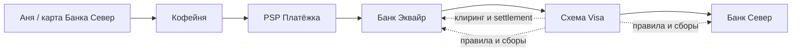
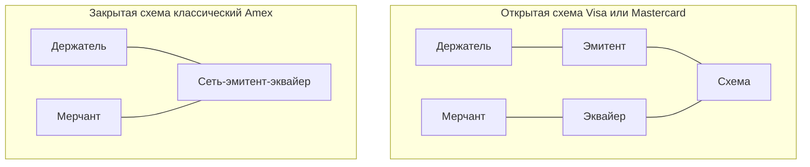
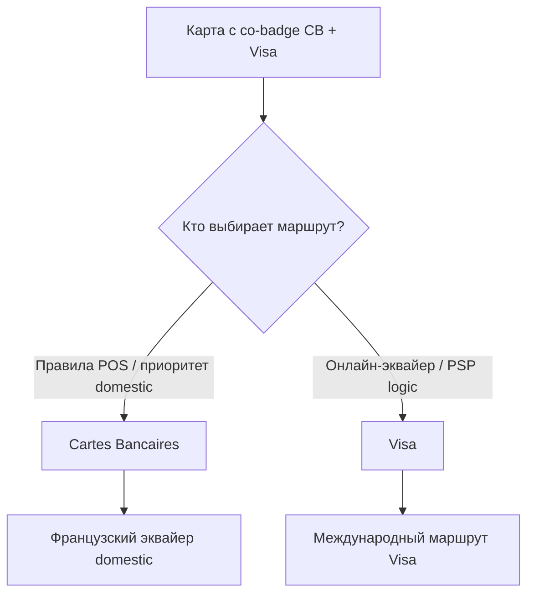
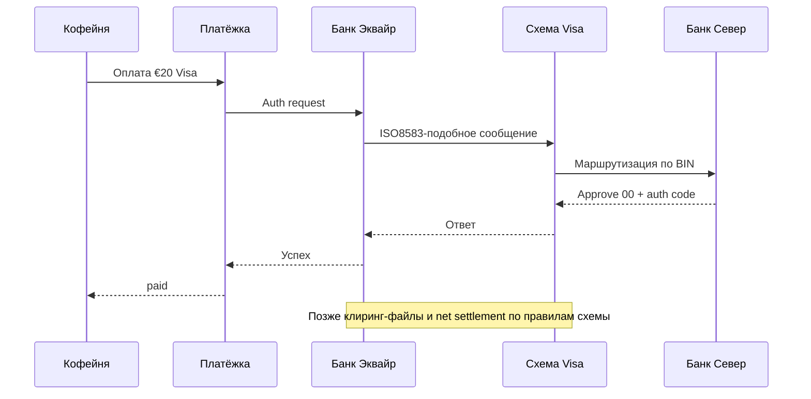
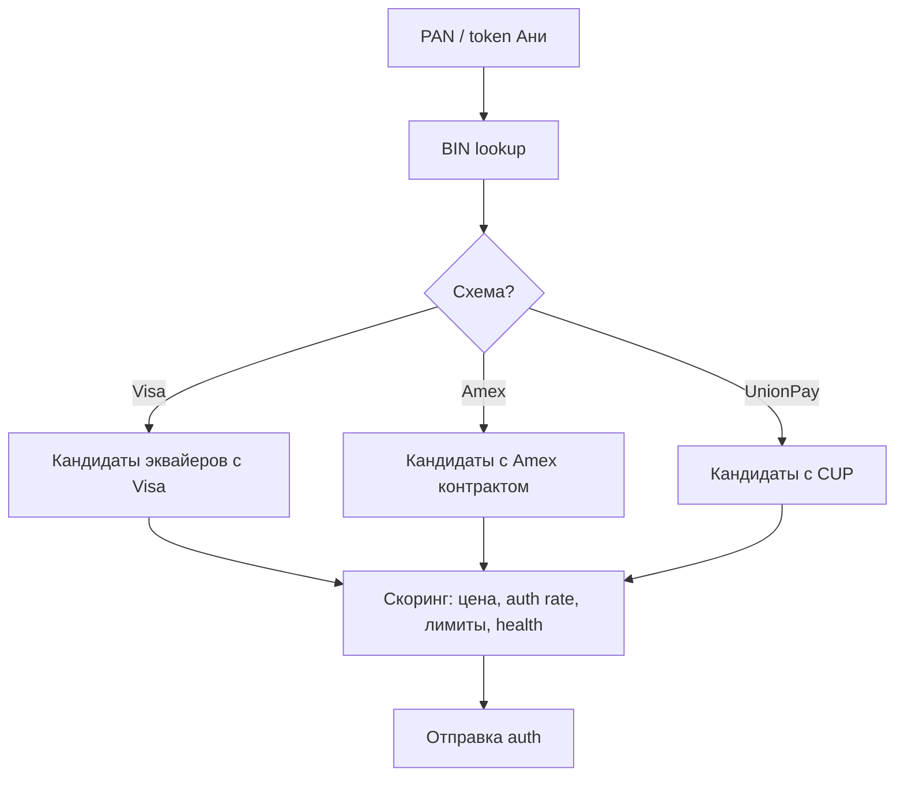

# Глава 04. Карточные сети и схемы

В предыдущей главе мы разобрали карту как объект: PAN, BIN, чип, CVV. Но карта сама по себе — пластик и цифры. Чтобы Аня могла заплатить «Кофейне» двадцать евро за пачку зерна, нужен ещё один слой: **карточная сеть** (card network), или, как чаще говорят в индустрии, **схема** (scheme, payment scheme). Именно схема говорит всем участникам: «вот правила, вот маршруты, вот кто кому сколько должен».

Без схемы четырёхсторонняя модель из [главы 02](02-ecosystem-participants.md) разваливается. Эмитент «Банк Север» и эквайер «Банк Эквайр» не обязаны знать друг друга лично. Они оба состоят в одной схеме — скажем, Visa — и схема гарантирует: если эмитент одобрил авторизацию, деньги в итоге дойдут до эквайера (а тот — до продавца), а если покупатель оспорит платёж, будет понятный процесс chargeback — оспаривания покупки через банк с возвратом по правилам сети ([глава 17](17-chargebacks-and-disputes.md)). Схема — это одновременно техническая сеть, свод правил и коммерческая площадка со своими сборами.

Инженер, который впервые видит в ответе PSP поле `scheme: visa` или `brand: mastercard`, часто думает: «ну, логотип на кнопке». На деле от схемы зависят маршрутизация, комиссии, лимиты, требования к 3-D Secure — проверке держателя при онлайн-оплате ([глава 08](08-3ds-and-sca.md)), правила споров, форматы клиринговых файлов и даже то, можно ли вообще принимать эту карту в конкретной стране. Эта глава — карта самих схем: кто они, чем отличаются открытые от закрытых, что такое членство и сертификация, и почему «просто добавить UnionPay» — это не переключатель в админке.

## В этой главе

- Что такое схема и чем она отличается от банка, процессора и PSP
- Открытые (four-party) и закрытые (closed-loop) модели
- Крупные международные сети: Visa, Mastercard, American Express, UnionPay, JCB, Discover, Мир
- Национальные схемы и зачем государства их поднимают
- Правила, членство, сборы и сертификации
- Региональные особенности: Европа, США, Азия, СНГ и кросс-бордер
- Сквозной пример: Аня платит картой Visa, а «Кофейня» получает деньги через «Платёжку»

## Зачем нужна схема: проблема, которую она решает

Представьте мир без карточных сетей. «Кофейня» хочет принимать карты. Ей пришлось бы заключать договор с каждым банком, чьи клиенты могут что-то купить. «Банк Север» выпускает карты — но точкам приёма нужно как-то узнавать, что карта валидна, и переводить деньги. Получается полный граф связей: каждый с каждым. Это не масштабируется.

Схема решает задачу иначе. Она создаёт **стандарт и хаб**:

1. **Единый язык сообщений.** Авторизация (одобрение операции эмитентом), клиринг (обмен финансовыми записями и определение обязательств; [глава 06](06-payment-lifecycle.md)), споры — у всех участников совместимые форматы (часто поверх ISO 8583 — стандарта карточных сообщений — и файловых протоколов; детали — в [главе 22](22-integrations.md)).
2. **Маршрутизация.** По BIN карты понятно, к какому эмитенту слать запрос. Эквайер не звонит в «Банк Север» напрямую — он идёт в сеть.
3. **Доверие и правила.** Схема говорит: кто несёт ответственность при мошенничестве, как считается interchange — межбанковская комиссия в пользу эмитента ([глава 15](15-fees-and-economics.md)), сколько дней на chargeback, какие MCC запрещены.
4. **Расчёты (settlement).** Сеть неттит обязательства между банками-участниками — взаимозачитывает их и оставляет к переводу разницу: вместо тысячи двусторонних переводов — клиринг и net settlement, расчёты итоговыми суммами ([глава 12](12-flow-of-funds.md)).
5. **Бренд и принятие.** Логотип Visa на двери магазина означает: «здесь примут карту любого банка-члена Visa (при наличии договора эквайринга)».



Словами: данные платежа идут от магазина через PSP и эквайера в схему, схема доставляет их эмитенту. Деньги и обязательства потом сводятся через ту же схему. Банки не обязаны дружить — достаточно быть членами одной сети.

В разговорной речи «Visa», «Mastercard», «схема», «карточная сеть», «платёжная система» часто смешивают. В этой книге:

- **схема / карточная сеть (scheme, card network)** — организация и набор правил плюс инфраструктура маршрутизации и расчётов (Visa, Mastercard, Мир…);
- **эмитент / эквайер** — банки (или лицензированные учреждения), которые выпускают карты или принимают платежи;
- **процессор / gateway / PSP** — технологические и коммерческие посредники поверх банков и схем (см. [главу 02](02-ecosystem-participants.md)).

Схема — не «банк Ани» и не «API Платёжки». Схема — рельсы и ПДД для тех, кто по ним ездит.

### Три слоя одной схемы

Удобно мысленно разложить Visa или Mastercard на три слоя — иначе в голове всё слипается в «большую компанию с логотипом».

1. **Бренд и acceptance mark — знак приёма карт этой сети.** То, что видит Аня на карте и «Кофейня» на чекауте. Без права показывать логотип по правилам схемы мерчант/эквайер рискует штрафом — да, за неправильный логотип тоже бывают non-compliance fees.
2. **Правила и коммерция.** Правила interchange, scheme fees (сборы самой сети), запрещённые категории бизнеса, порядок chargeback и лицензирование участников. Это «конституция» площадки.
3. **Технологические рельсы.** Авторизационная сеть (у Visa исторически VisaNet и связанные сервисы), клиринговые и settlement-системы, Directory Server для 3DS — узел схемы, который помогает направить проверку держателя в его банк ([глава 08](08-3ds-and-sca.md)), token service — выпуск безопасных заменителей карточных реквизитов ([глава 05](05-card-contexts-and-tokens.md)), fraud intelligence feeds — потоки сигналов о мошенничестве ([глава 16](16-fraud.md)). Регуляторы вроде британского PSR (Payment Systems Regulator, регулятора платёжных систем; не путать с европейским Payment Services Regulation из [главы 18](18-regulation-and-compliance.md)) отдельно разбирают **scheme fees** и **processing fees**: часть услуг обязательна для участия в системе, часть — опциональные «надстройки». Для инженера PSP это значит: в invoice эквайера строка «visa» может быть пакетом из нескольких компонентов, а не одной магической таксой.

Когда продакт говорит «подключим Mastercard», он обычно имеет в виду все три слоя сразу. Когда сетевой инженер говорит «упал коннект к хосту схемы» — он про третий слой. Когда юрист мерчанта спорит про prohibited goods — про второй. Путаница слоёв в одном тикете — классика on-call.

### Врезка: как это бывает в жизни

«Платёжка» обещала крупному маркетплейсу «карты Европы». В демо на staging с тестовыми Visa/MC всё зелёное. На проде французские дебетовые карты с co-badge — двумя карточными брендами на одной карте — массово уходят в отказ или в дорогой кросс-бордер-маршрут: у выбранного эквайера слабый domestic CB — внутренний маршрут французской схемы Cartes Bancaires, а BIN lookup на стороне PSP не учитывал preferred national route. Формально «Visa же работает». По сути — схема как продукт для Франции не собрана. Маркетплейс считает конверсию, а не логотипы на слайде.

## Открытые и закрытые схемы

Не все карточные бренды устроены одинаково. Главная развилка — **открытая** (open-loop, обычно four-party) против **закрытой** (closed-loop, часто three-party).

### Открытая схема: four-party

Классика — Visa и Mastercard. Схема **не выпускает карты конечным клиентам** и **не эквайрит продавцов напрямую** (в базовой модели). Она лицензирует банки и других членов:

- эмитенты выпускают карты под брендом схемы;
- эквайеры подключают мерчантов;
- схема маршрутизирует, клирит, устанавливает правила и собирает свои fees.

Отсюда «четыре стороны» в упрощённой картинке: cardholder, merchant, issuer, acquirer — плюс сама сеть как пятый «организатор площадки». Подробный разбор ролей — в [главе 02](02-ecosystem-participants.md); здесь важно следствие: **конкуренция идёт на двух рынках сразу**. Банки конкурируют за держателей карт (кэшбэк, кредитный лимит). Эквайеры и PSP конкурируют за мерчантов (ставки MDR — общей комиссии продавца за приём карты ([глава 15](15-fees-and-economics.md)), конверсия, покрытие методов). Схема зарабатывает на объёме транзакций и сопутствующих сервисах, а не на «своей» выдаче кредита Ане.

Для инженера открытая схема означает: интеграция почти всегда идёт **через эквайера/процессора/PSP**, а не «напрямую в Visa API для магазина». У «Кофейни» контракт с «Платёжкой», у «Платёжки» — с «Банком Эквайр» (или несколькими), у эквайера — членство в схемах. Цепочка длинная, зато покрытие карт огромное.

### Закрытая схема: closed-loop / three-party

Классический пример модели — **American Express** в историческом виде (и ряд store cards, gift-card сетей, некоторые кошельки). Здесь одна организация часто совмещает роли:

- выпускает карту держателю;
- сама (или через tightly controlled партнёров) принимает платежи у мерчанта;
- сама несёт кредитный и fraud-риск;
- сама же делает settlement.

Формально сторон меньше: покупатель — сеть — продавец. На практике Amex и похожие игроки давно усложнили картину: есть лицензированные эмитенты-партнёры в разных странах, сторонние эквайеры, которые «принимают Amex» по договору. Но **экономическая и продуктовая логика** всё ещё ближе к closed-loop: бренд контролирует и выпуск, и приём сильнее, чем Visa.



Словами: в открытой модели схема сидит между банками; в закрытой — часто сама банк для клиента и «эквайер» для магазина.

### Зачем различать на практике

| Вопрос | Open-loop (Visa/MC) | Closed-loop (классический Amex / store card) |
|---|---|---|
| Кто выпускает карту Ане | Банк-эмитент | Сеть или её жёстко контролируемый партнёр |
| Кто подключает «Кофейню» | Эквайер / PSP | Часто сама сеть или узкий список партнёров |
| Кто задаёт interchange | Схема (и регуляторы) | Внутренняя экономика сети |
| Как «добавить приём» | Включить схему у эквайера, пройти сертификации | Отдельный договор / onboarding с сетью |
| Покрытие | Очень широкое | Уже; зависит от региона и сегмента |

Для «Кофейни» через «Платёжку» это выглядит так: Visa и Mastercard почти всегда «включены по умолчанию» у европейского эквайера. Amex — отдельный флаг, отдельный MID — идентификатор продавца у эквайера, иногда другая экономика и другой timeline споров. Discover/JCB/UnionPay — тоже отдельные продуктовые линии. Инженер, который рисует в UI один переключатель «карты», прячет под ним зоопарк контрактов.

### Врезка: не путать closed-loop с «локальной схемой»

Национальная схема вроде Мир или Cartes Bancaires — чаще **открытая** внутри страны: много банков-эмитентов и эквайеров, общая инфраструктура. Closed-loop — про совмещение ролей, а не про географию. Карта лояльности супермаркета «только у нас» — closed-loop. Карта Мир от «Банка Север» (в нашей вымышленной вселенной — если бы эмитент выпускал Мир) при приёме у любого эквайера-члена — open-loop национальная схема.

### Серые зоны и гибриды

Реальность любит гибриды сильнее учебников.

- **Amex** выдаёт карты через партнёрские банки в ряде стран (white-label / co-brand), но бренд и правила остаются «амэксовскими».
- **Discover** исторически ближе к closed-loop на домашнем рынке и наращивал acceptance через взаимные соглашения с другими сетями за рубежом.
- **Gift cards и store cards** ритейлера — чистый closed-loop; иногда поверх них рисуют «псевдо-PAN» для процессинга внутри PSP, и неопытный разработчик принимает их за Visa по длине номера.
- **Transit cards / campus cards** — closed-loop до момента, пока их не токенизируют в open-loop wallet.
- **PayFac и MoR** не делают схему closed-loop, но с точки зрения «Кофейни» ощущение похожее: один договор, один баланс. Разница: под капотом PayFac всё равно гоняет open-loop рельсы Visa/MC (см. [главу 02](02-ecosystem-participants.md)).

Практический тест: *кто может выпустить «такую же» карту другому банку без разрешения вашего бренда?* Если тысячи банков выпускают Visa самостоятельно по лицензии — open-loop. Если только вы (или узкий список) выпускаете карту «MagazinPay» — closed-loop.

## Крупные международные сети

Ниже — портреты схем, с которыми вы столкнётесь в 90% интеграций. Цифры объёмов и долей рынка быстро меняются; опирайтесь на порядок величин и структурные отличия, а не на «точную долю в процентах на вчера».

### Visa

Visa — открытая глобальная схема, один из двух «дефолтных» брендов для e-commerce почти везде, кроме рынков с сильными национальными альтернативами. Исторически выросла из банковских ассоциаций в США; сегодня — публичная компания, которая зарабатывает на сетевых сборах, data/value-added сервисах, токенизации (Visa Token Service — подробнее в [главе 05](05-card-contexts-and-tokens.md)), рисках и продуктов для эмитентов/эквайеров.

Что важно инженеру:

- **BIN и маршрутизация.** Префиксы Visa узнаются по BIN; от них зависит, уйдёт ли транзакция в VisaNet (сеть авторизаций Visa).
- **Продуктовые линейки.** Consumer debit/credit (личные дебетовые/кредитные карты), commercial (коммерческие карты организаций), prepaid (предоплаченные карты) — разные interchange и иногда разные правила.
- **Региональные правила.** Европа с регулируемым interchange для consumer debit/credit живёт иначе, чем США; кросс-бордер — иначе, чем domestic.
- **Споры и программы.** Visa задаёт reason codes — коды причин споров, — сроки и chargeback monitoring programs — программы контроля продавцов с высоким уровнем споров (детали — [глава 17](17-chargebacks-and-disputes.md)).

Когда Аня платит Visa «Кофейне», типичный путь: «Платёжка» → «Банк Эквайр» → Visa → «Банк Север». Схема здесь — и транспорт, и арбитр правил.

Visa также задаёт продуктовую таксономию, которая всплывает в fee и risk: consumer vs commercial, debit vs credit vs prepaid, и региональные программы. Эквайер в clearing указывает product identifiers; ошибка классификации (отправили commercial как consumer) бьёт по цене и иногда по compliance. Для «Платёжки» это повод не доверять только фронтовому «Visa» и сверяться с BIN/account range tables и с тем, что вернул эквайер после auth.

### Mastercard

Mastercard — второй глобальный open-loop гигант. Для мерчанта и PSP Mastercard часто симметричен Visa: те же роли, похожий lifecycle, свои файлы клиринга, свои fee schedules, свой Directory Server для 3DS ([глава 08](08-3ds-and-sca.md)), свой токен-сервис (MDES, Mastercard Digital Enablement Service; [глава 05](05-card-contexts-and-tokens.md)).

Практически:

- Нельзя считать «Visa = Mastercard» в коде. Разные коды отказов в нюансах, разные MAC (Merchant Advice Codes, рекомендации по дальнейшим попыткам после отказа; [глава 09](09-declines-and-response-codes.md)), разные программы fraud alerts (типа Ethoca у Mastercard vs Verifi у Visa — экосистема вокруг схемы).
- Co-badging: одна карта может нести Mastercard и национальную схему (ниже). Тогда **приоритет маршрута** зависит от региона, выбора POS/онлайн-формы и правил.
- Для биллинга и аналитики всегда храните `scheme` / `brand` отдельно от `issuer_country` и `card_type`.
- Mastercard (как и Visa) продаёт не только «провод для auth»: data products, identity, consulting, account-to-account эксперименты на соседних рельсах. В P&L схемы — отчёте о прибылях и убытках — транзакционный core — база, но не единственная история.

В продуктах PSP часто пишут «card» и внутри рисуют оба логотипа. В леджере (учётной книге; [глава 13](13-ledger-and-reconciliation.md)) и отчётности схемы нужно различать: от них зависят scheme fee и иногда settlement currency path.

Дуэт Visa+Mastercard создаёт интересный рыночный эффект: эмитенты и эквайеры почти всегда состоят в обеих сетях, мерчанты принимают обе, а конкуренция схем идёт за объём, за innovative services и за условия для банков, а не за «эксклюзив на кассе у Кофейни». Для инженера это значит, что **fallback между Visa и MC невозможен на одной карте**: карта Ани — либо Visa BIN, либо Mastercard BIN (если не считать экзотики и ошибок данных). Cascading — повторная попытка через другой маршрут после подходящего отказа ([глава 07](07-states-async-idempotency.md)). У PSP это смена *эквайера/процессора*, а не смена схемы на той же карте.

### American Express

Amex — гибрид. В голове держите closed-loop ДНК: сильный контроль бренда, акцент на premium/commercial сегмент, своя экономика. При этом в многих странах приём Amex идёт через партнёрские эквайеры или PSP, которые заключили соглашение с Amex.

Особенности для инженера и продакта:

- **Отдельный onboarding.** Не каждый эквайер «Банк Эквайр» автоматически принимает Amex. «Платёжке» может понадобиться отдельный контракт.
- **Другой профиль покупателя.** Часто выше средний чек, другая fraud-модель, другие chargeback patterns.
- **Сетевые сообщения.** Интеграции могут отличаться от Visa/MC pipeline; процессоры прячут это, но edge-кейсы (частичный capture,industry-specific rules) всплывают.
- **Acceptance gap.** В одних странах Amex почти везде, в других мерчанты отключают из-за ставки. «Кофейня» в ЕС может включить Amex осознанно под B2B/gift-карты, а не «для всех».

Не пишите в поддержку мерчанта «Amex — это просто ещё один card brand». Коммерчески и операционно это часто отдельный продукт.

Ещё один сюрприз для биллинга: в open-loop мире мерчант часто видит разбиение interchange + scheme + acquirer. В Amex-подобных моделях чаще **единый discount rate — ставка комиссии с продавца** или иной пакет: «меньше строчек, больше средняя цена». Финансовому аналитику «Кофейни» нельзя сравнивать «2,8% Amex» с «1,2% Visa debit» как апельсины с яблоками без учёта сегмента покупателей и chargeback profile.

### UnionPay

UnionPay (China UnionPay) — огромная по числу карт и объёму схема с центром тяжести в Китае и сильным присутствием у китайских туристов и диаспоры по миру. Модель ближе к open-loop внутри своей экосистемы банков, но **глобальный приём** для европейского/американского мерчанта — отдельная история: нужны эквайер или процессор с UnionPay-подключением, иногда отдельные терминальные/онлайн-сертификации, иногда QR-сценарии наряду с card-not-present.

Для «Кофейни», если цель — китайские покупатели:

- card payments UnionPay через поддерживающего эквайера;
- либо локальные/кошелёковые методы (Alipay/WeChat — уже [глава 11](11-wallets-bnpl-local-methods.md)), которые часто важнее «классической» карты.

Технически UnionPay — не «ещё один enum рядом с visa». Тестируйте отдельно: 3DS/аутентификация, валюты, отказные коды, refund timing — сроки добровольного возврата продавцом ([глава 06](06-payment-lifecycle.md)) — могут вести себя иначе.

### JCB

JCB (Japan Credit Bureau) — японская схема с международной сетью приёма. Open-loop характер: японские (и партнёрские) эмитенты, эквайеры по миру через соглашения. Для мерчанта вне Японии JCB часто появляется в пакете «alternative card brands» у PSP вместе с Discover/Diners — через партнёрства вроде сетей взаимного приёма.

Инженерный смысл: низкий объём в европейском e-commerce, но ненулевой для travel, digital goods с японской аудиторией, маркетплейсов. Выключать «потому что редко» можно только осознанно, глядя на GEO трафика.

### Discover (и Diners Club в связке)

Discover — американская схема с заметной долей на домашнем рынке США и сетью международного приёма через партнёрства (в том числе исторические связки с Diners Club и соглашениями взаимного acceptance с другими брендами в разных регионах). Модель эволюционировала; для упрощения в книге: считайте Discover **отдельным брендом**, который в США критичен для покрытия, а в Европе часто «nice to have» через PSP.

Практика PSP:

- в США incomplete brand coverage = потеря конверсии;
- в ЕС многие мерчанты живут на Visa+MC+национальная схема и подключают Discover/JCB пакетом, если эквайер даёт без боли.

### Мир

«Мир» — национальная платёжная система России (оператор — НСПК). По задумке — open-loop внутри страны: банки выпускают, банки эквайрят, есть свои правила, клиринг, брендинг. В контексте санкций и геополитики 2020-х **международный приём Мир** резко ограничен; внутри России и в отдельных партнёрских контурах схема остаётся ключевой инфраструктурой.

Для учебника важно не политика, а инженерный урок:

- национальная схема может за короткое время стать **dominant domestic rail**;
- зависимость мерчанта и PSP только от глобальных Visa/MC — стратегический риск на некоторых рынках;
- co-badging и «карта с двумя брендами» усложняют маршрутизацию и UX выбора.

Если ваш продукт когда-либо работал с российским acquiring — вы уже знаете, что «схема» в конфиге мерчанта — не косметика.

### Diners Club и «длинный хвост» брендов

Diners Club часто встречается в связке с Discover/партнёрскими сетями приёма. Для европейского e-commerce это типичный представитель long-tail: объём маленький, но корпоративные travel&entertainment покупатели бывают платёжеспособными. PSP обычно тащат Diners в том же «alternative brands» пакете, что JCB/Discover. Отдельно сертифицировать Diners «потому что в тикете попросили» без оценки объёма — способ сжечь квартал program manager’а.

Есть и менее глобальные, но локально важные бренды и дебетовые сети (особенно в США: маршрутизация debit через альтернативные сети на POS — отдельный пласт правил). Вывод один: **справочник схем в вашей платформе должен быть расширяемым**, а не enum из двух значений.

### Сводная шпаргалка брендов

| Схема | Модель (упрощённо) | Где особенно важна | Типичный путь для ЕС-мерчанта |
|---|---|---|---|
| Visa | Open-loop | Глобально | Через эквайера/PSP |
| Mastercard | Open-loop | Глобально | Через эквайера/PSP |
| American Express | Hybrid / closed-loop ДНК | Premium, US, travel | Отдельный договор/флаг |
| UnionPay | Open-loop (CN-центричная) | Китай, туризм CN | Отдельное подключение |
| JCB | Open-loop | Япония, travel | Часто пакет alternative brands |
| Discover | Hybrid/open эволюция | США | Через US acquiring / пакет |
| Мир | Open-loop национальная | Россия (domestic) | Локальный эквайринг / ограничения |

## Национальные схемы

Государства и банковские сообщества поднимают национальные схемы по разным причинам: суверенитет платёжной инфраструктуры, снижение зависимости от глобальных сетей, регулирование комиссий, поддержка local debit, льготы для государства и социально значимых выплат.

Примеры (неполный список, иллюстративно):

- **Cartes Bancaires (CB)** — Франция; очень сильный domestic debit/credit контур, часто co-badge с Visa/MC.
- **Girocard** — Германия; национальный debit на POS, в e-commerce история сложнее (много банковских методов рядом).
- **Bancontact** — Бельгия.
- **Dankort** — Дания.
- **Mir** — Россия.
- **RuPay** — Индия (в связке с огромным push в безнал и UPI как соседний rail — [глава 10](10-bank-based-methods.md)).
- **Тройка локальных схем** в Латинской Америке, на Ближнем Востоке, в Африке — каждая со своей долей и правилами.



Словами: одна физическая карта может уметь ездить по двум рельсам. Кто выберет рельс — зависит от канала (POS vs ecom), настроек терминала, регуляторики и иногда явного выбора пользователя. Для PSP это головная боль маршрутизации и отчётности: одна и та же карта Ани во Франции на кассе супермаркета может уйти в CB, а в иностранном интернет-магазине — в Visa.

### Зачем инженеру знать про national schemes

1. **Конверсия.** В Франции «только Visa/MC без CB» на неправильном канале бьёт по acceptance.
2. **Цена.** Domestic national route часто дешевле кросс-бордер Visa.
3. **Регуляторика.** Локальные правила SCA (Strong Customer Authentication, сильной аутентификации клиента; [глава 08](08-3ds-and-sca.md)), льготы, государственные карты.
4. **Отчётность.** Scheme fee и interchange различаются; сверка без поля scheme врёт.

«Платёжка», выходя во Францию, не может честно сказать «мы принимаем все карты Европы», если у эквайера нет CB. Это продуктовый, юридический и технический gap одновременно.

### Как государство и банки проектируют национальную схему

Типичный набор мотивов (не обязательно все сразу):

1. **Суверенный клиринг.** Domestic транзакции не обязаны покидать контур страны для авторизации/клиринга.
2. **Контроль цены.** Возможность влиять на interchange/сборы иначе, чем у глобальных схем.
3. **Доступность.** Карты для зарплатных, социальных, студенческих программ.
4. **Конкуренция.** Давление на глобальные сети через наличие альтернативы.
5. **Инновации на своём поле.** Локальные QR, мгновенные платежи, ID-интеграции — рядом со схемой или вместо неё.

Инженерный побочный эффект: у национальной схемы свои тестовые карты, свои сертификационные стенды, свои reason codes (иногда «как у Visa, но не совсем»), свои требования к statement descriptor и свои monitoring programs по fraud/chargeback. Команда, которая скопировала Visa-коннектор и заменила endpoint, получает тонну сюрпризов на certification day.

### Для любопытных: кто «побеждает» при co-badge

На физическом POS приоритет часто зашит в терминал и softPOS-логику по локальным правилам (domestic national first). В e-commerce приоритет чаще определяет эквайер/PSP: что сертифицировано, что дешевле, что даёт лучший auth rate. Иногда регулятор требует дать потребителю выбор сети на определённых типах транзакций (это особенно обсуждают в контексте US debit routing — детали зависят от актуальных правил на момент внедрения). Для доменной модели «Платёжки» полезно хранить не только `scheme_used`, но и `scheme_candidates[]`, если вы когда-либо делаете smart routing между national и international rail на одной карте.

## Правила схем, членство, сборы, сертификации

Схема — не только логотип. Это **контрактная вселенная**.

### Членство (membership)

Чтобы банк стал эмитентом или эквайером Visa/Mastercard, он проходит членство: due diligence — проверку организации и её рисков, — капитал/лицензии, технические подключения, соответствие требованиям безопасности (PCI DSS, стандарту защиты карточных данных, и требованиям схемы; [глава 19](19-payment-security-pci.md)), операционная готовность к клирингу и спорам. Не каждый финтех «просто подключается к Visa». Часто финтех работает как program manager — организатор карточной программы — с BIN sponsor, банком-спонсором, предоставляющим доступ к выпуску карт в схеме или как клиент эквайера.

Иерархия упрощённо:

1. **Principal member** — полноправный член с прямым доступом к сети.
2. **Affiliate / associate** — через принципала.
3. **Мерчант** — вообще не член схемы; у него договор с эквайером/PSP/PayFac.

«Кофейня» не становится членом Visa. «Банк Эквайр» — да (или его процессор/спонсор). «Платёжка» может быть техническим процессором, PayFac или EMI — учреждением электронных денег ([глава 18](18-regulation-and-compliance.md)) — с банковскими партнёрами — модель из [главы 02](02-ecosystem-participants.md) определяет, кто именно держит membership.

### Правила схем (scheme rules)

Сотни/тысячи страниц правил (Visa Core Rules, Mastercard Rules и аналоги) покрывают:

- что можно продавать (prohibited MCC, high-risk categories);
- как маркировать транзакции (e-commerce, MOTO, recurring, credential-on-file — [глава 05](05-card-contexts-and-tokens.md));
- требования к авторизации, clear/settle срокам ([глава 06](06-payment-lifecycle.md));
- chargeback windows и evidence ([глава 17](17-chargebacks-and-disputes.md));
- data security и PCI;
- branding (как показывать логотипы);
- штрафы за нарушение (non-compliance fees).

Инженер редко читает rules end-to-end. Но когда продукт включает подписку, частичный capture — предъявление к списанию части ранее авторизованной суммы ([глава 06](06-payment-lifecycle.md)) — через 7 дней, или мерчанта с MCC adult/crypto, без знания «что схема разрешает» вы проектируете судебные иски будущего.

Правила живут. Схемы выпускают bulletins, effective dates, grace periods. У «Банка Эквайр» и «Платёжки» должна быть функция (человек или команда), которая переводит bulletin в: изменение валидации, новый обязательный field, запрет MCC, новый порог 3DS, новый отчёт. Инженерия без schema-change process вокруг scheme rules — это тикающая бомба в compliance.

### Сборы схемы (scheme fees)

Схема берёт деньги не «из воздуха комиссии магазина», а по своим тарифам с участников (эмитентов/эквайеров). Эквайер и PSP перекладывают это в MDR или показывают в IC++ (Interchange++): отдельно interchange, сборы сети и свою наценку. Подробный разрез экономики — [глава 15](15-fees-and-economics.md); здесь суть:

- **Scheme fee** зависит от региона, domestic vs cross-border, card product, channel (CP/CNP — приём с физическим предъявлением карты / без него; [глава 05](05-card-contexts-and-tokens.md)), иногда от use case.
- Это **не interchange**. Interchange идёт эмитенту (в типичной модели). Scheme fee — сети. Acquirer fee/markup — эквайеру/PSP.
- Одинаковый платёж €20 у Ани может иметь разный scheme fee, если карта польская, а мерчант в Германии (кросс-бордер), vs оба во Франции на domestic CB.

Для леджера «Платёжки» scheme fee — отдельная статья затрат, которую нельзя смешивать с «комиссией эквайера одной кучей», если вы обещаете IC++ прозрачность.

Грубый иллюстративный порядок мысли (не тарифная сетка): на consumer debit domestic в ЕС scheme fee часто выглядит «мелочью» рядом с регулируемым interchange, но на кросс-бордере, commercial cards и некоторых CNP-сценариях вклад сети заметно растёт. Плюс фиксированные/событийные сборы: за chargeback, за retrieval — запрос документов по операции ([глава 17](17-chargebacks-and-disputes.md)), за non-compliance, за минимум объёма, за срочные сервисы. Именно поэтому «у нас комиссия 1,5% всегда» в презентации PSP либо blended-усреднение (единый тариф на смесь операций), либо фантазия.

Эмитенты тоже платят схемам (и получают interchange). Карта Ани «бесплатная с кэшбэком» финансируется из этой экономики — отсюда интерес банков к premium cards и к тому, каким MCC Аня платит.

### Сертификации

Чтобы гонять живые транзакции, участники проходят технические и операционные сертификации:

- **Host-to-host / network certification** — сообщения авторизации, коды, таймауты, негативные сценарии.
- **3DS certification** — EMV 3DS с Directory Server схемы ([глава 08](08-3ds-and-sca.md)).
- **Tokenization** — VTS/MDES и т.п. ([глава 05](05-card-contexts-and-tokens.md)).
- **PCI DSS** — база безопасности карточных данных ([глава 19](19-payment-security-pci.md)); схемы требуют подтверждения.
- **Terminal / L2/L3** для Card Present — проверки платёжного ПО терминала и его взаимодействия с процессингом; также проверяются PIN entry devices, устройства ввода PIN.
- **Product certifications** — например, specific programs для installments (рассрочек), account funding (пополнений): OCT (Original Credit Transaction) используется для зачислений на карту, AFT (Account Funding Transaction) — для получения средств с карты — отдельные миры.

Сертификация — долгая и дорогая. Поэтому PSP и процессоры продают мерчантам «уже сертифицированную трубу». «Кофейня» выигрывает месяцы, не сертифицируясь в Visa напрямую.

Как выглядит процесс изнутри у эквайера/процессора (упрощённо):

1. Доступ к test host схемы / лабораторной среде.
2. Прогон обязательных test cases: approve, decline, partial approve (где есть), timeout, reversal, duplicate, late response.
3. Негативные сценарии и format compliance.
4. Подключение к production с поэтапным набором объёма (иногда с monitoring).
5. Recertification при смене продукта, протокола, 3DS version, token service, или после серьёзного инцидента.

Если «Платёжка» пишет собственный прямой коннектор к схеме — это многолетняя ставка уровня компании. Если идёт через «Банк Эквайр» — сертификация уже его проблема, но **поведение** сети всё равно ваше: таймауты, идемпотентность, разбор decline ([глава 09](09-declines-and-response-codes.md)).



Словами: мерчант общается с PSP; схема появляется глубже в стеке, но именно она доставляет запрос эмитенту и потом сводит деньги между банками.

### Членство ещё раз: кто на самом деле «в схеме»

Частая путаница онбординга финтеха:

| Роль | Член схемы? | Что это значит |
|---|---|---|
| «Банк Эквайр» | Да (напрямую или через principal) | Несёт scheme compliance, платит scheme fees, сдаёт отчёты |
| BIN-sponsor банк | Да | Даёт эмитентский доступ программе финтеха |
| «Платёжка» как Tech/PSP | Часто нет напрямую | Арендует рельсы у членов |
| «Платёжка» как PayFac | Обычно нет / через спонсора | Подключает sub-merchants под своим зонтиком |
| «Кофейня» | Нет | Принимает карты по договору с PSP/эквайером |
| Аня | Нет | Держатель карты эмитента-члена |

Отсюда следует неприятная правда для стартапа: «интегрироваться со схемой» почти никогда не значит HTTP API с ключом из кабинета Visa за день. Это либо партнёрство с членом, либо годы membership track.

## Региональные особенности

### Европа

- Сильные **национальные схемы** и co-badging.
- **Регулируемый interchange** для многих consumer card payments (порядки величин для illustration: десятые доли процента для debit, около процента и ниже для credit — точные потолки зависят от регуляций и типа; не заучивайте число как вечное).
- **SCA / PSD2** сильно влияет на e-commerce: 3DS стал нормой, exemptions — искусство ([глава 08](08-3ds-and-sca.md)).
- Кросс-бордер внутри ЕЭЗ ≠ «международный» в бытовом смысле, но для схемы и fee schedule часто всё равно особый класс.

### США

- Visa/MC/Amex/Discover — must-have покрытие для крупного ecom.
- Interchange в целом выше и сложнее матрицей (без европейского потолка в том же виде).
- Card Present vs CNP экономика и fraud сильно различаются.
- Региональные сети и debit routing rules (в т.ч. регуляторные требования к маршрутизации debit) добавляют логику на POS.

### Великобритания

- После Brexit — свой регуляторный контур; Faster Payments силён как альтернатива картам для многих use cases ([глава 10](10-bank-based-methods.md)).
- Карты Visa/MC по-прежнему доминируют в ecom; 3DS/SCA-подобная дисциплина сохраняется через локальные правила и схемы risk.

### Азия

- **Китай:** UnionPay + супер-доминанта мобильных суперприложений; «только Visa» для локального потребления — мимо рынка.
- **Индия:** RuPay + UPI как параллельная вселенная account-to-account.
- **Япония:** JCB + локальные привычки; конверсия требует локального acquiring.
- **ЮВА:** смесь международных схем и локальных кошельков/банковских методов.

### Латинская Америка, Ближний Восток, Африка

- Часто высокий share международных схем в ecom плюс критичные локальные методы (boleto-подобные, ваучеры, локальные дебеты, мгновенные переводы).
- Cross-border acquiring из Европы на эти рынки может давать хуже approval rate, чем local acquiring ([глава 27](27-cross-border-payments.md)).

### СНГ и санкционные контуры

- Доступность схем, settlement в валютах, возможность выпуска/приёма — зависят от юрисдикции и санкционного режима **на момент операции**.
- Инженерная практика: храните и мониторите **scheme × geography × currency × MCC** как матрицу capability, а не один глобальный boolean `cards_enabled`.

### Сводная карта «что считать must-have»

| Регион мерчанта / аудитории | Базовый card stack | Часто критичный плюс |
|---|---|---|
| ЕС e-commerce | Visa + Mastercard | National scheme (FR/BE/…), иногда Amex |
| США | Visa + MC + Amex + Discover | Debit routing нюансы на CP |
| Великобритания | Visa + Mastercard | Amex по сегменту; банковские методы рядом |
| Китай (локальные покупатели) | UnionPay | Кошельки важнее карт |
| Япония | Visa/MC + JCB | Локальный acquiring |
| Индия | RuPay + Visa/MC | UPI как соседний must-have |
| Туризм / travel global | Visa/MC + Amex | JCB/UnionPay по GEO гостей |

Эта таблица — не догма, а стартовый чеклист due diligence перед «мы выходим на рынок X».

## Сквозной пример: €20, Visa, «Кофейня»

Аня в Берлине покупает в интернет-магазине «Кофейня» (юридически — merchant в Литве, для примера) пачку зерна за **€20.00**. Карта: Visa Debit, эмитент «Банк Север» (вымышленный банк в ЕЭЗ), PAN начинается с BIN, который принадлежит программе Visa debit.

Таймлайн (упрощённо, иллюстративно):

1. **T+0 мс.** Фронт «Кофейни» токенизирует PAN — заменяет номер карты безопасным идентификатором — через hosted fields «Платёжки», поля, из которых реквизиты уходят сразу провайдеру ([глава 05](05-card-contexts-and-tokens.md)) (PCI scope уменьшен — [глава 19](19-payment-security-pci.md)).
2. **T+200 мс.** «Платёжка» определяет `brand=visa`, `funding=debit`, `issuer_country=...`, выбирает маршрут на «Банк Эквайр» (у которого есть Visa membership).
3. **T+400 мс.** Возможно, EMV 3DS: Directory Server Visa направляет проверку к ACS (Access Control Server) «Банка Север»; тот проверяет держателя без дополнительного действия (frictionless) или просит подтверждение (challenge) ([глава 08](08-3ds-and-sca.md)).
4. **T+2–5 с.** Авторизация: эквайер → Visa → эмитент. Ответ `00` (одобрено), auth code `A1B2C3` (код одобрения эмитента), hold — резервирование — €20 на счёте Ани.
5. **T+минуты/часы.** Capture (если не auto-capture) — [глава 06](06-payment-lifecycle.md).
6. **T+1 бизнес-день (порядок).** Clearing file уходит в схему; схема неттит позиции «Банка Эквайр» и «Банка Север».
7. **T+1…N.** Расчёты реальными средствами (settlement funds), отражение на балансе продавца (merchant balance) у «Платёжки», выплата (payout) «Кофейне» по расписанию ([глава 12](12-flow-of-funds.md)).

Иллюстративный JSON ответа PSP мерчанту (не API конкретного вендора):

```json
{
  "id": "pay_c0ffee_01",
  "amount": 2000,
  "currency": "EUR",
  "status": "succeeded",
  "payment_method": {
    "type": "card",
    "brand": "visa",
    "scheme": "visa",
    "funding": "debit",
    "last4": "4242",
    "issuer_country": "DE",
    "co_badged": false
  },
  "routing": {
    "acquirer": "bank_acquire_eu",
    "network": "visa",
    "domestic": true
  },
  "auth_code": "A1B2C3"
}
```

В JSON `amount: 2000` означает 20,00 EUR в центах, `funding` — источник средств карты, `last4` — последние четыре цифры, `co_badged` — наличие нескольких схем. `domestic` — классификация маршрута провайдером, смысл которой нужно сверять с его документацией. Что здесь ценно для инженера: `brand`/`scheme`, `funding`, `domestic`, `acquirer` — поля, без которых потом невозможно объяснить мерчанту комиссию, decline или chargeback.

Теперь вариант «та же Аня, но карта co-badged» во французском POS — маршрут мог бы стать CB domestic. В e-commerce у литовского мерчанта через «Платёжку» с приоритетом международных схем — Visa. Один пластик, разные рельсы, разные fees.

### Куда уходят деньги «за схему» на €20 (иллюстрация)

Точные ставки зависят от договора и регуляций; порядок мысли такой:

| Компонент | Кто получает | Комментарий |
|---|---|---|
| Interchange | Эмитент «Банк Север» | Регулируемый/тарифный |
| Scheme fee | Visa | Сетевой сбор |
| Acquirer / PSP fee | «Банк Эквайр» + «Платёжка» | Обработка, риск, сервис |
| Итого MDR | Платит «Кофейня» | Часто blended или IC++ |

Полный числовой «разрез» — в [главе 15](15-fees-and-economics.md). Здесь важно: **схема — отдельная строка экономики**, даже если мерчант видит одну ставку «2%».

### Тот же заказ, другая схема: мини-ветка Amex

Аня могла бы платить корпоративной Amex (допустим, командировочный лимит). Тогда:

- «Платёжка» проверяет, включён ли Amex у «Кофейни» и есть ли живой контракт upstream;
- маршрут может пойти на другой MID / другой процессорный endpoint;
- 3DS/step-up и fraud-скоринг используют другие сигналы;
- settlement и отчётность приходят иным файлом или в иной секции отчёта эквайера;
- при споре reason codes и сроки иные.

Если продукт нарисовал одну state machine «card_payment» без ветки `scheme`, поддержка через полгода будет дебажить Amex-chargeback инструментами Visa. Спойлер: плохо кончится.

### Таймлайн одного дня у оператора схемных инцидентов

```text
09:10  Алерт: auth success rate Visa DE -12% vs 7d baseline
09:25  Проверка: Mastercard DE стабилен → не «весь эквайер»
09:40  Эквайер подтверждает деградацию на одном Visa host
10:05  «Платёжка» сужает маршрутизацию DE Visa на вторичный эквайер
11:30  Восстановление primary; сравнение объёма и late clearing
15:00  Постмортем: не хватало дашборда scheme×country×acquirer
```

Без размерности `scheme` этот день выглядел бы как «платежи Германия легли» и лечился бы выключением всего рынка.

## Как схема проявляется в системах PSP

«Платёжка» внутри обычно держит:

1. **Справочник BIN/account range** — чтобы знать scheme, product, country, co-badge.
2. **Матрицу capability** — `merchant × country × scheme × MCC × currency → allowed`.
3. **Коннекторы эквайеров** — у одного эквайера Visa+MC, у другого ещё Amex+UnionPay.
4. **Правила маршрутизации** — cost-based, auth-rate-based, cascading ([глава 07](07-states-async-idempotency.md) обзорно, [глава 22](22-integrations.md) подробно).
5. **Учёт fee** — scheme fee estimates vs фактические отчёты эквайера.
6. **Compliance flags** — prohibited schemes/regions, sanctions screening на уровне участников.

Ошибка новичка — хранить только `card_brand` с фронта (то, что нарисовала касса по регулярке PAN). Бренд с клиента можно подделать визуально; источник истины — BIN lookup + ответ эквайера/схемы.

### Данные, которые стоит нормализовать

Минимальный набор полей после успешной/неуспешной попытки оплаты картой:

```text
payment_id
merchant_id
acquirer_id
scheme                 # visa | mastercard | amex | ...
scheme_product         # если известен (consumer debit, ...)
funding                # debit | credit | prepaid | unknown
issuer_bin / account_range
issuer_country
merchant_country
cross_border           # bool / enum
co_badge_schemes[]     # если знаем
network_transaction_id # если вернули
auth_code
response_code
3ds_status
```

Это не «красивый JSON для витрины». Это фундамент для fee reconciliation ([глава 13](13-ledger-and-reconciliation.md)), для dispute evidence, для smart routing и для честного SLA перед «Кофейней».

### Когда схем больше, чем эквайеров

Зрелая «Платёжка» часто имеет 2–N эквайеров. Матрица становится трёхмерной: эквайер умеет схемы A/B/C в регионах X/Y. Оркестратор платежей выбирает не «лучший банк», а **лучшую ячейку матрицы** под конкретную карту. Иногда вторичный эквайер без UnionPay бесполезен для китайского PAN — даже если у него фантастический auth rate по Visa.



Словами: сначала узнаём схему карты, потом фильтруем эквайеров, которые эту схему вообще умеют, и только затем считаем «кто лучше сегодня».

## Что это значит для инженера

- Моделируйте **scheme как сущность домена**, не как строку в UI. От неё зависят маршруты, fees, 3DS DS, dispute workflows, отчёты.
- Не обещайте мерчанту «все карты», пока не проверите **membership и сертификации** стоящего за вами эквайера по каждой схеме и региону.
- Храните в платеже: scheme/brand, funding type, issuer country, acquirer, domestic/cross-border flag, auth network reference (RRN — ссылочный номер сетевой операции; ARN — ссылка на клиринговую запись ([глава 06](06-payment-lifecycle.md), справочник — [глава 28](28-glossary.md))).
- Co-badging = ветвление маршрутов. Тестируйте оба рельса, если рынок national-scheme-heavy.
- Amex/UnionPay/JCB/Discover — отдельные продукты в backlog: контракт, MID, тестовые карты, refund/chargeback нюансы.
- Мониторьте approval rate **в разрезе scheme × country × MCC**. «Вчера упала Visa DE» — полезный алерт; «упали карты» — нет ([глава 24](24-monitoring-and-operations.md)).
- Документируйте для саппорта: какая схема за какой кнопкой и кто upstream (эквайер), иначе тикеты мерчанта превращаются в гадание.
- При проектировании выплат на карты (payouts/OCT) уточняйте, **те ли это схемы и те ли BIN**, что для acquiring; это соседний, но не идентичный мир.
- Заложите процесс разбора scheme bulletins: владелец, срок внедрения, тест-план, коммуникация мерчантам при breaking changes.
- В контрактных тестах коннекторов держите **отдельные наборы** кейсов на схему, а не один «happy path card».
- Не логируйте PAN; но логируйте scheme, BIN (по политике PCI), response codes и network refs — иначе инцидент не разобрать ([глава 19](19-payment-security-pci.md)).

## Типичные ошибки и грабли

1. **Считать схему = банк.** «Банк Север отказал» и «Visa отрубила маршрут» — разные диагнозы и разные эскалации.
2. **Один boolean `cards_enabled`.** Реальность — матрица схем и гео.
3. **Игнорировать national schemes** на локальном рынке. Конверсия и цена страдают молча.
4. **Смешать Amex в тот же пайплайн без контракта.** Тестовая среда «пропустила», прод — нет.
5. **Перепутать scheme fee и interchange** в отчётах IC++. Мерчант потеряет доверие после первого invoice.
6. **Фронтовый детект бренда по regex** как источник истины. BIN tables обновляются; co-badge ломает наивные эвристики.
7. **Забыть, что правила схемы — закон площадки.** «Мы так в продукте задумали» не отменяет prohibited MCC и сроки clear.
8. **Не заложить сертификационные сроки.** «Добавим UnionPay в спринт» без слота на certification у процессора.
9. **Кросс-бордер acquiring «на весь мир» одной схемой** без учёта approval rate и local rails ([глава 27](27-cross-border-payments.md)).
10. **Не развести в голове open-loop и closed-loop** — тогда непонятно, почему onboarding Amex похож на отдельную религию.

## Итоги главы

1. Карточная схема — рельсы, правила и клиринг; не «логотип» и не PSP.
2. Open-loop (Visa/MC) разделяет эмитентов и эквайеров; closed-loop сильнее совмещает роли (Amex-классика).
3. Visa и Mastercard — дефолтный глобальный дуэт open-loop; остальным брендам нужны отдельные продуктовые решения.
4. Национальные схемы и co-badging решают суверенитет, цену и конверсию на домашних рынках.
5. Членство, scheme rules, scheme fees и сертификации — цена входа на рельсы; мерчант обычно покупает их в пакете у PSP/эквайера.
6. Регион меняет всё: fees, SCA, набор must-have брендов, смысл local acquiring.
7. В данных платежа scheme — first-class field для маршрутизации, экономики и разборов инцидентов.
8. Следующий слой после «какой бренд» — **в каком контексте** карта используется: в терминале, в онлайне, как credential-on-file или как токен. Этим займётся следующая глава.

## Связанные главы

- [Глава 02. Участники платёжной экосистемы](02-ecosystem-participants.md) — роли вокруг схемы
- [Глава 03. Банковская карта: анатомия](03-bank-card-anatomy.md) — PAN, BIN, продукты карт
- [Глава 05. Где и как используется карта: CP/CNP, MOTO, credentials on file, токены](05-card-contexts-and-tokens.md) — контексты и network tokens
- [Глава 06. Жизненный цикл карточного платежа](06-payment-lifecycle.md) — auth, clear, settle по правилам схем
- [Глава 08. Аутентификация: 3-D Secure и SCA](08-3ds-and-sca.md) — Directory Server схем
- [Глава 15. Комиссии и экономика платежей](15-fees-and-economics.md) — interchange vs scheme fee
- [Глава 17. Chargebacks и disputes](17-chargebacks-and-disputes.md) — правила споров схем
- [Глава 22. Интеграции с банками, процессорами и схемами](22-integrations.md) — сообщения и файлы
- [Глава 27. Международные платежи](27-cross-border-payments.md) — local vs cross-border acquiring
- [Глава 28. Глоссарий и идентификаторы](28-glossary.md) — Scheme и смежные идентификаторы
