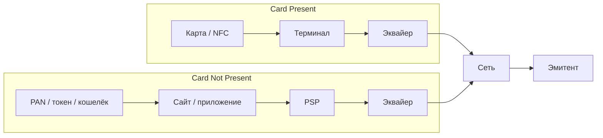
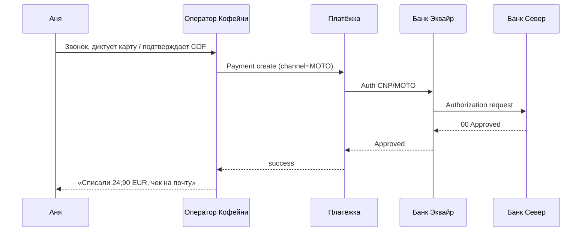
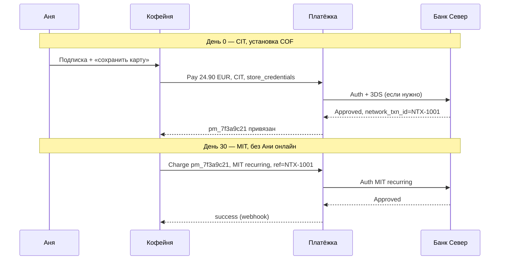
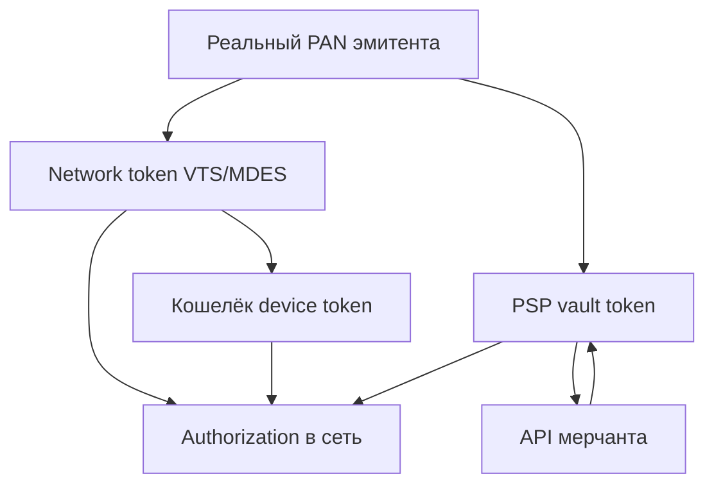
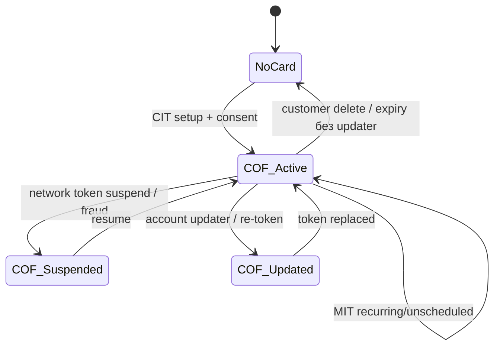

# Глава 05. Где и как используется карта: CP/CNP, MOTO, credentials on file, токены

В главах [03](03-bank-card-anatomy.md) и [04](04-card-networks.md) мы разобрали, что такое карта и кто её «обслуживает» на уровне сетей. Теперь другой вопрос — не *что* такое карта, а *где* и *как* она предъявляется. Один и тот же кусок пластика (или его цифровой двойник) ведёт себя по-разному в терминале кофейни на улице, в браузере на ноутбуке Ани, в звонке оператору «Кофейни» и в ночном списании подписки на зерно «раз в месяц».

Для инженера это не академическая классификация. От контекста использования зависят: какой interchange заплатит продавец, какие данные обязательны в авторизации, нужен ли 3-D Secure, кто несёт ответственность при мошенничестве, можно ли сохранить карту «на потом» и что именно сохранять — PAN, токен PSP или network token. Ошибка в одном флаге `stored_credential` или неправильная пометка «recurring» легко превращается в decline, штраф схемы или проигранный chargeback через три месяца.

В этой главе мы пройдём путь от «карта в руке» до «карта, которой физически уже нет, но платёж всё равно проходит»: Card Present и Card Not Present, MOTO, хранение credentials, CIT/MIT и типы последующих списаний, а затем — токены всех уровней: от «заглушки» внутри PSP до network tokens Visa/Mastercard и виртуальных карт для B2B.

## В этой главе

- Card Present и Card Not Present: чем отличаются каналы и почему это важно для риска и тарифов
- MOTO: телефон и почта как особый вид CNP
- Card-on-file и stored credentials: как «сохранить карту» правильно
- CIT и MIT: кто инициировал платёж и зачем схемы это знают
- Recurring, unscheduled, installment: три разных «продолжающихся» сценария
- Guest checkout vs one-click vs off-session MIT
- Токенизация: PSP-токены, network tokens (VTS, MDES), криптограммы и домены привязки
- Виртуальные карты: одноразовые и B2B
- Стык с 3DS/SCA и что проверять в коде, мониторинге и договорах

---

## Карта в руке и карта «в голове»

Представьте два дня из жизни Ани.

Утром она заходит в офлайн-точку «Кофейни», прикладывает карту «Банка Север» к терминалу — чип или NFC, короткая вибрация, чек. Вечером дома она открывает сайт той же «Кофейни», вводит номер карты (или выбирает уже сохранённую) и платит за подписку на зерно. Для Ани это «одна карта, один бренд». Для платёжной индустрии — два разных мира с разными правилами, разными комиссиями и разным распределением ответственности.

Первый сценарий называют **Card Present (CP)** — карта присутствует: она физически взаимодействует с терминалом продавца. Второй — **Card Not Present (CNP)** — карты нет рядом с терминалом в момент оплаты; продавец (или его PSP) принимает реквизиты удалённо.

Эта бинарная опция — один из самых важных «контекстов» платежа. Схемы, эмитенты и эквайеры смотрят на него постоянно: при маршрутизации, при скоринге фрода, при разборе диспута, при расчёте interchange. Если в сообщении авторизации «случайно» пометить интернет-платёж как Card Present, вы не «сэкономите» — вы нарушите правила схемы и рано или поздно получите проблемы.

### Card Present: терминал, чип, касание

В CP-мире доказательство «это действительно карта» строится на железе и криптографии чипа (EMV), а не на том, что покупатель «знает номер». Терминал обменивается данными с картой, формируется криптограмма, дальше авторизация уходит к эквайеру («Банк Эквайр»), в сеть и к эмитенту («Банк Север»). Детали полей и жизненного цикла — в [главе 06](06-payment-lifecycle.md); здесь важно другое.

В CP продавец обычно видит меньше «сырых» карточных данных в своей IT-системе: терминал и процессор закрывают большую часть PCI-scope. Магнитная полоса ещё встречается (особенно как fallback), но индустрия десятилетиями выталкивает её в пользу чипа и бесконтакта именно потому, что подделка «трека» была слишком дешёвой для мошенников.

Типичные признаки CP для инженера, который смотрит на транзакцию «снаружи»:

- есть устройство (терминал, mPOS, SoftPOS на телефоне);
- есть entry mode вроде chip, contactless, иногда magstripe;
- часто нет CVV в том виде, в каком его вводят на сайте (карта сама «доказала» присутствие иначе);
- liability при правильном EMV-сценарии чаще лежит на эмитенте, если продавец соблюдал правила (упрощённо; нюансы зависят от региона и типа fraud).

Офлайн-авторизация (терминал одобрил без связи с банком в момент покупки) — отдельная ветка CP, важная для транспорта и ритейла с плохой связью. Для интернет-магазина «Кофейня» это почти неактуально, но помнить стоит: «одобрено терминалом» ≠ «деньги гарантированно приедут после клиринга».

Ещё один нюанс CP, который всплывает у омниканальных брендов: **один merchant account / MID на сайт и на кассу — не значит, что контексты можно смешивать в одном API-вызове**. Офлайн-терминал «Кофейни» идёт через банковский POS-процессинг; сайт — через «Платёжку». Reconciliation потом склеивает продажи по `order_id`, но entry mode в каждой ноге свой. Попытка «пробить» интернет-заказ через виртуальный SoftPOS «чтобы было CP» почти наверняка нарушит правила, если карты физически нет.

### Card Not Present: номер вместо пластика

CNP — это весь e-commerce, in-app оплаты с ручным вводом, оплата по ссылке, многие кошельки на уровне «карта заведена в аккаунт», и огромный пласт подписок. Аня вводит PAN, срок, CVV — или выбирает сохранённую карту. Эмитент не видит чип; он видит данные и косвенные сигналы: 3DS, device fingerprint, историю, AVS (где принято), сумму, MCC, страну мерчанта.

Именно поэтому CNP исторически дороже для продавца (выше interchange и fraud) и жёстче регулируется: в Европе — SCA и 3-D Secure ([глава 08](08-3ds-and-sca.md)), у схем — требования к stored credentials, у PCI — ограничения на хранение CVV (его **нельзя** хранить после авторизации — см. [главу 03](03-bank-card-anatomy.md) и [19](19-payment-security-pci.md)).

Сквозной мини-пример. Аня покупает на сайте «Кофейни» пачку Ethiopia 250 г за **24,90 EUR**:

1. Браузер → checkout «Кофейни».
2. «Кофейня» → API PSP «Платёжка» (hosted fields / payment intent — детали модели в [главе 20](20-platform-architecture.md)).
3. «Платёжка» → эквайер «Банк Эквайр» с пометкой e-commerce / CNP.
4. Сеть (Visa или Mastercard) → эмитент «Банк Север».
5. Ответ: approve или decline; при необходимости — challenge 3DS до авторизации.

На всём этом пути где-то в сообщении живёт индикатор: «это не терминал, это удалёнка». Назовите его `pos_entry_mode`, `eci`, `channel` или `card_present=false` — смысл один.



Словами: в CP карта говорит с терминалом напрямую; в CNP между картой и эквайером почти всегда стоят браузер/приложение и PSP. Сеть и эмитент в обоих случаях те же, но входной контекст — разный.

### Почему CP vs CNP ломает наивную модель «просто спишите карту»

Инженеры, пришедшие из обычного CRUD, часто думают: «у нас есть номер — шлём charge». Индустрия отвечает списком вопросов:

| Вопрос | CP | CNP |
|---|---|---|
| Как доказать присутствие карты? | EMV / contactless crypto | 3DS, CVV, risk signals |
| Типичный fraud | skimming, lost/stolen (частично) | stolen PAN, carding, ATO |
| Где PCI-scope у мерчанта | часто уже у процессора терминала | checkout, API, vault |
| Interchange (очень грубо) | обычно ниже | обычно выше |
| Liability shift через 3DS | не тот инструмент | критичен в e-com |

Числа interchange всегда иллюстративны и зависят от региона, продукта карты (debit/credit), MCC и программы схемы. Важна не таблица «0,2% vs 1,5%», а принцип: **канал — это ценообразующий и риск-образующий атрибут**, его нельзя выдумать в коде «как удобнее».

### Пограничные случаи

Мир не чёрно-белый.

- **COF в приложении с биометрией телефона** — формально CNP (или wallet CNP), но UX «как в терминале». Риск-модель и токены кошелька ([глава 11](11-wallets-bnpl-local-methods.md)) делают его ближе к «сильному» каналу.
- **QR на кассе, оплата в телефоне** — часто CNP или hybrid в зависимости от схемы и того, что именно сканируют.
- **SoftPOS / tap-to-phone** — Card Present на потребительском смартфоне; сертификация и ответственность другие, чем у классического POS.
- **Оплата «по ссылке» курьеру** — CNP, иногда с сильным фродом, если ссылку пересылают.

Для доменной модели полезно хранить не булев `is_card_present`, а явный `entry_context` / `channel` со словарём значений, согласованным с тем, что умеет ваш эквайер.

---

## MOTO: когда кассир печатает номер за покупателя

**MOTO** — Mail Order / Telephone Order — заказ по почте или телефону. Звучит как ретро из 90-х, но канал жив: отели, авиация, B2B-продажи, «позвоните и продлите полис», благотворительность, некоторые call-центры маркетплейсов.

Аня звонит в «Кофейню»: «Можно добавить к подписке ещё одну пачку и списать с карты, которая у вас уже есть?» Или диктует номер оператору, потому что «сайт у меня не открывается». Оператор вводит данные в CRM → платёжный виджет → «Платёжка».

С точки зрения схем MOTO — это **подвид CNP**, но с отдельной маркировкой. Нет ни чипа, ни полноценного e-commerce UX с 3DS в браузере (хотя современные флоу иногда уводят клиента на SMS/link для SCA). Эмитент видит: «это не интернет-checkout, это mail/phone».

### Чем MOTO отличается от обычного e-com на практике

1. **Нет CVV** — часто. По телефону люди неохотно диктуют CVV; по старым mail-order формам его не было. Многие эмитенты и эквайеры допускают MOTO без CVV, но approval rate может быть ниже, а fraud — выше.
2. **3DS** — обычно отсутствует в классическом MOTO. В Европе это создаёт трение с SCA: чисто «оператор списал с диктовки» без сильной аутентификации клиента всё труднее объяснить регулятору. Обходные пути — отправка payment link клиенту, exemption'ы, MIT после согласия (об этом ниже). Юрист и compliance «Платёжки» должны сказать своё слово; инженер не должен сам «нарисовать» exemption.
3. **Доказательная база при chargeback** — слабее, чем у e-com с 3DS и device data. Запись звонка, подтверждение заказа по email, AVS (где есть) — это ваш evidence pack ([глава 17](17-chargebacks-and-disputes.md)).
4. **Тарифы и MCC** — call-center MOTO иногда тарифицируется иначе, чем card-not-present e-commerce. Зависит от эквайера и схемы.

### Типичная ошибка интеграции

Разработчик «Кофейни» берёт тот же API-метод `charge`, что для сайта, и просто не передаёт `cvv`. Эквайер думает, что это e-com без CVV — и либо режет риск-правилом, либо принимает, но при диспуте позиция продавца хуже. Правильный путь: явный `channel=moto` / `transaction_type=mail_order|telephone_order` (как требует ваш провайдер) и процесс, согласованный с договором эквайринга.



MOTO — не «устаревший костыль», а отдельный продуктовый канал. Если его нет в вашей state machine и отчётности — вы либо его не поддерживаете честно, либо поддерживаете опасно.

---

## Card-on-file: «оставьте карту у нас»

Аня оформила подписку «зерно раз в месяц» и поставила галочку «сохранить карту для следующих оплат». С этого момента у «Кофейни» (через «Платёжку») появляется **card-on-file (COF)** — карта «в картотеке»: реквизиты (точнее, их безопасное представление) хранятся, чтобы не просить Аню вводить 16 цифр каждый раз.

В индустрии рядом звучит термин **stored credentials** — сохранённые платёжные данные (credentials), которые продавец или его провайдер держит для последующих платежей. Visa и Mastercard ввели жёсткие рамки: нельзя просто «положить PAN в свою БД и иногда списывать». Нужны согласие, правильная маркировка первого и последующих платежей, различение того, кто инициировал списание.

Зачем схемам эти правила? Потому что без них:

- мерчанты списывали «тихо» и получали лавину chargeback'ов «я не узнаю эту оплату»;
- эмитенты не понимали, чем подписка отличается от разовой покупки;
- fraud-кольца сохраняли украденные PAN у сотен мелких магазинов.

### Что именно хранят

Варианты по возрастанию «правильности» с точки зрения PCI и современной индустрии:

1. **Сырой PAN у мерчанта** — почти всегда плохая идея. Раздувает PCI-scope, запрещает хранить CVV, повышает ущерб при утечке. Подробнее — [глава 19](19-payment-security-pci.md).
2. **PSP-токен** — «Платёжка» хранит карту в своём vault, «Кофейне» отдаёт `pm_7f3a…`. Самый частый путь для среднего e-com.
3. **Network token** — токен схемы (VTS/MDES), привязанный к устройству или к мерчанту; PAN у эмитента/токенизатора, у мерчанта — token PAN + необходимость криптограмм. Об этом позже в главе.
4. **Токен кошелька** (Apple Pay / Google Pay) — отдельная история, [глава 11](11-wallets-bnpl-local-methods.md).

Для Ани UX один: «карта •••• 4242». Под капотом у «Платёжки» — запись в vault:

```json
{
  "payment_method_id": "pm_7f3a9c21",
  "customer_id": "cus_anya_001",
  "merchant_id": "mer_coffee_shop",
  "brand": "visa",
  "last4": "4242",
  "exp_month": 8,
  "exp_year": 2028,
  "fingerprint": "fp_9aa1…",
  "network_token": {
    "status": "active",
    "token_last4": "8912"
  },
  "cof": {
    "consent_at": "2026-03-12T18:04:11Z",
    "consent_source": "checkout_checkbox",
    "initial_transaction_id": "txn_0c1e55"
  }
}
```

Заметьте: здесь нет полного PAN и нет CVV. Есть связь с первым платежом (`initial_transaction_id`) — схемы часто требуют уметь сослаться на него в последующих MIT.

### Согласие (consent) — не галочка «для галочки»

Сохранить карту можно только если клиент понял, *для чего*. Разовая покупка «сохранить для ускорения checkout» и подписка «будем списывать 24,90 EUR каждого 12-го числа» — разные обещания. В Европе это пересекается с PSD2/SCA и с договорным правом; в других регионах — с правилами схем и локальным consumer protection.

Инженерная практика:

- фиксируйте текст согласия, timestamp, UI-surface (checkout / account settings / migration);
- не молча превращайте «сохранить для удобства» в «рекуррент без лимита»;
- дайте способ отозвать (удалить карту) — и реально удаляйте токен, а не только скрывайте в UI;
- при смене суммы/периода подписки — подумайте, не нужно ли новое согласие и не сломаете ли вы MIT-цепочку.

---

## CIT и MIT: кто нажал кнопку

Ключевые аббревиатуры stored credentials:

- **CIT — Customer-Initiated Transaction** — платёж инициировал клиент. Аня нажала «Оплатить» или «Обновить подписку и списать сейчас».
- **MIT — Merchant-Initiated Transaction** — платёж инициировал продавец (или его биллинг) *без* активного участия клиента в этот момент. Ночной job «Кофейни» списывает абонентку.

Схемы требуют явно помечать: это CIT или MIT, и какой подтип. Эмитент использует это для риск-скоринга и для решений по SCA: многие MIT в Европе могут идти без challenge, *если* была правильная начальная привязка и выполнены условия exemption ([глава 08](08-3ds-and-sca.md)). Но «MIT» — не волшебная галочка «можно без 3DS всегда». Неправильная маркировка — частая причина decline и претензий.

### Первый платёж и «установка» credentials

Классический happy path для подписки Ани:

1. **CIT + сохранение credentials** (иногда в той же транзакции, иногда отдельной zero-amount / account verification). Аня вводит карту, проходит 3DS при необходимости, соглашается на сохранение и на будущие списания.
2. В ответе/клиринге фиксируется идентификатор первоначальной транзакции (у разных сетей и процессоров поля называются по-разному: network transaction id, initial transaction id, scheme reference…).
3. Последующие **MIT** ссылаются на эту цепочку и несут правильный `reason` / `mit_type`.

Если шаг 1 сделали «как обычный one-off» без флагов COF, а на шаге 3 внезапно шлёте `recurring=true`, эмитент видит рассинхрон. Approval rate падает.



### Зачем эмитенту знать CIT/MIT

Представьте поток в «Банке Север»: тысячи авторизаций в секунду. Если приходит списание 24,90 EUR ночью с MCC кофейной подписки, с историей успешных MIT и ссылкой на NTX-1001 — это один риск-профиль. Если приходит «случайный» e-com на 480 EUR из другой страны без 3DS и без истории — другой. Маркировка — часть языка, на котором мерчант говорит с эмитентом через схему.

---

## Recurring, unscheduled, installment: не всё «повторяющееся» одинаково

Когда инженеры слышат «рекуррент», они часто сваливают в одну кучу подписку Netflix-типа, «спишем, когда доставим», и рассрочку «4 платежа». Схемы их **различают**. Ниже — практическая карта (формулировки чуть упрощены; у Visa/Mastercard есть точные enum'ы в гайдах stored credentials — сверяйтесь с документацией вашего эквайера).

### Recurring (регулярное списание)

Фиксированный (или предсказуемый) график: раз в месяц зерно за 24,90 EUR. Клиент знает период и характер услуги.

Признаки:

- расписание известно заранее;
- обычно одна и та же (или предсказуемо меняющаяся) сумма;
- MIT с типом recurring;
- отмена подписки должна прекращать будущие MIT.

Если «Кофейня» повышает цену до 27,90 EUR, лучшая практика — уведомить Аню заранее и быть готовым к тому, что часть эмитентов/регуляций ожидает прозрачность. Технически следующий MIT может пройти с новой суммой, но продуктово и по chargeback-риску молчаливое удвоение цены — путь к «friendly fraud» и проигранным диспутам.

### Unscheduled (нерегулярное, по событию)

Сумма или момент **не** привязаны к календарной сетке. Примеры:

- поездка каршеринга: авторизовали hold, потом добрали фактическую сумму;
- маркетплейс: списание, когда заказ «укомплектован»;
- cloud: usage-based billing раз в конец месяца по факту потребления (граничный случай — иногда моделируют как recurring с переменной суммой; как скажет ваш провайдер);
- «доплата за доставку», если это отдельно согласовано как COF usage.

Для unscheduled особенно важно, чтобы первое согласие покрывало *такой* характер списаний. «Подписка 24,90» ≠ «будем списывать что угодно, когда захотим».

### Installment (рассрочка / частичные платежи)

Покупка на 120 EUR разбита на 4 платежа по 30 EUR. Это не подписка на услугу, а структура оплаты одного заказа. В некоторых регионах installment — отдельный продукт банка/схемы (с процентами и договором), в других — просто серия MIT с типом installment, привязанных к исходной покупке.

Путать installment с recurring опасно: при chargeback и при отчётности для эмитента это разные истории («я не подписывался на сервис» vs «я не соглашался на 4 платежа»).

### Сводная таблица для доменной модели

| Сценарий | Кто инициирует обычно | Тип stored credential | Пример «Кофейни» |
|---|---|---|---|
| Разовая оплата | CIT | нет / optional COF save | Пачка Ethiopia сейчас |
| Сохранить карту для удобства | CIT | COF, последующие CIT | Аня в один клик на следующей покупке |
| Подписка | первый CIT, далее MIT | recurring | Зерно раз в месяц |
| Списание по событию | MIT | unscheduled | Доплата за редкий «box» |
| Рассрочка заказа | MIT (иногда CIT на первый) | installment | Набор подарков 4×30 EUR |
| MOTO повтор | CIT (оператор) или MIT | зависит от согласия | Звонок «продлите ещё на месяц» |

### Account verification и нулевые суммы

Иногда нужно «проверить карту» без списания: привязка карты к аккаунту, смена карты в биллинге, антифрод. Делают **account verification** / zero-amount auth / authorization на небольшую сумму с немедленным void — практика зависит от региона и эквайера. Важно:

- не оставлять «висящие» холды, которые пугают Аню в SMS-банке;
- помечать verification как CIT с установкой credentials, если дальше пойдут MIT;
- не использовать verification как способ «обхода» лимитов — эмитенты это видят.

### Что происходит, когда карта протухла или пере выпущена

У Ани закончился срок `08/28`, «Банк Север» прислал новую карту с тем же «продуктом», но другим PAN (или тем же PAN и новым expiry — бывает по-разному). Если у вас лежит сырой старый PAN — MIT начнут падать. Если network token — схема/эмитент часто умеют **обновить токен** (account updater / token lifecycle), и подписка живёт без участия Ани. Если только PSP-токен без updater-сервисов — «Платёжка» либо ходит в account updater сети, либо просит Аню обновить карту (CIT).

Это один из сильных бизнес-аргументов в пользу network tokens: ниже involuntary churn подписок.

---

## Токенизированные карты: зачем прятать PAN

**Токенизация** в платежах — замена чувствительного PAN на суррогат (токен), который бесполезен или ограниченно полезен вне контекста. Утекли токены одного мерчанта — мошенник не получает универсальный номер карты «на все случаи жизни» (в идеале).

Но слово «токен» в индустрии обозначает **несколько разных вещей**. Путать их — классическая ошибка собеседований и архитектуры.

Три уровня, которые обязан различать инженер:

1. **PSP-токен (vault token)** — внутренний ID провайдера (`pm_…`). Работает только в API этой «Платёжки».
2. **Network token** — токен карточной сети (Visa Token Service, Mastercard MDES и аналоги). Участвует в авторизации как token PAN + cryptogram; понимается сетью и эмитентом.
3. **Токен кошелька / device token** — то, что лежит в Apple Pay / Google Pay на устройстве; часто тоже построен на network token + device cryptogram.

Плюс **виртуальные карты** (ниже) — это уже не «токен вместо карты», а *отдельный* карточный продукт с собственным PAN, часто одноразовым.



Словами: реальный PAN знает эмитент (и те, кому нельзя его разбрасывать). Network token — «официальный двойник» для платежей в сети. PSP-токен — удобный ключ к vault провайдера; сам по себе в Visa не ходит.

---

## Network tokens: Visa Token Service и MDES

### Идея

Схемы устали от того, что PAN гуляет по тысячам мерчантов и процессоров. **Network tokenization** выпускает вместо PAN токен (часто тоже выглядящий как «номер карты», с BIN из токен-диапазона), привязанный к домену: конкретный мерчант, устройство, кошелёк. Для каждой оплаты (или сессии) генерируется **криптограмма** — одноразовый криптографический хвост, без которого токен слабее или вовсе не принимается.

Эмитент в авторизации видит: это токен, вот криптограмма, вот гарантии домена. Можно повысить approve rate, снизить fraud, обновить реквизиты при перевыпуске карты.

### Visa Token Service (VTS)

**Visa Token Service** — инфраструктура Visa для выпуска и обслуживания токенов. Участники: токен-реквестор (часто PSP, кошелёк или эмитентский сервис), Token Service Provider, эмитент. «Платёжка», если сертифицирована как token requestor, может для COF Ани запросить network token и дальше проводить MIT/CIT уже с ним.

На уровне идеи жизненный цикл:

1. Есть PAN (из первого CIT или из эмитентского provisioning).
2. Запрос на токенизацию → проверка у эмитента (иногда с step-up для держателя).
3. Выпущен token + срок + metadata (последние 4 реального PAN для UX, бренд, статус).
4. При платеже — запрос cryptogram → auth с token PAN + cryptogram + ECI и пр.
5. Lifecycle: suspend, resume, delete, update при перевыпуске.

### MDES (Mastercard Digital Enablement Service)

**MDES** — аналог со стороны Mastercard: digital enablement, токены для кошельков и для merchant COF. Логика для инженера «Кофейни» та же: вы редко говорите с MDES напрямую; ваш PSP/эквайер даёт API «использовать network token», а под капотом — MDES или VTS в зависимости от бренда карты Ани.

Другие схемы (Amex, Discover, национальные) имеют свои сервисы; к 2026 году для глобального e-com критичны прежде всего Visa/Mastercard, но при выходе на локальные рынки проверяйте наличие токенизации у локальной схемы.

### Чем network token помогает «Кофейне»

Сквозной сюжет. Аня на год вперёд подписана на зерно. Через полгода «Банк Север» пере выпускает карту из-за утечки у какого-то *другого* мерчанта. Если «Кофейня» хранила только старый PAN через PSP без updater — серия decline `do not retry` / expired, Аня отваливается, support load растёт. Если был network token с lifecycle — токен обновляется, MIT проходит, Аня даже не заметила.

Второй плюс — **approval rate**: эмитенты часто доверяют токен+cryptogram больше, чем «голому» PAN+CVV, особенно в COF без CVV (а CVV вы всё равно не имеете права хранить).

Третий — **PCI и утечки**: компрометация БД «Кофейни» с `pm_…` или даже с token PAN мерчантского домена бьёт слабее, чем утечка «универсальных» PAN (хотя расслабляться нельзя: token PAN + дырки в процессе тоже бывают опасны).

### Cryptogram и «одноразовость»

Грубая модель:

```text
payment_request:
  token_pan: 4895 ******** 8912
  exp: 12/27
  cryptogram: AL3k9…   # на один auth
  eci: 05 / 07 / …     # зависит от сценария и кошелька
  token_requestor_id: …
```

Повторно прислать ту же криптограмму на второй платёж — нельзя рассчитывать, что сработает. Для MIT подписок PSP умеет запрашивать новые криптограммы по правилам схемы. Если вы строите свой token requestor — это отдельный серьёзный проект (сертификации, ключи, HSM, операционка), а не «ещё один REST-клиент».

### Связь с кошельками

Когда Аня платит Apple Pay на сайте «Кофейни», в авторизацию уходит не «её банковский PAN», а device/network token и cryptogram, созданные экосистемой кошелька. Это объясняет, почему «копирование номера из Wallet» невозможно в привычном виде и почему refund/chargeback всё равно доходят до эмитента: сеть умеет детокенизировать в своём контуре. Детали UX и staged/pass-through — в [главе 11](11-wallets-bnpl-local-methods.md); здесь фиксация: **кошелёк ≈ network tokenization + device binding + удобный UX**.

---

## PSP-токены: практичный слой для мерчанта

Большинству команд «Кофейни» не нужен прямой контракт с VTS. Им нужен стабильный `payment_method_id` и обещание: «мы спишем, когда вы попросите, в рамках PCI, с нормальным approve rate».

**PSP-токен** решает оркестрацию:

- единый ID на все бренды карт;
- маскирование PCI: мерчант часто уходит в SAQ A / A-EP при правильном hosted fields / redirect ([глава 19](19-payment-security-pci.md));
- маршрутизация к одному или нескольким эквайерам;
- опционально — «под капотом» PSP всё равно поднимает network token и account updater.

### Ограничения, о которых забывают

1. **Lock-in.** `pm_7f3a9c21` бесполезен у другого PSP. Миграция — это export/import через network tokens (если повезло с поддержкой), card updater, или просьба ко всем Аням ввести карту заново (конверсия убьёт).
2. **Не путать с «токеном платёжной сессии».** Короткоживущий `client_secret` / session token для checkout — это не COF.
3. **Мультиэквайеринг.** Если «Платёжка» шлёт одну и ту же карту то в «Банк Эквайр», то в другого эквайера, COF и MIT-ссылки на initial transaction id могут **не переноситься** между эквайерами. Cascading retries ([глава 07](07-states-async-idempotency.md), [09](09-declines-and-response-codes.md)) должны учитывать stored credentials constraints.
4. **Удаление.** GDPR и просто здравый смысл: delete payment method должен каскадно гасить network token (если PSP token requestor) и прекращать биллинг.

### Пример: первая покупка и сохранение

Иллюстративный JSON (не API конкретного вендора):

```json
{
  "amount": 2490,
  "currency": "EUR",
  "customer_id": "cus_anya_001",
  "payment_method": {
    "type": "card",
    "card_number": "4111111111111111",
    "exp_month": 8,
    "exp_year": 2028,
    "cvv": "123"
  },
  "setup_future_usage": "off_session",
  "stored_credential": {
    "initiator": "customer",
    "reason": "recurring",
    "consent_id": "cns_44ab"
  },
  "idempotency_key": "cof-setup-anya-20260312"
}
```

Ответ:

```json
{
  "transaction_id": "txn_0c1e55",
  "status": "approved",
  "authorization_code": "A12B3C",
  "payment_method_id": "pm_7f3a9c21",
  "network_transaction_id": "NTX-1001",
  "three_ds": { "result": "authenticated" }
}
```

Через месяц:

```json
{
  "amount": 2490,
  "currency": "EUR",
  "payment_method_id": "pm_7f3a9c21",
  "stored_credential": {
    "initiator": "merchant",
    "reason": "recurring",
    "initial_network_transaction_id": "NTX-1001"
  },
  "idempotency_key": "sub-anya-20260412"
}
```

CVV во втором запросе нет — и не должно быть. Если ваш код «на всякий случай» требует CVV для всех charges, вы сломаете легитимный MIT.

---

## Виртуальные карты: когда PAN рождается под задачу

**Виртуальная карта** — карточные реквизиты (PAN, expiry, иногда CVV), выпущенные без пластика, часто с ограничениями: лимит суммы, один MCC, один мерчант, single-use, срок «до конца недели».

Это не токен поверх существующей карты Ани (хотя UX может быть похож). Это **отдельный инструмент**, который эмитент или карточный B2B-провайдер выпускает на базе карточного счёта, кредитной линии или корпоративного баланса.

### Single-use виртуальные карты

Сценарии:

- Аня в банковском приложении создаёт «одноразовый номер» для подозрительного сайта — даже если PAN утечёт, второй charge не пройдёт;
- travel-агентство выдаёт гостю карту под конкретный отель;
- страховка оплачивает ремонт авто виртуальным PAN на сумму калькуляции.

Для мерчанта «Кофейня» single-use карта выглядит как обычный CNP-платёж. Сложность на стороне эмитента/issuer processor: лимиты, мгновенное закрытие после auth/capture, reconciliation.

### B2B и корпоративные виртуальные карты

Здесь большие деньги и большая боль интеграций. Компания закупает рекламу, облако, отели для сотрудников. Вместо одной «корпоративной карты в Excel на 40 человек» — выпуск виртуальных PAN на поставщика, на поездку, на бюджет команды.

Зачем:

- **контроль:** лимит 5 000 EUR только на MCC airlines;
- **учёт:** каждый PAN = cost center в ERP;
- **безопасность:** уволили сотрудника — карты команды не скомпрометированы разом;
- **кэшбэк/float** и программы эмитента — уже экономика, [глава 15](15-fees-and-economics.md).

Инженерные следствия для платёжной платформы, если вы *выпускаете* такие карты (а не только принимаете):

- нужен card issuing API, KYB, лимиты, авторизационный поток (часто issuer processing в реальном времени: approve/deny по правилам);
- auth приходит к вам как к «логическому эмитенту» или к вашему BIN-спонсору;
- споры, chargeback, FX — вы теперь на issuer-стороне, не только на merchant-стороне.

Если вы только **принимаете** оплату виртуальной картой — для вас это обычный CNP/COF. Не ломайте голову: различие важно продукту, который выпускает карты.

### Виртуальные карты vs network tokens

| | Network token | Виртуальная карта |
|---|---|---|
| Что это | Суррогат существующего PAN | Отдельный PAN продукта |
| Кто выпускает | Схема + token requestor + эмитент | Эмитент / BaaS / корпоративная программа |
| Типичная цель | Безопасность и COF/wallets | Контроль расходов, single-use, B2B |
| Для мерчанта-эквайера | Нужна поддержка token auth | Обычный card payment |
| Перевыпуск исходной карты | Токен часто переживает | Вирт. карта живёт своей политикой |

---

## Сквозной пример: год из жизни карты Ани в «Кофейне»

Соберём историю в один таймлайн — так проще увидеть, как контексты сменяют друг друга.

| Когда | Что делает Аня / система | Контекст | Что хранится / используется |
|---|---|---|---|
| 12 мар 2026, 18:04 | Покупка Ethiopia + подписка на сайте | CNP, CIT, setup COF, возможно 3DS | Создан `pm_7f3a9c21`, NTX-1001; PSP запросил network token |
| 12 мар 2026, 18:05 | Аня сохраняет карту «для быстрых покупок» | согласие COF | consent записан |
| 15 мар 2026 | Разовая покупка кружки в один клик | CNP, CIT по COF | `pm_…`, без CVV; может быть 3DS/TRA |
| 12 апр 2026, 03:10 | Биллинг списывает подписку | MIT recurring | network token + cryptogram, ref NTX-1001 |
| 20 апр 2026 | Аня в офлайн-точке платит NFC | CP contactless | терминал; к сайту COF отношения нет |
| 3 май 2026 | Звонок: «добавьте box к этому месяцу» | MOTO + существующий COF или новый ввод | channel=MOTO |
| 12 июн 2026 | Карта пере выпущена банком | lifecycle | network token обновлён; MIT без участия Ани |
| 1 сен 2026 | Аня удаляет карту в ЛК | revoke | PSP delete + token deactivate; биллинг стоп |
| 2 сен 2026 | Биллинг по ошибке шлёт MIT | должен fail | нет активного pm; алерт «orphan billing» |

Этот таймлайн — хорошая основа для test suite: не только `test_payment_success`, а сценарии смены контекста и отзывов согласия.



---

## Данные в авторизации: какие поля «печатают» контекст

Точные имена полей зависят от ISO 8583 vs REST-эквайера ([глава 22](22-integrations.md)), но смыслы повторяются. Инженеру полезно держать внутреннюю каноническую модель и маппить её на провайдеров.

Типичные смыслы:

- **presence / entry mode** — CP chip, CP contactless, CNP keyed, COF, credential on file…;
- **ECI (Electronic Commerce Indicator)** — насколько «электронный» и аутентифицированный платёж (связан с 3DS и кошельками);
- **stored credential flags** — CIT/MIT, reason (recurring / unscheduled / installment / …);
- **initial transaction reference** — связь с первым платежом цепочки;
- **token data** — token PAN, cryptogram, token requestor id, wallet id;
- **MOTO indicator** — mail vs telephone;
- **MCC, MID, country** — не про «контекст карты», но эмитент читает их вместе с контекстом.

Если каноническая модель в «Платёжке» бедная («у нас только amount и pan»), вы начнёте терять approve rate на каждом новом эквайере: маппинг будет угадыванием.

---

## Риск, liability и chargeback: зачем контекст в споре

Коротко, без спойлеров всей [главы 17](17-chargebacks-and-disputes.md):

- CP EMV при правильном проведении часто даёт продавцу более сильную позицию по определённым fraud-reason codes;
- CNP без 3DS — классика «украли карту, купили кофе оптом»;
- 3DS с liability shift меняет, кто платит за fraud (нюансы и exemptions — [глава 08](08-3ds-and-sca.md));
- MIT recurring с доказанным согласием и правильной маркировкой — другая линия защиты, чем «мы просто списывали»;
- MOTO — собирайте evidence заранее (запись, email confirmation), потом будет поздно.

Фрод-мониторинг ([глава 16](16-fraud.md)) должен сегментировать метрики по каналу: общий fraud rate «по магазину» скрывает, что MOTO пылает, а CIT one-click с network token — зелёный.

---

## Guest checkout, one-click и «тихие» списания

Не каждый CNP обязан становиться COF. Три продуктовых режима, которые стоит явно развести в API «Кофейни» и «Платёжки»:

**Guest checkout.** Аня платит картой один раз, галочку «сохранить» не ставит. PAN (или одноразовый session) живёт ровно столько, сколько нужно для auth/capture. В vault мерчанта записи нет. Это правильно для низкой вовлечённости и для рынков, где люди боятся «привязок».

**CIT one-click (card on file, клиент здесь).** Карта уже сохранена; Аня в сессии аккаунта нажимает «Оплатить». Это всё ещё CIT: клиент инициировал. CVV могут спросить повторно (особенно после долгого перерыва или при повышении риска), а могут и нет — политика риск-движка и региона. 3DS тоже может включиться точечно.

**MIT off-session.** Ани нет. Биллинг сам. Здесь уже stored credential reason, ссылка на initial transaction, запрет на «изобретение» CVV, аккуратность с SCA exemption.

Путаница начинается, когда продукт говорит «one-click», а в эквайер уходит MIT, или наоборот: cron шлёт платежи с `initiator=customer`. Эмитентский скоринг и отчётность схем от такой путаницы только страдают — как и вы при первом же аудите эквайера.

### Врезка: как это бывает в жизни

Команда «Кофейни» запускает подписку за две недели до Чёрной пятницы. В спешке в админке ставят «автопродление» всем, кто когда-либо покупал зерно, без новой галочки согласия. Технически MIT идут с картами, которые люди сохраняли «чтобы быстрее оформлять разовые заказы». Через месяц — пачка chargeback'ов «неузнанная подписка», рост dispute rate, письмо от «Платёжки» с просьбой объяснить spike, и ночной рефакторинг биллинга. Мораль плоская, но дорогая: **согласие на COF ≠ согласие на конкретный MIT-продукт**.

---

## Токены и домены привязки: merchant, device, cloud

Network token редко бывает «абстрактным номером на все случаи». У него есть **домен привязки (token domain)**:

- **Card-on-file / merchant domain** — токен выпущен для конкретного мерчанта (или token requestor, действующего за мерчантов). Им нельзя оплатить у случайного другого магазина «как обычным PAN».
- **Device domain** — токен привязан к Secure Element / TEE телефона (типичный путь кошельков). Криптограмма доказавает устройство.
- **E-commerce / cloud wallet domain** — сценарии, где токен живёт в облачном кошельке без того же device SE; набор гарантий другой.

Для инженера приёмной стороны это означает: нельзя взять token PAN, который пришёл из Apple Pay payload, сохранить его как «обычный COF» и потом слать как merchant MIT без соответствующего provisioning. Форматы и жизненные циклы разные. Правильный путь — либо использовать wallet заново (Аня снова подтверждает биометрией), либо отдельно токенизировать карту в merchant COF-потоке после согласия.

### Для любопытных: кто такой token requestor

В модели VTS/MDES появляется роль **token requestor** — сторона, которая имеет право просить схему выпустить токен. Это может быть:

- PSP «Платёжка» (самый частый путь для e-com COF);
- сам эмитент «Банк Север» (банковский кошелёк);
- крупный мерчант с собственной сертификацией (редко и дорого);
- OEM/кошелёк (Apple, Google и т.п.).

Сертификация, TRID (token requestor id), обмен ключами, операционная поддержка suspend/delete — отдельная программа на месяцы. Поэтому в книге для «Кофейни» разумный дефолт: **не становиться token requestor**, пока вы не PSP или не issuer. Купите capability у провайдера, а в своей доменной модели оставьте место под `network_token_status`, чтобы не переписывать биллинг через год.

---

## Как контекст стыкуется с 3DS и SCA

Полная механика — в [главе 08](08-3ds-and-sca.md), но без короткого мостика глава 05 была бы дырявой.

В Европе (и в режимах, копирующих PSD2-логику) удалённая оплата часто требует **SCA — Strong Customer Authentication**. На практике для карт это чаще всего EMV 3-D Secure. Исключения (exemptions) существуют, и одно из самых важных для бизнеса подписок — возможность проводить **MIT без challenge**, если изначально клиент согласился и первый платёж/привязка прошли правильно.

Грубая карта ожиданий (не юридическая консультация, регионы отличаются):

| Контекст | 3DS / SCA часто | Комментарий |
|---|---|---|
| CNP CIT, первая оплата | да / часто | особенно без TRA exemption |
| CNP CIT one-click COF | иногда | риск-скоринг, сумма, TRA |
| MIT recurring после setup | часто без challenge | нужен корректный MIT + согласие |
| MOTO классический | обычно нет 3DS | опасная зона для SCA; думайте link-to-pay |
| CP EMV | другой контур | PIN/CDCVM, не браузерный 3DS |
| Wallet (Apple/Google) | device auth + token | отдельный UX, часто уже «сильный» фактор |

Если биллинг «Кофейни» внезапно начинает слать MIT без initial reference и без признака stored credential, эмитент может либо отказать, либо запросить аутентификацию так, будто это новый CIT — а Ани нет перед экраном. Результат: массовые decline в 03:10 ночи и утренний Slack в #payments.

---

## Что это значит для инженера

1. **Заведите явный `payment_channel` / `entry_context` в доменной модели** — не выводите его эвристикой из «если есть cvv, то ecom». Храните то, что реально отправили эквайеру.

2. **Stored credentials — отдельная подсистема, не булев `recurring=true`.** Нужны: consent, initiator (CIT/MIT), reason, initial network transaction id, статус payment method, связь с подпиской/инвойсом.

3. **Никогда не храните CVV.** Даже «зашифрованный на всякий случай». PCI и здравый смысл. MIT обязан работать без него.

4. **Идемпотентность биллинга.** Ночной MIT с ключом `sub-anya-20260412` ([глава 07](07-states-async-idempotency.md)) важнее, чем «надеемся, cron не запустится дважды».

5. **Различайте PSP-токен и network token в аналитике.** Метрики approve rate, churn, fraud — разные. Если PSP включает network tokens постепенно, смотрите A/B по сегменту.

6. **Миграция PSP = миграция COF.** Заложите в договор возможность экспорта токенов/network tokens *до* того, как бизнес захочет уйти «завтра».

7. **Каскад эквайеров осторожно с MIT.** Повтор на втором эквайере без валидной credential-цепочки может быть invalid по правилам схемы.

8. **Тесты:** CIT setup → MIT success; MIT без initial ref → ожидаемый decline/reject на вашей валидации; delete PM → MIT невозможен; MOTO без ecom 3DS; CP путь вообще не смешивать с vault-токенами сайта.

9. **Наблюдаемость:** режь дашборды по channel + initiator + credential_reason. Иначе « упал auth rate» не диагностируется.

10. **Продуктовые тексты согласия — тоже код.** Версионируйте их; при диспуте пригодится `consent_version=3`.

11. **Account updater / token lifecycle** — мониторингте долю обновлений и долю failure «expired card». Это метрика выручки для подписочного бизнеса, не только «технический nicety».

12. **Виртуальные карты на приёме** — обычные карты; виртуальные карты на выпуске — другой домен (issuing). Не смешивайте сервисы в одном «CardService» без границ.

---

## Типичные ошибки и грабли

**Пометить e-com как Card Present, «потому что так ниже комиссия».** Это не оптимизация, а нарушение. Схемы штрафуют, эквайер может расторгнуть договор, при диспуте вы беззащитны.

**Один флаг `recurring` на все случаи.** Unscheduled доплата и installment уезжают с неверным reason → лишние decline и хаос в отчётах эмитента.

**Сохранили карту после one-off без согласия и без флагов COF, потом начали MIT.** Юридически и по схемам плохо; технически — цепочка без initial reference.

**Требуют CVV на каждый off-session charge.** Ломают подписки. CVV был на setup — и был забыт правильно.

**Считают, что PSP-токен переносится к другому провайдеру.** Не переносится. Внезапно «у нас 200 тысяч сохранённых карт» превращается в «у нас 200 тысяч last4».

**Каскадный retry MIT на другой MID/эквайер как ordinary payment.** Ломают stored credential linkage.

**MOTO через e-com интеграцию без индикатора.** Approval и disputes страдают; SCA-история в Европе становится невнятной.

**Удалили карту в UI, но cron биллинга не подписан на событие.** Аня видит списание «после удаления» — почти гарантированный chargeback и токсичный NPS.

**Смешали wallet cryptogram с «просто PAN» в одном коде пути.** Кошельки живут другим набором полей; fallback «достанем PAN» часто невозможен и не нужен.

**Надеются, что network token = можно не делать fraud-мониторинг.** Токен снижает часть риска, но ATO (взлом аккаунта Ани в «Кофейне») всё ещё списывает её же токен.

**Виртуальную single-use карту пытаются сохранить как COF для подписки.** Политика эмитента говорит «нет»; биллинг красный; support не понимает почему.

**Нулевая верификация на 1 EUR без void.** У Ани в ленте банка висят холды; перед атомарным capture/void потоком это выглядит как баг продукта.

**Логируют полный token PAN и криптограммы в plaintext debug.** «Мы же токены, не PCI» — опасное заблуждение; криптограммы и токены тоже защищают.

**Игнорируют разницу mail order vs telephone order**, если эквайер её различает в отчётности — мелочь до первого аудита.

---

## Итоги главы

1. **Card Present и Card Not Present** — не «где стоит сервер», а канал предъявления карты: от него зависят риск, тарифы, данные авторизации и позиция в споре.

2. **MOTO** — живой подвид CNP со своими индикаторами, слабым 3DS и особыми требованиями к evidence; его нельзя притворять обычным e-com.

3. **Card-on-file / stored credentials** — хранение возможности платить снова; требует согласия, PCI-грамотного vault и правильной маркировки в сети.

4. **CIT vs MIT** — кто инициировал платёж; база для SCA-exemption'ов, скоринга эмитента и легальных подписок.

5. **Recurring, unscheduled, installment** — разные бизнес-смыслы; в API схем это разные reason'ы, не один булев флаг.

6. **PSP-токен** удобен мерчанту, но создаёт lock-in; **network token (VTS/MDES)** ближе к схемам, повышает устойчивость COF и часто approve rate.

7. **Криптограммы** делают token-платежи одноразово защищёнными; без понимания lifecycle токенов подписочный биллинг хрупкий.

8. **Виртуальные карты** — отдельный продукт (single-use и B2B-контроль), а не синоним токенизации.

9. Для инженера контекст использования карты — **first-class поле домена**, тестовых сценариев и дашбордов, а не мелочь «передадим если вспомним».

10. Дальше логично смотреть, как любой из этих контекстов проходит через **authorization → capture → clearing → settlement**: этим занимается [глава 06](06-payment-lifecycle.md). Аутентификация в CNP (3DS/SCA) детально — в [главе 08](08-3ds-and-sca.md); безопасность хранения — в [главе 19](19-payment-security-pci.md).

---

## Связанные главы

- [Глава 03. Банковская карта: анатомия](03-bank-card-anatomy.md) — PAN, CVV, что нельзя хранить
- [Глава 04. Карточные сети и схемы](04-card-networks.md) — Visa, Mastercard и правила схем
- [Глава 06. Жизненный цикл карточного платежа](06-payment-lifecycle.md) — auth, capture, clearing, refund
- [Глава 07. Состояния платежа, sync/async, webhooks, idempotency, retries](07-states-async-idempotency.md) — идемпотентность биллинга и каскады
- [Глава 08. Аутентификация: 3-D Secure и SCA](08-3ds-and-sca.md) — 3DS, exemption'ы для MIT
- [Глава 09. Отказы и коды ответов](09-declines-and-response-codes.md) — soft/hard decline при протухших COF
- [Глава 11. Кошельки, BNPL, наличные и локальные методы](11-wallets-bnpl-local-methods.md) — Apple Pay / Google Pay и токены устройств
- [Глава 16. Payment fraud](16-fraud.md) — фрод в CNP и ATO по сохранённым картам
- [Глава 17. Chargebacks и disputes](17-chargebacks-and-disputes.md) — evidence по каналам
- [Глава 19. Безопасность платежей и PCI DSS](19-payment-security-pci.md) — vault, scope, токенизация
- [Глава 22. Интеграции с банками, процессорами и схемами](22-integrations.md) — поля ISO/API для entry mode и COF
