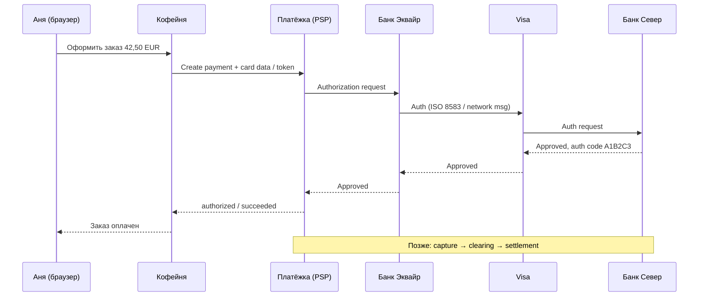
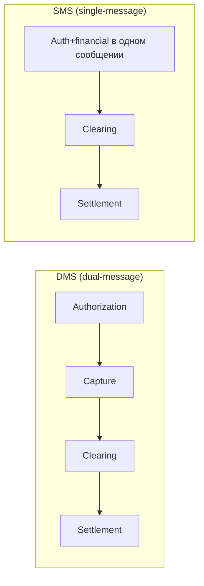
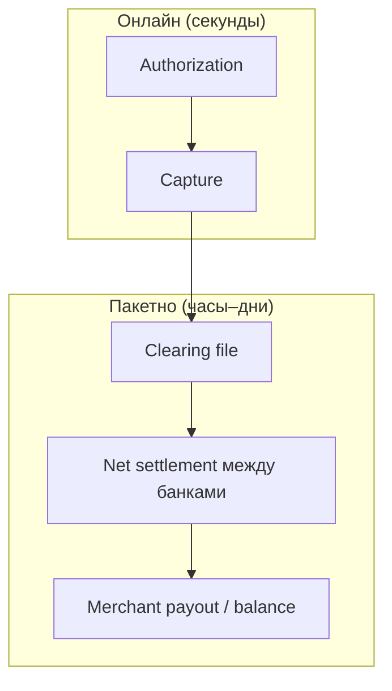
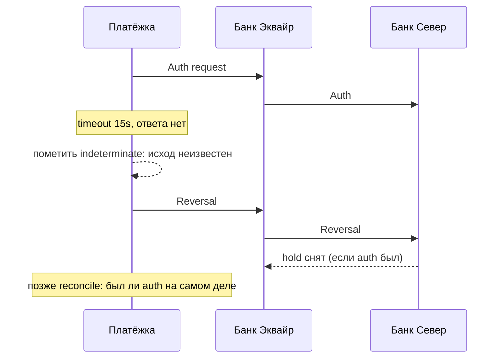
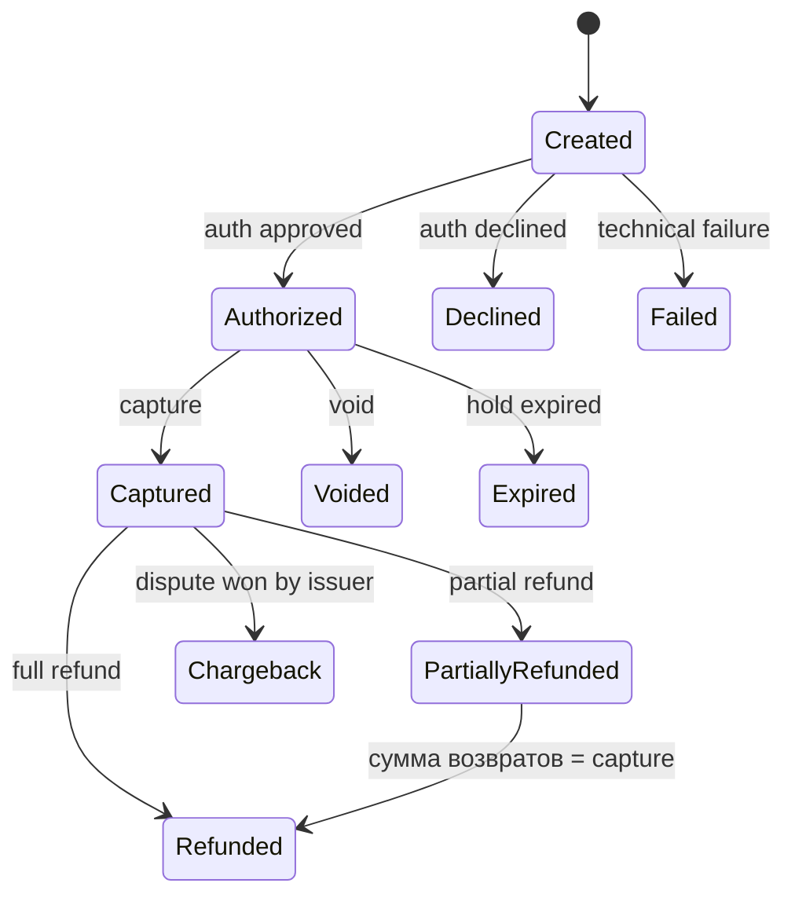

# Глава 06. Жизненный цикл карточного платежа

Аня нажала «Оплатить» в интернет-магазине «Кофейня». На экране крутится спиннер. Через полторы секунды — зелёная галочка: «Заказ оплачен». Для Ани история закончилась. Для платёжной системы она только началась.

Между кнопкой и зелёной галочкой произошла авторизация (authorization): эмитент «Банк Север» согласился зарезервировать деньги на карте. Но «зарезервировать» и «перевести продавцу» — разные вещи. Деньги ещё не ушли с карты Ани на счёт «Кофейни». Между этими двумя моментами — часы или дни, десятки сообщений, файлы клиринга (clearing), расчёты (settlement) и цепочка участников, которых Аня никогда не увидит.

Эта глава — карта всего пути карточного платежа: от нажатия «Оплатить» до денег на счёте продавца и дальше — до возврата, отмены и тех моментов, когда «уже оплачено» вдруг разъезжается с реальностью. Мы уже знаем, кто участвует ([Глава 02](02-ecosystem-participants.md)), что такое карта ([Глава 03](03-bank-card-anatomy.md)) и чем CNP отличается от присутствия карты ([Глава 05](05-card-contexts-and-tokens.md)). Теперь разберём **что именно происходит по шагам** — и почему инженеру нельзя путать authorization с capture, void с refund и reversal с «просто отменили».

В жизни платежа почти всё ломается не на «как вызвать API», а на таймингах, частичных списаниях и рассинхроне между тем, что видит мерчант, что видит PSP и что уже ушло в схему. Если один раз пройти путь целиком — многие странные баги перестают быть странными.

**В этой главе**

- Полный путь «кнопка → деньги на счёте» на сквозном примере Ани и «Кофейни»
- Авторизация: что резервируется, кто отвечает, какие сообщения летают
- Capture: single, partial, multiple; зачем вообще отделять списание от авторизации
- Единая и двойная схемы сообщений (SMS и DMS)
- Клиринг и сеттлмент: файлы, неттинг, когда деньги «настоящие»
- Void, reversal, refund и partial refund — чем отличаются и когда что применять
- Тайминги, окна hold и типичные инженерные грабли

---

## Один платёж от кнопки до расчёта

Возьмём конкретный заказ. Аня покупает в «Кофейне» набор зернового кофе на **42,50 EUR**. Карта — дебетовая Visa «Банка Север», эмитент в Европейской экономической зоне (EEA). «Кофейня» принимает платежи через PSP «Платёжка», а та работает с эквайером «Банк Эквайр». Карточная сеть — Visa. MCC магазина — 5499 (miscellaneous food stores — категория продовольственных магазинов; для примера). Платёж — Card Not Present, e-commerce.

Платёжный объект у PSP будем называть Payment Intent — намерением получить оплату конкретного заказа ([глава 20](20-platform-architecture.md)). На стороне банков у него другие номера: STAN (Systems Trace Audit Number) связывает запрос и ответ в сетевом обмене, RRN (Retrieval Reference Number) помогает найти операцию у эквайера, ARN (Acquirer Reference Number) связывает её с клиринговой записью. Это разные ссылки на одну историю, не взаимозаменяемые ключи ([глава 28](28-glossary.md)).

Идентификаторы, которыми будем пользоваться дальше (иллюстративные):

| Что | Значение |
|---|---|
| Заказ в «Кофейне» | `ORD-2026-0918-0042` |
| Payment Intent / платёж у PSP | `pay_8f3a2c91` |
| Сумма | `4250` минорных единиц EUR, то есть центов (exponent 2 — два знака после запятой; [глава 14](14-currencies-and-fx.md)) |
| Authorization code | `A1B2C3` |
| RRN (Retrieval Reference Number) | `609182743015` |
| STAN | `000847` |
| ARN (после клиринга) | появится позже |

Покупатель видит один статус. Система платёжного провайдера видит цепочку состояний. Банки и схема видят сообщения ISO 8583 (или их современные обёртки) и потом — клиринговые файлы. Это три разных «правды», которые должны сойтись.



На схеме выше — только «онлайн»-часть до зелёной галочки. Capture, clearing и settlement идут отдельным актом, иногда через минуты, иногда через сутки. Именно поэтому «деньги уже списались с карты Ани» в приложении банка и «деньги уже у „Кофейни“» — события с разным смыслом и разным временем.

Разберём каждый этап по порядку.

### Минута за минутой: кто что делает до зелёной галочки

Полезно разложить те же полторы секунды по ролям — иначе кажется, что «Платёжка» просто проксирует JSON.

1. **«Кофейня»** создаёт заказ `ORD-2026-0918-0042`, считает итог 42,50 EUR, открывает checkout. Карточные данные Аня вводит на поле, которое контролирует «Платёжка» (hosted fields — поля провайдера внутри страницы магазина; redirect — переход на его страницу; token — замена карточных реквизитов идентификатором) — чтобы «Кофейня» не трогала PAN без нужды ([Глава 19](19-payment-security-pci.md)).
2. **«Платёжка»** создаёт платёжный объект `pay_8f3a2c91`, проверяет лимиты мерчанта, правила против мошенничества (fraud) своего контура ([глава 16](16-fraud.md)), выбирает эквайера/маршрут (здесь — «Банк Эквайр»), нормализует сумму в минорные единицы.
3. **«Банк Эквайр»** упаковывает запрос в сетевой формат, подставляет MID (идентификатор продавца у эквайера) и TID (идентификатор физического или виртуального терминала), отправляет в Visa.
4. **Visa** маршрутизирует к эмитенту по BIN карты Ани — в «Банк Север».
5. **«Банк Север»** принимает решение, вешает hold, возвращает `00` и `A1B2C3`.
6. Ответ бежит назад по той же цепочке. «Платёжка» пишет событие `payment.authorized`, отвечает магазину, магазин показывает Ане успех.

Если на шаге 2 «Платёжка» уже отклонила платёж своим fraud-движком, до Visa запрос может не дойти — для Ани это всё равно «отказ», но природа другая ([Глава 09](09-declines-and-response-codes.md), [Глава 16](16-fraud.md)). Жизненный цикл «карточной» авторизации в схеме в этом случае даже не начался.

Ещё один нюанс UX: магазин часто пишет «Оплачено» в момент auth. Юридически и операционно корректнее думать «Платёж подтверждён» / «Средства зарезервированы», особенно если capture ручной. Формулировки — продуктовый выбор, но внутренние статусы обязаны различать фазы.

---

## Авторизация: «можно ли?»

### Зачем нужна авторизация

Авторизация отвечает на вопрос эмитента: **можно ли прямо сейчас зарезервировать (или сразу списать — зависит от схемы) сумму X по этой карте для этого продавца?** Это не перевод денег продавцу. Это обещание: эмитент говорит эквайеру и схеме «я подтверждаю, что держатель и лимиты позволяют; вот код авторизации».

Без отдельного шага авторизации интернет-магазин либо рисковал бы отгружать товар «на честном слове», либо ждал бы реальных межбанковских расчётов часами. Авторизация даёт **быстрый онлайн-ответ** (обычно сотни миллисекунд — пару секунд end-to-end) и **hold** на средствах или лимите карты.

Для инженера важно: успешная авторизация — ещё не выручка. Это разрешение плюс обязательство эмитента в рамках правил схемы. Если capture не сделать вовремя, hold снимется, и «успешный платёж» внезапно окажется пустышкой.

Исторически авторизация выросла из мира карточного терминала в магазине: кассиру нужно за секунды понять, принимает ли банк эту покупку, не дожидаясь ночного клиринга. Онлайн-эквайринг унаследовал ту же идею и добавил поверх неё e-commerce-индикаторы, 3DS и токены — но смысл «сначала спроси эмитента» остался.

### Что проверяет эмитент

«Банк Север», получив запрос на 42,50 EUR от «Кофейни» через цепочку, типично смотрит (упрощённо):

- карта существует, не в стоп-листе, срок не истёк;
- CVV/криптограмма/токен корректны (для CNP — по правилам контекста; детали токенов — в [Главе 05](05-card-contexts-and-tokens.md));
- хватает лимита / доступного остатка;
- нет явных fraud-сигналов (скорость трат, география, нетипичный MCC);
- не сработали ли собственные правила банка (лимиты на e-commerce, ночные траты и т.п.);
- нужна ли аутентификация держателя — проверка, что платит владелец инструмента (3-D Secure — карточный протокол такой проверки; SCA — требование усиленной аутентификации) — это отдельный слой до или вокруг авторизации, подробно в [Главе 08](08-3ds-and-sca.md).

Если всё ок — ответ **approved** с authorization code (`A1B2C3`). Если нет — decline с кодом причины. Разбор отказов — тема [Главы 09](09-declines-and-response-codes.md); здесь нам важно, что «нет» тоже финальный онлайн-ответ на этом шаге.

### Сообщение авторизации: что летает по проводам

В классической карточной инфраструктуре онлайн-обмен идёт сообщениями в духе **ISO 8583**: тип сообщения (MTI), битовая карта, отмечающая присутствующие поля, и сами поля данных (data elements). Детали полей и коннекторов — в [Главе 22](22-integrations.md). Здесь — смысл для жизненного цикла.

Типичный authorization request несёт примерно:

- сумму и валюту (`4250`, `EUR`);
- PAN или токен карты (PSP/эквайер видят то, что им положено по PCI-модели);
- срок действия, иногда CVV (CVV **не** сохраняют после авторизации — [Глава 03](03-bank-card-anatomy.md), [Глава 19](19-payment-security-pci.md));
- MID/MCC продавца, идентификаторы терминала/шлюза;
- тип транзакции / processing code — код вида операции (покупка, предварительная авторизация, то есть pre-auth, refund-сообщение и т.д.);
- STAN, время, иногда RRN;
- индикаторы e-commerce, 3DS, stored credentials.

Ответ эмитента:

- response code (`00` — одобрено; `05` — do not honor; `51` — insufficient funds — как примеры хорошо известных кодов);
- authorization code при одобрении;
- иногда дополнительные данные (частичная сумма одобрения — rare edge case; advise codes).

PSP «Платёжка» обычно **не** отдаёт мерчанту сырой ISO 8583. Мерчант видит свой JSON:

```json
{
  "id": "pay_8f3a2c91",
  "order_id": "ORD-2026-0918-0042",
  "amount": 4250,
  "currency": "EUR",
  "status": "authorized",
  "authorization_code": "A1B2C3",
  "rrn": "609182743015",
  "card": {
    "brand": "visa",
    "last4": "4242",
    "issuer_country": "DE"
  }
}
```

Статус `authorized` здесь значит: hold стоит, capture ещё можно сделать (в dual-message схеме). В single-message схеме тот же ответ мерчанту может уже называться `captured` / `succeeded`, потому что списание и авторизация слились — об этом ниже.

### Hold: что видит Аня в банке

После успешной авторизации Аня в приложении «Банка Север» часто видит **холд** или «ожидающую операцию» на 42,50 EUR. Деньги ещё не «ушли навсегда» в бухгалтерском смысле карты, но пользоваться ими уже нельзя: лимит уменьшен.

Срок жизни hold зависит от:

- типа карты (debit / credit);
- типа авторизации (обычная покупка vs pre-authorization отеля/аренды авто);
- правил схемы и практики эмитента;
- того, сделан ли capture.

Для обычного e-commerce CNP ориентир порядка **7 дней** до авто-снятия hold, если capture не пришёл — но это **иллюстрация**, не универсальная константа. У pre-auth в travel/car rental окна бывают длиннее (иногда десятки дней). Конкретные сроки надо читать в договорённостях эквайера/схемы для вашего MCC и продукта.

Если hold истёк, а «Кофейня» всё же отправит capture — шансы на успех падают: эмитент может отказать, либо операция уйдёт в «слепой» клиринг с повышенным риском dispute — спора покупателя по операции ([глава 17](17-chargebacks-and-disputes.md)). Инженерное правило: **capture в окне hold**, мониторить «authorized too long».

### Pre-authorization vs обычная auth

Иногда сумма на этапе «можно ли?» ещё неизвестна точно. Классика — отель: при заезде pre-auth на депозит, при выезде — capture на фактический чек (иногда с tip). Аренда авто — похоже. В e-commerce у «Кофейни» чаще обычная auth на точную сумму заказа.

С точки зрения сообщений pre-auth — тот же класс authorization request с другими индикаторами суммы/типа. С точки зрения продукта — отдельный сценарий UI и политики: не списывать полную сумму, пока услуга не оказана.

### Incremental authorization

Отдельный приём, родственный pre-auth: **incremental authorization** — доавторизация дополнительной суммы к уже существующему hold. Ресторан сначала авторизовал 50 EUR под открытый счёт, потом гости дозаказали десерт, и терминал доавторизовал ещё 12 EUR. В e-commerce встречается реже, но в travel и card-present — регулярно.

Для инженера интегратора это значит: один «логический» счёт гостя может породить несколько auth-сообщений, связанных scheme/acquirer reference, а capture потом идёт на сумму факта. Если ваша доменная модель знает только «один payment = одна auth», travel-сценарии начнут ломаться на уровне данных.

### Authorization code — что с ним делать

Код `A1B2C3` — короткий идентификатор одобрения от эмитента. Его любят показывать в письмах «ваш платёж одобрен» и в админках. Для трассировки диспута и сверки он **полезен, но недостаточен**: коллизии и переиспользование в длинной перспективе возможны, поэтому опирайтесь на связку `payment_id` + `rrn`/`arn` + время + сумму. Authorization code хорошо хранить как атрибут события auth, плохо — как единственный первичный ключ.

### Что может пойти не так на авторизации

Короткий список без ухода в главу отказов:

- эмитент отклонил (недостаточно средств, fraud, карта закрыта);
- схема/эквайер отклонили до эмитента (формат, лимиты MID);
- технический обрыв: запрос дошёл, ответ — нет;
- 3DS challenge не завершён — до «чистой» auth дело не дошло;
- partial approval — одобрение только части запрошенной суммы (редко в e-commerce): эмитент одобрил меньшую сумму, чем просили — мерчант должен уметь либо принять, либо void.

Каждый случай требует разной реакции магазина. Слепое «попробуйте ещё раз» после окончательного отказа по тому же инструменту (hard decline) усугубляет fraud и бесит эмитента ([Глава 09](09-declines-and-response-codes.md)).

---

## Capture: «забери обещанное»

### Зачем отделять capture от authorization

Capture (списание, «захват» средств) — команда эквайеру/схеме: **подтверди, что по этой авторизации нужно провести операцию на сумму Y к расчёту**. После capture транзакция попадает в поток clearing/settlement; hold превращается в реальную операцию по счёту карты (с учётом таймингов банка Ани).

Разделение auth и capture даёт бизнесу гибкость:

- проверить склад и только потом списывать;
- списать меньше, чем авторизовали (частичный capture), если часть заказа отменили;
- в отелях/доставке — списать факт;
- не отправлять товар, если auth отклонили.

Цена разделения — сложность состояний и таймингов. Именно поэтому часть интеграций по умолчанию делает **auto-capture** сразу после auth: проще операционно, хуже для сценариев «сначала резерв».

### Single capture

Самый частый случай для «Кофейни»: авторизовали 42,50 EUR → захватили 42,50 EUR одним запросом.

```text
auth  42,50 EUR  →  approved
capture 42,50 EUR →  accepted into clearing pipeline
```

После успешного capture статус у PSP становится вроде `captured` / `settled_pending` (названия зависят от продукта). Деньги продавцу ещё могут быть pending — уже учтёнными на его балансе, но пока недоступными к выплате. Payout — отдельная выплата с этого баланса на банковский счёт магазина — живёт по своему расписанию ([глава 12](12-flow-of-funds.md)).

### Partial capture

Аня заказала два сорта кофе: 25,00 + 17,50. Один сорт внезапно закончился. «Кофейня» хочет списать только 25,00 EUR.

Если эквайер и схема поддерживают partial capture по этой авторизации:

```text
auth     42,50 EUR
capture  25,00 EUR   ← остаток hold обычно снимается или остаётся по правилам продукта
```

Не все процессоры одинаково дружат с partial capture. Где-то разрешён один partial и потом автоматический void остатка; где-то — только full capture или void. Это нужно проверять в документации конкретного эквайера/PSP, а не предполагать «как у всех».

Для инженера: в доменной модели платежа `authorized_amount` — резерв, `captured_amount` — переданная на списание сумма, `refundable_amount` — остаток, который ещё можно вернуть. Это разные поля. Склеивать их в одно `amount` — путь к багам сверки.

### Multiple capture

Реже, но бывает: одна авторизация — несколько списаний. Пример: заказ из нескольких посылок, каждая отгружается и списывается отдельно (если правила схемы/эквайера это позволяют для данного MCC и продукта).

```text
auth      100,00 EUR
capture_1  40,00 EUR
capture_2  35,00 EUR
capture_3  25,00 EUR
```

Ограничения типичны:

- сумма captures ≤ суммы auth (иногда с оговорками по валюте/комиссиям);
- число partial/multiple capture ограничено договором;
- после финального capture остаток hold закрывается;
- не каждый регион/схема/MCC разрешает multiple capture в e-commerce.

Если multiple capture недоступен, мерчант делает auth+capture на каждую отгрузку отдельно (несколько платежей) или auth на максимум и один final capture — с продуктовыми компромиссами.

### Capture без предварительной «ручной» auth в API мерчанта

С точки зрения мерчанта API часто выглядит как `charge` / `pay` одним вызовом. Под капотом PSP всё равно делает auth и сразу capture (или SMS — см. ниже). Для жизненного цикла это не отменяет двух смысловых фаз; просто граница спрятана внутри «Платёжки».

### Capture больше auth: tip и final amount

В ресторанах и такси сумма capture иногда **больше** первоначальной auth: к холду 40 EUR добавили чаевые 6 EUR и захватили 46 EUR. Это не универсальное право e-commerce: схемы и эквайеры допускают превышение в рамках процента/фиксированного порога для определённых MCC. «Кофейне» в интернет-магазине normally нельзя внезапно capture на 50 EUR после auth 42,50 — получите отказ или нарушение правил.

Правило инженера: в конфиге маршрута храните `max_capture_amount` / policy per MCC, а не хардкод «capture ≤ auth» без исключений и не «capture = что угодно».

### Что если capture не удался

Auth успешен, capture вернул ошибку. Причины разные: истек hold, сеть недоступна, сумма невалидна, дубликат capture. Стратегия:

- различить **retryable** (таймаут) и **non-retryable** (expired, already captured);
- не открывать новый заказ молча — сначала reconcile — сверить результат у провайдера ([глава 13](13-ledger-and-reconciliation.md));
- если hold ещё жив — повторить capture с идемпотентностью: повтор запроса не должен создать второе списание ([глава 07](07-states-async-idempotency.md));
- если hold мёртв — либо новая auth (с согласия/сценария пользователя), либо отменить заказ.

Молчаливый «потом дошлём capture крон-джобой без алертов» — как раз тот путь, которым компании теряют деньги партиями.

---

## SMS и DMS: одна или две «онлайн»-фазы

В индустрии говорят о **single-message system (SMS)** и **dual-message system (DMS)**. Это не про SMS на телефон. Это про то, сколько онлайн-сообщений нужно, чтобы и авторизовать, и зафиксировать финансовую операцию.

### Dual-message (DMS)

Классика многих card-present и части e-commerce потоков:

1. **Authorization request/response** — онлайн, hold.
2. Позже **capture** (или completion) — отдельная команда, которая включает операцию в клиринг.

Между (1) и (2) мерчант думает, комплектует заказ, меняет сумму в рамках правил. Эквайер хранит связку по auth code / RRN / внутреннему id.

«Кофейня» в нашей истории работает в DMS-логике через «Платёжку»: сначала `authorized`, потом `capture`.

### Single-message (SMS)

Одно онлайн-сообщение несёт и разрешение, и финансовую инструкцию «сразу в clearing». Отдельного capture как бизнес-шага нет (или он no-op). Так часто устроены некоторые debit-потоки и ряд региональных/методных интеграций; также многие «простые» API PSP эмулируют SMS с точки зрения мерчанта.



Словами: в DMS «можно?» и «забери» разнесены во времени; в SMS они слиты. Clearing и settlement всё равно происходят **после**, пакетно — SMS/DMS меняют онлайн-часть, а не отменяют клиринг.

### Что выбрать продукту

| Вопрос | DMS удобнее | SMS удобнее |
|---|---|---|
| Нужен hold до отгрузки | да | обычно нет |
| Partial / multiple capture | чаще да | редко / иначе моделируется |
| Простота API для мерчанта | сложнее | проще |
| Риск «забыли capture» | есть | нет |
| Типичный e-commerce с фулфилментом | часто DMS + auto-capture опция | для «мгновенных» цифровых товаров |

«Платёжка» для «Кофейни» может предлагать переключатель `capture_method: automatic | manual`. Под капотом это политика DMS: делать ли capture сразу после auth.

---

## Клиринг: как операции собирают в пачки

### Что такое clearing

Клиринг (clearing) — этап, на котором авторизованные (и захваченные) операции **передаются в схему** как финансовые записи для последующих расчётов между эквайером и эмитентом. Это уже не «можно ли?», а «вот список обязательств».

Онлайн auth сказал: «Банк Север» должен «Банку Эквайр» 42,50 EUR по этой операции (упрощая поток денег; реальный неттинг сложнее — [Глава 12](12-flow-of-funds.md), [Глава 15](15-fees-and-economics.md)). Клиринг оформляет это обязательство в стандартном файле/потоке схемы.

Без клиринга сеттлмента не будет: нечего считать.

### Сообщения и файлы

Исторически и до сих пор по сути:

- онлайн: ISO 8583-подобные auth / advice / reversal;
- офлайн/пакетно: **clearing files** (у Visa/Mastercard — свои форматы и имена продуктов; суть одна — батч финансовых записей).

В клиринговой записи для платежа Ани появятся сумма, валюта, идентификаторы сторон, ссылки на исходную авторизацию, MCC, данные для трассировки chargeback — возвратного платежа через карточную схему по спору держателя ([глава 17](17-chargebacks-and-disputes.md)). После клиринга часто становится доступен **ARN** (Acquirer Reference Number) — длинный идентификатор, которым потом ищут операцию в диспутах ([Глава 17](17-chargebacks-and-disputes.md), [Глава 28](28-glossary.md)).

Сроки: эквайер обычно включает capture в ближайший клиринговый цикл схемы. Для иллюстрации: операция в понедельник вечером может уйти в файл той же ночи или следующего окна — зависит от cut-off эквайера — крайнего времени, после которого операции попадают уже в следующий цикл. Мерчанту PSP показывает это как «processing» → «settled» с задержкой.

### Clearing ≠ движение денег по счёту продавца

Клиринг двигает **обязательства между банками-участниками схемы**. Выплата «Кофейне» на расчётный счёт — отдельный процесс (merchant settlement / payout), который PSP/эквайер делают по своему расписанию, с комиссиями, резервами и холдами. Подробно поток денег — в [Главе 12](12-flow-of-funds.md).

Инженерная ловушка: статус `cleared` у процессора и `paid_out` у мерчанта — разные события. Их нельзя схлопывать в один `success`.

### Как выглядит «пачка» на пальцах

Представим упрощённо, что за день через «Банк Эквайр» прошло три операции Visa:

| Операция | Тип | Сумма |
|---|---|---|
| Аня → Кофейня | покупка | 42,50 EUR |
| Другой клиент | покупка | 10,00 EUR |
| Возврат третьему | refund | −15,00 EUR |

В клиринговый файл уйдут все три (с правильными знаками/типами записей). На этапе settlement схема посчитает нетто между «Банком Эквайр» и эмитентами (на самом деле — по множеству эмитентов и с учётом interchange — комиссии в пользу эмитента — и scheme fee — сборов карточной сети ([глава 15](15-fees-and-economics.md))). Для нашей иллюстрации «эквайерская сторона» ожидает получить порядка 42,50 + 10,00 − 15,00 = 37,50 EUR **до** комиссий схемы и interchange — а после комиссий нетто будет меньше. Точные формулы — в [Главе 15](15-fees-and-economics.md); здесь важно другое: **одна операция Ани никогда не едет отдельным банковским переводом на 42,50 через SWIFT — сеть финансовых сообщений между банками ([глава 27](27-cross-border-payments.md))**. Она тонет в неттинге дня — взаимозачёте встречных требований участников.

Именно поэтому «найти мой платёж в settlement bank wire» — неправильный вопрос. Правильный — «найти строку в clearing/settlement report и связать с `pay_8f3a2c91`».

### Presentment

В языке схем иногда говорят **presentment**: эквайер «предъявляет» операцию эмитенту через клиринг. Первичный presentment — обычная покупка после capture. Есть second presentment в мире диспутов (representment) — это уже [Глава 17](17-chargebacks-and-disputes.md). Для жизненного цикла покупки достаточно знать: successful capture обычно ведёт к presentment в clearing file.

---

## Settlement: когда считают нетто

### Что такое settlement

Сеттлмент (settlement, расчёты) — этап, на котором по результатам клиринга участники **фактически переводят нетто-суммы**. Схема (или её расчётный банк) считает: кто кому должен за период после взаимозачёта тысяч операций, interchange и scheme fees.

Для платежа Ани на 42,50 EUR:

- эмитентская сторона отдаёт деньги (с карты/счёта Ани в своей бухгалтерии);
- эквайерская сторона получает;
- из суммы вычитаются/добавляются комиссии по правилам (interchange, scheme fee — экономика в [Главе 15](15-fees-and-economics.md));
- «Платёжка» потом рассчитывается с «Кофейней» уже по **merchant agreement**, договору с продавцом. MDR — плата мерчанта за приём платежа; blended объединяет затраты в одну ставку, IC++ раскрывает interchange, сборы схемы и надбавку отдельно ([глава 15](15-fees-and-economics.md)).

T обозначает исходный день операции или расчётного цикла — его нужно уточнять в договоре. Тайминг сеттлмента схемы — часто T+1 / T+2 в рабочих днях для классических карточных потоков (ориентир, не догма; зависит от продукта и региона). Instant-методы из [Главы 10](10-bank-based-methods.md) живут иначе; здесь мы про карты.



### Что видит Аня vs что видит «Кофейня»

| Момент | Аня | Кофейня |
|---|---|---|
| Auth OK | hold 42,50 EUR | заказ «оплачен» (осторожно с отгрузкой!) |
| Capture | hold → операция списания (часто на следующий день в выписке) | статус captured |
| Scheme settlement | окончательная проводка у эмитента | ещё не значит «деньги на р/с» |
| Merchant payout | ничего | +42,50 минус комиссии на балансе/счёте |

Фраза «платёж прошёл» без уточнения фазы — источник конфликтов между саппортом, бухгалтерией и разработкой.

### Иллюстративный разрез одного платежа после settlement

Пусть для примера (числа условные) по платежу Ани 42,50 EUR:

- interchange уходит эмитентской стороне порядка 0,2% на regulated consumer debit в EEA — около 0,09 EUR (потолок/ориентир, не универсальная ставка мира);
- scheme fee — ещё доля цента/процента по тарифу схемы;
- эквайер/PSP забирают свой MDR по договору с «Кофейней», скажем иллюстративно 1,2% + 0,25 EUR.

«Кофейня» в итоге увидит на балансе не 42,50, а что-то вроде 42,50 − комиссии ≈ 41,74 EUR при указанном blended-тарифе (42,50 − 0,76); при IC++ итог зависит от фактических компонентов комиссии. Жизненный цикл доставил операцию; **экономика** объясняет, почему на р/с другая цифра — [Глава 15](15-fees-and-economics.md). Путать «capture amount» с «payout amount» нельзя уже на уровне отчёта финансовому директору (CFO).

### Multicurrency на хвосте жизненного цикла

Если Аня платит картой в USD, а «Кофейня» сеттлится в EUR, валюта предъявления операции (presentment currency) и валюта расчётов (settlement currency) разъедутся. Capture всё ещё «про сумму auth», но валютная конвертация (FX) и разница курсов покупки и продажи (спред) всплывут на clearing/settlement. Детали — [Глава 14](14-currencies-and-fx.md); в этой главе достаточно помнить: фаза одна, валютных сумм в отчётах может быть две.

---

## Void: отмена до capture

### Зачем void

Заказ отменили через пять минут после оплаты. Кофе ещё не мололи, capture ещё не делали. Нужно снять hold, не запуская финансовый клиринг покупки.

**Void** (иногда говорят cancellation до capture) — отмена авторизации. Эмитент освобождает hold. В клиринг покупка не должна уйти.

В API «Платёжки» это может называться `cancel`, `void`, `release`. Смысл: **мы ещё не в financial clearing этой покупки**.

### Чем void отличается от refund

| | Void | Refund |
|---|---|---|
| Когда | до capture (в DMS) | после capture / clearing |
| Hold | снимается | уже не hold — возврат денег |
| Клиринг покупки | не нужен / отменяется | покупка уже была; идёт credit |
| Выписка Ани | hold исчез или «отмена холда» | отдельная операция возврата |
| Лимиты мерчанта | обычно не «трата» refund-лимита так же | влияет на refund policy / баланс |

Если capture уже ушёл, void поздно: нужен **refund** (или, в узком окне, online reversal — см. ниже).

### Типичный happy-path void у «Кофейни»

```text
t+0s     auth 42,50 approved
t+5min   void  → hold released
         status: voided / canceled
```

Сообщение в сеть — authorization void / reversal advice в зависимости от практики эквайера и того, успели ли что-то отправить дальше. Для мерчанта важен контракт PSP: void идемпотентен? что если void пришёл одновременно с auto-capture?

Гонка void vs auto-capture — классический прод-баг. Решение: жёсткая state machine на стороне PSP ([Глава 07](07-states-async-idempotency.md)) и запрет void после точки невозврата.

### Когда void уже «как будто прошёл», а hold ещё висит

Аня видит hold ещё сутки после успешного void в админке «Кофейни». Это не всегда баг PSP: эмитентские приложения обновляют pending-операции с лагом. Саппорт должен уметь объяснить «отмена принята, банк снимет холд в течение N», а мониторинг — отличать реальные зависшие auth (нет void в логах эквайера) от эмитентского UX-лага. Иначе команда начнёт слать повторные void и размножать шум в сети.

---

## Reversal: «отзови то сообщение»

### Смысл reversal

**Reversal** — сообщение (или цепочка), которое говорит участникам: **предыдущая операция должна быть отменена / сторнирована**, часто из-за таймаута, обрыва связи или явной команды отменить ещё «горячую» транзакцию.

Представь: «Платёжка» отправила auth в «Банк Эквайр», ответа нет 15 секунд, клиентский HTTP уже вернул ошибку мерчанту. Но у эмитента auth мог пройти и повесить hold. Без reversal Аня получит «заморозку» денег при «неуспешной» оплате в магазине — один из самых болезненных UX-багов платежей.

Поэтому при таймаутах зрелые шлюзы шлют **reversal** (иногда автоматически, иногда после reconcile «повисших» auth). Это часть надёжности, не «бизнес-возврат товара».

### Reversal vs void vs refund

В быту все три называют «отмена». В жизненном цикле:

- **void** — продуктовая отмена авторизации до capture (заказ отменили);
- **reversal** — техническое/операционное сторно авторизации или financial сообщения, часто из-за сбоя или в узком временном окне;
- **refund** — возврат уже захваченных/проведённых средств.

На практике границы размыты терминологией конкретного PSP: один и тот же endpoint `/cancel` может внутри выбрать void или refund. Инженеру мерчанта важно знать **фазу платежа**, а не только название кнопки в админке.

### Automatic reversal после timeout



Даже с reversal нужна **сверка**: reversal мог не дойти; auth мог не пройти; дубли возможны. Тема распределённых сюрпризов — [Глава 21](21-distributed-systems-and-money.md) и сценарии [Главы 29](29-scenarios-part-1.md) / [Главы 30](30-scenarios-part-2.md).

---

## Refund: деньги назад после списания

### Зачем refund

Аня получила кофе, но помол оказался не тот. «Кофейня» согласна вернуть 42,50 EUR. Capture уже был, клиринг, возможно, тоже. Нужен **refund** (возврат): кредитовая операция на карту Ани (точнее — на тот же платёжный инструмент / в рамках правил схемы).

Refund — не «удалить старую транзакцию». Старая покупка остаётся в истории. Появляется новая операция (или clearing credit), связанная с оригиналом.

### Полный refund

```text
pay_8f3a2c91
  auth+capture 42,50 EUR
  refund       42,50 EUR  →  status refunded
```

Аня видит возврат в выписке через срок, зависящий от эмитента (часто 1–10 рабочих дней до доступности средств — **ориентир**). «Кофейня» видит уменьшение баланса / удержание суммы refund из будущих payout, если денег «свободных» нет — отсюда negative balance у мерчанта ([Глава 12](12-flow-of-funds.md), [Глава 25](25-merchant-domain.md)).

### Partial refund

Вернули только один сорт из набора: 17,50 EUR.

```text
captured 42,50
refund_1 17,50   →  refunded_amount=17,50; остаток «удержанной» продажи 25,00
```

Можно сделать несколько partial refund, пока сумма возвратов ≤ captured (минус предыдущие возвраты). Ограничения снова зависят от процессора: число partial refund, срок «refund window» (например, 90–180 дней — иллюстративно), refund только на исходную карту и т.д.

### Refund и деньги мерчанта

Важный момент экономики и риска: refund идёт **с** мерчанта. Если «Кофейня» уже вывела payout, а потом сыпет возвраты, PSP может:

- вычесть из текущего баланса;
- уйти в negative balance и остановить payout;
- потребовать top-up — пополнение баланса переводом от продавца.

Refund бесплатен не всегда: бывают отдельные комиссии за каждый возврат (per-refund fees); плюс исходный MDR иногда не возвращается полностью — зависит от договора (детали в [Главе 15](15-fees-and-economics.md)).

### Путь refund в сети

Refund тоже проходит онлайн-инициацию и затем, как правило, **clearing credit**. Это не «правка старой строки в файле». Поэтому у возврата свои идентификаторы, свои сроки появления в выписке Ани и своя строка в отчётах. Сверка «сумма покупок − сумма возвратов = нетто» обязана учитывать даты cut-off: возврат вчерашней покупки может попасть в другой settlement-день.

Иногда PSP сначала делает **online refund**, и карта Ани быстро отражает кредит; иногда credit проявляется только после клиринга. Зависит от связки эмитент–схема–эквайер. Продуктовые обещания «мгновенный refund» нужно сверять с реальностью конкретной карты, а не с демо на одной Visa от тестового банка.

### Refund window и «уже поздно»

Процессоры ограничивают, как долго после capture можно вернуть деньги через карточный refund (порядок — месяцы, точное число — в договоре). После окна остаются alternative: payout на счёт, ручной перевод, goodwill — это уже не классический card refund в рамках исходной операции. В коде «Кофейни» кнопка «Вернуть на карту» должна гаснуть осмысленно, а не с 500 от эквайера.

### Refund vs chargeback

Если «Кофейня» не хочет возвращать, Аня может открыть диспут у «Банка Север» — получится **chargeback**. Это уже другая глава ([Глава 17](17-chargebacks-and-disputes.md)): сроки, доказательства продавца (evidence), коды причин спора (reason codes), штрафы. Инженерно: refund — добровольный кредит мерчанта; chargeback — принудительный через схему. Часто дешевле и спокойнее сделать refund до chargeback.

---

## Card Present vs Card Not Present: тот же жизненный цикл, другие акценты

Жизненные фазы те же, но акценты смещаются.

В **Card Present** (терминал в физическом кафе «Кофейня») auth часто почти сразу завершается financial presentment: покупатель у стойки, сумма известна, DMS с длинным окном capture реже нужен (хотя tip-adjust существует). EMV-криптограмма и присутствие карты меняют fraud-профиль, но не отменяют clearing/settlement.

В **Card Not Present** (наш интернет-заказ Ани) чаще ручной или отложенный capture, 3DS, выше риск void/refund из-за фулфилмента, длиннее путь саппорта «где деньги». MOTO и credentials-on-file добавляют флаги в auth, но фазы lifecycle те же ([Глава 05](05-card-contexts-and-tokens.md)).

Инженер, который строил только e-commerce API, иногда удивляется, зачем терминальному ПО нужны separate completion и tip adjust. Это всё тот же DMS-скелет в другой одежде.

---

## Сквозной таймлайн: заказ Ани на 42,50 EUR

Соберём фазы в одну ленту. Времена — иллюстративные для Европы / обычного e-commerce DMS с ручным capture через час.

| Время | Событие | Где видно |
|---|---|---|
| 12:00:00 | Аня жмёт «Оплатить» | браузер |
| 12:00:01 | `pay_8f3a2c91` создан | PSP |
| 12:00:02 | Auth request → Visa → Банк Север | онлайн-сеть |
| 12:00:03 | Approved `A1B2C3`, hold 42,50 | эмитент, PSP `authorized` |
| 12:00:03 | «Заказ оплачен» | Аня, «Кофейня» |
| 13:05:00 | Склад подтверждён, capture 42,50 | PSP → эквайер |
| 13:05:02 | Capture принят | PSP `captured` |
| Ночь D+0 | Операция в clearing file | схема / эквайер |
| D+1 | Net settlement банков | схема |
| D+1…D+2 | Баланс мерчанта += net | «Платёжка» |
| D+2…D+3 | Payout на счёт «Кофейни» (по расписанию) | банк мерчанта |
| D+5 | Аня просит partial refund 10,00 | саппорт |
| D+5 | Refund 10,00 инициирован | PSP |
| D+5…D+N | Credit на карту / выписку Ани | эмитент |

Альтернативная ветка — void:

| Время | Событие |
|---|---|
| 12:00:03 | authorized |
| 12:10:00 | отмена заказа, void |
| 12:10:01 | hold снят, `voided` |
| | clearing покупки нет |

Альтернативная ветка — timeout + reversal:

| Время | Событие |
|---|---|
| 12:00:02 | auth ушёл |
| 12:00:17 | timeout у PSP, мерчанту `failed`/`pending` |
| 12:00:18 | reversal |
| 12:05:00 | reconcile показал: auth был approved → после reversal hold снят; заказ не подтверждён |

Именно такие ветки обязан покрывать автотест платёжного сервиса — не только happy-path JSON.

---

## Сообщения и артефакты на каждом шаге

Чтобы не держать всё в голове нарративом, одна таблица «фаза → что это за данные».

| Фаза | Онлайн / батч | Типичный артефакт | Главный смысл |
|---|---|---|---|
| Authorization | онлайн | ISO 8583 auth req/resp; у PSP — payment object | можно ли, hold |
| Capture | онлайн или внутренний | completion / capture request | включить в финансы на сумму Y |
| Void | онлайн | void / cancel | снять auth до financial |
| Reversal | онлайн | reversal msg | сторно из-за сбоя/окна |
| Clearing | батч | clearing file, появляется ARN | обязательства в схеме |
| Settlement | батч | settlement reports, net positions | нетто между банками |
| Refund | онлайн + потом clearing credit | refund request; отдельная запись | вернуть captured |
| Merchant payout | батч/расписание | payout, statement | деньги продавцу |

Отчёты эквайера и схемы — сырьё для сверки (reconciliation), сопоставления внутренних записей с внешними подтверждениями. Леджер — учётная книга денежных движений и обязательств, а проводка — запись в ней ([глава 13](13-ledger-and-reconciliation.md)). Если в леджере PSP capture есть, а в clearing file нет — это инцидент, а не «подождём, само рассосётся».

Пример фрагмента «логики» внутреннего события после auth (иллюстративно):

```json
{
  "event": "payment.authorized",
  "payment_id": "pay_8f3a2c91",
  "amount_authorized": 4250,
  "currency": "EUR",
  "authorization_code": "A1B2C3",
  "rrn": "609182743015",
  "network": "visa",
  "acquirer": "bank_acquire",
  "expires_at": "2026-09-25T12:00:03Z"
}
```

`expires_at` здесь — продуктовая оценка окна capture; реальный expiry hold у эмитента может отличаться. Здоровый PSP ставит себе **более короткий** внутренний дедлайн, чем худший эмитентский hold.

---

## Единая картина состояний платежа на уровне жизненного цикла

Полная state machine — тема [Главы 07](07-states-async-idempotency.md). Здесь — минимальный скелет, без которого жизненный цикл не собрать:



Chargeback намеренно показан краем: он ломает «спокойную» ветку после settlement и разбирается отдельно. Failed после timeout может перейти в Authorized по факту позднего ответа — отсюда идемпотентность и reconcile.

---

## Тайминги: что важно запомнить без иллюзии универсальных цифр

Реальные числа зависят от схемы, региона, MCC, debit/credit, cut-off эквайера и продукта PSP. Ниже — **порядки величины**, чтобы инженеру было от чего оттолкнуться, а не чтобы вшить константы в код.

| Интервал | Порядок | Комментарий |
|---|---|---|
| Auth end-to-end | 0,5–3 с | пики выше при 3DS challenge |
| Auto-capture после auth | мгновенно–минуты | политика PSP |
| Ручной capture window | часы–~7 дней | e-commerce typ.; pre-auth дольше |
| Auth → clearing | часы–1–2 суток | cut-off |
| Clearing → scheme settlement | часто T+1/T+2 | рабочие дни |
| Settlement → merchant payout | по договору | daily/weekly + reserve |
| Refund → деньги у держателя | дни | эмитентский UX |
| Void эффект на hold | минуты–сутки | эмитент может обновлять выписку лагая |

Если продукт обещает «мгновенный возврат на карту», уточняйте: мгновенный init refund в PSP ≠ мгновенный available balance у Ани.

---

## Что это значит для инженера

1. **Моделируйте фазы явно.** В БД и API различайте `authorized`, `captured`, `voided`, `refunded`, суммы по каждой фазе. Один булев `paid=true` недостаточен для сверки, саппорта и бухгалтерии.

2. **Считайте деньги в минорных единицах** целыми (`4250`), храните currency и exponent. Не таскайте `float` для 42.50 — округления аукнутся в FX и partial refund ([Глава 14](14-currencies-and-fx.md)).

3. **Связывайте идентификаторы.** Merchant `order_id`, PSP `payment_id`, `authorization_code`, `rrn`, позже `arn` — разные миры. Логируйте корреляцию; без неё диспут и reconcile превращаются в археологию ([Глава 28](28-glossary.md)).

4. **Таймаут ≠ decline.** При indeterminate результате не подтверждайте заказ и не списывайте повторно без идемпотентности. Запускайте reverse/reconcile policy ([Глава 07](07-states-async-idempotency.md), [Глава 21](21-distributed-systems-and-money.md)).

5. **Окно capture — метрика.** Алерт «authorized > N часов без capture» спасает от expired hold и «успешных» заказов без денег.

6. **Гонки void/capture/refund.** Сериализуйте переходы state machine на `payment_id`. Два одновременных запроса не должны создать и capture, и void «успешно».

7. **Refund проверяйте по балансу мерчанта.** Иначе получите negative balance и останов payout в пятницу вечером.

8. **Тестируйте не только happy path.** Partial capture, partial refund, void до capture, double capture attempt, capture после expiry, refund больше captured — обязательный набор.

9. **Не обещайте UI «денеги сразу у продавца».** После auth говорите честно: платёж подтверждён; зачисление по расписанию.

10. **Ведите леджер под события жизненного цикла.** Auth, capture, refund — разные проводки; иначе reconciliation с clearing file развалится ([Глава 13](13-ledger-and-reconciliation.md)).

Псевдокод политики capture (иллюстративно):

```python
def capture(payment_id, amount):
    p = lock_payment(payment_id)
    assert p.status == "authorized"
    assert amount > 0 and amount <= p.amount_authorized
    assert now() < p.capture_deadline
    result = acquirer.capture(p.network_refs, amount)
    if result.ok:
        p.amount_captured = amount
        p.status = "captured"
        emit("payment.captured", p)
        ledger.post_capture(p)
    return result
```

---

## Типичные ошибки и грабли

**Считать authorization финальной оплатой.** Отгрузили товар по `authorized`, забыли capture, hold истёк — товара нет, денег нет, отзыв однозвёздочный.

**Повторный charge после timeout.** Пользователь нажал ещё раз, получилось два auth. Без idempotency key — двойное списание или два hold. Лечится ключами и дедупом на order_id ([Глава 07](07-states-async-idempotency.md)).

**Void после capture «кнопкой отмены».** API вернул ошибку или тихо сделал refund — саппорт не понимает, почему в выписке «возврат», а не «отмена холда».

**Partial refund без пересчёта комиссий и налогов в ERP.** Карточный контур вернул 17,50, а учёт магазина думает, что весь заказ жив.

**Смешение SMS и DMS в голове интегратора.** Ждут отдельный capture, а провайдер уже SMS-captured; или наоборот — ждут `succeeded`, а платёж висит в `authorized`.

**Игнор cut-off.** «Почему settlement не сегодня?» — потому что capture прошёл в 23:40, а окно файла закрылось в 23:00. Это не баг схемы, это календарь.

**Refund «на другую карту» как базовый сценарий.** Схемы карточных refund обычно целятся в исходный инструмент; original-credit / payout — другой продукт ([Глава 12](12-flow-of-funds.md)).

**Реверсия «на глаз» без reconcile.** Послали reverse, не проверили результат, создали новый платёж — у Ани то два hold, то ни одного при списанном заказе.

**Хранить CVV дольше auth.** Жизненный цикл платежа не требует CVV после авторизации; PCI требует его не хранить ([Глава 19](19-payment-security-pci.md)).

**Одинаковый UX для soft decline и technical timeout.** Пользователю в обоих случаях «что-то пошло не так», но retry-стратегии разные ([Глава 09](09-declines-and-response-codes.md)).

---

## Врезка: как это бывает в жизни

Ночь перед релизом большой коллекции. «Кофейня» включает auto-capture. Утром маркетинг запускает скидку, склад разваливается, половину заказов надо отменять. Void уже нельзя — всё captured. Начинается волна refund. Баланс мерчанта уходит в минус, payout стопорится, бухгалтер пишет в общий чат капсом. Через неделю продукт возвращает `capture_method: manual` для preorder-кампаний. Жизненный цикл, который «работали же на стейдже», внезапно стал бизнес-ограничением.

Другая история: мобильная сеть моргнула на 3DS challenge. Фронт показал ошибку, Аня заплатила снова. Два `pay_*`, два hold по 42,50. Саппорт вручную void-ит один. Через месяц тот же баг в Black Friday — уже не вручную. Идемпотентность на `ORD-…` стоила одного поля в API и недели спокойного сна.

---

## Для любопытных: advice и «поздние» сообщения

Кроме request/response авторизации в сетях бывают **advice**-сообщения: «информацию принял к сведению / зафиксируй». Ими иногда досылают результаты, которые не требуют нового решения эмитента, или чинят рассинхрон. Мерчанту PSP это обычно не видно, но в логах процессора advice объясняет, откуда взялась операция без «вашего» capture-вызова. Если занимаетесь коннектором к эквайеру — читайте спецификацию advice/reversal внимательно; если интегрируете только PSP API — знайте, что под капотом есть жизнь после HTTP 200.

---

## Итоги главы

1. Карточный платёж — это не один API-вызов, а цепочка: **authorization → (capture) → clearing → settlement → (payout)**, плюс ветки void / reversal / refund.
2. Авторизация даёт **быстрый ответ и hold**, но не гарантирует деньги на счёте продавца.
3. Capture превращает обещание в финансовую операцию для клиринга; бывают single, partial и multiple — с ограничениями процессора.
4. **DMS** разделяет auth и capture; **SMS** сливает их в одно онлайн-сообщение; клиринг/сеттлмент всё равно пакетные.
5. Clearing оформляет обязательства в схеме; settlement считает нетто между банками; payout мерчанту — отдельный слой.
6. **Void** отменяет до capture; **refund** возвращает после; **reversal** чаще про сбои и сторно сообщений.
7. Partial refund и partial capture требуют отдельных сумм в модели данных, а не одного поля `amount`.
8. Таймауты и гонки — часть жизненного цикла; без reconcile и идемпотентности вы ломаете деньги людям.
9. Для инженера ценность главы — в точных фазах, идентификаторах и метриках окон, а не в заучивании названий кнопок админки.
10. Дальше логичный шаг — **состояния, webhooks и идемпотентность**: как система узнаёт о смене фазы надёжно, если HTTP оборвался и файл клиринга пришёл ночью.

Следующая глава — [Глава 07. Состояния платежа, sync/async, webhooks, idempotency, retries](07-states-async-idempotency.md): там мы наденем на этот жизненный цикл state machine и каналы доставки правды до мерчанта.

---

## Связанные главы

- [Глава 02. Участники платёжной экосистемы](02-ecosystem-participants.md) — кто такие эквайер, эмитент, PSP и схема в этой цепочке
- [Глава 05. Где и как используется карта](05-card-contexts-and-tokens.md) — CNP-контекст авторизации, credentials on file
- [Глава 07. Состояния, webhooks, идемпотентность](07-states-async-idempotency.md) — state machine поверх фаз жизненного цикла
- [Глава 08. 3-D Secure и SCA](08-3ds-and-sca.md) — аутентификация до/вокруг authorization
- [Глава 09. Отказы и коды ответов](09-declines-and-response-codes.md) — когда auth не одобрен
- [Глава 12. Что происходит с деньгами](12-flow-of-funds.md) — settlement of funds, баланс мерчанта, payout
- [Глава 13. Ledger и reconciliation](13-ledger-and-reconciliation.md) — проводки на auth/capture/refund и сверка с файлами
- [Глава 15. Комиссии и экономика](15-fees-and-economics.md) — interchange и MDR на пути одного платежа
- [Глава 17. Chargebacks и disputes](17-chargebacks-and-disputes.md) — если вместо refund пришёл диспут
- [Глава 22. Интеграции](22-integrations.md) — ISO 8583, clearing files подробно
- [Глава 29. Сквозные сценарии I](29-scenarios-part-1.md) — auth без capture, refund, таймауты в сюжетах
