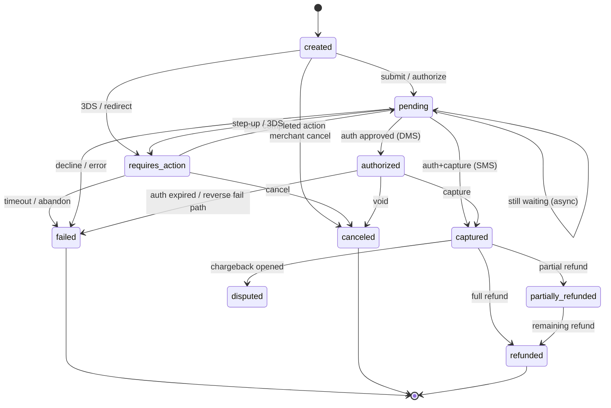
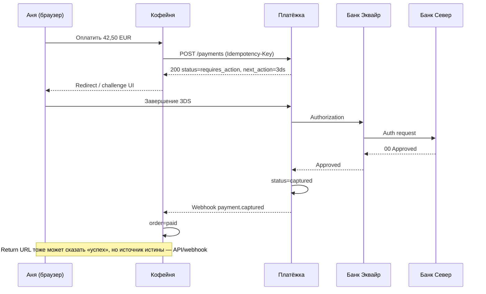
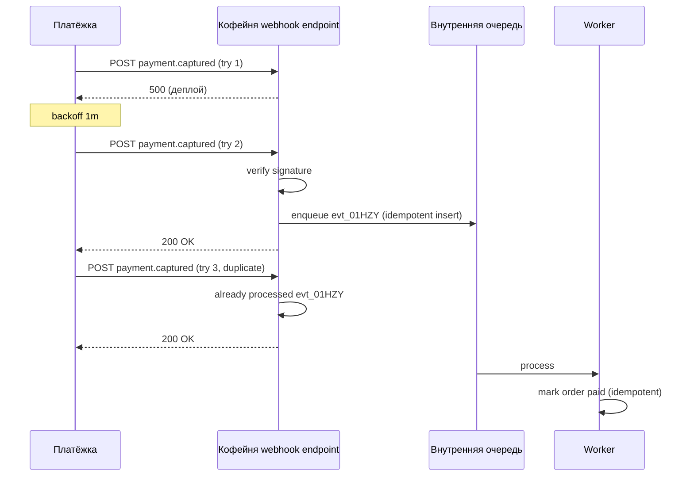
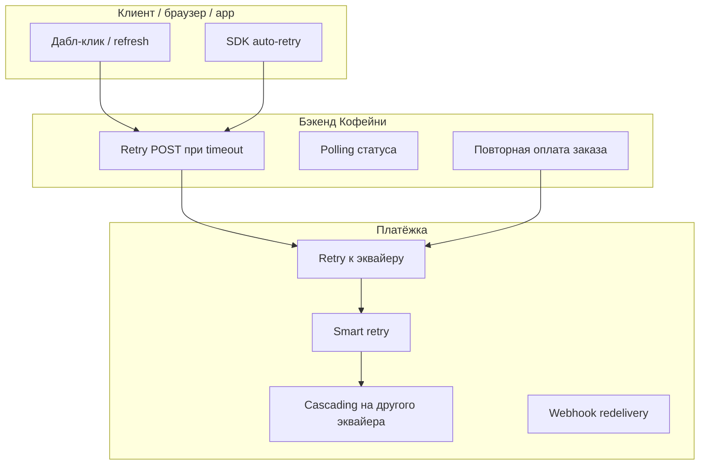
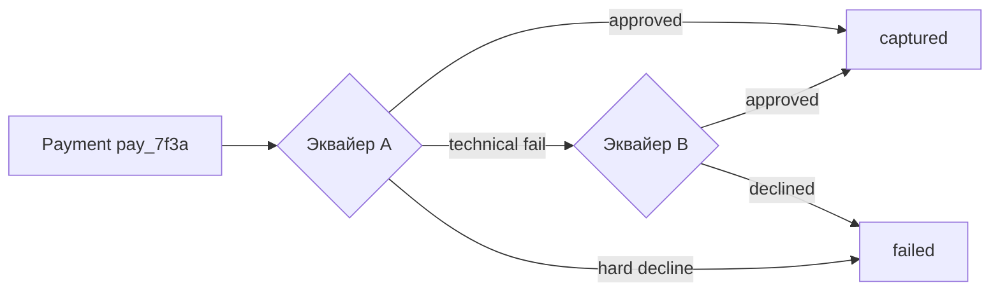
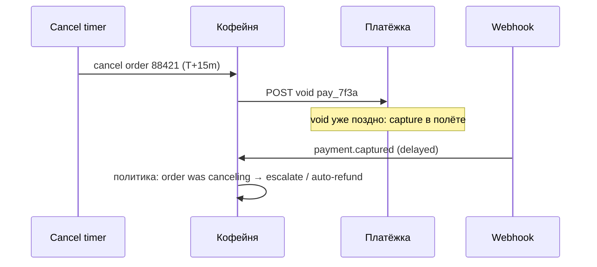

# Глава 07. Состояния платежа, sync/async, webhooks, idempotency, retries

В [главе 06](06-payment-lifecycle.md) мы прошли путь карточного платежа «как в учебнике»: авторизация, capture, клиринг, сеттлмент, refund. На диаграммах всё выглядело линейно — запрос ушёл, ответ пришёл, деньги поехали. В продакшене линейности почти никогда нет.

Аня нажала «Оплатить» в «Кофейне». Браузер завис. Она обновила страницу. Нажала ещё раз. За это время «Платёжка» уже отправила авторизацию в «Банк Эквайр», эмитент «Банк Север» уже захолдировал 42,50 EUR, webhook с результатом улетел в никуда, потому что бэкенд «Кофейни» перезапускался, а фронт показал «что-то пошло не так — попробуйте ещё раз». Вопрос не в том, «прошёл ли платёж». Вопрос в том, **в каком состоянии** он находится у каждого участника — и как эти состояния снова сойдутся.

Эта глава — про то, как инженер думает о платеже как о сущности со временем жизни: машина состояний, синхронные и асинхронные ответы, webhooks, ключи идемпотентности и стратегии повторов. Без этого lifecycle из главы 06 остаётся красивой картинкой, а в проде вы получаете двойные списания, «зависшие» заказы и ночные звонки от поддержки.

## В этой главе

- Машина состояний платежа: зачем она нужна и какие состояния реально встречаются
- Синхронные и асинхронные потоки: когда ответ приходит сразу, а когда — позже
- Webhooks: доставка, порядок, дубликаты, подписи и идемпотентная обработка
- Idempotency key: как не списать дважды при ретраях и дабл-кликах
- Retries на стороне клиента, мерчанта и PSP; smart retries и cascading
- Polling, гонки статусов и кто является источником истины
- Что проверять в коде, мониторинге и тестах — и какие грабли ловят все

---

## Зачем платежу машина состояний

Платёж — не булевый флаг `paid = true/false`. Это процесс, который длится секунды, минуты или дни и проходит через промежуточные фазы, где деньги уже «заняты», но ещё не «ваши», или наоборот — уже списаны у покупателя, а мерчант ещё не уверен, что можно отдавать товар.

Представьте заказ `ord_coffee_88421` в «Кофейне» на 42,50 EUR. В один и тот же момент:

- у Ани в банковском приложении — pending hold 42,50 EUR;
- у «Платёжки» платёж `pay_7f3a…` в статусе `authorized`;
- у «Кофейни» заказ всё ещё `awaiting_payment`, потому что webhook не дошёл;
- у эквайера авторизация жива ещё 6 дней до истечения.

Если ваша система умеет только «успех / неуспех», вы неизбежно врёте хотя бы одной стороне. Машина состояний (payment state machine) — способ честно моделировать эту реальность: у платежа есть **конечный набор статусов**, **разрешённые переходы** между ними и **инварианты** («из `captured` нельзя вернуться в `authorized` без reversal», «из `failed` нельзя сделать `succeeded` тем же payment id» и т.п.).

В доменной модели платформы (подробнее — в [главе 20](20-platform-architecture.md)) платёж обычно отделяют от заказа мерчанта. Заказ «Кофейни» живёт в своём мире (`created` → `paid` → `shipped`). Платёж «Платёжки» — в своём. Связь между ними — через идентификаторы и события, а не через общую таблицу с одним статусом на всё.

### Что именно моделируем

На практике в PSP и у мерчанта почти всегда есть **несколько слоёв статусов**, и путать их — классическая ошибка:

| Слой | Пример сущности | О чём говорит статус |
|---|---|---|
| Бизнес-заказ мерчанта | `Order` | Можно ли отдавать кофе / списывать со склада |
| Платёжная сессия / intent | `PaymentIntent`, `Payment` | Жизненный цикл попытки оплатить |
| Операция на сети | `Authorization`, `Capture`, `Refund` | Конкретное сообщение в сторону банка/схемы |
| Деньги на балансе | `BalanceTransaction`, settlement | Что уже попало в available / pending (см. [главу 12](12-flow-of-funds.md)) |

Когда поддержка пишет «платёж в статусе success, а заказ не оплачен» — почти всегда речь о рассинхроне слоёв, а не о «баге в Visa».

---

## Payment state machine: типовые состояния

У разных PSP названия отличаются (`succeeded` vs `captured` vs `paid`), но смысл сходится. Ниже — рабочая модель, которой пользуются инженеры «Платёжки» для карточных платежей «Кофейни». Это не стандарт ISO, а инженерная абстракция поверх lifecycle из [главы 06](06-payment-lifecycle.md).

### Базовые статусы

**`created` (или `requires_payment_method`).** Платёж заведён в системе: известны сумма, валюта, мерчант, `order_id`. Карты ещё нет или она не подтверждена. Денег никто не трогал. Для Ани это «открылась форма оплаты».

**`pending` / `processing`.** Запрос ушёл во внешний мир (эквайер, банк, 3DS, APM redirect), но финального ответа ещё нет. Самый опасный статус для наивной логики: «раз ответа нет — значит, не прошло» здесь ломает людей и деньги.

**`requires_action`.** Нужно действие пользователя: 3-D Secure challenge, редирект в банк (iDEAL-подобные методы), подтверждение в приложении кошелька. Платёж не провален — он ждёт Аню. Подробности 3DS — в [главе 08](08-3ds-and-sca.md); APM — в [главах 10](10-bank-based-methods.md) и [11](11-wallets-bnpl-local-methods.md).

**`authorized`.** Эмитент одобрил холд. Деньги у Ани заморожены, но ещё не списаны окончательно (в двухстадийной схеме DMS). «Кофейня» может резервировать товар, но capture ещё впереди.

**`captured` / `succeeded`.** Средства списаны (или одностадийная SMS-авторизация сразу завершила оплату). С точки зрения мерчанта «деньги наши» на уровне платёжного факта — хотя на баланс они могут попасть с задержкой settlement.

**`failed` / `declined`.** Финальный отказ: эмитент сказал нет, fraud-движок заблокировал, карта просрочена. Важно различать soft и hard decline — об этом [глава 09](09-declines-and-response-codes.md); для state machine достаточно знать: это терминальное состояние **этой попытки**, но не обязательно терминальное для заказа (можно создать новый платёж).

**`canceled` / `voided`.** Мерчант или система отменили платёж до capture: холд снят (void/reversal). Денег у «Кофейни» нет, у Ани холд должен исчезнуть.

**`refunded` / `partially_refunded`.** После успешного списания деньги (частично) возвращают покупателю. Часто это **отдельная сущность** `Refund`, а у платежа — агрегированный статус. Инженерно чище хранить refunds отдельно и вычислять «полностью ли возвращён», чем плодить десятки статусов.

**`disputed` / `chargeback`.** Покупатель оспорил операцию. Это уже другой жизненный цикл — [глава 17](17-chargebacks-and-disputes.md). В state machine платежа обычно появляется флаг или связанный dispute, а не «откат» в `authorized`.

### Диаграмма переходов



Читать диаграмму словами: из `created` платёж либо уходит в обработку, либо сразу требует действия пользователя. Из `pending` возможны три «хороших» исхода для карточной схемы (authorized / captured) и отказ. Из `authorized` — capture или void. После `captured` деньги уже «прошли», дальше только refunds и disputes. Стрелка `pending → pending` — не баг: при асинхронной обработке вы можете получать промежуточные события «ещё ждём».

### Терминальные и нетерминальные состояния

Инженеру полезно явно пометить статусы:

- **Нетерминальные:** `created`, `pending`, `requires_action`, `authorized` — система ещё может менять исход без создания нового платежа.
- **Терминальные успех:** `captured` / `succeeded` (с оговоркой про последующий refund/dispute — успех оплаты ≠ «история закрыта навсегда»).
- **Терминальные неуспех этой попытки:** `failed`, `canceled`.

Правило продукта: **не переиспользуйте payment id после терминального неуспеха для новой попытки списания**. Новая попытка Ани — новый платёж (или новая attempt внутри intent — см. ниже), иначе вы потеряете аудит и сломаете идемпотентность.

### Payment Intent и попытки (attempts)

Многие современные API разделяют:

- **Payment Intent (или Payment Order)** — намерение получить 42,50 EUR за заказ `ord_coffee_88421`;
- **Attempt / Transaction** — конкретная попытка провести деньги (карта Ани, потом другая карта, потом iDEAL).

Тогда state machine intent'а выглядит грубее (`requires_payment_method` → `processing` → `succeeded` / `canceled`), а детальный разбор отказов живёт на уровне attempts. Это удобно: заказ «Кофейни» привязан к одному intent, а ретраи Ани не плодят пять «оплаченных» заказов. Глубже про доменную модель — [глава 20](20-platform-architecture.md).

### Сквозной пример: статусы глазами всех

Аня покупает набор зерна за **42,50 EUR**.

| Время (UTC) | Событие | Статус у «Платёжки» | Статус заказа у «Кофейни» | У Ани в банке |
|---|---|---|---|---|
| 10:00:00 | Создан платёж `pay_7f3a` | `created` | `awaiting_payment` | — |
| 10:00:01 | Карта отправлена, ждём 3DS | `requires_action` | `awaiting_payment` | — |
| 10:00:25 | Аня подтвердила в приложении банка | `pending` | `awaiting_payment` | — |
| 10:00:26 | Auth approved, auth code `A1B2C3` | `authorized` | `awaiting_payment` | hold 42,50 EUR |
| 10:00:27 | Auto-capture | `captured` | всё ещё `awaiting_payment` (webhook в пути) | hold → posting |
| 10:00:28 | Webhook доставлен | `captured` | `paid` | — |
| T+1..2 дня | Settlement | `captured` + balance pending→available | `paid` | списание в выписке |

Обратите внимание на окно между 10:00:27 и 10:00:28: деньги уже списаны по факту сети, а заказ ещё не `paid`. Если в эти миллисекунды Аня обновит страницу и увидит «оплата не подтверждена», поддержка получит тикет — хотя state machine «Платёжки» уже в `captured`. Отсюда необходимость и webhooks, и polling, и идемпотентного «что с моим платежом?» API.

### Инварианты, которые стоит кодировать явно

1. Сумма capture ≤ сумма authorization (для partial capture — сумма всех capture ≤ auth).
2. Нельзя capture после void и наоборот «вперемешку» без явной бизнес-логики.
3. Refund ≤ captured − already_refunded.
4. Переход только по белому списку рёбер state machine; всё остальное — ошибка приложения, а не «тихо поправим статус в БД».
5. Смена статуса — с записью события (`payment.captured`) и, желательно, версией/revision для optimistic locking.

Нарушение инварианта «поправили статус руками в проде» — частый источник расхождений на сверке ([глава 13](13-ledger-and-reconciliation.md)).

---

## Синхронные и асинхронные потоки

Когда «Кофейня» вызывает `POST /v1/payments`, что она получает в HTTP-ответе? Иногда — финальный результат. Иногда — «принято, разберёмся». Разница между sync и async определяет всю архитектуру checkout'а.

### Синхронный поток

Синхронный (synchronous) ответ значит: к моменту завершения HTTP-запроса у вас есть **терминальный или почти терминальный** исход операции — approve/decline авторизации, ошибка валидации, отказ fraud-движка на входе.

Типичный карточный auth без 3DS в «лучшем мире» укладывается в сотни миллисекунд: мерчант → PSP → эквайер → сеть → эмитент → обратно. «Кофейня» получает:

```json
{
  "id": "pay_7f3a9c2e",
  "status": "captured",
  "amount": 4250,
  "currency": "EUR",
  "authorization_code": "A1B2C3"
}
```

и может сразу показать Ане «Спасибо, заказ оплачен».

Плюсы: проще UX, меньше движущихся частей, проще отладка «запрос-ответ». Минусы: длинный HTTP timeout (нужно держать соединение, пока весь мир отвечает), хрупкость при сетевых сбоях на обратном пути (запрос мог пройти, а ответ — потеряться — см. idempotency ниже), невозможность втиснуть пользовательское действие (3DS challenge) внутрь одного HTTP round-trip без трюков.

### Асинхронный поток

Асинхронный (asynchronous) ответ значит: HTTP-ответ говорит «мы начали» (`pending` / `processing` / `202 Accepted`), а финал придёт **отдельным каналом** — webhook, polling, WebSocket, redirect back URL.

Асинхронность появляется не потому, что архитекторы любят очереди. Она появляется из реальности:

- **3DS / SCA** — нужно показать challenge Ане (см. [главу 08](08-3ds-and-sca.md)).
- **Redirect-методы** — Аня уходит в банк или кошелёк и возвращается через минуты.
- **Банковские переводы и прямые дебеты** — результат часами или днями ([глава 10](10-bank-based-methods.md)).
- **Ручной review fraud** — платёж «на паузе» у риск-команды ([глава 16](16-fraud.md)).
- **Деградация** — эквайер отвечает медленно; PSP не хочет держать HTTP мерчанта 60 секунд и переводит в async.



### Sync поверх async: как это стыкуют

На практике API часто **гибридные**:

1. Создаёте платёж — синхронно получаете `requires_action` или `pending`.
2. Пользователь проходит action.
3. Мерчант либо поллит `GET /payments/pay_7f3a`, либо ждёт webhook, либо использует return URL как hint.
4. Финальный `captured` фиксируется у PSP; мерчант обязан **подтвердить** статус своим запросом, а не верить только фронту.

Return URL (`https://coffee.example/pay/return?payment_id=pay_7f3a`) — удобный UX-сигнал, но плохой источник истины: его можно подделать, оборвать, открыть дважды. Правило: return URL → «сходи в API и узнай статус».

### Таймауты и статус `pending`

Что если «Банк Эквайр» молчит 30 секунд? Варианты:

- **Синхронный timeout у мерчанта:** «Кофейня» оборвала HTTP, но PSP мог продолжить и получить approve. Платёж у PSP — `captured`, у мерчанта — «ошибка сети». Классика двойной оплаты при слепом ретрае.
- **PSP сам переводит в async:** отвечает `pending`, дальше webhook. Честнее для длинных цепочек.
- **Неопределённость:** статус `pending` висит, пока не сработает SLA (например, 15 минут) и reconciliation/query к эквайеру.

Инженерное правило: **timeout ≠ decline**. Timeout — это `unknown` / `pending`, и его нельзя мапить в `failed` без проверки у источника истины.

### Когда какой режим выбирать мерчанту

| Сценарий | Режим | Комментарий |
|---|---|---|
| Карта, без 3DS, низкая латентность | Sync OK | Всё равно нужен idempotency key |
| Карта + 3DS | Async / hybrid | `requires_action` неизбежен |
| Apple Pay / Google Pay | Часто sync-like | Криптограмма уже есть; но SCA-правила региональны |
| iDEAL / Open Banking PIS | Async | Redirect + webhook |
| SEPA debit | Async на часы/дни | Нельзя строить UX «мгновенно paid» |
| Cash voucher | Async | Оплата «офлайн» до дедлайна |

«Кофейне» в Европе для карт почти всегда нужен hybrid из-за SCA. Даже если сегодня frictionless 3DS вернул результат за одну секунду, завтра challenge растянет поток — API должно это переживать без смены интеграции.

---

## Webhooks: когда система зовёт вас сама

Webhook (иногда callback, notification) — HTTP-запрос от PSP к мерчанту (или от процессора к PSP), которым система сообщает о смене состояния: `payment.captured`, `payment.failed`, `refund.created`, `dispute.opened`.

Зачем они, если есть polling? Потому что мерчанту непрактично долбить API каждые 200 мс по миллиону платежей, а события вроде chargeback приходят дни спустя, когда никто уже не поллит checkout-сессию.

### Минимальный контракт

Типичное уведомление «Платёжки» для «Кофейни»:

```http
POST /webhooks/platjozka HTTP/1.1
Host: api.coffee.example
Content-Type: application/json
Platjozka-Signature: t=1730000000,v1=9f2c…
Platjozka-Delivery-Id: whdel_01HZY…
Idempotency-Key: evt_pay_7f3a_captured

{
  "id": "evt_01HZY9…",
  "type": "payment.captured",
  "created_at": "2026-03-18T10:00:27Z",
  "data": {
    "payment_id": "pay_7f3a9c2e",
    "order_id": "ord_coffee_88421",
    "amount": 4250,
    "currency": "EUR",
    "status": "captured"
  }
}
```

Ключевые поля, которые мерчанту нельзя игнорировать:

- **`id` события** — для дедупликации доставок;
- **`type`** — что случилось;
- **бизнес-идентификаторы** (`payment_id`, `order_id`);
- **подпись и timestamp** — чтобы не принять подделку;
- **delivery id** — для отладки с саппортом PSP.

### Надёжность доставки: at-least-once

Почти все платёжные webhooks работают по модели **at-least-once**: PSP будет ретраить, пока не получит HTTP 2xx (или пока не исчерпает лимит попыток). Следствия:

1. Вы **обязаны** обработать дубликаты одного и того же события.
2. Вы **можете** получить событие, которое уже устарело относительно текущего статуса (сначала `captured`, потом повторно старый `authorized` — редко, но порядок не гарантия).
3. «Ровно один раз» на уровне HTTP вам никто не обещал; exactly-once семантика строится у вас в обработчике (см. обзорно здесь и глубже в [главе 21](21-distributed-systems-and-money.md)).



Паттерн «быстрый 200 + асинхронная обработка» хорош для устойчивости, но опасен, если вы отвечаете 200 **до** записи события в своё хранилище: при падении сразу после 200 событие потеряется, а PSP уже не пришлёт (он думает, что доставил). Надёжный минимум: **persisted + дедуп**, потом 200; либо outbox/inbox-паттерны из [главы 21](21-distributed-systems-and-money.md).

### Порядок событий не гарантирован

Сеть не очередь Kafka с партициями по `payment_id` (хотя внутри PSP она может быть). Между датацентрами, ретраями и разными типами событий вы обязаны писать обработчик **толерантный к порядку**:

- Пришло `payment.refunded` раньше повторного `payment.captured`? Смотрите актуальный статус через API или храните version/timestamp и игнорируйте устаревшее.
- Пришло `payment.failed` после того, как заказ уже `paid` по другому attempt? Не отменяйте заказ вслепую — сверьте `payment_id`.

Практический приём: webhook — **сигнал перечитать** ресурс (`GET /payments/pay_7f3a`), а не единственный носитель истины. Особенно если payload урезанный.

### Дубликаты: три уровня

1. **Дубликат доставки одного события** (`evt_01HZY` дважды) — дедуп по `event.id`.
2. **Два разных события об одном факте** (редко: `payment.updated` + `payment.captured`) — дедуп по бизнес-эффекту («заказ уже paid»).
3. **Два платежа на один заказ** (Аня кликнула дважды, два intent) — это уже не webhook-проблема, а idempotency/checkout-дизайн; webhook лишь проявит оба.

Храните таблицу вида `processed_webhook_events(event_id PRIMARY KEY, processed_at)` или используйте unique constraint на `(payment_id, event_type, occurrence)` — в зависимости от модели PSP.

### Подписи, replay и безопасность

Кратко здесь; подробно про webhook security — в [главе 19](19-payment-security-pci.md):

- Проверяйте HMAC/подпись по shared secret или asymmetric key.
- Учитывайте timestamp: отклоняйте слишком старые запросы (replay).
- Слушайте только HTTPS endpoint; не кладите секреты в query string.
- Не доверяйте payload без верификации «потому что IP из allowlist» — allowlist полезен как defense in depth, но не вместо подписи.

### Что отвечает endpoint

| HTTP-код | Как читает PSP | Когда так делать |
|---|---|---|
| 2xx | Успех, не ретраить | Событие принято и дедуплицировано / сохранено |
| 408/429/5xx | Ретрай с backoff | Временный сбой, перегрузка |
| 4xx (кроме 429) | Часто **не** ретраить | Подпись неверна, неизвестный тип — осторожно: «не ретраить» может значить потерю события |

Опасный антипаттерн: отвечать 400 на валидное событие неизвестного вам `type`. Лучше 200 + положить в «неизвестно, посмотреть позже», либо явный ignore-list версий API. Иначе при добавлении PSP нового типа событий вы молча теряете деньги-события.

### Мониторинг webhooks

Мерчанту и PSP нужны метрики:

- доля доставок с первой попытки;
- глубина очереди ретраев;
- возраст самого старого недоставленного события;
- процент дубликатов;
- mismatch «PSP status vs merchant order status» (операционная сверка — [глава 24](24-monitoring-and-operations.md)).

«Кофейня» раз в N минут гоняет job: все платежи `captured` у «Платёжки» за сутки должны иметь заказ `paid`. Расхождения — алерт, не «ну подождём тикет от Ани».

---

## Idempotency: ключ, который спасает от двойного списания

Идемпотентность операции — свойство «повторный запрос с тем же смыслом не создаёт повторный эффект». В платежах это не академическая красота, а защита от самого дорогого класса багов: **два списания за одну чашку кофе**.

### Откуда берутся дубликаты запросов

- Аня дважды кликнула «Оплатить».
- Браузер сделал retry на обрыве сети.
- Мобильное приложение «Кофейни» ретраит POST при timeout.
- API gateway мерчанта ретраит upstream.
- Оператор поддержки нажал «повторить списание» в админке.
- Job «докачай зависшие платежи» запустился дважды по cron.

Во всех случаях намерение одно: оплатить заказ `ord_coffee_88421` на 42,50 EUR. Без идемпотентности каждый POST может стать новым `pay_…` и новой авторизацией.

### Idempotency-Key

Стандартный паттерн публичных Payment API: клиент присылает заголовок `Idempotency-Key` (или поле в теле) — произвольную строку, уникальную для **логической операции**.

```http
POST /v1/payments HTTP/1.1
Authorization: Bearer sk_live_…
Idempotency-Key: ord_coffee_88421_attempt_1
Content-Type: application/json

{
  "amount": 4250,
  "currency": "EUR",
  "order_id": "ord_coffee_88421",
  "capture_method": "automatic",
  "payment_method": "pm_card_anya_sever"
}
```

Поведение «Платёжки»:

1. Если ключ **новый** — выполнить операцию, сохранить `(merchant_id, idempotency_key) → request_hash + response`.
2. Если ключ **повторён с тем же телом** — вернуть **тот же** ответ (тот же `payment_id`, тот же статус), не создавая вторую авторизацию.
3. Если ключ **повторён с другим телом** — ошибка конфликта (например, 422): ключ уже занят другой операцией.

Ключ обычно живёт ограниченное время (часто порядка 24 часов — уточняйте у провайдера; цифры иллюстративные). После истечения тот же ключ может начать новую операцию — поэтому «Кофейне» нельзя вечно полагаться на один ключ без понимания TTL.

### Как выбирать ключ

Хорошие стратегии:

- `order_id + attempt_number` — если явные попытки;
- UUID, сгенерированный **один раз** на клиенте при старте checkout-сессии и сохранённый до успеха/фиаско;
- `order_id`, если бизнес-правило «один успешный платёж на заказ» и повтор должен возвращать существующий успешный платёж.

Плохие стратегии:

- новый UUID на каждый HTTP-ретрай (ключ бесполезен);
- только `order_id` при том, что продукт разрешает доплату/вторую попытку другой картой без смены attempt — застрянете на первом `failed`;
- ключ от одного пользователя, общий на всю сессию браузера без привязки к заказу.

### Что сохранять на стороне PSP

Минимальное хранилище идемпотентности:

| Поле | Зачем |
|---|---|
| `merchant_id` | Ключи изолированы между мерчантами |
| `idempotency_key` | Lookup |
| `request_fingerprint` | Обнаружение конфликта тел |
| `payment_id` / resource id | Связь с сущностью |
| `response_body` / status | Повторный ответ |
| `state` | `started` / `finished` — для in-flight |
| `created_at` | TTL и аудит |

**In-flight:** первый запрос ещё обрабатывается, второй с тем же ключом пришёл. Нельзя начать вторую авторизацию. Варианты: ждать и вернуть тот же результат; ответить `409 Conflict` / `425 Too Early` с просьбой повторить позже. Главное — не «упасть» во второй charge.

### Идемпотентность не только на create payment

Имеет смысл на всех **side-effect** операциях:

- capture;
- refund;
- void;
- payout;
- «confirm» после 3DS.

Refund без ключа при ретрае поддержки — классический способ вернуть Ане деньги дважды (если эквайер не защитился на своём уровне). Надейтесь на свою идемпотентность, но проверяйте и поведение провайдера.

### Связь с at-least-once и очередями

Тема №189 из общей карты книги (подробный разбор в [главе 21](21-distributed-systems-and-money.md)): в распределённых системах вы почти всегда имеете **at-least-once** доставку сообщений. Идемпотентный потребитель — единственный реалистичный способ приблизиться к «ровно одному эффекту». Webhook handler, outbox publisher, «проведи capture» job — все обязаны быть идемпотентными относительно бизнес-ключа, не только HTTP-слоя.

Формула, которую стоит выжечь на доске команды:

> **At-least-once delivery + idempotent handlers ≈ безопасные деньги.**  
> **At-least-once + наивные handlers ≈ дубликаты списаний.**

Exactly-once end-to-end через всю карточную сеть вам никто не подарит. Сеть и эмитент имеют свои STAN/RRN и защиту от дублей сообщений, но ваш HTTP API — отдельный контур.

### Идемпотентность «на чтении» и безопасные методы

`GET /payments/pay_7f3a` по природе идемпотентен: сколько ни читай — новый charge не родится. Путаница начинается, когда команда прячет side effect в GET («на всякий случай дожми capture, если застрял»). Не делайте так: отладка и CDN/прокси-кэши превратят «безопасный» метод в рулетку. Side effects — только в POST/PATCH с ключом; GET пусть остаётся зеркалом состояния.

Ещё один тонкий край: **условная идемпотентность**. Повтор create с тем же ключом после того, как платёж уже `failed`, должен вернуть тот же failed-платёж, а не «переоткрыть» его. Новая попытка оплаты — новый ключ и новый attempt. Иначе вы никогда не отличите «ретрай транспорта» от «пользователь хочет попробовать снова».

### Сквозной пример: timeout и спасение ключом

1. «Кофейня» шлёт `POST /payments` с `Idempotency-Key: ord_coffee_88421_attempt_1`.
2. «Платёжка» уходит в «Банк Эквайр», получает approve, ставит `captured`.
3. Ответ «Кофейне» теряется (обрыв, 502 на API gateway, timeout клиента).
4. «Кофейня» **повторяет тот же POST с тем же ключом**.
5. «Платёжка» возвращает существующий `pay_7f3a`, `status=captured`.
6. Заказ помечается `paid`. Аня списана **один** раз.

Без ключа шаг 5 создал бы `pay_9aa1` и второй холд/списание — и дальше ручной refund, извинения и разбор в reconciliation.

---

## Retries: кто, когда и зачем повторяет

Retry (повтор) — попытка выполнить операцию снова после сбоя или неопределённости. В платежах ретраи бывают полезными и катастрофическими. Разница — в том, **что** вы ретраите и **с каким знанием** о предыдущей попытке.

### Три уровня ретраев



#### 1. Client-side (Аня и фронт)

Фронт не должен слепо долбить `charge` при каждом клике. Защита:

- disable кнопки после первого submit;
- один `Idempotency-Key` на попытку;
- при ошибке сети — «проверить статус», а не «создать новый платёж»;
- не ретраить автоматически операции, которые пользователь не подтверждал повторно.

Мобильные SDK иногда ретраят сами — читайте документацию и выравнивайте с бэкенд-ключами.

#### 2. Merchant-side («Кофейня»)

Бэкенд мерчанта ретраит вызовы PSP. Правила:

- Ретраить **безопасные** read-методы всегда (`GET` статуса).
- Ретраить **write** только с idempotency key и понятной политикой.
- Не ретраить бесконечно: бюджет ретраев, jitter, max attempts.
- Различать: «транспортная ошибка» vs «бизнес-decline». Decline 05 от эмитента ретраить тем же запросом бессмысленно (см. [главу 09](09-declines-and-response-codes.md)).

Типичный псевдокод:

```python
def pay_order(order_id, key, payload):
    try:
        return psp.create_payment(payload, idempotency_key=key)
    except Timeout:
        # не новый key!
        return psp.create_payment(payload, idempotency_key=key)
    except SoftDecline as e:
        if e.retryable and e.advice == "retry_later":
            schedule_smart_retry(order_id)
        else:
            mark_failed(order_id, e)
```

#### 3. PSP-side («Платёжка» → эквайер)

PSP ретраит изоляцию сети, таймауты ISO-коннектора, временную недоступность процессора. Здесь критично:

- не отправить **две разные** авторизации, если первая на самом деле прошла;
- иметь query/reversal-поток для «unknown»;
- учитывать advice codes эмитента / схемы.

Webhook redelivery — тоже вид ретрая, но уже **уведомления**, а не списания.

### Когда ретрай вреден

| Ситуация | Ретраить? | Почему |
|---|---|---|
| HTTP 500 до принятия запроса | Да, с тем же key | Эффекта ещё нет (если уверены) |
| Timeout после отправки auth | Сначала inquire / тот же key | Иначе риск дубля |
| Hard decline (lost card, stolen) | Нет | Эмитент сказал «стоп» |
| Soft decline (insufficient funds) | Осторожно | Позже / другая карта / другой метод |
| Fraud block | Нет автоматом | Нужен разбор |
| 3DS abandoned | Новая attempt, не «тот же auth» | Пользователь не завершил |

### Backoff и бюджет

Слепой retry storm убивает и вас, и эквайера. Базовые практики:

- exponential backoff с **jitter**;
- ограничение параллелизма;
- circuit breaker, если эквайер лежит ([глава 23](23-reliability.md));
- единый **бюджет** ретраев на операцию (сколько раз кто имеет право стучать).

Иначе клиент ретраит 3 раза, мерчант — 3, PSP — 3, и эквайер видит 27 попыток на одну Аню.

---

## Smart retries и cascading

Обычный retry — «повторить то же самое». Smart retry и cascading — «повторить умнее».

### Smart retries

Smart retry — повтор с учётом **причины отказа** и контекста:

- insufficient funds в день зарплаты → попробовать через N дней (для подписок);
- temporary issuer unavailable → короткий delayed retry;
- do not retry / MAC (Merchant Advice Code) → остановиться или сменить метод;
- сеть сказала «try again later» → подождать, не молотить.

Для «Кофейни» one-shot покупки кофе smart retry на «недостаточно средств» редко имеет смысл в момент checkout (Аня лучше выберет другую карту). Для **рекуррентных** списаний (подписка на ежемесячную доставку зерна) smart retry — часть revenue recovery: расписание попыток, уведомление пользователя, смена метода.

Важно: smart retry создаёт **новую попытку** (новый attempt / новый network request) под контролем политики, а не «дублирует неизвестный POST». Идемпотентность здесь другая: ключ на каждую запланированную попытку свой, но бизнес-правила не дают параллельных дублей.

### Cascading (каскад)

Cascading (иногда cascade routing, waterfall) — при неуспехе или недоступности одного эквайера/процессора PSP пробует **другой маршрут** для той же логической оплаты.

Пример: «Платёжка» шлёт auth в «Банк Эквайр». Технический сбой линка. Каскад переключает на резервный процессор B. Аня по-прежнему видит один платёж `pay_7f3a`, заказ один.



Ограничения и риски каскада:

1. **Нельзя каскадить вслепую после unknown approval.** Если эквайер A мог одобрить, но ответ потерян, слепая отправка в B даёт риск двойного холда. Сначала query/reversal по A.
2. **Бизнес-decline** обычно не каскадят на тот же PAN «на авось» — эмитент уже отказал; другой эквайер часто приведёт к тому же. Исключения бывают (разный MCC, другой тип продукта), но это уже тонкая оптимизация.
3. **Стоимость и правила схем** — маршрутизация влияет на interchange и compliance; каскад — не бесплатный крутой трюк.
4. **Идемпотентность на уровне сети** — у каждой попытки свои идентификаторы сообщений; ваш payment id должен связать их в цепочку attempts для аудита.

Cascading близок к теме routing в [главе 22](22-integrations.md); здесь важен аспект **состояний и ретраев**: каскад — управляемая серия attempts внутри одного платежа/intent, а не хаотичные ретраи клиента.

### Связка smart retry + cascading + состояния

В модели «Платёжки»:

- Intent `pi_…` остаётся `processing`, пока политика ретраев жива.
- Каждый attempt имеет свой статус `failed_technical` / `declined_soft` / `declined_hard`.
- Решение движка: retry same rail / cascade / ask user / final fail.
- Мерчант получает либо промежуточный webhook `payment.updated`, либо только финал — зависит от API; документация должна быть честной.

Для инженера мерчанта: не стройте свой каскад поверх PSP, дублируя его smart retry, без согласования — получите войну ретраев.

---

## Склейка картины: один платёж Ани целиком

Соберём историю, где state machine, async, webhook, idempotency и retries встречаются в одном инциденте.

**Сценарий.** Аня оплачивает 42,50 EUR. Включён 3DS. На середине challenge у «Кофейни» деплой, webhook endpoint отвечает 502. Аня после успеха 3DS видит спиннер и жмёт «Обновить».

Таймлайн:

1. `10:00:00` — создан `pay_7f3a`, key=`ord_coffee_88421_attempt_1`, status=`requires_action`.
2. `10:00:20` — Аня проходит challenge; PSP шлёт auth; `captured`.
3. `10:00:21` — webhook #1 → 502; PSP планирует retry.
4. `10:00:22` — return URL открывается, фронт зовёт `GET /payments/pay_7f3a` → `captured`; заказ → `paid`. Уже хорошо.
5. `10:00:25` — Аня не дождалась (медленный GET), жмёт «Оплатить» ещё раз. Фронт **ошибочно** генерирует новый key=`…_attempt_2`.
6. `10:00:26` — новый `pay_9aa1` уходит в auth… но «Кофейня» на бэкенде проверяет «есть ли уже captured payment на order?» и **отклоняет** вторую попытку до PSP — правильный второй рубеж.
7. `10:01:21` — webhook #1 redelivery; обработчик видит `evt_…` уже не нужен: заказ paid; отвечает 200 после дедупа.
8. Аня получает один кофе и одну сумму в выписке.

Разбор ошибок, которых избежали:

- идемпотентность на ключе attempt_1 спасла бы от дубля при ретрае того же POST;
- бизнес-инвариант «один успешный платёж на order» спас от плохого нового ключа;
- GET статуса + webhook вместе закрыли дыру деплоя;
- disable кнопки и reuse key на фронте — тоже стоило бы починить (грабли UX).

Если на шаге 6 бэкенд не проверит заказ и отправит второй платёж — получите два холда, потом void/refund, потом сверку. State machine на уровне заказа и платежа обязана быть согласована правилами, а не «надеждой на аккуратность фронта».

---

## Состояния для не-карточных методов (кратко)

Карточная машина выше — база. Для APM статусы те же по смыслу, но длительности другие:

- **Банковский redirect:** долгое `requires_action`, финал часто только webhook.
- **Instant transfer:** может выглядеть sync для UX, но мерчант всё равно ждёт confirmation от PSP.
- **Отложенный cash/voucher:** `pending` часами до оплаты или expiry → `failed`/`canceled`.
- **Прямой дебет:** `pending` → `succeeded` спустя дни; возможен late failure / return.

Не пытайтесь натянуть карточный `authorized` на все методы. Лучше общая абстракция intent + method-specific substates, чем ложные ожидания capture window там, где capture нет.

---

## Polling, гонки и источник истины

Webhook — не единственный и не всегда достаточный канал. На checkout «Кофейни» почти всегда параллельно живут три источника сигналов:

1. **Return URL / клиентский callback** после 3DS или redirect — быстрый, но недоверенный.
2. **Polling** `GET /v1/payments/{id}` с бэкенда — доверенный, но дорогой, если долбить без ума.
3. **Webhook** — доверенный (после проверки подписи), но с задержкой и ретраями.

Зрелая схема: фронт после return URL просит бэкенд «синхронизируй платёж»; бэкенд один раз (или с коротким backoff) ходит в PSP API; webhook остаётся страховкой для всего, что случится вне активной сессии Ани (capture позже, refund, dispute, late failure SEPA).

### Как поллить, чтобы не устроить DDoS самому себе

- Начинайте сразу после `requires_action` / return: интервал 1–2 секунды несколько раз.
- Дальше — экспоненциально реже (5 с, 15 с, 60 с).
- Останавливайтесь на терминальном статусе или по deadline сессии checkout (например, 15–30 минут для карты+3DS; для voucher — до expiry).
- Не поллите с браузера напрямую секретами PSP — только через свой бэкенд.
- Дедуплицируйте параллельные poll'ы одной вкладки/воркера (lock по `payment_id`).

### Гонки, которые ломают наивные системы

**Гонка A: двойной submit.** Два параллельных `POST /payments` без ключа или с разными ключами. Лечится: idempotency + уникальность «активного платежа на заказ» в БД мерчанта (`UNIQUE` частичный индекс на `order_id WHERE status NOT IN (failed, canceled)` — идея, синтаксис зависит от СУБД).

**Гонка B: webhook vs poll.** Poll уже поставил заказ `paid`, webhook приходит следом и снова начисляет бонусные зёрна. Лечится: идемпотентный эффект «начислить лояльность один раз на `payment_id`».

**Гонка C: cancel vs capture.** Таймер «Кофейни» отменяет заказ через 15 минут `awaiting_payment`, а webhook `captured` опаздывает на 16-й минуте. Нужна явная политика: auto-void через PSP, перевод в ручную очередь, или «воскрешение» заказа. Молчаливое «оставим как есть» заканчивается либо недоставленным товаром при списанных деньгах, либо деньгами без заказа.

**Гонка D: два refund.** Оператор и авто-job одновременно шлют refund. Без idempotency key на refund и без ограничения `refundable_amount` в транзакции БД легко уйти в отрицательный баланс мерчанта.



Именно поэтому state machine должна знать не только «куда можно перейти», но и **что делать при опоздавшем событии**.

### Кто source of truth

Короткий ответ, который стоит повесить в Confluence команды:

| Вопрос | Источник истины |
|---|---|
| Прошла ли авторизация/capture по карте? | PSP / эквайер (потом схема и settlement-файлы) |
| Можно ли отдавать товар Ане? | Заказ мерчанта, обновлённый по подтверждённому статусу платежа |
| Сколько денег доступно к выплате? | Ledger + settlement ([главы 12](12-flow-of-funds.md)–[13](13-ledger-and-reconciliation.md)), не UI-статус checkout |
| Что показать Ане в момент спиннера? | UX-слой с честным «проверяем оплату», пока бэкенд не подтвердил |

Фронт никогда не источник истины о деньгах. Webhook — сильный сигнал, но при сомнении выигрывает свежий GET к PSP плюс сверка.

---

## Наблюдаемость статусов: что логировать

Без корреляционных id разбор инцидента «Аня говорит, что списали дважды» превращается в археологию. Минимальный набор полей в логах и трейсах на каждом hop:

- `order_id` мерчанта (`ord_coffee_88421`);
- `payment_id` / `intent_id` PSP (`pay_7f3a`);
- `idempotency_key`;
- `attempt_no` / `attempt_id`;
- `event_id` webhook'а;
- сетевые id, когда есть (RRN, STAN, authorization code — см. [главу 28](28-glossary.md));
- предыдущий и новый `status`, причина перехода;
- кто инициировал переход: `user`, `merchant_api`, `webhook`, `worker`, `support_admin`.

Тогда timeline из поддержки собирается запросом, а не перепиской «а вы логи смотрели?». Метрики рядом: time-in-state для `pending` и `requires_action`, доля платежей, ушедших в terminal без webhook, доля дублей idempotency hits (это здоровый сигнал, не ошибка).

---

## Что это значит для инженера

1. **Моделируйте платёж как state machine с белым списком переходов**, а не как колонку `status` без проверки. Пишите тесты на запрещённые переходы.

2. **Разделите статусы заказа и платежа.** Заказ `paid` только после подтверждённого успеха платежа (API или проверенный webhook), не после «форма отправилась».

3. **Timeout ≠ failure.** При обрыве — inquire / повтор с тем же Idempotency-Key / сверка, а не новый charge.

4. **Idempotency-Key на все money-side-effects:** create, capture, refund, void, payout. Ключ стабилен на логическую попытку.

5. **Webhook-обработчик: verify → persist/dedup → 2xx → применить эффект идемпотентно.** Не делайте тяжёлую бизнес-логию до сохранения факта доставки, если отвечаете 200.

6. **Считайте webhook at-least-once и out-of-order.** Используйте event id + перечитывание ресурса.

7. **Сведите бюджет ретраев** между фронтом, бэкендом и PSP. Логируйте attempt number.

8. **Для pending заведите watchdog:** Ordinal job «платежи в non-terminal > N минут» → алерт и авто-inquire.

9. **Наблюдайте расхождение слоёв:** `PSP captured` vs `order not paid` — отдельный dashboard ([глава 24](24-monitoring-and-operations.md)).

10. **Каскад и smart retry** проектируйте как явные attempts с аудитом, а не как невидимые сюрпризы для сверки и саппорта.

11. **Тесты:** дубль webhook; webhook раньше return URL; timeout + повтор с тем же key; конфликт ключа с другим телом; запрет второй оплаты paid-заказа.

12. **Документируйте для продукт-команды:** какие статусы показывать Ане человеческим языком («проверяем оплату» для `pending`, а не «ошибка»).

13. **Спроектируйте политику late events** (capture после cancel, refund после payout, dispute после «закрытого» заказа) до того, как они приедут в пятницу вечером.

14. **Коррелируйте order_id / payment_id / idempotency_key / event_id** в логах с первого дня — дешевле, чем внедрять после первого серьёзного инцидента.

---

## Типичные ошибки и грабли

**«У нас только success и fail».** Теряете `pending` и `requires_action` — получаете ложные отмены заказов и повторные списания.

**Маппинг любого исключения в `failed`.** Особенно в catch-all вокруг HTTP-клиента к PSP. Поймали timeout — поставили fail — Аня оформила заказ заново — два списания.

**Новый Idempotency-Key на каждый ретрай.** Ключ как будто есть в заголовке, пользы ноль.

**Вера в return URL как в истину.** Подделанный или частично загруженный return → ложный «успех» без money movement или наоборот.

**200 OK на webhook до записи в БД.** Потеря события при краше процесса.

**Идемпотентность только на create, но не на refund.** Двойные возвраты при ретраях админки и job'ов.

**Ретрай hard decline.** Шум, issuer penalties, плохой UX; иногда — fraud velocity.

**Каскад после unknown на первом эквайере.** Риск двух авторизаций на разных рельсах.

**Гонка: два воркера обрабатывают один webhook.** Без unique constraint оба помечают побочные эффекты (два email «оплачено», два начисления лояльности). Деньги могут быть защищены, а бизнес-эффект — нет.

**Статус `refunded` без сущностей refund.** Потом partial refund некуда добавить; аудит сломан.

**Смешение attempt и intent в одном id.** Невозможно объяснить саппорту, что «третий try другой картой» — не тот же network trace.

**Нет TTL-политики ключей и нет очистки.** Либо дыра безопасности/переполнения, либо сюрприз «ключ протух, создали второй платёж».

**Показ Ане technical status as-is.** `requires_action` в красном баннере «ошибка оплаты» → она начинает новую попытку посреди 3DS.

**Игнор late webhooks.** Заказ уже cancelled по таймеру, приходит `captured` — нужны правила: авто-void, ручной разбор, или «оставить paid и воскресить заказ». Без политики — хаос.

**Side effect внутри GET «для удобства».** Кажется милым авто-capture при чтении статуса — до первого кэша, префетча или двойного poll из двух инстансов.

**Один глобальный retry-wrapper на все HTTP-вызовы.** Библиотека ретраит и `GET`, и `POST /refunds` одинаково; для refund забыли прокинуть ключ — сюрприз в бухгалтерии.

**Смена amount при том же Idempotency-Key.** Клиент «чуть поправил корзину» и переотправил: PSP правильно отвечает конфликтом, фронт показывает «ошибка оплаты», Аня злится. Нужно либо новый ключ на новую сумму, либо явная смена заказа до первой попытки charge.

---

## Для любопытных: оптимистичные UI и «ложный успех»

Некоторые продукты показывают Ане «Оплата прошла!» сразу после frictionless-ответа фронту, не дожидаясь серверной фиксации. Это ускоряет UX, но создаёт класс инцидентов «пользователь видел успех, заказа нет». Если делаете optimistic UI — обязаны иметь компенсирующий поток: догнать статус, уметь извиниться и автоматически разобраться с money/order mismatch. В платежах оптимизм без компенсации — долг под проценты chargeback и саппорта.

---

## Врезка: как это бывает в жизни

Ночной инцидент у «Кофейни»: после релиза webhook-сервис отвечал 200, но писал события в Kafka-топик с ошибочным ACL. PSP доставку считал успешной. Платежи `captured`, заказы висят `awaiting_payment`, склад не отпускает зерно, Аня пишет в поддержку «деньги сняли». Чинили не карточную сеть — чинили inbox и сверку «PSP report vs orders». Мораль: **доставка webhook'а до HTTP 200 ≠ бизнес-обработка**. Мониторьте и то, и другое; держите reconciliation ([глава 13](13-ledger-and-reconciliation.md)) как страховку, не как хобби бухгалтерии.

---

## Итоги главы

1. Платёж — это машина состояний с нетерминальными фазами (`pending`, `requires_action`, `authorized`), а не булевый флаг.
2. Статусы заказа, платежа, сетевой операции и баланса — разные слои; их рассинхрон — нормальная рабочая проблема, которую надо детектить.
3. Синхронный ответ удобен, но реальность (3DS, APM, таймауты) делает async/hybrid неизбежным.
4. `Timeout` и «нет ответа» означают неизвестность, а не отказ.
5. Webhooks работают как at-least-once: нужны подпись, дедуп, толерантность к порядку и иногда перечитывание API.
6. Idempotency-Key — основной предохранитель от двойных списаний при ретраях и дабл-кликах; его надо правильно выбирать и хранить in-flight состояние.
7. Ретраи бывают на клиенте, у мерчанта и у PSP; без общего бюджета они усиливают друг друга.
8. Smart retries и cascading повышают conversion, но только вместе с inquire/unknown-политикой и аудитом attempts — иначе это фабрика дублей.
9. Надёжная формула: at-least-once доставка + идемпотентные обработчики; exactly-once «на всей земле» не существует.
10. Return URL, polling и webhook дополняют друг друга; источник истины о деньгах — API PSP и сверка, не фронт.
11. Дальше логичный вопрос: кто вообще решает, что покупатель — это покупатель, а не мошенник с картой? Следующая глава — про 3-D Secure и SCA.

---

## Связанные главы

- [Глава 06. Жизненный цикл карточного платежа](06-payment-lifecycle.md) — auth/capture/refund как бизнес-операции, которые меняют статусы
- [Глава 08. Аутентификация: 3-D Secure и SCA](08-3ds-and-sca.md) — главный источник `requires_action` на картах
- [Глава 09. Отказы и коды ответов](09-declines-and-response-codes.md) — soft/hard decline и советы по retry
- [Глава 10. Банковские переводы, прямые дебеты и Open Banking](10-bank-based-methods.md) — длинные async-потоки
- [Глава 11. Кошельки, BNPL, наличные и локальные методы](11-wallets-bnpl-local-methods.md) — APM и redirect-паттерны
- [Глава 13. Ledger, двойная запись и reconciliation](13-ledger-and-reconciliation.md) — как ловить рассинхрон денег и статусов
- [Глава 19. Безопасность платежей и PCI DSS](19-payment-security-pci.md) — подписи webhooks, replay
- [Глава 20. Архитектура платёжной платформы и доменная модель](20-platform-architecture.md) — Intent, Transaction, идентификаторы
- [Глава 21. Распределённые системы и деньги](21-distributed-systems-and-money.md) — exactly-once vs at-least-once, outbox, глубокая идемпотентность
- [Глава 22. Интеграции с банками, процессорами и схемами](22-integrations.md) — маршрутизация и каскад на уровне коннекторов
- [Глава 23. Надёжность платёжных систем](23-reliability.md) — бюджет ретраев, circuit breakers
- [Глава 24. Мониторинг и операционная работа](24-monitoring-and-operations.md) — метрики статусов и webhook delivery
- [Глава 29. Сквозные сценарии I](29-scenarios-part-1.md) — потерянный и дублированный webhook, повторная оплата
- [Глава 30. Сквозные сценарии II](30-scenarios-part-2.md) — timeout при уже совершённом списании, восстановление состояния
