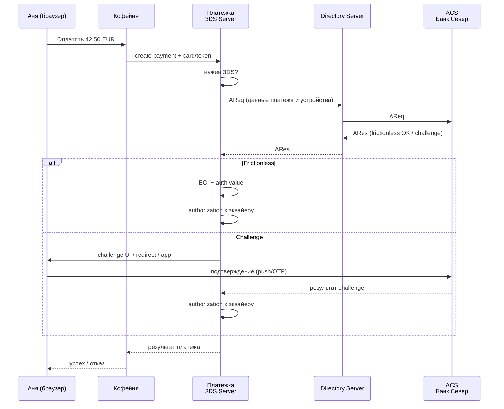
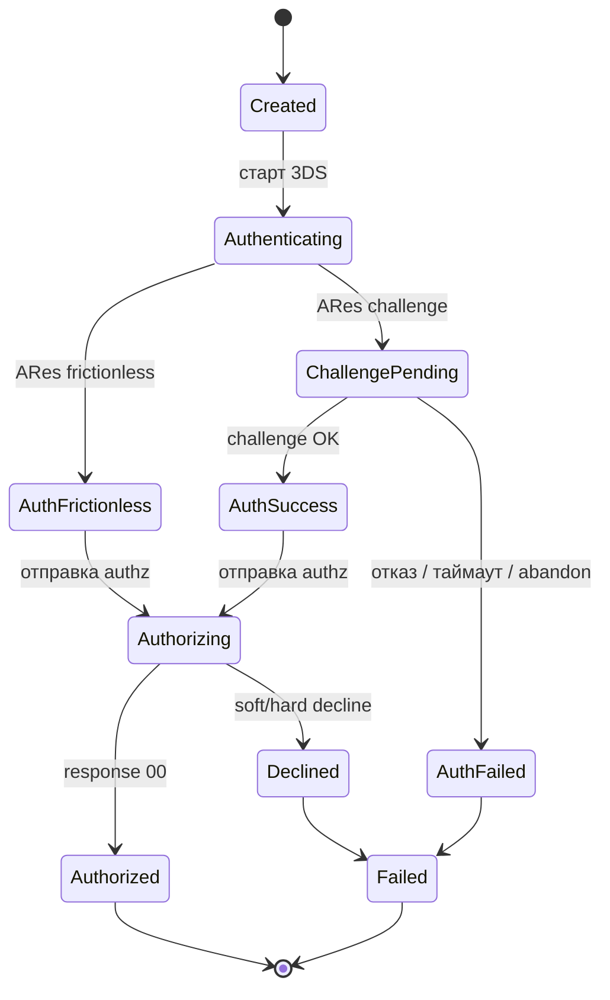
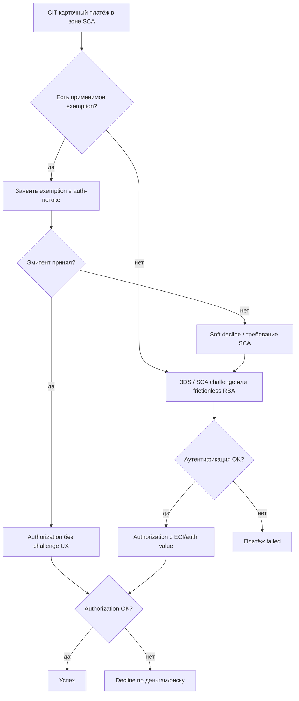

# Глава 08. Аутентификация: 3-D Secure и SCA

Аня нажимает «Оплатить» в интернет-магазине «Кофейня». Карта уже введена, сумма — 42,50 EUR за набор зёрен. Иногда после этого сразу появляется «Оплата прошла». Иногда экран моргает, и Аня оказывается на странице своего банка: «Подтвердите покупку» — и ждёт push в приложение «Банка Север». Иногда push не приходит, и она бросает корзину. Иногда банк говорит «нет» ещё до того, как кто-то успел списать деньги.

Всё это — не «ещё один странный шаг в чекауте». Это отдельный слой платёжного мира: **аутентификация** (authentication) держателя карты. Пока вы не разделите её с **авторизацией** (authorization) — тем самым «можно ли провести платёж на эту сумму», о котором шла речь в [главе 06](06-payment-lifecycle.md), — любые баги с 3-D Secure, SCA и «почему у нас упала конверсия в Европе» будут выглядеть как магия.

Эта глава — про то, кто кого спрашивает «ты точно Аня?», как устроен протокол 3-D Secure (особенно EMV 3DS / 3DS2), что такое frictionless и challenge, зачем европейский регулятор придумал Strong Customer Authentication, какие есть exemptions, куда уезжает liability при chargeback и почему 3DS — это одновременно и щит от мошенничества, и нож, которым легко порезать собственную конверсию.

В этой главе:

- чем authentication отличается от authorization и зачем их путают;
- как эволюционировал 3-D Secure: от 3DS1 к EMV 3DS (3DS2);
- кто такие 3DS Server, Directory Server и ACS;
- frictionless vs challenge — и что видит покупатель;
- SCA по PSD2: что требует закон и как это ложится на карты;
- exemptions: low value, TRA, trusted beneficiary, MIT и другие;
- liability shift — кто платит, если платёж оказался мошенническим;
- 3DS как инструмент против fraud и как его встраивать в продукт.

---

## Два вопроса вместо одного: authentication и authorization

Представьте кассу в физическом магазине. Кассир смотрит на карту (или чип отвечает терминалу) и одновременно банк решает: хватит ли денег, не заблокирована ли карта, не подозрительна ли покупка. В интернете эти два смысла разъехались сильнее.

**Authorization** — это решение эмитента (и инфраструктуры вокруг него): «можно ли зарезервировать / провести сумму X по этой карте у этого мерчанта». Ответ приходит кодом вроде `00` (успех) или `05` / `51` (отказ) — подробнее в [главе 09](09-declines-and-response-codes.md). Авторизация отвечает на вопрос про деньги и риск *с точки зрения счёта и правил банка*.

**Authentication** — это попытка убедиться, что за клавиатурой (или в приложении) сейчас именно держатель карты, а не тот, кто украл PAN и срок действия с какого-нибудь дампа. Аутентификация отвечает на вопрос: «это Аня?».

В Card Present мире (терминал, чип, PIN, иногда биометрия на телефоне) аутентификация часто «вшита» в сценарий предъявления карты. В Card Not Present — в интернет-магазине — карты нет под рукой, CVV легко утекает вместе с номером, и индустрия выдумала отдельный протокол: **3-D Secure** (3DS).

Для инженера это критично по двум причинам.

Во-первых, в вашей платёжной state machine (см. [главу 07](07-states-async-idempotency.md)) аутентификация — отдельная фаза: платёж может быть `requires_action` / `awaiting_authentication`, успешно пройти 3DS и *потом* упасть на авторизации (недостаточно средств), или наоборот — 3DS не пройден, и до авторизации дело не дойдёт.

Во-вторых, юридически и коммерчески это разные вещи. SCA в Европе требует именно *сильной аутентификации* клиента в ряде сценариев. Liability shift при успешном 3DS перекладывает ответственность за определённые виды fraud-chargeback. Авторизация сама по себе liability shift не даёт.

Коротко: авторизация — «можно ли взять деньги». Аутентификация — «кто нажал кнопку». Путать их в логах, в UI и в разговоре с поддержкой — классический способ потратить день на несуществующий баг.

```text
[Покупатель] → ввод карты / клик «Оплатить»
       │
       ▼
┌──────────────────┐     опционально / по правилам
│  Authentication  │  ← 3DS, wallet cryptogram, bank app
│  «это держатель?»│
└────────┬─────────┘
         │ success / fail / exempted
         ▼
┌──────────────────┐
│  Authorization   │  ← эмитент: лимиты, баланс, fraud score
│  «можно списать?»│
└────────┬─────────┘
         │
         ▼
   Capture / Clearing / Settlement  (глава 06)
```

---

## Зачем вообще понадобился 3-D Secure

Онлайн-торговля выросла быстрее, чем доверие эмитентов к CNP-платежам. Украсть карту в интернете проще, чем в офлайне: фишинг, утечки, carding, «купил базу — тестирую по доллару». Мерчанты получали chargeback с reason code про fraud, деньги уезжали обратно держателю (иногда честному, иногда — «friendly fraud»), а продавец оставался и без товара, и без выручки. Подробнее про disputes — в [главе 17](17-chargebacks-and-disputes.md); про виды fraud — в [главе 16](16-fraud.md).

Карточные сети и банки искали способ сказать: «перед авторизацией давайте эмитент сам поговорит с клиентом». Так появился 3-D Secure — протокол, в котором появляется третье «измерение» помимо мерчанта и эквайера: эмитент (через свой Access Control Server) участвует в подтверждении личности.

Название «3-D» исторически отсылает к трём доменам:

1. **Merchant / acquirer domain** — магазин и его эквайер (у нас «Кофейня» и «Банк Эквайр», плюс PSP «Платёжка»).
2. **Issuer domain** — банк карты («Банк Север») и его ACS.
3. **Interop / scheme domain** — инфраструктура карточной сети (Directory Server и правила схемы).

С точки зрения продукта 3DS решает три задачи сразу:

- снизить fraud в CNP;
- дать **liability shift** при успешной аутентификации (при определённых условиях);
- выполнить регуляторные требования вроде SCA в EEA/UK.

Цена — friction: лишние экраны, редиректы, push, SMS, таймауты, падение конверсии. Вся история 3DS1 → 3DS2 — это попытка оставить пользу и убрать максимально возможную боль.

---

## От 3DS1 к EMV 3DS (3DS2): что изменилось на самом деле

### 3DS 1.0: редирект, который все ненавидели

Классический 3DS1 выглядел так: после ввода карты покупателя уводили на страницу банка (часто в iframe или полном редиректе), там просили статический пароль, «секретный вопрос» или одноразовый код из SMS. UX был тяжёлым: страницы банков выглядели по-разному, иногда как фишинг (и покупатели *правильно* пугались), мобильные браузеры ломались на iframe, а статичные пароли через год все забывали.

С точки зрения риска 3DS1 давал аутентификацию, но почти не давал контекста. Эмитент мало что знал о устройстве, сессии и поведении — только «человек что-то ввёл на нашей странице».

К 2020-м 3DS1 в большинстве регионов официально ушёл в закат: схемы отключали поддержку. На момент написания книги (2026) ориентир для интеграций — **EMV 3-D Secure**, в обиходе **3DS2**.

### EMV 3DS / 3DS2: больше данных, меньше лишних экранов

3DS2 сохранил идею «эмитент подтверждает держателя», но перестроил механику:

- вместо обязательного редиректа на «страшную страницу банка» — обмен богатым набором данных (device info, browser data, иногда app SDK), по которым ACS может решить: challenge не нужен;
- поддержка **frictionless** flow: аутентификация проходит «тихо», пользователь может даже не заметить 3DS;
- **challenge** стал современнее: push в banking app, OTP, биометрия в приложении банка, а не только «пароль от 2005 года»;
- отдельные профили для браузера и нативного приложения (Browser / App flow);
- лучшая стыковка с токенами, кошельками и последующей авторизацией (CAVV/AAV и связанные криптограммы уходят в auth-сообщение).

Важно не романтизировать: 3DS2 не «всегда безFriction». Если риск высокий, сумма крупная, карта новая или банк консервативный — challenge будет. И если ваш фронт криво собрал browser data или оборвал callback — frictionless превратится в таймаут и «оплата не прошла».

### Что инженер должен унести из эволюции

3DS1 учил индустрию одному навыку: «открой iframe и жди». 3DS2 учит другому: **собери качественный data set, корректно проведи method URL / fingerprinting шаг, обработай async-результат, правильно прокинь authentication value в authorization**. Это уже не «виджет банка», а полноценный протокол с состояниями — родной брат той async-модели из [главы 07](07-states-async-idempotency.md).

### Сообщения протокола: словарь, который всплывает в логах

В документации провайдера и в PCAP/логах 3DS Server вы встретите короткие имена. Их не нужно зубрить наизусть, но полезно узнать «кто кому пишет»:

| Сообщение | Кто → кому | Зачем |
|---|---|---|
| AReq / ARes | 3DS Server ↔ DS ↔ ACS | Запрос аутентификации и ответ: frictionless, challenge или отказ |
| CReq / CRes | Браузер/SDK ↔ ACS (через challenge flow) | Сам challenge и его результат на стороне клиента |
| RReq / RRes | ACS ↔ 3DS Server (часто через DS) | Результат challenge «сервер-сервер», когда UI уже закрылся |
| 3DS Method | Браузер → Method URL эмитента | Тихий сбор устройства до AReq |

Почему это важно: если вы слушаете только return URL фронта и игнорируете RReq, вы можете «потерять» успешный challenge, когда пользователь вернулся криво, а ACS уже всё подтвердил. Зрелая оркестрация ждёт **серверный** результат (или явный статус от PSP), а фронтовый redirect считает лишь UX-событием.

Ещё одна буква, которая путает онбординг: **3RI** (3DS Requestor Initiated) — сценарии, где requestor инициирует аутентификацию без браузера держателя в моменте (например, для некоторых MIT/декупленных потоков). Это отдельная ветка протокола; не смешивайте её с обычным browser CIT, пока продукт явно не сказал «нам нужно 3RI».

---

## Участники 3DS: кто с кем разговаривает

Без ролей в голове любой sequence diagram превращается в кашу. Разберём участников на истории Ани.

### Merchant и PSP / 3DS Requestor

«Кофейня» хочет принять оплату. На практике она почти никогда не говорит с Directory Server напрямую. Это делает PSP «Платёжка» (или эквайер «Банк Эквайр», или отдельный 3DS-провайдер). Сторона, которая инициирует 3DS от имени мерчанта, в терминологии протокола — **3DS Requestor**.

Мерчанту в API обычно достаточно сказать: «хочу платёж, вот карта / токен, вот сумма, вот return URL». Дальше «Платёжка» решает, нужен ли 3DS, и оркестрирует его.

### 3DS Server

**3DS Server** — компонент на стороне requestor'а (часто у PSP или у специализированного вендора), который:

- принимает запрос на аутентификацию;
- общается с Directory Server схемы;
- помогает провести browser/app flow (в том числе 3DS Method);
- возвращает результат: успех / отказ / challenge required + данные для challenge;
- выдаёт значения, которые потом нужны для авторизации (например, ECI и authentication value).

Если вы строите свой PSP — 3DS Server для вас либо внутренний сервис с сертификацией, либо интеграция с провайдером 3DS Server as a service. «Просто дёрнуть REST эмитента» нельзя: эмитентов тысячи, путь идёт через схему.

### Directory Server (DS)

**Directory Server** — инфраструктура карточной сети (Visa, Mastercard и т.д.). Это «телефонный справочник и коммутатор» 3DS:

- по BIN/картам понимает, какой ACS обслуживает карту;
- маршрутизирует AReq/ARes (authentication request/response) между 3DS Server и ACS;
- участвует в правилах версии протокола, диапазонах карт, доступности 3DS.

Для мерчанта DS обычно невидим. Для инженера PSP — это контрагент, с которым нужно быть совместимым по сообщениям, сертификатам и версиям.

### Access Control Server (ACS)

**ACS** — система эмитента («Банк Север»), которая:

- решает, делать frictionless или challenge;
- проводит challenge (OTP, push, app2app, …);
- возвращает результат аутентификации и криптографические значения для последующей авторизации.

Именно ACS «знает» клиента банка: устройство в banking app, историю входов, антифрод-модели эмитента. Поэтому один и тот же платёж на 42,50 EUR у Ани может пройти frictionless, а у другого клиента того же BIN — уйти в challenge.

### Кто ещё рядом

В реальной схеме рядом ещё:

- **SDK** в мобильном приложении мерчанта (для App flow);
- **browser** покупателя (для Browser flow) — и да, качество сбора browser data влияет на frictionless rate;
- **эквайер / схема** на этапе уже *authorization*, куда попадут ECI и CAVV/AAV;
- иногда отдельный **RBA engine** у эмитента или у PSP (risk-based authentication) — см. также [главу 16](16-fraud.md).



На словах: «Платёжка» через 3DS Server спрашивает схему, схема будит ACS «Банка Север», ACS либо тихо соглашается, либо устраивает challenge Ане, и только потом идёт обычная авторизация денег.

---

## Frictionless и challenge: два лица одной аутентификации

### Frictionless flow

**Frictionless** — аутентификация без видимого участия пользователя. ACS на основе данных (сумма, MCC, устройство, история, score) решает: риск приемлемый, challenge не нужен. С точки зрения Ани экран магазина чуть подождал — и «Оплачено».

Это не «3DS выключили». 3DS *был*, просто challenge не показали. В сообщении авторизации всё равно могут уйти признаки успешной аутентификации (и тогда возможен liability shift — об этом ниже). Для аналитики важно отделять:

- платежи без 3DS вообще;
- платежи с 3DS frictionless;
- платежи с 3DS challenge.

Иначе вы никогда не поймёте, «сломался ли ACS» или «просто все ушли в challenge и бросили».

### Challenge flow

**Challenge** — ACS требует явное действие: код из SMS/push, подтверждение в приложении банка, биометрия, иногда вопросы (реже). Пока challenge не завершён успешно (или не истёк таймаут), авторизацию обычно не отправляют — иначе вы получите отказ или платёж без нужной «обвязки» аутентификации.

Challenge — главный убийца конверсии в Европе после введения SCA. Причины брошенных challenge:

- SMS не доходит (роуминг, антиспам);
- banking app не установлен / устарел;
- пользователь не понимает, зачем его «выкинуло» из магазина;
- iframe/redirect сломался на mobile WebView;
- таймаут ACS или фронта короче, чем думает человек;
- challenge запрошен повторно из-за бага идемпотентности.

По каналу challenge условно делят так:

- **OTP / SMS / email** — просто внедрить банку, плохо по UX и по устойчивости к перехвату;
- **In-app / OOB (out-of-band)** — подтверждение в banking app, пока браузер магазина ждёт; сейчас доминирующий «хороший» путь для SCA;
- **Decoupled** — ещё более отложенное подтверждение (пользователь подтверждает не мгновенно); в e-com чекауте редкий гость, потому что корзина и склад не любят ждать минутами;
- **HTML challenge в браузере** — страница ACS прямо в flow; работает без приложения, но снова упирается в «похоже на фишинг?» и мобильные глюки.

Для «Кофейни» продуктовый вывод простой: вы не выбираете канал — его выбирает ACS «Банка Север». Вы выбираете, **насколько аккуратно** доставите пользователя до challenge и обратно, и не сломаете ли вы ожидание результата.

### Как ACS выбирает режим

Упрощённо ACS смотрит на risk score и политики банка / схемы / регулятора:

| Сигнал | Скорее frictionless | Скорее challenge |
|---|---|---|
| Сумма | низкая / привычная | высокая / atypical |
| Устройство | знакомое, хороший fingerprint | новое, эмулятор, странный UA |
| История | частые покупки у мерчанта | первая покупка, atypical MCC |
| Гео / IP | совпадает с обычным | VPN, другая страна |
| Регуляторика | exemption применим и принят | SCA обязателен без exemption |

Мерчант и PSP влияют на решение косвенно: качеством данных в AReq, правильным заявлением exemption, собственной anti-fraud политикой «когда вовсе не вызывать 3DS» (вне SCA-зон) и UX challenge.

### Врезка: как это бывает в жизни

«Кофейня» заметила: в Германии challenge rate внезапно вырос с ~25% до ~60% за выходные. Виноват был не «банк», а релиз фронта: перестали корректно слать `acceptHeader` / размеры экрана / timezone в browser data. ACS стал видеть «пустышку» и слал всех в challenge. Конверсия просела на несколько пунктов, support завалили тикетами «у вас сайт сломался». Починили data collection — challenge rate вернулся. Мораль: в 3DS2 «тихие» поля формы — это не косметика, это риск-сигнал.

---

## Сквозной пример: Аня, 42,50 EUR и два исхода

Пусть заказ `ord_coffee_10042`, платёж у «Платёжки» — `pay_8f3a21`, карта Visa «Банка Север», покупка в EUR, мерчант в EEA.

### Исход A: frictionless + успешная авторизация

1. «Кофейня» создаёт платёж через API «Платёжки» с `return_url` и токеном карты (или raw-данными через hosted fields — см. PCI в [главе 19](19-payment-security-pci.md)).
2. «Платёжка» видит: регион EEA, remote card payment → нужен SCA-контур; решает идти в 3DS2.
3. 3DS Server собирает browser data, при необходимости дергает 3DS Method URL эмитента (тихий fingerprint).
4. Уходит AReq → DS → ACS.
5. ACS «Банка Север»: устройство знакомо, сумма мелкая, score низкий → **frictionless success**.
6. В ответе — индикаторы вроде ECI (Electronic Commerce Indicator) и authentication value (у Visa часто говорят CAVV, у Mastercard — AAV; точные имена полей зависят от схемы и вашего коннектора).
7. «Платёжка» отправляет authorization в «Банк Эквайр» / схему **вместе** с этими значениями.
8. Эмитент отвечает `00`, холд 42,50 EUR.
9. «Кофейня» получает webhook `payment.succeeded` (или `authorized` — в зависимости от SMS/DMS модели из [главы 06](06-payment-lifecycle.md)).

Иллюстративный фрагмент состояния после frictionless (не привязан к API конкретного вендора):

```json
{
  "payment_id": "pay_8f3a21",
  "amount": 4250,
  "currency": "EUR",
  "status": "authorized",
  "authentication": {
    "type": "emv_3ds",
    "version": "2.2",
    "flow": "frictionless",
    "eci": "05",
    "trans_status": "Y",
    "liability_shift": true
  },
  "authorization": {
    "response_code": "00",
    "auth_code": "A1B2C3"
  }
}
```

Здесь `eci: "05"` — иллюстративный пример «полностью аутентифицированного» e-commerce для одной из схем; в жизни кодировки ECI отличаются между Visa/Mastercard/Amex, и маппить их нужно по документации эквайера, а не по памяти.

### Исход B: challenge, Аня подтверждает в приложении

Шаги 1–4 те же, но ACS возвращает `challenge required`.

5. «Платёжка» отдаёт фронту данные для challenge (redirect / hosted challenge / SDK).
6. Аня видит экран «Подтвердите оплату в приложении Банка Север», получает push, жмёт «Да, это я».
7. ACS завершает challenge успешно (`trans_status` успешного типа).
8. Дальше снова authorization с auth value.
9. Если Аня закрыла вкладку на шаге 6 — платёж остаётся в `requires_action` / `authentication_pending`, потом expires. Денег нет, заказа нет, в метриках — drop-off на 3DS.



Инженерный смысл диаграммы: **не смешивайте** `Authenticating` и `Authorizing` в один статус `processing`. Иначе вы не отличите «ACS молчит» от «эмитент ответил 51».

---

## Что именно возвращает 3DS и зачем это авторизации

После успешной (или попытки) аутентификации в мир авторизации уезжает минимум три смысловых вещи:

1. **Результат аутентификации** — успех, отказ, попытка, недоступность ACS и т.п. (в протоколе — transaction status вроде Y/N/U/A/R/C — точный набор зависит от версии; не заучивайте буквы без спеки вашего провайдера).
2. **ECI** — индикатор электронной коммерции: насколько «сильной» была аутентификация с точки зрения схемы.
3. **Authentication value** (CAVV/AAV и аналоги) — криптографическое подтверждение, которое эмитент/схема могут проверить на этапе authorization.

Если вы «успешно прошли 3DS» на фронте, но **не прокинули** auth value / ECI в authorization — вы можете:

- получить decline;
- провести платёж *без* liability shift;
- нарушить SCA-ожидания (регуляторно и по правилам схемы).

Отдельный класс сюрпризов — **attempts** / частично успешные сценарии (исторически «attempted authentication»): 3DS как бы пробовали, ACS был недоступен или вернул особый статус, ECI другой, liability — под вопросом. Не считайте любой «зелёный экран 3DS» равным полному liability shift: смотрите итоговые флаги от PSP/эквайера.

### ECI без мистики

ECI (Electronic Commerce Indicator) — короткое значение в авторизационном сообщении, которое говорит схеме/эмитенту: «это был такой-то тип e-commerce / такой уровень аутентификации». Путаница начинается потому, что **Visa и Mastercard historically используют разные кодировки** для похожих смыслов. В интеграциях «Платёжки» почти всегда есть слой нормализации: наружу мерчанту отдают понятный флаг вроде `authenticated: true` / `liability_shift: true`, а в ISO8583/коннектор уходит уже «схемный» ECI.

Практические правила:

- не хардкодьте «всегда ставь ECI=05» — это сломает Mastercard-трафик и наоборот;
- храните и ECI, и сырой authentication value, и версию 3DS — при споре с эквайером через полгода вам это понадобится;
- если провайдер отдаёт `liability_shift: null/unknown` — не обещайте поддержке «мы под shift».

### Таймлайн одного challenge (иллюстративно)

Пусть Аня попала в challenge в 12:00:00.

| Время | Что происходит |
|---|---|
| 12:00:00 | ARes: challenge required, фронт показывает «откройте приложение банка» |
| 12:00:05 | Push доходит до телефона Ани |
| 12:00:40 | Аня подтверждает биометрией |
| 12:00:41 | ACS шлёт RReq на 3DS Server |
| 12:00:42 | «Платёжка» отправляет authorization |
| 12:00:43 | Эмитент отвечает `00` |
| 12:00:44 | Webhook в «Кофейню», UI показывает успех |

А теперь сломанный вариант: push пришёл через 90 секунд, а фронт «Платёжки» убил сессию через 60. ACS ещё готов принять ответ, пользователь нажал «да», но мерчант уже показал «сессия истекла» и создал *новый* платёж по второй кнопке. Два challenge, один холд или ноль холдов, тикет в support. Лечится согласованным TTL, идемпотентностью и копирайтом «не нажимайте оплатить повторно — проверьте приложение банка».

---

## SCA и PSD2: зачем государство вмешалось в чекаут

### Откуда взялось требование

В Европе (EEA) директива **PSD2** (Payment Services Directive 2) и связанные регуляторные технические стандарты потребовали **Strong Customer Authentication (SCA)** — сильную аутентификацию клиента — для многих электронных платежей. Цель регулятора: снизить fraud, повысить доверие к безналу. Побочный эффект для индустрии: резкий рост challenge и головной боли у продуктовых команд.

На момент написания книги обсуждаются и внедряются следующие итерации рамок (PSD3/PSR и уточнения SCA) — детали статей лучше сверять с актуальной консультацией юриста и локальным compliance. Здесь важна *суть*, которая для инженера стабильнее номеров директив: **удалённый платёж картой в зоне SCA по умолчанию требует сильной аутентификации, если не сработало законное exemption**.

В UK после Brexit действует свой контур (наследник тех же идей SCA); правила близки по духу, но не клонируйте «как в ЕС» без проверки. Вне EEA/UK SCA-как-регуляторный-обязательный-режим может отсутствовать, но схемы и эмитенты всё равно могут требовать 3DS по своим правилам риска.

Подробнее про PSD2/PSD3 как регуляторный ландшафт — в [главе 18](18-regulation-and-compliance.md). Здесь — прикладной срез для карточного CNP.

### Что такое «сильная» аутентификация

SCA опирается на **два из трёх** независимых факторов:

1. **Knowledge** — то, что знает только пользователь (пароль, знание ответа — на практике всё реже как единственная опора).
2. **Possession** — то, чем владеет (телефон с banking app, аппаратный токен, карта в сочетании с устройством).
3. **Inherence** — то, чем является (биометрия: отпечаток, лицо).

SMS-OTP формально часто опирается на possession (SIM/телефон), но индустрия и регуляторы давно смотрят на SIM-swap и перехват кодов косо: поэтому банки толкают пользователей в app-based challenge и биометрию.

3DS2 challenge в banking app с биометрией — типичный способ удовлетворить SCA для карточного платежа. Frictionless при этом *может* считаться соответствующим SCA, если эмитент применил risk-based подход в рамках разрешённых правил — но это уже зона интерпретаций ACS/схемы, а не «мерчант сам решил, что frictionless = SCA выполнен». Для мерчанта практический контракт проще: **положиться на корректную оркестрацию PSP и на то, принял ли эмитент exemption / провёл аутентификацию**.

### На какие платежи это влияет

В зоне действия SCA типично затрагиваются:

- customer-initiated удалённые карточные платежи e-commerce;
- многие wallet-сценарии (хотя токены Apple Pay / Google Pay с device cryptogram часто идут по отдельной логике — см. [главу 11](11-wallets-bnpl-local-methods.md));
- иногда другие remote electronic payments (не только карты) — но в этой главе фокус на картах и 3DS.

Не путайте: SCA — требование к *аутентификации клиента платежной услуги*, а не «обязательный iframe Visa». 3DS — доминирующий *механизм исполнения* SCA для cards in e-commerce.

### Что будет, если проигнорировать

Если в SCA-зоне отправить authorization без надлежащей аутентификации / без принятого exemption, эмитент часто отвечает soft decline в духе «authentication required» (у разных схем и банков разные коды; обработку и retry-стратегии разбираем в [главе 09](09-declines-and-response-codes.md)). Правильная реакция PSP: уйти в 3DS и повторить авторизацию с результатами — а не бесконечно ретраить ту же голую авторизацию.

---

## Exemptions: когда сильную аутентификацию можно не показывать

Exemptions — это официальные «лазейки», точнее **законные исключения**, когда SCA можно не применять (или применить в ослабленном виде), чтобы не убить мелкие платежи и подписки. Их заявляет обычно одна из сторон (мерчант/PSP/эквайер), а **эмитент может exemption принять или отклонить**. Отклонил — ждите challenge или soft decline «пойдите в SCA».

Ниже — основные, которые обязан понимать любой, кто строит чекаут в Европе. Это не юридическая консультация; локальные нюансы и актуальность на 2026 год нужно сверять с compliance.

### Low value (низкая сумма)

Платежи ниже определённого порога (в регуляторике PSD2 классически фигурировали суммы порядка 30 EUR — уточняйте актуальный порог и накопительные лимиты) могут идти без SCA, но с **ограничениями по кумулятивной сумме и/или числу подряд идущих exemption'ов**. То есть «всегда low value и никогда challenge» — так не работает: после серии мелких покупок эмитент всё равно потребует сильную аутентификацию.

Для «Кофейни» с чеком 42,50 EUR low value уже может не подойти — сумма выше иллюстративного порога. Для доппродажи шоколадки за 2,90 EUR — может.

### Transaction Risk Analysis (TRA)

**TRA** — exemption на основе анализа риска, доступное при выполнении условий по fraud rate у эквайера/PSP (пороги зависят от суммы и регуляторики). Идея: если у вас зрелый антифрод и низкий fraud, регулятор позволяет не беспокоить пользователя challenge'ем на части трафика.

На практике TRA — это не «включили галочку в админке». Это:

- измеримый fraud rate;
- право заявлять TRA на уровне эквайера;
- готовность эмитента принять;
- понимание, что при росте fraud privilege могут отобрать.

PSP «Платёжка» может заявлять TRA за мерчантов в своём портфеле — если позволяет её эквайерская модель и цифры.

### Trusted beneficiary (белый список мерчанта)

Держатель может добавить продавца в **доверенные** у своего банка (trusted beneficiary / merchant whitelisting). Тогда последующие платежи этому мерчанту могут идти без SCA.

UX тут зависит от банка: иногда whitelist предлагают *после* успешного challenge. Мерчант не может «записать себя в доверенные» сам — только пользователь через эмитента. Для «Кофейни» с повторными покупками это золото: один challenge — и дальше friction меньше.

### Merchant-Initiated Transactions (MIT)

**MIT** — платежи, инициированные мерчантом уже *после* того, как клиент дал мандат: рекуррент, рассрочка, unscheduled credential-on-file (досписание за услуги). Подробная таксономия CIT/MIT — в [главе 05](05-card-contexts-and-tokens.md).

Ключевая идея для SCA: **первая** транзакция серии (setup) обычно требует SCA/3DS, а последующие MIT при корректной маркировке (stored credential indicators, network transaction ID / original reference) могут идти **без** новой SCA.

Типичная ошибка: провести первый платёж без 3DS «чтобы не мешать», сохранить карту, а потом удивляться soft decline на рекурренте и отсутствию нормальной цепочки MIT. Делайте наоборот: тяжёлую аутентификацию — на установке мандата.

### Secure corporate payments и другие

Для B2B / dedicated corporate processes бывают отдельные exemption'ы (например, через защищённые платёжные процессы компаний). Они узкие, сильно зависят от продукта и не спасают обычный consumer checkout «Кофейни».

Также встречаются сценарии вроде delegation / делегирования аутентификации в рамках конкретных продуктов — не стройте на них общий happy path, пока compliance явно не сказал «да».

### Recurring и one-click: как не сломать голову

| Сценарий | Нужен ли 3DS/SCA обычно | Комментарий |
|---|---|---|
| Первый CIT, EEA, карта | Да (или exemption) | Базовый e-com |
| Повторный CIT one-click | Часто да, но возможны TRA / trusted / low value | Не путать с MIT |
| MIT recurring после мандата | Часто exemption MIT | Нужна корректная маркировка |
| Сохранение карты без списания (zero auth / account verification) | Часто да, если потом будут CIT/MIT | Зависит от продукта |
| Apple Pay с device auth | Часто иной путь | Биометрия на устройстве + cryptogram |

### Кто «владеет» решением по exemption

Мерчант может *попросить* («хотим TRA»). PSP/эквайер может *заявить* exemption в сообщении. Эмитент *принимает или нет*. Схема задаёт правила передачи. Поэтому в API «Платёжки» честный статус выглядит так: `exemption_requested: tra`, `exemption_accepted: false`, `flow: challenge` — а не «TRA включён, значит challenge rate = 0».



---

## Liability shift: кому прилетит chargeback за fraud

Допустим, мошенник всё же провёл оплату «картой Ани», товар ушёл, Аня пишет в банк: «это не я». Открывается fraud chargeback (см. [главу 17](17-chargebacks-and-disputes.md)). Вопрос на миллион: **кто несёт убыток — мерчант или эмитент?**

**Liability shift** в контексте 3DS означает: при определённых условиях успешной аутентификации ответственность за *этот класс* мошенничества смещается с мерчанта на эмитента (упрощённо). Мерчант «сделал всё правильно по протоколу», эмитент подтвердил держателя — значит, эмитент не может просто переложить fraud на продавца тем же путём, что при «голом» CNP.

Это не абсолютный иммунитет от всех chargeback. Liability shift:

- обычно про **fraud** reason codes, а не про «товар не пришёл» / quality disputes;
- зависит от ECI / статуса аутентификации / правильности данных;
- может не применяться при ошибках интеграции, attempts, некоторых exemption-сценариях;
- не отменяет операционные комиссии и правила программ мониторинга схем.

### Практическая таблица для инженера и риск-менеджера

| Ситуация | Ожидание по liability (упрощённо) |
|---|---|
| Успешный 3DS (полный auth, корректный ECI) | Часто shift на issuer при fraud |
| Frictionless success с корректными значениями | Аналогично — это тоже 3DS |
| Challenge success | Аналогично |
| 3DS failed, платёж всё равно провели «как получится» | Обычно shift нет + плохая идея |
| Exemption без 3DS, эмитент принял | Часто liability на мерчанте (вы сознательно взяли риск) |
| Soft decline «нужен 3DS», вы проигнорировали | Плохо и для approval, и для liability |
| Auth value не прокинули | Риск потерять shift |

Именно поэтому продукт иногда говорит: «давайте не будем включать 3DS — конверсия выше». Риск отвечает: «ок, но fraud chargeback останется на нас». В зоне SCA этот спор часто закрывает регулятор: без аутентификации/exemption вы просто не получите approval.

### Связь с мониторингом

Даже с liability shift высокий challenge abandon и высокий fraud — красные лампочки для схем и эквайера. Liability shift — не лицензия на токсичный трафик. Программы вроде повышенного мониторинга fraud/chargeback ratio живут своей жизнью ([глава 17](17-chargebacks-and-disputes.md), [глава 16](16-fraud.md)).

---

## 3DS как инструмент против fraud

Регуляторика заставила многих внедрить 3DS. Но даже вне Европы 3DS остаётся рычагом антифрода. Как им пользоваться осознанно — а не «включили всем и уронили sales».

### Что 3DS реально отрезает

Хорошо закрывает:

- использование украденных PAN+exp+CVV без доступа к фактору владения (телефону/банку Ани);
- часть автоматизированного carding (ботам сложно проходить challenge массово);
- сценарии, где эмитент видит аномалию и требует step-up.

Плохо закрывает или не закрывает:

- **account takeover** у самого банка/телефона (мошенник уже в приложении Ани);
- **friendly fraud** («я не помню покупку» / «мне поможет банк») — challenge был, liability мог уехать на issuer, но спор и операционные издержки остаются;
- социальную инженерию, где жертва *сама* подтверждает push;
- атаки на мерчанта после авторизации (логистика, возвраты) — это уже не про 3DS.

То есть 3DS — слой **holder authentication**, а не серебряная пуля антифрода. Его комбинируют со scoring, velocity, device fingerprint, правилами на стороне PSP/мерчанта ([глава 16](16-fraud.md)).

### Стратегии включения

Типичные политики у зрелого PSP:

1. **Always 3DS** в SCA-зоне для CIT — базовый compliance-режим.
2. **Risk-based 3DS** вне SCA: высокий score → 3DS, низкий → прямая авторизация (быстрее, но без shift).
3. **Exemption-first**: пробуем TRA/low value, при soft decline — step-up в 3DS.
4. **Step-up only**: сначала авторизация, при soft decline «нужна аутентификация» — 3DS и retry (осторожно с UX и идемпотентностью).

Для «Кофейни» в ЕС разумный дефолт: оркестрация «Платёжки» с exemption там, где позволено, и обязательный 3DS-контур на CIT. Для продажи в регион без SCA — можно крутить risk-based, глядя на fraud rate и маржу.

### Метрики, без которых 3DS бесполезен

Если в мониторинге нет отдельных разрезов, вы управляете туманом:

- 3DS start rate;
- frictionless rate;
- challenge rate;
- challenge success / abandon / fail;
- time-to-complete challenge;
- conversion after 3DS vs auth-only;
- soft decline «authentication required» rate;
- share of payments with liability shift = true;
- fraud rate / chargeback rate в разрезе «with 3DS» / «exemption» / «no 3DS».

Подробнее про операционные метрики — в [главе 24](24-monitoring-and-operations.md). Здесь главное: **challenge rate сам по себе не враг**; враг — abandon и падение approval без снижения fraud.

### Врезка: для любопытных — «3DS Method» и зачем он нужен

В 3DS2 перед AReq часто выполняется тихий шаг: браузер обращается к Method URL эмитента, чтобы ACS получил cookies / устройство раньше challenge. Пользователь ничего не должен заметить. Если вы заблокировали third-party cookies, обрезали iframe method, не дождались callback и пошли дальше — ACS недополучил сигнал, frictionless rate падает. Это одна из самых частых «невидимых» интеграционных грабель.

---

## Браузерный и app flow: интеграционные паттерны

### Browser flow

Классика веб-чекаута «Кофейни»:

1. Сервер создаёт платёж.
2. Фронт собирает browser data (или это делает JS SDK «Платёжки»).
3. Возможен скрытый iframe для 3DS Method.
4. При challenge — redirect или встроенный challenge UI.
5. Return URL / postMessage / webhook завершают состояние.

Главные риски: WebView внутри приложений, блокировщики, сломанный return URL, потеря idempotency key при повторе кнопки «Оплатить».

### App flow (SDK)

Нативное приложение мерчанта встраивает 3DS SDK, который умеет общаться с ACS более «приложенческим» способом (включая app-based challenge out-of-band). UX часто лучше, чем браузерный редирект, но появляется зависимость от версии SDK, сертификации и обновлений OS.

### Hosted vs embedded

- **Hosted payment page / hosted challenge** — меньше PCI scope и меньше шансов сломать протокол руками; меньше контроля над UX.
- **Embedded / native** — красивее воронка, больше ответственности за data quality и edge cases.

Про scope и PCI — [глава 19](19-payment-security-pci.md). Про безопасность API и webhooks (подписи, replay) — там же; для 3DS это важно, потому что результат challenge часто приходит async callback'ом.

---

## Данные, приватность и безопасность вокруг 3DS

3DS2 живёт тем, что мерчант/PSP отправляет много сигналов: IP, device ID-подобное, email, историю корзины иногда, browser headers. Это полезно для frictionless и антифрода, но поднимает вопросы минимизации данных и хранения.

Практические правила:

- не логируйте полные PAN рядом с 3DS debug — токенизируйте ([глава 03](03-bank-card-anatomy.md), [глава 19](19-payment-security-pci.md));
- debug-логи AReq полезны, но быстро становятся PII-помойкой: маскируйте;
- result callback URL должны проверять подпись/origin, иначе мошенник пришлёт вам «authentication success» поддельным запросом;
- не доверяйте только фронту: итоговый статус 3DS подтверждайте сервер-сервер у своего 3DS Server/PSP.

Тема безопасности карточных данных и API (в исходном перечне рядом с PCI и fraudulent API requests) в этой главе раскрывается так: **3DS не отменяет PCI и API security**; он добавляет новые поверхности атаки (return URL, method iframe, challenge endpoints, SDK), которые нужно защищать так же жёстко, как платёжный API.

Отдельно про fraudulent API requests вокруг аутентификации:

- атакующий может пытаться подобрать токены сессии challenge или дергать finalize URL чужого платежа — rate limit и привязка к серверной сессии обязательны;
- «успешный» клиентский postMessage без сверки с backend — дыра;
- повторная отправка старого authentication value на новый платёж должна отвергаться: value привязан к сумме/мерчанту/транзакции в рамках правил схемы.

Если коротко для архитектора: считайте 3DS таким же доверенным контуром, как authorize endpoint. Не «виджетом банка на полях-часа».

---

## Что это значит для инженера

1. **Разведите статусы.** `requires_authentication`, `authentication_succeeded`, `authentication_failed`, `authorized`, `declined` — разные вещи. Смешать их в `processing` — значит отлаживать прод вслепую.

2. **Идемпотентность вокруг challenge.** Пользователь жмёт «Оплатить» дважды, возвращается с return URL дважды, webhook приходит дважды. Один платёжный intent — один активный 3DS session. См. [главу 07](07-states-async-idempotency.md).

3. **Прокидывайте authentication value.** Успех UI ≠ успех протокола. Без ECI/CAVV (или эквивалента) в authorization вы теряете смысл 3DS.

4. **Обрабатывайте soft decline «нужна аутентификация».»** Это не «карта плохая». Это команда: сделайте SCA/3DS и повторите корректно — один раз, с новой обвязкой, не штормом ретраев.

5. **Собирайте browser/app data качественно.** Frictionless rate — функция данных. Тестируйте WebView, Safari ITP, In-App browser.

6. **Таймауты согласуйте с UX.** ACS, фронт, API gateway и «человеческое время на достать телефон» живут в разных шкалах. Покажите «ждём подтверждения в банке», дайте путь cancel/retry без дубля списания.

7. **Маркируйте MIT/CIT правильно.** Иначе exemption не взлетит, а рекуррент развалится. Связка с [главой 05](05-card-contexts-and-tokens.md).

8. **Считайте воронку 3DS отдельно.** Алерт на падение frictionless rate после релиза фронта — must-have.

9. **Не обещайте liability shift в UI поддержки без флага.** Смотрите то, что вернул эквайер/PSP, а не «ну у нас же 3DS был».

10. **Тесты.** На стендах прогоняйте: frictionless success, challenge success, challenge fail, ACS unavailable, method timeout, return URL с потерей сессии, повторный webhook. Сценарно это же разберём в [главе 29](29-scenarios-part-1.md).

Псевдокод оркестрации (иллюстративно):

```python
def pay(cit_payment):
    intent = create_intent(cit_payment, idempotency_key=cit_payment.key)

    if needs_sca_zone(intent) or risk_requires_3ds(intent):
        authn = start_3ds(intent)
        if authn.status == "challenge_required":
            return present_challenge(authn)
        if authn.status != "authenticated":
            return fail(intent, reason="authentication_failed")
        intent.attach(authn.eci, authn.auth_value)

    result = authorize(intent)
    if result.is_soft_decline_auth_required():
        authn = start_3ds(intent)
        return present_challenge(authn)  # затем authorize с auth value

    return result
```

---

## Типичные ошибки и грабли

**Путают authentication и authorization в логах и тикетах.** «Банк отклонил на 3DS» пишут и про отказ ACS, и про `51` на авторизации. Введите разные reason namespaces.

**Считают, что frictionless = 3DS выключен.** И дальше удивляются наличию ECI и поведению fraud. Наоборот: frictionless — это успешный 3DS без UI.

**Ломают 3DS Method и browser data.** Самый тихий способ убить конверсию в Европе.

**Не обрабатывают abandon.** Висит `requires_action` вечно, склады резервируются, маркетинг считает «почти купили». Нужен TTL и освобождение заказа.

**Дублируют challenge.** Два параллельных AReq на один клик — гонка, странные статусы, двойные push'и клиенту.

**Игнорируют soft decline.** Ретраят ту же авторизацию без 3DS, ловят rate limit и hard problems с эмитентом.

**Включают 3DS «всегда» вне SCA без анализа.** Fraud чуть падает, конверсия падает сильнее — юнит-экономика страдает. Или наоборот, выключают 3DS ради конверсии и тонут в chargeback.

**Неверно маркируют recurring.** Первый платёж без SCA, последующие MIT «как получится» — классика ночных алертов после роста подписок.

**Доверяют только клиентскому callback.** Подделанный «success» на return URL без серверной проверки — путь к фроду.

**Обещают пользователю «банк гарантированно спросит пароль».»** При frictionless не спросит. При app push — спросит не пароль. Ожидания надо калибровать копирайтом.

**Смешивают liability shift и «chargeback невозможен».»** Возможен. Особенно non-fraud. И даже fraud-процесс имеет нюансы.

**Забывают про локализацию и доступность challenge.** Экран банка на другом языке, нет fallback, если push не работает — Аня уходит к конкуренту.

---

## Итоги главы

1. **Authentication ≠ authorization.** Сначала «кто», потом «можно ли списать» — и в протоколе, и в state machine.
2. **3DS — мост к эмитенту в CNP**, чтобы подтвердить держателя и (часто) получить liability shift.
3. **EMV 3DS (3DS2)** заменил тяжёлый 3DS1: больше данных, frictionless, современные challenge, app/browser flows.
4. **Ключевые участники:** 3DS Requestor / 3DS Server, Directory Server схемы, ACS эмитента.
5. **Frictionless и challenge** — оба настоящий 3DS; отличаются UX и метриками воронки.
6. **SCA (PSD2 и наследники)** делает сильную аутентификацию нормой для многих remote-платежей в EEA/UK; 3DS — основной механизм для карт.
7. **Exemptions** (low value, TRA, trusted beneficiary, MIT, …) снижают friction, но их принимает эмитент, а риск часто остаётся на мерчанте.
8. **Liability shift** защищает не от всех диспутов и только при корректной аутентификации/значениях в авторизации.
9. **Как антифрод-инструмент** 3DS силён против украденных реквизитов без контроля телефона/банка и слаб против ATO, социальной инженерии и friendly fraud — ему нужен соседний risk-слой.
10. **Для инженера** победа = корректные статусы, данные, идемпотентность, обработка soft decline и честные метрики, а не «подключили SDK и забыли».

Дальше логично разобрать, **почему платёж всё-таки отклоняют** — даже после красивого 3DS: коды ответов, soft vs hard decline, что ретраить, а что нет. Этому посвящена [глава 09](09-declines-and-response-codes.md).

---

## Связанные главы

- [Глава 05. Где и как используется карта: CP/CNP, MOTO, credentials on file, токены](05-card-contexts-and-tokens.md) — CIT/MIT и stored credentials, без которых exemption MIT не взлетит.
- [Глава 06. Жизненный цикл карточного платежа](06-payment-lifecycle.md) — куда после аутентификации идут authorization, capture и settlement.
- [Глава 07. Состояния платежа, sync/async, webhooks, idempotency, retries](07-states-async-idempotency.md) — async-состояния challenge и идемпотентность.
- [Глава 09. Отказы и коды ответов](09-declines-and-response-codes.md) — soft decline «authentication required» и стратегия retry.
- [Глава 11. Кошельки, BNPL, наличные и локальные методы](11-wallets-bnpl-local-methods.md) — device cryptogram и аутентификация в Apple Pay / Google Pay.
- [Глава 16. Payment fraud: обнаружение и предотвращение](16-fraud.md) — 3DS в общей системе антифрода.
- [Глава 17. Chargebacks и disputes](17-chargebacks-and-disputes.md) — fraud chargeback и смысл liability shift.
- [Глава 18. Регуляторика и compliance](18-regulation-and-compliance.md) — PSD2/PSD3 и SCA в регуляторном контексте.
- [Глава 19. Безопасность платежей и PCI DSS](19-payment-security-pci.md) — PCI scope, защита callback и card data рядом с 3DS.
- [Глава 24. Мониторинг и операционная работа](24-monitoring-and-operations.md) — метрики challenge/frictionless/conversion.
- [Глава 29. Сквозные сценарии I](29-scenarios-part-1.md) — полный сценарий оплаты с 3DS.
