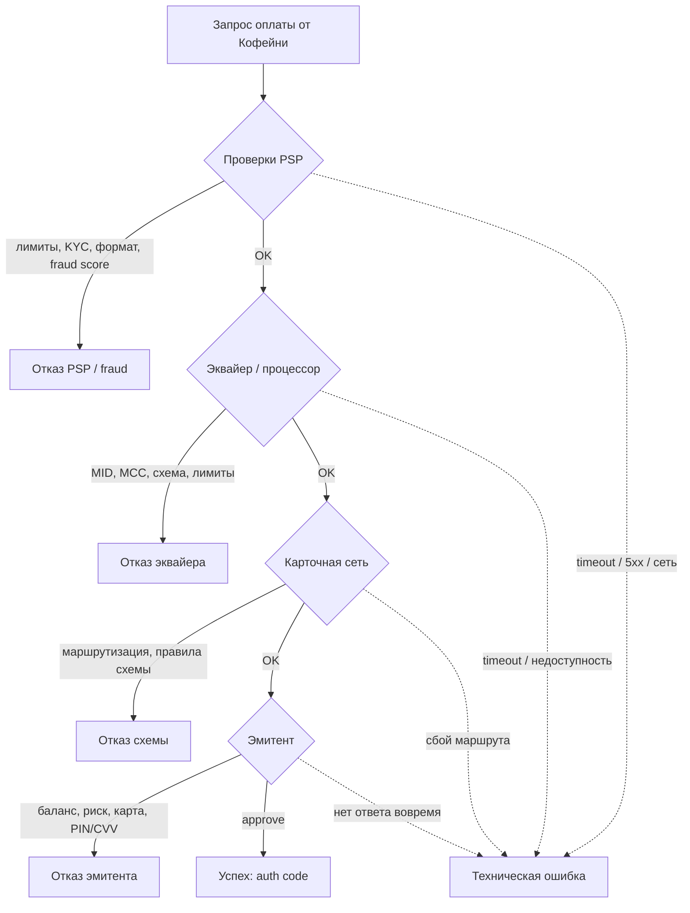
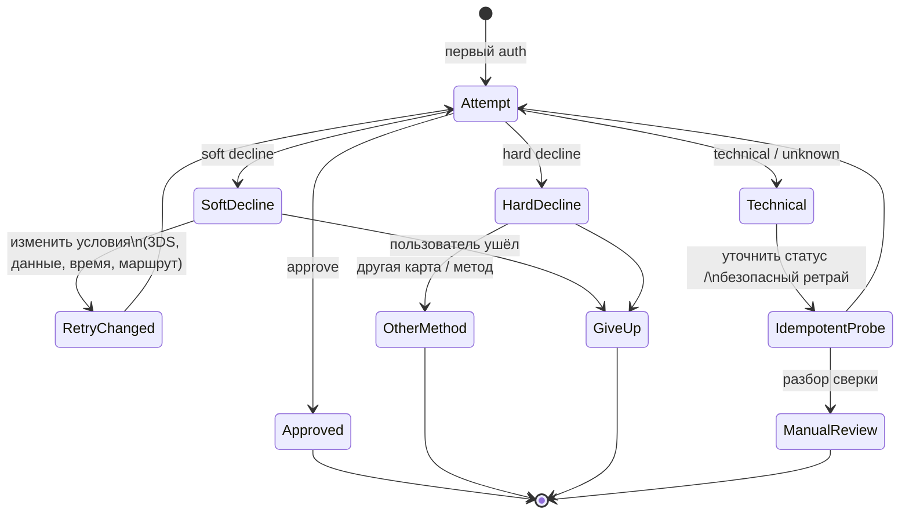
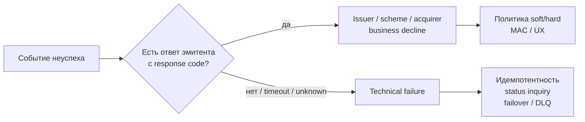
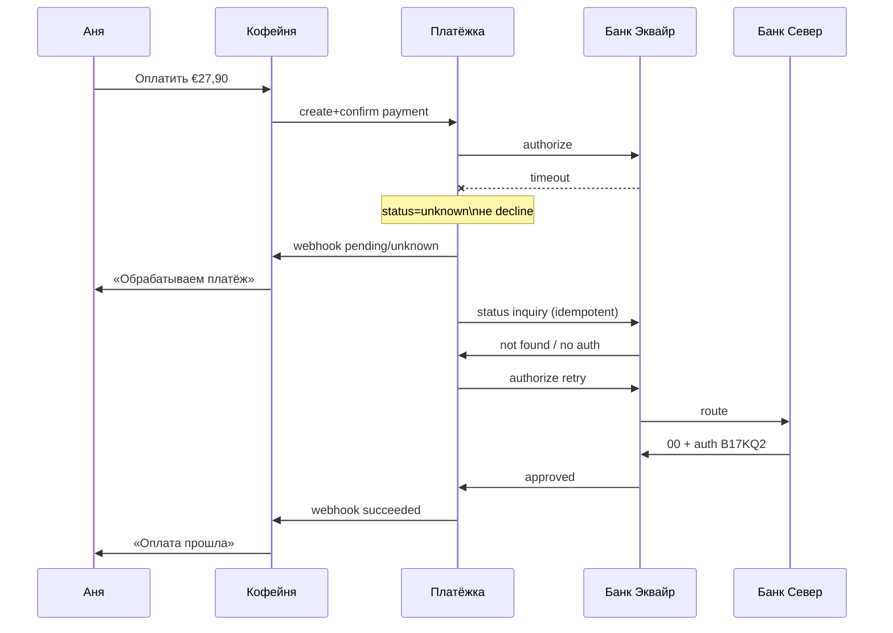
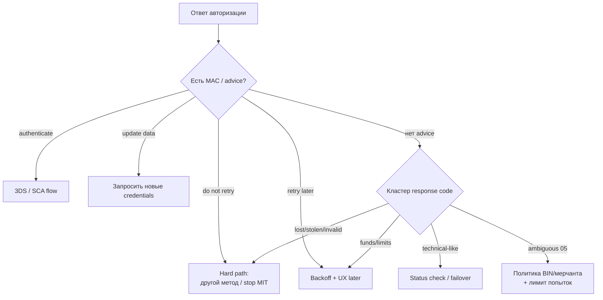

# Глава 09. Отказы и коды ответов

Успешный платёж в учебниках выглядит просто: Аня нажала «Оплатить», экран зелёный, кофе едет. В продакшене зелёный экран — редкий гость среди серых. Куда чаще «Кофейня» и PSP «Платёжка» сталкиваются с отказами: то у Ани на карте не хватает денег, то эмитент «Банк Север» не любит ночные покупки из другой страны, то сам PSP решил, что транзакция слишком похожа на card testing, то ISO-сообщение до эмитента не дошло и сработал таймаут.

Отказ — не одна сущность. Это целый зоопарк причин, источников и кодов. Если инженер смешивает «карта отклонена» с «у нас упал коннектор к эквайеру», он начинает ретраить не то, показывать пользователю не то и алертить ночную смену не по тому поводу. А ещё хуже — бесконечно долбить эмитента одним и тем же запросом после hard decline и получать штрафы схемы или блокировку BIN.

Эта глава стоит на стыке жизненного цикла платежа ([Глава 06](06-payment-lifecycle.md)), состояний и ретраев ([Глава 07](07-states-async-idempotency.md)) и аутентификации ([Глава 08](08-3ds-and-sca.md)). Здесь мы разберём, *кто* отклоняет, *какими кодами* это оформляется, чем soft decline отличается от hard, чем issuer decline — от technical, что такое Merchant Advice Code и как говорить об отказе человеку на экране, не выдавая мошеннику инструкцию по обходу и не пугая честного покупателя банковским жаргоном.

## В этой главе

- Кто и где отклоняет платёж: issuer, scheme, acquirer/PSP, fraud, техника
- Soft vs hard decline, серые зоны вроде `05`, правила повторов
- Issuer decline vs technical decline — разные миры для мониторинга и ретраев
- Authorization code, response code, decline code, reason code — что есть что
- Merchant Advice Codes, CIT/MIT и конфликт с cascading
- Нормализация кодов провайдеров, UX-слои и плейбук поддержки
- Сквозной пример: отказы Ани в «Кофейне» и что с ними делать в коде

## Отказ — это не «нет», а адрес проблемы

Когда «Платёжка» возвращает мерчанту `status: declined`, за этим статусом почти всегда стоит цепочка решений. Представьте авторизацию как конвейер: на каждом участке кто-то может сказать «стоп». И важно понимать, *на каком* участке это случилось — от этого зависят и текст на экране, и стратегия повтора, и то, надо ли будить дежурного.



Диаграмма читается так: бизнес-отказы (слева направо по конвейеру) и технические сбои (пунктир вниз) — разные классы событий. Их нельзя складывать в одну кучу «decline rate», если вы хотите осмысленный мониторинг. Подробнее про метрики — в [Главе 24](24-monitoring-and-operations.md); здесь же зафиксируем смысл различения.

### Issuer decline: эмитент сказал «нет»

Это классика. Сообщение дошло до «Банка Север», банк посмотрел на карту Ани, сумму, MCC «Кофейни», возможно на результат 3DS, и вернул отказ. Типичные причины (иллюстративно, формулировки у разных эмитентов гуляют):

- недостаточно средств (insufficient funds);
- карта просрочена, потеряна, заблокирована, ещё не активирована;
- неверный CVV / expiry;
- превышен дневной или разовый лимит;
- подозрение на fraud со стороны банка;
- транзакция не разрешена для этого типа карты (например, запрет e-commerce на корпоративной debit);
- требуется аутентификация / SCA (иногда выглядит как soft decline с указанием «попробуй с 3DS»).

Для инженера важно: issuer decline — это *доменная* правда о карте или счёте в этот момент. Повторять тот же запрос без изменения условий часто бессмысленно или вредно. Исключения есть — и как раз про soft decline и Merchant Advice Codes речь пойдёт ниже.

### Scheme decline: карточная сеть вмешалась

Схема (Visa, Mastercard и другие — см. [Главу 04](04-card-networks.md)) обычно маршрутизирует, но иногда сама отклоняет или заставляет отклонить: нарушение правил, санкционные ограничения на уровне сети, проблемы с токеном / cryptogram, запрещённый MCC для продукта карты, срабатывание сетевых программ риска. На практике мерчант часто видит это уже «упакованным» в код эквайера или PSP, и без хорошей нормализации трудно понять, что отказ пришёл именно со стороны схемы, а не эмитента.

Отдельно живут случаи, когда схема *не* отклоняет авторизацию, а позже бьёт по экономике через fees и программы мониторинга — но это уже про chargeback ratio и compliance, не про response code в момент оплаты ([Глава 17](17-chargebacks-and-disputes.md), [Глава 18](18-regulation-and-compliance.md)).

### Acquirer / PSP decline: отказ до эмитента

«Банк Эквайр» или «Платёжка» могут остановить платёж, не отправляя его в сеть:

- мерчант не прошёл onboarding / MID заморожен;
- сумма выше лимита мерчанта;
- валюта или метод не подключены;
- некорректный запрос (битый токен, просроченный payment intent, повтор с тем же idempotency key и другим телом);
- cascade закончился: все маршруты отказали или недоступны;
- коммерческие правила («этот BIN не принимаем», «только 3DS для cross-border»).

Такие отказы полезно маркировать отдельно: часто их чинит конфигурация и продукт, а не «другая карта» у покупателя. Если «Кофейня» внезапно получает вал `merchant_disabled`, это инцидент онбординга, а не проблема Ани.

### Fraud decline: риск-движок сказал «стоп»

Fraud-отказ может случиться на стороне PSP, эквайера, эмитента или даже мерчанта (если «Кофейня» встроила свой скоринг). С точки зрения пользователя все они выглядят похоже: «платёж отклонён». С точки зрения системы — разные владельцы решения и разные последствия для false positive.

Ложная блокировка честной Ани режет конверсию. Пропуск card testing жрёт деньги и репутацию у схем. Компромисс и устройство антифрода — тема [Главы 16](16-fraud.md); здесь важно: **fraud decline — отдельный класс** в вашей таксономии. Его нельзя бездумно мапить в `insufficient_funds` «чтобы звучало мягче» — вы врёте и себе в аналитике, и поддержке.

### Техническая ошибка: ответа про карту нет

Таймаут до эквайера, 502 от процессора, обрыв TLS, «мы отправили auth, ответ не успел, статус неизвестен» — это не decline в смысле «эмитент отказал». Деньги могли уйти в hold, могли не уйти, состояние могло зависнуть между мирами. Ретраи без идемпотентности здесь особенно опасны ([Глава 07](07-states-async-idempotency.md), [Глава 21](21-distributed-systems-and-money.md), [Глава 23](23-reliability.md)).

Практическое правило: **technical failure ≠ declined**. В API и в метриках держите разные статусы. Иначе вы «лечите» сеть ретраями по карте и наоборот.

## Soft decline и hard decline

Тема, ради которой многие открывают эту главу первой: **soft decline** vs **hard decline** (№55 в исходном перечне). Интуиция простая, нюансы — злые.

### Hard decline: не долбите эту дверь

Hard decline означает: при текущих данных карты / счёта повтор с высокой вероятностью бесполезен или прямо запрещён рекомендациями схемы. Примеры типичных ситуаций (смысл, не дословный enum всех банков мира):

- карта потеряна / украдена / закрыт счёт;
- неверный номер карты (invalid PAN);
- устойчивый запрет на e-commerce;
- явный «do not try again» в Merchant Advice Code.

Повтор hard decline тем же инструментом:

- злит эмитента и схемы (velocity, excessive retries);
- ухудшает ваш auth rate в отчётах;
- может стоить дополнительных fees;
- в крайних случаях ведёт к scrutiny со стороны эквайера.

Для продукта: покажите Ане понятное сообщение («карта недоступна для оплаты, попробуйте другую») и предложите другой метод. Не крутите спиннер с тремя скрытыми ретраями «на всякий случай».

### Soft decline: есть смысл изменить условия

Soft decline — отказ, после которого повтор *может* пройти, если что-то изменить: подождать, пройти 3DS, обновить expiry, выбрать другую сумму (редко), другой канал, другой эквайер в cascade.

Классика soft decline в Европе после PSD2: эмитент отвечает в духе «нужна SCA» — и правильный следующий шаг не «ещё раз тот же CNP без аутентификации», а challenge / frictionless 3DS ([Глава 08](08-3ds-and-sca.md)). Другой частый soft: insufficient funds — имеет смысл предложить Ане другую карту или повторить позже (но не через 300 мс автоматическим циклом).



Схема не говорит «soft всегда ретраим». Она говорит: soft открывает *ветку решений*, hard её почти закрывает для того же инструмента оплаты.

### Как понять soft vs hard на практике

В идеальном мире схемы и эмитенты всегда присылают однозначный Merchant Advice Code (MAC) / advice. В реальном мире «Платёжка» получает от разных эквайеров кашу: ISO response code `05` (do not honor), `51` (insufficient funds), `65` (exceeds frequency limit), плюс иногда отдельное поле advice, плюс проприетарный текст процессора.

Поэтому PSP обычно строит **нормализованную политику**:

| Сигнал (иллюстративно) | Класс | Типичное действие |
|---|---|---|
| insufficient funds (`51`) | soft | предложить другую карту / повторить позже; не спамить |
| invalid CVV | soft/hard зависят от политики | дать исправить данные; лимит попыток |
| lost/stolen (`41`/`43`) | hard | другая карта; не ретраить |
| do not honor (`05`) без MAC | неоднозначно | смотреть MAC/историю BIN; осторожный retry policy |
| authentication required | soft | запустить 3DS |
| timeout / 5xx | technical | идемпотентный статус-чек, не «decline UX» |

Не выдумывайте «универсальную таблицу всех кодов ISO навсегда» в голове: эмитенты используют коды по-разному, а схемы усиливают семантику через advice-поля. Ваша система должна хранить **сырой код + нормализованный класс + политику retry**.

## Issuer decline vs technical decline

Тема №237 часто всплывает у SRE и аналитиков: «у нас вырос decline rate» — а потом выясняется, что вырос не отказ эмитентов, а доля таймаутов к одному процессору в регионе.

### Почему это разные метрики

**Issuer decline** — эмитент осознанно отказал. Это сигнал о качестве трафика, антифроде, 3DS-стратегии, портфеле карт, географии, MCC. Лечится продуктом, риском, маршрутизацией, UX аутентификации.

**Technical decline** (точнее говорить *technical failure*, хотя в разговорной речи часто говорят «технический decline») — вы не получили нормального бизнес-ответа эмитента. Лечится надёжностью интеграций, таймаутами, failover, идемпотентностью, capacity.

Смешение в одном графике даёт ложные диагнозы:

- продукт бежит «улучшать 3DS», хотя умер коннектор;
- SRE чинит ретраи, хотя эмитент режет fraud после смены descriptor;
- поддержка говорит Ане «проблемы у банка», хотя зависла очередь webhooks.

### Операционная развилка



Для он-колла полезно иметь отдельные алерты: всплеск `technical_failure_rate` по коннектору «Банк Эквайр» — страница инженерии; всплеск `issuer_decline_rate` по коду `05` на BIN-диапазоне — страница риска/продукта. Подробный набор метрик — снова [Глава 24](24-monitoring-and-operations.md); здесь закладываем модель данных.

## Четыре «кода», которые все путают

В чатах поддержки и в схемах БД часто лежит одно поле `code`, в которое кто-то пишет всё подряд. Разведём сущности (№294–297).

### Authorization code (№294)

**Authorization code** (часто просто *auth code*) — короткий код (обычно 6 символов, буквы/цифры), который эмитент возвращает при *успешной* авторизации. Это не «причина отказа» и не глобальный идентификатор платежа. Это метка одобрения, которая потом участвует в clearing/capture и иногда нужна поддержке при сверке.

Пример из жизни «Кофейни»: Аня купила зерно за €42,50. «Банк Север» вернул auth code `A1B2C3`. В ответе «Платёжки» мерчант видит и свой `payment_id`, и `authorization_code: "A1B2C3"`. При capture/clearing этот код едет дальше по цепочке как часть доказательной базы «да, эмитент это одобрял».

Что auth code **не** делает:

- не заменяет Transaction ID / RRN / ARN ([Глава 28](28-glossary.md));
- не гарантирует, что capture обязателен к успеху навсегда (hold может истечь — [Глава 06](06-payment-lifecycle.md));
- не появляется при decline (логично: одобрять было нечего). Иногда провайдеры кладут пустую строку или `null` — не храните `"000000"` как успех.

### Response code (№295)

**Response code** — код результата авторизации в протоколе (в карточном мире классика — ISO 8583 DE39 и аналоги). Успех часто `00` (или `000` в некоторых диалектах). Всё остальное — оттенки отказа или специальных состояний.

Иллюстративные примеры, которые инженер видит постоянно:

| Код (пример) | Смысл по жизни | Комментарий |
|---|---|---|
| `00` | approved | дальше можно capture по правилам |
| `05` | do not honor | зонтик; без advice малоинформативен |
| `14` | invalid card number | обычно hard |
| `51` | insufficient funds | классический soft |
| `54` | expired card | обновить данные / другая карта |
| `57` | transaction not permitted | часто hard для данного use case |
| `61` / `65` | превышены лимиты | часто soft «попробуй позже / иначе» |
| `91` | issuer unavailable | ближе к technical / soft по политике |
| `96` | system malfunction | technical |

Важно: **один и тот же response code у разных эмитентов может означать чуть разное**. Поэтому зрелые PSP не строят UX только на DE39: они смотрят связку response + advice + текст процессора + историю.

В REST API «Платёжки» response code обычно не торчит наружу как сырой `51` без обёртки — его кладут в `raw`, а наружу отдают нормализованное поле вроде `failure_code: "insufficient_funds"`. Сырой код при этом **обязан** сохраняться для сверки и споров с эквайером.

### Decline code (№296)

**Decline code** — термин скользкий. В разговоре им называют:

1. любой неуспешный response code;
2. нормализованный код PSP (`card_declined`, `fraud_rejected`);
3. отдельное поле процессора, параллельное ISO.

В этой книге под decline code мы понимаем так: **код, которым система маркирует факт и класс отказа для прикладного слоя**, часто уже после нормализации. Response code — «что пришло из рельсов карточной сети/процессора». Decline code — «как мы это назвали у себя для мерчанта и аналитики».

Пример ответа «Платёжки» «Кофейне» (иллюстративный JSON):

```json
{
  "payment_id": "pay_01J9COFFEE42",
  "status": "declined",
  "failure": {
    "decline_code": "insufficient_funds",
    "decline_type": "soft",
    "source": "issuer",
    "message": "The issuer declined the payment due to insufficient funds.",
    "user_message_key": "payment.declined.insufficient_funds",
    "retry": {
      "recommended": true,
      "earliest_seconds": 3600,
      "same_credential": true,
      "advice": "retry_later"
    },
    "raw": {
      "iso_response_code": "51",
      "merchant_advice_code": "24",
      "processor_text": "NO FUNDS"
    }
  },
  "authorization_code": null
}
```

Здесь видно разделение ролей: `decline_code` для продукта, `raw.iso_response_code` для интеграций, `authorization_code` пуст, потому что успеха не было.

### Reason code (№297)

**Reason code** — ещё один термин-хамелеон. В платежах он встречается минимум в двух крупных смыслах:

1. **Причина отказа / advice** в контексте авторизации (иногда так называют MAC или внутренний reason у fraud-движка).
2. **Chargeback reason code** — код причины диспута (fraud, not received, duplicate и т.д.), который живёт совсем в другой стадии жизненного цикла ([Глава 17](17-chargebacks-and-disputes.md)).

Путать их в одной колонке БД — путь к аналитическому аду: вы начнёте строить воронку «отказы по reason 4837» и смешивать авторизацию с chargeback.

Правило книги:

- на этапе auth/capture говорим **response code / decline code / merchant advice code**;
- на этапе dispute говорим **chargeback reason code**;
- слово *reason code* без уточнения в документации API лучше не отпускать гулять — уточняйте контекст.

Если fraud-движок «Платёжки» отклонил платёж до сети, у вас может быть свой `reason_code: "velocity_card_testing"` — это нормально, но это *ваш* reason, не код схемы и не код эмитента. Храните namespace: `fraud.velocity_card_testing` vs `iso.51` vs `cbk.10.4`.

## Merchant Advice Codes и политика повторов

Схемы давно устали от бессмысленных ретраев. Отсюда **Merchant Advice Codes** (название и набор значений зависят от схемы; смысл общий): эмитент/схема не только говорит «нет», но и подсказывает, *стоит ли пробовать снова и при каких условиях*.

Иллюстративно (не как нормативный справочник конкретного бренда схемы):

| Advice (смысл) | Что делать мерчанту/PSP |
|---|---|
| retry later | можно повторить тем же инструментом позже |
| do not retry | hard: другой метод / обновление credentials |
| try again after updating card data | попросить новые expiry/PAN/токен |
| authentication required | пойти в 3DS / SCA |
| stop recurring payments | для MIT/подписок — не долбить расписание |

Smart retries и cascading из [Главы 07](07-states-async-idempotency.md) должны читать advice **раньше**, чем эвристику «код 05 = попробуем ещё раз на другом эквайере». Иначе вы аккуратно обойдёте одного эквайера и трижды словите тот же hard decline у эмитента — только уже с тремя комиссиями за попытку.

### Ретраи: чеклист инженера

1. Есть MAC / нормализованный `retry.advice`? Следуй ему.
2. Soft + insufficient funds? Не ретрай в том же checkout-цикле без действия пользователя.
3. Soft + authentication required? Ретрай только через 3DS-поток.
4. Hard? Смена payment method.
5. Technical / unknown? Сначала status inquiry / reconciliation-safe path, потом аккуратный идемпотентный retry.
6. Recurring / MIT? Отдельные правила и стоп-флаги; слепое «дожать оплату» убивает подписочный портфель.

## Как показывать ошибки пользователю

Экран отказа — это и UX, и безопасность, и поддержка. Плохие крайности:

- «Error 05» — понятно только автору ISO;
- «Недостаточно средств» всегда, даже при fraud block — утечка сигнала мошеннику и ложь честному пользователю;
- «Что-то пошло не так» на все случаи — Аня не знает, менять карту, править CVV или просто подождать.

### Слоёные сообщения

Держите минимум три слоя текста:

1. **User message** — коротко, по-человечески, на языке витрины «Кофейни».
2. **Merchant/support message** — чуть подробнее, без секретов эмитента, но с классом причины.
3. **Raw/internal** — полные коды для PSP и разбора инцидентов.

Примеры маппинга (иллюстративно):

| Нормализованный decline | Пользователю | Поддержке |
|---|---|---|
| `insufficient_funds` | «Не хватает средств. Попробуйте другую карту или позже.» | issuer soft, код 51 |
| `invalid_card_data` | «Проверьте номер, срок и код на карте.» | возможны 14/54/N7-подобные |
| `authentication_required` | «Нужно подтверждение банка — сейчас перенаправим.» | soft → 3DS |
| `fraud_rejected` | «Банк или платёжный сервис не смог подтвердить платёж. Другая карта или способ.» | не светить правило |
| `do_not_retry` | «Эта карта не подходит для оплаты. Используйте другую.» | hard + MAC |
| `technical_error` | «Временный сбой. Можно попробовать ещё раз через минуту.» | technical, не issuer |

Не обещайте в UI «деньги точно не списаны», если статус technical/unknown: честнее «статус уточняется, не повторяйте оплату несколько раз подряд — мы проверим». Иначе получите двойное списание и разбор в [Главе 29](29-scenarios-part-1.md).

### Локализация и ключи

Храните `user_message_key`, а не зашитый русский текст в ядре «Платёжки». «Кофейня» может хотеть свой тон («Упс, карта не прошла — может, эспрессо наличными?»), но класс причины должен оставаться машинно-сравнимым.

## Сквозной пример: утро в «Кофейне»

Аня оформляет заказ на €27,90 (смесь под фильтр + доставка). Разберём три попытки подряд — как это выглядит в данных.

### Попытка 1 — insufficient funds

Аня случайно платит с debit-карты, где после вчерашнего ужина осталось мало.

Таймлайн:

1. `T+0s` — «Кофейня» создаёт payment intent `pay_01J9A`, шлёт карту (токен PSP).
2. `T+0.4s` — «Платёжка» → «Банк Эквайр» → схема → «Банк Север».
3. `T+1.1s` — эмитент: response `51`, MAC в духе «retry later».
4. `T+1.2s` — «Платёжка» нормализует: `decline_code=insufficient_funds`, `decline_type=soft`, `source=issuer`.
5. UI: «Не хватает средств…».

Инженерно верно: **не** делать автоматический повтор через 200 мс. Предложить другую карту. Auth code нет.

### Попытка 2 — fraud soft / challenge

Аня достаёт кредитку «Банка Север». Антифрод эмитента не любит новый device fingerprint.

1. Первый auth без достаточной аутентификации → soft decline «authentication required».
2. «Платёжка» инициирует 3DS2 challenge ([Глава 08](08-3ds-and-sca.md)).
3. Аня подтверждает в приложении банка.
4. Повторный auth → `00`, auth code `B17KQ2`.

Если бы продукт показал «карта отклонена» и остановился, конверсия умерла бы на soft decline, который схема как раз предлагает «дожать» через SCA.

### Попытка 3 (другой день) — technical unknown

Ночной деплой коннектора к «Банку Эквайр». Таймаут на 12-й секунде.

1. «Платёжка» не знает, создался ли hold у эмитента.
2. Статус платежа: `pending` / `unknown`, **не** `declined`.
3. Идемпотентный status inquiry / сверка.
4. Пользователю: «Платёж обрабатывается, не отправляйте оплату повторно».
5. Если выяснилось, что auth не дошёл — аккуратный retry с тем же idempotency key или новым ключом по политике ([Глава 07](07-states-async-idempotency.md)).



Сравните с попыткой 1: там бизнес-отказ и понятный soft. Здесь — техника и запрет врать «отклонено».

### Попытка 4 — hard decline и смена метода

Через неделю Аня пробует оплатить корпоративной картой коллеги (не надо так, но в e-commerce бывает всякое). «Банк Север» отвечает кодом в духе lost/stolen / do not retry. «Платёжка» ставит `decline_type=hard`, `retry_advice=do_not_retry`.

Что делает правильный checkout «Кофейни»:

1. Не предлагает «попробовать ещё раз» той же картой.
2. Предлагает другой способ: другая карта, кошелёк, банковский метод.
3. Пишет в свою аналитику `hard_decline`, чтобы не портить conversion-эксперименты «ретраями ради ретраев».

Что делает неправильный checkout: три скрытых ретрая на тот же токен «вдруг банк передумал». Банк не передумал. Зато velocity-правила эмитента теперь смотрят на «Кофейню» косо.

## Анатомия ответа: что ещё приезжает вместе с кодом

Один response code редко живёт в вакууме. В реальном ответе эквайера «Платёжка» часто видит пакет полей. Не все из них — «коды отказа», но без них отказ не интерпретируется.

### CVV / CVC result и AVS

Даже при `00` (approve) эмитент может вернуть результат проверки CVV и AVS (адрес). Обратная ситуация: иногда отказ формулируется через несовпадение CVV, а иногда approve приходит с «CVV fail» — и тогда риск-политика мерчанта/PSP решает, void-ить ли сразу.

Для инженера:

- не путайте «CVV result = N» с отдельным decline code, если авторизация всё же approved;
- не логируйте сам CVV — только результат проверки ([Глава 19](19-payment-security-pci.md));
- в UX при явном CVV-mismatch просите исправить код, а не орём «карта заблокирована».

### 3DS result как контекст отказа

Отказ после challenge и отказ до аутентификации — разные истории. Храните рядом:

- был ли 3DS attempt;
- frictionless или challenge;
- transStatus / аналог результата ACS;
- exemption, если пытались ([Глава 08](08-3ds-and-sca.md)).

Иначе аналитика скажет «много `05`», а правда будет «много неудачных SCA».

### Partial approval и referral (для любопытных)

В некоторых сценариях (чаще card-present, иногда специфические B2B-потоки) встречается partial approval: эмитент одобрил не всю сумму. В классическом e-commerce «Кофейни» это редкость, но интегратору процессора полезно знать, что «не `00` на полную сумму» не всегда равно decline. Referral («свяжитесь с банком») в онлайне почти всегда превращается в обычный отказ с человеческим текстом — звонить в банк из браузера Аня не будет.

### Approval с последующим риском

Отдельно: успешный auth code не отменяет будущий fraud chargeback. Отказ — про момент авторизации; диспут — про жизнь после ([Глава 17](17-chargebacks-and-disputes.md)). Не говорите бизнесу «раз код `00`, риска нет».

## Глубже про soft/hard: серые зоны

Жизнь любит зоны, где учебник пишет soft, а практика орёт.

### `05` Do not honor

Самый мемный код индустрии. Эмитент как будто говорит: «нет, и объяснять не буду». Без Merchant Advice Code вы не знаете: то ли fraud, то ли лимит, то ли «просто не хочу этот MCC». Политики PSP обычно такие:

- первый `05` на CIT с возможностью 3DS → попробовать authenticate;
- `05` + MAC do not retry → hard;
- серия `05` на одном BIN/мерчанте → смотреть fraud и качество дескриптора, а не долбить cascade.

### Insufficient funds vs credit line

На credit-карте «недостаточно средств» может значить «упрётесь в кредитный лимит». Для UX это всё равно soft: другая карта или позже. Для подписок (MIT) слепой ежечасный retry превратит вас в источник decline spam. Умные биллинг-системы делают schedule backoff: через день, через три, перед зарплатным пиком в регионе — и останавливаются по MAC/стопу.

### Issuer unavailable (`91` и друзья)

Формально это похоже на technical: эмитент не ответил нормально. Но схемы и эквайеры могут вернуть это как business-looking code. Ваша нормализация должна помечать `source` аккуратно: если ответа эмитента по сути нет — это ближе к technical/soft с осторожным retry, а не к «карта плохая».

### Врезка: как это бывает в жизни

У «Платёжки» однажды вырос decline rate на 4 процентных пункта за полдня. Продукт уже готовил гипотезу «надо больше 3DS». Оказалось: один эквайер начал отдавать таймауты как `96 system malfunction`, а внутренний маппинг сложил `96` в `issuer_decline`. Дашборд врал. Починили маппинг — «чудо» с 3DS рассосалось само. Мораль: **класс отказа — часть контракта данных**, а не подпись в Slack.

## Authorization code на практике

Разберём, где auth code реально нужен инженеру «Кофейни» и инженеру «Платёжки».

### Где хранить

В сущности успешной авторизации:

```json
{
  "payment_id": "pay_01J9OK",
  "status": "authorized",
  "amount": 2790,
  "currency": "EUR",
  "authorization_code": "B17KQ2",
  "network_transaction_id": "ntid_…",
  "rrn": "…",
  "approved_at": "2026-03-12T09:14:02Z"
}
```

`payment_id` — ваш первичный ключ. Auth code — атрибут события approve. RRN/STAN/ARN — другие идентификаторы для клиринга и диспутов ([Глава 28](28-glossary.md)). Путать их — любимый спорт онбординга.

### Capture и сверка

При capture/clearing связка «сумма + auth code + retrieval refs» помогает процессору сопоставить hold. Если вы случайно потеряли auth code в своей БД, capture у части процессоров всё ещё пройдёт по их internal id — но саппорт и reconciliation станут больнее ([Глава 13](13-ledger-and-reconciliation.md)).

### Пустые и фейковые значения

Запретите себе семантику «auth code `000000` = успех» или «= отказ». Явный `null` при decline, явная строка при approve. Иначе через год кто-нибудь напишет `if auth_code: success`.

## Response code: как читать, не вызубрив весь ISO

Вам не нужно держать в голове все значения DE39. Нужна рабочая карта кластеров.

### Кластеры смысла

1. **Approve** — `00` / эквиваленты.
2. **Данные карты** — invalid number, expired, incorrect PIN/CVV.
3. **Деньги и лимиты** — insufficient funds, withdrawal frequency, amount limit.
4. **Политика и продукт** — not permitted to cardholder, restricted card.
5. **Fraud / security** — stolen, lost, suspected fraud, security violation.
6. **Доступность** — issuer down, system malfunction, destination not found.
7. **Аутентификация** — further action required / soft decline SCA (кодировки зависят от схемы и процессора).

Кластер важнее точного кода: от него зависят UX и retry. Точный код важен для raw-аналитики и споров.

### Почему «народные» таблицы в интернете врут

Блог 2018 года говорит: «`05` = fraud». Эмитент 2026 года шлёт `05` на «не люблю этот cross-border MCC». Другой эмитент шлёт `51` при fraud, чтобы не обучать мошенников. Вывод: **политики эмитентов неоднородны**; ваша система должна обновлять маппинг и смотреть advice/контекст, а не копировать чужой cheat sheet в прод.

### Для любопытных: где response code живёт в стеке

```text
Карта / токен
  → API «Кофейни»
    → API «Платёжки» (нормализованный decline_code)
      → коннектор эквайера (проприетарный код + ISO)
        → ISO 8583 / ISO 20022-подобное сообщение
          → схема
            → эмитент (решение + DE39/analog)
```

Чем дальше от эмитента к мерчанту, тем больше слоёв трансляции. Каждый слой может потерять advice. Хороший PSP тащит advice наверх; плохой — оставляет мерчанту только `card_declined`.

## Decline code как контракт API

Если вы проектируете Payment API ([Глава 20](20-platform-architecture.md)), decline code — часть публичного контракта. Менять его «тихо» нельзя.

### Стабильный enum vs провайдерская простыня

Два антипаттерна:

1. Отдавать наружу сырые строки каждого эквайера (`NO FUNDS`, `NSF`, `51`, `INSUFFICIENT_FUNDS`) — мерчант пишет 40 if-ов.
2. Схлопнуть всё в `card_declined` — мерчант не может отличить soft от hard.

Золотая середина: стабильный enum + `decline_type` + `retry` объект + `raw` за feature-flag/ролью.

### Версионирование

Добавлять новые значения enum можно. Менять смысл старых — нельзя. Если выяснилось, что `do_not_honor` вы слишком агрессивно мапили в hard, лучше ввести уточнение через `retry.advice`, чем перекрасить историю.

### Идемпотентность и повтор с тем же ключом

Если «Кофейня» повторяет запрос с тем же idempotency key, «Платёжка» должна вернуть *тот же* результат первого decline, а не инициировать новую авторизацию «на всякий случай». Новая попытка — новый ключ или явный «retry» endpoint по вашей семантике ([Глава 07](07-states-async-idempotency.md)).

## Reason code: три вселенные одного слова

Чтобы закрыть тему №297 без каши, зафиксируем три вселенные явно.

### Вселенная A — авторизация

«Почему не прошёл платёж?» → response/decline/MAC. Иногда процессор называет это reason. В документации «Платёжки» лучше писать `failure_code` / `decline_code`, а не голое `reason`.

### Вселенная B — fraud engine

«Какое правило сработало?» → внутренний reason/rule id. Это секретный соус. Наружу — грубый класс `fraud_rejected`, внутрь — `rule:velocity_pan_1h`.

### Вселенная C — chargeback

«Почему покупатель оспорил?» → chargeback reason code схемы. Другое время, другие файлы, другие деньги. Связь с исходным платежом есть через идентификаторы, но не через «тот же код, что при auth».

Если в схеме БД одна колонка `reason_code varchar` на все случаи — переименуйте, пока не поздно.

## Merchant Advice Codes: как встроить в продукт

MAC бесполезен, если лежит в логе и никто не читает. Его нужно встроить в state machine ретраев.

### CIT (покупатель в сессии)

Аня всё ещё на checkout. Advice `authenticate` → сразу 3DS. Advice `update credential` → форма карты. Advice `retry later` → текст «попробуйте позже» + другие методы сейчас. Advice `do not retry` → только другие методы.

### MIT / подписки / merchant-initiated

Покупателя нет на экране. Здесь MAC критичен: он говорит биллингу, жить ли подписке. `stop` / do not retry на серии MIT — это сигнал обновить карту (account updater / network tokens, [Глава 05](05-card-contexts-and-tokens.md)) или прекратить попытки и написать пользователю на почту, а не десять ночных auth «ради recovery rate».

### Cascade и MAC

Cascading на другой эквайер имеет смысл при technical и при некоторых soft, где проблема маршрута/эквайера. При hard decline эмитента cascade — способ потратить больше денег на те же «нет». Правило: **MAC и issuer hard побеждают желание роутера «ещё один путь»**.



## Нормализация кодов: внутренняя модель

Если «Платёжка» подключена к нескольким эквайерам, без канонической модели вы утонете. Минимальный каркас:

```text
PaymentFailure
  source: issuer | scheme | acquirer | psp | fraud | technical
  decline_code: canonical enum
  decline_type: soft | hard | none
  retry_advice: do_not_retry | retry_later | update_credential | authenticate | other
  http_analog: optional (для non-card)
  raw:
    provider: string
    response_code: string
    decline_code: string
    advice_code: string
    message: string
  authorization_code: string | null
```

Canonical enum лучше делать умеренно широким (`insufficient_funds`, `invalid_card`, `expired_card`, `do_not_honor`, `policy`, `fraud`, `authentication_required`, `limit_exceeded`, `issuer_unavailable`, `processing_error`, …), чем пытаться 1:1 отразить каждый ISO-код. Детали всегда в `raw`.

Версионируйте маппинг: эквайер внезапно начал слать новый code path — вы правите таблицу трансляции, не бизнес-логику «Кофейни».

### Пример таблицы трансляции

Иллюстративный фрагмент конфига (не догма):

```text
provider=acquirer_bank_acquire
  iso:51 + advice:24  -> insufficient_funds / soft / retry_later
  iso:54              -> expired_card / soft / update_credential
  iso:41              -> lost_card / hard / do_not_retry
  iso:05 + advice:01  -> do_not_honor / hard / do_not_retry
  iso:05 + advice:auth-> authentication_required / soft / authenticate
  iso:91              -> issuer_unavailable / soft / retry_later (limit 1)
  timeout             -> processing_error / none / technical_path
```

Такую таблицу тестируйте юнит-тестами на фикстурах реальных ответов (с маскированием чувствительных данных). Когда эквайер меняет диалект — падают тесты маппинга, а не «странно ведёт себя прод».

### Наблюдаемость маппинга

Метрика `unmapped_raw_response_code_total` должна алертить. Незнакомый код, улетевший в общий `do_not_honor`, — как неизвестный exception, проглоченный `catch (Exception e) {}`.

## Стоимость отказов и зачем продукту это знать

Отказ — не бесплатный no-op. Даже declined auth может нести scheme/processor costs в некоторых моделях, плюс всегда несёт стоимость попытки в latency и в лимитах. Высокий soft-decline rate с низкой долей recovery (успешный retry после soft) означает, что вы платите за трение, не возвращая конверсию.

Грубый каркас для юнит-экономики «Кофейни» (цифры вымышленные, порядок величин для разговора):

- 1000 попыток оплаты;
- 800 approve, 150 issuer decline, 50 technical;
- из 80 soft decline после правильного UX/3DS спасли 35;
- из 20 hard «спасли» ретраями 0, но сожгли лимиты.

Продуктовый вывод: инвестировать в recovery soft и в technical reliability обычно выгоднее, чем в «ещё один скрытый retry» на hard. Деньги и комиссии подробнее — в [Главе 15](15-fees-and-economics.md).

## Отказы вне карточного мира

Карточные response codes — центр этой главы, но «Кофейня» принимает и другие методы. У SEPA/Open Banking/кошельков отказ выглядит иначе: `RJCT` в ISO 20022, `failed` у wallet с собственным reason, отказ PIS на стороне банка Ани. Принцип тот же: **источник + нормализованный класс + retry advice + человеческий текст**. Не пытайтесь запихнуть iDEAL failure в ISO DE39 — сохраняйте родной raw и мапьте только semantic layer.

Примеры смыслового маппинга:

| Метод | Типичный отказ | Канонический класс | Retry |
|---|---|---|---|
| SCT Inst | счет не найден / отказ банка | `invalid_account` / `bank_rejected` | чаще hard для того же IBAN |
| SDD | chargeback-like refusal позже | отдельный поток, не auth decline | по мандату и правилам |
| Open Banking PIS | пользователь отменил consent | `cancelled_by_customer` | soft: начать заново |
| Wallet | лимит кошелька | `insufficient_funds` | soft |
| BNPL | credit decision reject | `credit_declined` | hard / другой метод |

Подробности методов — [Глава 10](10-bank-based-methods.md) и [Глава 11](11-wallets-bnpl-local-methods.md).

## Плейбук поддержки и он-колла

Короткий операционный слой, чтобы глава стыковалась с [Главой 24](24-monitoring-and-operations.md).

### Когда пишет Аня: «мне списали, а заказа нет»

1. Найти payment_id / idempotency key.
2. Статус: `declined` / `succeeded` / `unknown`?
3. Если `unknown` или technical — не говорить «банк отказал»; запускать сверку.
4. Если `declined` + soft — помочь с другой картой / 3DS.
5. Если `declined` + hard — другой метод, без «ещё раз ту же».
6. Сырые коды смотреть во внутреннем UI, Ане их не диктовать как мантру.

### Когда орёт алерт decline rate

1. Разрез: issuer vs technical vs fraud vs psp_policy.
2. Разрез по эквайеру, BIN, MCC, стране, payment method.
3. Изменился ли маппинг/деплой коннектора?
4. Не сломался ли 3DS (рост soft authenticate без recovery)?
5. Только потом — «давайте включим больше cascade».

## Что это значит для инженера

- Разведите в модели статусы: `declined` (бизнес-отказ) и `failed/unknown` (техника). Не кормите дашборды одной кашей.
- Храните сырой response/advice и нормализованный decline_code отдельно. Сырое нужно для споров с эквайером, нормализованное — для продукта.
- Authorization code пишите только на approve; не используйте его как primary key и не сравнивайте с `"000000"`.
- Классифицируйте soft/hard и следуйте Merchant Advice Codes до эвристик cascading.
- Ретраи после hard decline — баг, не «надёжность».
- UI строите по ключам причин, а не по сырым кодам; не раскрывайте fraud-правила.
- Для technical/unknown запрещайте «наивный» повтор кнопкой «Оплатить» без идемпотентности и без текста «не дублируйте оплату».
- Логируйте `source` отказа: иначе поддержка и SRE говорят на разных языках.
- Тесты: soft→3DS→approve; hard→смена метода; timeout→inquiry→approve; MIT stop по MAC; unmapped code → алерт.
- Метрики: `issuer_decline_rate`, `technical_failure_rate`, `soft_decline_share`, `retry_success_after_soft`, `unmapped_raw_response_code_total` — разные серии.
- Публичный enum decline_code версионируйте как API-контракт; маппинг провайдеров держите данными/конфигом с тестами.
- В поддержке дайте внутренний экран «сырой код + advice + канонический класс», наружу — только user-safe текст.
- Для подписок заведите отдельную политику recovery: backoff, account updater, стоп по MAC, письмо пользователю.
- Не смешивайте CVV/AVS result, 3DS transStatus и response code в одном поле — это разные оси решения.

## Типичные ошибки и грабли

- Считать любой не-`00` hard decline и сразу просить «другую карту», убивая soft-сценарии с 3DS.
- Авторетрай insufficient funds / do not honor в цикле checkout «пока не пройдёт».
- Показывать пользователю сырой ISO или внутренний fraud reason.
- Мапить fraud block в `insufficient_funds` «для конверсии» — ломаете аналитику и trust.
- Писать `declined` при таймауте, а потом ловить двойные списания.
- Путать chargeback reason code с decline code в одной колонке `reason`.
- Игнорировать MAC и полагаться только на «народную память» кодов.
- Не сохранять raw-поля — через месяц нельзя доказать эквайеру, что пришло.
- Делать cascade на другой MID после явного do not retry по карте.
- Обещать в UI мгновенный точный статус денег, когда платёж `unknown`.
- Смешивать в алерте рост decline rate без разреза issuer vs technical.
- Хранить auth code как доказательство capture без проверки TTL hold.
- Повторять MIT hourly после серии soft без backoff — и удивляться блокировке BIN.
- Считать блог-таблицу ISO 2018 года нормативным справочником эмитента 2026 года.
- Глотать неизвестные response codes в общий `card_declined` без метрики unmapped.
- Возвращать при том же idempotency key новую авторизацию вместо сохранённого decline.

## Итоги главы

1. Отказ платежа — это адрес проблемы: issuer, scheme, acquirer/PSP, fraud или техника; без адреса вы лечите не то.
2. Soft decline открывает ветку «измени условия и попробуй»; hard — почти всегда другой инструмент оплаты.
3. Issuer decline и technical failure живут в разных метриках, ретраях и эскалациях.
4. Authorization code — метка успеха эмитента, не универсальный ID и не код отказа.
5. Response code — протоколный результат; decline code — прикладная нормализация; reason code без уточнения опасен путаницей с chargeback.
6. Merchant Advice Codes важнее фольклора «что значит 05».
7. Пользователю — понятный слой, системе — сырой; мошеннику — минимум лишних сигналов.
8. Ретраи без идемпотентности и без различия soft/hard/technical — источник дублей и штрафов.
9. Нормализация кодов между эквайерами — обязательная часть PSP, а не «удобный рефакторинг потом».
10. Дальше путь платежа уходит за пределы карт: переводы, direct debit и Open Banking — [Глава 10](10-bank-based-methods.md), где «отказ» звучит уже на диалекте банковских рельсов.

## Связанные главы

- [Глава 05. CP/CNP, credentials on file, токены](05-card-contexts-and-tokens.md) — MIT, токены и обновление credentials после decline
- [Глава 06. Жизненный цикл карточного платежа](06-payment-lifecycle.md) — где в потоке рождается approve/decline
- [Глава 07. Состояния, webhooks, idempotency, retries](07-states-async-idempotency.md) — как повторять безопасно
- [Глава 08. 3-D Secure и SCA](08-3ds-and-sca.md) — soft decline «нужна аутентификация»
- [Глава 10. Банковские переводы и Open Banking](10-bank-based-methods.md) — отказы вне карточных DE39
- [Глава 16. Payment fraud](16-fraud.md) — fraud decline и false positives
- [Глава 17. Chargebacks и disputes](17-chargebacks-and-disputes.md) — reason codes диспутов, не авторизации
- [Глава 20. Архитектура платформы](20-platform-architecture.md) — decline_code как часть Payment API
- [Глава 22. Интеграции](22-integrations.md) — ISO 8583 и поля ответа
- [Глава 24. Мониторинг](24-monitoring-and-operations.md) — decline rate и issuer vs technical
- [Глава 28. Глоссарий](28-glossary.md) — идентификаторы и коды в одном месте
- [Глава 29. Сквозные сценарии I](29-scenarios-part-1.md) — отказ банка и технические сбои на примерах
