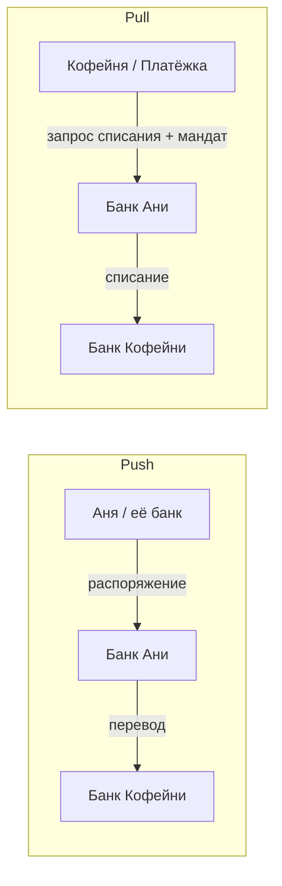
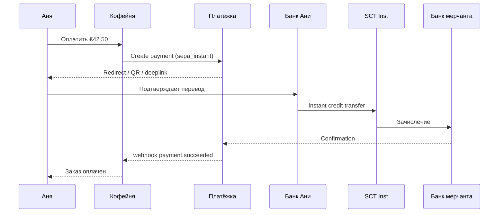
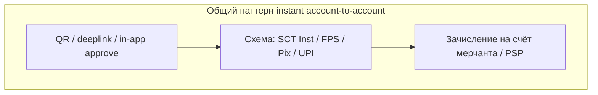
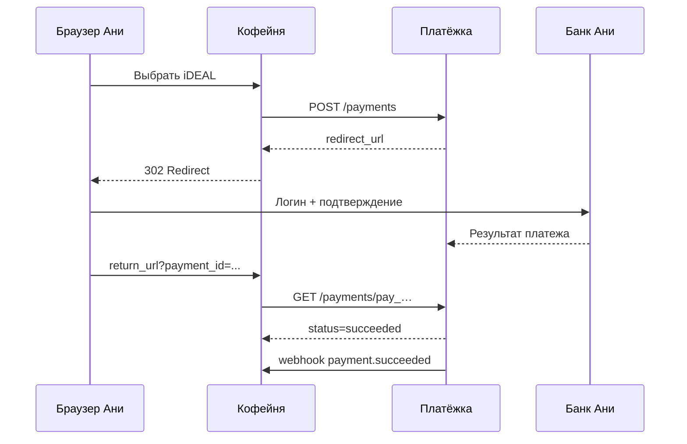
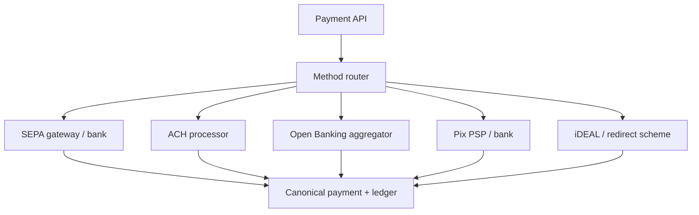
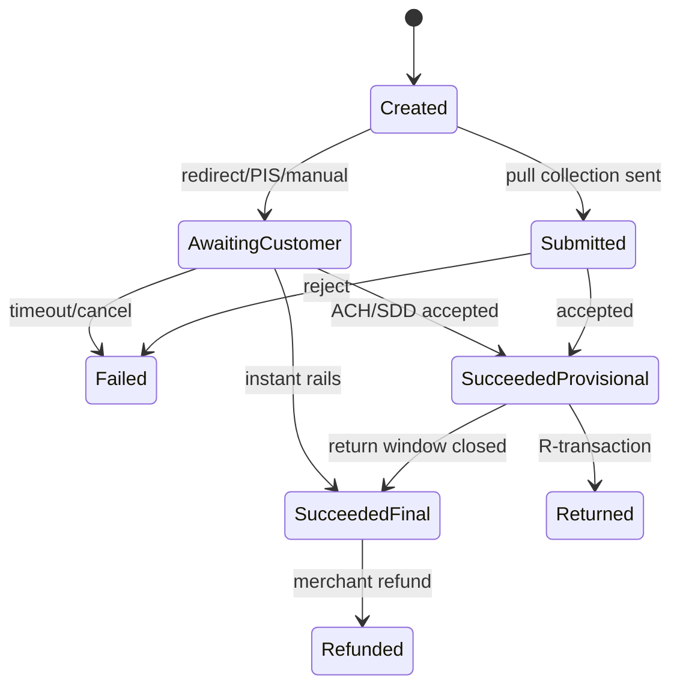

# Глава 10. Банковские переводы, прямые дебеты и Open Banking

До этой главы платёж в книге почти всегда выглядел как «карта → эквайер → сеть → эмитент». Для Ани, которая покупает зерно в «Кофейне», и для PSP «Платёжка» это привычный путь. Но в Европе, Бразилии, Индии, Нидерландах и всё чаще в UK и США покупатель часто платит **не картой**, а со своего банковского счёта: переводом, прямым дебетом, через банковский редирект или через Open Banking API.

Почему это важно инженеру? Потому что банковский метод — это не «ещё один payment_method=sepa в enum». У него другая модель денег (push против pull), другие сроки финальности — момента, после которого расчёт считается окончательным по правилам системы, — другие возвраты, другие отказы и совсем другой UX. Карточный chargeback здесь либо отсутствует, либо выглядит иначе. Webhook может прийти через минуты — или через сутки. А «успех» в API иногда означает лишь «платёж принят в обработку», а не «деньги уже у мерчанта».

Эта глава — мост из карточного мира в мир счетов. Мы разберём классические переводы и прямые дебеты (SEPA, ACH), мгновенные схемы (SCT Inst, Faster Payments, Pix, UPI), bank-redirect вроде iDEAL и современный Open Banking (PIS/AIS) с Variable Recurring Payments. Сквозная история та же: Аня платит «Кофейне» через «Платёжку» — только теперь не картой «Банка Север», а со счёта.

## В этой главе

- Push и pull: кто инициирует движение денег и почему это меняет всё
- Bank transfer и региональные рельсы: SEPA, ACH, Faster Payments
- Instant-системы на примере SCT Inst, Pix и UPI
- Bank-redirect методы (iDEAL и родственники)
- Open Banking: AIS, PIS и VRP
- Возвраты, отзыв платежа и финальность
- Что проектировать в коде, состояниях и сверке

---

## Зачем вообще платить со счёта

Карта удобна: привычный UX, широкое покрытие, понятная (хотя и дорогая) экономика. Но у мерчанта есть причины любить банковские методы.

Во-первых, **стоимость**. Interchange — комиссия эмитенту — и scheme fee — сборы карточной сети — съедают маржу, особенно на крупных чеках B2B и на рынках, где регулятор давит на комиссии карт. Банковский перевод или мгновенный платёж по счёту часто дешевле для продавца — иногда на порядок в абсолютных цифрах на крупных суммах.

Во-вторых, **доступность**. В Нидерландах iDEAL исторически доминировал в e-commerce. В Бразилии Pix стал повседневной нормой. В Индии UPI — дефолт для миллионов покупок. Если «Кофейня» выходит на такой рынок только с Visa/Mastercard, она теряет конверсию.

В-третьих, **риск и споры**. У многих банковских методов нет карточного chargeback в классическом виде (см. [главу 17](17-chargebacks-and-disputes.md)). Это не значит «риска нет» — значит, он другой: отзыв мандата (согласия на будущие списания), return (возврат операции банком) по ACH, claim (претензия по платежу) в Open Banking, ошибка реквизитов, социальная инженерия.

В-четвёртых, **регуляторика**. PSD2 и Open Banking в Европе (подробнее в [главе 18](18-regulation-and-compliance.md)) буквально заставили банки открыть API для инициирования платежей и чтения счетов. Индустрия получила новый канал, который конкурирует с картами на checkout.

Для инженера вывод простой: платёжная платформа без банковских методов — это платформа для части мира. Дальше — как эти методы устроены изнутри.

---

## Push против pull: главная развилка

Прежде чем нырять в SEPA и ACH, зафиксируем одну ось, на которой крутится почти всё в этой главе.

### Push: плательщик «толкает» деньги

В **push**-платеже инициативу и согласие на списание несёт сторона плательщика (или её банк по явной команде). Классика: Аня заходит в интернет-банк и переводит €42,50 на IBAN (International Bank Account Number, международный номер банковского счёта) «Кофейни». Или Аня в приложении банка подтверждает платёж, инициированный через Open Banking PIS (Payment Initiation Service) — сервис, который с согласия пользователя инициирует платёж со счёта. Подробно PIS разобран ниже. Деньги **уходят** со счёта Ани по её (или SCA-подтверждённому) распоряжению.

Свойства push, важные для системы:

- Мерчант обычно **не может** сам списать счёт без нового согласия/сессии (если нет отдельного мандата или VRP).
- Финальность часто выше: раз деньги ушли и дошли, «отозвать как chargeback» сложно или невозможно.
- UX зависит от того, умеет ли покупатель сам сделать перевод (реквизиты, reference) или его ведут через redirect/API.
- Ошибка реквизитов — частая боль: неверный IBAN, неверный reference → деньги ушли «не туда» или зависли.

### Pull: получатель «тянет» деньги

В **pull**-платеже получатель (или его банк/провайдер) инициирует списание со счёта плательщика на основании заранее данного согласия — **мандата** (mandate). Классика: SEPA Direct Debit, ACH debit. «Кофейня» говорит: «у Ани есть мандат, спиши €12,90 за подписку на кофе».

Свойства pull:

- Удобно для **рекуррентных** и «списать потом» сценариев.
- Риск возврата выше: клиент может оспорить списание в окне dispute/return.
- Нужно хранить и жизненный цикл мандата: создание, изменение, отмена, истечение.
- Pre-notification (уведомление до списания) в некоторых схемах — не «nice to have», а правило.



На словах: в push Аня (или её банк по её подтверждённой команде) отправляет деньги. В pull «Кофейня» забирает деньги по заранее выданному разрешению. Путать эти модели в коде — классический способ получить «успешный» платёж, который через неделю вернётся return'ом, или checkout, где вы ждёте webhook, которого никогда не будет, потому что пользователь просто закрыл вкладку банка.

### Смешанные и «почти push» сценарии

Bank-redirect (iDEAL) и Open Banking PIS выглядят для мерчанта как API-вызов, но по сути это **push с удобной обёрткой**: пользователь уходит в банк, подтверждает, банк инициирует перевод. Для доменной модели полезно хранить не только `method_type=ideal`, но и семантику `rail_direction=push|pull` — от неё зависят retry, refund и ожидания по dispute.

---

## Bank transfer: «просто перевод» — и почему он не простой

**Bank transfer** (банковский перевод) в широком смысле — любое движение денег со счёта на счёт через банковские рельсы, без карточной сети. В checkout это может быть:

1. **Ручной перевод по реквизитам**: показать IBAN, сумму, reference; ждать поступления.
2. **Инициированный перевод** через Open Banking / bank API.
3. **Перевод внутри мгновенной схемы** (Pix, FPS, SCT Inst) с QR или deeplink — ссылкой, открывающей конкретный платёж в приложении банка.

### Ручной перевод: боль и ниша

Представьте: «Кофейня» выставляет счёт на €850 за оптовую партию обжарки для небольшого кафе. Картой платить неудобно (лимиты, комиссии). Менеджер кафе получает:

- IBAN получателя
- имя бенефициара (получателя денег)
- сумму
- **payment reference** / end-to-end ID — строку, по которой «Платёжка» поймёт, какой инвойс закрыть

Дальше начинается инженерия ожидания. Деньги могут прийти сегодня, завтра или через два банковских дня. Reference могут обрезать, перепутать регистр, добавить пробелы. Иногда платят «почти ту сумму». Matching поступлений — мини-reconciliation на каждый платёж (общая тема сверки — в [главе 13](13-ledger-and-reconciliation.md)).

Типичный жизненный цикл статуса для manual bank transfer:

```text
created → awaiting_funds → matched → settled
                ↘ expired
                ↘ underpaid / overpaid → manual_review
```

Для инженера: не помечайте заказ `paid` в момент создания платёжной инструкции. Помечайте, когда matching уверенно связал входящее поступление с инвойсом — или когда риск underpaid принят бизнес-правилом.

### Идентификаторы, которые спасают matching

В Европе для SEPA-переводов критичны IBAN и часто BIC (Bank Identifier Code, код банка; хотя для многих внутри-ЕЭЗ сценариев BIC уже не обязателен в UX). Для сверки важнее **structured remittance** — структурированное назначение платежа — и end-to-end identification, идентификатор, передаваемый по цепочке участников. Это может быть короткий уникальный код вроде `CF-ORD-1048291`. Договоритесь с банком/PSP о длине и допустимых символах: разные банки режут reference по-разному.

Иллюстративный кусок инструкции, которую «Платёжка» отдаёт мерчанту или покупателю:

```json
{
  "payment_id": "pay_8f3a21",
  "method": "bank_transfer",
  "rail": "sepa_sct",
  "amount": { "value": 4250, "currency": "EUR" },
  "beneficiary": {
    "name": "Kofeynya Sp. z o.o.",
    "iban": "PL61109010140000071219812874"
  },
  "remittance_information": "CF-ORD-1048291",
  "expires_at": "2026-04-10T21:59:59Z"
}
```

Суммы в минорных единицах — как и в карточных API (см. [главу 14](14-currencies-and-fx.md)): `4250` = €42,50.

---

## SEPA: единая европейская зона переводов

**SEPA** (Single Euro Payments Area) — набор правил и схем, благодаря которым перевод в евро между участвующими странами выглядит «как внутри одной страны»: единые инструменты, IBAN, предсказуемые сроки и форматы сообщений (сегодня в основном ISO 20022 — стандарт банковских сообщений, подробнее про интеграции — в [главе 22](22-integrations.md)).

Для e-commerce важны три схемы:

| Схема | Направление | Типичный срок | Зачем в продукте |
|---|---|---|---|
| SCT (SEPA Credit Transfer) | push | обычно D+1 (следующий банковский день после дня D) | инвойсы, выплаты, «обычный» перевод |
| SCT Inst (Instant) | push | порядка секунд, 24/7 | checkout, payout «сейчас» |
| SDD (SEPA Direct Debit) | pull | по календарю мандата/коллекции | подписки, счета «спишем сами» |

SEPA — не «один API», а **правила схемы + банки-участники + клиринговые инфраструктуры**. PSP «Платёжка» подключается к банкам или scheme access providers и прячет эту сложность за своим Payment API, но статусы и returns всё равно протекают сквозь абстракцию.

### SEPA Credit Transfer (SCT)

**SCT** — обычный кредитовый перевод в евро. Аня (или её банк по поручению) отправляет деньги на IBAN «Кофейни». Классический batch-мир: банку отдали платёжное поручение, оно ушло в клиринг, на следующий банковский день (типично) средства у бенефициара. Выходные и праздники сдвигают срок.

Что ломается на SCT в продукте:

- Пользователь думает, что «перевод мгновенный», а мерчант обещает отгрузку «после оплаты» — и ждёт сутки.
- Cut-off time — время отсечения банка для текущего цикла обработки: поручение после 15:00 может уехать только завтра.
- Частичные совпадения reference при массовых оплатах.

SCT отлично подходит для B2B-инвойсов и payout'ов мерчанту (см. [главу 12](12-flow-of-funds.md)), но на consumer checkout без доп. UX часто проигрывает картам и instant.

### SEPA Instant Credit Transfer (SCT Inst)

**SCT Inst** — мгновенный кредитовый перевод в евро: цель схемы — подтверждение за секунды, круглосуточно, включая праздники (с оговорками по лимитам банка и доступности участников). На момент написания (2026) покрытие банков растёт, регуляторное давление в ЕС усиливает обязательность instant для многих участников — но «все банки всегда online» всё ещё нельзя закладывать как физический закон.

Для checkout это меняет игру: банковский push становится конкурентом карте по скорости. Аня сканирует QR или подтверждает в приложении банка — и через несколько секунд «Платёжка» получает confirmation.

Важные инженерные нюансы SCT Inst:

- **Timeout и неопределённость**. Instant тоже может «зависнуть» на секунды: банк плательщика принял, банк получателя ещё отвечает. Нужен статус `processing` и идемпотентный финализатор (см. [главу 07](07-states-async-idempotency.md)).
- **Лимиты**. Банки ставят потолки на сумму instant (для примера порядка сотен–тысяч евро для consumer — точное число зависит от банка). Крупный B2B-чек может упасть на SCT.
- **Отказ участника**. Не все банки получателя принимают instant одинаково; возможен fallback на обычный SCT — и тогда SLA резко меняется. Продуктово это надо показывать честно.



### SEPA Direct Debit (SDD)

**SDD** — pull: «Кофейня» списывает счёт Ани по мандату. В consumer-сегменте чаще говорят о **SDD Core**; для бизнеса есть **SDD B2B** с другими правилами оспаривания (короче окно, жёстче требования к мандату).

Мандат — это не «галочка в UI», а юридически и схемно значимый объект: кто должник, кто кредитор, уникальный mandate reference, дата подписи, тип (one-off / recurrent), иногда электронная подпись или подтверждённый online-flow через банк.

В direct debit запрос на конкретное списание по мандату называют **collection**, или коллекцией. Мандат разрешает серию операций, а коллекция задаёт одну сумму и дату. Жизненный цикл коллекции (упрощённо):

1. Мандат создан и хранится у кредитора / PSP.
2. Перед списанием — уведомление должника (pre-notification), если требует продукт/схема для вашего кейса.
3. Коллекция отправляется в банк по календарю (с учётом lead time: для Core обычно нужно закладывать банковские дни до due date).
4. Банк должника списывает или возвращает (R-transaction).
5. Деньги доходят до кредитора — или приходит return позже.

**R-transactions** (returns/rejects) — отдельная вселенная кодов: недостаточно средств, мандат отменён, счёт закрыт, отказ клиента и т.д. Для инженера это почти как decline codes в картах ([глава 09](09-declines-and-response-codes.md)), только с **отложенной** семантикой: «успех» на due date не гарантирует, что через несколько дней не придёт return.

Врезка: как это бывает в жизни. Подписка «Кофейня Monthly» €12,90. Аня отменила мандат в банке, а «Платёжка» ещё не синхронизировала статус. Коллекция уходит, банк возвращает «mandate cancelled», мерчант уже «отгрузил» цифровой доступ. Нужен быстрый revoke доступа и понятный billing retry — не «ещё три charge attempts как по карте».

#### SDD Core и SDD B2B

**SDD Core** рассчитан на потребителей и «обычный» бизнес. Должник защищён сильнее: проще оспорить списание, шире окна для претензий по неавторизованным операциям. Для подписки Ани на кофе это дефолтный выбор.

**SDD B2B** — для платежей между компаниями. Мандат жёстче (банк должника часто проверяет его наличие заранее), зато окно отказа короче и потребительские «передумал через месяц» сценарии не работают так же. Если «Кофейня» списывает дистрибьютора за опт, B2D/B2B-рельс уместнее Core — но onboarding мандата сложнее, и не каждый PSP одинаково хорошо это упаковывает.

Путать Core и B2B в конфигурации мерчанта опасно: вы либо получите лавину consumer returns, либо не сможете провести легитимный B2B debit.

#### Жизненный цикл мандата глазами системы

Мандат стоит моделировать отдельно от платежа:

```text
draft → pending_signature → active → suspended → cancelled
                              ↘ expired
```

События, которые должны менять статус: подпись (бумажная, e-mandate, bank-confirmed), первая успешная коллекция, отказ банка «no mandate», явная отмена Аней в банке или у мерчанта, истечение срока. Коллекция без `mandate.status=active` — баг, даже если «в прошлый раз проходило».

Храните минимум: `mandate_reference` (уникальный у кредитора), `creditor_id` (идентификатор кредитора в схеме), `debtor_iban` / имя, `sequence_type` (OOFF / RCUR / FRST / FNAL — разовое, повторяющееся, первое и последнее списание; применимость значений зависит от правил схемы и коннектора), даты подписи и отмены, канал получения согласия, proof (PDF, лог checkbox+timestamp, bank redirect evidence).

#### SDD и chargeback-подобное поведение

В SDD Core у потребителя есть право оспорить неавторизованное/ошибочное списание в довольно широком окне (для неавторизованных — существенно дольше, чем «пара дней»). Это не карточный chargeback один в один, но продуктово близко: деньги могут уйти обратно, а спор — к мерчанту. Поэтому антифрод и KYC (Know Your Customer, проверка личности клиента; [глава 18](18-regulation-and-compliance.md)) для direct debit — не формальность: продавать «спишем с любого IBAN после галочки» без верификации счёта — приглашение к убыткам.

Отдельно от схемы живёт **коммерческий** риск: даже если return законный, у вас уже отгружен товар. Delayed goods, digital access с быстрым revoke, rolling reserve — удержание части выручки на время для покрытия будущих возвратов ([глава 12](12-flow-of-funds.md)) — для рискованных категорий продавцов (MCC) — те же рычаги, что и в картах, только триггеры другие.

---

## ACH: американские рельсы пакетной эпохи

**ACH** (Automated Clearing House) — клиринговая система в США для электронных переводов между банками. Это не «мгновенно по умолчанию»: классический ACH — **batch**, с окнами обработки и расчётами в банковские дни. Есть Same Day ACH и более быстрые надстройки (RTP и FedNow — отдельные системы мгновенных переводов в США), но ментальная модель для инженера всё равно «файл/батч + returns», а не «ISO 8583 auth за 200 мс».

В ролях ACH полезно знать две аббревиатуры:

- **ODFI** (Originating Depository Financial Institution) — банк, который **отправляет** ACH-запись в сеть (со стороны инициатора: мерчанта, payroll-провайдера, PSP).
- **RDFI** (Receiving Depository Financial Institution) — банк, который **получает** запись и применяет её к счёту клиента (списывает или зачисляет).

«Платёжка», работая в США, обычно не является банком сама: она ходит в ODFI-партнёра или процессор, а наружу мерчанту отдаёт тот же Payment API. Ошибки и returns всё равно приходят с задержкой банковского мира.

### Credit и debit

- **ACH credit** — push: работодатель платит зарплату, мерчант получает payout, человек отправляет деньги.
- **ACH debit** — pull: биллинг подписки, оплата счёта со счёта (account number — номер счёта — и routing number — идентификатор банка для американских переводов).

Для e-commerce checkout ACH debit часто выглядит так: Аня вводит routing number + account number (или выбирает банк через агрегатор «подключи счёт» / account linking), соглашается с авторизацией списания, и платёж уходит в следующий цикл ACH. На экране это может казаться «как карта: нажал и готово», но под капотом — батч.

**Same Day ACH** ускоряет расчёт внутри банковского дня при попадании в окна cutoff, но не превращает ACH в Pix: returns и правила авторизации остаются «ACH-шными». Не обещайте в UI «мгновенно», если рельс — Same Day.

### Returns — главная особенность ACH

ACH известен тем, что **return может прийти после того, как вы уже посчитали платёж успешным**. Типичные причины (иллюстративно): insufficient funds (R01), account closed (R02), unauthorized (R10) и др. Окна и правила зависят от типа return и правил Nacha — организации, управляющей правилами ACH; unauthorized-семейство особенно болезненно для мерчанта.

Практическое следствие для доменной модели:

```text
submitted → processing → settled_provisional → settled_final
                              ↘ returned
```

Многие команды ошибочно делают `settled` слишком рано. Для товаров физического мира это риск: отправили кофейную машину, а через несколько дней — return. Для цифровых товаров — риск charge-off — списания невозвратного долга в убыток. Риск-движок, лимиты на первого платежа с нового account, проверка счёта небольшими тестовыми зачислениями (micro-deposits verification) и delayed fulfillment здесь друзья.

Врезка: как это бывает в жизни. Новый покупатель вводит чужой account number «с потолка» или из слитого списка. Первая коллекция проходит или нет — но unauthorized return позже бьёт по мерчанту. Верификация счёта (micro-deposits, aggregator with OAuth-like bank login, confirmation of ownership) стоит дороже в UX, но дешевле в loss rate.

### Авторизация и мандаты в US-контексте

Для debit нужна надлежащая authorization (согласие клиента) в форме, которую требует Nacha и ваш банк/ODFI. Тип авторизации зависит от канала: web, telephone, signed form. Храните доказательство согласия: текст, timestamp, IP, user-agent, версию оферты — это пригодится в споре «unauthorized». Без evidence спорить нечем.

SEC codes (Standard Entry Class codes, категории ACH-записей по типу и каналу операции) — ещё один слой, который процессор ждёт корректно заполненным (web debit ≠ corporate credit). Неправильный код — операционный отказ или compliance-проблема у банковского партнёра.

### Стоимость и ниша

ACH часто дёшев относительно карт (фиксированные центы или доли процента — зависит от контракта; цифры контрактные, не универсальные). Поэтому его любят bill pay, payroll, крупные B2B и подписки. На мгновенный consumer checkout в США к 2026 чаще смотрят на RTP/FedNow и на Open Banking-подобные / pay-by-bank агрегаторы — но ACH как дешёвый batch-рельс никуда не исчез и ещё долго будет в payout и billing.

---

## Faster Payments: британский instant-рельс

**Faster Payments Service (FPS)** в Великобритании — система почти мгновенных платежей в GBP между участвующими банками, 24/7 для типичных consumer-сумм (с лимитами на сторону банка и схемы). Для UK e-commerce это базовый «банковский» рельс рядом с картами и Open Banking.

Свойства, полезные инженеру:

- Push-модель: плательщик инициирует (сам или через PIS).
- Скорость: секунды в нормальном случае.
- Reference / payment narrative важны для reconciliation; банки снова любят обрезать и «нормализовать» строки.
- Refund — отдельный FPS-платёж в обратную сторону (не «void auth»). Сумма и получатель должны быть валидны; иногда исходный платёж не отдаёт полный набор реквизитов для авто-refund — нужен fallback на ручной процесс.
- Contingency: даже «always on» системы имеют инциденты. Держите статус `processing` и SLA коммуникации мерчанту, а не вечный спиннер.

Open Banking в UK исторически сильно завязан на FPS как на исполнение PIS: TPP (Third Party Provider, сторонний провайдер с доступом к банковским API по согласию клиента) инициирует, банк исполняет через Faster Payments. Поэтому в британском стеке «Платёжки» статусы PIS и статусы FPS часто живут рядом в одном payment aggregate: `initiation_status` и `rail_status`.

Для международных команд ловушка в другом: назвать метод в API просто `bank_transfer` и для PL SEPA, и для UK FPS. Мерчант из «Кофейни» увидит один label, а операционка получит два разных мира cutoff и returns. Лучше явный `rail`.

---

## Instant-системы за пределами Европы: Pix и UPI

Карточки глобальны, но **массовые мгновенные платежи со счёта** часто локальны. Два самых цитируемых примера — Pix (Бразилия) и UPI (Индия). Их не нужно знать «по каждому API-полю», но нужно понимать паттерн: центральная схема + адресация проще IBAN + мгновенность + QR/deeplink как UX.

### Pix

**Pix** — мгновенная платёжная система Центрального банка Бразилии. Ключевая идея: перевод 24/7 за секунды, идентификация получателя через **Pix key** (телефон, email, CPF/CNPJ (бразильский налоговый идентификатор человека/организации), случайный ключ) или QR. Для мерчанта — динамический QR на сумму заказа; для человека — сканировал в банке и подтвердил.

Почему Pix взорвал рынок: низкая стоимость, мгновенность, доступность на смартфоне, поддержка государства и банков. Для «Кофейни», выходящей в Бразилию, «только карты» — почти гарантированная потеря конверсии.

Инженерные следствия:

- Статусы близки к instant: `pending` → `succeeded`/`failed` за секунды, но всё равно нужен webhook и идемпотентность.
- Refund через схему — отдельная операция с своими лимитами по времени; не предполагайте бесконечное окно как у внутренней проводки.
- Fraud и социальная инженерия сместились в сторону мгновенных переводов «на ключ» — риск другой, не карточный: человек сам подтвердил перевод мошеннику.
- Идентификаторы заказа в QR/payload должны быть устойчивы к повторному сканированию и истечению QR (TTL).

### UPI

**UPI** (Unified Payments Interface) в Индии связывает банки и приложения через адресацию вида VPA (Virtual Payment Address, виртуальный платёжный адрес: `name@bank`) и позволяет push-платежи (и сценарии collect/request) почти мгновенно. UX: QR, intent в приложении банка/кошелька, approve.

Снова паттерн: локальная мгновенная схема + мобильный UX + дешевизна относительно карт → APM (alternative payment methods, альтернативные платёжные методы) становится необходимым для рынка (об APM как классе — [глава 11](11-wallets-bnpl-local-methods.md)).

Для интегратора UPI через агрегатора важны: обработка collect-request timeout (пользователь не одобрил), дубли intent на Android, сверка с settlement-отчётом провайдера на следующий цикл — потому что «мгновенно для пользователя» не отменяет пакетную отчётность для бухгалтерии.



Запомните формулу: **мгновенный push + удобная адресация + смартфон**. Региональные детали отличаются, продуктовый скелет — один.

---

## Bank-redirect методы: iDEAL и «сходи в банк подтвердить»

Есть семейство методов, где checkout выглядит так: пользователь выбирает банк → редирект (или app-to-app) → логин/SCA в банке → подтверждение → возврат на сайт мерчанта. Классический европейский пример — **iDEAL** (Нидерланды). Рядом по духу — Bancontact-подобные потоки, Sofort/Klarna Pay Now в старых обличьях, некоторые giropay/eps-сценарии и современные Open Banking redirect flows. Названия продуктов меняются, **паттерн интеграции** живёт.

### Как это ощущается для Ани

Аня на checkout «Кофейни» выбирает iDEAL, банк «Bank Noord» (вымышленный), уходит на страницу банка, подтверждает €42,50, возвращается на `return_url`. Сайт ещё может не знать итог — его скажет webhook от «Платёжки».

### Как это устроено под капотом (упрощённо)

1. Мерчант создаёт платёж у PSP: сумма, currency, method=`ideal`, `return_url`.
2. PSP возвращает `redirect_url`.
3. Браузер Ани уходит в банк / scheme.
4. Банк аутентифицирует Аню и инициирует перевод (часто через локальный клиринг / SEPA rails — зависит от метода и эпохи).
5. PSP получает результат асинхронно.
6. Аня возвращается на сайт; фронт делает inquiry статуса (не доверяя только return).



### Грабли redirect

- **Return URL ≠ успех**. Пользователь может вернуться по кнопке «назад», закрыть вкладку, успешно оплатить и не вернуться. Источник истины — PSP status + webhook.
- **Двойной клик и повторный redirect**. Нужны idempotency key на create payment и защита от двух параллельных сессий на один заказ.
- **App switch на мобиле**. Пользователь ушёл в banking app и «потерялся»; нужны deeplink, session resume и короткий TTL платежа.
- **Банк недоступен**. Метод «есть в списке», но issuer bank лежит — покажите понятный fallback (другой банк, карта, другой APM).

Bank-redirect удобно моделировать как подтип async payment с обязательным `redirect` action в state machine ([глава 07](07-states-async-idempotency.md)).

---

## Open Banking: AIS, PIS и новая труба к счёту

**Open Banking** — зонтичное имя для регулируемого доступа третьих сторон к банковским счетам через API (в ЕС — во многом наследник PSD2; в UK — отдельная эволюция Open Banking standards; в других регионах — свои рамки). Для платежей нас интересуют два разрешения (consent):

- **AIS** (Account Information Service) — читать информацию о счетах/балансах/транзакциях (с согласия пользователя).
- **PIS** (Payment Initiation Service) — инициировать платёж от имени пользователя.

«Платёжка» как TPP (Third Party Provider) получает лицензию/регистрацию (или работает через лицензированного партнёра), проходит technical conformance, и тогда может сказать банку Ани: «Аня согласилась, инициируй SCT/FPS на IBAN мерчанта».

### AIS: не платёж, но рядом

Зачем AIS платёжнику?

- Проверка платёжеспособности / баланса перед PIS (осторожно с UX и согласием).
- Account verification: «счёт реально принадлежит Ане».
- Enrichment для lending/BNPL и antifraud.
- Reconciliation и financial data products.

AIS сам по себе денег не двигает. Но плохо оформленный consent на AIS — регуляторный и репутационный риск. Храните scope, срок согласия, возможность revoke.

### PIS: платёж без ввода IBAN руками

Типичный happy path PIS на checkout:

1. Аня выбирает «Оплатить через банк».
2. PSP/TPP начинает consent + payment initiation (часто одним связанным flow).
3. Аня редиректится (или использует decoupled/app flow) в банк, проходит SCA.
4. Банк исполняет платёж по рельсу (SCT Inst / FPS / …).
5. TPP получает статус initiation; финальный settlement status может прийти отдельно — **это частая ловушка**.

Важный нюанс: статус «payment initiated / accepted by bank» ≠ всегда «funds settled to merchant». В хорошем API это разные поля или явная state machine. Не продавайте мерчанту «мгновенный settled», если банк дал только acceptance initiation.

Ещё нюанс: **список банков**. Coverage не равномерна. У одного ASPSP (Account Servicing Payment Service Provider, банка или другого провайдера, обслуживающего счёт клиента) отличный app-to-app, у другого — древний redirect с обрывом на мобиле, у третьего — техработы в воскресенье. «Платёжка» обычно кеширует availability, показывает только живые банки и умеет fallback на карту/iDEAL/Pix в зависимости от geo.

```json
{
  "payment_id": "pay_ob_99102",
  "method": "open_banking_pis",
  "rail": "sepa_instant",
  "amount": { "value": 4250, "currency": "EUR" },
  "status": "accepted_settlement_in_process",
  "bank_status": {
    "initiation": "ACCP",
    "settlement": "pending"
  },
  "debtor_bank": "Bank Noord",
  "creditor_iban": "PL61109010140000071219812874",
  "end_to_end_id": "CF-ORD-1048291"
}
```

Коды вроде `ACCP` здесь иллюстративны (в духе ISO 20022 payment status); у конкретных банков и агрегаторов набор статусов свой. Проектируйте внутренний канонический статус и маппинг коннекторов ([глава 22](22-integrations.md)).

### Согласие (consent) как сущность

Consent в Open Banking — не cookie banner. Это объект с:

- целью (AIS и/или PIS),
- сроком жизни,
- счетами в scope,
- возможностью отзыва пользователем в банке,
- аудитом для регулятора.

Для one-off PIS consent часто короткоживущий и привязан к одному платежу. Для AIS и VRP — длиннее, и тогда вам нужен процесс синхронизации revoke: банк отозвал → ваш биллинг/данные останавливаются, а не «ещё одна попытка ночью».

### SCA и Open Banking

PIS почти всегда упирается в Strong Customer Authentication в банке плательщика (связь с [главой 08](08-3ds-and-sca.md)): это не 3-D Secure карт, но та же идея — доказать, что распоряжение дал владелец счёта. Exemptions возможны в рамках правил банка/регулятора, но на checkout лучше предполагать challenge и закладывать время UX (Аня может уйти в приложение банка на минуту-две).

### Кто за что отвечает

В четырёхсторонней карточной модели роли жёстко распределены ([глава 02](02-ecosystem-participants.md)). В Open Banking:

- Банк Ани — ASPSP (держит счёт, исполняет платёж, делает SCA).
- «Платёжка» / TPP — инициирует и оркестрирует (как PISP (провайдер PIS) и/или AISP (провайдер AIS)).
- Мерчант — получает деньги (часто на счёт PSP с последующим payout, либо напрямую — зависит от модели MoR/PSP).

Риск мошенничества смещается: меньше «украденная карта», больше «убедили человека подтвердить перевод» и ошибки интеграции consent. Liability не копируйте с карточного liability shift — читайте договор TPP и локальные правила; юрист здесь не опционален.

---

## VRP: Variable Recurring Payments

**VRP** (Variable Recurring Payments) — развитие Open Banking: пользователь один раз даёт согласие на серию платежей с ограничениями (потолок суммы, период, получатель), а дальше мерчант/TPP может инициировать списания **без нового полного UX каждый раз**, пока параметры в рамках consent.

Зачем это нужно: подписки, «добей до нуля баланс кошелька», utilities, гибкий биллинг — там, где SDD/ACH debits традиционно сильны, но хочется современного API-согласия и контроля пользователя.

Свойства VRP (логически):

- Это **не** безлимитный доступ к счёту: consent с guards (max amount, cumulative limits, expiry).
- Каждый платёж всё ещё проходит банковские проверки; выход за лимиты → отказ.
- Пользователь может отозвать consent в банке — ваш биллинг должен уметь услышать revoke (webhook/AIS-подобное событие или ошибка на следующем init).
- Регуляторная и продуктовая зрелость зависит от страны: UK лидировал в практическом rollout; в других юрисдикциях к 2026 картина неравномерна — проектируйте feature flag по рынку.

Сравнение с SDD:

| | SDD / ACH debit | VRP / Open Banking recurring |
|---|---|---|
| Модель | классический pull по мандату | инициирование в рамках OB consent |
| UX первого раза | мандат + иногда soft | SCA в банке + явные лимиты |
| Оспаривание | сильные consumer protections / returns | зависит от схемы и банка; не копируйте SDD один в один |
| Контроль лимитов | слабее в UX мандата | обычно явные в consent |

Для «Кофейни» VRP — способ собирать €12,90 подписку без хранения карточного токена и без тяжёлого SDD onboarding, **если** банк Ани и рынок это поддерживают. Иначе fallback: карта + credentials on file ([глава 05](05-card-contexts-and-tokens.md)) или классический SDD.

Практический совет по доменной модели: VRP consent храните как `RecurringAuthorization` с полями лимитов; каждый платёж — child с проверкой `amount <= max_per_payment` и `sum(period) <= max_period` **до** вызова банка. Банк всё равно проверит, но ранний отказ дешевле и понятнее в UX.

---

## Как PSP «Платёжка» прячет зоопарк рельсов

Мерчанту хочется один API: `amount`, `currency`, `method`, `customer`, `return_url`. Под капотом «Платёжка» выбирает коннектор:



Задачи оркестратора, которые нельзя «оставить на потом»:

1. **Нормализация статусов** из десятка словарей в канон.
2. **Идемпотентность** create/confirm/refund на границе каждого коннектора.
3. **Маршрутизация**: страна покупателя, валюта, сумма, availability банка, стоимость, риск.
4. **Settlement accounting** — учёт расчётов в леджере, финансовой учётной книге ([глава 13](13-ledger-and-reconciliation.md)): деньги могли прийти на клиентский счёт PSP, а не мерчанта — дальше payout по расписанию ([глава 12](12-flow-of-funds.md)).
5. **Единый webhook** наружу, даже если внутри — SFTP-файл ACH утром и HTTP callback Pix ночью.

Без этого каждый новый рынок превращается в отдельный микросервис со своей правдой о «что такое успех».

---

## Возвраты, отзыв и финальность

Карточный мир приучил нас к void/refund/chargeback ([глава 06](06-payment-lifecycle.md), [глава 17](17-chargebacks-and-disputes.md)). В банковских методах словарь другой.

### Refund (возврат мерчантом)

Обычно это **новый push** в обратную сторону: со счёта мерчанта/PSP на счёт покупателя. Нет «отменить auth». Нужны реквизиты получателя refund (из исходного платежа их иногда можно взять, иногда — нет: зависит от рельса и того, что банк вернул в notification).

Ограничения:

- Срок: некоторые схемы/продукты лимитируют окно refund.
- Сумма: partial refund возможен не везде одинаково удобно.
- FX (foreign exchange, конвертация валют): если исходный платёж и refund в разных представлениях — осторожно с курсом ([глава 14](14-currencies-and-fx.md)).

### Return / reject / R-transaction

Инициируется **банком или схемой**, не «кнопкой refund» у мерчанта. Типично для pull (SDD, ACH): недостаточно средств, нет мандата, unauthorized. Деньги или требование о деньгах возвращаются кредитору. В учёте это отдельное событие: не путайте с merchant refund.

### Отзыв (cancellation) до исполнения

Пока платёж не исполнен, его иногда можно отменить: неподтверждённый redirect, pending PIS до SCA, SCT до cut-off в редких bank API. После final settlement cancellation обычно уже не существует — только refund или claim.

### Финальность (finality)

**Finality** — момент, после которого платёж считается окончательным и безотзывным в рамках схемы. Для SCT Inst / Pix / FPS финальность наступает быстро после successful credit. Для ACH/SDD «settled» может быть **провизорным** до конца return window.

Правило для инженера:

> Не стройте fulfillment (исполнение заказа, например отгрузку) только на `status=succeeded` из коннектора, пока не знаете, **какая финальность** у этого рельса и есть ли отложенный return.



---

## Сквозной пример: Аня платит €42,50 тремя способами

Один заказ «Кофейни»: набор Ethiopia washed, €42,50. Три альтернативных метода через «Платёжку» — чтобы увидеть разницу состояний.

### Вариант A: SEPA Instant через Open Banking PIS

Таймлайн (иллюстративный):

| Время | Событие |
|---|---|
| 14:02:01 | `POST /v1/payments` → `pay_8f3a21`, method=open_banking, rail=sepa_instant |
| 14:02:02 | Аня уходит в банк, SCA |
| 14:02:18 | Банк ACCP initiation |
| 14:02:20 | Instant credit на счёт PSP |
| 14:02:21 | webhook `payment.succeeded` (final для этого рельса) |
| 14:02:22 | «Кофейня» показывает «Оплачено», склад резервирует |

### Вариант B: iDEAL-like redirect

| Время | Событие |
|---|---|
| 14:05:01 | create payment, redirect |
| 14:05:40 | Аня подтверждает в банке |
| 14:05:42 | Аня вернулась на return_url, GET ещё `processing` |
| 14:05:45 | webhook `succeeded` |
| 14:05:46 | фронт по polling увидел успех |

Урок: UI никогда не верит одному только return_url.

### Вариант C: SDD на подписку €12,90

| День | Событие |
|---|---|
| D0 | Мандат подписан online, mandate_id=`man_44c` |
| D0 | Pre-notification email: списание 5-го числа |
| D3 | Collection submitted на due date D5 |
| D5 | Accepted / booked |
| D8 | Return R-code (иллюстративно): insufficient funds |
| D8 | Подписка → `past_due`, доступ ограничен, soft retry policy |

Урок: биллинг на SDD — это календарь + return handling, не card-like auth.

---

## Сравнение методов одной таблицей

| Метод | Push/Pull | Скорость | Return risk | Типичный UX |
|---|---|---|---|---|
| Manual SCT | push | D+1 | низкий после зачисления | реквизиты + ждать |
| SCT Inst | push | секунды | низкий | QR / банк / PIS |
| SDD | pull | дни | высокий (R-tx) | мандат + коллекция |
| ACH debit | pull | дни / same-day | высокий | account+routing / aggregator |
| FPS | push | секунды | низкий | банк / PIS |
| Pix / UPI | push | секунды | схема-специфичный | QR / app |
| iDEAL-like | push обёртка | минуты | низкий/средний | redirect |
| OB PIS | push | секунды–минуты | зависит от рельса | redirect + SCA |
| VRP | инит в рамках consent | по событию | зависит от рынка | первый SCA, далее тише |

---

## Что это значит для инженера

1. **Модель метода богаче enum'а.** Храните `family` (bank_transfer, direct_debit, open_banking, bank_redirect), `rail` (sepa_sct, sepa_inst, ach, fps, pix…), `direction` (push/pull), `finality_class` (instant_final / provisional_with_returns).

2. **State machine должна уметь provisional success.** Для ACH/SDD отделяйте `funds_received` от `return_window_closed`. Fulfillment policy — продукт+риск, не сюрприз для склада.

3. **Никогда не считайте return_url истиной.** Только server-side status и подписанные webhooks ([глава 07](07-states-async-idempotency.md), [глава 19](19-payment-security-pci.md) про подписи).

4. **Мандаты и consents — first-class сущности.** Таблицы/агрегаты: mandate/consent id, scope, limits, status, revoked_at, evidence. Платёж ссылается на них.

5. **Matching для manual transfers.** Нормализация reference, допуски по сумме, очередь manual review, анти-коллизии кодов.

6. **Refund = новый исходящий платёж.** Нужны реквизиты, лимиты, идемпотентность, связь `refund_of`.

7. **Таймзоны и banking days.** Cut-off, holidays, «D+1» — календарь банковский, не `cron` в UTC вслепую.

8. **Мониторинг по рельсам.** Отдельно: redirect conversion, PIS initiation success, instant timeout rate, ACH return rate, SDD R-rate ([глава 24](24-monitoring-and-operations.md)).

9. **Тесты на async.** Симулируйте: успех без return; return после success; двойной webhook; пользователь не вернулся с redirect; VRP revoke mid-cycle.

10. **Регуляторика не «потом».** PIS/AIS требуют правильного consent UX и лицензионной модели — иначе продукт не выйдет в прод на рынке ([глава 18](18-regulation-and-compliance.md)).

Псевдокод канонизации статуса:

```python
def canonicalize(rail: str, provider_status: str) -> str:
    if rail in ("sepa_inst", "fps", "pix", "upi") and provider_status == "settled":
        return "succeeded_final"
    if rail in ("ach_debit", "sepa_dd") and provider_status == "settled":
        return "succeeded_provisional"
    if provider_status in ("returned", "r_transaction"):
        return "returned"
    if provider_status == "refunded":
        return "refunded"
    return "processing"
```

---

## Типичные ошибки и грабли

- **Показать «оплачено» после create payment.** Особенно на manual transfer и PIS inception.
- **Смешать refund и return в одном поле `refunded_at`.** Потом невозможно объяснить бухгалтерии и клиентскому саппорту, что произошло.
- **Retry pull как карточный soft decline.** Повторная коллекция SDD/ACH без политики и без нового уведомления может нарушить правила и разозлить клиента.
- **Забыть, что IBAN в UI можно ввести с пробелами и буквами в нижнем регистре.** Нормализуйте.
- **Один `succeeded` для всех рельсов в аналитике.** Конверсия iDEAL и return rate ACH схлопнутся в бессмысленное число.
- **Хранить «вечный» mandate после revoke в банке.** Биллинг продолжит слать коллекции в пустоту.
- **Обещать мгновенный payout мерчанту**, пока входящий рельс provisional.
- **Скопировать карточный chargeback workflow на Pix/FPS.** Процессы споров другие; обучение саппорта обязательно.
- **Игнорировать cut-off:** тестовый стенд «всегда D+0», прод — «почему деньги не пришли в пятницу вечером».
- **Считать Open Banking заменой карт глобально.** Покрытие банков и UX сильно плавают по странам; нужен fallback.

---

## Для любопытных: почему рельсы такие разные

Исторически платежи со счёта росли из пакетной клиринговой культуры: файлы ночью, неттинг утром, дешёво на объёме. Карты выросли из розничного «убедись, что можно отгрузить сейчас». Instant account-to-account — попытка соединить дешевизну счетов со скоростью карт. Open Banking — попытка регулятора открыть трубу к тем же счетам через API, а не через screen scraping. Отсюда зоопарк: вы не «выберете один стандарт навсегда», вы научитесь **оркестрировать рельсы**.

---

## Итоги главы

1. Банковские методы — не приложение к картам, а параллельная вселенная с другой экономикой, UX и финальностью.
2. Главная ось — **push vs pull**: кто инициирует движение денег и кто несёт риск возврата.
3. SEPA даёт SCT, SCT Inst и SDD — три разных продукта под одним зонтиком евро-зоны.
4. ACH учит смирению перед **отложенными returns**; не путайте provisional и final.
5. Faster Payments, Pix, UPI показывают, как локальные instant-схемы перекраивают checkout.
6. Bank-redirect (iDEAL и подобные) — async + redirect; return_url не является доказательством оплаты.
7. Open Banking разделяет **AIS** (данные) и **PIS** (инициация платежа); статусы initiation и settlement различайте явно.
8. **VRP** переносит рекуррент в мир consent с лимитами — альтернатива и конкурент direct debit на зрелых рынках.
9. Refund, return и cancellation — разные события; финальность зависит от рельса.
10. В коде: богатая модель метода, мандаты/consent, provisional states, matching, мониторинг по рельсам.

Дальше логичный шаг — другие «некарточные» миры: кошельки, BNPL, наличные ваучеры и локальные APM. Ими займётся [глава 11](11-wallets-bnpl-local-methods.md).

---

## Связанные главы

- [Глава 06. Жизненный цикл карточного платежа](06-payment-lifecycle.md) — для контраста void/capture/refund с банковскими рельсами
- [Глава 07. Состояния, async, webhooks, idempotency](07-states-async-idempotency.md) — обязательная база для redirect и PIS
- [Глава 08. 3-D Secure и SCA](08-3ds-and-sca.md) — SCA в банке при PIS vs 3DS по картам
- [Глава 09. Отказы и коды ответов](09-declines-and-response-codes.md) — рядом с R-codes и bank failures
- [Глава 11. Кошельки, BNPL, наличные и локальные методы](11-wallets-bnpl-local-methods.md) — следующий слой APM
- [Глава 12. Что происходит с деньгами](12-flow-of-funds.md) — settlement и payout после bank rails
- [Глава 13. Ledger и reconciliation](13-ledger-and-reconciliation.md) — matching входящих переводов
- [Глава 17. Chargebacks и disputes](17-chargebacks-and-disputes.md) — чем банковские споры не похожи на карточные
- [Глава 18. Регуляторика и compliance](18-regulation-and-compliance.md) — PSD2/Open Banking, лицензии TPP
- [Глава 22. Интеграции](22-integrations.md) — ISO 20022, bank APIs, файлы клиринга
- [Глава 24. Мониторинг и операционная работа](24-monitoring-and-operations.md) — метрики по методам и рельсам
