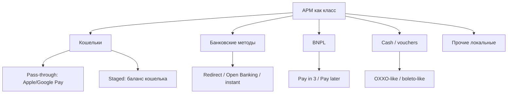
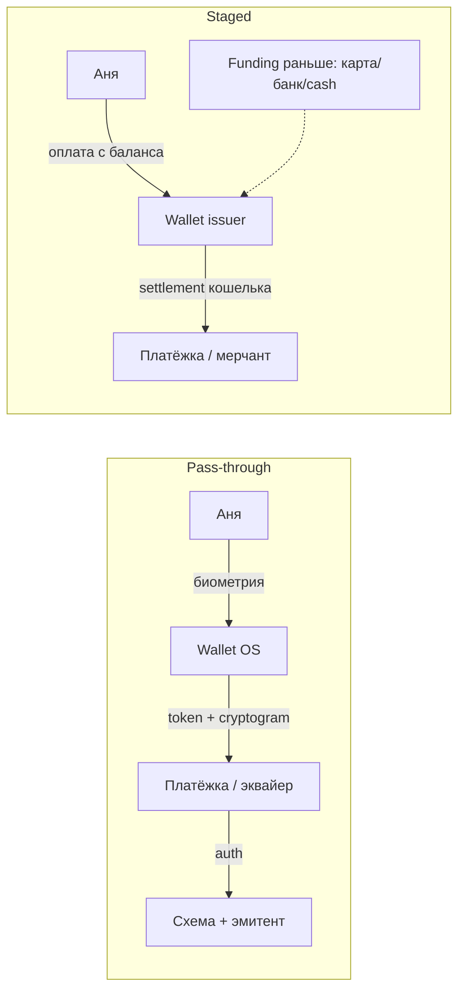
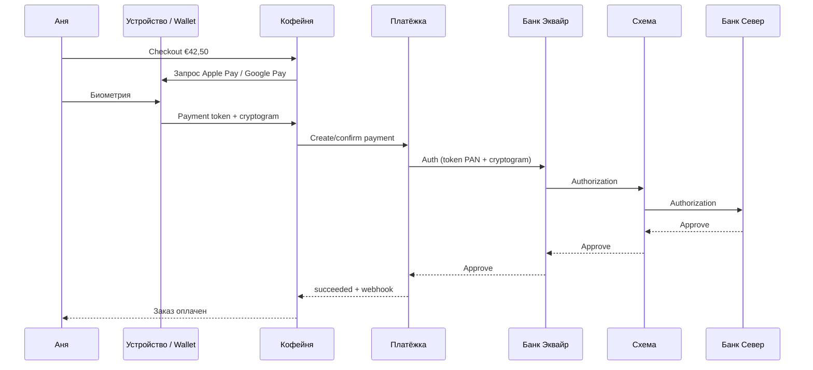
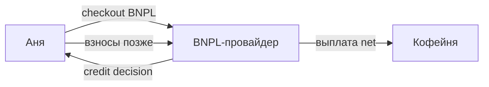
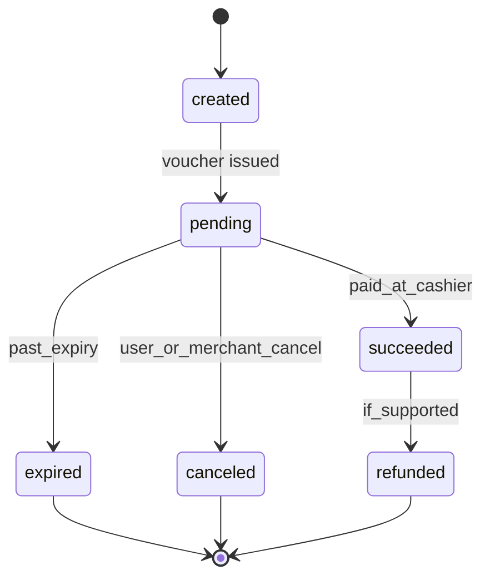
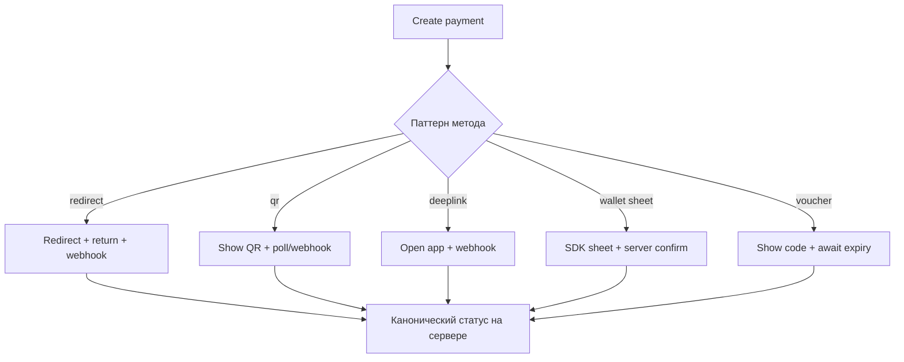

# Глава 11. Кошельки, BNPL, наличные и локальные методы

В [главе 10](10-bank-based-methods.md) Аня уже платила «Кофейне» не картой, а со счёта: SEPA Instant, iDEAL-подобный редирект, Open Banking. Казалось бы, карта плюс банк — и checkout закрыт. На практике «Кофейня» открывает новый рынок — и внезапно конверсия падает, хотя Visa и Mastercard «есть». Пользователи в Бразилии ждут Pix и boleto-подобные ваучеры. В Нидерландах — iDEAL. В Китае — суперприложение-кошелёк. В Германии часть аудитории выбирает «купи сейчас, плати потом». А Аня на телефоне жмёт не «ввести карту», а Apple Pay — и уходит за две секунды, даже не вспоминая PAN.

Эта глава — про всё, что в индустрии привычно зовут **APM (alternative payment methods)**: кошельки, BNPL (buy now, pay later, «купи сейчас, плати потом»), наличные ваучеры, локальные методы «иначе на рынок не зайдёшь». Слово *alternative* здесь историческое: для покупателя на конкретном рынке это часто не альтернатива, а **дефолт**. Для инженера «Платёжки» это означает: нельзя спроектировать платформу вокруг одной карточной state machine и потом «добавить enum». У каждого семейства методов — своя модель денег, свои сроки финальности, свой UX и свой способ сломаться.

Мы пойдём от классификации APM к staged и pass-through кошелькам, разберём Apple Pay / Google Pay на уровне токенов и криптограмм (не путая их с network tokens из [главы 05](05-card-contexts-and-tokens.md)), затем BNPL и cash-методы, и закончим интеграционными паттернами, без которых оркестрация APM превращается в зоопарк костылей.

## В этой главе

- APM как класс: что объединяет «не карты» и чем они отличаются друг от друга
- Digital wallets: staged vs pass-through и где в цепочке появляются деньги
- Apple Pay и Google Pay: device token, криптограмма, SCA без классического 3DS
- BNPL: кредит на checkout, кто несёт риск и как это выглядит в API
- Cash-based методы: ваучеры, OXXO-подобные сценарии, отложенная оплата
- Локальные методы и стратегия выхода на рынок
- Интеграционные паттерны APM: redirect, QR, deeplink, SDK, webhook-first

---

## APM как класс: не «ещё одна кнопка»

**APM** — зонтичный ярлык для платёжных методов, которые не являются «классическим» вводом PAN/CVV на сайте мерчанта. Внутри зонтика живут совершенно разные звери: банковский редирект, кошелёк с балансом, BNPL с кредитным решением, ваучер, который Аня оплатит наличными в магазине через три дня.

Зачем тогда общий термин? Потому что для продукта и интеграции у них есть общие свойства:

1. **Checkout не укладывается в один синхронный HTTP-ответ.** Часто нужен redirect, QR, deeplink в приложение, ожидание оплаты офлайн.
2. **Источник истины — провайдер метода**, а не «ответ формы на сайте». Return URL и клиентский success-экран — подсказки, не доказательство.
3. **Lifecycle длиннее карточного auth.** От минут (кошелёк) до дней (ваучер, некоторые BNPL-этапы).
4. **Споры и возвраты не копируют chargeback.** Иногда спора почти нет; иногда это consumer credit dispute; иногда — «ваучер истёк, деньги не поступили».
5. **Конверсия локальна.** Метод, который в одной стране даёт 40% share, в другой бесполезен.



Словами: APM — это не один протокол, а **семейство интеграционных и продуктовых паттернов**. Банковские рельсы мы уже разобрали в [главе 10](10-bank-based-methods.md); здесь фокус на кошельках, BNPL, наличных и на том, как всё это стыковать в одной платформе рядом с картами.

### Что APM *не* означает

- Не «дешевле карт всегда». BNPL и некоторые кошельки могут быть дороже MDR (Merchant Discount Rate, полной комиссии продавца за приём карты; [глава 15](15-fees-and-economics.md)); вы платите за конверсию и доступ к аудитории.
- Не «без риска fraud». Мошенничество смещается: ATO (account takeover, захват чужой учётной записи) кошелька, социальная инженерия на redirect, дружеский fraud по BNPL, оплата ваучера украденными деньгами.
- Не «можно игнорировать PCI». Pass-through wallet всё равно уходит в карточный acquiring; staged wallet часто принимает карты на funding — требования PCI DSS — стандарта безопасности карточных данных — никуда не делись, просто scope (область систем, к которым они применяются) сдвинулся ([глава 19](19-payment-security-pci.md)).

### Ось классификации, которая спасает доменную модель

Вместо плоского `payment_method=klarna|apple_pay|oxxo` полезно думать осями:

| Ось | Вопросы | Примеры |
|---|---|---|
| Кто финансирует | Карта? Счёт? Баланс кошелька? Кредит провайдера? | Apple Pay → карта; Alipay-like → баланс/счёт; BNPL → кредит |
| Когда деньги «твердые» | Мгновенно? После webhook? После офлайн-оплаты? | Google Pay sync-like; voucher — до expiry |
| Где UX | На сайте, в wallet sheet, в банке, в кассе магазина | Pass-through sheet vs OXXO barcode |
| Кто Merchant of Record / кредитор | Мерчант, PSP, BNPL-провайдер | Klarna-подобные модели |
| Споры | Scheme chargeback, credit dispute, почти нет | Карточный wallet vs BNPL vs cash |

«Платёжка» для «Кофейни» должна хранить эти оси явно. Иначе через год отчёты «успешность APM» смешают Apple Pay (по сути карта) с ваучером, который висел `pending` 48 часов, и product-команда примет неверные решения.

---

## Digital wallets: два разных мира под одним словом

Слово **digital wallet** (цифровой кошелёк) в разговорах менеджеров означает «кнопка с яблоком или буквой G». Для инженера это опасно: под одной вывеской живут как минимум две архитектуры — **pass-through** и **staged**. Путать их — всё равно что путать VPN и банк.

### Pass-through wallet: кошелёк как «умный ввод карты»

В **pass-through** (иногда говорят *device wallet* в узком смысле) кошелёк **не держит** отдельный баланс, с которого мерчант получает деньги. Он хранит у себя (на устройстве / в экосистеме) токенизированные реквизиты платёжного инструмента — чаще всего карты — и в момент оплаты выдаёт **токен + криптограмму** для авторизации в обычной карточной сети.

Типичные публичные примеры модели: **Apple Pay**, **Google Pay** (в режиме оплаты картой/токеном сети). Аня не вводит PAN на сайте «Кофейни». Она подтверждает биометрией на телефоне. Дальше платёж идёт через эквайера «Банк Эквайр», схему Visa/Mastercard и эмитента «Банк Север» — почти как обычный CNP, но с другими доказательствами аутентификации и другими полями в auth.

Деньги: **из банка-эмитента карты Ани** к эквайеру/PSP и далее на merchant balance «Кофейни». Кошелёк здесь — UX и криптографический слой, не расчётный банк сделки.

### Staged wallet: сначала пополни, потом трать

В **staged wallet** у пользователя есть **баланс внутри экосистемы кошелька**. Классическая ментальная модель: Аня заранее (или в момент оплаты) пополняет кошелёк картой/переводом/наличными, а «Кофейне» платит уже **с баланса кошелька**. На клике «Оплатить» карточной четырёхсторонки может не быть вовсе — или она была раньше, на этапе funding.

Публичные ориентиры духа модели (без претензии на внутреннюю бухгалтерию конкретных компаний): PayPal в ряде сценариев с балансом, региональные суперприложения-кошельки, закрытые экосистемные балансы. В [главе 02](02-ecosystem-participants.md) это как раз «стек G».

Деньги на checkout: **кошелёк → мерчант/PSP** по правилам кошелька. Отдельный вопрос — как кошелёк фондировался и кто несёт риск chargeback на funding.



Словами: слева кошелёк «протаскивает» карточный платёж; справа кошелёк сам является платёжным институтом/эмитентом баланса для этой покупки.

### Смешанные и пограничные случаи

Реальность не двоична:

- Один и тот же бренд кошелька может работать **и** как pass-through (карта в wallet), **и** как staged (баланс), в зависимости от выбора Ани и страны.
- «Кошелёк банка» в приложении может быть обёрткой над счётом (ближе к bank app + push), а не к Apple Pay.
- Gift card / closed-loop баланс магазина — staged в миниатюре, часто без карточной схемы на spend.

Для доменной модели «Платёжки» полезны поля вроде `wallet_mode=pass_through|staged|hybrid` и `funding_instrument=card|bank|balance|credit`, а не только `method=wallet`.

### Funding vs spend: две транзакции вместо одной

У staged wallet инженер часто видит **две** финансовые истории, даже если Аня «просто нажала оплатить».

**Funding** — пополнение баланса: карта через эквайера кошелька, bank transfer, наличные в агентской сети, иногда другой кошелёк. Здесь живут 3DS, card decline, ACH return, fraud на входе денег в экосистему.

**Spend** — оплата мерчанту с уже существующего баланса (или с мгновенным auto-funding «под капотом»). Здесь живут лимиты кошелька, блокировки AML (anti-money laundering, противодействие отмыванию денег; [глава 18](18-regulation-and-compliance.md)), «недостаточно средств», редирект на confirm в приложении.

Ошибка новичка: завести в системе один `payment_id` и пытаться объяснить им и funding chargeback через месяц, и сегодняшний spend в «Кофейне». Правильнее связать сущности явно: `wallet_funding_tx` и `wallet_spend_tx` с разными провайдерскими id, даже если UX для Ани выглядит монолитно.

Иногда кошелёк делает **just-in-time funding**: на spend автоматически тянет карту Ани. Для мерчанта это почти pass-through по ощущению сроков, но юридически и в спорах всё равно может всплыть цепочка «карта → кошелёк → мерчант». В договоре с wallet-провайдером ищите, кто отвечает за card dispute и в какие сроки прилетает clawback — обратное взыскание ранее зачисленных средств с баланса продавца (merchant balance; [глава 12](12-flow-of-funds.md)).

### Зачем кошельки существуют (если уже есть карта)

С точки зрения Ани: быстрее, не надо помнить номер, биометрия привычнее 3DS-формы, меньше ощущения «я снова ввожу секрет на чужом сайте».

С точки зрения «Кофейни»: выше conversion на mobile, ниже friction SCA в ряде сценариев (устройство уже аутентифицировало), иногда лучше auth rate за счёт токена и device binding, меньше PCI-scope на своей странице (данные карты не касаются DOM мерчанта).

С точки зрения эмитента и схемы: контроль токенизации, снижение утечек PAN, данные об устройстве, конкуренция за «кнопку по умолчанию» в checkout.

Цена: зависимость от экосистемы (не у всех пользователей есть Apple Pay), сертификации/онбординг мерчанта в wallet programs через PSP, отдельный UX для web vs in-app, и путаница саппорта («я платила Apple Pay — почему chargeback как по карте?» — потому что **под капотом это карта**).

---

## Apple Pay и Google Pay: токены и криптограммы

Здесь мы углубляемся в pass-through на примере двух самых частых кнопок в европейском и глобальном e-com. Детали network tokenization (VTS, MDES) уже разобраны в [главе 05](05-card-contexts-and-tokens.md); сейчас — как кошелёк использует этот слой и что видит инженер «Кофейни».

### Что происходит, когда Аня добавляет карту в кошелёк

Упрощённый жизненный цикл (иллюстративно):

1. Аня вводит карту «Банка Север» (или банк пушит карту в wallet — issuer push provisioning).
2. Кошелёк / token requestor запрашивает у схемы **network token** (device domain): вместо «голого» PAN появляется токен (часто тоже 16-значный, из токен-BIN диапазона).
3. На устройстве оказывается **device account number / device token** плюс ключи для генерации криптограмм. Реальный PAN Ани в «Кофейню» не попадает и обычно не лежит в открытом виде в wallet UI для копирования «как есть».
4. Эмитент может одобрить токенизацию сразу или с step-up (SMS в банковском приложении и т.п.).

Итог: карта в Wallet — это не «фотография PAN», а **криптографически привязанный к устройству (и часто к кошельку) платёжный токен**.

### Что происходит в момент оплаты €42,50

Сквозной сюжет. Аня на iPhone в Safari на сайте «Кофейни» выбирает набор Ethiopia washed за **42,50 EUR**, жмёт Apple Pay.

1. Фронт «Кофейни» (через PSP SDK / Payment Request API / кнопку PSP) запрашивает платёж на сумму 4250 minor units (минорных единиц: для EUR это 42,50 EUR в центах), currency EUR, merchant capability.
2. iOS показывает payment sheet — системную форму подтверждения оплаты: мерчант, сумма, карта (маска), адрес при необходимости.
3. Аня подтверждает Face ID / Touch ID / passcode — это **device authentication**, сильный фактор на устройстве.
4. Кошелёк генерирует (или запрашивает) **payment cryptogram** — одноразовый криптографический артефакт для этой транзакции (или короткого окна).
5. На сервер «Платёжки» уходит payload: tokenized PAN (DPAN, Device PAN — карточный номер-токен устройства, или network token), expiry токена, cryptogram, ECI-подобные индикаторы, данные о методе аутентификации — в обёртке, которую эквайер понимает как wallet auth.
6. «Платёжка» → «Банк Эквайр» → схема → «Банк Север»: обычная **authorization**, но с маркерами wallet/token.
7. Approve → «Кофейня» получает success (часто почти sync-like) + webhook.



Словами: биометрия разблокирует выпуск криптограммы; дальше — карточный auth с токеном, не «перевод из Apple».

### Cryptogram: зачем он, если уже есть токен

**Токен** говорит: «это легитимный суррогат карты в домене устройства/кошелька». **Cryptogram** говорит: «вот доказательство, что *сейчас* держатель (через устройство) инициировал *эту* оплату». Повторно прогнать тот же cryptogram на новый платёж нельзя рассчитывать — он одноразовый или короткоживущий по правилам схемы/кошелька.

Для инженера следствия:

- Нельзя «сохранить cryptogram в БД и списывать подписку». Для recurring нужны отдельные модели: card-on-file / MIT после правильного согласия, network token с новыми cryptogram по правилам, или вовсе другой метод (см. CIT/MIT в [главе 05](05-card-contexts-and-tokens.md)).
- Retry того же payment session payload опасен: идемпотентность на стороне PSP обязательна ([глава 07](07-states-async-idempotency.md)).
- Логировать cryptogram целиком в plaintext-логи — плохая идея (секретоподобный материал + мало пользы для саппорта). Маска и correlation id достаточны.

### Google Pay: похоже, но не клон

Google Pay в e-com часто отдаёт мерчанту/PSP либо:

- **токенизированные карточные данные** (аналог pass-through с cryptogram через tokenized PAN), либо
- в некоторых конфигурациях — поток, где PSP получает payload и дальше сам ведёт auth.

Детали API различаются (Payment Data vs gateway tokenization), но инженерная суть та же: **не хранить payload как reusable credential**, прокидывать в acquiring сразу, различать `PAN_ONLY` (если вообще доступен в вашей конфигурации — по сути ближе к «получили номер») и `CRYPTOGRAM_3DS`-подобные режимы с криптограммой. Для «Кофейни» через «Платёжку» правильный путь — всегда **gateway/PSP tokenization**, чтобы PAN не оказался в PCI-scope мерчанта.

На Android ещё сильнее проявляется **app-to-app** и Play services; на Web — JS API. Тестируйте оба канала: «работает в Chrome на Desktop» ≠ «работает в WebView приложения Кофейни».

### SCA, 3DS и liability: где кошелёк пересекается с главой 08

В Европе вопрос: заменяет ли Apple Pay / Google Pay **3-D Secure**?

Коротко для инженера (не юрadvice): device authentication кошелька часто рассматривается как выполнение SCA-факторов на устройстве, и поток идёт **без отдельного ACS challenge**, с соответствующими ECI/криптограммными индикаторами. Но:

- правила зависят от региона, схемы, типа транзакции и того, как эквайер маркирует auth;
- exemptions и TRA из [главы 08](08-3ds-and-sca.md) — отдельная история; не смешивайте «wallet cryptogram» и «TRA exemption» в одной галочке без compliance;
- **liability shift** для wallet-токенов обычно опирается на правила схемы для tokenized / authenticated transactions — читайте актуальные scheme rules через своего эквайера, не форумы.

Практический вывод для «Кофейни»: не обещайте в UI «без 3DS навсегда»; обещайте «часто без дополнительного шага банка», и логируйте фактический authentication path.

### Web vs in-app vs POS

| Канал | Что особенного |
|---|---|
| Mobile Safari / Chrome | Payment sheet браузера/OS; нужны корректный merchant validation / session (Apple), HTTPS, домены |
| Native in-app | SDK кошелька; часто лучший UX; отдельные сертификаты и merchant IDs |
| Desktop | Apple Pay на Mac с Touch ID / iPhone handoff; Google Pay в браузере — покрытие другое |
| Физический POS / tap | NFC, CP-мир; другая сертификация терминала — не путать с e-com интеграцией |

Онбординг: у Apple Pay для web нужны merchant identifier, payment processing certificate, verified domains — обычно «Платёжка» проводит мерчанта за руку, но DNS и association файлы всё равно чей-то sprint.

### Refund и chargeback по Apple Pay

Refund идёт как **карточный refund** по исходной (токензированной) транзакции. Аня в выписке «Банка Север» видит дескриптор «Кофейни»/PSP, не «счёт Apple». Chargeback — карточный dispute ([глава 17](17-chargebacks-and-disputes.md)). Саппорт не должен искать «отдел возвратов Apple».

### Что именно уходит в authorization (иллюстративно)

«Кофейня» и даже многие разработчики PSP не собирают ISO 8583 руками — это делает эквайер. Но полезно понимать состав смысловых полей, которые отличаются от «ручного» CNP:

```text
amount:           4250
currency:         EUR
token_pan:        4895********4412   # токен, не банковский PAN Ани
token_expiry:     12/28
cryptogram:       <one-time>
eci:              значение для wallet-authenticated (зависит от схемы)
wallet_id / pos_entry: кошелёк / способ предъявления платёжных реквизитов
token_requestor_id / wallet_type: идентификатор запросившей токен стороны / тип кошелька
```

Эмитент «Банк Север» в своём risk engine видит: это токен устройства, криптограмма валидна, сумма €42,50, MCC кофейни/specialty retail. Отсюда часто более высокий approve rate, чем у «голой» формы на подозрительном сайте — но magics нет: украденный телефон без биометрии / обойдённый passcode всё ещё риск, просто другой.

### Merchant validation и домены: почему «кнопка исчезла»

Apple Pay на Web особенно чувствителен к конфигурации: домен не прошёл verification, истек payment processing certificate, merchant id не привязан к PSP, страница открыта в неподдерживаемом браузере, iframe без нужных permissions. Симптом для Ани — кнопки нет или sheet падает сразу. Симптом для on-call — «conversion Apple Pay = 0 с полудня», при том что карты живы.

Практика: мониторинг `wallet_sheet_available` / `wallet_sheet_error` отдельно от `auth_decline`. Иначе неделю ищете «эмитент стал жёстче», а виноват DNS.

---

## BNPL: «купи сейчас, плати потом» на checkout

**BNPL (buy now, pay later)** — семейство методов, где покупатель получает товар/услугу сейчас, а платит провайдеру кредита (или в рассрочку) позже: одним платежом через N дней или несколькими взносами (pay-in-3 / pay-in-4 и т.п.). Публичный ориентир модели — Klarna-подобные продукты и аналоги на разных рынках; конкретные бренды и условия меняются быстрее, чем стоит высекать их в коде.

### Какую проблему решает BNPL

Для Ани: снизить мгновенную боль от €42,50 (или от чека на €300 за кофемашину в том же магазине). Психология «три платежа поменьше» реально двигает conversion, особенно в fashion, electronics, travel.

Для «Кофейни»: рост среднего чека и конверсии ценой **комиссии BNPL**, которая часто заметно выше карточного MDR (порядок величины — иллюстративно: существенный процент от суммы; точные ставки — в договоре). Плюс зависимость от credit decision: часть покупателей получит отказ.

Для BNPL-провайдера: процентный/merchant-funded доход, данные, иногда late fees (регуляторика вокруг этого ужесточается — на момент написания смотрите локальные правила consumer credit).

### Линейка продуктов под одним брендом

Одно имя BNPL на кнопке checkout часто скрывает разные продукты:

| Продукт (дух) | Что происходит | Риск / деньги |
|---|---|---|
| Pay in 30 | Один отложенный платёж | Краткий кредит |
| Pay in 3 / 4 | Несколько взносов без «классического» процента для клиента (часто за счёт мерчанта) | Merchant fee выше |
| Financing / slice longer | Длинная рассрочка, иногда с процентом для Ани | Ближе к классическому кредиту |
| Pay now через BNPL | Фактически bank/card rails под брендом BNPL | Другая экономика |

В API и отчётах храните `bnpl_product`, иначе finance увидит одну строку «klarna-like», а unit economics внутри неё — три разных мира. Для Ани «та же кнопка»; для леджера — разные fee schedules.

### Кто кому сколько должен

Упрощённая экономика одного успешного BNPL на €42,50 (цифры вымышленные):

1. Аня проходит **credit check** у BNPL-провайдера (мягкий/жёсткий скоринг — зависит от продукта и страны).
2. BNPL одобряет лимит / сделку.
3. «Кофейня» через «Платёжку» получает **почти сразу** (или через N дней после договорного события T — срок T+N по договору) выплату за заказ — часто **за вычетом merchant fee** BNPL.
4. Аня потом платит BNPL-провайдеру по графику со своего счёта/карты.

Риск неоплаты Аней несёт в типичной merchant-of-record / guarantee модели **BNPL-провайдер** (или его банк-партнёр), а не «Кофейня» — именно за это мерчант и платит повышенную комиссию. Бывают модели, где риск разделён иначе; читайте договор, не слайд sales.



Словами: мерчант продаёт и получает деньги от BNPL; кредитные отношения Ани — с BNPL.

### Как выглядит интеграция

Типичный async-поток:

1. `POST /payments` method=`bnpl`, amount=4250, currency=EUR, capture_mode=…
2. Ответ: `requires_action` + `redirect_url` (или in-app SDK BNPL).
3. Аня в виджете BNPL логинится / заполняет данные / подтверждает SCA, если нужно.
4. Webhook: `payment.succeeded` | `payment.declined` (credit reject) | `payment.canceled`.
5. Return URL — снова только UX; истина на сервере.

Иллюстративный объект платежа:

```json
{
  "id": "pay_bnpl_42a1",
  "amount": 4250,
  "currency": "EUR",
  "method": {
    "type": "bnpl",
    "provider": "example_bnpl",
    "product": "pay_in_3"
  },
  "status": "requires_action",
  "actions": [
    {
      "type": "redirect",
      "url": "https://bnpl.example/session/…"
    }
  ],
  "order_id": "ord_1048291"
}
```

### Отказы BNPL — не карточный soft decline

Credit decision reject — часто **hard** с точки зрения «повторить тот же BNPL через секунду»: скоринг уже сказал нет. UX: предложить карту, Open Banking, другой BNPL-продукт с меньшей суммой, разбить корзину (осторожно с fraud). Не крутите smart retry как для `05`/`51` ([глава 09](09-declines-and-response-codes.md)).

### Refunds и частичные возвраты

Аня вернула одну из двух пачек в заказе. «Кофейня» инициирует partial refund. BNPL должен **пересчитать график** взносов Ани. Это не всегда мгновенно и не всегда симметрично карточному refund: возможны задержки, минимум суммы, запрет refund после определённой стадии. Тестируйте partials явно.

### Регуляторика (кратко и честно)

BNPL всё чаще регулируется как consumer credit: раскрытие полной стоимости, охлаждение маркетинга «беспроцентно без звёздочек», лицензии, affordability checks. На момент написания (2026) правила сильно зависят от страны ЕС/UK/US. Инженеру: не хардкодить юридические тексты в checkout без legal review; продукту — закладывать изменяемые disclosure-блоки. Подробнее о лицензиях и compliance — [глава 18](18-regulation-and-compliance.md).

### Врезка: как это бывает в жизни

«Кофейня» включает BNPL «на все чеки от €10». Conversion растёт, но average fee тоже. Через квартал finance замечает: на дешёвых пачках зерна BNPL съедает маржу. Правило продукта становится простым: BNPL только от €50 или только на технику/наборы. Это не баг интеграции — это unit economics ([глава 15](15-fees-and-economics.md) раскроет комиссии глубже).

---

## Cash-based методы: когда интернет-магазин принимает наличные

Звучит парадоксально: e-commerce и cash. Но на рынках, где у части аудитории нет карты или нет доверия к онлайн-оплате картой, работают **ваучерные / coupon / boleto-подобные / OXXO-подобные** схемы.

Идея: «Платёжка» (или локальный провайдер) создаёт **платёжное поручение с штрихкодом/ссылкой/номером**. Аня идёт в аптеку, супермаркет, киоск или банк, платит **наличными** (иногда дебетом на кассе), кассир подтверждает ваучер. Деньги приходят мерчанту позже через settlement сети ваучеров.

Публичный дух примеров: OXXO (Мексика), boleto-подобные потоки (Бразилия; рядом с эволюцией в сторону Pix), различные сети наличных ваучеров в Латинской Америке (LATAM), Юго-Восточной Азии (SEA), на Ближнем Востоке и в Северной Африке (MENA). Названия продуктов и покрытие точек меняются; **паттерн** стабилен.

### Жизненный цикл ваучера на €42,50

Иллюстративный таймлайн для заказа «Кофейни» (допустим, Аня в гостях у родственников в стране, где cash voucher — норма; сумма для единообразия та же):

| Время | Событие | Статус у «Платёжки» |
|---|---|---|
| День 0, 15:00 | Создан voucher, показан barcode | `pending` / `awaiting_cash_payment` |
| День 0, 15:01 | Аня сохранила PDF / сделала скрин | всё ещё `pending` |
| День 0, 19:40 | Аня оплатила в точке сети | провайдер → webhook `succeeded` |
| День 0, 19:41 | «Кофейня» может исполнять заказ (по политике отгрузки) | `succeeded` |
| День 2 | Settlement на баланс мерчанта | money movement |
| Альтернатива: День 3, 15:00 | Никто не оплатил | `expired` / `canceled` |



Словами: долгий `pending` — норма; `succeeded` приходит, когда офлайн-мир подтвердил оплату; expiry обязателен.

### Что обязательно спроектировать

1. **Expiry.** Обычно часы или несколько дней. После expiry ваучер нельзя оплатить; заказ нельзя вечно держать на складе.
2. **Идемпотентность оплаты.** Кассир / сеть могут прислать дубль notification — не отгрузите дважды.
3. **Under/over payment.** Редко, но бывает; политика manual review.
4. **Фулфилмент (fulfillment, исполнение заказа).** Цифровой товар vs физический кофе: разные правила «когда можно отгружать».
5. **Refund.** Вернуть наличные на кассу сложно; чаще refund на банк/счёт/ваучер провайдера — если метод вообще поддерживает refund. Многие cash-методы **refund-hostile**: заложите это в продукт до обещаний клиенту.
6. **UX честности.** Пишите «ожидаем оплату до …», а не «оплачено» в момент создания ваучера.

### Связь с главой 07

В [главе 07](07-states-async-idempotency.md) cash voucher уже фигурировал как эталон длинного async. Здесь добавим доменное: `expires_at` — first-class поле; job, который переводит просроченные в `expired` и отпускает складской reserve; метрика `voucher_pay_rate` отдельно от `card_auth_rate`.

### Риски

- Fraud: мошенник оформляет заказ на чужой адрес, ваучер оплачивает «дроп» — подставной участник схемы — наличными — сложнее chargeback'ом откатить.
- Операционка: поддержка «я оплатил, а статус pending» — нужен tool для lookup по barcode/reference.
- Бухгалтерия: деньги могут прийти пачкой от агрегатора ваучеров с задержкой — reconciliation ([глава 13](13-ledger-and-reconciliation.md)).

---

## Локальные методы: почему без них не выйти на рынок

«Локальный метод» — не отдельная технология, а **продуктово-рыночная категория**: то, без чего доля checkout на рынке X недопустимо низка. iDEAL в NL, Pix в BR, UPI в IN, Swish-подобные в SE, кошельки в CN, Przelewy24-подобные в PL, cash vouchers в MX — разные рельсы, одна управленческая мысль.

### Конверсия против «у нас же есть Visa»

Карты глобальны. Привычки — нет. Если 30–60% онлайн-покупателей на рынке *ожидают* локальный метод, «Кофейня» с only cards теряет не «красоту кнопок», а деньги. Локальный эквайринг карт ([глава 27](27-cross-border-payments.md)) решает часть цены и approve rate, но **не заменяет** метод, которого ждут как UX.

### Как выбирать методы при выходе на рынок

Практичный чеклист для «Кофейни» + «Платёжки»:

1. **Share и тренд.** Что реально используют в e-com этого сегмента (grocery/coffee ≠ fashion).
2. **Стоимость.** MDR/fee, FX, fixed fee, стоимость refund/dispute.
3. **Финальность и fraud.** Можно ли отгружать сразу?
4. **Сложность интеграции.** Один API «Платёжки» vs прямой контракт.
5. **Операционка.** Саппорт, сверка, payout timing.
6. **Регуляторика.** Нужна ли локальная entity, ограничения cross-border accepting.
7. **Охват аудитории «Кофейни».** Туристы с картами vs локальные жители.

Таблица-иллюстрация (не рейтинг вендоров — карта мышления):

| Рынок (пример) | Карты | Must-have локальное (дух) | Почему |
|---|---|---|---|
| Нидерланды | Да | Bank-redirect (iDEAL-like) | Исторический дефолт e-com |
| Бразилия | Да | Instant (Pix) + иногда voucher-наследие | Instant стал нормой |
| Мексика | Да | Cash voucher сети | Доля unbanked / привычка |
| Германия | Да | Soft factors: bank methods, BNPL | Культура и credit products |
| Китай (локальные покупатели) | Слабее | Суперapp-кошельки | Карточный UX не доминирует |

### Локальность ≠ «завести ещё один MID»

Иногда «локальный метод» — это:

- отдельное **юридическое лицо (legal entity)** и KYB (Know Your Business, проверка компании; [глава 18](18-regulation-and-compliance.md));
- отдельная **settlement currency** (валюта расчётов; [глава 14](14-currencies-and-fx.md)) и банк для выплаты продавцу;
- отдельные **договоры** scheme/wallet;
- отдельные **reason codes** и отчёты.

PSP обещает «одна интеграция — сто методов». Это правда на уровне API shape и неправда на уровне money ops: сверка и исключения всё равно размножаются. Заложите capacity finance/ops до того, как sales включит 15 рынков за квартал.

### Врезка: история одной галочки

Продакт «Кофейни» включает Польшу. Инженер ставит `methods+=blik_like`. Через месяц support: «оплаты висят». Оказалось, никто не описал expiry и deeplink из мобильного приложения банка, а return_url в WebView ломался. Метод был «подключён» в dashboard и «сломан» в UX. Локальный метод без локального QA на реальных банковских приложениях — декорация.

### Порядок кнопок на checkout — тоже продукт

Исследования и простая практика мерчантов показывают: **порядок и набор** методов влияют на выбор сильнее, чем микрокопирайт. Если поставить BNPL первым на чеке €12, получите лишние fee. Если спрятать локальный must-have третьей ссылкой «ещё способы», потеряете конверсию. «Платёжка» должна уметь отдавать **recommendation**: `methods[]` уже отсортированный по стране, устройству, сумме и сегменту мерчанта — с возможностью мерчанту переопределить.

Грубое правило для старта «Кофейни» на новом рынке:

1. Локальный must-have (если есть).
2. Wallet sheet (если устройство поддерживает).
3. Карта.
4. BNPL — с порогом суммы.
5. Cash voucher — если аудитория без карт заметна.
6. Остальное — под «ещё».

Это не догма; это напоминание, что APM — не только бэкенд-коннекторы.

### Когда локальный метод уже есть у PSP, но «не ваш»

Иногда метод формально доступен в каталоге «Платёжки», но:

- settlement currency не та (вы хотите PLN payout, а метод сеттлит в EUR с FX);
- MCC «Кофейни» не поддержан wallet program;
- threshold KYB выше, чем у SMB-кофейни;
- метод только для local acquiring entity, которой у мерчанта нет.

Перед обещанием рынку sales'у нужна матрица: method × country × currency × entity × MCC. Иначе roadmap врёт.

---

## Интеграционные паттерны APM

Карточный платёж часто: поля → (3DS) → sync/hybrid result. APM почти всегда укладываются в несколько паттернов. Если «Платёжка» абстрагирует их правильно, добавление метода — конфигурация, а не новый микросервис с нуля.

### Паттерн 1: Redirect

Классика bank-redirect, многих BNPL и staged wallets.

1. Create payment → `redirect_url`.
2. Браузер Ани уходит на провайдера.
3. Аня подтверждает.
4. Возврат на `return_url` / `success_url` / `failure_url`.
5. Webhook (или active query) подтверждает статус.

Правила:

- Return URL **не** финализирует заказ.
- Различайте `cancel_url` (Аня нажала назад) и `failure` (отказ провайдера).
- Mobile WebView: ломаются cookie, intent, custom URL schemes — тестируйте.

### Паттерн 2: QR code

Аня видит QR на desktop; сканирует телефоном (кошелёк/банк). Статус на desktop обновляется по websocket/polling/webhook.

Особенности: два устройства; сессия должна пережить минуты; QR имеет TTL; не печатайте QR без amount/merchant sanity-check.

### Паттерн 3: Deeplink / app-to-app

Мобильный checkout открывает приложение банка/кошелька через universal link / intent. Критично: fallback, если приложение не установлено; возврат в приложение «Кофейни»; потеря context при убийстве process.

### Паттерн 4: Client SDK / native sheet

Apple Pay / Google Pay sheet, BNPL widget, wallet SDK. Секреты не на клиенте; на клиенте — session keys / merchant validation. Сервер подтверждает платёж отдельно.

### Паттерн 5: Push notification to wallet user

Реже в классическом e-com: счёт выставлен в кошелёке, Аня подтверждает в приложении кошелька. Похоже на QR/deeplink по состояниюм.

### Паттерн 6: Voucher display + offline wait

Показать barcode/PDF; ждать webhook до expiry. UI — таймер и инструкции «как оплатить».



### Единый контракт поверх зоопарка

Для мерчанта «Кофейня» «Платёжка» должна давать:

```text
Payment
  id
  amount / currency
  method_family   # card | wallet | bnpl | cash_voucher | bank | …
  method_variant  # apple_pay | oxxo_like | pay_in_3 | …
  status          # requires_action | pending | succeeded | failed | expired | …
  actions[]       # redirect | display_qr | display_voucher | use_sdk
  expires_at?
  next_poll_after?
```

Клиентский код «Кофейни» тогда пишет один reducer: «если actions — выполни; если pending — жди; если terminal — покажи результат». Здесь `actions[]` — необходимые действия покупателя, `expires_at` — срок жизни оплаты, `next_poll_after` — подсказка, когда снова запросить статус. Новый метод = новые actions, не новый фронтовый фреймворк.

### Webhook-first и идемпотентность

Почти все APM — webhook-first. Значит:

- проверка подписи ([глава 19](19-payment-security-pci.md));
- идемпотентная обработка event id;
- порядок событий не гарантирован (`succeeded` до `processing` бывает);
- out-of-order после expiry — явная политика.

### Cascading и fallback

Аня не завершила iDEAL — предложить карту. BNPL decline — предложить Open Banking. Нельзя автоматически «дожать» второй метод без явного согласия: получите двойную оплату. Cascading — продуктовое правило + новый payment intent, а не молчаливый retry того же id.

Типичный безопасный алгоритм:

1. Первый payment `pay_1` уходит в `canceled` / `expired` / `failed` **терминально** (или явно void у провайдера).
2. UI предлагает другой метод.
3. Создаётся `pay_2` с новым idempotency key и ссылкой `replaces=pay_1` для аналитики.
4. Складской reserve перевязывается на `pay_2` только после терминала `pay_1`.

Если `pay_1` ещё `pending` (Аня может доплатить ваучер), второй метод либо блокируется, либо reserve увеличивается — иначе oversell.

### Синхронизация UI: polling, websocket, push

Пока бэкенд ждёт webhook, фронт «Кофейни» должен жить:

- **Polling** `GET /payments/pay_…` с backoff (1s → 2s → 5s), Stop на terminal или на `expires_at`.
- **Websocket / SSE** от собственного бэкенда мерчанта (не от чужого BNPL напрямую — меньше связности).
- **Mobile push** реже для checkout, чаще для «ваучер оплачен, пока вы отошли».

Не открывайте на клиенте длинный HTTP к PSP без лимита: вкладка уснёт, battery сядет, а статус всё равно должен восстанавливаться по `payment_id` после resume.

### Что отличает хороший APM-коннектор внутри PSP

1. Нормализация статусов в канон платформы.
2. Сохранение raw provider payload для споров и сверки.
3. Таблицас expiry/timeouts per method.
4. Симулятор песочницы: success, fail, expire, duplicate webhook, late success after expire (да, бывает гонка).
5. Метрики: start → action_complete → pay_success conversion funnel по методу.

Псевдокод канонизации (иллюстративно):

```python
def canonicalize_apm(family: str, provider_status: str, now, expires_at) -> str:
    if expires_at and now > expires_at and provider_status in ("pending", "created"):
        return "expired"
    if provider_status in ("paid", "captured", "settled_ok"):
        return "succeeded"
    if provider_status in ("declined", "credit_rejected", "failed"):
        return "failed"
    if provider_status in ("redirected", "waiting_user", "waiting_cash"):
        return "pending"
    return "processing"
```

---

## Сквозной пример: один заказ €42,50 — четыре метода

Заказ `ord_1048291`, набор Ethiopia washed, **42,50 EUR**, merchant «Кофейня», PSP «Платёжка». Аня пробует разные кнопки в разные дни — чтобы увидеть контраст.

### Сценарий A: Apple Pay (pass-through)

| Время | Событие |
|---|---|
| 14:10:01 | Create payment `pay_ap_901`, method=apple_pay |
| 14:10:02 | Sheet + Face ID |
| 14:10:04 | Token+cryptogram → auth через «Банк Эквайр» → «Банк Север» |
| 14:10:05 | `succeeded`, auth code иллюстративно `AP42K1` |
| 14:10:05 | Webhook `payment.succeeded` |
| T+1–2 дн. | Карточный clearing/settlement как обычно |

Урок: для склада это почти «карточный успех»; для PCI — без PAN на сайте; для саппорта — это карта.

### Сценарий B: Staged wallet (вымышленный «WalletX»)

| Время | Событие |
|---|---|
| 11:00 | Аня давно пополнила WalletX картой (funding — отдельный платёж) |
| 14:20:01 | Checkout method=wallet_x_balance |
| 14:20:02 | Redirect в WalletX, confirm |
| 14:20:20 | WalletX списывает баланс, webhook `succeeded` |
| Позже | Settlement WalletX → «Платёжка» → «Кофейня» по договору кошелька |

Урок: chargeback может прилететь на **funding**, а не на spend — расследование сложнее; статусы spend и funding связывайте в леджере.

### Сценарий C: BNPL pay-in-3

| Время | Событие |
|---|---|
| 16:00:01 | `pay_bnpl_42a1` requires_action |
| 16:00:40 | Credit approved, schedule 3× €14,17 (иллюстративно; округление — отдельная боль) |
| 16:00:41 | «Кофейня» получает succeeded / captured-equivalent |
| D+30 / D+60 | Аня платит взносы BNPL (вне системы «Кофейни») |

Урок: округление 4250 / 3 minor units должно быть детерминированным и согласованным с провайдером; не изобретайте свой split на фронте.

### Сценарий D: Cash voucher

| Время | Событие |
|---|---|
| 09:00 | Voucher `pay_csh_77`, expires 72h, barcode |
| — | Аня не оплатила |
| 09:00+72h | Job → `expired`, складской soft-reserve снят |
| Альтернатива | Оплата на кассе на 30-м часу → `succeeded` |

Урок: fulfilment policy и expiry — часть платёжного дизайна, не «логистики потом».

### Сводная таблица

| Метод | Скорость до succeeded | Главный риск для мерчанта | Типичная комиссия ( qualitatively) |
|---|---|---|---|
| Apple Pay | секунды | Карточный fraud/chargeback | Как карта + иногда wallet fee |
| Staged wallet | секунды–минуты | Правила кошелька, funding disputes | Договор с wallet |
| BNPL | минуты | Высокий MDR, credit reject | Часто выше карты |
| Cash voucher | часы–дни | Expiry, fraud адреса, refund | Локальный тариф |

---

## Что это значит для инженера

1. **Модель метода — граф свойств, не enum из брендов.** `family`, `ux_pattern`, `wallet_mode`, `finality`, `refund_support`, `dispute_model`, `expires_at`.

2. **Один канон статусов для всех APM**, плюс raw status провайдера. UI и склад слушают канон; саппорт и reconciliation — raw.

3. **Actions-driven checkout.** Фронт не знает «как устроен OXXO»; он умеет показать voucher / QR / открыть redirect / вызвать SDK.

4. **Никогда не trust return_url.** Только серверный статус и подписанные webhooks ([глава 07](07-states-async-idempotency.md)).

5. **Различайте Apple Pay и «оплату кошельком».** В аналитике и в ledger: pass-through card rail vs staged balance rail.

6. **Cryptogram не credential.** Не сохранять для MIT; не логировать в открытом виде; не ретраить чужие payload'ы без идемпотентности.

7. **BNPL credit decline — отдельный класс отказа.** Другой UX, другой retry, другая аналитика.

8. **Voucher expiry — обязательный scheduler.** Иначе вечные `pending` и замороженный сток.

9. **Тесты на гонки:** late paid after expire; duplicate webhooks; пользователь открыл два QR; BNPL success + пользователь нажал Cancel на return.

10. **Мониторинг funnel по методу:** `presented → started → completed_action → succeeded`, плюс time-to-paid для voucher ([глава 24](24-monitoring-and-operations.md)).

11. **Документация для саппорта.** Отдельные playbooks: «Apple Pay chargeback», «BNPL partial refund», «ваучер оплачен но заказ expired».

12. **Feature flags по стране и сегменту.** Метод можно включить в PL и выключить для customer_country=US без деплоя фронта.

Пример фрагмента конфигурации метода (иллюстративно):

```json
{
  "method_id": "cash_voucher_mx_like",
  "family": "cash_voucher",
  "ux_pattern": "display_voucher",
  "countries": ["MX"],
  "currencies": ["MXN"],
  "default_ttl_seconds": 259200,
  "refund_supported": false,
  "fulfillment": "on_succeeded_webhook"
}
```

---

## Типичные ошибки и грабли

- **Считать Apple Pay «не картой».** Споры, settlement и часть antifraud — карточные.
- **Смешать staged и pass-through в одной метрике conversion.** Решения продукта будут ложными.
- **Показать «Спасибо, оплачено!» на return_url BNPL/redirect.** Двойные отгрузки и злые письма.
- **Сохранить Google Pay payload и попытаться списать через месяц.** Cryptogram протух; возможен decline или хуже — странное поведение.
- **Включить BNPL на низких чеках без расчёта маржи.** Бухгалтерия придёт позже и без чувства юмора.
- **Игнорировать округление pay-in-3.** Расхождения на цент vs провайдер ломают сверку.
- **Обещать refund по cash voucher**, когда провайдер умеет только manual exceptional process.
- **Не поставить expiry job.** Склад верит в заказ, которого никогда не оплатят.
- **Скопировать карточную state machine один-в-один на APM.** Забудете `expired`, `waiting_cash`, `credit_declined`.
- **Выкатить локальный метод без теста на реальных banking apps.** WebView и deeplink — кладбище конверсии.
- **Cascading методов без нового idempotency/intent.** Двойная оплата.
- **Хранить только brand name** (`klarna`) без `product` (`pay_now` vs `pay_later`). Разные деньги и риски.
- **Забыть, что wallet merchant registration** (домены, certs) истекает. Внезапно «кнопка пропала» в проде в пятницу вечером.

---

## Для любопытных: почему APM размножаются, а не сходятся

Казалось бы, мир должен сойтись к «одной кнопке». Но платежи — это привычка + регуляторика + банковская инфраструктура + розничные сети + кредит. Pix не отменяет карты; он отбирает у них сценарии. BNPL не заменяет Visa; он забирает чеки, где важна рассрочка. Apple Pay не убивает ввод PAN; он доминирует там, где устройство всегда с собой. Инженер платформы выигрывает не тем, что угадает «финальный метод», а тем, что строит **оркестрацию**, в которой новый зверь — новый адаптер с понятным контрактом.

---

## Итоги главы

1. **APM** — класс методов с общим async/UX-паттернами, но разными деньгами, рисками и спорами; для многих рынков это не «альтернатива», а must-have.
2. **Pass-through wallet** (Apple Pay / Google Pay) протаскивает карточный платёж через device token и cryptogram; **staged wallet** платит с баланса экосистемы.
3. Cryptogram одноразовый; подпискам нужна отдельная модель credentials, не «сохранённый Apple Pay payload».
4. BNPL продаёт конверсию и средний чек ценой комиссии и credit decision; мерчант часто получает деньги от BNPL, а не от графика Ани.
5. Cash vouchers — честный e-com для рынков с наличными: длинный `pending`, expiry, слабый refund, офлайн-подтверждение.
6. Без **локальных методов** выход на рынок часто бессмыслен по конверсии, даже при наличии глобальных карт.
7. Интеграция APM сводится к паттернам: redirect, QR, deeplink, SDK sheet, voucher-wait — поверх единого канона статусов и webhook-first.
8. Аналитика и ledger обязаны различать рельсы; иначе экономика checkout врёт.
9. Return URL, клиентский success и «кнопка была нажата» не являются бухгалтерским фактом оплаты.

Дальше книга уходит в деньги: куда физически уходят средства после успешного статуса, что такое merchant balance, pending vs available и payout. Это [глава 12](12-flow-of-funds.md) — логичное продолжение после того, как мы научились получать `succeeded` разными путями.

---

## Связанные главы

- [Глава 02. Участники платёжной экосистемы](02-ecosystem-participants.md) — роли PSP, MoR, стек staged wallet
- [Глава 05. CP/CNP, credentials on file, токены](05-card-contexts-and-tokens.md) — network tokens, VTS/MDES, отличие от wallet payload
- [Глава 06. Жизненный цикл карточного платежа](06-payment-lifecycle.md) — auth/capture под pass-through wallet
- [Глава 07. Состояния, async, webhooks, idempotency](07-states-async-idempotency.md) — база для redirect и voucher
- [Глава 08. 3-D Secure и SCA](08-3ds-and-sca.md) — SCA и связь с device auth кошелька
- [Глава 09. Отказы и коды ответов](09-declines-and-response-codes.md) — нормализация wallet/BNPL отказов
- [Глава 10. Банковские переводы и Open Banking](10-bank-based-methods.md) — bank-redirect и instant как соседние APM
- [Глава 12. Что происходит с деньгами](12-flow-of-funds.md) — settlement и payout после разных методов
- [Глава 13. Ledger и reconciliation](13-ledger-and-reconciliation.md) — сверка ваучеров и кошельков
- [Глава 15. Комиссии и экономика платежей](15-fees-and-economics.md) — MDR vs BNPL fees
- [Глава 17. Chargebacks и disputes](17-chargebacks-and-disputes.md) — карточные споры по wallet
- [Глава 18. Регуляторика и compliance](18-regulation-and-compliance.md) — consumer credit / BNPL, лицензии
- [Глава 19. Безопасность и PCI DSS](19-payment-security-pci.md) — scope при wallet и webhook security
- [Глава 27. Международные платежи](27-cross-border-payments.md) — локальные методы в стратегии рынка
