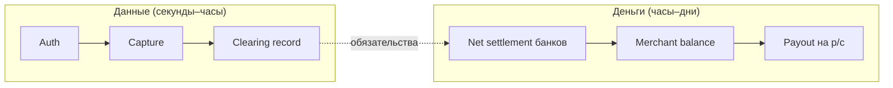
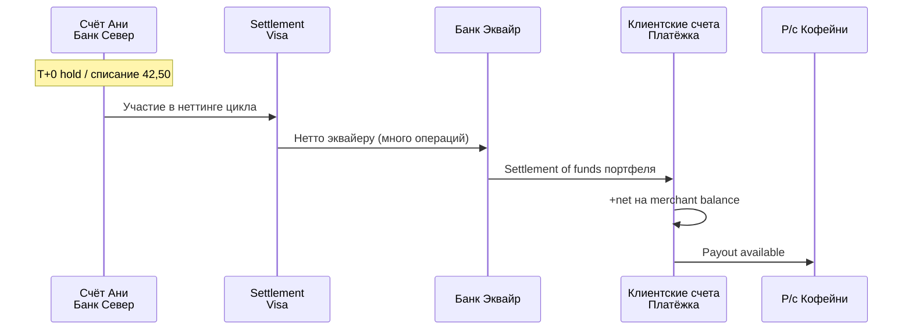
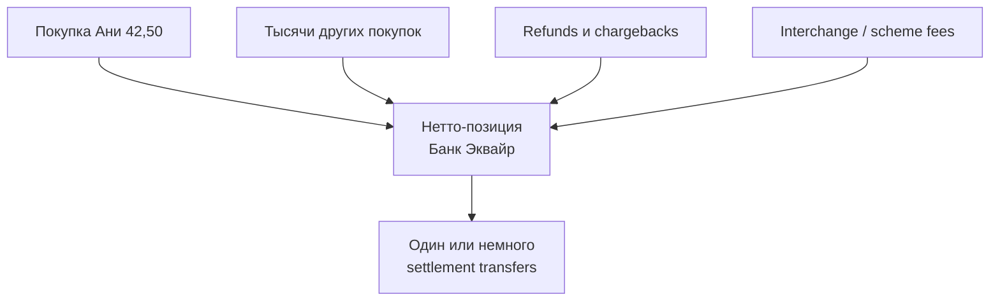
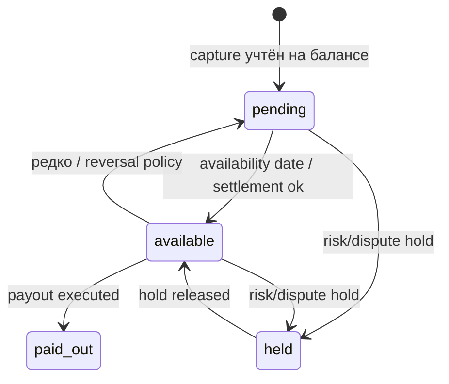
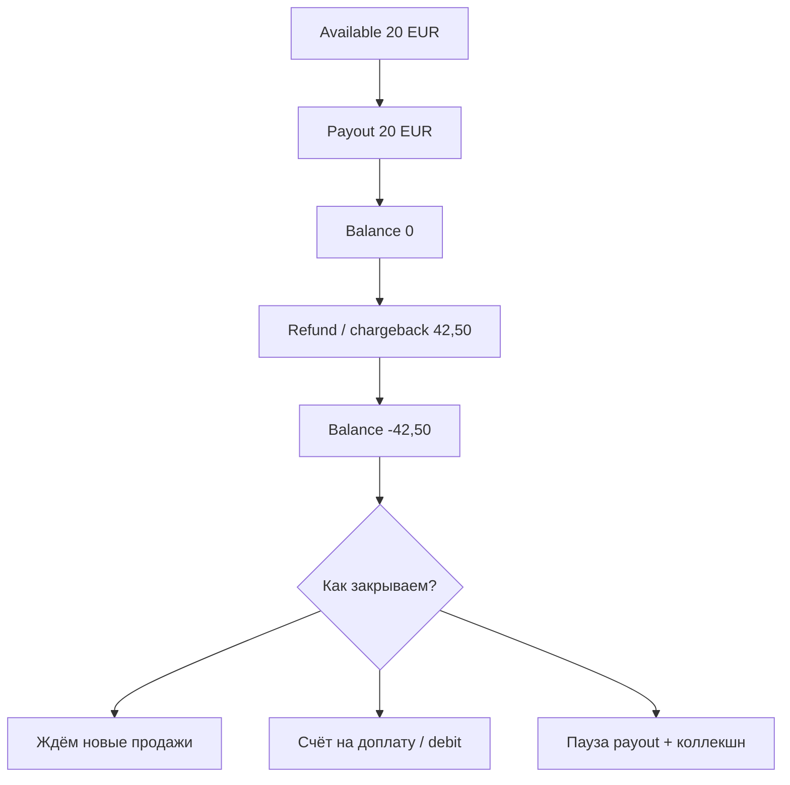

# Глава 12. Что происходит с деньгами

Аня снова купила кофе в «Кофейне» — набор зерна на **42,50 EUR**. На экране зелёная галочка. В приложении «Банка Север» висит списание. В админке «Кофейни» заказ в статусе «оплачен». Бухгалтер магазина спрашивает инженера: «А деньги уже у нас на расчётном?» Инженер смотрит в API «Платёжки», видит `status: succeeded` и почти отвечает «да».

Не отвечай «да».

`succeeded` значит, что платёжный *факт* состоялся: авторизация прошла, capture ушёл, обязательство зафиксировано. Деньги «Кофейни» при этом могут ещё лежать в неттинге карточной сети, на settlement-счёте эквайера, в pending-балансе PSP или в rolling reserve. Расчётный счёт «Кофейни» в её банке может молчать ещё два рабочих дня — и это нормально.

В [главе 06](06-payment-lifecycle.md) мы прошли фазы карточного платежа: authorization, capture, clearing, settlement. Там settlement мелькал как «банки рассчитались нетто». Здесь мы развернём другую сторону той же истории: **куда физически и логически едут деньги**, на каких счетах они живут, чем merchant balance отличается от банковского остатка, почему бывают pending и available, зачем rolling reserve, что такое held funds и откуда берётся negative balance.

Если не понимать поток денег, команда будет чинить «пропавшие» payout'ы как баг API, путать status платежа с деньгами на р/с и обещать CFO «мгновенные поступления», которых карточный мир по конструкции не даёт.

**В этой главе**

- Физический путь денег платежа Ани: от счёта карты до р/с «Кофейни»
- Счета участников: эмитент, схема, эквайер, PSP, мерчант; корреспондентские и settlement-счета
- Net settlement между банками и схемами — почему 42,50 EUR не едут отдельным проводом
- Settlement of funds и merchant balance: pending vs available
- Payouts: расписание, rolling, пороги; rolling reserve, held funds, negative balance
- Сквозной денежный разрез одного заказа и практические выводы для инженера

---

## Две реальности одного платежа

У каждого успешного карточного платежа есть две параллельные жизни.

**Данные.** Сообщения auth/capture, статусы, webhooks, ARN, отчёты. Это то, что видит инженер в логах и что разбирали в [главах 06](06-payment-lifecycle.md) и [07](07-states-async-idempotency.md).

**Деньги.** Остатки на счетах, обязательства между банками, нетто-переводы, логический баланс мерчанта у PSP, банковский перевод на р/с. Это то, что видит казначейство и то, из-за чего в понедельник утром CFO звонит в саппорт.

Эти жизни связаны, но **не синхронны**. Hold у Ани появляется за секунды. Capture — минуты или часы. Клиринг схемы — в следующем cut-off. Settlement между банками — часто T+1/T+2 рабочих дней. Зачисление на merchant balance — по политике PSP. Payout на р/с — по расписанию договора. Chargeback через три недели может вычесть уже выплаченные деньги.

Поэтому в доменной модели зрелой платформы платёж, balance transaction и payout — разные сущности. Склеивать их в одно поле `paid = true` — приглашение к инциденту сверки.



Словами: clearing оформляет обязательства; net settlement двигает нетто между банками; merchant balance отражает «сколько PSP считает вашим»; payout — уже банковский перевод мерчанту. Стрелка «данные → деньги» существует, но с лагом и фильтрами комиссий, резервов и холдов.

---

## Физический путь денег: платёж Ани на 42,50 EUR

Возьмём тот же сквозной заказ, что в [главе 06](06-payment-lifecycle.md).

| Что | Значение |
|---|---|
| Заказ | `ORD-2026-0918-0042` |
| Платёж у «Платёжки» | `pay_8f3a2c91` |
| Сумма presentment | 42,50 EUR |
| Карта | дебетовая Visa, эмитент «Банк Север» |
| Мерчант | «Кофейня» через PSP «Платёжка» |
| Эквайер | «Банк Эквайр» |
| Схема | Visa (иллюстративно) |

Аня думает: «Я заплатила „Кофейне“». Юридически и продуктово так и есть: она купила у мерчанта. Но **банковский провод** «карта Ани → р/с Кофейни» в природе не существует. Деньги движутся цепочкой обязательств и нетто-расчётов.

### Шаг за шагом: где деньги в каждый момент

**T+0 (секунды): authorize.** «Банк Север» ставит hold 42,50 EUR на карточном счёте Ани. Деньги ещё «её», но недоступны для других трат. На р/с «Кофейни» ноль изменений. У «Платёжки» на merchant balance тоже ещё ничего — или, в зависимости от продукта, появляется ожидаемая запись в статусе pending после capture (модели разные; важно не путать hold покупателя с балансом продавца).

**T+0…T+часов: capture.** Операция включается в клиринговый конвейер. Hold у Ани начинает превращаться в списание (эмитентские UX-тайминги разные). Обязательство «эмитентская сторона должна эквайерской» оформляется для схемы. Физического провода на 42,50 всё ещё нет.

**Ночь / следующий цикл: clearing.** В файле схемы появляется financial presentment по `pay_8f3a2c91`. ARN становится известен. Схема знает: эта покупка участвует в завтрашнем (или сегодняшнем) неттинге.

**T+1…T+2: scheme settlement.** Между расчётными позициями участников схемы происходит **net settlement**: не 42,50 отдельным платежом, а одна нетто-сумма «Банка Эквайр» против множества эмитентов за весь цикл, с учётом interchange и scheme fees. Деньги «приземляются» на settlement/correspondent-контуре эквайера (упрощая).

**После этого: PSP ↔ эквайер.** «Платёжка» получает от «Банка Эквайр» settlement of funds по своему портфелю мерчантов (или видит зачисление на свой клиентский/safeguarded счёт — зависит от лицензии и договора). Из валовой суммы вычитаются комиссии по тарифу.

**Потом: merchant balance.** На логическом балансе «Кофейни» у «Платёжки» появляется net-сумма: условно 42,50 минус MDR. Часто сначала в **pending**, затем в **available**.

**Ещё позже: payout.** По расписанию (например, каждый рабочий день после 10:00) «Платёжка» инициирует банковский перевод available-части на IBAN «Кофейни». Вот теперь бухгалтер видит деньги в интернет-банке магазина.



Словами: Аня теряет доступ к 42,50 почти сразу; «Кофейня» получает деньги на р/с заметно позже и уже за вычетом комиссий и возможных удержаний. Между этими точками — несколько слоёв счетов и один большой взаимозачёт.

### Кто «держит» деньги в промежутке

Пока payout не ушёл, экономический float размазан по цепочке. Упрощённо и без претензии на юридическую точность конкретного договора:

- после auth доступ Ани ограничен hold'ом, но эмитент ещё не отправил деньги в неттинг;
- после scheme settlement ликвидность оказывается у эквайерской стороны (за вычетом комиссий схемы);
- PSP, получив settlement of funds, держит клиентские деньги на safeguarded/client accounts до payout;
- rolling reserve и held funds — тоже деньги мерчанта, просто с ограничением на вывод.

Инженеру полезно спрашивать в инциденте не «куда исчезли 42,50», а **на каком слое сейчас обязательство**: issuer accounting, scheme position, acquirer payable to PSP, PSP payable to merchant, bank transfer in flight. От ответа зависит, кого пинговать и какой отчёт смотреть.

Ещё один практический нюанс: разные методы оплаты «созревают» по-разному. Карта Ани на 42,50 может дать available через два рабочих дня. SEPA Instant на тот же заказ — через минуты на счёт PSP, но pending на merchant balance всё равно могут держать сутки из-за AML. BNPL вообще может финансировать мерчанта раньше, чем покупатель погасит рассрочку — это уже чужой баланс-лист. Поэтому availability policy в коде лучше хранить **per payment method / per risk tier**, а не одной константой `AVAILABLE_AFTER_HOURS=48`.

### Врезка: как это бывает в жизни

Бухгалтер «Кофейни» сверяет день продаж 18 сентября: в кассе PSP — двадцать заказов на 850 EUR gross. На р/с 20 сентября пришло 812,40 EUR одним платежом с описанием вроде `PLATEZHKA PAYOUT 2026-09-19`. Внутри — двадцать покупок, три refund'а предыдущих дней, комиссия дня и кусок rolling reserve. Искать «провод на 42,50 от Ани» бессмысленно. Искать строку `pay_8f3a2c91` в settlement/payout report — правильно.

---

## Счета, на которых живут деньги

Чтобы поток не казался магией, разложим **типы счетов**. Не все из них видит инженер мерчанта в API — но все влияют на то, почему payout «задержался» или почему баланс «не сходится с банком».

### Счёт держателя карты у эмитента

У Ани в «Банке Север» карточный (или текущий, привязанный к карте) счёт. При auth:

- на дебетовой карте резервируется сумма (available balance уменьшается на hold);
- на кредитной — уменьшается доступный кредитный лимит.

После clearing/settlement эмитент проводит окончательное списание в своей бухгалтерии. Для Ани в приложении это часто выглядит как «сначала pending, потом обычная операция» — но это UX банка, не API «Кофейни».

Инженеру мерчанта этот счёт недоступен и не нужен напрямую. Он нужен, чтобы помнить: **успех у мерчанта и движение у cardholder — разные системы**, и лагом между ними пугают саппорт («списалось, а заказ не создался» / наоборот).

### Settlement-счета схемы и участников

Карточная сеть организует расчёты между тысячами банков. У участников (эмитентов, эквайеров) есть позиции и счета в расчётной инфраструктуре схемы или у её settlement bank. Именно здесь происходит взаимозачёт обязательств за цикл.

Детали форматов файлов и коннекторов — в [главе 22](22-integrations.md); экономика interchange/scheme fee — в [главе 15](15-fees-and-economics.md). Здесь важен принцип: схема — не «кошелёк Ани», а **клирингово-расчётный механизм** между членами.

### Корреспондентские счета: nostro и vostro

Когда деньги реально «переезжают» между банками (особенно cross-border), часто участвует **корреспондентский банкинг**. Коротко:

- **Nostro** — «наш счёт у вас»: счёт банка A в банке B, которым A пользуется для расчётов в валюте/регионе B.
- **Vostro** — «ваш счёт у нас»: тот же счёт глазами банка B.

Для внутриевропейского карточного settlement в одной валюте картина часто спрятана внутри схемы и её расчётного банка. Для международных потоков и некарточных рельсов корреспонденты выходят на первый план — подробнее в [главе 27](27-cross-border-payments.md). В этой главе достаточно правила: **если кто-то говорит „деньги зависли на корреспонденте“, это про банковский слой, а не про баг webhook'а**.

### Счета эквайера «Банк Эквайр»

Эквайер получает нетто от схемы (с учётом комиссий) и дальше:

- рассчитывается с прямыми мерчантами; или
- рассчитывается с PSP вроде «Платёжки», который агрегирует тысячи мерчантов.

У эквайера есть operational/settlement accounting: сколько должен схеме, сколько должен мерчантам/PSP, сколько удержать под риск. Инженер «Кофейни» этот слой обычно не видит — он видит уже продукт «Платёжки».

### Клиентские и safeguarded-счета PSP

«Платёжка» как платёжный институт / EMI (тип лицензии зависит от юрисдикции — [глава 18](18-regulation-and-compliance.md)) часто обязана держать деньги клиентов **отдельно** от собственных операционных средств: client money, safeguarding, segregated accounts. Смысл регулирования: если PSP завтра обанкротится, деньги мерчантов не должны раствориться в зарплатах сотрудников PSP.

Для инженера это объясняет странную на первый взгляд архитектуру:

- в продукте у каждого мерчанта есть **логический** merchant balance;
- в банке лежит один или несколько **физических** пулов, по которым идёт своя сверка;
- payout — это вывод из пула на р/с конкретного мерчанта по правилам леджера.

Путать «баланс в кабинете» с «IBAN Платёжки» нельзя: кабинет показывает долю мерчанта в учёте; IBAN — банковский контейнер, где лежит много мерчантов сразу.

### Расчётный счёт «Кофейни»

Обычный бизнес-счёт в банке магазина. Сюда приходят payout'ы. Отсюда «Кофейня» платит поставщикам эфиопского зерна. Этот счёт — **конечная станция** пользовательской истории «нам заплатили», но не единственная правда о деньгах: до payout истина живёт в балансе PSP и в settlement-отчётах.

---

## Net settlement: почему 42,50 не едут сами по себе

В [главе 06](06-payment-lifecycle.md) уже было: одна операция тонет в пачке. Здесь углубим **механику неттинга**, потому что без неё невозможно понять settlement reports и «почему в банке одна сумма, а продаж много».

### Gross vs net

**Gross settlement** — каждая операция порождает отдельный перевод полной суммы. Так живут некоторые мгновенные платёжные системы (идея RTGS / instant rails), но не классический карточный день эквайера.

**Net settlement** — за период считают взаимные обязательства и переводят только разницу.

Пример на пальцах (числа иллюстративные). За цикл через позицию «Банка Эквайр» прошло:

| Направление | Смысл | Сумма |
|---|---|---|
| Purchase presentments | эквайер должен получить от эмитентов | +1 250 000 EUR |
| Refunds / credits | эквайер должен отдать | −80 000 EUR |
| Interchange + scheme fees | нетто комиссий по правилам | −15 000 EUR |

Грубо: вместо тысяч проводов схема организует расчёт нетто-позиции участника. Платёж Ани на 42,50 — одна строка внутри +1 250 000.



Словами: схема схлопывает океан операций в позиции участников; банки платят/получают нетто; мерчант потом видит уже свой кусок через PSP.

### Зачем так сделали

Карточный мир вырос из эпохи, когда нельзя было гонять миллионы real-time проводок между всеми парами банков. Неттинг:

- снижает ликвидную нагрузку (не нужно держать gross на каждую покупку);
- упрощает операционный день;
- естественно стыкуется с пакетным clearing.

Цена — **лаг и непрозрачность** для наивного наблюдателя. «Где мои 42,50?» — вопрос не к SWIFT-трассировке одной суммы, а к отчёту и matching'у идентификаторов ([глава 13](13-ledger-and-reconciliation.md)).

### Многосторонний неттинг и роли схемы

Схема выступает организатором многостороннего взаимозачёта: у каждого члена позиция против системы расчётов, а не обязательно парный провод «Банк Север ↔ Банк Эквайр» на каждую покупку. Именно поэтому эквайер и эмитент могут не иметь прямого договора друг с другом, но успешно рассчитывать операции через членство в сети ([глава 04](04-card-networks.md), [глава 02](02-ecosystem-participants.md)).

### Cut-off и календарь

Settlement живёт по календарю рабочих дней схемы/банка. Пятничный вечерний capture может попасть в понедельничный цикл. Праздники региона схемы сдвигают T+N. Instant card-like продукты и exemption'ы существуют, но классический e-commerce acquiring в Европе на момент написания книги всё ещё часто ощущается как «деньги через один–два банковских дня», даже если UI платежа мгновенный.

Для инженера: закладывайте в SLA и в UI отчётов **business-day calendar**, а не `now() + 48 hours` календарных.

### Что ломается в неттинге

Неттинг красив, пока сходится. Типичные боли операционного дня:

- **Файл клиринга не принят схемой** (формат, дубликат batch id, cut-off). Обязательства «висят», settlement сдвигается.
- **Расхождение totals**: сумма строк ≠ trailer. Пока не починят — позиция участника под вопросом.
- **Late presentment / out-of-window**: операция пришла слишком поздно относительно auth; часть потока уходит в exceptions.
- **Chargeback и representment вперемешку с покупками**: знаки в нетто прыгают, finance без reason codes слепнет.

С точки зрения «Кофейни» это редко выглядит как красная кнопка в API. Чаще — задержка available на полдня или «странная» корректировка в отчёте. С точки зрения «Платёжки» — PagerDuty ночью и ручной reconcile. Подробная механика файлов — [глава 22](22-integrations.md); здесь вывод: **net settlement — не абстракция из учебника, а ежедневный завод с exception queue**.

---

## Settlement of funds: когда деньги «приземлились»

Фраза **settlement of funds** в индустрии означает: по результатам клиринга и неттинга средства **фактически доступны** соответствующей стороне на её settlement/operational контуре — не как обещание в сообщении auth, а как движение или подтверждённая позиция денег.

Важно различать уровни:

1. **Scheme settlement** — банки-участники рассчитались по циклу схемы.
2. **Acquirer → PSP settlement** — эквайер передал PSP её долю портфеля (проводом, внутридневным зачётом, отчётом+движением — как договорятся).
3. **Merchant settlement** — PSP отразила сумму на балансе мерчанта и/или отправила payout.

Статус `settled` в разных API может означать любой из этих уровней. Читайте контракт конкретного поля, не перевод слова.

### Что приходит «Платёжке» от эквайера

Типично (упрощая) PSP получает:

- **денежное движение** на свой клиентский/settlement счёт (или внутрибанковский зачёт);
- **отчёт** (файл/API): список операций, fees, adjustments, chargebacks, net amount.

Без отчёта деньги — просто «пришло 1 184 332,17 EUR». С отчётом появляется возможность разнести сумму по мерчантам и платежам. Сверка «провод ↔ файл ↔ леджер» — сердце операционки; ей посвящена [глава 13](13-ledger-and-reconciliation.md).

### Иллюстративный нетто одного платежа на стороне PSP

Пусть по договору «Кофейни» с «Платёжкой» тариф blended (цифры **иллюстративные**):

- gross presentment: 42,50 EUR;
- комиссия PSP: 1,2% + 0,25 EUR ≈ 0,76 EUR;
- net к балансу мерчанта: 41,74 EUR.

Из этих 41,74 EUR схема и эквайер уже «забрали своё» на предыдущих слоях; PSP заложила свой take rate в MDR. Полный экономический разрез (interchange, scheme fee, markup) — в [главе 15](15-fees-and-economics.md). Здесь нам нужно другое: **на merchant balance попадает net, не gross**.

```json
{
  "payment_id": "pay_8f3a2c91",
  "order_id": "ORD-2026-0918-0042",
  "gross_amount": { "currency": "EUR", "value": 4250 },
  "fee_amount": { "currency": "EUR", "value": 76 },
  "net_amount": { "currency": "EUR", "value": 4174 },
  "balance_transaction_id": "btx_91aa02",
  "availability": "pending",
  "available_on": "2026-09-20"
}
```

Поля вымышлены, но смысл настоящий: отдельная сущность balance transaction связывает платёж с деньгами мерчанта.

### Multicurrency на хвосте

Если presentment в USD, а settlement «Кофейни» в EUR, на пути появятся FX-конвертации и спреды. Денежный путь удлиняется ещё одним слоем курсов. Принципы — [глава 14](14-currencies-and-fx.md); в этой главе запомните: **gross в валюте карты ≠ net в валюте payout**, даже без комиссии «в лоб».

### Когда settlement of funds «не тот»

Иногда деньги на счёт PSP пришли, а разнести их нельзя:

- отчёт от эквайера задержался или битый;
- пришло больше/меньше, чем сумма строк отчёта (bank charges, FX residual, чужой платёж на тот же IBAN);
- один провод покрывает несколько merchant portfolios / MID'ов.

В этот момент зрелая «Платёжка» кладёт сумму на **suspense / unallocated** в леджере и не раздаёт её мерчантам «на глаз». Наивная система сразу плюсует всем пропорционально GMV дня — и через неделю разбирает, кому вернуть лишнее. Правило инженера: **нет matching'а отчёта — нет автоматического credit на merchant balance**.

Ещё крайность: scheme settlement прошёл, а эквайер задержал перевод PSP из-за своего риска или операционного сбоя. Платежи в API зелёные, мерчанты нервничают, treasury PSP решает — кредитовать балансы из собственной ликвидности или честно держать pending. Это продуктово-казначейское решение с ценой; его нельзя спрятать в «просто ускорим webhook».

---

## Merchant balance: касса внутри «Платёжки»

**Merchant balance** — логический остаток средств мерчанта у PSP: «сколько „Кофейня“ может считать своими в учёте Платёжки». Это не обязательно отдельный банковский счёт на каждое юрлицо магазина. Чаще — запись в леджере плюс доля в safeguarded-пуле.

### Зачем он появился

Если бы каждый успешный capture мгновенно рождал SEPA-перевод на р/с мерчанта:

- банковские комиссии и операции убили бы unit economics мелких платежей;
- refunds и chargebacks после выплаты превратились бы в охоту за уже ушедшими деньгами;
- риск-команда не успевала бы останавливать вывод мошенническим мерчантам.

Баланс внутри PSP даёт буфер: сначала учесть операцию, потом — по правилам — выплатить. Для marketplace и split payments без внутреннего баланса почти невозможно жить ([глава 26](26-marketplace-and-split-payments.md)).

### Что двигает баланс

Типичные события (имена в продуктах разные):

| Событие | Влияние на баланс |
|---|---|
| Успешный capture / charge | +net (часто через pending) |
| Refund | −сумма возврата (−fee policy зависит от договора) |
| Chargeback / dispute lost | −сумма (− dispute fee) |
| Fee / adjustment | − или + |
| Payout | −available (деньги ушли на р/с) |
| Reserve hold / release | перекладки между корзинами баланса |
| Manual credit/debit от риска/саппорта | редко, но бывает |

Инженерная модель: balance — не «одно число в Redis», а **поток иммутабельных проводок** с проекцией текущего остатка. Иначе через полгода никто не объяснит, почему вчера было 12 400, а сегодня 11 980. К леджеру вернёмся в [главе 13](13-ledger-and-reconciliation.md); здесь — продуктовый смысл.

### Баланс в кабинете vs деньги в банке мерчанта

| | Merchant balance | Р/с «Кофейни» |
|---|---|---|
| Где | учёт PSP | банк мерчанта |
| Когда обновляется | по событиям платежей/споров | по факту payout (и других проводок магазина) |
| Видит ли Аня | нет | нет |
| Можно ли тратить на refunds внутри PSP | да, если хватает | косвенно: нет денег на балансе — refund может увести в negative |

Классический саппорт-тикет: «В кабинете 5 000 EUR, а в банке ноль». Ответ: payout ещё не ушёл / в пути / упал / available ещё не наступило. Не «пропали деньги».

---

## Available vs pending

Почти у каждого PSP баланс мерчанта режется минимум на две корзины.

### Pending

**Pending** — сумма уже учтена как связанная с успешными операциями, но **ещё не доступна к выводу**. Причины разные и часто комбинируются:

- ещё не завершился settlement цикл схемы/эквайера;
- договорная задержка availability (например, T+2/T+7 после capture);
- риск-политика: новым мерчантам дольше держать pending;
- метод оплаты: карта vs bank transfer vs BNPL по-разному «созревают».

Пока деньги в pending, «Кофейня» их видит в отчёте («ожидаем»), но кнопка payout / автоматический вывод их не забирает.

### Available

**Available** — сумма, которую по текущим правилам можно включить в payout (если нет других блоков: KYC, sanctions hold, negative offset и т.д.).

Переход pending → available — событие. Его стоит логировать и отдавать webhook'ом (`balance.available` / аналог), потому что казначейство мерчанта планирует ликвидность от available, а не от gross sales.



Словами: happy-path — pending → available → payout. Боковые ветки — холды риска и споров, которые вынимают деньги из доступных.

### Зачем продукту две корзины

1. **Честность к мерчанту.** Показать «вам уже „начислили“, но вывести завтра» лучше, чем молчать до payout.
2. **Риск.** Задержка availability — дешёвый (для PSP) способ снизить ущерб от first-day fraud.
3. **Операции.** Payout-батч строится из available, не из «всех succeeded за сутки».

### Ловушка отчётности

Маркетинг мерчанта считает «выручку дня» по `succeeded` платежам. Финансы считают поступления по bank statement. Product считает GMV. PSP показывает pending+available. Четыре числа, четыре правды. Задача инженера платформы — **именовать метрики явно** (`gross_captured`, `net_pending`, `net_available`, `paid_out`), а не одно слово «баланс».

---

## Payouts: путь на расчётный счёт

**Payout** (выплата) — перевод available-средств с контура PSP на банковский счёт мерчанта (или нескольким бенефициарам в marketplace). Это отдельный платёжный продукт со своими статусами, ретраями и сверкой — не «побочный эффект succeeded».

### Расписание выплат

Типичные политики (иллюстративно, всё договорное):

| Режим | Как работает | Кому удобно |
|---|---|---|
| Daily automatic | каждый рабочий день available → bank | магазины с постоянным cashflow |
| Weekly | раз в неделю, меньше банковских fee | мелкий оборот |
| Threshold | когда available ≥ N EUR | редкие продажи |
| Manual | мерчант жмёт «вывести» в кабинете | контроль ликвидности у мерчанта |
| Rolling continuous | по мере созревания available, частые мелкие | «почти realtime» ощущение |

«Кофейня» в нашем примере сидит на **daily**: каждый будний день после cut-off «Платёжка» собирает available, создаёт payout, отправляет SCT (или локальный rail) на IBAN магазина.

### Rolling payout — что имеют в виду

Слово **rolling** в выплатах путают с rolling reserve. Уточним:

- **Rolling payout / rolling settlement** — выплаты идут регулярно «катящимся» окном: сегодня за вчерашнее available, завтра за сегодняшнее, без ожидания конца месяца.
- **Rolling reserve** — удержание процента оборота в резерв (см. ниже).

Когда менеджер говорит «у нас rolling», спросите: про частоту payout или про резерв?

### Статусы payout

Минимальный набор для инженера:

1. `created` / `pending` — выплата собрана во внутренней системе.
2. `in_transit` — отправлена в банк/рельс.
3. `paid` / `succeeded` — банк принял / подтвердил зачисление (осторожно: у SCT «accepted» ≠ всегда финальность в бытовом смысле, см. [главу 10](10-bank-based-methods.md)).
4. `failed` / `returned` — отказ реквизитов, закрытый счёт, AML reject, return от банка получателя.

```json
{
  "payout_id": "po_77c1de",
  "merchant_id": "mer_coffee_01",
  "amount": { "currency": "EUR", "value": 81240 },
  "status": "in_transit",
  "destination_iban": "DE00XXXX",
  "statement_descriptor": "PLATEZHKA PAYOUT 2026-09-19",
  "arrival_date": "2026-09-20",
  "balance_transactions": ["btx_91aa02", "btx_91aa03"]
}
```

Payout на 812,40 EUR может включать net от платежа Ани и ещё десятки строк. Связь many-to-many: много balance transactions → один payout; иногда один adjustment → отдельный payout.

### Что может пойти не так

- Неверный IBAN / смена р/с без KYC update → return, деньги возвращаются на баланс, мерчант орёт «где выплата».
- Банк получателя на выходных → «T+0» превращается в вторник.
- PSP поставил payout на паузу из-за риска — available растёт, р/с молчит.
- Дублирование payout job без идемпотентности → двойная выплата; потом negative balance и уголовный холод в желудке у on-call.

Payout — денежная операция. К нему применяются те же правила надёжности, что к платежам: идемпотентность, exactly-once на уровне леджера, сверка после инцидента ([главы 21](21-distributed-systems-and-money.md), [23](23-reliability.md)).

### Instant payout как продукт

Некоторые PSP продают «мгновенный вывод» за отдельную fee: available (или даже часть pending под риск) уходит по SCT Inst / локальному instant rail. Это не отменяет того, что схема могла ещё не рассчитаться: PSP кредитует мерчанта из собственной ликвидности/пула и берёт на себя timing risk. Для инженера «Кофейни» это просто другой `payout_speed`. Для инженера PSP — отдельный treasury и лимиты.

### Как собрать дневной payout «Кофейни»

Иллюстративный алгоритм (псевдокод), который объясняет, почему «просто SELECT sum(succeeded)» нельзя:

```python
# иллюстративно, не API конкретного PSP
def build_daily_payout(merchant_id, business_day):
    available_txns = ledger.list(
        merchant_id=merchant_id,
        bucket="available",
        not_yet_in_payout=True,
        as_of=business_day.cutoff,
    )
    # резервы и холды уже вычтены из available-проекции
    amount = sum(t.net_amount for t in available_txns)
    if amount < merchant.min_payout_threshold:
        return None  # переносим на завтра
    if risk.is_payout_paused(merchant_id):
        raise PayoutBlocked(reason=risk.pause_reason(merchant_id))
    return payouts.create_idempotent(
        key=f"payout:{merchant_id}:{business_day}",
        amount=amount,
        destination=merchant.verified_bank_account,
        includes=[t.id for t in available_txns],
    )
```

Здесь видны все развилки, о которых спорят ночами: cut-off, threshold, risk pause, идемпотентный ключ на день, явный список включённых balance transactions. Без списка включённых потом невозможно ответить на вопрос бухгалтера: «А платёж Ани `pay_8f3a2c91` в какую выплату вошёл?»

### Payout и несколько валют / счетов

«Кофейня» может принимать EUR и PLN, а выводиться только в EUR на один IBAN. Тогда PSP либо конвертирует PLN→EUR по своему treasury rate (спред — снова [глава 14](14-currencies-and-fx.md)), либо ведёт мультивалютный баланс и просит второй счёт. Инженерная модель: `Balance` обычно имеет ключ `(merchant_id, currency)`. Payout всегда в конкретной валюте на совместимый destination. Смешивать валюты в одном `amount` без currency — билет в ад округлений.

---

## Rolling reserve: подушка под будущие беды

**Rolling reserve** — договорное удержание части оборота мерчанта на резервном «кармане» баланса, которое потом постепенно освобождается. Классика high-risk и нового мерчанта: «10% от каждой выплаты держим 90 дней, потом отдаём».

### Зачем эквайеру/PSP резерв

Схема и эмитент могут через недели вернуть деньги покупателю через chargeback. Если к тому моменту мерчанту уже всё выплатили, а магазин исчез — убыток на эквайере/PSP. Reserve снижает этот хвост риска.

Для «Кофейни» с нормальным MCC и историей резерв может быть нулевым. Для внезапного мерчанта с MCC travel/electronics и первым месяцем — заметным.

### Как это выглядит в деньгах

Иллюстрация (не универсальные проценты):

- net к зачислению по платежу Ани: 41,74 EUR;
- rolling reserve 10%: 4,17 EUR уходит в reserve;
- к available/payout сегодня: 37,57 EUR;
- через 90 дней 4,17 EUR release → available.

```text
capture net     +41,74
reserve hold    -4,17   → reserve_balance
to available    +37,57
...
T+90d           reserve release +4,17 → available
```

Резерв обычно **не** «пропавшие деньги». Это отложенные деньги мерчанта внутри того же PSP, с графиком освобождения. Но для cashflow магазина 10% — ощутимо: нельзя закупать зерно на сумму, которая ещё в reserve.

### Rolling vs fixed reserve vs minimum balance

- **Rolling reserve** — процент от оборота, «окно» N дней.
- **Fixed reserve** — держать не ниже X EUR постоянно.
- **Minimum balance / floating** — не выплачивать ниже порога, чтобы было чем крыть refunds.

Продуктово это разные ручки одного рычага: **не отдавать мерчанту всё сразу**. В договоре и в API их надо различать, иначе саппорт объясняет «резерв» три раза разными словами.

---

## Held funds: когда деньги замораживают точечно

**Held funds** (удержанные / замороженные средства) — суммы, которые PSP/эквайер **временно изымает из available** по конкретной причине, не обязательно по формуле rolling reserve.

Типичные поводы:

- подозрение в fraud по мерчанту или по пачке операций ([глава 16](16-fraud.md));
- открытый dispute / chargeback, под который резервируют сумму спора ([глава 17](17-chargebacks-and-disputes.md));
- незавершённый KYC/KYB, смена бенефициара, sanctions hit ([глава 18](18-regulation-and-compliance.md));
- запрос правоохранения / compliance investigation;
- технический hold «пока не сверим расхождение settlement».

### Чем hold отличается от rolling reserve

| | Rolling reserve | Held funds |
|---|---|---|
| Триггер | формула договора / риск-сегмент | событие или расследование |
| Предсказуемость | график release известен | срок может быть «пока не разберёмся» |
| Гранулярность | процент потока | конкретная сумма/платёж/период |
| Ощущение мерчанта | «так в договоре» | «нас заблокировали» |

Оба уменьшают available. Путать их в одной куче `reserved` без reason code — способ получить ярость мерчанта и невозможность автоматизировать release.

### Что должен видеть инженер в данных

У удержания должны быть:

- `amount`, `currency`;
- `reason` (fraud_review, dispute, kyc, compliance, settlement_mismatch, …);
- `related_payment_id` / `dispute_id` если есть;
- `created_at`, `release_at` или `status: active|released`.

Иначе через месяц никто не вспомнит, почему 2 300 EUR «просто висят».

### Врезка: как это бывает в жизни

«Кофейня» внезапно запускает рекламу, оборот за сутки ×20. Fraud-движок «Платёжки» ставит merchant-level hold на новые available. Платежи Ани и других покупателей продолжают `succeeded` — кофе уезжает. Payout встаёт. Через два дня риск подтверждает легитимность, hold снимается, уходит увеличенный payout. Если бы «Кофейня» отгружала только после bank credit, она бы остановила продажи. Если отгружает по `succeeded` — продолжает, но кассовый разрыв на совести договорённости с PSP и собственного treasury.

---

## Negative balance: когда мерчант «должен» PSP

**Negative balance** — состояние, когда обязательства мерчанта перед PSP превысили его pending+available. Проще: на балансе минус.

### Откуда берётся минус

Классические сюжеты:

1. **Refund после payout.** Аня получила кофе, «Кофейня» вывела деньги, потом согласилась на полный refund 42,50. На балансе нет покрытия → −42,50 (ещё и fee).
2. **Chargeback после payout.** Ещё больнее: спор + dispute fee, товар уже отдан.
3. **Массовые возвраты.** Сезонная акция + брак партии зерна.
4. **Корректировки settlement.** Поздний fee, reversal представления, scheme fine, переданный мерчанту.
5. **Ошибка выплаты.** Случайно выплатили дважды; одна вернулась не сразу.



Словами: минус — нормальный (хотя неприятный) результат асимметрии «сначала выплатили, потом прилетел возврат».

### Что делает PSP

Политики разные, часто комбинация:

- автопауза payout, пока баланс не выйдет в плюс;
- netting будущих продаж в погашение минуса;
- счёт / SEPA debit / ручная доплата от мерчанта;
- гарантийный депозит, увеличение reserve;
- в крайнем случае — offboarding и коллекшн, иногда списание на страховой/резервный фонд риска PSP.

Для инженера платформы negative balance — **не «показать красным число и забыть»**. Нужны алерты риску, блокировки вывода, отчёты, иногда запрет новых refund'ов без покрытия (продуктово спорно, но встречается).

### Что это значит для «Кофейни» как инженерии магазина

Магазин, который делает refunds из своей OMS, обязан смотреть не только «платёж captured», но и **покрываемость** на стороне PSP (или держать собственный резерв ликвидности). Иначе саппорт будет обещать Ане возврат, а API вернёт `insufficient_balance`.

### Как не допустить минус «втихую»

На стороне PSP полезны жёсткие инварианты:

- нельзя создать payout, если после него available < 0;
- refund/chargeback, уводящий баланс ниже нуля, либо блокируется, либо проходит с немедленным `negative_balance` event и паузой вывода;
- любой ручной credit от саппорта требует dual control (двух глаз) — иначе «подарили» мерчанту лишние десять тысяч.

На стороне мерчанта полезны мягкие:

- перед массовым refund-кампейном смотреть available + прогноз поступлений;
- не считать выведенные деньги «закрытой главой» в течение chargeback window;
- в ERP хранить не только bank balance, но и оценку PSP balance (хотя бы ежедневным импортом отчёта).

Negative balance — не баг карточной схемы. Это следствие того, что **право покупателя на возврат/спор переживает ваш payout**.

---

## Сквозной денежный разрез: семь дней из жизни 42,50 EUR

Соберём историю Ани в один таймлайн с фокусом на деньги. Даты иллюстративные; `pay_8f3a2c91` тот же, что в [главе 06](06-payment-lifecycle.md).

| Когда | Событие | Деньги Ани | Деньги «Кофейни» |
|---|---|---|---|
| Пн 14:02 | Auth approve | hold −42,50 available | баланс без изменений |
| Пн 14:03 | Capture | hold → к списанию | у PSP: ожидание clearing |
| Вт ночь | Clearing file | эмитент готовит final | обязательствная запись в схеме |
| Ср | Scheme net settlement | списание финализировано у банка | эквайер получил нетто-пачку |
| Ср/Чт | PSP settlement of funds | — | +41,74 pending на балансе |
| Пт 00:00 | available_on | — | 41,74 → available (из них 4,17 в reserve, если 10%) |
| Пт 11:40 | Payout batch | — | available уходит в `po_77c1de` |
| Пт/Пн | Bank credit | — | +37,57 (пример с reserve) на р/с |
| … +90d | Reserve release | — | +4,17 available → следующий payout |

Без rolling reserve картинка проще: на р/с приедет порядка 41,74 одним из кусков дневного payout.

### Как это отражается в трёх «правдах»

1. **Банк Ани:** операция покупки у `COFFEE*ORDER …` на 42,50 EUR.
2. **Кабинет «Платёжки»:** платёж succeeded; balance transaction net 41,74; payout reference.
3. **Интернет-банк «Кофейни»:** входящий SCT на сумму дня, в которой 41,74 (или 37,57) спрятаны.

Сверка между (2) и (3) — задача [главы 13](13-ledger-and-reconciliation.md). Здесь вывод проще: **не ищите 42,50 на р/с**.

### Для любопытных: где «физически» лежат 42,50 в среду утром

Грубый ответ: уже не на «свободных» деньгах Ани; ещё не на р/с «Кофейни»; распределены по обязательствам и позициям банков в settlement-системе схемы и по счетам эквайера/PSP. Спрашивать «на каком конкретно IBAN лежат именно эти 42,50» — как спрашивать, в каком entangle'd электроне вашего биткоина «ваш» сатоши. Учёт отвечает лучше физики провода.

---

## Связь с некарточными методами

Банковские переводы и Open Banking из [главы 10](10-bank-based-methods.md) меняют **скорость и рельс**, но не отменяют слоёв PSP:

- SCT Inst может зачислить деньги на счёт PSP за секунды;
- merchant balance всё равно может показать pending (риск, AML, cutoff payout);
- payout мерчанту остаётся отдельным решением.

Наличные ваучеры и BNPL из [главы 11](11-wallets-bnpl-local-methods.md) добавляют ещё больше лагов: «покупатель оплатил» ≠ «мерчант получил». Всегда рисуйте два таймлайна: buyer settlement и merchant settlement.

## Карта вопросов: «где мои деньги?»

Когда в чат саппорта прилетает «оплата прошла, денег нет», полезно пройти чеклист слоёв — сверху вниз.

| Вопрос | Куда смотреть | Если «нет» |
|---|---|---|
| Платёж captured/succeeded? | API платежа, webhook | чинить auth/capture, не payout |
| Есть balance transaction net? | ledger / balance API | ждать settlement of funds или искать exception |
| Статус pending или available? | availability | ждать `available_on` / риск-политику |
| Сумма в reserve или hold? | reserve/hold reasons | объяснить график или расследование |
| Создан payout, включающий эту txn? | payout report | cut-off, threshold, pause |
| Payout in_transit / paid / returned? | статус выплаты, bank | реквизиты, банк, ретрай |
| Деньги на р/с мерчанта? | bank statement | matching по descriptor и дате, не по 42,50 |

Этот чеклист экономит часы переписки «это вы / это банк / это схема». Он же хороший каркас для runbook on-call и для UI статуса «деньги заказа» во внутренней админке «Кофейни» — если магазин достаточно крупный, чтобы ему это было нужно.

Для «Платёжки» как платформы тот же чеклист превращается в observability: отдельные дашборды на каждый слой, а не одна лампочка `payments_ok`. Иначе инцидент «эквайер задержал settlement wire» выглядит идентично инциденту «упал webhook succeeded», хотя чинятся совершенно разными людьми.

---

## Что это значит для инженера

1. **Разведите сущности в модели.** `Payment`, `BalanceTransaction`, `Payout`, `Reserve`, `Hold` — разные объекты со своими id и статусами. Статус платежа не обновляет автоматически bank statement мерчанта.

2. **Храните net, fee, gross отдельно.** Иначе невозможно объяснить CFO, почему «оплачено 42,50», а «пришло 37,57».

3. **Считайте availability явно.** Поле `available_on` / событие перехода pending→available должно быть first-class, не комментарий в Slack от бухгалтера PSP.

4. **Payout идемпотентен.** Ключ идемпотентности на создание выплаты обязателен. Двойной payout — Bloody Sunday для леджера.

5. **Webhook'и денег.** Подпишитесь не только на `payment.succeeded`, но и на `payout.*`, `balance.*`, `dispute.*`. Иначе OMS узнает о минусе баланса от злого письма мерчанта.

6. **Не обещайте UI „деньги у вас“ на auth.** Формулировки: «оплата подтверждена», «ожидаем поступление», «выплачено». Разные фазы — разные слова.

7. **Календарь business days.** Тесты с `+2 days` в календарных днях врут на праздниках и выходных.

8. **Симулируйте negative path.** В staging обязательно: refund после payout, chargeback, failed payout return, reserve release. Happy-path демо врёт о зрелости системы.

9. **Метрики ликвидности.** Кроме conversion rate мониторьте: payout failure rate, time-to-available, volume in pending, volume in reserve/holds, merchants with negative balance ([глава 24](24-monitoring-and-operations.md)).

10. **Документируйте reason codes холдов.** Без них автоматизация release и саппорт превращаются в археологию.

---

## Типичные ошибки и грабли

**Считать `succeeded` = деньги на р/с.** Самая частая. Ломает отчёты, обещания клиентам и интеграцию с 1C/ERP.

**Искать сумму заказа в bank statement.** Payout агрегированный. Matching — по отчёту и id, не по 42,50.

**Склеить pending и available в одно число для кнопки „Вывести всё“.** Выведете невыводимое — или недовыведете и получите тикет.

**Забыть, что refund ест баланс.** Продукт разрешает бесконечные возвраты при нулевом available → negative → паника.

**Rolling reserve спрятать в „комиссию“.** Мерчант думает, что его обманули в fee. Reserve должен быть отдельной строкой отчёта с датой освобождения.

**Held funds без срока и причины.** Compliance hold на «потом разберёмся» висит месяцами и убивает доверие.

**Payout job по cron без защиты от overlap.** Два пода одновременно — два перевода. Нужны блокировка, идемпотентность, сверка.

**Сменить IBAN в UI и сразу ждать выплату.** Без повторной верификации реквизитов PSP правильно тормозит. Это не баг.

**Игнорировать return от банка.** Статус `paid` у себя, `returned` у банка через день — баланс должен вернуть деньги мерчанту, иначе «пропажа».

**Обещать instant settlement карт как у SCT Inst.** Карточный неттинг так не работает. Instant — отдельный продукт и отдельный риск PSP.

**Не различать слои settlement в алертах.** «Settlement failed» без уточнения (scheme / acquirer / merchant payout) будит не тех людей.

**Хранить баланс одним UPDATE amount = amount + x.** Без проводок вы не восстановите историю и не переживёте аудит. Леджер — в следующей главе, но грабля начинается здесь.

---

## Итоги главы

1. У платежа две жизни — данные и деньги; они связаны с лагом, и `succeeded` не равен зачислению на р/с.
2. 42,50 EUR Ани не едут отдельным проводом до «Кофейни»: они тонут в **net settlement** схемы и эквайера.
3. Деньги живут на разных счетах: карта эмитента, settlement/корреспондентский контур, клиентские счета PSP, р/с мерчанта.
4. **Settlement of funds** — факт приземления денег на контур стороны; уровней несколько (схема → эквайер → PSP → мерчант).
5. **Merchant balance** — логическая касса мерчанта у PSP; это не то же самое, что остаток в интернет-банке.
6. **Pending vs available** отделяют «уже учли» от «можно вывести»; availability — продуктовое и риск-решение.
7. **Payout** — отдельная операция со статусами, рельсом и идемпотентностью; часто агрегирует много платежей.
8. **Rolling reserve** и **held funds** уменьшают available по разным правилам; их нельзя сваливать в одну кучу без причин.
9. **Negative balance** возникает, когда возвраты и споры прилетают после вывода; это ожидаемый сценарий, его надо проектировать.
10. Дальше логичный шаг — **как всё это провести по книгам**: двойная запись, план счетов платёжной компании и сверка трёх уровней правды. Этим займётся [глава 13](13-ledger-and-reconciliation.md).

---

## Связанные главы

- [Глава 02. Участники платёжной экосистемы](02-ecosystem-participants.md) — кто держит деньги и риск на каждом слое
- [Глава 06. Жизненный цикл карточного платежа](06-payment-lifecycle.md) — auth, capture, clearing, settlement как фазы операции
- [Глава 07. Состояния, webhooks, идемпотентность](07-states-async-idempotency.md) — статусы платежа vs статусы денег
- [Глава 10. Банковские переводы и Open Banking](10-bank-based-methods.md) — рельсы, которыми часто едут payout'ы
- [Глава 13. Ledger и reconciliation](13-ledger-and-reconciliation.md) — учёт проводок и сверка
- [Глава 14. Валюты и FX](14-currencies-and-fx.md) — когда gross и net в разных валютах
- [Глава 15. Комиссии и экономика](15-fees-and-economics.md) — из чего складывается разница 42,50 vs net
- [Глава 17. Chargebacks и disputes](17-chargebacks-and-disputes.md) — как споры вычитают уже «свои» деньги
- [Глава 25. Merchant-side](25-merchant-domain.md) — кабинет продавца: balance, payout, reserves
- [Глава 26. Marketplace и split payments](26-marketplace-and-split-payments.md) — много балансов и бенефициаров
- [Глава 27. Международные платежи](27-cross-border-payments.md) — корреспонденты и cross-border settlement
