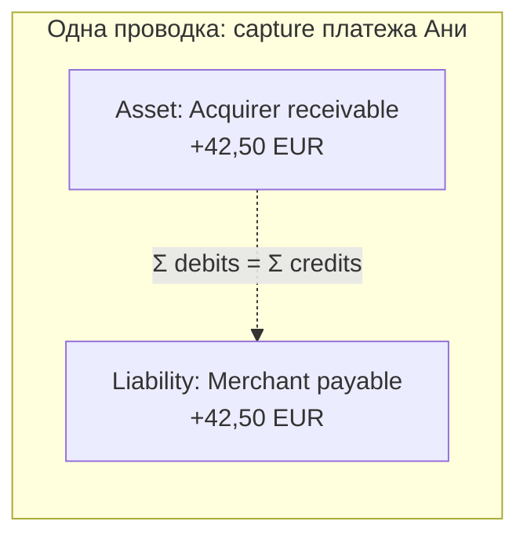
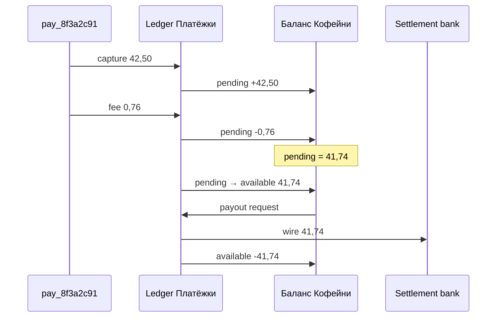
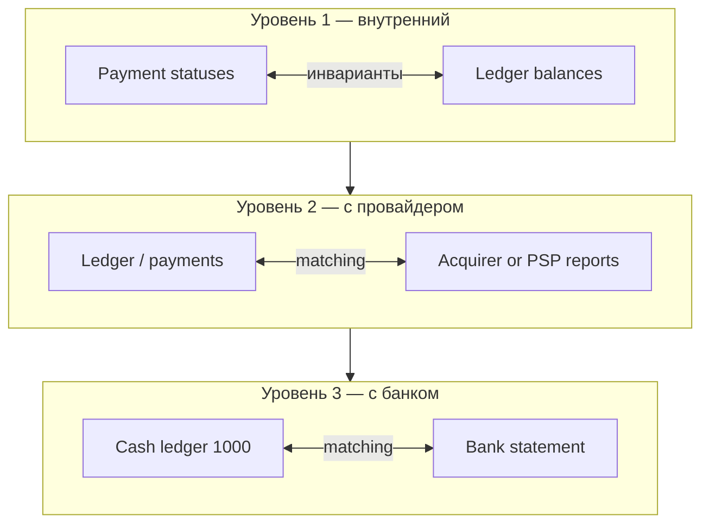
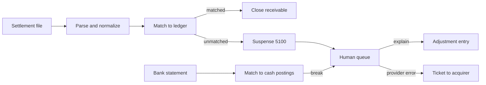
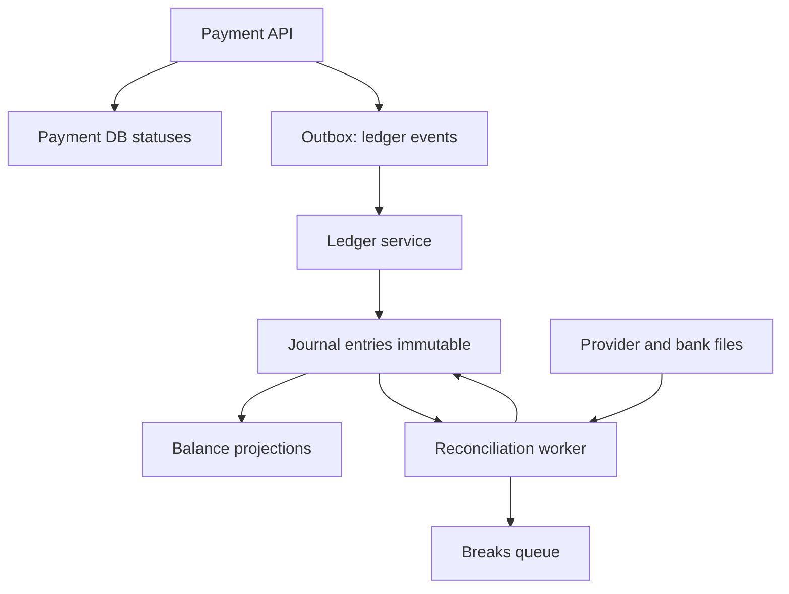

# Глава 13. Ledger, двойная запись и reconciliation

Аня нажала «Оплатить», «Кофейня» увидела зелёную галочку, `pay_8f3a2c91` ушёл в `captured`. В [главе 06](06-payment-lifecycle.md) мы разобрали путь карточной операции. В [главе 12](12-flow-of-funds.md) — куда физически едут деньги: холды, неттинг схемы, баланс мерчанта, payout. Остаётся вопрос, без которого платёжная компания не живёт и дня: **как система помнит, кому сколько должна, и как доказать, что память совпадает с реальностью**.

Ответ — леджер (ledger, учётная книга) и сверка (reconciliation). Не «бухгалтерский модуль где-то сбоку», а ядро денег в коде. Если статусы платежа — это операционная правда («что мы думаем о заказе»), то леджер — финансовая правда («какие обязательства мы признали»). Они обязаны сходиться. Когда расходятся — начинается ночь саппорта, ручные Excel и «а почему у „Кофейни“ на балансе 41,74, а в банке пришло 41,70».

Эта глава — бухгалтерия для инженеров. Без плана счетов Минфина и без претензии заменить финансового директора. С претензией объяснить: почему double-entry (двойная запись: у каждой проводки равные дебетовая и кредитовая стороны) спасает от тихих дыр в балансе, как выглядят проводки на auth/capture/refund/chargeback/payout/fee, и почему reconciliation — не «месячный отчёт», а ежедневный конвейер с тремя уровнями и автоматом matching.

**В этой главе**

- Зачем платежам леджер и чем он отличается от таблицы `payments`
- Двойная запись, план счетов PSP и неизменяемость проводок
- Проводки для auth, capture, fee, refund, chargeback и payout на примере Ани
- Как из леджера получаются pending/available и отчёты
- Reconciliation: внутренний, с провайдером, с банком; matching и расхождения
- Автоматизация сверки и что проверять в коде

---

## Почему «таблица платежей» — ещё не учёт

У «Кофейни» в БД есть заказ `ORD-2026-0918-0042` и статус `paid`. У «Платёжки» — объект `pay_8f3a2c91` со статусом `captured`, суммой `4250` (минорные единицы EUR), auth code `A1B2C3`, RRN `609182743015`. Кажется, этого достаточно: выбери `SUM(amount) WHERE status = 'captured'` — вот оборот за день.

Этого **недостаточно**, как только появляются:

- комиссия, которая списывается не в момент клика, а в settlement-дне;
- частичный refund на 10,00 EUR через неделю;
- chargeback, который прилетает через месяц;
- payout пачкой: сто платежей минус fees минус reserve = один банковский перевод;
- два эквайера, два файла, один мерчантский баланс;
- FX, когда presentment в USD, а баланс мерчанта в EUR ([глава 14](14-currencies-and-fx.md));
- повтор webhook'а, который дважды «начислил» одно и то же.

Статусная модель отвечает на вопрос «что происходит с платежом». Учёт отвечает на «какие обязательства изменились». Это разные оси. Их связывают идентификаторы и события, но хранить только статусы — всё равно что вести склад по полю `order.shipped = true` без движений товара.

### Врезка: как это бывает в жизни

Команда раннего стартапа пишет: `UPDATE merchants SET balance = balance + $amount`. Потом добавляют refund: `balance = balance - $refund`. Потом fee: иногда вычитают при capture, иногда при payout «на глаз». Через полгода CFO спрашивает: «Почему сумма балансов мерчантов не равна остатку на settlement-счёте?» Ответа нет — есть только `balance`, без истории. Чинят не баг в формуле, а отсутствие леджера.

---

## Двойная запись для инженеров

Двойная запись (double-entry bookkeeping) родилась не для банковских аудиторов — она родилась, чтобы **не потерять инвариант**. Каждое движение денег (или обязательства) записывается как минимум двумя сторонами: куда ушло и откуда пришло. Сумма дебетов равна сумме кредитов. Если не равна — проводка битая, её нельзя принять.

В платёжной компании инвариант важнее «красивой отчётности». Он ловит баги раньше клиента: если fee-сервис начислил revenue (доход) 0,76, но забыл уменьшить payable (обязательство выплатить деньги продавцу), уравнение либо не сойдётся при записи, либо (если вы по ошибке разрешили несбалансированные entries) тихая дыра всплывёт на сверке через дни. Жёсткая проверка баланса сторон на insert — unit-тест, который крутится в проде на каждой проводке.

Инженеру удобно думать так:

- у вас есть **счета** (accounts) — именованные «корзины» с балансом;
- у вас есть **проводки** (journal entries / postings) — атомарные наборы движений между счетами;
- баланс счёта = сумма всех postings по нему (с учётом знака стороны);
- глобальный инвариант: по каждой проводке `Σ debit = Σ credit` (в одной валюте; мультивалютность — отдельная дисциплина, см. ниже и [главу 14](14-currencies-and-fx.md)).

В платежах «деньги» часто ещё не физические: после auth у эмитента холд, у PSP — обязательство перед мерчантом появится только после capture/settlement-логики продукта. Леджер как раз фиксирует **экономический смысл события**, а не ждёт SWIFT.

### Дебет и кредит без боли

Не надо зубрить «актив увеличивается по дебету». Запомните рабочую модель для платёжного леджера:

| Тип счёта | Что означает рост баланса | Типичные примеры у PSP |
|---|---|---|
| Asset (актив) | у нас стало больше денег/требований | settlement-счёт в банке, требования к эквайеру |
| Liability (обязательство) | мы кому-то должны больше | баланс мерчанта, клиентские средства EMI |
| Revenue (доход) | мы заработали | MDR, FX markup, подписка |
| Expense (расход) | мы потратили/потеряли | scheme fee, interchange (в IC++ моделях), fraud loss |
| Contra / clearing | временный «мост» между событиями | auth holds, clearing suspense |

В проводке вы всегда двигаете минимум два счёта так, чтобы уравнение баланса компании (упрощённо Assets = Liabilities + Equity) не ломалось. Для операционного леджера PSP часто хватает набора asset/liability/revenue/expense плюс технические clearing-счета.

Дебет и кредит — названия сторон проводки, а не универсальные «минус» и «плюс». Для используемых здесь счетов активы и расходы растут по дебету и уменьшаются по кредиту; обязательства и доходы — наоборот. Поэтому в примере capture дебет требования к эквайеру и кредит долга перед мерчантом означают одновременный рост обоих остатков. **Equity** в уравнении выше — собственный капитал: разница между активами и обязательствами.

### Почему не single-entry

Single-entry («просто +42,50 на баланс») ломается на частичных событиях и на расследованиях. Double-entry даёт аудит: каждая копейка имеет противовес. Нашли лишние 0,04 EUR на счёте fees — ищете парную сторону, а не гадаете.



Словами: после capture «Платёжка» признаёт, что ей (через эквайера) должны прийти 42,50, и одновременно — что она должна «Кофейне» 42,50 (до удержания комиссии; комиссию часто проводят отдельной проводкой или той же атомарной пачкой — ниже).

---

## План счетов платёжной компании

План счетов (chart of accounts) — каталог всех счетов леджера. У «Платёжки» он не копия банковского GL (General Ledger, главной бухгалтерской книги) один в один: это **операционный** план под продуктовые события. Позже его сводят с бухгалтерией (иногда через экспорт в ERP) — но online-деньги крутятся здесь.

Иллюстративный фрагмент плана счетов «Платёжки» (EUR, упрощённо):

| Код | Счёт | Тип | Зачем |
|---|---|---|---|
| `1000` | Cash — settlement bank EUR | Asset | Реальные деньги на счёте в банке-партнёре |
| `1100` | Acquirer receivable | Asset | Ожидаем сеттлмент от «Банка Эквайр» |
| `1200` | Scheme/processor clearing | Asset/Clearing | Промежуточные суммы в файлах |
| `2000` | Merchant payable — available | Liability | Можно выплатить «Кофейне» |
| `2100` | Merchant payable — pending | Liability | Ещё не available (холд rolling / T+N) |
| `2200` | Merchant reserve | Liability | Rolling reserve, held funds |
| `2300` | Customer wallet / EMI safeguarded | Liability | Если есть кошельки/электронные деньги |
| `3000` | Revenue — processing fees | Revenue | MDR / markup |
| `3100` | Revenue — FX markup | Revenue | Разница курса ([глава 14](14-currencies-and-fx.md)) |
| `4000` | Expense — interchange | Expense | В моделях, где PSP «видит» IC |
| `4100` | Expense — scheme fees | Expense | Сборы сети |
| `4200` | Expense — chargeback losses | Expense | Когда спор проигран |
| `5000` | Auth hold mirror | Clearing | Опционально: учёт холдов до capture |
| `5100` | Suspense / unmatched | Clearing | Суммы из файла, которые ещё не сматчились |

Счета мерчантов почти всегда **аналитические**: не один `2000` на всех, а `2000` + `merchant_id=mch_coffee` (субсчёт / dimension). Иначе нельзя посчитать баланс «Кофейни» отдельно от соседнего магазина.

### Измерения (dimensions), без которых сверка умрёт

Кроме кода счёта проводке нужны разрезы:

- `merchant_id` — `mch_coffee`;
- `payment_id` — `pay_8f3a2c91`;
- `currency` — `EUR`;
- `provider` / `acquirer` — `bank_acquire`;
- `settlement_batch_id` — когда событие пришло из файла;
- `value_date` vs `booking_date` — дата, с которой сумма учитывается для расчётов, vs дата регистрации проводки в системе.

Без dimensions вы «сойдётесь» по компании в целом и никогда не найдёте, какой платёж разъехался.

---

## Transaction ledger: структура данных

На практике у «Платёжки» леджер — не Excel и не `UPDATE balance`. Типовая модель (идея, не догма схемы):

**Account** — счёт плана + валюта + владелец (platform / merchant / …).

**Journal entry** (проводка-заголовок) — атомарное событие: `entry_id`, `created_at`, `event_type` (`capture`, `fee`, `refund`, …), `external_ref` (`pay_8f3a2c91`), `idempotency_key`.

**Posting** (строка) — `entry_id`, `account_id`, `amount` (minor units, знак по соглашению или раздельные debit/credit колонки), `side`.

Правила:

1. Проводка принимается только если сумма сторон сходится.
2. Проводки **не редактируют** — только сторно (reversing entry, новая проводка, отменяющая эффект исходной зеркальными сторонами) или компенсирующая новая.
3. Баланс счёта — производная (материализованная для скорости, но восстанавливаемая из postings).
4. Запись в леджер идемпотентна по ключу события: повтор webhook `payment.captured` не создаёт вторую пару +42,50.

```json
{
  "entry_id": "je_7c21e0",
  "event_type": "capture",
  "payment_id": "pay_8f3a2c91",
  "idempotency_key": "ledger:capture:pay_8f3a2c91",
  "currency": "EUR",
  "postings": [
    {"account": "1100.acquirer_receivable", "side": "debit", "amount": 4250},
    {"account": "2100.mch_coffee.pending", "side": "credit", "amount": 4250}
  ]
}
```

Суммы в минорных единицах: `4250` = 42,50 EUR. Float в леджере — преступление; об этом ещё раз в [главе 14](14-currencies-and-fx.md) и в граблях ниже.

### Immutability: почему нельзя «поправить строку»

Иммутабельность проводок — не эстетика event sourcing, а следствие аудита и сверки. Если вчерашний capture «исправили» с 42,50 на 42,00, вчерашний settlement-файл и сегодняшний отчёт мерчанта разъедутся навсегда, а `SUM(postings)` за дату D уже не воспроизведёт то, что видел банк.

Правильный путь при ошибке:

1. Найти исходную проводку `je_7c21e0`.
2. Создать сторно (зеркальные стороны) с ссылкой `reverses = je_7c21e0`.
3. Создать корректную новую проводку.
4. Обе новые — с причиной (`ops_correction`, ticket id).

Так история остаётся объяснимой. Ручной `UPDATE postings SET amount=…` в проде — путь к расхождению ledger vs bank, которое потом разбирают сценарии вроде [главы 30](30-scenarios-part-2.md).

### Леджер vs payment state machine

В [главе 07](07-states-async-idempotency.md) статусы платежа живут своей машиной. Леджер подписан на **финансово значимые** переходы:

| Событие статуса | Типичный эффект в леджере |
|---|---|
| `authorized` | опционально mirror hold; часто **ещё нет** merchant liability |
| `captured` / `settled` (по политике продукта) | receivable + merchant payable |
| `void` до capture | снять hold-mirror; payable не было |
| `refunded` | уменьшить payable / увеличить обязательство к покупателю через провайдера |
| `chargeback` | списать с мерчанта, возможно expense |
| fee posted | revenue + уменьшение payable |
| payout executed | уменьшить payable, уменьшить cash |

Путать «статус `succeeded` на checkout» с «деньги в available» нельзя: отгрузка зерна и право мерчанта вывести деньги — разные политики. Леджер кодирует второе.

### Void и reversal: когда деньги «как будто не было»

Void до capture и online reversal — частые гости [главы 06](06-payment-lifecycle.md). С точки зрения леджера важно не смешать их с refund.

Если на auth вы **не** постили merchant payable, void почти ничего не делает в деньгах к выплате: максимум снимает auth-hold mirror. Если по ошибке продукта вы уже начислили pending на auth, void обязан сторнировать эти проводки тем же `payment_id`, иначе «Кофейня» увидит призрак 42,50 в балансе, а в клиринг ничего не уйдёт — классический internal break.

Reversal после того, как capture-проводка уже создана, но presentment ещё можно отозвать, выглядит как сторно capture (+ сторно fee, если fee уже взяли). Refund после клиринга — это **новая** кредитовая операция, не правка старой строки. В отчётах сверки void/reversal и refund должны быть разными `event_type`: иначе matcher уровня 2 будет путать «операции не было» с «операция была и вернули».

### Для любопытных: леджер как append-only лог

Если вам ближе event sourcing, думайте о journal entries как о финансовом event log с жёсткой схемой: каждый event проверяется инвариантом double-entry **до** записи. Проекции балансов — read-model. Можно материализовать balance snapshot на счёте для быстрого `GET /balance`, но любой спор «почему 41,74?» должен решаться переигрыванием postings, а не доверием к кэшу. Рассинхрон кэша и лога — снова уровень 1 сверки: `projected_balance == sum(postings)`.

---

## Сквозной пример: проводки по платежу Ани

Возьмём тот же платёж, что в [главе 06](06-payment-lifecycle.md):

| Поле | Значение |
|---|---|
| Заказ | `ORD-2026-0918-0042` |
| Платёж | `pay_8f3a2c91` |
| Сумма | 42,50 EUR |
| Auth code | `A1B2C3` |
| RRN | `609182743015` |
| ARN (после клиринга) | `74123456789012345678901` (иллюстративно) |
| Тариф «Кофейни» | blended (пакетная ставка; [глава 15](15-fees-and-economics.md)) 1,2% + 0,25 EUR (как ориентир из гл. 06) |
| Комиссия | 0,51 + 0,25 = **0,76 EUR** |
| Нетто мерчанту | **41,74 EUR** |

Таймлайн финансовых событий (иллюстративный):

| Когда | Событие | Деньги в леджере |
|---|---|---|
| D+0 10:00 | Authorization approved | обычно без merchant payable |
| D+0 10:05 | Capture | +42,50 receivable / +42,50 pending payable |
| D+0 10:05 | Fee | −0,76 с payable, +0,76 revenue (или одной пачкой) |
| D+1 | Acquirer settlement file | receivable → clearing/cash movement внутри нетто дня |
| D+2 | Pending → available | 41,74 переезжает на available |
| D+3 | Payout | available → cash out «Кофейне» |

Ниже — по шагам.

### Authorization: деньги ещё не «наши» обязательства перед магазином

Эмитент «Банк Север» захолдировал 42,50. Для Ани лимит уменьшен. Для «Кофейни» заказ можно комплектовать по бизнес-правилам, но **PSP ещё не обязан** считать, что должен магазину 42,50: capture могут отменить void'ом, hold истечёт, fraud-команда остановит отгрузку.

Многие зрелые леджеры на auth **ничего не постят** в merchant payable. Некоторые постят технический hold-mirror:

```text
Debit  5000 auth_hold_mirror          42,50
Credit 5001 auth_hold_contra          42,50
```

Это помогает отчётам «сколько висит в authorized», но не смешивается с деньгами к выплате. Если ваш продукт обещает available сразу после auth (редко и опасно) — политика другая; честно задокументируйте её, иначе сверка с эквайером вас накажет.

### Capture: появляется обязательство перед «Кофейней»

Capture говорит: операция пойдёт в clearing. «Платёжка» признаёт:

```text
Entry je_capture_8f3a
  Debit   1100 acquirer_receivable          42,50
  Credit  2100 mch_coffee.pending           42,50
```

Инвариант: 42,50 = 42,50. У «Кофейни» pending balance += 42,50.

### Fee: откуда берётся 41,74

Комиссию проводят сразу при capture (часто) или при settlement/payout (зависит от прайсинга; экономика — [глава 15](15-fees-and-economics.md)):

```text
Entry je_fee_8f3a
  Debit   2100 mch_coffee.pending            0,76
  Credit  3000 revenue_processing_fees       0,76
```

После двух проводок pending «Кофейни» = 41,74 EUR. В UI баланса магазин видит «+41,74 (pending)», не «+42,50». Если показать 42,50 — бухгалтер магазина потом неделю спорит с payout-выпиской.

Альтернатива одной атомарной проводкой из трёх линий:

```text
  Debit   1100 acquirer_receivable          42,50
  Credit  2100 mch_coffee.pending           41,74
  Credit  3000 revenue_processing_fees       0,76
```

Оба варианта валидны, если идемпотентность и отчётность согласованы. Трёхлинейный удобнее для «одна операция = один entry_id».

### Когда приходит деньги от эквайера (нетто дня)

В [главе 12](12-flow-of-funds.md) сеттлмент схемы — нетто по тысячам операций. «Платёжка» не получает отдельный банковский перевод, отправленный через SWIFT (сеть межбанковских сообщений; [глава 27](27-cross-border-payments.md)), на 42,50 за Аню. В леджере это отражают на уровне **батча**:

```text
Entry je_acq_settle_2026_09_19
  Debit   1000 cash_settlement_bank         18_420,55   # нетто дня, пример
  Credit  1100 acquirer_receivable          18_420,55
```

Внутри батча строки отчёта эквайера матчятся на `pay_*` (см. reconciliation ниже). По платежу Ани receivable 42,50 «закрывается» в составе нетто; отдельно вы ещё проведете scheme/interchange expenses, если работаете в IC++ (interchange plus plus: отдельно комиссия эмитенту, сборы сети и надбавка провайдера) и видите разложение комиссий — детали в [главе 15](15-fees-and-economics.md).

Для blended-тарифа «Кофейни» часто достаточно: merchant fee уже в revenue, а разница между тем, что пришло от эквайера, и тем, что должны мерчантам, оседает в марже (и должна сходиться в P&L (profit and loss, отчёте о прибылях и убытках)).

### Pending → available

Политика «Платёжки»: T+2, без rolling reserve для «Кофейни».

```text
Entry je_release_8f3a
  Debit   2100 mch_coffee.pending           41,74
  Credit  2000 mch_coffee.available         41,74
```

Деньги всё ещё у PSP (на settlement-счёте в составе пула), но обязательство сменило «корзину»: теперь их можно включить в payout.

Если есть rolling reserve 10% ([глава 12](12-flow-of-funds.md)):

```text
  Debit   2100 pending                      41,74
  Credit  2000 available                    37,57
  Credit  2200 reserve                       4,17
```

### Payout: «Кофейня» получает перевод

Раз в день payout на IBAN магазина, в пачке несколько платежей. Допустим, available перед выплатой = 41,74 (только Аня для простоты), bank transfer fee 0 (условно):

```text
Entry je_payout_po_991
  Debit   2000 mch_coffee.available         41,74
  Credit  1000 cash_settlement_bank         41,74
```

На расчётном счёте «Кофейни» в её банке появится +41,74. У «Платёжки» cash уменьшился, liability закрылась. Красивый ноль по этому обязательству.



### Refund: Аня вернула часть заказа

Через пять дней «Кофейня» делает partial refund 10,00 EUR (один сорт кофе). Возврат покупателю идёт через эквайера/схему ([глава 06](06-payment-lifecycle.md)). В леджере:

```text
Entry je_refund_8f3a_p1
  Debit   2000 mch_coffee.available         10,00
  Credit  1100 acquirer_receivable          10,00
```

Смысл: мы уменьшаем долг перед магазином (или уходим в negative available → долг магазина перед PSP) и фиксируем, что от эквайера/схемы уйдёт credit. Политика fee на refund — отдельная проводка: иногда fee не возвращают, иногда возвращают частично ([глава 15](15-fees-and-economics.md)).

Если available уже выплачен, refund съедает следующие поступления или уводит баланс в минус ([глава 12](12-flow-of-funds.md) про negative balance). Леджер обязан это уметь: liability может стать отрицательной (дебетовое сальдо мерчанта) — тогда это уже receivable от мерчанта.

### Chargeback: спор не в пользу «Кофейни»

Упрощённо, когда chargeback проигран на 42,50 (полный; в жизни сумма и fee спора сложнее — [глава 17](17-chargebacks-and-disputes.md)):

```text
Entry je_cb_8f3a
  Debit   2000 mch_coffee.available         42,50
  Credit  1100 acquirer_receivable          42,50
Entry je_cb_fee
  Debit   2000 mch_coffee.available          15,00   # иллюстративный dispute fee
  Credit  3000 revenue_or_pass_through      15,00
```

Если денег на available нет — уходим в negative / reserve. Иногда часть убытка остаётся на PSP (expense `4200`) по политике покрытия — это уже risk/commercial decision, но она тоже должна быть проводкой, а не «молчаливым» расхождением с банком.

---

## Accounting в платёжной системе: что видят люди

Леджер — источник истины. Поверх него строят проекции.

### Merchant balance

```text
pending   = balance(2100.mch_coffee)
available = balance(2000.mch_coffee)
reserve   = balance(2200.mch_coffee)
```

UI «Кофейни» и API `GET /balance` читают проекцию, не `SUM(payments)`. Иначе вы никогда не учтёте ручные adjustments, reserve release и fee corrections.

### Statements и отчёты

Дневной statement мерчанта — выборка journal entries с dimensions `merchant_id` + период. Строка «Payment pay_8f3a2c91 +41,74» — это не сырой capture 42,50, а нетто после fee (или две строки: gross и fee). Договоритесь о формате один раз с поддержкой и бухгалтерией — и не меняйте смысл колонок между CSV-версиями молча.

### Platform GL vs operational ledger

У крупной «Платёжки» часто два слоя:

1. **Operational ledger** — real-time, по событиям платежей, для балансов и payout.
2. **Financial GL** (ERP) — счета по стандартам учёта юрлица, закрытие периода, налоги.

Сверка operational ↔ GL — ещё один контур (месячный/дневной). Не пытайтесь заставить Postgres леджер сразу стать полной МСФО-книгой; сделайте явный экспорт проводок.

### Мультитенантность и marketplace

Если «Платёжка» обслуживает marketplace со split ([глава 26](26-marketplace-and-split-payments.md)), у каждого селлера — свой sub-ledger, у платформы — platform fee account. Одна покупка Ани может породить три credit'а: seller A, seller B, platform. Reconciliation тогда проверяет и сумму split'ов = gross − fees.

### Что бухгалтер магазина ожидает от вас

«Кофейня» ведёт свою 1С/QuickBooks. Ей нужно не «красивое API», а три артефакта, которые сходятся:

1. **Список операций** за период с `payment_id`, суммой gross, fee, net, типом (sale/refund/chargeback/adjustment).
2. **Список payout'ов** с датой value date, суммой, банковским reference.
3. **Правило**: сумма net операций минус то, что ещё pending/reserve ≈ сумма payout'ов ± остаток available на конец периода.

Если ваш портал показывает «оборот 42,50», а в payout уезжает 41,74 без расшифровки fee — вы перекладываете сверку на человека с калькулятором. Хороший PSP отдаёт machine-readable statement и стабильные ID, чтобы мерчантский уровень 3 (его банк ↔ ваши payout'ы) закрывался без тикетов в саппорт.

### Контрольные точки внутри суток

Не ждите конца месяца. Минимальный набор controls для «Платёжки»:

- после каждого деплоя платёжного/ledger-сервиса — job «orphan captured» (статус есть, entry нет) и «orphan entry» (наоборот);
- каждый час — `sum(debits) == sum(credits)` по новым entry (если нет — стоп записи и pager);
- перед payout-батчем — запрет включать платежи с open break уровня 2 старше порога;
- после bank statement — diff остатка `1000` vs банк > X EUR → инцидент, не «разберём в пятницу».

Эти controls дешевле любой красивой BI-дашборды: они режут утечку денег на этапе, когда её ещё можно не выплатить наружу.

---

## Reconciliation: зачем, если леджер честный

Леджер честен **внутри**. Он не знает, солгал ли файл эквайера, потерялся ли webhook, задвоился ли payout, обрезал ли банк remittance reference. Сверка (reconciliation) — процесс сравнения **нескольких независимых источников правды** и разбора расхождений (breaks / exceptions).

Без сверки вы узнаете о проблеме от клиента: «деньги не пришли» или «списали дважды». Со сверкой — от алерта в 06:15, пока payout ещё можно остановить.

### Три уровня сверки

Держите в голове три контура — они пересекаются, но не заменяют друг друга.



#### Уровень 1. Внутренний (internal reconciliation)

Сверяете собственные подсистемы:

- сумма `captured` за день по payments ≈ сумма capture-postings в леджере;
- `SUM(merchant available + pending + reserve)` ≈ обязательства, покрытые assets (с учётом timing);
- нет платежей в `captured` без ledger entry;
- нет ledger entry без платежа (кроме явных ops adjustments);
- идемпотентность: на один `payment_id` + `event_type` не больше одной успешной проводки.

Это ловит баги деплоя: «статус обновили, в леджер писать забыли», «webhook обработали дважды», «refund в статусе есть, postings нет».

#### Уровень 2. С провайдером / эквайером (provider reconciliation)

Сверяете свои операции с отчётами «Банка Эквайр» или вышестоящего процессора:

- settlement report / clearing detail file;
- transaction detail (auth, capture, refund, chargeback);
- fee report (иногда отдельным файлом).

Цель: каждая строка файла либо сматчена на внутренний объект, либо висит в suspense с причиной. Каждая внутренняя операция в статусе «должна быть в файле» либо найдена, либо просрочена (missing in provider).

Именно здесь отвечают на вопрос: «Мы думаем, что capture Ани на 42,50 ушёл; эквайер это подтверждает?»

#### Уровень 3. С банком (bank reconciliation)

Сверяете леджер cash (`1000`) с выпиской settlement-банка:

- входящие нетто от схемы/эквайера;
- исходящие payout'ы мерчантам;
- собственные комиссии банка, проценты, возвраты SWIFT.

Цель: остаток на счёте по банку = остаток по леджеру (с учётом in-transit). Классика бухгалтерии, но в PSP объём и частота — ежедневные, часто интрадей.

Мерчант «Кофейня» у себя делает свой уровень 3: выписка своего банка ↔ payout reports «Платёжки». Ваш продуктовый CSV обязан это облегчать (стабильный payout reference в назначении платежа).

---

## Matching: как склеить две правды

Matching — алгоритм (и ручной процесс), который говорит: «эта строка файла и эта проводка/платёж — про одно и то же».

### Ключи сопоставления

Иерархия надёжности (типичная):

1. **Стабильный ID провайдера** — `acquirer_txn_id` / `processor_id`, который вы сохранили при auth/capture.
2. **ARN / RRN** — сильные для карточных споров и клиринга; не всегда есть в момент online.
3. **Составной ключ**: сумма + валюта + дата окна + merchant MID + auth code.
4. **Fuzzy**: сумма ± комиссия банка, дата ± 1 день, reference с нормализацией строки.

Для платежа Ани идеальный match:

| Источник | Поле | Значение |
|---|---|---|
| Внутренний | `payment_id` | `pay_8f3a2c91` |
| Внутренний | `provider_ref` | `acq_9f2…` |
| Файл эквайера | `transaction_id` | `acq_9f2…` |
| Файл | `amount` | 4250 |
| Файл | `arn` | `74123456789012345678901` |

Если провайдер не возвращает стабильный id на auth — сохраняйте всё, что даёт: STAN, RRN, retrieval ref. Иначе matching деградирует до fuzzy и ручного ада.

### Банковские поступления

Payout «Кофейне» на 41,74 в назначении платежа должен нести что-то вроде `PO-991 PLATEZHKA`. Во входящем нетто от эквайера на 18_420,55 EUR reference часто **не** содержит payment_id — матчите на `settlement_batch_id` / ожидаемую сумму батча, которую вы сами посчитали из файла уровня 2.

Типичный пайплайн дня:



### Нормализация — половина успеха

Перед matching приведите данные к канону:

- суммы → minor units integer;
- даты → timezone cut-off эквайера (не «полночь UTC наугад»);
- sign → покупка/refund/chargeback в одной семантике;
- строки reference → upper-case, trim, убрать `NOTPROVIDED`;
- валюта → ISO код, не символ `€`.

Разные эквайеры по-разному кодируют partial capture и refund. Коннектор ([глава 22](22-integrations.md)) обязан нормализовать **до** леджера и сверки, иначе matching пишет исключение на каждую вторую строку.

### Пример matching на строке Ани

Фрагмент settlement detail (иллюстративный CSV после normalize):

```text
row_id,provider_txn_id,arn,rrn,type,amount_minor,currency,value_date
1848291,acq_9f2aa01,74123456789012345678901,609182743015,capture,4250,EUR,2026-09-19
```

Внутренний кандидат:

```text
payment_id=pay_8f3a2c91
provider_txn_id=acq_9f2aa01
rrn=609182743015
ledger_capture_amount=4250
status=captured
```

Правило 1 срабатывает по `provider_txn_id` → confidence 1.0 → auto-match. В journal появляется ссылка `matched_row=1848291`, break не создаётся.

Теперь испорченный день: в файле `amount_minor=4200` (partial capture, о котором ваш сервис не знал, потому что manual capture в админке эквайера обошёл API). Match по id проходит, но amount check падает → break `amount_mismatch` с diff −50. Оператор видит: надо либо догнать partial capture в домене и сторно/допровести леджер, либо эскалировать эквайеру «кто менял сумму». Без amount check вы бы «успешно» сматчили и никогда не заметили, что «Кофейне» в pending висит 41,74 от полного 42,50, а схема знает только 42,00.

### Многие-ко-многим и нетто-платежи

Банковская выписка редко содержит сто строк по сто payout'ам: иногда банк схлопывает, иногда вы сами группируете. Модель matching должна уметь:

- 1:1 (идеал);
- 1:N (один wire = много payout journal entries);
- N:1 (редко: несколько bank lines на один логический batch — комиссии банка отдельной строкой).

Для 1:N храните `payout_batch_id` на всех entry и матчите сумму батча к сумме wire. Если сматчить «первую попавшуюся» выплату 41,74 к wire 41,74, а рядом была другая «Кофейня» с тем же нетто — поздравляю, два мерчанта в одном break на следующей неделе.

---

## Типичные расхождения (breaks)

Расхождение — не всегда баг. Но каждое должно иметь **класс** и **SLA разбора**.

### 1. Missing in provider

У вас `captured`, в файле дня D нет. Причины: cut-off (попадёт в D+1), задержка клиринга, провайдер отбросил presentment, вы отправили capture после окна. Действие: ждать N циклов → inquire → escalate.

### 2. Missing internally

В файле есть операция, у вас нет платежа. Причины: потеряли webhook и не догнали status inquiry ([глава 07](07-states-async-idempotency.md)), проводка не создалась, платёж в другом юрлице/MID. Действие: создать «orphan» investigation; **не** молча игнорировать — это дыра в receivable/payable.

### 3. Amount mismatch

У вас 42,50, в файле 42,00 (partial), или 42,50 vs 41,74 (вы сравнили gross с net). Класс: «сравниваете разные вещи» vs «реальный mismatch». Сначала проверьте, fee/FX/tip.

### 4. Duplicate

Две строки файла на один capture — или две ваши проводки на один event. Часто ретраи без идемпотентности. Лечится уникальным ключом и сторно дубля.

### 5. Timing / value date

Проводка у вас 19-го, банк 20-го. In-transit account снимает ложную панику: `Debit in_transit / Credit cash` в день инициации payout, обратная — по выписке.

### 6. Fee и FX сюрпризы

Эквайер удержал scheme fee отдельно; FX settlement currency другая ([глава 14](14-currencies-and-fx.md)). Без отдельных счетов expense/FX breaks будут вечными.

### 7. Chargeback и representment

Representment — ответ продавца на chargeback с повторным предъявлением операции и доказательствами ([глава 17](17-chargebacks-and-disputes.md)). Спор приходит отдельной строкой с задержкой недель. Ваш платёж давно в `captured` и даже выплачен. Break «внезапный −42,50» нормален — если процесс dispute умеет провести леджер и затронуть баланс ([глава 17](17-chargebacks-and-disputes.md)).

### 8. Ручные правки и «подкрутки»

Оператор изменил баланс SQL-ом. Internal reconciliation орёт. Единственный допустимый путь — adjustment entry с тикетом.

### Врезка: история на 0,04 EUR

«Платёжка» неделю ловила расхождение cash vs bank на 0,04 EUR. Искали пропавший платёж. Нашли: округление FX markup на сотне мелких транзакций писалось в revenue с `round half-up` на стороне отчёта и `banker's round` в леджере. Урок: политика округления — часть контракта леджера, не «деталь UI».

---

## Автоматизация сверки

Ручной Excel на тысячах строк не масштабируется. Автоматизация — это продукт внутри PSP, не скрипт стажёра.

### Конвейер

1. **Ingest** — загрузка файлов по SFTP/API; MT940 и camt.053 — форматы банковских выписок, CSV — табличный формат ([глава 22](22-integrations.md)).
2. **Normalize** — каноническая схема `ReconciliationRow`.
3. **Match** — правила по приоритету, скоринг confidence.
4. **Post** — для matched bank movements создать/подтвердить cash postings; для provider — закрыть receivable.
5. **Exception management** — очередь с причинами, assignee, SLA, audit trail.
6. **Controls** — дневной sign-off: «уровень 2 закрыт с N open breaks < threshold».

### Правила и машинное обучение

Начните с детерминированных правил. ML для fuzzy matching имеет смысл на bank remittance с мусорными назначениями — но всегда с human-in-the-loop на низком confidence. Ложное авто-сшивание двух разных выплат опаснее, чем лишний тикет.

### Идемпотентность конвейера

Повторная загрузка того же settlement file не должна дублировать postings. Ключ: `file_id + row_id` или хэш строки + provider. Тот же принцип, что у webhook'ов в [главе 07](07-states-async-idempotency.md).

### Метрики

- match rate % по уровню 2/3;
- ageing open breaks (сколько висят > 24h / 72h);
- absolute break amount (EUR at risk);
- time-to-explain;
- auto-match vs manual ratio.

Это пересекается с operational reconciliation в [главе 24](24-monitoring-and-operations.md): алерт «match rate < 98%» будит не меньше, чем рост decline rate.

### Что автоматизировать нельзя до конца

Спор с эквайером «ваша строка, нашего capture не было» — переговоры и логи ISO. Корректировка после инцидента — [глава 23](23-reliability.md). Распределение убытка между PSP и мерчантом — политика риска. Автомат готовит факты; решения остаются людям.

### Роли и доступ

Очередь breaks — не общий Slack. Нужны роли:

- **Recon analyst** — видит breaks, предлагает match/unmatch, не пишет произвольные суммы;
- **Ledger adjuster** — может создавать adjustment entries в пределах лимита (например, до 100 EUR) с обязательным ticket;
- **Approver** — выше лимита или по expense/loss счетам;
- **Read-only auditor** — экспорт периода без права провести.

Каждое ручное действие пишет `who/when/why` в audit. Через полгода при вопросе регулятора или инвестора «откуда дыра» вы открываете не git blame SQL, а журнал adjustment'ов.

### Врезка: как это бывает в жизни

Пятница, 17:40. Payout-батч «Платёжки» должен уйти до cut-off банка. Match rate уровня 2 — 97,1% при пороге 99%. Дежурный встаёт перед выбором: задержать всех мерчантов или выплатить «чистых» и отложить unmatched. Правильный продукт позволяет **partial release**: в payout попадают только платежи без open breaks. «Кофейня» с Аниным платежом, уже matched, получает 41,74 вовремя. Соседний мерчант с тремя missing_in_provider ждёт понедельника — и получает честный статус `payout_held_reconciliation`, а не тишину в кабинете.

---

## Как леджер встраивается в архитектуру

Кратко — здесь; распределённые тонкости — в [главе 21](21-distributed-systems-and-money.md).

Паттерн, который работает:

1. Доменный сервис меняет статус платежа в одной транзакции с записью **outbox** — исходящего события в таблицу той же БД, чтобы затем надёжно доставить команду «нужно провести ledger event»; подробнее — [глава 21](21-distributed-systems-and-money.md).
2. Ledger-сервис потребляет событие идемпотентно, пишет journal entry.
3. Проекции балансов обновляются из леджера (подписка), а не наоборот.
4. Reconciliation читает леджер и внешние файлы, пишет breaks и adjustment entries тем же API леджера.

Антипаттерн: считать баланс в платежном сервисе и «иногда синкать» в леджер. Через месяц у вас два источника истины и вечный break уровня 1.



Для инженера мерчанта («Кофейня»): ваш локальный учёт заказов тоже стоит сверять с отчётами PSP ежедневно — хотя бы job «orders.paid vs PSP captured report». Иначе двойной webhook или пропущенный refund стреляют в склад и в бухгалтерию магазина.

---

## Сквозной день сверки: 19 сентября

Соберём один операционный день «Платёжки» вокруг платежа Ани.

| Время | Что происходит |
|---|---|
| 10:00 | Auth + capture `pay_8f3a2c91`, леджер: +42,50 pending, −0,76 fee → 41,74 pending |
| 22:00 | Cut-off эквайера; операция попадает в clearing |
| D+1 06:00 | Приходит settlement detail file; matcher склеивает строку с `pay_8f3a2c91` по `provider_ref` |
| D+1 06:05 | Internal job: все captur'ы D+0 имеют entry — OK |
| D+1 14:00 | На settlement-счёт капает нетто дня 18_420,55; bank matcher склеивает с ожидаемым batch |
| D+2 00:10 | Pending→available для T+2 политики: 41,74 available |
| D+2 09:00 | Payout `PO-991` на 41,74; леджер cash− / available− |
| D+2 15:00 | Выписка банка: исходящий 41,74 с reference `PO-991` — matched |
| D+2 16:00 | Sign-off: уровень 2 — 99,2% matched, 3 breaks в очереди (не про Аню) |

Если на шаге D+1 06:00 строка Ани **не** пришла — break `missing_in_provider`, payout по этому платежу можно задержать политикой «не выпускать unmatched captured». Это и есть практический смысл сверки: не только отчётность, но и **контроль денег наружу**.

---

## Что это значит для инженера

1. **Спроектируйте леджер как отдельный модуль с инвариантом double-entry**, а не как колонку `balance` у мерчанта. Балансы — проекции.
2. **Пишите проводки идемпотентно** от доменных событий (`ledger:capture:pay_8f3a2c91`). Повтор webhook не должен удваивать деньги.
3. **Не мутируйте postings.** Сторно + новая запись. Сохраняйте `reason` и actor для ручных adjustment.
4. **Храните provider references** (и ARN/RRN, когда появятся) рядом с платежом — иначе matching уровня 2 слепнет.
5. **Разведите gross, fee и net** в API и CSV. Покажите «Кофейне» 42,50 и 0,76 явно.
6. **Три уровня сверки — три пайплайна** с метриками match rate и ageing breaks. Internal можно гонять непрерывно; provider/bank — по расписанию файлов.
7. **Cut-off и timezone** должны быть в конфиге коннектора, не в голове дежурного.
8. **Тесты:** парные проводки сходятся; двойная доставка события; refund после payout (negative balance); settlement file replay; amount mismatch в queue.
9. **Minor units, integer, одна политика округления.** Никаких `float` для денег.
10. **Разграничьте статусы заказа, статусы платежа и ledger balances** в голове команды и в дашбордах ([глава 07](07-states-async-idempotency.md), [глава 24](24-monitoring-and-operations.md)).
11. **Payout reference** сделайте стабильным и коротким — подарок мерчантской бухгалтерии и вашему же bank matching, когда разбираете возврат payout.
12. **Не закрывайте break молчаливым UPDATE.** Даже «очевидная» правка — adjustment entry.
13. **Считайте reconciliation частью payment platform**, а не «потом прикрутим для бухгалтерии». Без неё payout и dispute-операции летают вслепую.
14. **Логируйте cut-off и file version** рядом с batch_id: половина споров «где моя строка» — про вчерашний файл, который перезалили сегодня.

---

## Типичные ошибки и грабли

**Баланс как единственная цифра без истории.** Невозможно объяснить chargeback месячной давности и пройти аудит.

**Проводки в той же транзакции БД, что и внешний HTTP к эквайеру.** Получите частичный коммит или дубли. Outbox/inbox — [глава 21](21-distributed-systems-and-money.md).

**Available сразу после auth.** Отгрузили кофе, void/expiry hold — денег нет, товар ушел.

**Сравнение gross payments с net bank deposit** и паника «нас обокрали на сумму всех комиссий».

**Один MID / один файл на несколько юридических лиц** без `legal_entity` в dimensions — matching «уедет» не на ту книгу.

**Ручной SQL в проде «чтобы сходится завтра».** Завтра сходится, послезавтра разъедется сильнее, audit trail мёртв.

**Идемпотентность статусов без идемпотентности леджера.** Статус `captured` один, проводок две.

**Игнор in-transit** между инициацией payout и появлением в выписке — ложные breaks каждый день.

**Fee проводят только в UI-калькуляторе**, а в леджер пишут нетто «как получилось». Потом нельзя ответить на вопрос take rate ([глава 15](15-fees-and-economics.md)).

**Reconciliation как месячный ритуал бухгалтерии**, а не ежедневный контроль перед payout. Деньги уже ушли — остались переговоры.

**Float и `DECIMAL` с разной точностью в разных сервисах.** Классика 0,01 EUR × N транзакций.

**Сматчили по сумме+дате две разные операции по 42,50.** Нужен уникальный provider ref; fuzzy — только с очередью подтверждения.

**Merchant statement без payment_id.** Бухгалтерия «Кофейни» не свяжет с `ORD-2026-0918-0042` — и пойдёт в саппорт.

**Забыть, что refund и chargeback могут прийти после payout.** Нет модели negative balance / recoverable — леджер врёт или payout падает.

**Считать, что „файл эквайера всегда прав“.** Иногда прав ваш лог auth; иногда — файл. Break — место для расследования, не для слепой перезаписи леджера файлом.

---

## Итоги главы

1. Статусы платежа и леджер — разные оси; деньги живут в проводках, не в `status = succeeded`.
2. Double-entry даёт инвариант «деbet = credit» и объяснимость каждой копейки.
3. План счетов PSP отражает receivable, merchant payable (pending/available/reserve), cash, revenue и expense.
4. Проводки иммутабельны; ошибки исправляют сторно и корректирующими entry.
5. На примере Ани: capture 42,50 → fee 0,76 → pending 41,74 → available → payout; refund и chargeback — отдельные проводки.
6. Reconciliation существует на трёх уровнях: внутренний, с провайдером, с банком.
7. Matching держится на стабильных ID и нормализации; fuzzy — исключение с контролем.
8. Расхождения классифицируют и разбирают по SLA; молчаливые правки запрещены.
9. Автоматизация сверки — конвейер ingest → match → post → exceptions → sign-off.
10. Следующий шаг по деньгам — валюты и FX: когда 42,50 в одной валюте превращаются в другую сумму в отчётах и леджере ([глава 14](14-currencies-and-fx.md)), а затем полная экономика комиссий ([глава 15](15-fees-and-economics.md)).

---

## Связанные главы

- [Глава 06. Жизненный цикл карточного платежа](06-payment-lifecycle.md) — auth, capture, clearing, refund
- [Глава 07. Состояния, webhooks, идемпотентность](07-states-async-idempotency.md) — почему статусы и деньги расходятся
- [Глава 12. Что происходит с деньгами](12-flow-of-funds.md) — settlement, pending/available, payout, reserve
- [Глава 14. Валюты и FX](14-currencies-and-fx.md) — minor units, курсы, округление
- [Глава 15. Комиссии и экономика платежей](15-fees-and-economics.md) — MDR, IC++, откуда 0,76
- [Глава 17. Chargebacks и disputes](17-chargebacks-and-disputes.md) — споры как поздние проводки
- [Глава 21. Распределённые системы и деньги](21-distributed-systems-and-money.md) — outbox, exactly-once, архитектура reconciliation
- [Глава 22. Интеграции](22-integrations.md) — settlement files, bank statements
- [Глава 24. Мониторинг и операционная работа](24-monitoring-and-operations.md) — operational reconciliation, алерты
- [Глава 26. Marketplace и split payments](26-marketplace-and-split-payments.md) — split ledger
- [Глава 30. Сквозные сценарии II](30-scenarios-part-2.md) — расхождение ledger и settlement
