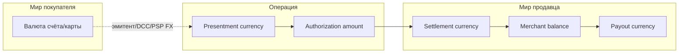
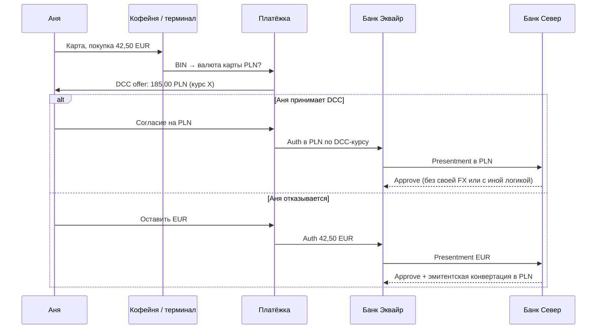
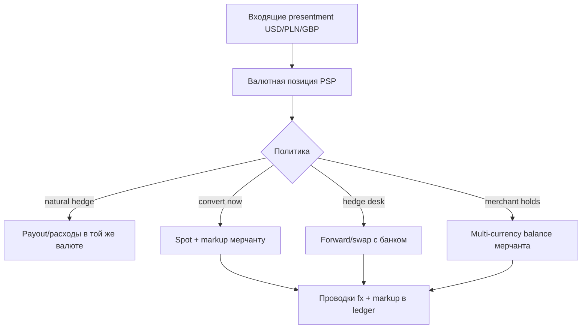

# Глава 14. Валюты и FX

Аня платит «Кофейне» **42,50 EUR**. В приложении «Банка Север» она видит ровно эту сумму. В админке «Кофейни» — тоже. В выписке «Платёжки» — снова 42,50 EUR минус комиссия. Кажется, валюта — просто поле `currency: "EUR"` в JSON, а деньги «сами» совпадают.

Пока все участники живут в одной валюте — да, почти сами. Но вот Аня уехала в Варшаву и платит картой счёта в PLN. Или «Кофейня» открыла витрину для американцев и проставляет цены в USD, а settlement с «Банком Эквайр» идёт в EUR. Или на терминале в аэропорту Ане предлагают «удобно списать в вашей валюте» — и внезапно чек раздувается на несколько процентов. Или refund через неделю возвращает не ровно то, что списали, потому что курс уехал.

Валюта в платежах — это не декорация. Это **несколько разных сумм в одной операции**, правила округления, источник курса, кто берёт спред, кто несёт FX-риск (foreign exchange, риск изменения курса валют) между auth и settlement, и почему `float` в JavaScript однажды украл у вас копейку на миллионе транзакций.

В [главе 12](12-flow-of-funds.md) мы смотрим, *куда* текут деньги. В [главе 13](13-ledger-and-reconciliation.md) — *как* их учитывать. В [главе 15](15-fees-and-economics.md) — *сколько* забирают участники, включая FX markup — надбавку к курсу конвертации. Здесь — **механика валют**: что такое presentment и settlement currency (валюта предъявляемой покупки и валюта расчётов), зачем exponent (число десятичных разрядов минорной единицы), откуда берётся курс, что такое DCC (Dynamic Currency Conversion, предложение оплатить в валюте карты с конвертацией на стороне эквайера), как PSP хеджирует риск — ограничивает потери от изменения курса и где рождаются ошибки округления. Международную стратегию выхода на рынки оставим [главе 27](27-cross-border-payments.md); сейчас — валютный движок под капотом одного платежа.

**В этой главе**

- Мультивалютные платежи: зачем они мерчанту и какие модели бывают
- Presentment currency vs settlement currency — две «правды» одной операции
- Exponent и minor units: почему сумма — целое число, а не `42.50`
- Курсы FX, их источники и время жизни котировки
- Спреды и markup: кто зарабатывает на разнице mid-market и «вашего» курса
- DCC: «удобная» конвертация для держателя карты и где прячется дороговизна
- Хеджирование FX на стороне PSP
- Ошибки округления, refund в другой валюте и сверка
- Сквозной пример: Аня, 42,50 EUR и платёж «в другую сторону»

---

## Зачем платежам вообще несколько валют

Если бы мир был одной валютной зоной, глава была бы короткой. Реальность другая.

**Покупатель** думает в валюте своего счёта или карты. Аня с EUR-картой «Банка Север» комфортно видит 42,50 EUR. Её подруга из Польши с PLN-картой на том же checkout видит либо цену в PLN, либо конвертацию банком-эмитентом после списания в EUR.

**Продавец** думает в валюте учёта, зарплат и поставщиков. «Кофейня» ведёт книги в EUR, платит обжарщику в EUR, хочет payout в EUR. Если она начнёт принимать USD «как есть», у неё появится позиция в долларах, которую надо либо конвертировать, либо держать.

**Эквайер и схема** живут в правилах settlement currency по BIN, региону, типу продукта и договорённости с участником. Не каждый эквайер сеттлит мерчанту в произвольной валюте. Не каждая схема одинаково тарифицирует cross-border и currency conversion.

**PSP** оказывается переводчиком между этими мирами: принимает платёж в одной валюте, показывает мерчанту баланс в другой, считает комиссию в третьей (условно), а в леджере обязан сохранить *все* суммы, курсы и курсовые разницы так, чтобы reconciliation не развалился.

Мультивалютность появляется не потому, что «круто поддержать ISO 4217 — стандарт кодов валют». Она появляется, потому что без неё нельзя:

- продавать в несколько стран с понятным UX цены;
- принимать карты иностранных эмитентов без сюрпризов в выписке;
- выводить продавцу в валюте, в которой он платит налоги и зарплаты;
- честно объяснить, почему refund «не совпал» с исходным списанием на карте покупателя.

### Модели мультивалютного приёма

На практике у «Кофейни» и «Платёжки» обычно несколько продуктовых моделей — иногда одновременно.

**1. Одна валюта цены, иностранная карта.** Цена на сайте — 42,50 EUR. Карта Аниной подруги — в PLN. Presentment (то, что уходит в авторизацию к эмитенту в контексте покупки у мерчанта) — EUR. Эмитент (или схема/банк по своим правилам) конвертирует EUR → PLN для отображения и списания со счёта в злотых. «Кофейня» получает EUR (минус комиссии). FX-риск покупателя — у эмитента/держателя; мерчант валюту почти не чувствует.

**2. Мультивалютный прайсинг.** На `.pl` витрине «Кофейня» показывает 185,00 PLN, на `.com` — 46,00 USD, на основной — 42,50 EUR. Это уже *разные* presentment currency в зависимости от витрины. Settlement «Кофейне» может оставаться в EUR: тогда «Платёжка» конвертирует поступившие PLN/USD в EUR по своему курсу и забирает markup. Либо мерчант держит multi-currency balance и сам решает, когда конвертировать.

**3. Local acquiring (местный эквайринг: обслуживание продавца эквайером в стране рынка) в валюте рынка.** «Кофейня» через «Платёжку» подключает польский эквайринг: presentment и settlement ближе к PLN. Это уже ближе к теме [главы 27](27-cross-border-payments.md), но валютный эффект тот же: меньше «сюрпризных» конвертаций для локального покупателя, другая экономика и другой operational footprint.

**4. DCC.** На checkout или терминале держателю предлагают оплатить *в валюте карты*, а не в валюте мерчанта. Presentment становится валютой карты; мерчант всё равно часто получает свою. Кто поставил курс и кто взял спред — отдельная история ниже.

Инженеру важно не смешивать эти модели в одном поле `currency` без контекста. «Валюта платежа» — слишком дырявое слово. Нужны: валюта цены/заказа, валюта авторизации (presentment), валюта settlement мерчанту, валюта баланса в PSP, валюта payout, иногда валюта комиссии.

Отдельный слой — **APM и банковские методы**. iDEAL почти всегда про EUR; Pix — BRL; часть open-banking PIS жёстко привязана к валюте счёта. Мультивалютный checkout «Кофейни» обязан не только конвертировать карту, но и *не предлагать* метод, который не умеет валюту корзины. Иначе Аня увидит красивые 46 USD, выберет локальный метод и получит отказ на стороне банка — уже не FX, а availability ([глава 10](10-bank-based-methods.md), [глава 11](11-wallets-bnpl-local-methods.md)).



На схеме сплошные стрелки — то, что система *обязана* зафиксировать в данных платежа. Пунктир — место, где кто-то применил курс. Если вы логируете только `amount` и один `currency`, вы теряете половину правды.

### Что мерчант обычно хочет от PSP

Список пожеланий «Кофейни» к «Платёжке» на практике звучит так:

- принимать карты в EUR, USD, GBP, PLN без отдельного договора на каждую валюту;
- видеть **один** баланс в EUR (или multi-currency с кнопкой «сконвертировать»);
- понимать заранее, сколько примерно придёт после FX и MDR (Merchant Discount Rate, комиссии за приём карты; [глава 15](15-fees-and-economics.md));
- делать refund так, чтобы покупатель получил «свои» деньги, а баланс мерчанта не ушёл в минус из-за курсовой дыры;
- в отчёте видеть строку FX отдельно от interchange.

Каждый пункт — продуктовое обещание с ценой в сложности леджера. Дешевле всего для PSP: «принимаем только settlement currency». Дороже: multi-currency acquiring + auto-convert. Ещё дороже: multi-currency balances + payout в нескольких валютах + FX desk — команду или контур валютных операций казначейства. Глава не выбирает за вас бизнес-модель — она показывает, какие сущности появятся в коде, когда маркетинг скажет «давайте как Stripe».

---

## Presentment vs settlement currency

Два термина, без которых разговор про FX в карточных платежах превращается в кашу.

### Presentment currency — в чём «показали» покупку сети и эмитенту

**Presentment currency** (валюта презентмента / валюта операции для схемы) — валюта суммы, которая идёт в авторизацию и затем в клиринг как сумма покупки у данного мерчанта в данном контексте. Упрощённо: «за сколько и *в чём* магазин продал».

Для базового сценария Ани:

- заказ `ORD-2026-0918-0042`;
- presentment amount = `4250` minor units;
- presentment currency = `EUR`.

Эмитент «Банк Север» видит запрос на 42,50 EUR. Если счёт Ани в EUR — конвертации нет. Если бы счёт был в другой валюте, эмитент применил бы *свой* курс (cardholder billing currency conversion) уже на своей стороне — мерчант об этом часто узнаёт только из жалобы «у меня списали больше».

### Settlement currency — в чём считают и платят продавцу / участнику

**Settlement currency** — валюта, в которой эквайер/схема/PSP **рассчитывается** с мерчантом (или с участником сети). «Кофейня» может принимать платежи в USD и PLN, но договор со «Банком Эквайр» / «Платёжкой» — settlement в EUR. Тогда каждая не-EUR операция где-то по пути конвертируется.

Путаница классическая:

| Вопрос | Presentment | Settlement (мерчанту) |
|---|---|---|
| Что видит Аня на чеке магазина? | Часто presentment | Не обязательно |
| Что уходит в auth к эмитенту от мерчанта? | Да | Нет (эмитент считает в валюте карты отдельно) |
| Что попадает в clearing file как сумма операции? | Обычно presentment (+ служебные валютные поля) | Может быть ещё settlement amount |
| Что увеличивает баланс «Кофейни» в «Платёжке»? | Не всегда | Да, после FX и комиссий |
| В чём payout на расчётный счёт? | Редко напрямую | Часто да, или отдельная payout currency |

В сетевых сообщениях и клиринге нередко живут **несколько сумм**: amount in transaction currency, amount in cardholder billing currency, amount in reconciliation/settlement currency. В мире ISO 8583 это разные data elements (точные номера зависят от версии и диалекта процессора — подробности в [главе 22](22-integrations.md)); для инженера PSP важно не выбросить «лишнюю» сумму на нормализации. Процессор отдаёт пакет полей → «Платёжка» раскладывает их по presentment / billing / settlement. Мерчантский API часто упрощает до «вы получите X в currency Y» — но внутри леджера должны остаться исходники.

Ещё один частый источник путаницы: **currency of the fee**. Комиссия схемы может считаться в валюте операции, а списаться с участника в валюте settlement членства. На уровне «Кофейни» вы этого можете не увидеть — «Платёжка» уже включила всё в MDR или IC++ строку (interchange plus plus: отдельно комиссия эмитенту, сборы сети и надбавка провайдера; [глава 15](15-fees-and-economics.md)). На уровне коннектора к эквайеру — увидите обязательно.

### Зачем различать на уровне продукта

Представьте: «Кофейня» включает приём USD. Аня (ну, её американский кузен) платит **46,00 USD** за тот же набор. Presentment = USD. «Платёжка» сеттлит «Кофейне» в EUR по курсу дня с markup 1,5% (иллюстративно).

В момент auth:

- hold у эмитента кузена — в USD (или в валюте его счёта после эмитентской конвертации);
- у «Кофейни» в UI «Платёжки» может появиться *оценка* в EUR — ещё не факт, что финальная.

В момент settlement:

- фиксируется курс PSP/эквайера;
- на баланс «Кофейни» падает, условно, 41,80 EUR (цифры иллюстративные: 46 USD × курс − markup − MDR).

Если продукт обещал «мгновенно 46 USD на балансе в USD», а потом бухгалтер ждёт EUR — будет конфликт ожиданий. Если продукт сразу пишет «≈ 41,80 EUR, курс будет зафиксирован при settlement» — честнее, но сложнее в UX.

Для инженера правило: **храните presentment и settlement раздельно**, даже когда они совпадают. Когда совпадают — settlement_amount = presentment_amount, fx_rate = 1, fx_pair пустой. Когда разъедутся — вам не придётся мигрировать схему данных под паникой.

```json
{
  "payment_id": "pay_8f3a2c91",
  "order_id": "ORD-2026-0918-0042",
  "presentment": {
    "amount": 4250,
    "currency": "EUR",
    "exponent": 2
  },
  "settlement": {
    "amount": 4250,
    "currency": "EUR",
    "exponent": 2
  },
  "fx": null
}
```

И тот же платёж, если «Кофейня» в EUR-settlement, а витрина приняла USD:

```json
{
  "payment_id": "pay_9c2d11ab",
  "order_id": "ORD-2026-1002-0188",
  "presentment": {
    "amount": 4600,
    "currency": "USD",
    "exponent": 2
  },
  "settlement": {
    "amount": 4180,
    "currency": "EUR",
    "exponent": 2
  },
  "fx": {
    "pair": "USD/EUR",
    "rate": "0.9090",
    "rate_source": "psp_treasury_desk",
    "rate_timestamp": "2026-10-02T14:03:11Z",
    "markup_bps": 150,
    "mid_market_rate": "0.9227"
  }
}
```

В примере `pair: "USD/EUR"` означает перевод USD в EUR, а `rate` — число EUR за один USD. `markup_bps: 150` — 150 базисных пунктов, или 1,5 процентного пункта: 1 bps = 0,01 процентного пункта. Эти поля описывают валютный тариф; их не следует путать с комиссией за обработку карты.

Обратите внимание: курс лучше хранить **строкой или decimal-типом**, не `float`. И mid-market рядом с «продажным» курсом — иначе через месяц невозможно объяснить мерчанту, из чего сложился markup ([глава 15](15-fees-and-economics.md) разберёт экономику; здесь важна фиксация факта).

---

## Exponent и minor units: деньги — это целые

### Почему не `42.50` как float

Компьютеры плохо считают десятичные дроби в двоичном float. Классика: `0.1 + 0.2 !== 0.3`. В платежах цена ошибки — не «странный UI», а **расхождение леджера, клиринга и банковской выписки**.

Индустриальный паттерн (и то, что вы уже видели в [главе 06](06-payment-lifecycle.md) и [главе 10](10-bank-based-methods.md)):

- сумма хранится как **целое число минорных единиц** (minor units / cents / «копейки»);
- валюта — код ISO 4217 (`EUR`, `USD`, `JPY`, `BHD`);
- **exponent** (или minor unit exponent) говорит, сколько знаков после запятой у валюты.

- Для EUR exponent = 2 → `4250` означает 42,50 EUR.
- Для JPY exponent = 0 → `4250` означает 4250 JPY (не 42,50).
- Для BHD (бахрейнский динар) exponent = 3 → `4250` означает 4,250 BHD.

Если вы «всегда делите на 100», вы сломаете Японию, Южную Корею, некоторые ближневосточные валюты и кучу отчётности.

### Откуда брать exponent

Источник нормативного числа минорных разрядов — **ISO 4217**. При интеграции отдельно проверяйте представление суммы в API провайдера: его контракт может задавать особые правила. Внутренний Money и формат коннектора — разные границы. В коде обычно:

- либо библиотека/таблица валют с полем `minor_units` / `exponent`;
- либо явное хранение `exponent` рядом с каждой суммой (избыточно, но спасает, если стандарт когда-то меняется или вы работаете с тестовыми «валютами»).

Не выводите exponent эвристикой «если код из трёх букв — делить на 100». Не доверяйте только UI-форматтеру локали: он умеет красиво рисовать, но не обязан знать платёжный контракт.

### Нулевые суммы, чаевые, partial и минорная сетка

Минорная единица — ещё и **квант**. Нельзя авторизовать «половину копейки». Partial capture и partial refund обязаны попадать в целые minor units. Если «Кофейня» хочет вернуть 30% от 42,50 EUR:

- 30% от 4250 = 1275 → 12,75 EUR — ок;
- но 1/3 от 4250 = 1416,666… → надо явно выбрать политику округления (floor/half-up/banker's) и применить её **один раз**, зафиксировав результат.

Процентные комиссии (MDR 1,4% + 0,25 EUR) считаются от суммы и тоже требуют политики округления. Иначе на миллионе платежей у вас «утечёт» или «создастся» заметная сумма в reconciliation.

### Что показывать человеку, что хранить в API

Правило слоёв:

1. **Внутри платёжного ядра и на проводе с процессором** — integer minor units + currency + (явный или выводимый) exponent.
2. **В API для мерчанта** — то же самое; не отдавайте только `42.5` без валютных метаданных.
3. **В UI** — отформатированная строка по локали (`42,50 €` vs `$42.50`), собранная *из* integer, а не наоборот.

```text
Плохо:  amount = 42.5; currency = "EUR"
Хуже:   amount = 42.5; currency = "JPY"   // уже двусмысленно
Хорошо: amount = 4250; currency = "EUR"; exponent = 2
Хорошо: amount = 4250; currency = "JPY"; exponent = 0
```

Врезка для любопытных: некоторые API принимают decimal-строку `"42.50"` и сами переводят в minor units на границе. Это допустимо как *input sugar*, если конвертация строгая (decimal, не float) и внутри сразу integer. Хранить «удобную» десятичную дробь как float64 в БД — нет.

---

## Курсы FX: что это и откуда они берутся

Курс — не магическое число с табло аэропорта. Для платёжной системы это **котировка на конкретный момент, для конкретной пары, от конкретного источника, с конкретным направлением (buy/sell) и сроком жизни**.

### Mid-market и «настоящий» курс операции

**Mid-market rate** (средний рыночный) — середина между ценой покупки и продажи на межбанке/площадке. Его любят показывать виджеты вроде «справедливого» курса. Почти никто не исполняет платёжный FX по чистому mid-market: банк, схема и PSP ставят **спред**.

Для платежа важны:

- **операционный курс** — по которому реально пересчитали presentment → settlement или cardholder billing;
- **время фиксации** — auth time, capture time, settlement cut-off, payout time — разные выборы дают разные суммы;
- **сторона сделки** — PSP покупает USD за EUR или продаёт; buy и sell — разные цены.

### Источники курсов (иллюстративно, по типам)

Платёжным компаниям курсы приходят не из одного крана.

| Источник | Кто использует | Что важно инженеру |
|---|---|---|
| Карточная схема (scheme FX / treasury rates) | Эквайеры, иногда напрямую крупные участники | Курсы для settlement/reconciliation в сети; обновления по расписанию схемы |
| Эквайер / процессор | PSP, крупные мерчанты | Часто именно их курс виден в settlement report |
| Банк-эмитент | Держатель карты | Cardholder billing conversion; мерчант редко видит точную цифру |
| Treasury desk PSP / banking partner (казначейство PSP / банк-партнёр) | PSP с собственным FX-продуктом | Ваш markup, ваши SLA на обновление |
| Публичные референсы (ECB и аналоги) | Отчётность, сравнение, иногда B2B-контракты | Хороши как бенчмарк; не всегда пригодны как executable rate |
| Рыночные фиды (Reuters/Bloomberg-подобные, banking APIs) | Treasury, хеджирование | Нужны подписки, fallback, контроль stale quotes |

«Платёжка» в нашей книге для мерчантского FX (USD→EUR на балансе) берёт курс у банковского партнёра / своего treasury и накладывает markup. Для карточного cross-border без мерчантской конвертации курс держателю ставит «Банк Север» — и «Кофейня» на него не влияет.

### Время жизни котировки

Курс в платежах — скоропорт. Типичные режимы (порядок величин, не догма):

- **lock при котировке на checkout** — показали Ане «46,00 USD ≈ 42,10 EUR», зафиксировали на 5–15 минут, успел оплатить — курс тот;
- **fix at capture / at settlement** — на checkout только estimate, финальный курс в отчёте позже;
- **суточный/пакетный курс схемы** — один rate table на операционный день;
- **payout conversion** — конвертация не в момент платежа, а когда мерчант выводит баланс из мультивалютного кошелька.

Если UI сказал «фиксация», а бэкенд пересчитал по settlement — это баг продукта, не «особенность FX». Контракт должен быть явным в API: `fx_mode: quoted_lock | settle_time | payout_time`.

Что хранить для отладки котировки (минимум):

```json
{
  "quote_id": "fxq_441",
  "base": "USD",
  "quote": "EUR",
  "side": "sell_base",
  "rate": "0.9090",
  "mid_market_rate": "0.9227",
  "source": "banking_partner_feed_a",
  "created_at": "2026-10-02T14:02:01Z",
  "expires_at": "2026-10-02T14:12:01Z",
  "status": "consumed",
  "consumed_by_payment_id": "pay_9c2d11ab"
}
```

Здесь `base` — исходная валюта, `quote` — валюта результата, `side: sell_base` означает продажу USD за EUR. Поэтому `46 USD × 0,9090` даёт сумму в EUR.

Статусы вроде `open → consumed | expired | cancelled` спасают от повторного использования одной котировки двумя платежами (гонка на checkout — родственница проблем из [главы 07](07-states-async-idempotency.md)).

### Кто видит какой курс

Полезно явно развести аудитории:

| Кто | Какой курс его «правда» |
|---|---|
| Аня / держатель | Курс эмитента (billing) или DCC-курс на терминале/checkout |
| «Кофейня» | Курс PSP/эквайера на settlement или payout |
| Treasury «Платёжки» | Wholesale / hedge rate с банком |
| Финансы схемы | Scheme rate table для участника |

Саппорт, который путает строки таблицы, генерирует тикеты вида «магазин ворует на курсе», хотя магазин курс даже не ставил.

### Сквозной кусок: подруга Ани платит в PLN

«Кофейня» оставила цену **42,50 EUR**. Подруга Ани в Варшаве платит картой PLN-эмитента. DCC выключен.

1. Presentment: 42,50 EUR → auth к эмитенту.
2. Эмитент конвертирует в PLN по своему курсу + возможному fee за currency conversion / non-EEA (зависит от банка и продукта карты; в EEA для consumer-карт многое регулируется, но детали — к договору банка и актуальному праву).
3. В приложении подруги: например, 185,40 PLN (иллюстративно).
4. «Кофейня» и «Платёжка» по-прежнему живут в 42,50 EUR presentment = settlement.
5. Если подруга потом сделает chargeback, споры идут вокруг исходной операции; суммы в PLN в её выписке — часть её отношений с эмитентом.

Мерчанту полезно в саппорте иметь шаблон: «Мы списали 42,50 EUR; сумма в PLN определяется вашим банком». Это снимает половину тикетов «магазин меня обманул на курсе».

---

## Спреды и markup: где прячется заработок на FX

### Спред

**Спред (spread)** — разница между ценой, по которой институт *покупает* валюту, и ценой, по которой *продаёт*. Mid-market 0,9200; buy 0,9170; sell 0,9230 — спред 60 bps (иллюстративно). Клиент всегда «не на той стороне» mid, которая выгодна провайдеру ликвидности.

### Markup

**Markup** — явная или скрытая надбавка PSP/эквайера поверх wholesale-курса. «Платёжка» получила от банка 0,9200 и отдаёт мерчанту конвертацию по 0,9050 — разница и есть FX markup (плюс, возможно, отдельная FX fee в прайсе).

В экономике платежа markup на FX часто сопоставим по вкусности с MDR на определённых потоках — поэтому его любят. Подробный разрез unit economics — в [главе 15](15-fees-and-economics.md); здесь механика:

```text
mid_market     = 0.9227          # USD → EUR, иллюстративно
wholesale      = 0.9180          # курс банка для «Платёжки»
merchant_rate  = 0.9090          # курс, который видит «Кофейня»
markup         ≈ wholesale - merchant_rate  (и/или vs mid)

presentment    = 46.00 USD
settlement_eur = 46.00 * 0.9090 = 41.814 → округление → 41.81 EUR
```

Кто «владеет» спредом:

- при эмитентской конвертации (нет DCC, presentment в валюте мерчанта) — чаще **эмитент** (и иногда схема/правила);
- при DCC — часто **эквайер/терминальный провайдер/PSP**, предложивший DCC;
- при мерчантском settlement FX (приняли USD, отдали EUR на баланс) — **PSP/эквайер**.

Прозрачность разная. В Европе для cardholders есть требования к раскрытию currency conversion (в духе регулирования и правил схем — уточняйте актуальные нормы «на момент операции»). Для мерчантского FX прозрачность — предмет договора и отчёта: хороший PSP показывает mid, свой rate, bps markup и время фиксации.

### Blended «всё включено» vs явный FX

Иногда мерчанту продают «один процент на всё» и FX якобы бесплатен. Курсовой заработок тогда зашит в blended rate или в худший курс без отдельной строки. Для инженера отчётности это неприятно: в леджере всё равно стоит выделить **fx_conversion** и **fx_markup** отдельными типами проводок — иначе P&L по платежам врёт, а finance не поймёт, растёт ли доход от MDR или от валюты.

---

## DCC: Dynamic Currency Conversion

### Что это такое

**DCC (Dynamic Currency Conversion)** — предложение держателю карты оплатить покупку **в валюте карты (cardholder billing currency)**, а не в валюте мерчанта, причём конвертацию делает сторона эквайера/терминала/PSP *в момент платежа*, а не эмитент потом.

Классика офлайна: Аня в лондонском сувениром магазине, ценник 20 GBP, терминал спрашивает: «Charge in EUR? 24,90 EUR». Онлайн-аналог: на checkout «Кофейни» карте с BIN польского банка предлагают «Оплатить 185,00 PLN» вместо 42,50 EUR.

Если Аня соглашается:

- presentment currency становится **EUR→PLN** с точки зрения того, что уходит как сумма в валюте карты (упрощая: операция номинируется в валюте держателя по курсу DCC-провайдера);
- эмитент часто *не* делает свою конвертацию (или делает иначе) — потому что сумма уже в «его» валюте;
- спред DCC обычно **толще**, чем у многих эмитентов; поэтому DCC любят эквайеры и недолюбливают финансово грамотные путешественники.

Точные поля сообщений зависят от схемы и процессора; принцип для книги: DCC — это **перенос FX с эмитента на эквайерскую сторону** плюс коммерческий спред.



### Согласие и UX

DCC без явного согласия — минное поле (правила схем, локальное регулирование, репутация). Для инженера:

- оферта должна быть **понятной**: сумма в валюте мерчанта, сумма в валюте карты, курс, кто конвертирует, возможность отказаться;
- выбор сохраняется в платеже (`dcc_offered`, `dcc_accepted`, `dcc_rate`, `dcc_provider`);
- отказ от DCC — не ошибка, а нормальный путь.

«Кофейня» в чистом e-commerce на домашнем рынке DCC часто **не включает**: свои покупатели в EUR, выгоды мало, раздражения много. DCC чаще в travel, duty free, мультинациональном card-present и у некоторых агрессивных эквайеров.

### Экономика и риск

DCC-провайдер зарабатывает на спреде. Мерчант иногда получает share. Покупатель чаще переплачивает относительно «оставить валюту магазина». С точки зрения fraud и declines DCC добавляет ещё один слой: неверный BIN→currency mapping, устаревший курс, отказ эмитента на DCC-индикаторах.

Итог для продукта: DCC — не «просто включить галку», а отдельный compliance + UX + отчётный контур.

---

## Хеджирование FX на уровне PSP

Пока «Платёжка» только проксирует карты и сеттлит в той же валюте, FX-риск почти чужой. Как только появляется продукт «принимайте USD/PLN/GBP, а баланс смотрите в EUR», PSP становится **валютным посредником** — даже если ему этого не хотелось.

### Откуда берётся позиция

Типичный день «Платёжки»:

- утром мерчанты напринимали 120 000 USD presentment;
- settlement мерчантам обещан в EUR по курсу с markup, фиксация — T+1;
- банковский партнёр сеттлит «Платёжке» USD на nostro;
- «Платёжка» должна отдать мерчантам EUR.

Если между котировкой мерчанту и покупкой EUR за USD рынок уехал, PSP либо заработал сверх markup, либо съел маржу / ушёл в убыток. Markup — не волшебная защита от тренда; он защищает от мелкой волатильности и оплачивает операционку, но на резком движении нужна **политика риска**.

### Что делают на практике

Без претензии на учебник по treasury — инженерный минимум:

1. **Лимиты позиции.** Сколько USD/GBP/… можно держать незахеджированными overnight. Превышение — алерт risk/treasury, не «потом разберёмся».
2. **Натуральный хедж (компенсация входящих и исходящих потоков в одной валюте).** Выплаты и платежи в одной валюте неттятся: если есть payout-и в USD и приём в USD, часть позиции закрывается сама.
3. **Форварды / свопы с банком.** Форвард фиксирует условия обмена на будущую дату, валютный своп связывает два обратных обмена на разные даты. Treasury покупает/продает валюту на дату сеттлмента. Инженерия поставляет *прогноз потока* и *факт*, иначе хедж слепой.
4. **Частая фиксация курса для мерчанта.** Чем короче окно между quote и conversion, тем меньше рыночный риск (ценой UX «курс прыгает»).
5. **Перенос риска на мерчанта.** Multi-currency accounts: «Кофейня» держит USD-баланс сама и конвертирует кнопкой, когда хочет. PSP берёт fee за конвертацию, но не обещает фиксированный EUR в момент auth.



### Что это значит в данных и сервисах

Появляется не только `payments`, но и контур:

- `fx_quotes` — котировки, TTL, источник;
- `fx_trades` / `fx_hedges` — сделки treasury (даже если файлом из банка);
- `fx_positions` — агрегат по валюте на конец дня;
- проводки в леджере: `fx_conversion`, `fx_markup_revenue`, `fx_revaluation` (переоценка остатков).

Reconciliation усложняется: сходятся не только платежи и settlement file, но и **банковский FX deal confirm** с тем, что finance поставил в учёт. Это мост к [главе 13](13-ledger-and-reconciliation.md).

PSP без лицензии/партнёра на FX не должен «на глаз» обещать конвертацию: валютный продукт — регулируемая и рисковая история ([глава 18](18-regulation-and-compliance.md) про лицензии; юрист обязателен).

### Врезка: инженерия для treasury, не «ещё одна таблица rates»

Команда платежей часто думает: «положить курс в Redis и умножать». Treasury думает: «какая у нас открытая позиция к 17:00, какой cut-off у банка, что будет, если фид ляжет». Мост между ними — **события потока**:

- каждый settled платёж с FX эмитит `fx_exposure_opened` / `fx_exposure_closed`;
- payout в валюте баланса уменьшает экспозицию;
- hedge fill — исполненная сделка хеджирования — уменьшает экспозицию и создаёт trade id;
- суточный job считает PnL (profit and loss, прибыль и убыток): markup earned vs market move vs hedge cost.

Без этого FX-продукт в PSP — слепой слот-машина. С этим — обычный (сложный) финансовый контур рядом с платежным.

---

## Ошибки округления: тихий убийца сверки

Округление в платежах — не математический пуризм. Это источник:

- расхождений на 0,01, которые блокируют auto-reconcile;
- «утечек» на процентных fee;
- недовольства мерчанта («сумма баланса не равна сумме платежей»);
- багов refund, когда обратно конвертируют по другому курсу и ещё раз округляют.

### Базовые правила

1. **Считайте в minor units integers** до финального шага.
2. **Округляйте один раз** в конце цепочки формул, а не после каждого умножения — если политика не требует иного (иногда требуют округлять каждый fee отдельно — тогда фиксируйте это в спецификации).
3. **Задокументируйте mode:** half-up (0,5 → вверх по модулю), half-even (при точной половине округление к ближайшему чётному разряду), floor для cuspomer-friendly refund и т.д. Разные юрисдикции и бухгалтерии любят разное; главное — одинаковость в системе.
4. **Не конвертируйте туда-обратно** без нужды. `EUR → USD → EUR` почти всегда даст не исходные 4250.
5. **Храните курс с достаточной точностью** (часто 6+ знаков после запятой для rate), но результат суммы — строго в exponent валюты результата.

### Пример: комиссия и FX на одном платеже

Presentment 46,00 USD. Курс merchant 0,9090. MDR 1,5% + 0,25 EUR (иллюстративно).

```text
gross_eur_raw = 4600 * 0.9090 / 100  →  работать лучше так:
gross_minor_eur = round(4600 * 0.9090)  → если rate означает EUR за 1 USD
               = round(4181.4) = 4181  → 41,81 EUR

mdr_percent = round(4181 * 0.015) = round(62.715) = 63  → 0,63 EUR
mdr_fixed = 25  → 0,25 EUR
net = 4181 - 63 - 25 = 4093 → 40,93 EUR
```

Смена порядка (сначала percent от USD, потом FX) даст **другую** цифру. Поэтому в договоре и в коде должен быть канонический порядок: *сначала FX в валюту баланса, потом fee в валюте баланса* — или наоборот, но один раз выбранный и покрытый тестами.

### Refund и «обратный» FX

Аня (кузен) заплатил 46,00 USD, «Кофейня» получила 41,81 EUR gross. Через 10 дней refund полного заказа.

Варианты политики:

- **refund in presentment currency** — вернуть 46,00 USD на карту; у мерчанта списать с баланса EUR по *текущему* или *исходному* курсу;
- **refund locked rate** — использовать fx_rate исходного платежа;
- **refund at live rate** — курс сегодня; мерчант или PSP несёт разницу.

Если использовали live rate и EUR укрепился, с баланса «Кофейни» спишут больше EUR, чем начислили при платеже. Это не обязательно баг — но должно быть в договоре и в UI («курсовая разница»). В леджере — отдельные проводки на fx delta, не молчаливое «ну почти сошлось».

Частичный refund в процентах снова бьётся об округление: два partial по 50% не всегда равны 100% из-за round. Политика: последний partial = остаток, а не повторный percent.

### Сверка: допустимый допуск

Операционка часто заводит tolerance ±1 minor unit на запись или ±N на батч. Это лекарство от вечного ручного разбора, но маскирует системный баг округления, если допуск слишком щедрый. Лучше: **сначала сделать округление детерминированным**, потом маленький tolerance как страховка от чужих файлов, а не от своей арифметики.

---

## Сквозной пример: три валютных судьбы одного кофе

Один и тот же набор зерна «Кофейни». Три сюжета — чтобы увидеть, как одни и те же 42,50 EUR размножаются в разные суммы.

### Сюжет A — всё в EUR (базовый)

Аня, карта «Банка Север» в EUR, заказ `ORD-2026-0918-0042`, `pay_8f3a2c91`.

| Поле | Значение |
|---|---|
| Presentment | 4250 EUR |
| Settlement мерчанту | 4250 EUR (до комиссий) |
| FX | нет |
| Что видит Аня | 42,50 EUR |
| Что видит «Кофейня» на балансе (после MDR, иллюстративно) | 41,74 EUR |

Это референс книги. Валютный движок почти спит; exponent и integer всё равно обязательны.

### Сюжет B — presentment EUR, карта PLN, без DCC

Подруга Ани, польский эмитент, тот же SKU, цена сайта 42,50 EUR.

| Поле | Значение |
|---|---|
| Presentment | 4250 EUR |
| Settlement «Кофейне» | EUR |
| Конвертация | у эмитента → PLN |
| Выписка подруги | например 185,40 PLN (курс банка) |
| DCC | off |

Саппорт «Кофейни» не объясняет PLN-сумму как «наш курс».

### Сюжет C — витрина USD, settlement EUR, lock котировки

Американский кузен, цена 46,00 USD, «Платёжка» конвертирует на EUR-баланс «Кофейни».

Таймлайн:

| Время | Событие |
|---|---|
| 14:02:01 | Quote: 46,00 USD → 41,81 EUR, rate 0,9090, TTL 10 мин, `quote_id=fxq_441` |
| 14:02:40 | Auth approved presentment 4600 USD; к платежу привязан `fxq_441` |
| 14:02:41 | Оценка на балансе pending 41,81 EUR |
| T+1 settlement | Курс подтверждён (lock), markup 150 bps учтён в rate |
| T+1 | Fee 1,5% + 0,25 EUR → net 40,93 EUR (как в примере выше) |
| T+8 дней | Full refund, policy = locked rate → возврат 46,00 USD, с баланса −41,81 EUR gross + возврат fee по правилам продукта |

```json
{
  "payment_id": "pay_9c2d11ab",
  "presentment": {"amount": 4600, "currency": "USD", "exponent": 2},
  "settlement": {"amount": 4181, "currency": "EUR", "exponent": 2},
  "fx": {
    "quote_id": "fxq_441",
    "pair": "USD/EUR",
    "rate": "0.9090",
    "mid_market_rate": "0.9227",
    "markup_bps": 150,
    "mode": "quoted_lock",
    "rate_timestamp": "2026-10-02T14:02:01Z"
  },
  "fees": {
    "mdr_percent_minor": 63,
    "mdr_fixed_minor": 25,
    "net_settlement_minor": 4093
  }
}
```

```mermaid
sequenceDiagram
    participant Cousin as Кузен (USD card)
    participant Shop as Кофейня
    participant PSP as Платёжка
    participant Acq as Банк Эквайр
    participant Iss as US Issuer

    Cousin->>Shop: Checkout 46.00 USD
    Shop->>PSP: Create payment + FX quote lock
    PSP->>PSP: fxq_441 rate 0.9090
    PSP->>Acq: Auth 46.00 USD
    Acq->>Iss: Auth presentment USD
    Iss-->>Acq: Approved
    Acq-->>PSP: Approved
    PSP-->>Shop: ok; pending settle ~41.81 EUR
    Note over PSP: T+1 settlement + MDR
    PSP->>PSP: ledger: +4181 EUR gross, fees, net 4093
```

Три сюжета — один SKU. Если в модели данных одно поле `amount`, вы не отличите A от C через полгода в споре.

---

## Что это значит для инженера

1. **Модель суммы — Money value object:** `amount_minor: int`, `currency: CurrencyCode`, `exponent: int` (или currency→exponent из справочника). Запретите «голые» `double` в домене платежей.

2. **Разделяйте presentment и settlement** в схеме БД и API с первого дня. Даже если продукт пока «только EUR».

3. **Фиксируйте FX-метаданные:** pair, rate, mid, markup_bps, source, timestamp, quote_id, mode (`quoted_lock` / `settle_time` / `payout_time`). Без этого тикет «почему 41,81» не закрыть.

4. **Канонический порядок формул** (FX vs fee vs tax) — в одной функции/спеке, покрытой табличными тестами на граничные валюты: JPY (0), EUR (2), BHD (3), нулевые суммы, refund остатком.

5. **Форматирование — на краю.** API отдаёт integer; клиент (или BFF) рисует строку. Не парсите обратно из `"$1,234.56"`.

6. **DCC — отдельный флаг и аудит согласия**, не молчаливая подмена currency.

7. **Метрики:** доля платежей с FX, средний markup_bps, fx_pnl PSP, число reconcile breaks на 1 minor unit, TTL expiry quotes, отказы после протухшей котировки.

8. **Идемпотентность котировок.** Повторный POST с тем же idempotency key не должен выдать новый rate, если quote ещё жив и привязан к payment intent ([глава 07](07-states-async-idempotency.md)).

9. **Ledger:** отдельные счета/типы проводок для FX conversion и FX markup; не смешивать с MDR ([глава 13](13-ledger-and-reconciliation.md), [глава 15](15-fees-and-economics.md)).

10. **Тесты со «злыми» валютами и частичными refund.** Один happy-path в EUR ничего не доказывает.

Псевдокод (иллюстративно):

```python
@dataclass(frozen=True)
class Money:
    amount_minor: int
    currency: str  # ISO 4217

    def __post_init__(self):
        assert self.amount_minor >= 0  # или разрешите signed для ledger
        assert exponent_of(self.currency) >= 0

def convert(money: Money, rate: Decimal, to: str, mode: str = "HALF_UP") -> Money:
    # rate: сколько единиц `to` за 1 единицу money.currency (в major units)
    raw = (Decimal(money.amount_minor) / (10 ** exponent_of(money.currency))) * rate
    minor = quantize_to_minor(raw, to, mode)
    return Money(minor, to)
```

---

## Типичные ошибки и грабли

**Делить все суммы на 100.** Япония, Корея, некоторые VIP-валюты с exponent 0 или 3. Симптом: заказы «в 100 раз дороже» или «в 100 раз дешевле» на одном рынке.

**Хранить деньги в float.** Симптом: ночная сверка с расхождениями 0,01; через квартал — тайна «куда делись 180 EUR».

**Одно поле currency на платёж.** Симптом: невозможно одновременно показать presentment USD и settlement EUR; саппорт фантазирует.

**Показать курс на UI и пересчитать по другому при settlement без оговорки.** Симптом: претензии мерчанта, эскалации, потеря доверия. Либо lock, либо честный estimate.

**Обратный FX на refund без политики.** Симптом: negative surprise на балансе «Кофейни» после волны возвратов в чёрную пятницу.

**Включить DCC «для конверсии» без UX согласия и без логирования.** Симптом: scheme compliance issues, chargeback reason «I didn't agree to conversion», гневные отзывы.

**Считать FX markup частью MDR в одной цифре отчёта.** Симптом: продукт не понимает, какая фича приносит деньги; pricing-команда слепа.

**Игнорировать stale quote.** Симптом: auth по протухшему rate в волатильный день → treasury в красном или отказ в конвертации после успешной оплаты.

**Процентный partial refund дважды с округлением.** Симптом: после двух «половинок» на карту ушло не ровно captured amount.

**Смешать cardholder billing conversion и merchant settlement FX в одном объяснении для саппорта.** Симптом: агент пишет Ане «наш курс такой», хотя курс поставил «Банк Север».

**Не хеджировать и не лимитировать позицию, «у нас же markup».** Симптом: один новостной шок по USDEUR съедает квартальную маржу FX-продукта.

**Сверка без допуска и без канона округления.** Симптом: вечная ручная работа на копейках *или* наоборот — допуск, который прячет реальные дыры.

---

## Врезка: как это бывает в жизни

«Кофейня» запускает доставку в США к сезону. Цены на сайте в USD красивые, круглые: 46,00. Внутри ERP всё в EUR. Интегратор пишет `amount_eur = amount_usd * rate`, rate из публичного сайта ЦБ, float, без lock. Первый месяц «почти сходилось». На второй — бухгалтер сравнивает payout с суммой заказов и находит стабильный хвост в несколько сотен евро. Разбор: float, другое время курса (сайт ЦБ вчера, settlement сегодня), MDR посчитан от USD, а в ERP — от EUR. Чинили две недели. Канонический Money и `quote_id` ввели после третьего нервного созвона.

Другая история: travel-мерчант включил DCC на всех терминалах по совету «так больше зарабатываете». Конверсия на терминале выросла в отчёте эквайера. Через квартал вырос fraud и claim «не тот курс». Финансово грамотные клиенты выбирали отказ от DCC; остальные генерили саппорт. DCC оставили только в duty-free и с жёстким экраном сравнения курса с mid-market.

---

## Для любопытных: ISO 4217, «невидимые» валюты и тестовые коды

ISO 4217 даёт не только `EUR` и `USD`. Есть фонды, серебро, исторические коды. В платёжном проде обычно белый список валют, которые реально умеет эквайер. Тестовые среды иногда кормят `XXX` (no currency) или вымышленные коды — не тащите их в prod-справочник без фильтра.

Ещё нюанс: **коммерческий «доллар»** на сайте и **settlement currency код** в отчёте эквайера должны совпадать буквально. Путаница HKD/USD, CNY/CNH, USDT «как валюта» (это не ISO-платёжная валюта карты) — отдельные классы боли. Крипто-рельсы и стейблкоины в этой главе не разбираем: у них другой домен риска и учёта.

---

## Итоги главы

1. Мультивалютность — это несколько сумм и курсов вокруг одной покупки, а не одно поле `currency`.
2. **Presentment currency** — в чём операция уходит в сеть/эмитенту; **settlement currency** — в чём считают и платят продавцу (часто через PSP).
3. Деньги в системе — **integer minor units + ISO currency + exponent**; float для сумм запрещён.
4. Exponent зависит от валюты: делить «всегда на 100» нельзя.
5. Курс имеет **источник, время, направление и TTL**; mid-market ≠ курс операции.
6. **Спред и markup** — основной FX-заработок эмитента, DCC-провайдера или PSP; их надо явно учитывать в леджере и отчётах.
7. **DCC** переносит конвертацию на эквайерскую сторону и требует согласия, аудита и честного UX.
8. PSP с конвертацией на баланс мерчанта несёт **валютную позицию** — лимиты, хедж, multi-currency accounts.
9. Округление должно быть детерминированным; refund FX — отдельная продуктовая политика, не «как получится».
10. Дальше логично смотреть, как FX markup и MDR складываются в экономику одного платежа — и куда уходит каждая копейка комиссии.

Следующая глава — [Глава 15. Комиссии и экономика платежей](15-fees-and-economics.md): разрежем 42,50 EUR (и мультивалютные случаи) на interchange, scheme fee, acquirer fee, markup и FX.

---

## Связанные главы

- [Глава 06. Жизненный цикл карточного платежа](06-payment-lifecycle.md) — где в auth/capture/clearing живут суммы
- [Глава 07. Состояния, webhooks, идемпотентность](07-states-async-idempotency.md) — котировки и платежи как идемпотентные ресурсы
- [Глава 10. Банковские переводы и Open Banking](10-bank-based-methods.md) — суммы в minor units вне карт
- [Глава 11. Кошельки, BNPL и локальные методы](11-wallets-bnpl-local-methods.md) — валютные ограничения APM
- [Глава 12. Что происходит с деньгами](12-flow-of-funds.md) — settlement of funds, балансы, payout
- [Глава 13. Ledger и reconciliation](13-ledger-and-reconciliation.md) — проводки FX и сверка расхождений
- [Глава 15. Комиссии и экономика платежей](15-fees-and-economics.md) — FX markup в unit economics
- [Глава 18. Регуляторика и compliance](18-regulation-and-compliance.md) — лицензии и рамки валютных услуг
- [Глава 22. Интеграции](22-integrations.md) — поля сумм/валют в ISO 8583 и отчётах
- [Глава 25. Merchant-side](25-merchant-domain.md) — баланс, payout, отчёты продавца
- [Глава 27. Международные платежи](27-cross-border-payments.md) — local vs cross-border acquiring, стратегия рынков
- [Глава 29. Сквозные сценарии I](29-scenarios-part-1.md) — сценарий платежа в другой валюте
