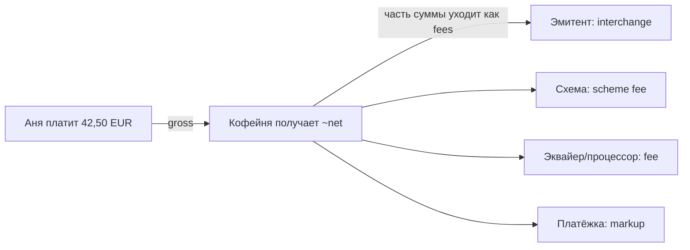
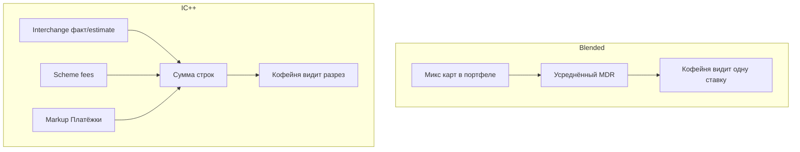
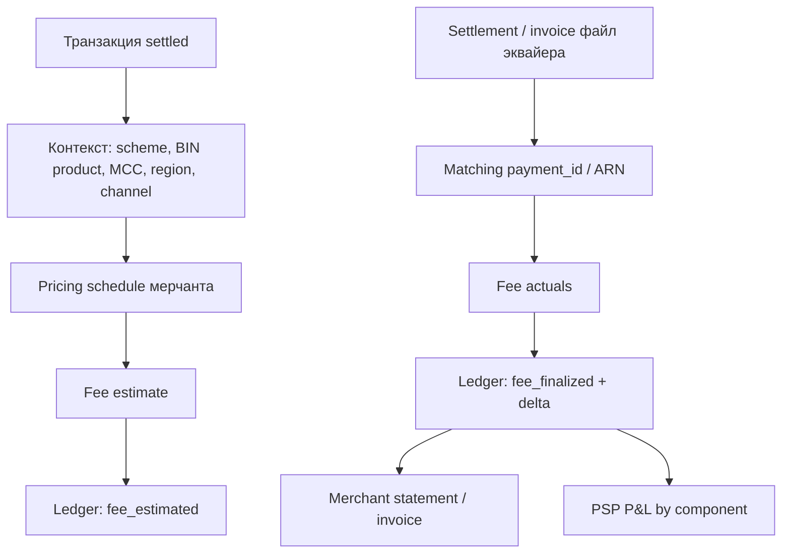
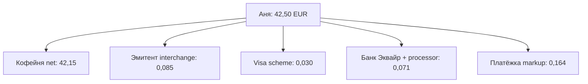

# Глава 15. Комиссии и экономика платежей

Аня заплатила 42,50 EUR за набор зерна в «Кофейне». В приложении «Банка Север» списалось 42,50. В админке магазина статус `paid`. А на расчётный счёт «Кофейни» через пару дней приходит уже не 42,50 — а что-то вроде 41,80 или 41,95, плюс строка в отчёте PSP, которую финансист читает как иероглифы. Куда делись эти десятки центов? Кто их съел? Почему вчерашний платёж «стоил» 0,70 EUR, а сегодняшний с той же суммы — 1,40? И почему один chargeback внезапно «стоит» как сто успешных оплат?

До этой главы мы разбирали путь данных и путь денег: кто участники ([Глава 02](02-ecosystem-participants.md)), как живёт авторизация и клиринг ([Глава 06](06-payment-lifecycle.md)), куда физически уходят средства ([Глава 12](12-flow-of-funds.md)), как их учитывают в леджере ([Глава 13](13-ledger-and-reconciliation.md)) и что делает с суммой валютный слой ([Глава 14](14-currencies-and-fx.md)). Теперь — слой, из‑за которого платёжный бизнес вообще существует как бизнес: **комиссии и unit economics**.

Инженеру эта глава нужна не чтобы стать CFO. Она нужна, чтобы понимать, почему продукт спорит о маршрутизации на 3 базисных пункта, почему «ещё один retry» — не бесплатный, почему blended-тариф в договоре и IC++ в invoice — разные вселенные, и почему метрика «оборот (TPV)» без take rate и cost per transaction врёт.

**В этой главе**

- Из чего складывается цена карточного платежа: interchange, scheme fee, acquirer/processor fee, markup
- MDR, fixed vs percent, blended vs IC++ и гибридные прайсы
- Как зарабатывает PSP: take rate, unit economics, CPT, gross margin, revenue share
- FX markup и сравнение себестоимости методов
- Стоимость refund и chargeback; когда дешевле вернуть, чем спорить
- Fee engine: estimate vs actual, компоненты, полный разрез платежа Ани на 42,50 EUR

---

## Зачем вообще есть комиссии

Платёж — это не «переложить байты JSON». Это перенос обязательства и риска между организациями, которые друг другу не доверяют. Эмитент «Банк Север» решает, можно ли Ане потратить 42,50, и потом фактически финансирует эту покупку до сеттлмента. Схема Visa задаёт правила и рельсы. Эквайер «Банк Эквайр» спонсирует «Кофейню» перед сетью и несёт риск, что магазин уже получил payout, а потом прилетит chargeback. PSP «Платёжка» даёт API, антифрод, отчётность, payout и поддержку в три часа ночи.

Кто-то должен за это платить. В открытой карточной модели (four-party) **плательщик комиссии в первую очередь — мерчант**. Аня на checkout обычно видит 42,50 «как есть» (в Европе surcharging по consumer cards сильно ограничен или запрещён — детали зависят от страны и момента; мы не даём юридических советов). «Кофейня» же получает net: сумма минус цепочка fees.

Упрощённо поток ценности выглядит так:



Словами: Аня отдаёт 42,50. «Кофейня» в итоге видит меньше. Разница расползается по эмитенту, схеме, эквайеру/процессору и PSP. Точные доли зависят от региона, типа карты, domestic vs cross-border, CP vs CNP, MCC, договора и модели ценообразования. Дальше разберём каждый слой — а потом соберём их в один платёж.

Важная оговорка на всю главу: **цифры иллюстративные**. Реальные тарифы схем, эквайеров и PSP — коммерческая тайна и матрица на десятки тысяч строк. Мы берём правдоподобные порядки величин для EEA e-commerce 2026 года, чтобы можно было думать, а не заучивать прайс.

### Язык денег: bps, basis points, «три пункта»

В платежах любят говорить не «0,03 процента», а **3 bps** (basis points, базисные пункты). Один basis point = 0,01 процентного пункта = 0,0001 в доле. На обороте «Кофейни» 500 000 EUR в месяц разница в 5 bps — это 250 EUR. На обороте крупного мерчанта в 50 млн — уже 25 000 EUR. Отсюда священные войны продукта и биллинга за маршрутизацию «на три пункта дешевле».

Для инженера полезно сразу договориться: в коде тарифы хранить как **integer bps** (или даже десятые доли bps, если договор так написан), а не как `float` проценты. `0.0015` в IEEE float — путь к расхождениям на центах при сверке конца месяца.

### Кто «платит», когда Аня ничего не доплачивает

Есть тонкость, которую новички пропускают. Юридически и кассово Аня отдаёт 42,50. Экономически часть ценности сделки уходит инфраструктуре. Мерчант закладывает MDR в цену товара (часто неявно: кофе стоит 42,50, а не 42,00). Иногда в B2B и в отдельных юрисдикциях встречаются surcharge / cash discount — но в consumer e-commerce ЕЭЗ это минное поле регулирования. Практический вывод для продукта «Кофейни»: **не изобретайте «комиссию за оплату картой» на checkout**, пока юрист не сказал «можно» для вашей страны и метода.

---

## Interchange — кусок эмитента

**Interchange (interchange fee)** — в типичной открытой схеме комиссия, которую сторона эквайера/мерчанта платит стороне эмитента за карточную операцию. Упрощённо: «Банк Север» получает interchange с платежа Ани в «Кофейне», потому что именно он несёт (или делит) кредитный риск, fraud risk, стоимость выпуска и обслуживания карты, кэшбэк-программы и funding до клиринга.

### Зачем он появился

Без interchange эмитентам было бы экономически менее интересно выпускать карты и принимать на себя риск. Мерчанты хотят, чтобы покупатели платили картами. Эмитенты хотят, чтобы карты были «бесплатными» для Ани и ещё с милями. Кто-то должен финансировать эту вечеринку — исторически это и есть interchange, зашитый в правила схем.

### Кто платит кому

В стандартной покупке (purchase):

1. Аня платит «Кофейне» через цепочку.
2. При клиринге/сеттлменте схема учитывает interchange.
3. Эквайерская сторона получает от эмитентской стороны сумму покупки **минус** interchange (упрощая неттинг: на практике всё идёт через многосторонний settlement схемы — см. [Главу 12](12-flow-of-funds.md)).
4. Эквайер/PSP перекладывают эту стоимость на мерчанта в MDR или показывают её отдельной строкой в IC++.

Для возврата (refund / credit) знак часто меняется: interchange может частично «ехать обратно». Для chargeback — отдельная экономика и отдельные fees (ниже).

### От чего зависит ставка

Interchange — не одно число. Это функция:

| Фактор | Пример влияния |
|---|---|
| Регион и регуляция | В ЕЭЗ для многих consumer debit/credit есть потолки |
| Тип продукта карты | Debit / credit / commercial / prepaid |
| Domestic vs cross-border | Кросс-бордер часто дороже |
| CP vs CNP | E-commerce (CNP) часто иначе, чем POS |
| MCC | Ресторан ≠ авиабилет ≠ digital goods |
| Наличие 3DS / token | Иногда отдельные программы и ставки |
| Схема | Visa ≠ Mastercard ≠ национальная схема |

### Регулируемые потолки в Европе (иллюстрация)

На момент написания (2026) в ЕЭЗ для многих **consumer** card payments действует регулирование interchange: порядок величин — **потолок около 0,2% для consumer debit** и **около 0,3% для consumer credit** на внутри‑EEA операциях. Это не «ставка всегда ровно 0,2%», а верхняя граница для регулируемого сегмента; точные условия и исключения — в регуляции и правилах схем, консультация юриста обязательна, если вы проектируете compliance.

Что **не** покрыто этими потолками так же жёстко (упрощённо):

- commercial / corporate cards;
- многие interregional сценарии;
- некоторые продукты и рынки вне ЕЭЗ;
- UK↔EEA после Brexit — отдельная история со своими ставками и регуляторными спорами (ситуация меняется; смысл для инженера: не хардкодить «Европа = дёшево всегда»).

Для платежа Ани: дебетовая Visa «Банка Север», эмитент и мерчант в ЕЭЗ, CNP e-commerce — interchange порядка **0,2% от 42,50 = 0,085 EUR** (округлим в примерах до 0,09 EUR или будем считать точно — ниже в разрезе укажем явно).

### Где ломается интуиция

1. **«Дешёвая Европа»** относится к consumer cards. Пришёл клиент с corporate Mastercard — и стоимость внезапно другая.
2. **Кросс-бордер**: Аня с польским BIN платит литовскому мерчанту через эквайер в другой стране — матрица другая.
3. **Amex и closed-loop** живут иной моделью: часто единый discount rate вместо «interchange + scheme + acquirer» ([Глава 04](04-card-networks.md)).
4. Interchange — **не доход PSP**. Если вы в дашборде назвали всю комиссию мерчанта «нашей выручкой», вы врёте себе в P&L.

### Как interchange проявляется инженеру (не только финансисту)

На авторизации interchange ещё **не финален**: эмитент сказал «да», но клиринговая категория может уточниться. После capture операция попадает в clearing file с индикаторами (product, MCC, e-commerce flag, 3DS result…). Схема/эквайер применяют fee schedule. «Платёжка» либо:

- оценивает interchange по собственной матрице BIN×MCC×region (estimate), либо
- ждёт файл от «Банка Эквайр» с actuals.

Врезка: как это бывает в жизни. Finance «Кофейни» звонит в поддержку: «Вчера на карте Visa было 0,09 EUR interchange, сегодня на такой же сумме 0,85. Вы ошиблись?» Поддержка смотрит: вчера consumer debit EEA, сегодня commercial. Один и тот же логотип Visa на кнопке checkout — разный продукт в BIN table. Без поля `card_product` / funding source в админке этот звонок будет повторяться каждую неделю.

### Interchange и кэшбэк Ани

Почему «Банк Север» даёт Ане 1% кэшбэка «на всё»? Не из любви к кофе. Часть экономики interchange (плюс кредитный процент на credit-картах, плюс другие доходы банка) финансирует программу лояльности. Когда регулятор режет interchange, банки режут кэшбэк или поднимают годовую плату за карту. Мерчант радуется более низкому MDR; держатель карты замечает, что «бесплатная карта с милями» стала менее щедрой. Это одна система сосудов.

---

## Scheme fee — кусок сети

**Scheme fee** (assessment / network fee / сборы схемы — названия в invoice эквайера плавают) — плата карточной сети за участие в её рельсах и сервисах. Её платят участники схемы (эмитенты и эквайеры); эквайер и PSP перекладывают стоимость на мерчанта.

Это **не interchange**. Interchange идёт эмитенту. Scheme fee — сети (Visa, Mastercard и т.д.). Путать их в IC++-отчёте — классический способ потерять доверие finance-команды мерчанта за один billing cycle.

### Зачем схеме отдельный сбор

Схема содержит авторизационную сеть, клиринг, settlement, правила споров, токенизацию, сертификацию, brand. Объём транзакций — её «газ»: чем больше платежей, тем больше сетевой выручки. Плюс value-added сервисы, штрафы за non-compliance, fees за chargeback/retrieval, минимумы объёма.

### Как выглядит на практике

На consumer debit domestic в ЕС scheme fee часто **мелкий** рядом с interchange — доли цента или несколько центов на чек 42,50. На кросс-бордере, commercial, некоторых CNP и «премиальных» продуктах вклад сети растёт. Плюс **событийные** сборы: за dispute, за несвоевременный respond, за нарушения.

Иллюстративно для платежа Ани возьмём scheme fee **0,03 EUR** (смесь процентной и фиксированной частей, упрощённо одной строкой). В реальности у эквайера может быть пять строк «Visa something» — для леджера «Платёжки» важно уметь их классифицировать как `scheme_fee`, а не сваливать в `other`.

### Что проверять в системе

- Поле `scheme` / `brand` на транзакции обязательно для fee estimation.
- Domestic flag и card product влияют на estimate.
- Фактические scheme fees приходят из settlement/invoice файлов эквайера с задержкой — estimate ≠ final ([Глава 13](13-ledger-and-reconciliation.md)).

---

## Acquirer fee и processor fee

**Acquirer fee** — плата эквайера за спонсорство мерчанта, доступ к схемам, риск underwriting, settlement к мерчанту/PSP, compliance. **Processor fee** — плата за технологическую обработку: auth switch, файлы клиринга, коннекторы, uptime.

На практике мерчант через PSP часто **не видит** границу «Банк Эквайр» vs процессор vs «Платёжка». В договоре одно брендовое имя. Внутри unit economics «Платёжки» эти строки критичны: это **cost of goods sold** платёжной транзакции.

### Типичные формы

- Фикс за авторизацию / за settled transaction (например, 0,01–0,05 EUR — порядок).
- Процент от суммы.
- Плата за 3DS, за token request, за account updater.
- Monthly minimum / PCI / gateway fee — не per-transaction, но бьют по unit economics мелких мерчантов.

Иллюстративно для Ани: эквайер+процессор берут **0,05 EUR** фикса + **0,05%** = 0,05 + 0,021 = **0,071 EUR**.

### Где сюрпризы

- Decline тоже может тарифицироваться (auth attempt fee) — отсюда «умные» retries стоят денег ([Глава 07](07-states-async-idempotency.md), [Глава 09](09-declines-and-response-codes.md)).
- Partial capture / multiple capture — иногда отдельные события биллинга.
- Смена эквайера на каскаде меняет cost и иногда interchange program.

---

## Markup — кусок PSP (и иногда эквайера)

**Markup** — надбавка поверх «сырых» затрат (interchange + scheme + acquirer/processor), которую берёт PSP или эквайер как свою маржу за сервис. В IC++ модели markup обычно **прозрачен** как отдельная ставка. В blended — спрятан внутри усреднённого MDR.

«Платёжка» зарабатывает не на interchange (тот уходит эмитенту), а на:

- markup / processing fee;
- FX markup (ниже);
- подписках и SaaS (dashboard, billing portal);
- value-added (fraud scoring premium, Account Updater, network tokens);
- иногда float / проценте на остатках (зависит от лицензии и модели — не универсально).

Иллюстративно: markup «Платёжки» на карточный платёж Ани — **0,10 EUR + 0,15%** = 0,10 + 0,06375 ≈ **0,164 EUR**.

Именно markup (плюс FX и исключения) кормит инженеров, антифрод и on-call. Если take rate схлопнулся до нуля после ценовой войны, «оптимизация latency на 20 мс» не спасёт P&L.

### Врезка: ценовая война и «нулевой» markup

Раз в пару лет на рынке появляется игрок: «карты 0,5% + 0,10, без сюрпризов». Крупные мерчанты мигрируют. Через квартал выясняется, что 0,5% не покрывает commercial-микс, FX «чуть дороже рынка», а payout T+1 стоит отдельных денег. Часть клиентов возвращается на IC++ с честным markup 8–15 bps. Инженерам в такие периоды достаётся срочная миграция тарифов, пересчёт исторических fees и тонна объяснений, почему `pricing_version` на мерчанте внезапно v7.

Урок: **markup должен быть согласован с risk appetite и миксом**. Слишком тонкий markup на blended — это не «market share», это отложенный убыток.

---

## MDR — что видит мерчант одной строкой

**MDR (Merchant Discount Rate)** — ставка «скидки» мерчанта: сколько продавец платит за приём карты, обычно как % от оборота и/или фикс за транзакцию. Исторически «discount» — потому что эквайер «покупал» у мерчанта право на выручку со скидкой.

Когда финансист «Кофейни» говорит «у нас эквайринг 1,4% + 0,25 EUR», он почти всегда говорит про **MDR / blended package**, а не про отдельный interchange.

MDR — **зонтик**. Под ним могут жить:

- interchange;
- scheme fee;
- acquirer/processor fee;
- PSP markup;
- иногда амортизация месячных плат.

Связь:

```text
MDR (то, что платит мерчант)
  ≈ interchange + scheme fee + acquirer/processor + markup
    (плюс округления, минимумы, исключения)
```

В blended-мире равенство приблизительное и усреднённое по портфелю карт. В IC++ — почти покомпонентное на каждую транзакцию.

---

## Fixed vs percent: почему на мелком чеке больно

Ценообразование почти всегда **гибрид**:

- **Percent (ad valorem)** — доля от суммы. Хорошо масштабируется на крупном чеке; на мелком даёт копейки.
- **Fixed (per transaction)** — центы/евро за штуку. На чеке 42,50 выглядит терпимо; на чеке 2,90 — убийственно.

Пример (иллюстративный тариф «1,2% + 0,25 EUR»):

| Сумма | 1,2% | Фикс | Итого fee | Fee / sum |
|---|---|---|---|---|
| 2,90 EUR | 0,035 | 0,25 | 0,285 | **9,8%** |
| 42,50 EUR | 0,510 | 0,25 | 0,760 | **1,8%** |
| 850,00 EUR | 10,20 | 0,25 | 10,45 | **1,2%** |

Отсюда продуктовые решения «Кофейни»: минимальная сумма заказа, доплата за «мелкую доставку», давление на локальные bank methods для micropayments ([Глава 10](10-bank-based-methods.md)), спор «нужен ли card для чаевых 1 EUR».

Для инженера PSP: в fee engine нельзя хранить «просто percent». Нужна модель `rate_bps + fixed_minor_units + currency + caps/floors`, с округлением round-half-even или банковским — и тестами на границах ([Глава 14](14-currencies-and-fx.md) про minor units).

---

## Blended vs IC++: две философии честности

### Blended (пакетная ставка)

Мерчанту говорят: «Карты — 1,5% + 0,25 EUR». Точка. PSP/эквайер внутри усредняет дорогие commercial и дешёвые debit. Мерчанту просто. PSP берёт на себя variance микса карт.

Плюсы: предсказуемость для «Кофейни», простой UI баланса, меньше споров «почему вчера 0,9%, сегодня 2,1%».

Минусы: если микс уезжает в corporate/cross-border, маржа PSP сжимается или уходит в минус; крупные мерчанты чувствуют, что «переплачивают» на debit и требуют IC++.

### IC++ (Interchange plus plus)

Прозрачная формула:

```text
merchant_fee = interchange + scheme_fees + acquirer/PSP_markup
```

Два «плюса» — scheme и markup (терминология рынка; иногда пишут IC+ для interchange+acquirer без детализации scheme).

Плюсы: честность, проще оптимизировать маршрутизацию и микс, крупный enterprise это любит.

Минусы: сложные invoices, estimate vs actual, споры о классификации строк, нужна зрелая аналитика у мерчанта.



### Что выбрать «Кофейне»

Маленький магазин с простым finance — часто blended. Сеть с миллионами оборота и собственным казначейством — IC++. «Платёжка» может предлагать оба; инженерия должна уметь оба биллинга на одном ledger.

### Гибриды и «blended по сегментам»

На практике чистых полюсов мало. Часто делают:

- blended на consumer cards внутри ЕЭЗ;
- IC++ или отдельный MDR на commercial;
- отдельный прайс на Amex;
- отдельный прайс на UK/US acquiring;
- cap: «IC++ but not more than 2,5%» — чтобы мерчант спал спокойно, а PSP хеджировал хвост.

Для fee engine это значит: **правила тарификации — decision tree**, а не одно число в `merchants.fee_percent`. Версионируйте правила (`pricing_schedule_id`), датируйте effective_from, не мутируйте прошлое.

```text
merchant_id = mrc_coffee_01
schedule = sch_2026_q3_eea
  IF scheme IN (visa, mastercard)
     AND card_product = consumer
     AND region = eea_domestic
     AND channel = cnp
     → blended 1.2% + 0.25 EUR
  IF card_product = commercial
     → ic_plus_plus markup 0.10 EUR + 0.20%
  IF scheme = amex
     → discount_rate 2.6% + 0.20 EUR
```

Такая таблица скучна в Excel и прекрасна в коде — пока кто-нибудь не заведёт исключение «для этого MID временно −5 bps руками в проде» без аудита.

---

## Take rate — пульс платёжного бизнеса

**Take rate** — доля выручки платёжного сервиса от обработанного объёма (TPV, total payment volume). Упрощённо:

```text
take_rate = payment_revenue / TPV
```

Если «Платёжка» обработала за месяц 10 000 000 EUR оборота мерчантов и получила 45 000 EUR выручки с платежей (markup + FX + fees за сервисы, **не** включая транзитный interchange), take rate = 0,45%.

Оговорки:

- Считать в take rate чужой interchange — самообман: это не ваша выручка.
- Net take rate после costs (COGS) — уже ближе к gross margin story.
- Смешение card + APM + payout в одном take rate без сегментов скрывает правду.

Для продукта: рост TPV при падающем take rate может быть пирровой победой («мы купили оборот ценой»).

---

## Unit economics: cost per transaction и gross margin

Разберём одну транзакцию глазами «Платёжки».

### Cost per transaction (CPT)

**Cost per transaction** — сколько «Платёжке» стоит провести одну операцию по переменным затратам:

```text
CPT ≈ interchange_pass_through? + scheme + acquirer/processor
      + fraud_tooling_variable + 3DS_fees + expected_loss_allocation
```

В IC++ модели interchange и scheme часто **pass-through** мерчанту: тогда в COGS «Платёжки» остаётся то, что она реально платит upstream и не перевыставляет, плюс её собственные variable costs. В blended — PSP «покупает» весь стек costs и продаёт пакет; CPT включает interchange+scheme+acquirer.

Иллюстративно для blended на платеже Ани:

| Статья COGS | EUR |
|---|---|
| Interchange | 0,085 |
| Scheme fee | 0,030 |
| Acquirer/processor | 0,071 |
| Variable fraud/3DS allocate | 0,020 |
| **CPT** | **0,206** |

### Gross margin на транзакции

Если blended MDR дал выручку с мерчанта 0,760 EUR:

```text
gross_profit ≈ 0,760 − 0,206 = 0,554 EUR
gross_margin ≈ 0,554 / 0,760 ≈ 73%  (на этой транзакции; иллюстрация)
```

На commercial card CPT может взорваться до 1,20 EUR при той же blended выручке 0,76 — и вот вы в минусе на «успешном» платеже. Поэтому blended без мониторинга микса — ловушка.

В IC++ выручка «Платёжки» ≈ markup 0,164; COGS ≈ 0,020 (allocate) + то, что не pass-through; маржа на транзакции тоньше в абсолюте, но предсказуемее.

### Unit economics портфеля

Смотреть одну транзакцию мало. Нужны:

- contribution после expected chargeback/fraud loss;
- стоимость поддержки и onboarding, размазанная на транзакции;
- минимум объёма мерчанта (мелкий MID с 30 платежами в месяц может быть убыточен при любых CPT).

### Мини-модель месяца «Кофейни» глазами «Платёжки»

Допустим (всё иллюстративно), за месяц:

| Метрика | Значение |
|---|---|
| Успешных card payments | 8 000 |
| TPV | 340 000 EUR (средний чек ≈ 42,50) |
| Blended MDR собрано с мерчанта | 6 100 EUR |
| Pass-through/COGS (IC+scheme+acq) | 3 400 EUR |
| Variable fraud/3DS | 400 EUR |
| Expected fraud+chargeback loss allocate | 900 EUR |
| Gross profit после expected loss | 6 100 − 3 400 − 400 − 900 = **1 400 EUR** |
| Take rate (revenue/TPV) | 6 100 / 340 000 ≈ **1,8%** |
| Net take после COGS+loss | 1 400 / 340 000 ≈ **0,41%** |

Теперь добавим 12 lost chargebacks по ~100 EUR impact, из которых в таблице выше «ожидали» только часть: фактический хвост съел весь красивый net take. Unit economics живёт в хвостах.

Ещё один слой: **неуспешные попытки**. 10 000 auth attempts, 8 000 success. Если эквайер тарифицирует attempts, CPT надо считать и на отказы. Иначе «мы улучшили conversion каскадом» маскирует рост attempt fees.

### Contribution margin vs accounting gross margin

В разговоре продукта «маржа» часто значит contribution: выручка минус переменные. В бухгалтерии gross margin может включать другие классификации. Для платёжной платформы договоритесь о словаре:

- **Payment revenue** — то, что действительно ваше (markup, FX spread, SaaS), не чужой interchange.
- **COGS variable** — upstream fees, которые вы не перевыставили или перевыставили ниже cost.
- **Losses** — fraud, chargeback, operational write-off.
- **Contribution** — revenue − COGS variable − losses.
- **Operating margin** — после людей, облака, PCI, лицензий.

Инженерный дашборд, который показывает только TPV и success rate, оптимизирует не тот KPI.

---

## Revenue share — когда кусок пирога делят

**Revenue share** — договорённость делить выручку (или markup) между сторонами: PSP и эквайером, PayFac и платформой, маркетплейсом и «Платёжкой», ISO/агентом и банком.

Пример духа: «Банк Эквайр» даёт «Платёжке» wholesale costs, а markup 0,15% они делят 60/40. Или marketplace забирает platform fee отдельно от processing fee ([Глава 26](26-marketplace-and-split-payments.md)).

Для инженера:

- в ledger нужны отдельные account'ы под `revenue_share_payable`;
- отчёт партнёру — не «весь MDR», а согласованная база (часто net markup after costs);
- споры начинаются с определения базы: до или после refunds? до или после fraud losses?

Иллюстративный JSON внутренней проводки (не API наружу):

```json
{
  "payment_id": "pay_8f3a2c91",
  "amount_eur": "42.50",
  "merchant_fee_eur": "0.76",
  "cogs_eur": "0.206",
  "gross_profit_eur": "0.554",
  "revenue_share": {
    "partner": "bank_acquire",
    "base": "gross_profit",
    "percent": 40,
    "partner_amount_eur": "0.222"
  }
}
```

---

## FX markup — тихий (и громкий) источник маржи

Когда валюта presentment и валюта settlement/payout расходятся, появляется FX. Подробный механизм курсов — в [Главе 14](14-currencies-and-fx.md). Здесь — экономика.

**FX markup** — надбавка PSP/банка к межбанковскому или wholesale-курсу. Аня платит 42,50 EUR, но если бы заказ был в USD, а карта/settlement в другой валюте, кто-то зарабатывает на спреде.

Сценарии:

1. **Merchant pricing в EUR, карта Ани EUR, settlement EUR** — FX почти нет (наш базовый пример).
2. **DCC (Dynamic Currency Conversion)** — Ане на POS предлагают платить в «своей» валюте по курсу с жирным markup; часто невыгодно покупателю.
3. **PSP конвертирует payout** — «Кофейня» продаёт в PLN, получает EUR на счёт с конвертацией и спредом.
4. **Multi-currency acquiring** — оптимизация, чтобы меньше конвертировать.

Иллюстрация: заказ 50,00 USD, «Кофейня» хочет EUR на счёт. Mid-market 1 USD = 0,9200 EUR → 46,00 EUR. PSP ставит 0,9050 → 45,25 EUR. Разница **0,75 EUR** — FX markup (плюс обычный MDR с USD-суммы). На объёме это может давать больше маржи, чем card markup.

Для инженера: храните `fx_rate_used`, `fx_rate_source`, `fx_markup_bps` отдельно от `processing_fee`. Иначе сверка с казначейством превращается в детективный роман.

---

## Стоимость refund: «просто вернуть» почти никогда не бесплатно

**Refund** возвращает покупателю деньги (частично или полностью), но экономически это не откат машины времени.

Что обычно происходит (зависит от договора):

1. Мерчанту уменьшают balance / удерживают из payout на сумму refund.
2. **MDR за исходный платёж часто не возвращают** (или возвращают частично) — «Платёжка» уже понесла costs и работу.
3. Иногда берут **отдельный refund fee** (фикс).
4. Interchange на credit/refund может частично компенсировать, но не обязан сделать операцию нулевой по стоимости.
5. Операционные затраты: поддержка, сверка, риск, что refund уйдёт не туда.

Иллюстрация для полного refund платежа Ани 42,50 при blended 0,76 EUR fee:

| Статья | EUR |
|---|---|
| Возврат Ане | −42,50 (с баланса «Кофейни») |
| Исходный MDR, не возвращённый | −0,76 (уже уплачен / удержан) |
| Refund fee (иллюстративно) | −0,15 |
| **Экономический удар по «Кофейне» сверх товара** | **≈ 0,91 + себестоимость логистики** |

Если кофе уже отправлен, refund = потеря товара + fees. Поэтому продуктово выгоднее partial refund («вернём 10 EUR за опоздание»), а инженерно — чёткие состояния и идемпотентность refund ([Глава 06](06-payment-lifecycle.md), [Глава 07](07-states-async-idempotency.md)).

Повторный refund на ту же сумму, refund больше capture, refund после chargeback — отдельные грабли с отдельной ценой.

---

## Стоимость chargeback: хвост, который ест туловище

**Chargeback** (возвратный платёж) — принудительный возврат через схему/эмитента, когда Аня (или мошенник с её картой) оспаривает операцию. Жизненный цикл спора — [Глава 17](17-chargebacks-and-disputes.md); здесь только **экономика**.

Типичный счёт на один lost chargeback (иллюстративно):

| Статья | Порядок величины |
|---|---|
| Сумма операции | 42,50 EUR |
| Chargeback fee схемы/эквайера | 10–25 EUR (часто фикс) |
| Операционное время representment | 30–90 минут сотрудника |
| Потеря товара / услуги | себестоимость |
| Штрафные программы схем при плохом ratio | от нуля до «очень больно» |
| Рост rolling reserve / задержка payout | стоимость капитала |

Грубо: один проигранный dispute на 42,50 может обойтись «Кофейне» как **60–100+ EUR** экономических потерь. При MDR 0,76 EUR на успешном платеже нужно порядка **80–130 успешных** чистых оплат, чтобы отбить один такой хвост — без учёта репутации и лимитов.

Отсюда инвестируют в 3DS / fraud / clear statement descriptor / каченую доставку evidence. False positive антифрода тоже стоит conversion — trade-off разберём в [Главе 16](16-fraud.md).

Для «Платёжки» chargeback fee часто pass-through мерчанту + свой dispute service fee. Если мерчант ушёл в negative balance и банкрот — риск может остаться на эквайере/PayFac ([Глава 02](02-ecosystem-participants.md), [Глава 12](12-flow-of-funds.md)).

### Refund vs chargeback: экономический выбор мерчанта

Иногда «Кофейня» получает pretension: Аня пишет в поддержку «не пришло». Два пути:

1. Сразу refund 42,50 — потеря fees ~0,9 EUR + товар, но без chargeback fee и без удара по chargeback ratio.
2. Спорить — риск получить chargeback на 42,50 + 18 EUR fee + ratio.

Правило большого пальца у зрелых мерчантов: **на мелких чеках чаще дешевле refund'ить, чем драться**, если evidence слабый. На дорогих заказах и при дружественном фроде («friendly fraud») — наоборот, representment обязателен. Экономика спора должна быть в runbook поддержки, а не только в эмоциях «мы же правы».

---

## Fee engine: как это выглядит в системе PSP

Пора собрать требования в картинку сервиса, который считает деньги.



Словами: на событии платежа строится контекст, применяется версия прайса, пишется оценка. Позже файл эквайера матчится с платежом, появляются факты, дельта корректирует леджер, мерчант видит statement, внутри считается P&L по компонентам.

Минимальные сущности:

| Сущность | Зачем |
|---|---|
| `PricingSchedule` | Версия правил, effective dates |
| `FeeComponent` | Тип: interchange, scheme, markup… |
| `FeeAssessment` | Оценка/факт на конкретный payment |
| `FeeDelta` | Корректировка estimate→actual |
| `PartnerShare` | Revenue share начисление |

Псевдокод оценки (иллюстративно):

```python
def estimate_fees(payment, schedule):
    ctx = build_context(payment)  # scheme, product, domestic, mcc...
    rule = schedule.match(ctx)
    if rule.model == "blended":
        pct = payment.amount * rule.rate_bps // 10000
        return FeeBreakdown(total=pct + rule.fixed, components=["blended_mdr"])
    if rule.model == "ic_plus_plus":
        ic = lookup_interchange_estimate(ctx, payment.amount)
        scheme = lookup_scheme_estimate(ctx, payment.amount)
        acq = rule.acq_fixed + payment.amount * rule.acq_bps // 10000
        markup = rule.markup_fixed + payment.amount * rule.markup_bps // 10000
        return FeeBreakdown(
            interchange=ic, scheme=scheme, acquirer=acq, markup=markup,
            total=ic + scheme + acq + markup,
        )
```

Где ломается: `lookup_interchange_estimate` устарел на неделю после обновления scheme bulletin; commercial карта определилась неправильно из-за дырявого BIN table; refund пересчитал markup, но не тронул pass-through; валюта fee отличается от валюты payment (редко, но больно).

---

## Полный разрез платежа Ани: 42,50 EUR

Сквозные вводные (согласованы с [Главой 06](06-payment-lifecycle.md)):

| Поле | Значение |
|---|---|
| Заказ | `ORD-2026-0918-0042` |
| Payment | `pay_8f3a2c91` |
| Сумма | 42,50 EUR (`4250` minor) |
| Карта | Visa consumer debit, «Банк Север», EEA |
| Мерчант | «Кофейня», MCC 5499 (иллюстративно) |
| Канал | CNP e-commerce |
| PSP | «Платёжка» |
| Эквайер | «Банк Эквайр» |
| Auth code | `A1B2C3` |

### Сценарий A — IC++, domestic EEA debit

Предположим договор IC++: markup «Платёжки» = 0,10 EUR + 0,15%.

| Компонент | Расчёт | EUR |
|---|---|---|
| Interchange | 0,20% × 42,50 | 0,085 |
| Scheme fee | иллюстративно | 0,030 |
| Acquirer/processor | 0,05 + 0,05% | 0,071 |
| Markup PSP | 0,10 + 0,15% | 0,164 |
| **Итого fee мерчанта** | | **0,350** |
| **Net «Кофейне»** | 42,50 − 0,350 | **42,150** |

Fee rate: 0,350 / 42,50 ≈ **0,82%**.



Словами: из 42,50 «Кофейня» получает 42,15 на уровне fee (до резервов и payout-расписания). Эмитент, схема, эквайер и PSP делят 0,35. Аня по-прежнему видит 42,50.

Иллюстративный фрагмент отчёта IC++:

```json
{
  "payment_id": "pay_8f3a2c91",
  "order_id": "ORD-2026-0918-0042",
  "amount": 4250,
  "currency": "EUR",
  "pricing_model": "ic_plus_plus",
  "fees": {
    "interchange": 9,
    "scheme": 3,
    "acquirer_processing": 7,
    "psp_markup": 16,
    "total": 35
  },
  "fee_currency": "EUR",
  "fee_minor_units": true,
  "net_to_merchant": 4215,
  "note": "illustrative estimates; actuals may post with settlement delay"
}
```

Суммы fees в minor units: 9+3+7+16=35 центов. Округление interchange 0,085 → 0,09 в деньгах банка или 8/9 центов — частый предмет сверки; зафиксируйте правило округления в fee engine.

### Сценарий B — blended «1,2% + 0,25 EUR»

| Компонент | EUR |
|---|---|
| MDR к уплате | 0,510 + 0,250 = **0,760** |
| Net «Кофейне» | **41,740** |

Внутри «Платёжки» (не видно мерчанту):

| COGS | EUR |
|---|---|
| Interchange | 0,085 |
| Scheme | 0,030 |
| Acquirer | 0,071 |
| Allocate variable | 0,020 |
| **Итого COGS** | 0,206 |
| **Gross profit PSP** | 0,760 − 0,206 = **0,554** |

Мерчанту «дороже» в абсолюте, чем IC++ на дешёвом debit — он субсидирует чужие commercial-карты в портфеле blended. PSP на этом платеже зарабатывает заметно больше, чем на чистом markup 0,164.

### Сценарий C — та же сумма, corporate credit cross-border

Аня платит с корпоративной карты иностранного банка (иллюстративный кошмар казначея). Ставки выдуманы для порядка:

| Компонент | EUR |
|---|---|
| Interchange | 1,100 |
| Scheme | 0,180 |
| Acquirer | 0,100 |
| Markup | 0,200 |
| **IC++ total** | **1,580** |
| Net | **40,920** |

Fee rate ≈ 3,7%. Если «Кофейня» на blended 0,76, **PSP теряет** порядка 1,58 − 0,76 ≈ 0,82 EUR на «успешной» оплате. После месяца таких клиентов blended-договор пересматривают или режут acceptance commercial.

### Сценарий D — банк-метод вместо карты

Аня платит SCT Inst / Open Banking PIS на те же 42,50 ([Глава 10](10-bank-based-methods.md)). Иллюстративно fee «Платёжки» 0,25 EUR фикса, без interchange:

| | EUR |
|---|---|
| Fee | 0,250 |
| Net | 42,250 |

На крупном B2B-чеке разница взрывается. На 42,50 карта в IC++ (0,35) уже близка к bank fee — побеждает UX, conversion и fraud-профиль, не только цена.

### Сценарий E — полный refund на следующий день

База: сценарий B (blended 0,76 уплачен).

| Событие | Влияние на «Кофейню» |
|---|---|
| Refund 42,50 | −42,50 с баланса |
| MDR не возвращён | −0,76 уже «сгоревших» |
| Refund fee 0,15 | −0,15 |
| Итого cash-out сверх «не продажи» | fees 0,91 |

Товар, если не вернули физически, — отдельный убыток.

### Сценарий F — chargeback через три недели

| Статья | EUR |
|---|---|
| Списание суммы | 42,50 |
| Chargeback fee | 18,00 |
| Representment проигран, labour (внутр.) | ~40,00 эквивалент |
| **Грубый total impact** | **~100** |

Один такой кейс ≈ 130+ платежей сценария A по валовой марже PSP или десятки по марже товара «Кофейни».

### Таймлайн денег и fees

```text
День 0, 10:00   Auth approved 42,50; fee ещё estimate
День 0, 10:05   Capture; «Кофейня» видит paid
День 1          Clearing; interchange/scheme фиксируются в схеме
День 2          Settlement банки; «Платёжка» обновляет actual fees
День 2          Merchant balance +42,50 − fee; available по политике T+N
День 3          Payout на счёт «Кофейни» (net за день/период)
День 5          Invoice/IC++ report: estimate → actual delta ±1–2 цента
День 25         (опционально) chargeback — отдельный ledger storm
```

Estimate в момент auth и actual после settlement — норма. Система, которая показывает fee как «окончательный» в ту же миллисекунду, что auth, либо врёт, либо работает только на blended с фиксированной формулой.

---

## Как «Платёжка» зарабатывает — сборная картина

Сведём модели дохода PSP:

1. **Card processing markup / MDR spread** — ядро.
2. **FX markup** — часто сопоставимо с processing на кросс-бордере.
3. **Плата за методы** — APM, BNPL как share с провайдером ([Глава 11](11-wallets-bnpl-local-methods.md)).
4. **Подписка / платформа** — фикс в месяц за MID, магазин, terminal.
5. **Value-added** — fraud premium, tokenization, billing engine, Account Updater.
6. **Revenue share** с банками и платформами.
7. **Штрафы и сервисы disputes** — этично серая зона: лучше зарабатывать на предотвращении, чем на fees за боль.

Не доход PSP: чужой interchange (кроме редких моделей, где структура договора иная — не наш базовый кейс), депозиты мерчантов как «свои» (регуляторика EMI/PI — [Глава 18](18-regulation-and-compliance.md)).

### Сравнение «видимой» цены методов на одном заказе

Аня снова у checkout с заказом 42,50. «Кофейня» через «Платёжку» показывает методы. Иллюстративная **стоимость для мерчанта** (не для Ани):

| Метод | Ориентир fee | Комментарий |
|---|---|---|
| Visa debit EEA, IC++ | ~0,35 EUR | Наш сценарий A |
| Visa debit EEA, blended | ~0,76 EUR | Сценарий B |
| Corporate card | ~1,50+ EUR | Сценарий C |
| Apple Pay (токен тот же debit) | ≈ как карта ± мелкие отличия | Экономика всё ещё карточная ([Глава 05](05-card-contexts-and-tokens.md), [Глава 11](11-wallets-bnpl-local-methods.md)) |
| Open Banking / SCT Inst | ~0,20–0,40 EUR | Без interchange |
| BNPL | доля выше, иной риск | Доля провайдеру BNPL |

Продуктовый вывод: «выключим карты, оставим только bank transfer» снижает MDR и может убить conversion. Оптимум — **методо-микс** с прозрачной себестоимостью в аналитике, а не священная война «карты зло / bank зло».

---

## Что это значит для инженера

1. **Модель данных fees.** Храните компоненты раздельно: `interchange`, `scheme_fee`, `acquirer_fee`, `psp_fee`, `fx_markup`, `refund_fee`, `chargeback_fee`. Одна колонка `fee_amount` годится только для отображения blended-итога.

2. **Estimate vs actual.** Введите статусы `fee_estimated` / `fee_finalized` и job сверки с settlement file. Дельты пишите корректирующими проводками, не overwrite истории ([Глава 13](13-ledger-and-reconciliation.md)).

3. **Округление.** Считайте в minor units integer; процент — через bps; зафиксируйте half-even. Напишите тесты на 42,50 × 0,2%, 42,50 × 1,2% + 25 cent.

4. **Карточка транзакции для support.** Без `scheme`, `card_product`, `domestic`, `pricing_model` саппорт не объяснит мерчанту invoice.

5. **Маршрутизация = деньги.** Cascading на второй эквайер может спасти conversion и одновременно ухудшить interchange program. Логируйте chosen route и cost estimate.

6. **Retries стоят CPT.** Soft decline retry — ok по политике; hard decline retry — сжигание auth fees и ухудшение fraud сигналов ([Глава 09](09-declines-and-response-codes.md)).

7. **Метрики рядом с TPV.** Дашборд: take rate, CPT, gross margin per method, fee delta estimate/actual, chargeback cost per 1000 tx, refund fee leakage.

8. **Не обещайте в API «финальную комиссию» синхронно**, если upstream actuals суточные — отдавайте `estimated_fee` и webhook `fee.updated`.

9. **Тесты на хвосты.** Refund без возврата MDR, partial refund, chargeback после payout, negative balance — это money-path tests, не «косметика».

10. **Сегменты.** Считайте unit economics отдельно card domestic debit / commercial / APM / FX. Средняя температура по больнице убивает ценообразование.

---

## Типичные ошибки и грабли

1. **Считать весь MDR выручкой PSP.** Interchange и scheme — чужие (pass-through или COGS). Искажает маржу и бонусы продажникам.

2. **Сравнивать blended 1,2% с IC++ 0,8% на debit** и делать вывод «IC++ всегда дешевле». На коммерческих картах наоборот; нужен микс.

3. **Перепутать scheme fee и interchange** в UI отчёта. Мерчант один раз поймает — и будет аудировать каждый месяц.

4. **Хардкод «Европа = 0,2%»** для всех карт. Commercial, interregional, UK↔EEA, Amex — другие миры.

5. **Игнорировать фикс на мелких чеках.** Микроплатежи картами съедают маржу товара; это не баг MDR, это математика.

6. **Показывать fee = 0 до settlement, потом сюрприз.** Transparency бьёт доверием сильнее, чем честный estimate с оговоркой.

7. **Refund «как в интернет-магазине игрушек»** без учёта non-refundable fees — дыра в ledger и в поддержке.

8. **Оптимизация conversion любой ценой** без стоимости fraud/chargeback. +0,5% auth rate каскадом может принести −2% к contribution.

9. **Revenue share от «грязной» базы** без контрактной спецификации (после refunds? после costs?) — вечный конфликт с партнёром.

10. **FX markup, спрятанный в «курсе без пояснений».** В B2B это всплывает на первой же сверке казначейства.

11. **Один тарификатор на auth и на capture** без правил void. Отменённая auth с fee за attempt — сюрприз в конце месяца.

12. **Забыть, что payout rolling reserve — тоже экономика.** Деньги «как будто ваши», но стоимость капитала реальна ([Глава 12](12-flow-of-funds.md)).

---

## Итоги главы

1. Комиссию за карточный платёж платит в первую очередь мерчант; она раскладывается на interchange, scheme fee, acquirer/processor fee и markup PSP.
2. Interchange — кусок эмитента; в ЕЭЗ для многих consumer cards регулируется порядком 0,2%/0,3%; commercial и кросс-бордер живут иначе.
3. Scheme fee — кусок сети, не путать с interchange.
4. MDR — зонтик для мерчанта; blended прячет микс, IC++ показывает компоненты.
5. Fixed + percent убивает мелкий чек процентом эффективной ставки.
6. Take rate, CPT и gross margin — язык unit economics PSP; TPV без них врёт.
7. Revenue share и FX markup — отдельные договорённости и отдельные строки учёта.
8. Refund редко возвращает исходный MDR; chargeback стоит сумму + fee + операционку и легко съедает маржу десятков платежей.
9. На платеже Ани 42,50 EUR в IC++ domestic debit fee может быть порядка долей процента; в blended — около 1–2%+фикс; на corporate — заметно больше. Цифры — иллюстрация, принцип — нет.
10. Инженерная система fees: minor units, estimate/actual, компоненты, метрики хвостов.

Дальше книга уходит в риск: как мошенничество и ложные срабатывания ломают ту самую unit economics, которую мы только что собрали по центам. Следующая остановка — [Глава 16. Payment fraud](16-fraud.md).

---

## Связанные главы

- [Глава 01. Как устроена индустрия онлайн-платежей](01-industry-overview.md) — масштаб отрасли и обзор «кто на чём зарабатывает»
- [Глава 02. Участники платёжной экосистемы](02-ecosystem-participants.md) — роли и интересы в комиссии
- [Глава 04. Карточные сети и схемы](04-card-networks.md) — scheme fees и правила схем
- [Глава 05. CP/CNP, credentials on file, токены](05-card-contexts-and-tokens.md) — почему Apple Pay всё ещё «карта» в экономике
- [Глава 06. Жизненный цикл карточного платежа](06-payment-lifecycle.md) — где в клиринге рождается interchange
- [Глава 10. Банковские переводы и Open Banking](10-bank-based-methods.md) — более дешёвые альтернативы карте
- [Глава 11. Кошельки, BNPL и локальные методы](11-wallets-bnpl-local-methods.md) — APM и другая unit economics
- [Глава 12. Что происходит с деньгами](12-flow-of-funds.md) — settlement, balance, payout, reserves
- [Глава 13. Ledger и reconciliation](13-ledger-and-reconciliation.md) — проводки fee и сверка actuals
- [Глава 14. Валюты и FX](14-currencies-and-fx.md) — курсы, спреды, DCC
- [Глава 16. Payment fraud](16-fraud.md) — потери, которые бьют по марже
- [Глава 17. Chargebacks и disputes](17-chargebacks-and-disputes.md) — процесс за экономикой chargeback
- [Глава 25. Merchant-side](25-merchant-domain.md) — pricing глазами продавца
- [Глава 26. Marketplace и split payments](26-marketplace-and-split-payments.md) — platform fee и деление выручки
