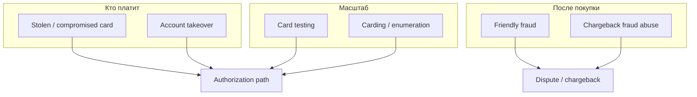
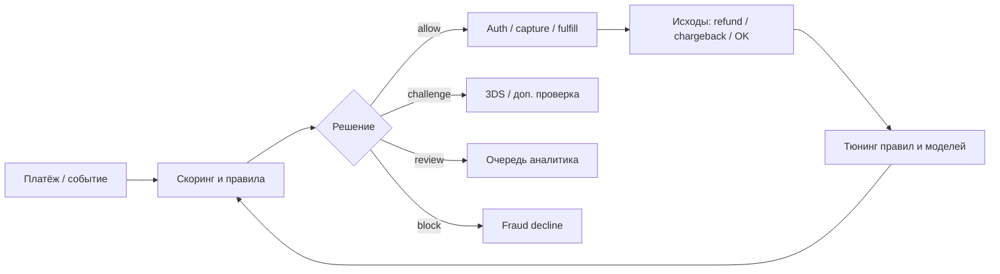
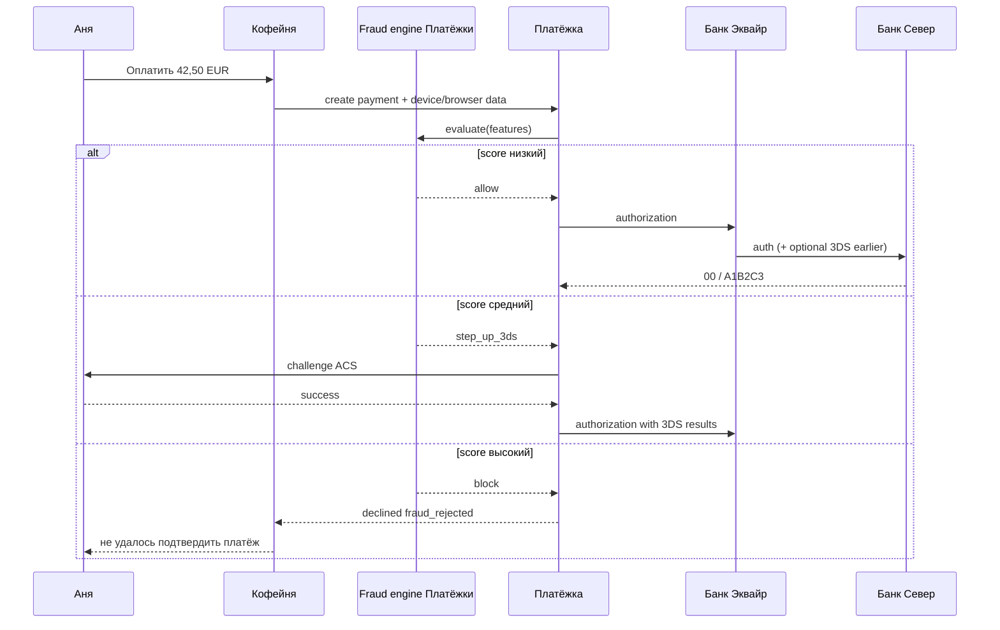
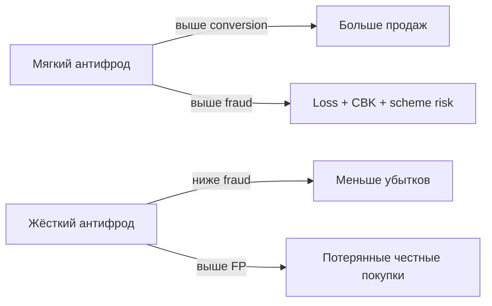

# Глава 16. Payment fraud: обнаружение и предотвращение

Аня купила в «Кофейне» набор кофе за **42,50 EUR**. Зелёная галочка. Через три дня ей приходит пуш от «Банка Север»: «Подозрительная операция — это вы?». Аня смотрит на выписку, узнаёт покупку, жмёт «Да, это я». История заканчивается ничем.

Теперь другая Аня. Точнее — не Аня. Мошенник купил на кард-шопе — теневом рынке украденных карточных данных — набор реквизитов с PAN (номером карты), expiry (сроком действия) и CVV (проверочным кодом) карты настоящей Ани. В три часа ночи он пытается купить в «Кофейне» тот же набор — и ещё сорок раз на других сайтах по 1 EUR, проверяя, жива ли карта. Где-то пройдёт. Где-то упрётся в 3-D Secure. Где-то «Платёжка» молча отклонит запрос ещё до эквайера. А где-то товар уедет, Аня оспорит покупку через банк, и тот запустит chargeback (возвратный платёж по правилам карточной сети; процесс — в [главе 17](17-chargebacks-and-disputes.md)), и «Кофейня» останется без кофе и без денег.

Эта глава — про то, как индустрия отличает первую историю от второй, пока спиннер ещё крутится. Антифрод — не «моделька в облаке», а конвейер решений: правила, скоринг (оценка риска попытки), отпечаток устройства, география, поведение, иногда машинное обучение, иногда живой аналитик в три часа ночи. Рядом всегда сидит неприятный компромисс: слишком мягко — теряете деньги и попадаете под программы схем — усиленный контроль продавцов с высоким уровнем мошенничества или споров ([глава 17](17-chargebacks-and-disputes.md)); слишком жёстко — режете конверсию честной Ане и сами себе устраиваете «дружественный» отток.

Мы уже видели, как 3DS и SCA аутентифицируют держателя ([Глава 08](08-3ds-and-sca.md)), как выглядят fraud decline в таксономии отказов ([Глава 09](09-declines-and-response-codes.md)) и где в жизненном цикле живёт авторизация ([Глава 06](06-payment-lifecycle.md)). Здесь разберём риск как отдельную дисциплину: виды атак, prevention vs detection, устройство движка и организацию команды, которая этим живёт.

**В этой главе**

- Виды payment fraud: stolen cards, ATO, card testing, carding, friendly fraud и chargeback fraud
- Prevention и detection — разные задачи, разные тайминги, разные метрики
- Скоринг, rules engine, velocity, device fingerprint, IP/geo, поведение и ML
- False positives и компромисс fraud vs conversion
- Как устроена fraud-команда и куда встраивать антифрод в платёжный поток
- Сквозные примеры: честная Аня, атака на «Кофейню», ложная блокировка

---

## Сколько стоит «пропустить» и сколько — «отрезать»

Прежде чем нырять в типы атак, зафиксируем экономику. Антифрод существует не потому, что «так правильно», а потому что убыток от мошенничества складывается из нескольких слоёв:

1. **Прямой loss** — товар/услуга ушли, деньги вернулись держателю через chargeback или refund.
2. **Комиссии и операционка** — chargeback fee у эквайера/PSP (для примера порядка единиц–десятков евро за кейс), время поддержки, representment — ответ эквайера на chargeback с доказательствами в пользу продавца ([глава 17](17-chargebacks-and-disputes.md)).
3. **Репутация у схем** — высокий fraud rate и chargeback ratio включают monitoring programs; дальше — резервы, лимиты, штрафы, в крайнем случае ограничение категорий бизнеса (MCC) или отключение идентификатора продавца у эквайера (MID) ([Глава 17](17-chargebacks-and-disputes.md)).
4. **Скрытая цена жёсткости** — false positive: честная Аня не купила, ушла к конкуренту, оставила плохой отзыв про «сайт не принимает карты».

Для инженера это значит: оптимизировать «fraud rate → 0» бессмысленно. Оптимизируют **ожидаемый убыток + штрафы + потерянную маржу от ложных отказов**. На чеке 42,50 EUR и на чеке 2 500 EUR пороги и политики разные — и правильно, что разные.

---

## Карта видов мошенничества

Payment fraud — зонтик. Под ним живут очень разные твари. Лечить их одним правилом «блокнуть VPN» нельзя: у каждой — свой сигнал, свой момент в жизненном цикле и свой владелец убытка.



Диаграмма читается так: левый кластер бьёт по авторизации (пока спиннер крутится), правый — по деньгам уже после успешного платежа. Одна и та же «Кофейня» должна уметь оба контура, но инструменты разные.

### Stolen / compromised cards — карта украдена или утекла

Классика CNP (Card Not Present, оплата без физического присутствия карты — см. [Главу 05](05-card-contexts-and-tokens.md)): у злоумышленника есть PAN, срок и часто CVV. Источники — фишинг, скимеры, утечки магазинов, malware на кассе, покупка дампа на теневом рынке. Карта настоящая, держатель настоящий, но **намерение** — чужое.

Что видит система: новый device, странный IP, нетипичная страна, скорость «только что купил в Варшаве — через минуту в Сингапуре», отсутствие истории у мерчанта, отказ пройти 3DS или наоборот — попытки обойти challenge.

Что помогает: 3DS/SCA ([Глава 08](08-3ds-and-sca.md)), device fingerprint (отпечаток устройства) и velocity (частота попыток за заданное время) по PAN/BIN; оба сигнала подробно разберём ниже. Дополняют их сопоставление billing/shipping — платёжного адреса и адреса доставки, — проверка адреса AVS (Address Verification Service; [глава 09](09-declines-and-response-codes.md)) и почтового индекса там, где они применяются, а также network tokens вместо «голого» PAN.

Что не помогает в одиночку: «у нас же PCI» — соответствие PCI DSS, стандарту защиты карточных данных, снижает риск *утечки у вас*, но не отменяет то, что карта уже утекла *где-то ещё* ([Глава 19](19-payment-security-pci.md)).

### Account takeover (ATO) — захватили аккаунт, не обязательно карту

ATO (account takeover) — мошенник вошёл в аккаунт Ани в «Кофейне» (или в кошелёк, или в banking app) и платит сохранёнными credentials / card-on-file. Карточные данные могут быть токенизированы и «чисты»; 3DS на MIT (merchant-initiated) иногда не требуется; AVS совпадает, потому что адрес в профиле уже «правильный».

Сигналы смещаются с карты на **сессию**: новый device для старого login, смена email/телефона перед покупкой, сброс пароля → сразу крупный заказ, нетипичный shipping, массовый logout других сессий.

Для инженера важно развести сущности: `customer_id` магазина, `cardholder`, платёжный метод и сессия логина — разные объекты. Склейка «один user = одна карта навсегда» ломает и antifraud, и разбор диспутов ([Глава 02](02-ecosystem-participants.md)).

### Card testing — проверка, жива ли карта

Card testing (иногда говорят «card check», «auth testing») — поток мелких авторизаций или покупок, цель которых не товар, а ответ эмитента: «карта валидна / CVV верный / хватает лимита». Типичные суммы — 0,50–2 EUR, иногда auth на 1 minor unit с последующим void, иногда «цифровой» товар с мгновенной доставкой.

Как это выглядит у «Кофейни» в логах:

- одна и та же сессия / device / IP гоняет десятки разных PAN;
- или один PAN стучится в десятки мерчантов за минуты (это уже видно эмитенту и схемам лучше, чем одному магазину);
- всплеск soft/hard declines с кодами вроде invalid, lost/stolen, do not honor — и редкие `00` посередине.

Цена для мерчанта: даже «копеечные» auth жрут лимиты, портят fraud metrics, могут сжечь MID. Эмитенты и схемы ненавидят testing: это разведка перед крупным carding.

### Carding — масштабирование украденных карт

Carding — использование пачки скомпрометированных карт для реальных покупок (электроника, подарочные карты, вещи с перепродажей). Часто testing идёт *перед* carding: сначала отфильтровали «живые», потом бьют по магазинам с быстрой доставкой и высоким ликвидным товаром.

«Кофейня» с зерновым кофе — не идеальная цель (скоропорт, низкая ликвидность на перепродаже), но и её могут использовать как **площадку для testing**, если checkout слабый. Мошеннику кофе не нужен: нужен ответ `approved`.

Признаки: всплеск новых покупателей без истории, аномальные BIN-кластеры, совпадение device fingerprint при разных именах/картах, покупки «на грани» лимитов velocity, отказ от 3DS там, где его можно обойти маршрутом.

### Friendly fraud — «я не помню» / «мне так удобнее»

Friendly fraud (дружественный фрод, иногда «first-party misuse») — платёж совершил настоящий держатель или кто-то из семьи, а потом в банк ушло «это не я» или «услугу не получил», хотя по факту получил. Мотивы: забыть про подписку, пожадничать, супружеский спор про покупку, «банк всегда на моей стороне».

Это особенно больно, потому что **технические сигналы часто чистые**: тот же device, тот же IP домашний, 3DS пройден, даже liability shift на эмитента мог сработать — а операционные издержки и часть споров всё равно остаются у мерчанта в зависимости от reason code и доказательств ([Глава 17](17-chargebacks-and-disputes.md)).

Оружие мерчанта здесь не столько «блокнуть в момент auth», сколько **доказательства (evidence) и клиентский опыт (customer experience, CX)**: понятный statement descriptor — текст покупки в банковской выписке («COFFEEHOUSE.EU»), чеки, трекинг доставки, логи доступа к цифровому контенту, политика refund до chargeback.

### Chargeback fraud и злоупотребление диспутами

Рядом с friendly fraud стоит более жёсткий край: человек *осознанно* использует chargeback как инструмент кражи (получил товар → оспорил как fraud). Иногда это делают организованно. Иногда путают с «chargeback fraud» в широком смысле любой fraud-related chargeback — в книге мы разделяем:

- **fraud chargeback** — диспут с reason про неавторизованную операцию (украли карту / ATO);
- **chargeback fraud / abuse** — злоупотребление механизмом диспута со стороны «покупателя».

Подробный lifecycle диспута — в [Главе 17](17-chargebacks-and-disputes.md). Здесь важно: антифрод *до* авторизации не закрывает этот класс полностью. Нужны процессы после авторизации (post-auth), ранние предупреждения (alerts) о претензии держателя от Ethoca/Verifi-подобных сервисов и RDR-подобные программы автоматического урегулирования споров. Как они работают, разберём в [главе 17](17-chargebacks-and-disputes.md); здесь важно заранее собирать evidence.

### Врезка: как это бывает в жизни — «семейный» CVV

Сын Ани заказал подписку на игру картой мамы, которую сфотографировал «на всякий случай». Аня через месяц видит списание, жмёт в приложении банка «это не я». Для эмитента — fraud claim. Для «Кофейни» (если это был другой мерчант) — chargeback. Для антифрода в момент покупки всё выглядело идеально: домашний Wi‑Fi, знакомый device fingerprint семьи, правильный billing address. Мораль: не все «чистые» платежи честные в смысле коммерческого риска, и не все «грязные» — мошеннические в смысле уголовного права. Команда риска работает с *вероятностями и убытками*, не с приговорами суда.

---

## Prevention vs detection: два разных мира

В разговорах «antifraud» часто смешивают две функции.

**Fraud prevention** — не дать мошеннической транзакции завершиться (или сильно её затруднить) *в реальном времени*: блокировка правилом (rule block), дополнительная проверка через 3DS (step-up), ручной разбор (review) до отгрузки, отказ в payout продавцу-мошеннику.

**Fraud detection** — узнать, что плохое уже произошло или происходит: аномалия в суточном отчёте, кластер chargeback, паттерн testing за последний час, модель, которая помечает аккаунт *после* серии успехов.

Prevention без detection слепнет: вы не узнаете, какие правила устарели. Detection без prevention превращается в красивый дашборд, пока товар уезжает. Зрелая система делает цикл:



Поток словами: на входе — событие платежа; движок считает признаки и принимает решение; исходы (в том числе запоздалые chargeback) возвращаются как разметка и кормят следующий виток правил.

Ещё одно важное различие по **моменту**. Auth — авторизация, fulfill / fulfillment — исполнение заказа (например, отгрузка кофе). Pre- означает «до», post- — «после»; portfolio здесь — весь набор продавцов PSP:

| Момент | Примеры действий | Цена ошибки |
|---|---|---|
| Pre-auth | block, force 3DS, CAPTCHA, deny BIN | false positive режет конверсию сразу |
| Post-auth / pre-fulfill | hold отгрузки, manual review | ложный hold бесит клиента, но деньги ещё «ваши» под контролем |
| Post-fulfill | chargeback fight, refund, blacklist | уже потерян товар |
| Portfolio | лимиты мерчанта, rolling reserve, offboarding | бьёт по бизнесу продавца целиком |

PSP «Платёжка» обычно сильна в pre-auth и portfolio (она видит много мерчантов). «Кофейня» сильна в post-auth signals (знает, уехал ли кофе, открывал ли клиент личный кабинет). Лучшие результаты — когда сигналы стыкуют, а не дублируют вслепую.

---

## Где в платёжном потоке живёт антифрод

Вернёмся к платежу Ани `pay_8f3a2c91` на 42,50 EUR ([Глава 06](06-payment-lifecycle.md)). Упрощённая врезка риска:



На схеме видно три исхода движка ещё до того, как «Банк Север» стал главным героем. Плюс параллельно эмитент крутит *свой* fraud score — вы его не контролируете, только наблюдаете через decline codes и 3DS decisions.

Практические точки интеграции для инженера:

1. **Сбор признаков на клиенте** — до или вместе с create payment (fingerprint, IP, user agent, timing заполнения формы).
2. **Синхронный evaluate** — уложиться в бюджет латентности (для примера десятки–пара сотен мс на rules; ML может быть тяжелее — тогда кэш/асинхронный pre-score сессии).
3. **Решение как first-class status** — `fraud_rejected` отдельно от issuer decline ([Глава 09](09-declines-and-response-codes.md)).
4. **Асинхронный review** — состояние `in_review` в state machine ([Глава 07](07-states-async-idempotency.md)): деньги авторизованы или даже captured, отгрузка ждёт.
5. **Обратная связь** — webhook/event `chargeback.created`, `refund.created`, ручная метка «confirmed fraud» должны доезжать до feature store — хранилища признаков для скоринга — и аналитики правил.

---

## Скоринг: число, за которым прячется политика

**Fraud score** — обычно число (например, 0–100) или калиброванная вероятность «эта попытка мошенническая». Само по себе число бесполезно: нужна **политика**, которая переводит score в действие.

Иллюстративный пример политики «Платёжки» для MCC вроде «Кофейни» (цифры вымышленные, для порядка величин):

| Score | Действие | Зачем |
|---|---|---|
| 0–30 | allow (в SCA-зоне всё равно может быть 3DS/exemption-поток) | не душить конверсию |
| 31–60 | allow + усиленный мониторинг / или force 3DS вне SCA | дешёвый step-up |
| 61–85 | manual review или hold fulfillment | дорогие/рисковые заказы |
| 86–100 | block | ожидаемый убыток выше цены false positive |

Скоринг собирается из признаков (features). Признаки бывают:

- **транзакционные** — сумма, валюта, MCC, cross-border, время суток;
- **платёжного инструмента** — BIN/issuer country, prepaid vs debit, age of card-on-file, совпадение billing;
- **идентичности** — email age, совпадение имени, история chargeback у customer;
- **устройственные и сетевые** — fingerprint, IP risk, proxy/VPN/Tor, geo-distance;
- **поведенческие** — скорость кликов, копипаст PAN, время на checkout;
- **графы связей** — сколько аккаунтов делят один device / один shipping.

Хороший score объясним хотя бы на уровне top contributing features. Иначе аналитик в три часа ночи не поймёт, почему отрезали оптовика, а модель «просто так сказала».

### Как собирают и калибруют score

На практике score редко бывает «сырой выход одной модели». Чаще это пайплайн:

1. **Нормализация признаков** — сумма в minor units, флаги cross-border, хеши идентификаторов, возраст аккаунта в часах.
2. **Правила-модификаторы** — жёсткие hit'ы добавляют баллы или сразу ставят decision override (`block` / `force_3ds`), не дожидаясь «красивой» вероятности.
3. **Модельный компонент** — вероятность fraud (условно `p_hat`), которую иногда переводят в 0–100 для UI риск-команды.
4. **Сегментная калибровка** — один и тот же `p_hat = 0,12` для gift cards и для доставки кофе означает разный ожидаемый убыток; пороги политики поэтому сегментируют.
5. **Решение** — функция от score, суммы, типа товара, истории мерчанта и регуляторных ограничений (например, «в EEA CIT всё равно идёт через SCA-оркестрацию»).

Важный инженерный нюанс: **score должен быть воспроизводим для аудита**. Если через две недели dispute specialist спросит «почему мы пропустили этот платёж?», вы обязаны достать features snapshot, version правил/модели и decision. Пересчитать «как сейчас» нельзя — модель уже другая, velocity-окна остыли.

Ещё одна тонкость — **зависимость признаков**. IP-country и BIN-country коррелируют; device fingerprint и user-agent тоже. Наивная сумма «штрафов» без учёта корреляций раздувает score честным путешественникам. Поэтому либо модель сама учит взаимодействия, либо правила пишут аккуратно («три независимых красных флага», а не «каждый чих +15 баллов»).

### Дополнительные сигналы рядом со score: AVS, CVV, name match

В части регионов эквайер/эмитент возвращает результаты проверок адреса (AVS) и CVV. Это не antifraud-движок мерчанта, но полезные входы:

- CVV mismatch при CNP — сильный сигнал «данные неполные/неверные», но бывает и опечатка Ани;
- AVS partial match — распространённая серая зона (квартира, другая запись улицы);
- name match на карте vs checkout — где доступно, помогает против stolen card с подставным payer name.

Нельзя строить политику «AVS fail = всегда block»: в международной доставке и в части европейских потоков AVS либо слабый, либо отсутствует. Используйте как feature, не как религию.

### Сквозной пример: три платежа по 42,50 EUR

Одна и та же сумма — три разных мира.

**Платёж A — честная Аня**

- Device fingerprint видели 12 раз за год на `customer_anya`.
- IP — домашний провайдер в стране эмитента.
- Карта — token / card-on-file после прошлого CIT с 3DS.
- Score: 12. Решение: allow (в EEA — оркестрация SCA/exemption по правилам [Главы 08](08-3ds-and-sca.md)).

**Платёж B — testing**

- Новый `guest` checkout.
- За 4 минуты с одного fingerprint: 19 попыток, 19 разных PAN одного BIN-диапазона, суммы 1,00 EUR.
- Velocity rule срабатывает раньше ML. Score даже не нужен: hard block + mark IP/device.
- Решение: `fraud_rejected`, reason внутри `fraud.velocity_pan_device_1h` (наружу не светим).

**Платёж C — stolen card, «красивый» заказ**

- Сумма 42,50 EUR, один PAN, один attempt.
- Device новый, IP — дата-центр/VPN, billing country ≠ IP country, email одноразовый.
- Score: 78. Решение: step-up 3DS. Мошенник не проходит challenge — decline на аутентификации, «Кофейня» не отгружает, Аня не получает сюрприз в выписке (или получает попытку — зависит от того, на каком шаге оборвали).

Именно поэтому «у нас средний чек маленький, нам fraud не страшен» — опасная мантра: testing и репутация MID не спрашивают про ваш средний чек.

Псевдокод решения (иллюстративно):

```python
def decide(payment, features, rules, model):
    forced_3ds = False

    # 1) hard rules first
    for rule in rules.by_priority():
        hit = rule.evaluate(payment, features)
        if not hit:
            continue
        if rule.action == "block":
            return Decision("block", score=100, reasons=[hit])
        if rule.action == "force_3ds":
            forced_3ds = True

    # 2) model score
    score = model.predict(features)  # 0..100
    score = apply_segment_calibration(score, payment.segment)

    # 3) policy
    if score >= policy.block_threshold(payment.segment):
        return Decision("block", score, reasons=model.top_reasons)
    if forced_3ds or score >= policy.stepup_threshold(payment.segment):
        return Decision("step_up_3ds", score, reasons=model.top_reasons)
    if score >= policy.review_threshold(payment.segment) and payment.amount >= REVIEW_MIN:
        return Decision("review", score, reasons=model.top_reasons)
    return Decision("allow", score, reasons=[])
```

На реальной системе между строками спрячутся кэши, таймауты, circuit breaker на model service и запись features snapshot. Но порядок «hard rules → score → policy» — хорошая ментальная модель, которую стоит сохранить даже в микросервисной каше.

---

## Rules engine: если X и Y — то Z

**Rules engine** — набор явных правил вида «если условие — то действие». Это фундамент. Даже при мощном ML правила остаются: регуляторные стоп-листы, санкции (связь с мониторингом в [Главе 18](18-regulation-and-compliance.md)), «никогда не пускать BIN страны X на physical goods в Y без 3DS», экстренные kill-switch при атаке.

Типичная анатомия правила:

```text
name: velocity_guest_pan_burst
priority: 100
when:
  merchant_mcc in [5499, 5812]
  customer_age_hours < 1
  distinct_pan_count_1h_by_device >= 5
then:
  action: block
  tag: card_testing
  notify: fraud-oncall
```

Что обязательно продумать в инженерии:

1. **Порядок и приоритет** — block важнее allow-исключения; иначе «белый список VIP» случайно пропустит testing на том же device.
2. **Идемпотентность оценки** — результат повторного evaluate одного и того же payment intent не должен прыгать от гонок счётчиков velocity. Payment intent — логическое намерение принять оплату, которое может пережить несколько попыток ([глава 20](20-platform-architecture.md)).
3. **Shadow mode** — новое правило сначала только логирует «сработало бы», не блокирует.
4. **Change management** — кто утвердил правило, когда, на каком сегменте, какой ожидаемый false positive.
5. **Explainability наружу vs внутрь** — клиенту «не удалось подтвердить платеж»; в саппорт-тулзе — rule id; мошеннику — ничего полезного.

Rules отлично ловят **известные** паттерны и катастрофически отстают от новых. Поэтому рядом живут аномалии и ML — но «выключим все правила, оставим нейронку» обычно заканчивается весёлым инцидентом на праздничной распродаже.

### Типы правил, которые встречаются у зрелого PSP

Разложим зоопарк, чтобы в бэклоге не писали просто «добавить fraud rule»:

| Тип | Пример | Риск ложного срабатывания |
|---|---|---|
| Hard deny | Санкционный стоп-лист, блокированный токен карты | Низкий (если списки качественные) |
| Velocity | N PAN на device за 10 минут | Средний на shared device/NAT |
| Heuristic combo | hosting IP + disposable email + guest + physical goods | Средний |
| Allow / trusted | Известный corporate buyer «Кофейни», allowlist device | Высокий, если allowlist утечёт мошеннику |
| Step-up | score mid → force 3DS | Низкий по loss, средний по conversion |
| Routing | высокий риск → эквайер с лучшим fraud tooling / обязательный 3DS | Операционный |

Отдельно живут **merchant-level rules**: «новый продавец не принимает prepaid», «суточный объём > 3× медианы → hold payout». Это уже портфельный риск PSP, не карточка Ани — но для инженера платформы тот же rules engine, другие ключи и другие alerting-каналы.

### Врезка: как это бывает в жизни — правило, которое «спасло» и убило промо

Маркетинг «Кофейни» запустил кампанию в другой стране: скидка на первый заказ, оплата картой. Risk за неделю до этого включил правило `BIN_country != shipping_country → block` после всплеска fraud. Кампания приехала ровно в это правило. Конверсия в сегменте рухнула, маркетинг орёт, risk орёт в ответ про прошлый chargeback. Постмортем простой и поучительный: правило было без сегмента «promo traffic», без shadow period на новых geo, без продукта в approvers. Технически всё работало. Бизнес-процесс — нет.

---

## Velocity: скорость как сигнал

**Velocity** — ограничители вида «не больше N событий за период T в разрезе ключа K». Ключи: PAN (точнее — hash/token), BIN, device id, IP, email, customer id, shipping address, MID, связка device+BIN.

Примеры (иллюстративно):

| Ключ | Порог | Зачем |
|---|---|---|
| device → distinct PAN / 10 мин | ≥ 5 | card testing |
| PAN → attempts / 1 час across merchants | высокий | видно PSP/схеме лучше, чем одному магазину |
| IP → approvals / 5 мин | всплеск | ботнет / proxy exit |
| customer → password reset + payout change / 24ч | 1+ | ATO перед выводом |
| MID → auth count / минута | аномалия | атака на конкретного мерчанта |

Velocity кажется простой — и именно поэтому её ломают:

- **Наивный счётчик в Redis без привязки к payment id** — двойной клик Ани превращается в «подозрительную скорость».
- **Счётчик по сырому PAN** — нарушает минимизацию PCI-данных; считают по токену/hash с правильным режимом доступа.
- **Глобальные пороги на всех MCC** — то, что нормально для билетного агрегатора, убийственно для нишевого кофе.
- **Игнорирование timezone и кампаний** — «чёрная пятница» выглядит как атака, если нет сезонных профилей.

Связь с ретраями: агрессивный client-side retry после soft decline сам разгоняет velocity и провоцирует fraud/issuer blocks ([Глава 07](07-states-async-idempotency.md), [Глава 09](09-declines-and-response-codes.md)). Антифрод и платёжный клиент должны жить по одним правилам повторов.

---

## Device fingerprinting: «этот браузер мы уже видели»

**Device fingerprinting** — попытка узнать устройство без (или в дополнение к) логина: комбинация атрибутов браузера/приложения, холста, шрифтов, timezone, screen, иногда аппаратных сигналов в SDK. Результат — идентификатор вроде `fp_9c2e…`, который с некоторой вероятностью стабилен между визитами.

Зачем: связать попытки, где мошенник меняет email и PAN, но не меняет прокси-ферму и ноутбук. Для ATO — увидеть новый fingerprint на старом аккаунте.

Ограничения, о которых честно говорят вслух:

- антидетект-браузеры и spoofing существуют;
- ITP (Intelligent Tracking Prevention, защита браузера от отслеживания) и privacy-режимы, запрет трекеров, WebView ломают стабильность;
- юридически это персональные/технические данные: нужны основания, политика и caution по GDPR ([Глава 18](18-regulation-and-compliance.md)) — без юридических гарантий, но с напоминанием: retention и purpose limitation обязательны к проработке с юристом и DPO (Data Protection Officer, ответственным за защиту персональных данных);
- fingerprint — сигнал, не паспорт. Коллега Ани с того же офисного NAT не обязан быть мошенником.

Инженерный минимум: передавать fingerprint *вместе* с payment attempt id, хранить историю связей device↔customer↔outcome, не строить единственное block-правило «новый device = fraud» (иначе убьёте всех с новым телефоном после апгрейда).

---

## IP и geo: где «находится» платёж

IP-адрес и геоданные — старый, но живой слой.

Что извлекают:

- страна/город (грубо);
- тип: residential / mobile / corporate / hosting / anonymous proxy;
- репутация (известные exit-ноды, ботнет-пулы — обычно из vendor feeds);
- расстояние и несостыковки: IP-country vs BIN-country vs shipping-country vs billing-country.

Типичные эвристики:

- hosting IP + physical goods + новый customer → высокий риск;
- BIN страны A, IP страны B, shipping страны C → смотреть внимательнее (но у путешественников и expats такое бывает);
- резкая смена geo у card-on-file без travel-паттерна в истории.

Ловушки:

- мобильные операторы и CGNAT дают «странный» geo;
- корпоративный VPN сотрудника «Кофейни», который тестирует прод своей картой, выглядит как дата-центр;
- блокировка целых стран без бизнес-решения («мы туда не доставляем») — ок; блокировка «потому что в среднем fraud выше» без сегментации — часто режет маркетинг-кампании.

Geo хорошо работает в **комбинации**. В одиночку — источник ложных срабатываний и политических скандалов («почему вы не принимаете карты из страны X»).

### Impossible travel и таймлайн сессии

Отдельный класс geo-сигналов — **impossible travel**: сессия «Ани» только что была с IP в Лиссабоне, через пять минут — «она же» с IP в Токио. Для карточных платежей это чаще про ATO или шаринг credentials, чем про сверхзвуковой самолёт.

Считать надо аккуратно:

- мобильные сети и VPN дают скачки без физического перемещения;
- корпоративные прокси «телепортируют» сотрудников;
- clock skew и кэш старого IP на CDN портят картину, если вы смотрите не тот hop.

Практичный подход: impossible travel повышает score и/или форсирует step-up, но редко является единственным hard-block на чеке 42,50 EUR у returning customer с длинной историей без chargeback.

---

## Behavioral analysis: как человек (или бот) заполняет форму

Поведенческий анализ смотрит не *что* ввели, а *как*:

- время между фокусом полей;
- вставка PAN целиком из буфера vs посимвольный ввод;
- движение мыши / отсутствие его;
- количество фокус-блуров на CVV;
- использование автоматизации (headless signals);
- патологический «идеальный» бот-тайминг.

Это полезно против carding-скриптов и плохо работает как единственный судья: Аня может вставить номер карты из менеджера паролей — и это *хорошо* для её безопасности, плохо для наивного правила «paste = fraud».

Современный подход: behavior features идут в score, а не в hard-block; hard-block оставляют на явные bot signals + velocity.

---

## Machine learning: когда правил больше не хватает

Машинное обучение (machine learning, ML) в платежном антифроде обычно решает одну из задач:

1. **Скоринг транзакции** (supervised): по истории размеченных fraud/legit предсказать риск.
2. **Аномалии** (unsupervised / semi): «этот мерчант сегодня не похож на себя».
3. **Графовые модели**: найти связные компоненты устройств, адресов, карт.
4. **Ранжирование очереди review**: что аналитику смотреть первым.

Что нужно, чтобы ML не был театром:

- **Разметка с задержкой.** Chargeback fraud-лейбл может прийти через недели. Обучение «на вчерашних approve» без учёта late labels врёт.
- **Concept drift — изменение закономерностей в данных.** Мошенники меняют паттерны. Модель без мониторинга качества и регулярного переобучения гниёт.
- **Class imbalance — дисбаланс классов в обучающей выборке.** Fraud — единицы процентов или доли процента. Accuracy 99% может быть бесполезной.
- **Стоимость ошибок асимметрична.** False negative на 2 000 EUR ≠ false positive на 42,50 EUR; loss-sensitive пороги важнее красивого AUC на слайде. AUC — площадь под ROC-кривой: она показывает, насколько хорошо модель различает классы при разных порогах; ROC сопоставляет доли найденного мошенничества и ложных тревог.
- **Explainability (объяснимость решения) и challenger models (альтернативные модели для сравнения с текущей).** В регулируемых контекстах и просто в ops нужны причины и возможность откатить релиз модели.
- **Не утечь данными.** Признаки не должны тащить сырой PAN; осторожнее с прямыми идентификаторами.

ML хорошо дополняет rules, плохо их заменяет в день DDoS-card-testing: когда атака уже идёт, on-call включает жёсткое velocity-правило за две минуты, а не ждёт feature sprint.

### Для любопытных: online features vs batch

Онлайновые признаки (velocity за 10 минут, риск IP прямо сейчас) считают в low-latency store. Офлайновые (среднее chargeback rate BIN за 90 дней, граф связей) — обновляют батчами. Архитектурная грабля: забыть, что batch-фича устарела на сутки, и удивиться, почему модель «не видит» свежий кластер.

---

## False positives: когда антифрод кусает Аню

**False positive (ложная тревога)** — система считает платёж мошенническим, а он легитимный. Для продукта это тот же decline, что и fraud block, только с другим вкусом боли: вы потеряли выручку и лояльность, мошенник ни при чём.

Почему false positives неизбежны: вы режете по вероятности в условиях неполной информации за сотни миллисекунд. Вопрос не «как обнулить», а «какой уровень терпим для маржи и бренда».

Сквозной пример ложной блокировки (тема, к которой книга вернётся в сценариях — [Глава 29](29-scenarios-part-1.md)):

1. Аня в роуминге в другой стране покупает кофе «Кофейни» на 42,50 EUR.
2. Новый hotel Wi‑Fi, IP hosting-подобного мобильного гейта, device тот же, но fingerprint слегка «поплыл» после обновления браузера.
3. Правила: `geo_mismatch` + `new_ip_type` → score 82 → block.
4. Аня пробует ещё раз — velocity по customer растёт → block ещё увереннее.
5. Аня уходит на маркетплейс. Через неделю fraud-аналитик видит в разметке: chargeback не было, support ticket «не могу оплатить», заказ брошен.

Как лечить системно:

- step-up (3DS) вместо block на «среднем» риске;
- белые сигналы: известный device + успешная история + низкая сумма → понижение score;
- быстрый self-service unblock осторожно (иначе мошенник этим же API воспользуется);
- отдельные пороги для travel-сегментов и для digital vs physical;
- метрика **false positive rate** рядом с fraud rate, а не вместо неё.

И наоборот, **false negative** — пропустили fraud. Его цена часто видима позже: chargeback, lost goods, scheme monitoring. Команды, которые смотрят только на conversion, копят отложенный долг.

---

## Trade-off: fraud vs conversion

Это центральный продуктный конфликт главы.



Нет универсальной точки на кривой. Её двигают:

- маржа товара (кофе vs электроника);
- возможность холдить fulfillment;
- доля цифровых мгновенных товаров (отменить нельзя);
- регион (SCA уже добавляет friction «за вас»);
- аппетит эквайера/PSP к риску портфеля;
- текущий chargeback ratio относительно порогов схем.

Практическая рамка для «Кофейни» и «Платёжки»:

1. Зафиксировать **целевой fraud loss** (например, иллюстративно: держать loss+fees ниже X% GMV (gross merchandise value, общего объёма продаж до вычетов)) и **целевой FP** (доля легитимных попыток, отрезанных fraud-движком).
2. Крутить политики **по сегментам**, не глобально: новые vs returning, domestic vs cross-border, card-on-file vs guest.
3. Предпочитать **ступенчатый friction** (3DS, review) бинарному block там, где экономика позволяет.
4. Связать антифрод с ценообразованием риска: высокорисковый мерчант платит больше / сидит на reserve ([Глава 15](15-fees-and-economics.md), [Глава 12](12-flow-of-funds.md)) — это тоже рычаг, не только rule.

Фраза, которую стоит повесить над бордой: «Мы не минимизируем fraud. Мы максимизируем устойчивую прибыль при ограничениях схем и регулятора».

### Простая модель ожидаемого убытка

Инженеру полезно хотя бы грубо формализовать спор продукта и риска. Иллюстративно для одного сегмента ожидаемая стоимость политики:

`ожидаемый_cost ≈ p_fraud × L_fraud + p_FP × маржа_честного_заказа + cost_ops`

где `p_fraud` — вероятность пропустить мошенничество при выбранной политике, `L_fraud` — средний убыток на пропущенный fraud (товар + fees + вклад в давление схем), `p_FP` — вероятность ложной блокировки, связанная с жёсткостью порогов, `cost_ops` — цена очереди review и алертов.

На заказе Ани 42,50 EUR при скромной абсолютной марже, но большом числе заказов, небольшое увеличение false positive «съедает» месячную экономию на fraud. На дорогом цифровом товаре с мгновенной доставкой наоборот — цена false negative доминирует. Формула не для бухгалтерии, а для того, чтобы спор «давайте подожмём» опирался на числа, а не на характер громче всех говорящего на созвоне.

---

## Организация fraud-команды

Технологии без людей и процессов превращаются в свалку правил. Типичные роли (названия варьируются):

| Роль | Что делает |
|---|---|
| Fraud analyst / agent | Смотрит очередь review, подтверждает fraud, собирает паттерны |
| Risk ops / policy | Пишет правила, пороги, playbooks на атаки |
| Data scientist / ML engineer | Модели, разметка, мониторинг drift |
| Payment/risk engineer | Интеграция движка, латентность, фичи, надёжность |
| Dispute specialist | Соседний контур chargeback evidence ([Глава 17](17-chargebacks-and-disputes.md)) |
| Merchant risk | Онбординг, мониторинг продавцов, KYB-сигналы проверки бизнеса продавца (Know Your Business) ([Глава 18](18-regulation-and-compliance.md), [Глава 25](25-merchant-domain.md)) |

У PSP «Платёжка» команда обычно двухуровневая: **transaction risk** (платежи) и **merchant risk** (кто такой продавец). У «Кофейни» часто нет отдельного fraud data science — она опирается на PSP и добавляет свои сигналы (логистика, аккаунт).

### Операционный контур

1. **Triage** — алерты velocity, всплеск decline, жалобы поддержки.
2. **Incident playbook** — «подозрение на card testing»: включить shadow→block правило, ужесточить CAPTCHA/3DS, связаться с эквайером при необходимости.
3. **Case management** — у каждого review есть audit trail: кто решил, на каком основании, какой feedback в модель.
4. **Feedback loop SLA** — chargeback labels должны попадать в систему за понятный срок, иначе обучение врёт.
5. **Этика и эскалации** — ложные обвинения клиентов, дискриминационные прокси-признаки (осторожнее с «страна = риск» без бизнес-основания), взаимодействие с законом через юристов, не через импровизацию в Slack.

### Метрики команды

Кроме классических payment-метрик ([Глава 24](24-monitoring-and-operations.md)):

- fraud rate (по деньгам и по штукам) и fraud loss;
- false positive rate / block rate на легитимном трафике (оценочно через поздние labels и support);
- review precision/recall — доля действительно мошеннических среди помеченных и доля найденных среди всех мошеннических — и время в очереди;
- rule hit rate и «мертвые» правила;
- доля step-up vs block;
- attack MTTD/MTTR — среднее время обнаружения и устранения атаки (как быстро заметили testing и как быстро остановили; метрики — в [главе 24](24-monitoring-and-operations.md)).

---

## Инструменты вокруг: 3DS, списки, вендоры, alerts

Антифрод — экосистема.

- **3DS / SCA** — holder authentication и liability shift для части fraud-chargeback; не замена scoring ([Глава 08](08-3ds-and-sca.md)).
- **Deny/allow lists** — PAN-token, device, email, IP. Короткоживущие списки после атаки полезны; вечные — копят долги (Аня сменила IP динамического провайдера, а вы её бан навсегда).
- **Vendor feeds** — репутация устройств, email, IP; полезны, но добавляют зависимость и задержку.
- **Issuer/scheme alerts** — ранние предупреждения о возможном fraud ещё до chargeback; стыкуются с быстрым refund, чтобы избежать диспута ([Глава 17](17-chargebacks-and-disputes.md)).
- **CAPTCHA / bot management** — на checkout и на «добавить карту».
- **KYC/KYB** — проверка личности клиента / бизнеса продавца ([глава 18](18-regulation-and-compliance.md)), особенно для payout и marketplace: иногда «fraud» — это не украденная карта, а продавец-пустышка ([Глава 26](26-marketplace-and-split-payments.md)).

Не пытайтесь купить «серебряную пулю». Покупайте закрытие дыр в своём threat model.

## Merchant fraud и «отравление» портфеля

До сих пор мы смотрели в основном на покупательский fraud. У PSP есть симметричная головная боль: **merchant fraud** — продавец, который сам является источником убытка.

Примеры (без претензии на уголовную квалификацию — это риск-классы для ops):

- продавец принимает платежи и не поставляет товар — лавина consumer chargeback;
- «friendly» мерчант отмывает трафик через чужой MCC;
- bust-out: легальный онбординг, чистая история, потом резкий всплеск объёма и исчезновение;
- использование украденных карт самим продавцом (merchant-side carding).

Сигналы другие: аномальный рост GMV, доля новых BIN, claim rate, расхождение между website content и MCC, жалобы в поддержку PSP, странные payout-паттерны. Рычаги — лимиты, delayed payout, rolling reserve, offboarding ([Глава 12](12-flow-of-funds.md), [Глава 25](25-merchant-domain.md)). Для инженера «Платёжки» это означает: fraud platform должна уметь скорить не только `payment`, но и `merchant` / `payout`.

Связь с карточным fraud прямая: токсичный продавец привлекает и card testing (слабый checkout), и scheme attention на весь портфель. Один «грязный» MID может ужесточить scrutiny к соседним честным мерчантам на том же эквайере.

---

## Сквозной разбор: ночная атака на «Кофейню»

Таймлайн (иллюстративный).

| Время (UTC) | Событие |
|---|---|
| 02:11 | С IP дата-центра начинаются guest-checkout попытки по 1,00 EUR |
| 02:12 | Velocity `device→PAN` достигает 5; правило в shadow mode пишет alert |
| 02:13 | On-call fraud ops переводит правило в block; включает force 3DS на guest |
| 02:15 | Доля `fraud_rejected` растёт, issuer declines падают — атака отрезана до сети |
| 02:40 | Находят 3 успешных auth до блока; заказы на review, fulfillment hold |
| 03:10 | Два заказа отменены (void/refund), один уже ушёл в доставку — ticket на перехват |
| 09:00 | Постмортем: добавить bot score, снизить порог для digital gift cards (если появятся), завести dashboard «attempts per new device» |
| +18 дней | По одному пропущенному приходит fraud chargeback — лейбл уходит в обучение |

Заметьте цепочку ответственности: rules срезали хвост атаки, ops сократили окно, logistics спасли часть loss, disputes добьют хвост. Инженер, который «просто заинтегрировал fraud API», без алертов и hold fulfillment, отдаёт половину ценности.

JSON решения движка (иллюстративно, не API конкретного вендора):

```json
{
  "payment_id": "pay_8f3a2c91",
  "amount": 4250,
  "currency": "EUR",
  "score": 91,
  "decision": "block",
  "reasons": [
    {"code": "velocity_device_pan", "weight": "high"},
    {"code": "ip_hosting", "weight": "medium"},
    {"code": "email_disposable", "weight": "low"}
  ],
  "customer_message_key": "payment_could_not_be_completed",
  "internal_tags": ["card_testing", "attack_cluster_2026_09_18"]
}
```

В этом примере `amount: 4250` означает 42,50 EUR в минорных единицах, `score: 91` — оценку риска по условной шкале 0–100, а `weight` — качественный вклад сигнала, не сумму денег. `customer_message_key` выбирает нейтральное сообщение покупателю, `internal_tags` связывает решение с атакой. Поля `reasons` остаются внутри. Наружу «Кофейня» получает грубый класс отказа — как учит [Глава 09](09-declines-and-response-codes.md).

---

## Что это значит для инженера

1. **Смоделируйте решение риска как отдельный доменный объект**: input features, score, decision, rule hits, model version, latency. Не прячьте это строкой в логе nginx.

2. **Разведите статусы.** `fraud_rejected`, `authentication_required`, `issuer_declined`, `in_review` — разные миры для UX, ретраев и метрик.

3. **Считайте latency budget.** Антифрод в синхронном пути оплаты конкурирует с 3DS и банком. Таймаут fraud-сервиса должен иметь безопасный fallback (fail-open — продолжить без ответа этого сервиса; fail-closed — остановить операцию) — это *продуктово-рисковое* решение, зафиксируйте его явно. Для high-risk MCC чаще fail-closed; для низкого риска и высокой доступности иногда fail-open с пост-мониторингом.

4. **Доставьте клиентские сигналы.** Без fingerprint/IP/browser data ваш серверный скоринг слеп. Но собирайте осознанно: consent, минимизация, срок хранения.

5. **Свяжите post-payment события.** Chargeback, refund, «клиент подтвердил в support, что это был он» — топливо для качества. Без пайплайна лейблов ML и rules деградируют.

6. **Не светите правила.** UI и API errors не должны обучать атакующего. Корреляция: одинаковое сообщение на fraud block и на часть issuer declines — нормальный trade-off UX vs security.

7. **Сделайте shadow mode и канарейки для правил/моделей.** Выкатка нового block-правила без тени — популярный способ устроить себе «день нулевой конверсии».

8. **Согласуйте ретраи с velocity.** Клиентский SDK, который долбит оплату, — соучастник ложных срабатываний и issuer penalties.

9. **Hold fulfillment там, где товар необратим.** Review после отправки гитары — театр.

10. **Наблюдайте атаку как отдельный класс инцидентов.** Алерт «distinct PAN per device > N» важнее среднего score по суткам.

---

## Типичные ошибки и грабли

- **Один глобальный порог score на всех мерчантов и MCC.** Оптовик и подписка на кофе — разные планеты.

- **Block вместо step-up на среднем риске.** Выбирайте 3DS/challenge там, где можно спасти конверсию и даже получить liability shift.

- **Маскировать fraud block под `insufficient_funds`.** Ломаете аналитику, поддержку и обучение модели; иногда ещё и подсказываете мошеннику, что карта «жива».

- **Обучать модель только на ранних лейблах.** Забыли late chargeback — получили оптимистичный мусор.

- **Вечный blacklist email/IP после одной атаки.** Через месяц колете честных пользователей того же провайдера.

- **Игнорировать merchant fraud.** Весь фокус на cardholder, пока продавец-пустышка принимает payments и выводит payout ([Глава 25](25-merchant-domain.md)).

- **Считать, что 3DS = можно выключить antifraud.** 3DS не закрывает friendly fraud, часть ATO и социальную инженерию с подтверждением push.

- **Правила без owner и без expiry.** «Временный» блок страны на промо-кампанию живёт три года.

- **False positive не измеряется.** Команда рапортует «fraud down 40%», молчит, что sales в том же сегменте упали на 25%.

- **Review очередь без SLA.** `in_review` на 48 часов для свежего кофе — и клиент, и fraud-process мертвы по-разному.

- **Склейка клиентов по карте навсегда.** Семейная карта, корпоративная карта, перевыпуск PAN — разные истории риска.

- **Fail-open по умолчанию без мониторинга.** Упавший fraud-сервис тихо пропускает ночной carding.

---

## Итоги главы

1. Payment fraud — не один злой бот, а спектр: stolen cards, ATO, testing, carding, friendly fraud, abuse диспутов; у каждого свой сигнал и свой момент убытка.

2. Prevention и detection дополняют друг друга: реальное время режет потери, поздние лейблы и аномалии учат систему.

3. Score без политики — декорация; политика без сегментов — мясорубка конверсии.

4. Rules, velocity, device, IP/geo, behavior и ML — слои одной обороны; атаку testing часто тушат скучным счётчиком, а не «нейросетью».

5. False positives — такая же бизнес-метрика, как fraud loss; компромисс fraud vs conversion должен быть явным и сегментированным.

6. 3DS/SCA — мощный слой аутентификации и liability, но не серебряная пуля антифрода.

7. Fraud-команда — это ops, политика, данные и инженерия; без feedback loop от chargeback движок тупеет.

8. Для инженера антифрод — доменный сервис со статусами, латентностью, explainability, shadow-выкладкой и связью с fulfillment.

9. Экономика решает: на 42,50 EUR и на дорогом мгновенном цифровом товаре пороги обязаны отличаться.

10. Дальше логичный шаг — разобрать, что происходит, когда мошенничество (или его имитация) уже дошло до банка в форме диспута: [Глава 17. Chargebacks и disputes](17-chargebacks-and-disputes.md).

---

## Связанные главы

- [Глава 05. Где и как используется карта](05-card-contexts-and-tokens.md) — CNP, card-on-file, токены как поверхность атаки и защиты
- [Глава 06. Жизненный цикл карточного платежа](06-payment-lifecycle.md) — куда врезается pre-auth проверка
- [Глава 07. Состояния, webhooks, idempotency](07-states-async-idempotency.md) — `in_review`, ретраи и гонки
- [Глава 08. 3-D Secure и SCA](08-3ds-and-sca.md) — step-up, TRA, liability shift
- [Глава 09. Отказы и коды ответов](09-declines-and-response-codes.md) — класс `fraud_rejected` и почему его не маскируют
- [Глава 12. Что происходит с деньгами](12-flow-of-funds.md) — holds, reserves, negative balance после fraud
- [Глава 15. Комиссии и экономика](15-fees-and-economics.md) — стоимость fraud, chargeback, unit economics риска
- [Глава 17. Chargebacks и disputes](17-chargebacks-and-disputes.md) — fraud chargeback, evidence, alerts
- [Глава 18. Регуляторика и compliance](18-regulation-and-compliance.md) — AML/мониторинг, KYB, данные и privacy
- [Глава 19. Безопасность и PCI DSS](19-payment-security-pci.md) — защита данных карты ≠ antifraud решений
- [Глава 24. Мониторинг и операции](24-monitoring-and-operations.md) — fraud rate и соседние метрики
- [Глава 25. Merchant-side](25-merchant-domain.md) — риск продавца, лимиты, резервы
- [Глава 29. Сквозные сценарии I](29-scenarios-part-1.md) — fraud-блокировка и ложная блокировка на полном пути
