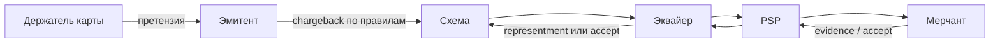
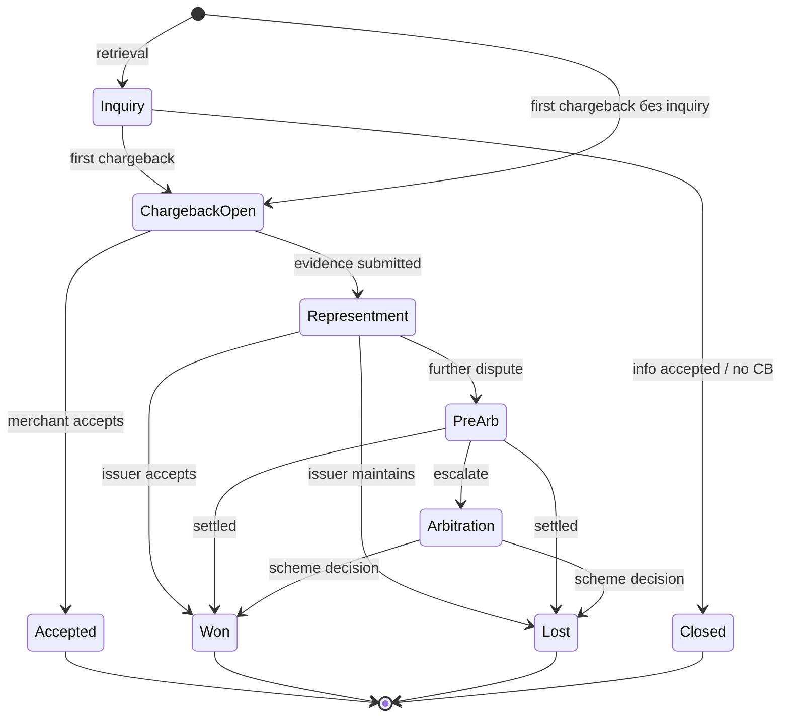
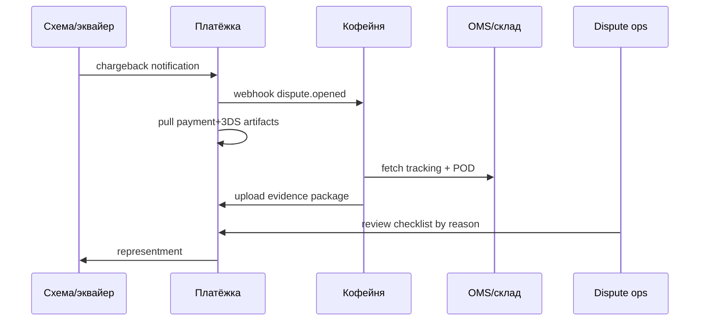
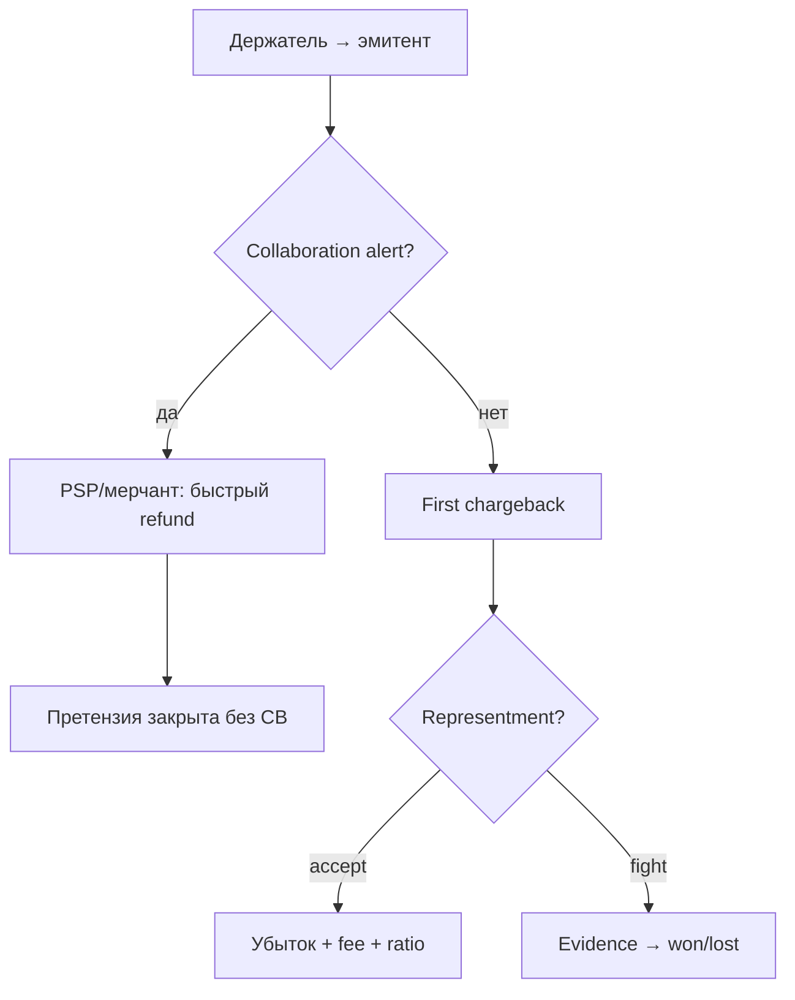

# Глава 17. Chargebacks и disputes

Аня купила в «Кофейне» набор зерна за 42,50 EUR. Заказ дошёл, кофе смолот, отзыв на сайте — пять звёзд. Через три недели в приложении «Банка Север» она видит строку `COFFEE*ORDER 1042` и думает: «Стоп, это же было в сентябре… или это не я?» Звонит в банк. Банк открывает спор. Через несколько дней «Платёжка» шлёт «Кофейне» webhook: `dispute.opened`. Деньги, которые мерчант уже считал выручкой, начинают движение обратно. Плюс комиссия за chargeback. Плюс дедлайн на evidence — доказательства в пользу продавца. Плюс риск, что если таких споров станет много, схема начнёт смотреть на MID «Кофейни» — её идентификатор у эквайера — как на токсичный.

Chargeback (возвратный платёж) — это не «баг API» и не «ещё один refund». Это **принудительный** механизм карточных схем, через который эмитент забирает деньги у эквайера (а тот — у мерчанта) по правилам сети. Dispute (диспут) — более широкий зонтик: претензия держателя карты, inquiry (запрос информации), chargeback, representment (ответ эквайера с доказательствами продавца), арбитраж схемы. Эти стадии разберём ниже по порядку. Для инженера это отдельный жизненный цикл поверх платежа из [Главы 06](06-payment-lifecycle.md): асинхронный, длинный, дорогой и жёстко завязанный на идентификаторы, сроки и доказательства.

В [Главе 16](16-fraud.md) мы смотрим на мошенничество «до» и «во время» платежа. Здесь — на то, что происходит **после**, когда спор уже открыт, и на то, как до него не доводить. В [Главе 08](08-3ds-and-sca.md) liability shift объясняет, *кто* платит за fraud-chargeback при 3DS; здесь — *как* сам процесс спора устроен и чем он бьёт по системе.

**В этой главе**

- Что такое chargeback и чем dispute отличается от refund
- Полный lifecycle: inquiry/retrieval → first chargeback → representment → pre-arbitration → arbitration
- Reason codes: как читать причину и что она диктует
- Evidence и dispute management на стороне мерчанта и PSP
- Fraud chargebacks, friendly fraud и связь с liability shift
- Chargeback ratio и monitoring-программы схем
- Автоматизация: Ethoca/Verifi-подобные алерты, RDR и «закрыть спор до chargeback»
- Сквозной пример: платёж Ани на 42,50 EUR уходит в диспут

---

## Зачем вообще придумали chargeback

Карточная индустрия продаёт не только «удобно платить». Она продаёт **доверие держателя карты**: «если что-то пойдёт не так — банк тебя защитит». Без этого доверия массовый e-commerce в CNP-мире не взлетел бы. Chargeback — цена этого обещания.

Исторически спор возник в мире физического терминала и почтовых заказов: покупатель не узнал списание, товар не пришёл, продавец исчез. Схема и эмитент нужны были как арбитр и как канал возврата денег без суда на каждый случай. Интернет усилил проблему: нет чипа в руке, выше fraud, выше «я не помню эту покупку», выше давление на сроки доставки. Правила схем превратились в толстые тома; у инженера в руках — урезанный, но достаточный каркас.

Кто инициирует. Формально chargeback поднимает **эмитент** (issuer) по обращению держателя карты или по собственному мониторингу. Аня звонит не в «Кофейню» и не в «Платёжку» — она звонит в «Банк Север». Эмитент оценивает претензию, выбирает reason code, запускает процесс через схему. Эквайер («Банк Эквайр») получает уведомление и передаёт его мерчанту (часто через PSP). Деньги двигаются **по правилам схемы**, а не по доброй воле продавца.

Кто платит. Упрощённо: при «проигранном» мерчантом споре сумма операции уходит обратно держателю (через цепочку settlement), плюс **chargeback fee** (иллюстративно — порядка единиц–десятков евро/долларов за кейс, плюс возможные штрафы программ). Товар/услуга при этом уже могли быть оказаны. Отсюда классическая боль e-commerce: **и товара нет, и денег нет**.

Почему это больно инженеру. Chargeback прилетает дни или недели спустя, когда заказ «закрыт», payout ушёл, склад очищен, аналитика уже посчитала GMV. Webhook `dispute.opened` ломает наивную state machine «captured = конец истории». Нужны отдельная сущность Dispute, сроки, пакет evidence, связь с ARN/RRN — идентификаторами клиринговой записи и операции в сети ([глава 06](06-payment-lifecycle.md)), проводки в леджере ([Глава 13](13-ledger-and-reconciliation.md)) и операционный процесс, а не только кнопка «refund».



Читать словами: спор рождается у эмитента, проходит схему и эквайера, доезжает до мерчанта как задача «принять убыток или защититься доказательствами». Обратный путь — ответ мерчанта (через эквайера) в сторону схемы и эмитента.

---

## Refund vs chargeback: две разные вселенные

Пока люди путают refund и chargeback, продукт будет терять деньги дважды: сначала на плохом UX возвратов, потом на принудительных спорах и штрафах.

**Refund** — добровольный возврат мерчанта (или MoR) покупателю через карточный credit / внутренний payout. Инициатор — продавец или его саппорт. Стоимость: обычно комиссия за refund (если есть) и потеря маржи; **нет** chargeback fee схемы за сам факт возврата. Контроль у мерчанта: сумму, срок, partial/full. Подробно жизненный цикл refund — в [Главе 06](06-payment-lifecycle.md).

**Chargeback** — принудительный возврат через схему. Инициатор — эмитент. Стоимость: сумма + fee + операционные часы + риск ratio. Контроль у мерчанта ограничен: либо принять, либо representment с evidence в жёсткие сроки.

| | Refund | Chargeback |
|---|---|---|
| Кто начинает | мерчант / саппорт | держатель → эмитент |
| Канал | API refund / админка | схема (Visa/Mastercard/…) |
| Скорость решения | часы–дни (инициация) | недели–месяцы полного цикла |
| Fee схемы за событие | обычно нет «chargeback fee» | да |
| Влияние на CB ratio | нет (если не путать учёт) | да |
| Нужен ли пакет evidence | нет | часто да |
| Можно ли «отменить кнопкой» | да, пока окно refund живо | нет; только process схемы |

Практическое правило индустрии: **если покупатель уже недоволен и ещё не открыл банк — дешевле и спокойнее сделать refund**. Если chargeback уже открыт, поздний refund иногда помогает закрыть кейс (зависит от стадии и правил), а иногда даёт **двойной возврат**: и refund прошёл, и chargeback списал. Это одна из главных инженерных граблей — ниже разберём защиту.

Есть и «серая зона»: **добровольный refund после алерта** (Ethoca/Verifi-подобные сервисы). Формально это всё ещё refund, но триггер — сигнал «скоро будет chargeback». Цель — не дать спору стать first chargeback и не испортить ratio.

### Врезка: как это бывает в жизни

Саппорт «Кофейни» отказывает Ане в возврате, потому что «зерно уже обжарено под заказ». Аня открывает диспут в банке с reason вроде «товар не получен / не такой». Через две недели магазин проигрывает representment: в evidence нет трек-номера и подписи о получении. Итог: 42,50 EUR назад Ане, fee «Платёжке», испорченный NPS (Net Promoter Score, оценка готовности клиентов рекомендовать магазин), и менеджер риска спрашивает, почему саппорт не предложил partial refund на 15 EUR и купон. Chargeback часто — цена жёсткой политики возвратов, а не только fraud.

---

## Словарь спора: inquiry, chargeback, dispute

Чтобы не путаться в API и в тикетах:

**Dispute** — зонтичный термин продукта/PSP: «по этому платежу открыт спор». Внутри могут быть стадии inquiry, chargeback, pre-arb и т.д.

**Retrieval request / request for information (RFI) / inquiry** — запрос эмитента на документы *до* или рядом с финансовым chargeback. Деньги пока могут не двигаться; мерчанту нужно ответить пакетом данных. Игнор retrieval часто заканчивается chargeback’ом «по умолчанию». Не все схемы и продукты одинаково ярко показывают эту стадию в API — у кого-то inquiry схлопнут в `needs_response`.

**First chargeback** — первое финансовое оспаривание: сумма (или её часть) уходит с мерчанта/эквайера в пользу эмитента/держателя по клирингу спора. Мерчант получает шанс **representment** (second presentment): «вот доказательства, верните деньги нам».

**Representment** — повторное предъявление операции эквайером с evidence. Если эмитент принимает — мерчант «выиграл» раунд. Если нет — возможен pre-arbitration / arbitration.

**Pre-arbitration / arbitration** — эскалация спора до quasi-судебной процедуры схемы. Дорого, долго, редко доходит для чека 42,50 EUR, но для высоких сумм и принципиальных кейсов — реальность. Комиссии арбитража иллюстративно измеряются сотнями долларов/евро за сторону — поэтому PSP и мерчанты часто **принимают** маленький chargeback экономически.

**Chargeback reversal** — откат chargeback’а (например, после успешного representment или ошибки). В леджере это отдельное событие, не «правка старой строки».

Для доменной модели «Платёжки» здорово иметь сущность `Dispute` со стадиями, а не флаг `payment.chargebacked=true`. Платёж остаётся `captured`; спор — связанный объект с собственной state machine.

---

## Lifecycle: от претензии Ани до финала

Возьмём наш сквозной платёж и проведём его через полный каркас. Суммы и даты — иллюстративные; реальные окна зависят от схемы, reason code, региона и продукта эквайера.

Исходные данные (согласованы с [Главой 06](06-payment-lifecycle.md)):

| Поле | Значение |
|---|---|
| Заказ | `ORD-2026-0918-0042` |
| Payment ID | `pay_8f3a2c91` |
| Сумма | 42,50 EUR (`4250`) |
| Auth code | `A1B2C3` |
| RRN | `609182743015` |
| ARN | `74537609261827430158273` (иллюстративно, после clearing) |
| Statement descriptor | `COFFEE*ORDER 1042` |
| Сеть | Visa |
| Эмитент | «Банк Север» |
| Эквайер | «Банк Эквайр» |
| PSP | «Платёжка» |

### Стадия 0. Претензия у эмитента

Аня видит списание, не узнаёт descriptor или спорит по содержанию заказа. «Банк Север» проверяет: была ли 3DS, есть ли fraud-алерт, не делал ли мерчант уже refund. Иногда банк сначала предлагает «разобраться с магазином». Иногда сразу оформляет claim.

Для мерчанта эта стадия **невидима**, пока нет collaboration-алерта. Именно поэтому понятный statement descriptor и быстрый саппорт — первая линия защиты ([Глава 02](02-ecosystem-participants.md) про descriptor, [Глава 25](25-merchant-domain.md) про операционку мерчанта).

### Стадия 1. Retrieval / inquiry (если есть)

Эмитент запрашивает информацию: чек, delivery proof, IP, описание товара. «Платёжка» шлёт `dispute.inquiry` или показывает статус `needs_response`. Дедлайн — обычно считанные дни (порядок величины; точное число — в письме/API).

Что делать инженеру:

- завести тикет/задачу с дедлайном в календаре и SLA;
- собрать пакет из order system + fulfilment + платёжных логов;
- ответить через API/портал эквайера **до** дедлайна;
- залогировать `responded_at` и хэш вложений для аудита.

Не ответили вовремя — почти гарантированный first chargeback.

### Partial chargeback и несколько споров на один платёж

Не всегда оспаривают всю сумму. Аня могла получить часть заказа или согласиться на partial credit. Эмитент поднимает chargeback на 15,00 EUR из 42,50. В модели данных:

- `dispute.amount` ≠ обязательно `payment.captured_amount`;
- `refundable_amount` и «сколько ещё под риском» считаются отдельно;
- после partial CB остаток платежа всё ещё может быть оспорен по другой причине (редко, но бывает) или уйти в refund.

Несколько `dispute_id` на один `payment_id` допустимы во времени (сначала inquiry закрыли, потом CB; или ошибка процесса). UI «один платёж — один красный бейдж» недостаточнен: нужна история кейсов.

### Стадия 2. First chargeback

Деньги (42,50 EUR) уходят с баланса мерчанта у «Платёжки» (или холдятся), плюс fee. Важно понять механику «ухода»: это не HTTP DELETE платежа. По клирингу спора эквайер становится должным эмитенту (упрощённо), PSP отражает это на merchant balance, fee часто списывается отдельной строкой в следующем statement. Webhook вроде:

```json
{
  "event": "dispute.opened",
  "dispute_id": "dp_4c91e2ab",
  "payment_id": "pay_8f3a2c91",
  "amount": 4250,
  "currency": "EUR",
  "reason_code": "13.1",
  "reason_category": "consumer_dispute",
  "status": "needs_response",
  "evidence_due_by": "2026-10-20T23:59:59Z",
  "arn": "74537609261827430158273",
  "network": "visa"
}
```

У Visa `13.1` означает Merchandise/Services Not Received — товар или услуга не получены, поэтому здесь категория `consumer_dispute`, а не `fraud`. Название и смысл кода можно сверить в [публичных правилах Visa](https://cis.visa.com/dam/VCOM/download/about-visa/visa-rules-public.pdf). У Visa/Mastercard разные таблицы и поколения кодов. В продукте храните **сырой код схемы** и свою нормализованную категорию (`fraud`, `authorization`, `processing_error`, `consumer_dispute` / merchandise).

В леджере PSP типично:

- debit merchant balance на сумму dispute;
- отдельная проводка fee;
- статус спора `open` / `funds_withdrawn`.

Пока идёт окно ответа, мерчант выбирает: **accept** (сдать) или **challenge/represent** (защищаться).



Читать словами: спор может начаться с inquiry или сразу с chargeback. Из открытого chargeback — либо принять убыток, либо отправить evidence. Дальше развилка: победа, поражение или эскалация в pre-arb/arbitration.

### Стадия 3. Representment (second presentment)

«Кофейня» загружает evidence. «Банк Эквайр» упаковывает second presentment в схему. Эмитент получает пакет и решает: вернуть деньги мерчанту или удержать chargeback.

Сроки снова жёсткие. Опоздали с evidence — representment не примут, кейс проигран по процессу, даже если правда на вашей стороне.

Инженерные требования к загрузке evidence:

- форматы и лимиты размера (PDF/JPEG, мегабайты);
- идемпотентность upload (не создать два representment);
- связь `dispute_id` ↔ `payment_id` ↔ `order_id`;
- запрет править заказ «задним числом» без аудита — это видно и токсично при разборе.

### Стадия 4. Pre-arbitration и arbitration

Если эмитент не согласен с representment, возможен следующий раунд. На этом этапе участвуют специалисты риска/диспутов, а не только саппорт L1. Для чека 42,50 EUR «Платёжка» часто рекомендует **accept**: стоимость часов и arb fee съест выигрыш. Политика «драться до конца по всем кейсам» — путь к отрицательной unit economics ([Глава 15](15-fees-and-economics.md)).

Arbitration — решение схемы. Оно ближе к финалу между банками-участниками. Мерчант обычно видит итог через PSP: `won` / `lost`.

### Стадия 5. Финал и хвосты

После `won` деньги возвращаются на баланс мерчанта (с лагом settlement). После `lost` — убыток зафиксирован; заказ в OMS (Order Management System, системе управления заказами) помечают `chargeback_lost`, товар уже не вернуть. Иногда позже приходит **second chargeback** по другой причине или ошибке процесса — редкость, но модель данных должна допускать несколько dispute-кейсов на один payment (с осторожной бизнес-логикой).

Таймлайн для Ани (иллюстративно):

| День | Событие |
|---|---|
| D0 | Оплата 42,50 EUR, capture, clearing, ARN |
| D2 | Payout «Кофейне» (net) |
| D22 | Аня звонит в «Банк Север» |
| D23 | Inquiry / или сразу CB |
| D24 | Webhook `dispute.opened`, баланс −42,50 − fee |
| D24–D31 | Сбор evidence |
| D31 | Representment отправлен |
| D45 | Эмитент отклонил / принял |
| D45+ | Pre-arb или финал won/lost |

«Успешный платёж» на D0 и «финальная экономика платежа» на D45+ — разные понятия. Аналитика GMV без учёта late chargebacks врёт.

---

## Reason codes: язык, на котором спорят

Reason code — это не decline code из авторизации ([Глава 09](09-declines-and-response-codes.md)). Это код **причины диспута**, заданный схемой. От него зависят:

- какое evidence релевантно;
- можно ли ссылаться на 3DS / liability shift;
- сроки окон;
- шансы выиграть representment.

Путать `response_code=05` с `reason_code=fraud` в одной колонке БД — аналитический яд; об этом уже предупреждала [Глава 09](09-declines-and-response-codes.md).

### Семейства причин (нормализация для инженера)

Схемы называют коды по-разному (и периодически обновляют таблицы). Для продукта удобна своя таксономия:

1. **Fraud / no authorization** — «я не совершал эту операцию», украденная карта, CNP fraud.
2. **Authorization-related** — проблемы с авторизацией/поздним presentment (реже в «чистом» e-commerce happy-path, но бывает).
3. **Processing errors** — дубль списания, неверная сумма/валюта, refund не отразился.
4. **Consumer disputes / merchandise** — не получил товар, не тот товар, не работает услуга, отменил подписку, quality.

Грубо: по fraud вы спорите про *кто платил*; по merchandise — про *что произошло после оплаты*. Liability shift из 3DS помогает в основном в первом мире, почти не спасает во втором ([Глава 08](08-3ds-and-sca.md)).

### Как reason code появляется в жизни Ани

Аня редко произносит «хочу reason 13.1». Она говорит оператору банка фразы из человеческой речи. Оператор (или IVR/чат-бот банка) мапит жалобу на код схемы. Отсюда сюрпризы:

- Аня имела в виду «не тот сорт зерна», а в системе у вас `fraud` — потому что так удобнее оформили в банке;
- Аня сказала «не помню покупку», хотя логин в «Кофейне» с её устройства час назад — friendly fraud под маской fraud;
- два разных оператора одного банка могут выбрать разные коды на похожие истории.

Поэтому win-rate стратегия строится не только на «официальной» категории, а на **содержимом кейса** + истории клиента. Авто-playbook «если fraud → всегда прикладывай только 3DS» проиграет merchandise, перекрашенный в fraud.

### Visa vs Mastercard vs «остальные» на уровне принципов

Не копируйте один справочник кодов на все бренды. На практике PSP держит:

- таблицу маппинга `scheme + raw_code → category + evidence_policy`;
- отдельные коннекторы сроков (у Amex и некоторых национальных схем иной UX портала evidence);
- флаги «этот reason участвует в fraud monitoring program» vs «только consumer».

Инженеру мерчанта, который видит только API «Платёжки», достаточно стабильной `reason_category`. Инженеру PSP — ещё и сырого кода, версии справочника и даты его применения (иначе через год отчёты «сломаются» после обновления схемы).

### Что хранить в системе

```text
dispute.raw_reason_code      = "13.1"          # как пришло от сети/эквайера
dispute.scheme              = "visa"
dispute.reason_category     = "consumer_dispute" # ваша нормализация
dispute.reason_subcategory  = "merchandise_not_received"
dispute.liability_shift     = true/false/null # на момент исходного платежа
dispute.evidence_policy_id  = "pol_not_received_v3"
```

Не хардкодьте выигрышные стратегии на вечные Visa-номера кодов в if-ах без слоя маппинга: таблицы живут дольше, чем ваш спринт, но не вечно. На момент написания книги (2026) у крупных схем уже прошли волны упрощения/перекодировки — закладывайте версию справочника.

### Как reason code диктует evidence

| Категория | Что обычно убеждает | Что обычно бесполезно |
|---|---|---|
| Fraud CNP | 3DS success + ECI (индикатор результата аутентификации) и CAVV/AV (криптографическое подтверждение 3DS; [глава 08](08-3ds-and-sca.md)), device, IP, история клиента | «мы честные» без данных |
| Fraud при liability shift | подтверждение authN (аутентификации держателя) + корректные флаги | спор «по качеству зерна» |
| Not received | трек, proof of delivery, адрес совпал | скрин «заказ в статусе shipped» без перевозчика |
| Not as described | спецификация, переписка, фото, policy | общие T&C (terms and conditions, условия продажи) на 40 страниц без релевантного абзаца |
| Duplicate | два ARN/payment_id, один заказ, void/refund второго | «так вышло» |
| Credit not processed | id refund, дата clearing credit | обещание саппорта без проводки |

Для платежа Ани на 42,50 EUR при fraud-reason и успешном 3DS «Кофейня» тащит в пакет: authentication data от «Платёжки», timestamp challenge/frictionless, order confirmation email, IP/device fingerprint, AVS/CVV result если были. При merchandise-reason — трек курьера и подпись/фото у двери важнее CAVV.

---

## Fraud chargebacks и friendly fraud

**Fraud chargeback** — спор с утверждением «операцию совершил не держатель». Это пересечение с [Главой 16](16-fraud.md): stolen card, account takeover, carding. Но fraud-prevention до auth и fraud-chargeback после — разные контуры. Можно идеально отсечь card testing и всё равно получить friendly fraud на легитимной покупке.

**Friendly fraud** (first-party misuse) — держатель *сам* платил (или член семьи), а потом оспаривает: «не помню», «не получил», «отменил подписку». Мотивы: удобство банка vs магазина, забывчивость, злой умысел, спор с родственником. Для схемы это часто выглядит как обычный consumer dispute или fraud claim — различие видно вам по устройству, логину, переписке.

Связь с 3DS:

- успешная аутентификация часто даёт **liability shift** на эмитента по *определённым* fraud reason codes;
- эмитент всё равно *может* открыть кейс; вопрос — кто в итоге несёт сумму;
- на merchandise-диспутах 3DS почти не щит;
- attempts / кривой ECI / exemption без реальной SCA — зона, где «мы думали, что shift есть», а при разборе его нет.

Что это значит операционно: даже при liability shift у вас остаются fee (иногда), трудозатраты, испорченный UX и риск программ мониторинга, если fraud/chargeback rate растёт. «Эмитент заплатит» ≠ «мне всё равно».

### Compelling evidence и повторные споры

Схемы развивали инструменты вроде compelling evidence — доказательств, соответствующих специальным критериям схемы: если мерчант доказал, что тот же cardholder уже делал похожие покупки / получил товар, повторный fraud-claim по похожему паттерну режется. Детали продуктов схем меняются; инженеру важно:

- уметь привязать customer_id, device_id, pan_token across orders;
- хранить delivery proof дольше окна chargeback;
- не удалять логи 3DS «для GDPR-гигиены» раньше, чем позволяет политика retention + спорные окна ([Глава 18](18-regulation-and-compliance.md) — с юристом).

---

## Evidence: что собирать и как не проиграть по процессу

Evidence — это не «красивый PDF для галочки». Это **набор фактов под конкретный reason code**, упакованный в срок и формат эквайера.

### Минимальный набор для e-commerce вроде «Кофейни»

1. **Идентификация платежа:** payment_id, ARN, RRN, auth code, сумма, валюта, дата UTC, descriptor.
2. **Заказ:** order_id, состав SKU (артикулов товара), цена, email/телефон (маскировано в UI, полно в защищённом пакете).
3. **Клиент:** account age, prior successful orders, billing/shipping address.
4. **Сессия:** IP, device fingerprint, user-agent, 3DS result, ECI, exemption flag.
5. **Фулфилмент (исполнение заказа):** carrier, tracking, timestamps, POD (proof of delivery), digital delivery logs (для цифровых товаров — IP скачивания, license key activation).
6. **Коммуникации:** тикеты саппорта, подтверждение заказа, отказ от refund с причиной.
7. **Политики:** фрагмент T&C / cancellation policy, который относится к кейсу (не весь сайт).

### Пайплайн сбора в «Платёжке»



Автоматизация здесь окупается быстро: человек не должен руками копировать ARN из пяти систем. Человек нужен на **оценку шансов** и на качество narrative («почему этот трек доказывает получение именно Аней»).

### Срок хранения

Окно chargeback для разных reason codes — порядка недель–месяцев (иногда дольше для определённых consumer cases; точные лимиты — в правилах схемы и договоре). Практический ориентир для инженера: **храните dispute-relevant артефакты дольше, чем «обычные логи приложения на 14 дней»**. Отдельно согласуйте с PCI/GDPR: PAN не хранить; токены, auth logs, delivery proof — да, по политике.

### Качество narrative

Пакет evidence — не свалка скринов. Эквайеры и эмитенты читают (или их автоматика парсит) связный рассказ:

1. Что купили (SKU, сумма 42,50 EUR).
2. Кто купил (account, device, 3DS).
3. Как доставили (tracking + POD).
4. Что говорили с клиентом (тикеты).
5. Почему претензия несправедлива *относительно reason code*.

Десять мегабайт нерелевантных T&C хуже двух страниц по делу. Если reason = duplicate, не прикладывайте фото зерна — прикладывайте два payment_id и один order_id.

### Цифровые товары и подписки

У «Кофейни» иногда бывает digital: гайд по завариванию, подписка на обжарку. Evidence меняется:

- лог выдачи файла / активации;
- IP и timestamp скачивания;
- история login после покупки;
- для подписки — proof of reminder, cancel flow, дата остановки MIT.

Без этого merchandise/cancellation disputes выигрываются плохо: «мы отправили email» без логов — слабый аргумент.

---

## Dispute management: люди, SLA, продукт

Технология без процесса проигрывает. Типичная зрелая схема у мерчанта или PSP:

1. **Inbox диспутов** с фильтрами: due soon, high amount, fraud vs merchandise, win-rate by reason.
2. **Playbooks** на каждый `reason_category`: чеклист evidence, шаблон текста, порог «accept if amount < X and win probability < Y».
3. **Эскалация** на fraud/legal для крупных сумм и арбитража.
4. **Связь с OMS:** при `dispute.opened` — стоп повторной отгрузки; при `won` — закрыть; при `lost` — списать товарный убыток.
5. **Связь с биллингом подписок:** не пытаться снова списать ту же карту «потому что chargeback», пока нет новой явной авторизации и политики.
6. **Метрики:** time-to-first-response, evidence completeness, win rate, accept rate, fee spend, CB ratio.

### Accept vs fight

Экономика решения (иллюстративно):

- сумма спора 42,50 EUR;
- fee ~15 EUR;
- час специалиста ~40 EUR cost;
- оценка win probability 30%.

Ожидаемый выигрыш от fight: `0.3 × 42.50 − 15 − 40` — глубоко в минусе. Рационально **accept**, если нет принципиального сигнала (массовый friendly fraud, тест процесса, крупный клиент). Для 500 EUR с win probability 70% и готовым пакетом evidence — fight.

Инженер должен дать риск-команде **данные для этой формулы**, а не мораль «мы всегда правы».

### Что видит Аня

На стороне банка UX спора простой: «оспорить операцию». На стороне «Кофейни» Аня может параллельно писать в чат. Политика: если открыт bank dispute — не обещать «сейчас сделаем refund» без сверки статуса, иначе двойной возврат. Лучше: «видим спор через банк, разберём в рамках процесса, дублирующий возврат не отправим».

---

## Chargeback ratio и программы схем

Схемы и эквайеры смотрят не только на один кейс Ани. Они смотрят на **долю** chargeback’ов в объёме мерчанта (и иногда отдельно fraud rate). Превышение порогов включает monitoring programs: усиленный контроль, штрафы, rolling reserve, запрет категорий, в крайнем случае — отключение MID.

### Как считают (принцип, не догма)

Иллюстративно и упрощённо:

\[
\text{chargeback ratio} \approx \frac{\text{число chargeback за период}}{\text{число settled продаж за период}}
\]

Иногда считают по сумме, не по штукам; иногда — отдельные окна и отдельные программы для fraud. Пороги зависят от схемы, региона, MCC. Для примера порядка величины в индустрии часто обсуждают комфортную зону **заметно ниже 1%** по count; точные триггеры программ — в актуальных правилах Visa/Mastercard и договоре эквайера. На момент написания не фиксируйте «магическое 0,9%» в коде как вечную константу без источника из compliance-команды.

Для «Кофейни»:

| Месяц | Продажи | Chargebacks | Ratio (count) |
|---|---|---|---|
| сентябрь | 10 000 | 12 | 0,12% |
| октябрь | 10 000 | 85 | 0,85% |
| ноябрь | 9 500 | 120 | 1,26% |

В ноябре риск «Банка Эквайр» уже звонит. Не потому что один кейс на 42,50 EUR страшен, а потому что **портфель** выглядит плохо.

### Что включают программы (типичный смысл)

Крупные схемы исторически гоняли мерчантов через named monitoring programs (у Visa и Mastercard свои бренды и поколения названий; к 2026 они эволюционировали, поэтому в книге фиксируем *смысл*, а не вечный акроним из презентации 2019 года). Суть одна:

- предупреждение и план remediation;
- повышенные fees / non-compliance fees;
- обязательный fraud tool / 3DS / AVS;
- reserve / delayed payout ([Глава 12](12-flow-of-funds.md));
- запрет на определённый трафик (high-risk MCC, cross-border);
- termination.

Эквайер («Банк Эквайр») обычно узнаёт раньше, чем мерчант успеет «удивиться»: у него договорные пороги жёстче схемных, потому что он несёт портфельный риск. PSP транслирует давление вниз: лимиты, hold, требование «включите 3DS на весь CNP», аудит фулфилмента.

PayFac и маркетплейсы особенно уязвимы: токсичный sub-merchant портит **зонтик** ([Глава 02](02-ecosystem-participants.md), [Глава 26](26-marketplace-and-split-payments.md)). Поэтому у платформ отдельные CB caps на продавца, авто-pause payout и kill-switch категории важнее «красивого дашборда GMV».

### Как снижать ratio без магии

Рычаги, которые реально работают у e-commerce вроде «Кофейни»:

1. **Statement descriptor** — чтобы Аня узнала списание с первого взгляда (`COFFEE*ORDER 1042`, а не `PYT*TX9912 EU`).
2. **Прозрачный billing для подписок** — напоминание до MIT, лёгкая отмена, без «тёмных паттернов».
3. **Доставка и трекинг в личном кабинете** — меньше «не получил».
4. **Refund policy быстрее банка** — саппорт с полномочием вернуть до эскалации.
5. **3DS / TRA-баланс** — меньше fraud CB ценой конверсии ([Глава 08](08-3ds-and-sca.md)).
6. **Алерты и RDR** — тушение до first chargeback.
7. **Отсев токсичного трафика** — affiliate fraud, card testing, high-risk GEO без покрытия доставки.

Что не работает: «запретить всем chargeback» в ToS. Схема не читает ваш ToS как отмену права держателя карты.

### Что мониторить в продукте

- CB count / CB amount / CB ratio rolling 30/90 days;
- разрез: reason_category, BIN country, MCC, channel (web/app), new vs returning;
- «скорость» роста: недели важнее квартала;
- win rate — отдельно от ratio (высокий win rate не отменяет высокий ratio);
- refund rate рядом: иногда рост refund — здоровая альтернатива CB, иногда — симптом плохого продукта.

Эквайер может считать ratio **иначе**, чем ваш BI. Reconciliation определений — часть работы risk ops, не «ошибка SQL».

---

## Автоматизация споров: алерты, RDR и «погасить до chargeback»

Самый дорогой chargeback — тот, которого можно было избежать **за сутки до** first chargeback. Индустрия построила слой collaboration между эмитентами и мерчантами.

### Ethoca / Verifi-подобные сервисы (идея класса)

Продукты вроде Ethoca Alerts, Verifi CDRN и аналоги (конкретные бренды — примеры публичных моделей, не реклама) делают следующее:

1. Эмитент или сеть фиксирует, что держатель *собирается* спорить / уже пожаловался.
2. Мерчант/PSP получает **alert** быстрее, чем formal chargeback.
3. Мерчант быстро делает refund (или подтверждает уже сделанный).
4. Эмитент закрывает претензию без chargeback — ratio не растёт (в идеальном сценарии).

Для инженера это отдельный коннектор:

- webhook `alert.received` с усеченными данными карты/суммы/descriptor;
- матчинг к `payment_id` (по ARN, last4 (последним четырём цифрам карты) + amount + date, auth code — с коллизиями!);
- авто-refund по правилам (лимит суммы, blacklist фрода, исключение уже refunded);
- идемпотентность: один alert — один refund;
- отчётность: alert-to-match rate, time-to-refund, prevented CB estimate.

Ложное срабатывание матчинга страшнее, чем кажется: refund «не тому» платежу + всё равно пришедший CB по правильному = двойной убыток.



### RDR и автоматические решения эмитента

**RDR (Rapid Dispute Resolution)** и похожие issuer-side программы (название и доступность зависят от схемы/банка/региона на момент 2026) — идея заранее согласиться: «по таким правилам сразу refund/credit, не открывая классический chargeback». Мерчант настраивает правила (порог суммы, MCC, reason). Плюс — меньше ручного труда и ratio. Минус — можно «автоматом отдавать» спорные кейсы, которые вы бы выиграли по evidence.

Инженерно: это не замена dispute inbox, а **политика**. Её версионируйте, считайте cost per prevented CB, сравнивайте с win rate ручного fight.

### Автоматизация внутри PSP «Платёжка»

Зрелый стек:

1. Нормализация нотификаций от разных эквайеров в единый `Dispute` / `Alert`.
2. Enrichment: подтянуть 3DS, order, customer graph.
3. Decisioning: auto-accept / auto-refund-on-alert / queue for human / auto-represent if evidence pack complete.
4. SLA bots: напоминания за 48/24/6 часов до `evidence_due_by`.
5. Post-mortem: кластеры reason codes → product fixes (descriptor, delivery, subscription cancel UX).

Не путайте автоматизацию **закрытия** спора с автоматизацией **антифрода**. Это соседние, но разные ML/rules контуры ([Глава 16](16-fraud.md)).

Пример решающего правила (псевдокод, иллюстративно):

```python
def on_collaboration_alert(alert):
    payment = match_payment(alert)  # ARN / amount+date+last4
    if payment is None:
        return queue_manual("unmatched_alert")
    if payment.refunded_amount >= alert.amount:
        return acknowledge(alert, reason="already_refunded")
    if payment.open_dispute:
        return link_alert_to_dispute(payment, alert)
    if alert.amount <= rules.auto_refund_limit and payment.risk_score < 80:
        refund = create_refund(payment, amount=alert.amount, idempotency_key=f"alert:{alert.id}")
        return acknowledge(alert, refund_id=refund.id)
    return queue_manual("alert_needs_review")
```

Ключи: `match_payment` с метриками precision/recall, идемпотентность `alert:{id}`, ручная очередь на сомнения — не «молчу и надеюсь».

---

## Окна времени и календарь дисциплины

Chargeback — спорт на дедлайнах. У эмитента есть окно, чтобы *поднять* спор после даты операции (зависит от reason: fraud часто длиннее, processing error — короче; consumer not received — свой порядок). У мерчанта — окно, чтобы *ответить*. У representment — окно реакции эмитента. Пре-арбитраж добавляет ещё витки.

Инженерные следствия:

- все дедлайны храните в UTC и показывайте локаль ops-команде;
- не планируйте «разбор диспутов по пятницам после 17:00» без дежурного — схемы не уважают ваш спринт;
- праздники и weekends банков режут эффективное время ответа сильнее, чем кажется из `evidence_due_by` в webhook;
- для международных кейсов timezone мерчанта в Азии и эквайера в Европе — классический способ проспать дедлайн «на сутки».

Иллюстративный календарь для `pay_8f3a2c91` (не норматив):

| Событие | Относительно capture |
|---|---|
| Держатель заметил списание | +3…45 дней |
| First chargeback возможен | до лимита схемы по reason |
| Evidence due | часто порядка 7–30 дней с нотификации |
| Решение после representment | недели |
| Arb (если дошли) | ещё недели–месяцы |

Точные числа берите из актуальных operating regulations / гайда эквайера, а в коде оставляйте конфиг по `scheme + reason_category`, не константу «всегда 7 дней».
---

## Деньги, баланс и леджер во время спора

Пока dispute открыт, «правда» о деньгах расходится:

- у Ани: кредит или pending claim у эмитента;
- у схемы: клиринговые записи chargeback / representment;
- у «Платёжки»: merchant balance adjustments + fees;
- у «Кофейни»: в OMS заказ fulfilled, в бухгалтерии — резерв/убыток.

Типовые проводки (смысл, не план счетов):

| Событие | Эффект для мерчанта |
|---|---|
| `dispute.opened` | −amount (hold или списание), −fee |
| `dispute.won` | +amount (fee часто не возвращается) |
| `dispute.lost` | фиксация убытка; amount уже списан |
| refund + CB | риск −amount дважды, если нет защиты |

Подробная двойная запись — [Глава 13](13-ledger-and-reconciliation.md). Здесь критично: **не считайте payout «безопасным»**. Rolling reserve и delayed payout существуют ровно потому, что chargeback приходит позже выплаты ([Глава 12](12-flow-of-funds.md)).

Negative balance: серия CB после крупного payout → «Кофейня» должна «Платёжке». Дальше — hold новых выплат, invoice, в худшем случае recovery. Это уже не «статус платежа», а кредитный риск портфеля.

---

## Сквозной пример: четыре ветки платежа 42,50 EUR

Один и тот же `pay_8f3a2c91`. Четыре альтернативных конца — чтобы команда писала тесты не только на happy-path.

### Ветка A. Fraud CB, есть liability shift, мерчант accept по экономике

1. Платёж прошёл с успешным 3DS, ECI указывает на authenticated.
2. Аня (или мошенник с её картой — тут детектив) оспаривает как fraud.
3. «Платёжка» видит `liability_shift=true`, reason=fraud.
4. Эмитент всё же открыл кейс; после проверки сети ответственность за сумму ложится на эмитента — мерчант получает won/auto-closed без списания суммы (детали зависят от продукта; fee/операционка возможны).
5. Урок: логи 3DS обязаны быть доступны dispute-команде, иначе shift не доказать.

### Ветка B. Merchandise CB «не получил», fight и win

1. Reason: not received.
2. «Кофейня» загружает tracking + POD с подписью на адресе Ани, email confirmation, фото коробки.
3. Representment принят, `dispute.won`, +42,50 EUR на баланс.
4. Fee за CB может остаться стоимостью «входного билета».
5. Урок: OMS должен отдать POD в API за минуты, не за три дня ручного поиска в Excel перевозчика.

### Ветка C. Alert → refund → double-pay ловушка

1. Приходит collaboration alert на сумму 42,50, last4, приблизительную дату.
2. Авто-refund срабатывает на `pay_8f3a2c91`.
3. Параллельно саппорт вручную жмёт refund ещё раз (нет idempotency).
4. Через неделю всё равно приходит chargeback (alert не сматчился у эмитента / late).
5. Итог: два refund + CB = катастрофа сверки.
6. Защита: `refundable_amount`, ключ идемпотентности, статус `refund_on_alert`, блок ручного refund при открытом alert/dispute, reconcile job.

### Ветка D. Нет денег на балансе (связка с гл. 30)

«Кофейня» уже вывела payout. Серия CB за неделю уводит merchant balance в минус. «Платёжка» ставит payout on hold, требует top-up или режет входящие. Для продукта это отдельный сценарий: dispute workflow + credit risk workflow. Сквозной разбор «нехватка денег у продавца» — в [Главе 30](30-scenarios-part-2.md); здесь достаточно знать: **chargeback — кредитное событие портфеля**, не только тикет саппорта.

```json
{
  "payment_id": "pay_8f3a2c91",
  "amount": 4250,
  "currency": "EUR",
  "disputes": [
    {
      "dispute_id": "dp_4c91e2ab",
      "status": "won",
      "reason_category": "consumer_not_received",
      "amount": 4250,
      "timeline": [
        {"at": "2026-10-12T09:00:00Z", "event": "opened"},
        {"at": "2026-10-18T16:40:00Z", "event": "evidence_submitted"},
        {"at": "2026-10-28T11:00:00Z", "event": "won"}
      ]
    }
  ],
  "refunds": [],
  "alerts": []
}
```

Храните timeline спора как append-only события — пригодится и саппорту, и сверке, и арбитражу.

---

## Chargeback за пределами «классической Visa»

Коротко, чтобы не переносить карточный процесс на всё подряд ([Глава 10](10-bank-based-methods.md), [Глава 11](11-wallets-bnpl-local-methods.md)):

- **SEPA Direct Debit** — отказ/refund по мандату с другими сроками; «как chargeback», но не card scheme lifecycle.
- **ACH returns** — коды return, окна, не representment с PDF.
- **Open Banking / push** — финальность выше; спор чаще через банк/регулятора/мошенничество согласия, не через Visa reason code.
- **BNPL** — диспут может идти через провайдера BNPL и его consumer protection, параллельно или вместо карточного.
- **Кошельки** — часто «карта под капотом»; chargeback всё равно карточный, но UX претензии — в Apple/Google/кошельке.

Доменная модель: `Dispute` с полем `rail=card|sdd|ach|…` и разными state machines, а не один `chargeback=true` на все методы.

---

## Что это значит для инженера

1. **Отдельная сущность Dispute**, связанная с Payment, с собственной state machine и дедлайнами. Не пытайтесь «откатить» платёж в `authorized`.

2. **Идентификаторы для матчинга:** ARN, RRN, auth code, amount, date, MID, last4/token. Без ARN после clearing dispute ops слепнет. Пишите ARN в БД на clearing, не «когда-нибудь потом».

3. **Webhooks и late events:** `dispute.*` приходят недели спустя. Inbox должен переживать рестарты; порядок с refund webhook — через сверку статусов ([Глава 07](07-states-async-idempotency.md)).

4. **Защита от двойного возврата:** при открытом dispute/alert — политика на refund (блок / require override / auto-link). Идемпотентность refund обязательна.

5. **Evidence pipeline:** API к OMS/carrier/3DS logs; шаблоны по reason_category; SLA-алерты до `evidence_due_by`.

6. **Нормализация reason codes** + сырой код схемы. Отдельная колонка от decline/response codes.

7. **Метрики CB ratio** как first-class product metric рядом с auth rate ([Глава 24](24-monitoring-and-operations.md)). Режьте по reason, гео, каналу.

8. **Леджер:** проводки на open/won/lost/fee; сверка со settlement файлами эквайера. Payout не равен «деньги наши навсегда».

9. **Decisioning accept/fight:** отдайте риск-команде amount, fee, win-prob proxy, evidence completeness score.

10. **Тесты:** не только payment success — сценарии inquiry timeout, representment late, alert+refund+CB, won after payout, partial dispute amount.

11. **Descriptor и UX отмены подписки** — инженерные рычаги снижения consumer disputes дешевле любого ML.

12. **Юридическая осторожность:** тексты для representment и политика retention — с юристами; эта глава не юридическая консультация.

---

## Типичные ошибки и грабли

**Считать captured концом жизни платежа.** Через месяц прилетает CB, аналитика и резервы вранье.

**Сложить decline code и chargeback reason в одно поле `reason`.** Потом невозможно отдельно чинить auth funnel и dispute funnel.

**Игнорировать retrieval.** «Потом разберёмся» = проигранный first chargeback.

**Сдавать evidence в последнюю ночь.** Портал эквайера лежит, файл 12 МБ не принимается, PDF без ARN. Дедлайн сгорел.

**Делать refund после открытого CB без сверки.** Двойной возврат. Классика пятничного инцидента.

**Драться по всем кейсам на 10 EUR.** Победа пиррова: hourly cost > amount.

**Не хранить POD и 3DS-артефакты.** Win rate падает не из-за «схема против нас», а из-за собственной амнезии.

**Авто-refund по alert без надёжного матчинга.** Возврат соседу по сумме и дате.

**Путать liability shift с иммунитетом от merchandise CB.** 3DS не доказательство, что кофе был вкусным и доехал.

**Считать ratio только в BI раз в квартал.** Программы схем смотрят скользящие окна; опоздание = уже штраф.

**Один workflow на Visa для Amex/UnionPay/локальных схем.** Другие коды, сроки, каналы evidence ([Глава 04](04-card-networks.md)).

**Удалить заказ из OMS после доставки «для чистоты».** Через 60 дней нечего приложить к representment.

**Не связать dispute с подпиской.** Биллер продолжает MIT-списания на оспоренную карту — новые CB и злость эмитента.

**PayFac без CB-лимитов на sub-merchant.** Один токсичный продавец роняет весь зонтик.

---

## Итоги главы

1. Chargeback — принудительный спорный механизм схем; dispute — зонтик стадий; refund — добровольный и обычно дешевле, если успеть до банка.

2. Lifecycle: inquiry → first chargeback → representment → pre-arb/arbitration → won/lost; у каждого шага свои сроки и деньги.

3. Reason code определяет evidence и шансы; это не response code авторизации.

4. Fraud CB связан с liability shift и 3DS; merchandise CB — с фулфилментом и сервисом; friendly fraud живёт между ними.

5. Evidence — конвейер данных и SLA, не «пришлите что-нибудь».

6. Chargeback ratio и monitoring programs бьют по бизнесу сильнее одного проигранного кейса на 42,50 EUR.

7. Алерты Ethoca/Verifi-класса и RDR-подобные программы — способ тушить спор до first chargeback; опасны без матчинга и идемпотентности.

8. В коде: сущность Dispute, ARN, late webhooks, защита от double refund, метрики ratio, леджерные проводки.

9. Экономика accept vs fight должна быть явной; героизм на мелких чеках убыточен.

10. Дальше по книге право и PCI сузят, что можно хранить и как онбордить мерчанта ([Глава 18](18-regulation-and-compliance.md), [Глава 19](19-payment-security-pci.md)); инженерия платформы встроит dispute в доменную модель ([Глава 20](20-platform-architecture.md)); сквозной разбор аварии с CB — в [Главе 30](30-scenarios-part-2.md).

---

## Связанные главы

- [Глава 02. Участники платёжной экосистемы](02-ecosystem-participants.md) — кто инициирует спор и кто несёт риск
- [Глава 04. Карточные сети и схемы](04-card-networks.md) — правила схем как «конституция» chargeback
- [Глава 06. Жизненный цикл карточного платежа](06-payment-lifecycle.md) — auth/capture/refund и появление ARN
- [Глава 07. Состояния, webhooks, идемпотентность](07-states-async-idempotency.md) — late events и статус `disputed`
- [Глава 08. 3-D Secure и SCA](08-3ds-and-sca.md) — liability shift при fraud chargeback
- [Глава 09. Отказы и коды ответов](09-declines-and-response-codes.md) — чем reason code спора не является
- [Глава 10. Банковские переводы и Open Banking](10-bank-based-methods.md) — споры вне карточного chargeback
- [Глава 12. Что происходит с деньгами](12-flow-of-funds.md) — reserve, negative balance, поздние списания
- [Глава 13. Ledger и reconciliation](13-ledger-and-reconciliation.md) — проводки chargeback/fee
- [Глава 15. Комиссии и экономика](15-fees-and-economics.md) — стоимость CB и unit economics
- [Глава 16. Payment fraud](16-fraud.md) — виды мошенничества и friendly fraud до спора
- [Глава 18. Регуляторика и compliance](18-regulation-and-compliance.md) — retention, претензии, лицензии
- [Глава 24. Мониторинг и операционная работа](24-monitoring-and-operations.md) — метрики chargeback rate
- [Глава 25. Merchant-side](25-merchant-domain.md) — диспуты в кабинете продавца
- [Глава 28. Глоссарий и идентификаторы](28-glossary.md) — ARN, RRN, reason code
- [Глава 30. Сквозные сценарии II](30-scenarios-part-2.md) — разбор chargeback end-to-end
