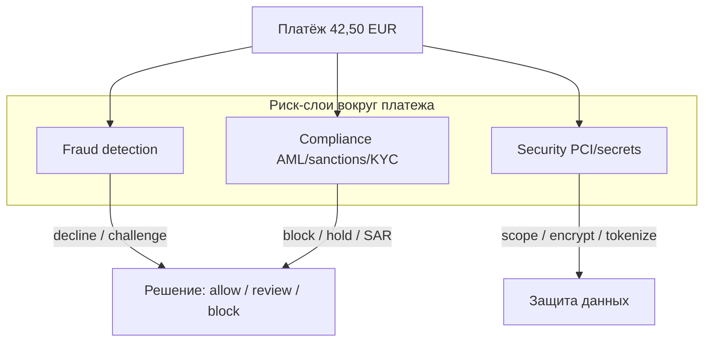
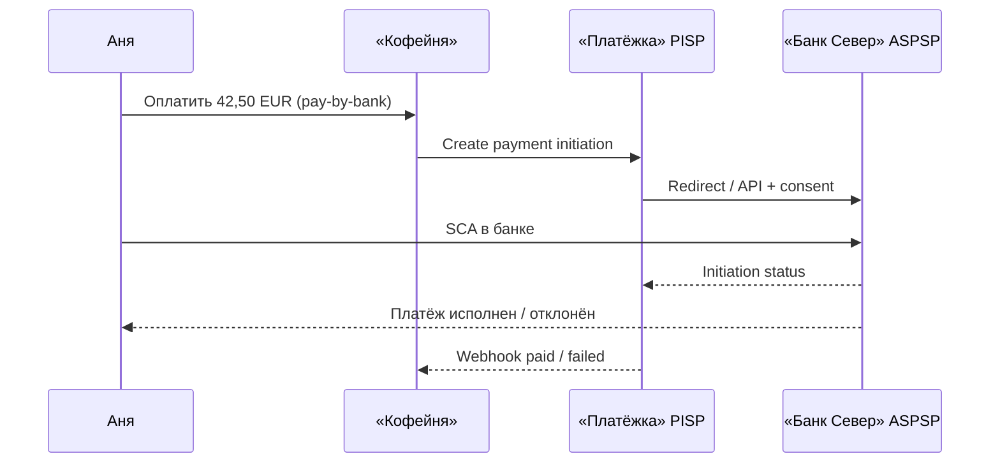
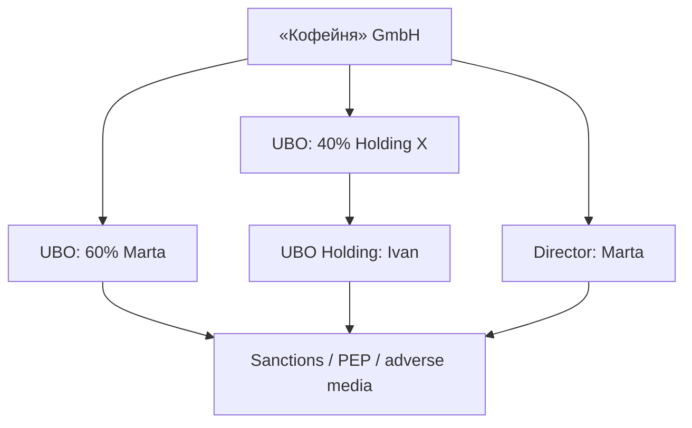
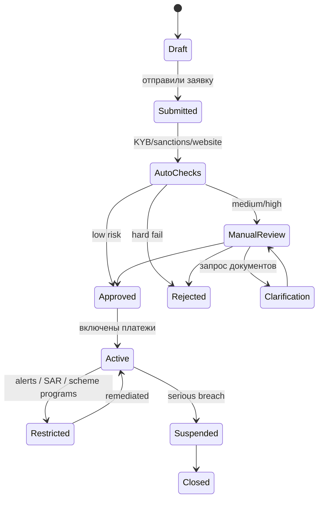
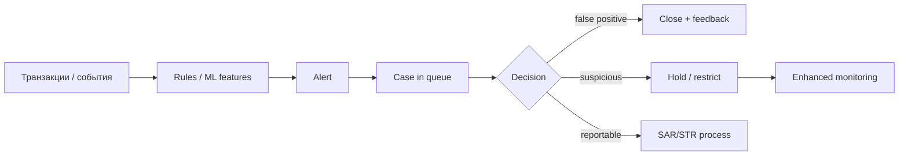

# Глава 18. Регуляторика и compliance

Аня заплатила 42,50 EUR за набор зёрен в «Кофейне». Для неё это зелёная галочка и ожидание курьера. Для «Банка Север» — авторизация и холд. Для «Банка Эквайр» — обязательство перед схемой. Для PSP «Платёжка» — ещё и совершенно другой слой: **можно ли вообще проводить этот платёж**, **кого она обслуживает**, **чьи это деньги на safeguarding-счёте — счёте для обособления и защиты клиентских средств ([глава 12](12-flow-of-funds.md))**, **не в санкционном ли списке контрагент**, **сколько лет хранить персональные данные Ани** и **что ответить регулятору**, если завтра придёт запрос «покажите цепочку по этому MID».

В предыдущих главах мы разобрали fraud ([глава 16](16-fraud.md)) и chargeback ([глава 17](17-chargebacks-and-disputes.md)) — риск «плохой сделки» и спор о деньгах. Теперь — риск **нарушить правила государства и лицензии**. Он выглядит скучнее фрода ровно до момента, когда лицензию ограничивают, payout замораживают или банк-партнёр рвёт договор из-за «слабого AML» — противодействия отмыванию денег (Anti-Money Laundering), которое подробно разберём ниже. Для инженера compliance — соблюдение применимых законов, лицензионных и договорных требований — не PDF из юридического отдела. Это поля в onboarding-форме, статусы мерчанта, правила transaction monitoring, блокировки по санкциям, retention-политики — правила сроков хранения — в БД и аудит-логи, которые нельзя «почистить ради места на диске».

Эта глава — про правовую и compliance-рамку вокруг онлайн-платежей: PSD2 и то, что идёт следом (PSD3/PSR), Open Banking как регулируемый доступ к счетам, лицензии PI/EMI/банк, KYC/KYB/UBO, AML и мониторинг транзакций, санкции, onboarding продавцов, GDPR и хранение данных, финансовые преступления. SCA здесь — только в регуляторном контексте: как протокол и UX она уже разобрана в [главе 08](08-3ds-and-sca.md).

Важная оговорка на весь текст: это **учебник для инженеров**, а не юридическая консультация. Правила зависят от юрисдикции, даты, типа лицензии и фактов конкретной сделки. Перед продакшен-решениями нужны юрист (counsel) и специалист по соблюдению требований (compliance officer). Мы фиксируем состояние «на момент написания» (2026) и объясняем суть, а не номера статей как догму.

## В этой главе

- Зачем платежам отдельная регуляторика и что такое compliance на практике
- PSD2: платёжные услуги, TPP, доступ к счетам, SCA
- Open Banking как регуляторный режим (не только «красивые API»)
- PSD3 и PSR: куда движется европейская рамка
- Лицензии: PI, EMI, банковская — что можно, чего нельзя
- KYC, KYB, UBO: кто такой клиент и кто за ним стоит
- Merchant onboarding и verification глазами PSP
- AML, финансовые преступления, transaction monitoring
- Санкции и OFAC-подобные списки
- GDPR, data retention и конфликт «хранить forever ради аудита»
- Сквозной пример: 42,50 EUR Ани через compliance-линзу

---

## Зачем платежам вообще регулятор

### Деньги чужих людей — не обычный CRUD

Платёжная компания двигает (или помогает двигать) чужие деньги. Регулятор смотрит на это не как на «ещё один SaaS с webhook», а как на деятельность, где легко:

- отмыть грязные деньги;
- профинансировать запрещённую деятельность;
- обмануть потребителей;
- потерять клиентские средства при банкротстве посредника;
- создать системный риск, если рухнет крупный игрок.

Поэтому появляется связка: **лицензия → капитал и safeguarding → AML/CFT (противодействие отмыванию денег и финансированию терроризма) → защита потребителя → отчётность → надзор**. Compliance — это операционная система поверх этой связки: политики, процедуры, системы, люди и доказательства, что вы делаете то, что обещали регулятору.

### Четыре плоскости, в которых живёт один платёж

Вернёмся к 42,50 EUR Ани. Один и тот же клик одновременно существует в четырёх плоскостях:

| Плоскость | Вопрос | Кто «смотрит» |
|---|---|---|
| Бизнес | Заказ оплачен? Можно отгружать? | «Кофейня» |
| Технология | Auth/capture/webhook дошли? | Инженеры «Платёжки» и мерчанта |
| Деньги | Где settlement, когда payout? | Finance, ledger ([глава 12](12-flow-of-funds.md), [глава 13](13-ledger-and-reconciliation.md)) |
| Право | Лицензия, SCA, AML, санкции, персональные данные | Регулятор, compliance, банк-партнёр |

Инженер часто проектирует первые две плоскости и удивляется, когда четвёртая внезапно ломает третью: payout задержан из-за KYB review, платёж отклонён санкционным screening, AIS-consent отозван, retention удалил лог, нужный для SAR — сообщения о подозрительной активности в компетентный орган (процедура — ниже в разделе AML).

### Compliance ≠ security ≠ fraud

Три соседних слова, три разные дисциплины:

- **Security / PCI** — как не украсть и не утекнуть card data ([глава 19](19-payment-security-pci.md)).
- **Fraud** — как не провести мошенническую транзакцию ([глава 16](16-fraud.md)).
- **Compliance** — как не нарушить закон, лицензию и договор с надзором/банком-партнёром.

Они пересекаются: санкционный hit похож на fraud decline; утечка данных — и PCI, и GDPR; card testing — и fraud, и иногда AML-сигнал. Но владелец процесса, метрики успеха и цена ошибки разные. Fraud-команда оптимизирует убыток vs конверсию. Compliance-команда снижает **residual regulatory risk** — остаточный риск нарушения требований после применённых контролей — и обеспечивает способность пройти аудит.



Словами: один платёж проходит через несколько «ворот». Fraud спрашивает «это похоже на кражу карты?». Compliance спрашивает «мы вообще имеем право обслуживать этих людей и эту сумму?». Security спрашивает «мы не размазали PAN по логам?».

---

## PSD2: европейская рамка, которая переписала платежи

### Откуда взялась вторая платёжная директива

**PSD2** (Payment Services Directive 2) — ключевая европейская рамка платёжных услуг (в ЕС; UK унаследовала близкую логику с собственной эволюцией после Brexit). Предшественник (PSD1) уже описывал платёжные учреждения и базовые права пользователя. PSD2 дожала две идеи, которые инженеры чувствуют каждый день:

1. **Конкуренция и Open Banking.** Банки обязаны дать лицензированным третьим сторонам доступ к платёжным счетам через безопасные интерфейсы (при согласии клиента).
2. **Сильная аутентификация (SCA).** Для многих электронных платежей нужна Strong Customer Authentication — иначе растёт fraud и размывается ответственность.

Для «Платёжки» это значит: можно стать не только «карточной трубой», но и **TPP** — third-party provider, который инициирует платежи со счёта Ани или читает информацию о счёте. Для «Банка Север» — обязанность открыть API (или сопоставимый канал) и жить с трафиком внешних приложений. Для «Кофейни» — на checkout появился pay-by-bank рядом с картой ([глава 10](10-bank-based-methods.md)).

### Что такое «платёжная услуга» и почему это важно

Регулятор мыслит не «у вас есть REST API», а «оказываете ли вы платёжную услугу». Если да — почти наверняка нужна лицензия или партнёрство с лицензиатом. Типичные услуги в духе PSD-рамки (упрощённо, без претензии на исчерпывающий список):

- исполнение платёжных операций (в т.ч. перевод средств);
- выпуск платёжных инструментов / эквайринг платёжных операций;
- **PIS** — payment initiation service (инициация платежа);
- **AIS** — account information service (информация о счёте);
- выпуск электронных денег (уже ближе к EMI-режиму);
- денежные переводы (money remittance) в ряде моделей.

Граница скользкая. Маркетплейс, который «просто держит деньги селлеров на своём счёте и потом выплачивает», может внезапно оказаться в зоне платёжной услуги — об этом ещё раз в [главе 26](26-marketplace-and-split-payments.md). Инженерный красный флаг: продукт говорит «escrow» — удержание средств до выполнения оговорённых условий ([глава 26](26-marketplace-and-split-payments.md)) — или «кошелёк баланса», а юридическая модель не оформлена.

### ASPSP, PISP, AISP — роли, которые всплывают в тикетах

В Open Banking-жаргоне PSD2:

- **ASPSP** (Account Servicing Payment Service Provider) — банк или учреждение, которое ведёт платёжный счёт. У Ани это «Банк Север».
- **PISP** — провайдер инициации платежей. «Платёжка» в режиме pay-by-bank.
- **AISP** — провайдер информации о счетах. «Платёжка» или отдельный fintech, который агрегирует балансы.

Один и тот же юрлицо может совмещать роли, если лицензия/регистрация это позволяет. Технически у каждой роли свои consent, scopes и audit trail.



Словами: мерчант не получает прямой доступ к интернет-банку Ани. Лицензированный PISP оркестрирует согласие и инициацию; ASPSP аутентифицирует клиента и исполняет платёж по своим рельсам (SCT, Faster Payments и т.д.).

### Доступ к счетам: не «взлом банка», а регулируемый контракт

PSD2 заставила ASPSP предоставить dedicated interface (или fallback) для TPP. На практике индустрия прошла через боль: нестабильные API банков, разные диалекты, споры о screen scraping (извлечение данных из интерфейса интернет-банка) vs dedicated API, технические conformance-тесты. К 2026 картина зрелее, но инженеру всё ещё нельзя считать Open Banking «как Stripe, только банк»: доступность банковских API, consent UX и статусы исполнения — отдельный operational domain ([глава 10](10-bank-based-methods.md), [глава 23](23-reliability.md)).

Регуляторный смысл важнее протокола: **без согласия клиента и без статуса TPP** лезть в чужой интернет-банк — не «интеграция», а нарушение. Consent — объект compliance, не cookie banner.

### SCA в PSD2: зачем закон полез в UX

**Strong Customer Authentication** — требование сильной аутентификации клиента для доступа к счёту и для инициирования многих электронных платежей. Классическая формула: минимум два независимых фактора из категорий knowledge / possession / inherence — знание секрета, владение устройством и биометрический признак. Для карт в e-commerce это почти всегда упирается в 3-D Secure; для PIS — в банковский challenge. Детали протоколов, exemptions (low value, TRA, trusted beneficiary, MIT…) и liability — в [главе 08](08-3ds-and-sca.md).

Здесь, в регуляторной главе, достаточно трёх инженерных истин:

1. SCA — не «фича продукта», а **обязательство** в зоне действия режима (EEA (Европейская экономическая зона), UK и наследники). Игнорировать «ради конверсии» — играть с лицензией эквайера/PSP и с отказами эмитентов.
2. Exemptions существуют, но их **принимает** ASPSP/issuer; мерчант не может «назначить exemption» односторонним флагом в своей БД.
3. Метрики challenge rate / abandonment — одновременно продуктовые и compliance-adjacent: аномальный спад SCA без объяснения exemptions может интересовать риск-команды банков-партнёров.

### Защита пользователя и «кто отвечает за несанкционированный платёж»

PSD2-рамка усилила потребительскую защиту вокруг платёжных услуг: прозрачность условий, сроки исполнения, правила по несанкционированным операциям, жалобы. Для инженера важнее всего практический вывод: **статусы и доказательства согласия/SCA** — это не внутренний лог «для отладки», а материал, которым банк и PSP объясняют, была ли операция авторизована клиентом.

Если Аня говорит «я не платила», цепочка доказательств может включать: device/session checkout, 3DS result / bank SCA reference, timestamp consent, IP (если законно хранится), statement descriptor, ARN/RRN для карточного мира. Нет доказательств — спор дороже и дольше, даже когда вы «уверены, что всё ок».

Отдельно: ответственность между ASPSP и TPP при инцидентах Open Banking распределяется по правилам режима и фактам (чей интерфейс, чей баг, было ли согласие). Проектируйте корреляцию `tpp_payment_id` ↔ `bank_payment_id` ↔ `merchant_order_id` заранее, а не в ночь эскалации.

### Что PSD2 дала и чего не дала

Плюсы для рынка: конкуренция TPP, pay-by-bank, давление на банки улучшать API, формализация SCA, больше прозрачности для потребителя в ряде сценариев.

Боль: фрагментация реализаций, friction на checkout в первые годы SCA, сложность для маленьких мерчантов, серые зоны вокруг marketplace/wallet. Именно поэтому к середине 2020-х Европа пошла в обновление рамки — PSD3 и PSR.

---

## Open Banking regulation: когда API — это закон

### Open Banking ≠ «открыли swagger»

В маркетинге «Open Banking» звучит как технология. В этой главе — как **регуляторный и рыночный режим**: кто имеет право читать счета и инициировать платежи, на каких условиях, с каким oversight, с какими стандартами безопасности и с какой ответственностью при инциденте.

В ЕС режим вырос из PSD2. В UK — сильная отдельная линия (стандарты, directory, внедрение у крупнейших банков, эволюция к расширенным платежам вроде VRP). В других регионах — свои рамки (open finance (регулируемый доступ к более широкому набору финансовых данных), CDR-подобные режимы (Consumer Data Right, право клиента предоставлять доступ к своим данным), локальные API-обязательства). Для международной «Платёжки» это значит: **не один коннектор на все страны**, а матрица «юрисдикция → правовой статус TPP → technical standard → operational SLA банков».

### Consent как доменный объект

Минимальный набор, который система должна уметь хранить и доказывать:

- кто дал согласие (identity субъекта);
- на что (AIS / PIS / VRP, scope счетов, получатель, лимиты);
- когда выдано и до какого срока;
- через какой канал (redirect, decoupled, app-to-app);
- статус: active / revoked / expired;
- связь с платежом или серией платежей;
- audit: кто и когда изменил статус (включая revoke со стороны банка).

Если revoke пришёл, а ваш job ночью снова дергает AIS «потому что кэш протух» — это уже не баг кэша, а compliance-инцидент.

### Конкуренция, ответственность и «кто виноват, если деньги ушли не туда»

Open Banking размывает привычную карточную картину ответственности. Нет классического scheme chargeback один в один ([глава 17](17-chargebacks-and-disputes.md)), зато есть:

- ошибки инициации (неверный IBAN бенефициара в запросе TPP);
- социальная инженерия («подтверди платёж в приложении»);
- сбои статуса (TPP думает success, банк — rejected);
- споры о согласии.

Регулятор и стандарты давят на ясность: кто ASPSP, кто TPP, какой reference платежа, как эскалировать claim. Для инженера это требование к **корреляции идентификаторов** и к человекочитаемым receipt'ам, а не только к `payment_id` внутри PSP.

### Врезка: как это бывает в жизни

«Кофейня» включает Open Banking, конверсия растёт, себестоимость ниже карточной. Через квартал support завален тикетами «деньги списались, заказ не создался». Причина — webhook от агрегатора пришёл раньше, чем финальный статус рельса, а идемпотентность на стороне магазина была «создай заказ на любой `completed`». Технически это [глава 07](07-states-async-idempotency.md). Регуляторно рядом лежит другой вопрос: как вы объясняете клиенту и банку цепочку согласия и статусов. Если audit trail дырявый, каждый такой тикет превращается в ручной ад compliance.

---

## PSD3 и PSR: что меняется «на момент написания»

Европейская рамка не стоит на месте. На момент написания книги (2026) обсуждение и внедрение пакета **PSD3** (директива) и **PSR** (Payment Services Regulation) — живая тема: цель — закрыть дыры PSD2, усилить борьбу с fraud (включая социальную инженерию и IBAN-name checks в духе confirmation of payee), выровнять правила, уточнить Open Banking / open finance, ужесточить требования к доступу и прозрачности.

Точные статьи, даты применения по странам и финальные формулировки меняются в законодательном процессе. Поэтому здесь — **принципы**, которые инженеру уже полезно закладывать в дизайн:

1. **Меньше серых зон вокруг платёжных услуг** — особенно у платформ, кошельков и «почти-PSP».
2. **Сильнее потребительская защита и антифрод-ожидания** — не только 3DS, но и проверки получателя, предупреждения, процессы возврата в определённых сценариях.
3. **Open Banking как норма, а не эксперимент** — стандартизация, надёжность интерфейсов, права TPP.
4. **Разделение директивы и regulation** — regulation обычно прямее унифицирует правила по ЕС; директива проходит через национальную имплементацию. Для мультистрановой «Платёжки» это влияет на timeline compliance-проектов.

Практический совет: заведите в архитектуре явный модуль «regulatory profile» на уровне merchant/country/product (какие методы доступны, какие SCA-политики, какие disclosure), вместо хардкода `if country == 'DE'`. PSD3/PSR — не последний раз, когда правила поедут.

### Что закладывать в бэклог уже сейчас

Даже не зная финальной редакции каждой статьи, платёжной платформе полезно иметь эпики:

- **Confirmation of payee / name check** на payout и на PIS-бенефициаре — UX предупреждений, коды «имя не совпало», политика «блок vs warn».
- **Fraud sharing / signal exchange** между участниками (где режим это предполагает) — аккуратная модель данных и legal basis.
- **Жёстче различие technical provider vs licensed PSP** в договорах и в API keys: кто на самом деле regulated entity за конкретный MID.
- **Доказательства предупреждений пользователю** (screens, versioned copy, timestamps) — если появятся обязанности «предупреди до подтверждения».
- **Надёжность Open Banking interfaces** как compliance+ops метрика, не только как DX-метрика TPP.

Юридическую актуальность сверяйте с counsel и официальными текстами; эта глава намеренно не притворяется кодексом.

---

## Лицензии: PI, EMI, банк — три разных «разрешения на деньги»

### Зачем лицензия, если можно «просто интегрировать эквайера»

Можно. Многие компании так и живут: мерчант «Кофейня» **не** получает платёжную лицензию — она принимает платежи через «Платёжку». Лицензия нужна тому, кто по факту оказывает регулируемую платёжную услугу / выпускает e-money / ведёт банковские счета.

Ошибка стартапа: «мы же только API и UI, деньги на счёте банка-партнёра» — пока модель агентская и деньги юридически не ваши клиентские обязательства. Стоит продукту обрасти балансами пользователей, split payments, хранением средств селлеров или выпуском prepaid — и counsel говорит неприятное слово «лицензия».

### Payment Institution (PI)

**Платёжное учреждение (Payment Institution)** — лицензированный игрок, который оказывает платёжные услуги, но **не** является банком и обычно **не** выпускает электронные деньги в полном EMI-смысле (границы зависят от разрешения и национального режима).

Что типично можно: эквайринг/исполнение платежей, money remittance, PIS/AIS (при соответствующих разрешениях), обслуживание платёжных операций для мерчантов.

Что обычно нельзя: принимать классические депозиты как банк; произвольно «держать» клиентские деньги вне правил safeguarding.

Для «Платёжки» PI-лицензия (или работа как agent связанного PI) — частый путь стать легальным PSP в Европе.

### Electronic Money Institution (EMI)

**EMI** — учреждение электронных денег. Ключевая суперсила: выпуск **e-money** — электронная денежная ценность, хранимая на счёте/кошельке клиента, погашаемая по номиналу.

Зачем это PSP: балансы пользователей, prepaid-карты, wallet-продукты, некоторые marketplace-модели, где нужна «электронная ценность» внутри платформы. EMI ближе к «почти банку» в головах пользователей, но регуляторно это не полная банковская лицензия: набор дозволенных активностей уже, депозитная защита и пруденциальный режим другие.

Опасная продуктовая фраза: «это не e-money, это просто внутренний баланс в Redis». Если пользователь пополняет, хранит и тратит ценность, а вы обещаете номинал — counsel и регулятор могут видеть e-money независимо от вашего нейминга в UI.

### Банковская лицензия

Банк может вести платёжные счета, принимать депозиты, кредитовать, участвовать в схемах как member, быть ASPSP «по праву рождения». Цена — капитал, надзор, AML-машина промышленного масштаба, годы на получение. Нужен и BCP — план непрерывности бизнеса при сбоях ([глава 23](23-reliability.md)).

«Банк Эквайр» и «Банк Север» в нашей книге — банки. «Платёжка» — скорее PI/EMI или технический слой перед ними. BIN sponsorship (выпуск карт с использованием BIN и участия банка-спонсора) и Banking-as-a-Service (банковские услуги через инфраструктуру партнёра) позволяют финтех-компаниям опереться на банковскую лицензию партнёра ([глава 02](02-ecosystem-participants.md)).

### Сравнение для инженера продукта

| | PI | EMI | Банк |
|---|---|---|---|
| Платёжные услуги | Да (по разрешению) | Да + e-money | Да |
| Клиентские «кошельки» | Ограниченно / через модель | Да (e-money) | Депозитные счета |
| Safeguarding / защита средств | Обязательна по правилам | Обязательна по правилам | Депозитный режим / страхование (зависит от юрисдикции) |
| Скорость вывода продукта | Средняя | Средняя/дольше | Долго |
| Типичная роль в книге | PSP «Платёжка» | Wallet-слой «Платёжки» | Эмитент / эквайер |

### Passporting, филиалы и «мы запустились во всей Европе»

В ЕС исторически работал passporting: лицензия в одном государстве + уведомления для работы в других. После Brexit UK — отдельный контур. Национальные регуляторы (в духе BaFin, ACPR, DNB, FCA…) остаются важны: регистрация, отчётность, локальные нюансы AML/consumer law.

Инженерный след: окружения, юридические entity_id, settlement-счета и даже текст checkout disclosures часто **привязаны к лицензионной сущности**, а не к одному глобальному `merchant_id`.

### Safeguarding: куда деваются деньги «Кофейни» до payout

Пока payout не ушёл на расчётный счёт «Кофейни», клиентские/мерчантские средства обычно должны быть **защищены** (safeguarding): segregated accounts, страхование/гарантия в допустимых формах — конкретная механика зависит от режима PI/EMI и страны.

Для инженера ledger ([глава 13](13-ledger-and-reconciliation.md)) это не абстракция: `available_balance` мерчанта должен быть согласован с реальным safeguarded money, а не с «мы так в Postgres посчитали». Расхождение — и операционный, и лицензионный риск.

### Агенты, distributors и «белая этикетка»

Частый паттерн: компания X продаёт payment API под своим брендом, а лицензия — у Y. Или «Платёжка» работает как agent of PI. Тогда в системе появляется `licensed_principal` и `distributing_brand`. Отчётность, жалобы клиентов, текст на checkout («платежи обрабатывает…»), даже то, на чьё имя открыт safeguarded account, должны быть согласованы с этой схемой.

Инженерная ловушка: один `api_key` обслуживает трафик нескольких юридических лиц без сегментации. При запросе регулятора вы не можете честно разрезать логи «чей это оборот».

### Сколько это стоит (порядок величин, иллюстративно)

Цифры зависят от страны и консультантов, но порядок мыслей такой: получение PI/EMI — месяцы/годы и заметные затраты порядка сотен тысяч евро на counsel, капитал, системы, аудит (не обещание цены — ориентир сложности). Поддержание — штатные специалисты compliance/AML (FTE — эквивалент полной занятости), мониторинг, отчётность, периодические audits. Альтернатива «работать через лицензированного партнёра» дешевле на старте, но режет маржу и продуктовую свободу. Выбор — стратегический, не только юридический.

---

## KYC, KYB, UBO: узнать, с кем имеешь дело

### KYC — Know Your Customer

**KYC** — процесс идентификации и проверки клиента-физлица (или представителя). Для «Банка Север» Аня проходит KYC, когда открывает счёт и получает карту. Для «Платёжки» KYC всплывает, когда:

- пользователь заводит wallet / e-money счёт;
- требуется проверка плательщика в high-risk сценариях;
- payout идёт физлицу (seller, gig-worker);
- срабатывает event-driven review (подозрительная активность).

Типичные данные: ФИО, дата рождения, адрес, документ (паспорт/ID), иногда selfie/liveness — селфи и проверка, что перед камерой живой человек, санкционный скрининг, PEP-проверка (politically exposed person, лицо, занимающее или занимавшее значимую публичную должность; применимые правила могут охватывать также близких и связанных лиц).

Глубина KYC — risk-based: студент, покупающий кофе, и человек, гоняющий крупные cross-border payouts, — разные уровни.

### KYB — Know Your Business

**KYB** — «KYC для компаний». Для onboarding «Кофейни» в «Платёжку» это сердцевина:

- legal name, registration number, адрес, страна учреждения;
- правовая форма, дата регистрации;
- directors / representatives;
- лицензии бизнеса (если нужны для MCC/отрасли);
- сайт, описание деятельности, ожидаемые обороты, география клиентов;
- банковский счёт для payout (ownership verification);
- документы: extract из реестра, устав, proof of address, sometimes financials.

KYB отвечает на вопрос: **это настоящий легальный бизнес, который продаёт то, что заявляет?** Fake merchant с сайтом-однодневкой — классический вход в carding и bust-out fraud.

### UBO — Ultimate Beneficial Owner

**UBO** — конечный бенефициарный владелец: человек, который в итоге владеет/контролирует компанию (часто через порог владения вроде 25% — порог зависит от юрисдикции и политики; не заучивайте число как универсальную константу).

Зачем: отмывание любит цепочки LLC → Cyprus HoldCo → Seychelles → «директор-номинал». Регулятор требует прозрачности: кто реально стоит за «Кофейней».

В системе это отдельные сущности: `LegalEntity` → `OwnershipEdge` → `Person`, плюс screening каждого person. Если ownership изменился, а вы узнали об этом через год, процесс due diligence — надлежащей проверки клиента и связанных лиц — не сработал.



Словами: проверка компании не заканчивается на названии магазина. Нужно дойти до людей и прогнать их через screening.

### CDD и EDD: обычная и усиленная проверка

**CDD** (Customer Due Diligence) — базовый набор мер. **EDD** (Enhanced Due Diligence) — усиленный: больше документов, источник средств/богатства, очные визиты/видео, более частый review, жёсткие лимиты.

Здесь adverse media означает негативные публикации о клиенте, например сообщения о предполагаемых финансовых преступлениях. Триггеры EDD: high-risk страна, сложная ownership-структура, PEP, высокие обороты, чувствительные MCC (gambling, crypto-adjacent, pharma — список risk-appetite зависит от лицензии и банка-партнёра), adverse media.

### Risk-based approach — не отмазка, а метод

Регуляторы ожидают **риск-ориентированный подход**: вы оцениваете риск клиента/продукта/канала/гео и калибруете глубину проверок. Это не «можно ничего не делать для low risk». Это «докажите, почему для этой когорты достаточно такого набора контролей, и пересматривайте».

Инженерный артефакт: `risk_rating` на мерчанте/пользователе, история его изменений, reasons, next_review_at. Без этого onboarding превращается в бесконечный одинаковый questionnaire, а аудит — в кошмар.

---

## Merchant onboarding и verification: как «Кофейня» попадает в «Платёжку»

Тема №152–153 живёт и здесь, и в [главе 25](25-merchant-domain.md). Здесь — **compliance-угол**: что проверяем и почему платёж 42,50 EUR вообще разрешён к приёму.

### Онбординг — это underwriting, не «регистрация в SaaS»

Underwriting — оценка риска принятия продавца на обслуживание. Продуктовая команда хочет: email → пароль → API key за 5 минут. Compliance и эквайер хотят: понять бизнес, MCC, сайт, UBO, ожидаемый ticket size (средняя сумма одной покупки), chargeback risk, sanctions, лицензии отрасли.

Компромисс современной «Платёжки»:

1. **Сбор данных** (формы, OCR документов, company registry API).
2. **Автоматические проверки** (реестры, санкции, устройства, дубликаты, website crawl).
3. **Скоринг риска** → auto-approve / manual review / reject.
4. **Договор и disclosures**.
5. **Активация методов** (карты, SEPA, Open Banking) и лимиты.
6. **Ongoing monitoring** (не «проверили один раз и забыли»).



### Verification на практике: что реально проверяют

- **Identity юрлица** — совпадение реквизитов с реестром.
- **Логический сайт** — не parked domain, есть товары/цены/контакты/policies (refund, privacy).
- **MCC и контент** — то, что на сайте, совпадает с заявленным; нет запрещёнки.
- **Банковский счёт** — принадлежит этой компании (confirmation of payee / micro-deposit / registry match — методы зависят от страны).
- **Представитель** — имеет право подписывать; его KYC.
- **UBO screening**.
- **Ожидаемый профиль** — average ticket ~40 EUR для specialty coffee выглядит правдоподобно; average ticket 4000 EUR при «продаже зёрен» — повод для вопросов.

### Лимиты, резервы и поэтапное доверие

Новую «Кофейню» редко пускают «без потолка». Типичные контроли:

- суточный/месячный volume cap;
- delayed payout (T+N больше обычного);
- rolling reserve ([глава 12](12-flow-of-funds.md));
- запрет некоторых методов (например, только cards local, без cross-border);
- ручной review первых N крупных выплат.

Это одновременно risk и compliance hygiene: ограничить ущерб, пока профиль не подтверждён реальной историей.

### Ongoing due diligence

Onboarding — точка входа. Дальше:

- периодический refresh документов;
- мониторинг смены UBO/director;
- мониторинг сайта (внезапно вместо кофе — подписки на «инвест-сигналы»);
- scheme compliance programs и chargeback ratio ([глава 17](17-chargebacks-and-disputes.md));
- триггеры от transaction monitoring.

Инженерно: merchant — **stateful risk subject**, не статичная запись в CRM.

### Что мерчант видит vs что видит compliance

Продуктовый дашборд «Кофейни» показывает: «аккаунт активен, выплаты T+2». Внутренний экран аналитика показывает: risk rating, last screening, open alerts, document expiry, connected UBOs, notes from manual review, scheme MID status. Не смешивайте эти представления в одном API без ACL: мерчант не должен читать внутренние AML-комментарии, а support не должен править risk rating без аудита.

Полезный паттерн: публичный `account_status` (active/restricted/suspended) + приватный `compliance_substatus` + reason codes, из которых наружу торчит только безопасное подмножество (`documents_required`, `payout_temporarily_delayed`).

---

## AML и финансовые преступления: не только «отмывание»

### AML/CFT в одном абзаце

**AML** (Anti-Money Laundering) — противодействие отмыванию денег. Рядом **CFT/CTF** — противодействие финансированию терроризма. Для платёжной компании это система: политика, KYC/KYB, мониторинг транзакций, расследования, эскалации в FIU (financial intelligence unit, подразделение финансовой разведки), обучение сотрудников, независимый audit, запись доказательств.

Цель преступника — взять грязные деньги и сделать их выглядящими как законный оборот. Платёжные рельсы удобны: скорость, объёмы, кросс-бордер, множество мерчантов и payout-получателей.

### Какие преступления «живут» рядом с платежами

Неполный, но полезный инженеру список:

- **Money laundering** — слои (layering) через кучу мелких платежей, подставных мерчантов, withdrawals.
- **Terrorist financing** — иногда мелкие суммы, важна семантика контрагентов и гео, не только крупный объём.
- **Fraud proceeds** — деньги от carding/ATO потом выводятся как «бизнес-выручка».
- **Sanctions evasion** — обход через третьи страны, подставные юрлица, ложные invoice.
- **Illegal goods / unlicensed activity** — наркотики, нелицензированные gambling/crypto-услуги, scams.
- **Tax crime / corruption** — в EDD и adverse media часто всплывает рядом.
- **Mule accounts** — счета «дропов», через которые гонят потоки.

Fraud-глава ловит атаку на платёж. AML-глава (эта) ловит **злоупотребление платёжной инфраструктурой как трубой**. Иногда это один и тот же кейс глазами разных команд.

### Врезка: финансовые преступления глазами платёжного лога

Представим не «Кофейню», а подставной магазин «Быстрый Гаджет». Паттерн за две недели:

1. Onboarding с украденными/купленными документами (synthetic identity) — если KYB слабый, проходит auto-approve.
2. Резкий всплеск CNP-авторизаций ночью с разных BIN — card testing + cash-out ([глава 16](16-fraud.md)).
3. Часть операций проходит, товар «цифровой» или не отгружается.
4. Payout на свежий счёт mule в другой стране.
5. Через дни — волна fraud chargeback ([глава 17](17-chargebacks-and-disputes.md)).

Для fraud-команды это атака на карты. Для AML — ещё и отмывание/вывод преступных доходов через мерчантский контур. Если fraud просто «выключил MID», а compliance не открыл case и не сохранил evidence path для SAR, вы закрыли дырку в конверсии и открыли дырку в лицензии.

Здесь TM (transaction monitoring) — мониторинг операций на предмет подозрительных паттернов; его конвейер разберём в следующем разделе. Другие учебные сюжеты, которые TM должен уметь узнавать:

- **Smurfing / structuring** — много платежей ровно под порог алерта.
- **Round-trip refunds** — оплата и быстрый refund на другой инструмент, имитация оборота.
- **Fan-in / fan-out** — много плательщиков на одного получателя или наоборот, без бизнес-объяснения.
- **Dormant → spike** — мёртвый MID внезапно оживает на крупные суммы.
- **Trade-based laundering light** — invoice и settlement не бьются с заявленным MCC и average ticket из KYB.

### Три стадии отмывания — и где их видно в логах

Классическая учебная модель:

1. **Placement** — ввод грязных денег в финансовую систему (пополнение, cash-in, оплата через mule).
2. **Layering** — перемешивание: много transfers, FX, разные MID, refunds туда-сюда.
3. **Integration** — вывод как «чистая» прибыль бизнеса, payout на корпоративный счёт, покупка активов.

В PSP-данных layering часто выглядит как: странная структура refund/chargeback, круговой оборот между связанными мерчантами, резкий рост volume без товарной логики, дробление (structuring) под пороги мониторинга.

### Программа AML: люди, политика, системы (три линии защиты)

Регуляторы любят модель «трёх линий»:

1. **Первая линия** — бизнес и продукт, которые встраивают контроли в onboarding и платежи (вы, инженеры и операционка).
2. **Вторая линия** — compliance/risk, которые задают политики, правила TM, эскалации.
3. **Третья линия** — internal audit / независимая проверка.

Без первой линии вторая линия тонет в исключениях. Без второй — продукт оптимизирует GMV до первого жёсткого письма от банка-партнёра. Без третьей — все уверены, что «процесс есть», пока не приходит inspection.

Минимальный системный контур: policy store (версии правил), alert/case tool, screening vendor/integration, training records, MI-отчёты (management information, управленческая отчётность) для руководства (сколько alerts, сколько SAR, сколько holds, aging очереди).

### SAR/STR и почему «тихо закрыть мерчанта» недостаточно

Когда расследование находит подозрение, лицензиат часто обязан подать **SAR/STR** (suspicious activity/transaction report) в компетентный орган — и при этом соблюдать правила tipping-off (нельзя предупреждать клиента в духе «мы на вас донесли»).

Инженерные следствия:

- статусы `suspended` / `hold_funds` должны уметь существовать без «дружелюбного» email «вы в AML-расследовании»;
- доступ к case files — строго role-based;
- удалять данные «чтобы не хранить лишнее» в середине расследования — катастрофа;
- нужны неизменяемые audit logs по действиям аналитика;
- шаблоны исходящих писем мерчанту должны проходить legal/compliance review (текст «почему payout задержан» легко становится tipping-off).

Это не юридический гайд по SAR в вашей стране — это напоминание спроектировать **case management**, а не только `UPDATE merchants SET status`.

### Для любопытных: почему «мелкий кофе» тоже в периметре

Кажется абсурдом мониторить платёж Ани на 42,50 EUR. Но AML смотрит на **портфель и сети**, не на одну чашку зерна. Тысяча «кофеен»-однодневок по 40 EUR — это уже машина. Financing of terrorism иногда намеренно использует мелкие суммы. Санкционный hit не зависит от того, что товар — specialty coffee. Поэтому низкий ticket не освобождает платформу от программы; он лишь меняет калибровку правил и ожидаемый alert rate.

---

## Transaction monitoring: правила, скоринг, люди

### Зачем мониторинг, если уже есть fraud engine

Fraud engine отвечает на вопрос «пройдёт ли *эта* авторизация прямо сейчас?». Transaction monitoring (TM) смотрит шире:

- поведение мерчанта за дни/недели;
- сети связанных аккаунтов;
- паттерны payout;
- аномалии относительно заявленного KYB-профиля;
- санкционные и adverse сигналы на длинном окне.

Иногда TM работает post-factum (батчи), иногда near-realtime. Оба режима нужны.

### Типичные типологии правил (иллюстративно)

| Сигнал | Почему подозрительно | Возможное действие |
|---|---|---|
| Резкий рост оборота x20 за неделю | Bust-out / laundering placement | Hold payout, review |
| Много мелких auth от разных BIN с одним device | Card testing | Fraud + TM case |
| Refund rate аномально высокий | Fake turnover / friendly abuse | Review, лимиты |
| Payout на новый счёт в high-risk стране | Proceeds extraction | EDD, delay |
| Структура владения совпала с ранее заблокированным | Mule network | Reject / SAR path |
| MCC drift: сайт больше не про кофе | Misrepresentation | Suspend methods |

Правила должны быть объяснимы аудитору. Чисто чёрный ML-box без reason codes плохо переживает regulatory examination — даже если метрики красивые. Компромисс: ML как сигнал + human-readable features + policy overlay.

### Alert → case → decision



Словами: мониторинг бесполезен, если алерты тонут в очереди. Нужны SLA на разбор, приоритеты, capacity planning аналитиков — иначе либо всё auto-close (дырка), либо всё auto-hold (убийство бизнеса).

### Данные, которые TM хочет от платёжной платформы

- стабильные идентификаторы customer/merchant/payment/payout;
- device/IP/geo (где законно);
- method, country, currency, MCC;
- связь auth → capture → refund → chargeback → payout;
- KYB-профиль и risk rating;
- бенефициары выплат и их screening results;
- история статусов мерчанта.

Если ledger и payment state machine врут или расходятся ([глава 13](13-ledger-and-reconciliation.md), [глава 21](21-distributed-systems-and-money.md)), TM либо слеп, либо орёт ложными алертами.

### False positives и «compliance vs conversion» №2

В fraud это trade-off с конверсией покупателя. В TM — trade-off с **time-to-payout и onboarding pass-rate**. Слишком параноидальные правила → честные кофейни без денег на зерно. Слишком мягкие → партнерский банк отзывает спонсорство.

Снимайте метрики: alert rate, precision по выборкам, median time-to-decision, % holds released clean, SAR conversion от alerts (очень грубо и осторожно), merchant churn after restrictions.

---

## Санкции и OFAC: когда «отклонить» — единственный правильный ответ

### Что такое санкционный скрининг

Государства и блоки (США, ЕС, UK, ООН и др.) ведут списки лиц, компаний, судов, режимов, с которыми нельзя иметь дело (или можно только с лицензией/исключением). **OFAC** (Office of Foreign Assets Control, США) — самый известный «бренд» таких списков в индустрии; на практике глобальному PSP нужен **набор** релевантных списков и политик по юрисдикциям лицензии и банков-партнёров.

Скрининг применяют к:

- мерчантам и UBO на onboarding и периодически;
- payout-бенефициарам;
- иногда плательщикам в высоких рисках;
- банкам-корреспондентам и контрагентам;
- странам/территориям (country controls);
- отдельным судам/воздушным судам в trade finance (реже в чистом e-commerce, но в platform-бизнесе встречается).

### False hits и fuzzy matching

«ANNA IVANOVA» даст тысячу совпадений. Нужны: алгоритм сопоставления, вторичные атрибуты (DOB — дата рождения, страна), human review на potential match, запись решения `true_match` / `false_positive`, freeze при true match.

Инженерные грабли:

- скринить только exact match — пропустите вариации написания;
- авто-блокировать каждый fuzzy hit — убьёте onboarding;
- не логировать, почему пропустили hit — провал аудита;
- скринить при onboarding и никогда больше — UBO попадает в список через полгода, а вы продолжаете payout.

### Что делать с платежом или payout при hit

Обычно: **стоп**. Не «отправим, разберёмся потом». Дальше — процедура: подтверждение match, блокировка средств/операции, эскалация compliance, возможные report obligations, legal assessment (лицензии OFAC/EU exceptions — только через qualified people).

Для продукта: предусмотрите статусы вроде `compliance_hold`, UI для внутреннего case, запрет авто-ретраев. Рестрай санкционного payout — способ превратить один инцидент в паттерн нарушений.

### Санкции vs fraud decline vs scheme block

Снаружи для «Кофейни» всё выглядит как «платёж не прошёл». Внутри:

- fraud decline — риск модели;
- issuer decline — решение «Банка Север»;
- scheme restriction — правила сети;
- sanctions hit — legal prohibition.

Нормализуйте reason в аналитике отдельно. Иначе оптимизируете «конверсию», маскируя compliance blocks.

---

## GDPR и data retention: персональные данные в платёжном мире

### Почему GDPR здесь, а PCI — в следующей главе

**PCI DSS** защищает cardholder data как платёжный секрет ([глава 19](19-payment-security-pci.md)). **GDPR** (General Data Protection Regulation, общий регламент ЕС о защите персональных данных) и аналоги в UK/других регионах защищает **персональные данные** человека как субъекта прав: законность обработки, минимизация, срок хранения, право доступа/удаления, breach notification, DPA — договорные условия обработки данных — с процессорами.

PAN может быть одновременно card data и personal data. KYC-документ — точно personal data. IP в fraud-логе — часто тоже. Поэтому «удалили из PCI scope токенизацией» не отменяет GDPR-обязательств на остальные поля.

### Правовые основания и роли

Грубо: controller решает зачем обрабатывать; processor обрабатывает по инструкции controller. «Платёжка» для данных «Кофейни» о покупателях часто выступает processor (но не всегда — зависит от продукта: если сама предоставляет wallet Ане, может быть controller). SCCs (Standard Contractual Clauses) — стандартные договорные положения для передачи персональных данных в третьи страны. Ошибки в DPA и SCCs — любимая тема юристов при выходе на рынок.

Инженеру достаточно железницы: понять, **для каких целей** поле вообще существует (исполнение платежа, AML legal obligation, fraud legitimate interest — примеры оснований; конкретный выбор — за counsel), и не расползать данные «на всякий случай» в пятый data lake.

### Права субъекта vs AML retention — главный конфликт

Аня пишет: «удалите все мои данные». Звучит просто. Но:

- по AML многие записи **обязаны** храниться N лет после окончания деловых отношений (срок зависит от юрисдикции; часто порядка 5+ лет — уточняйте локально, не копируйте число в политику с потолка);
- по спорным платежам и chargeback нужны доказательства;
- по бухгалтерии — свои сроки;
- по GDPR — минимизация и storage limitation.

Правильный паттерн: **целевое хранение**. Данные платежа и AML-case живут по legal hold / retention schedule: legal hold приостанавливает удаление материалов расследования или спора, retention schedule задаёт сроки хранения по целям. Маркетинговый профиль — удаляется. Токен для one-click — по правилам продукта и согласия. «Hard delete everything» одной кнопкой без политики — либо незаконно для AML, либо обман пользователя.

```text
Запрос Ани «удалите меня»
        │
        ▼
┌───────────────────────┐
│ Inventory по целям    │
│ payment / AML / tax / │
│ support / marketing   │
└──────────┬────────────┘
           │
     ┌─────┴─────┐
     ▼           ▼
 erase OK    retain + lock
 marketing   AML/payment
 soft-ID     legal basis
```

### Data minimization в платёжных логах

Классика инцидентов: в application log попали email + полный номер документа + CVV (CVV ещё и PCI-запрет). Политика retention бесполезна, если PII (personally identifiable information, данные, позволяющие идентифицировать человека) размножается в stdout, analytics, error trackers, CRM-скринах.

Практики:

- структурированные логи с allowlist полей;
- токенизация/псевдонимизация идентификаторов в non-prod;
- отдельные хранилища для KYC-документов с жёстким ACL;
- автоматический TTL + legal hold флаг на case;
- регулярные access reviews.

### Cross-border data и subprocessors

«Платёжка» почти наверняка использует cloud, screening vendor, KYC OCR, support tool, analytics. Каждый subprocessor — привлечённый обработчиком подрядчик по обработке данных — строка в register of processing и (часто) в DPA. Для инженера: нельзя «подключить удобный SaaS логирования» без privacy review, особенно если туда улетают KYC images или полные statement'ы.

Трансграничные передачи (EU → US и т.п.) живут своей правовой механикой (adequacy, SCCs и актуальные дополнения на момент внедрения). Книга не разбирает механизмы по статьям — но архитектурно закладывайте **региональность данных** (EU data residency для определённых классов) как опцию продукта, не как «потом попросим DevOps».

### Breach: когда «у нас утекли emails мерчантов» становится регуляторным таймером

Инцидент безопасности → оценка риска для прав субъектов → возможное уведомление регулятора/пользователей в сжатые сроки (конкретика — по режиму). Связка с [главой 23](23-reliability.md) и incident management: playbook должен включать privacy/compliance, не только SRE.

---

## Сквозной пример: 42,50 EUR Ани через compliance-линзу

Склеим историю в один таймлайн. Сумма заказа: **42,50 EUR**. Покупатель: Аня. Мерчант: «Кофейня». PSP: «Платёжка» (представим, что у неё европейская PI-лицензия и банковские партнёры). Эмитент: «Банк Север». Эквайер: «Банк Эквайр».

### T−30 дней: onboarding «Кофейни»

1. Marta подаёт заявку: GmbH, сайт с кофе, MCC specialty food, ожидаемый average ticket 35–50 EUR, гео — DE/AT/NL.
2. Автоматический KYB тянет реестр, находит UBO Marta 60% + Ivan через holding 40%.
3. Sanctions/PEP: clear (false positive по однофамильцу закрыт аналитиком, решение записано).
4. Website check: есть refund policy, contacts, prices.
5. Risk rating: medium-low → approved with payout T+2 и monthly cap.
6. В системе: `merchant_status=active`, `regulatory_entity=PI_EU`, методы cards+SCT Instant+Open Banking PIS.

Без этого шага платежа Ани легально «не существует» на платформе.

### T0: Аня жмёт «Оплатить» картой

1. Checkout «Кофейни» → API «Платёжки», amount `4250` (minor units), currency `EUR`.
2. Fraud scoring — ок ([глава 16](16-fraud.md)).
3. SCA: 3DS frictionless ([глава 08](08-3ds-and-sca.md)) — регуляторное требование закрыто аутентификацией эмитента.
4. Authorization у «Банка Север» — success.
5. Параллельно TM-правила фиксируют событие в профиль мерчанта (пока без алерта: ticket соответствует KYB).

### T0 альтернатива: Аня выбирает Open Banking

1. «Платёжка» как PISP создаёт initiation на 42,50 EUR.
2. Аня проходит consent + SCA в «Банке Север».
3. Consent объект сохранён: purpose=PIS, amount=42.50, beneficiary=IBAN мерчанта/платформы, expires=short-lived.
4. Статус исполнения рельса → webhook мерчанту.
5. Audit готов к вопросу регулятора: кто инициировал, на каком основании, чем подтверждена SCA на стороне ASPSP.

### T+1..T+2: деньги и safeguarding

1. Capture/clearing/settlement ([глава 06](06-payment-lifecycle.md), [глава 12](12-flow-of-funds.md)).
2. В ledger «Платёжки» растёт баланс «Кофейни»; physical funds — на safeguarded account по правилам PI.
3. Sanctions re-screen на payout-бенефициара (ежедневный job) — clear.
4. Payout уходит на бизнес-счёт «Кофейни» минус комиссии ([глава 15](15-fees-and-economics.md)).

### T+40 дней: скриптовый поворот (учебный)

Представим: UBO Ivan внезапно появляется в sanctions list update. Что должно произойти:

1. Screening job → potential match → confirmed true match.
2. Новые payouts — stop; возможно restriction на merchant.
3. Case в compliance; legal assessment.
4. Платежи «просто кофе» больше не «просто»: обслуживание связи с санкционным бенефициаром — зона запретов.
5. Продукт показывает мерчанту нейтральный hold, без tipping-off формулировок, если так требует процедура.

Именно поэтому UBO — не поле «для анкеты», а живой ключ в риск-движке.

### Пример JSON (иллюстративный) — compliance-контекст платежа

```json
{
  "payment_id": "pay_42a50_anya_001",
  "amount": 4250,
  "currency": "EUR",
  "merchant_id": "mch_coffeehouse",
  "merchant_risk_rating": "medium_low",
  "regulatory_entity": "pi_eu_example",
  "customer": {
    "type": "cardholder",
    "country": "DE"
  },
  "sca": {
    "required": true,
    "method": "3ds2",
    "result": "frictionless_success"
  },
  "screening": {
    "merchant_sanctions": "clear",
    "payee_sanctions": "clear",
    "lists_version": "2026-09-28"
  },
  "aml_monitoring": {
    "rules_fired": [],
    "profile_ticket_ok": true
  },
  "data_retention": {
    "purpose": ["payment_execution", "aml", "dispute_defense"],
    "delete_not_before": "2031-09-30"
  }
}
```

Это не API реального провайдера. Это напоминание: у платежа есть compliance-метаданные, и их надо проектировать так же сознательно, как `authorization_code`.

---

## Региональность: Европа — не весь мир

Книга часто говорит на «европейском диалекте» (PSD, SCA, PI/EMI), потому что он сильно сформировал e-commerce. Но:

- **США** — другой ландшафт (federal/state money transmitter licenses, FinCEN, OFAC как центр тяжести санкций, ACH rules, consumer protection вроде Reg E в банковском контуре; card networks rules рядом).
- **UK** — пост-Brexit собственная эволюция Open Banking и payment regulation.
- **Латам / Индия / Африка** — локальные лицензии платежных учреждений, мгновенные системы (Pix/UPI), валютный контроль, локальные AML-законы.
- **Кросс-бордер** — удваивает матрицу обязательств ([глава 27](27-cross-border-payments.md)).

Архитектурный вывод: `compliance_profile = f(entity, country, product, corridor)`. Хардкод «европейских» правил на весь глобальный стек — способ получить штраф в одной стране и ложный decline в другой.

---

## Что это значит для инженера

1. **Заведите regulatory entity в доменной модели.** Платежи, балансы, отчёты и disclosures принадлежат лицензированному лицу, не «глобальному монолиту».

2. **Merchant onboarding — state machine с audit trail.** Кто одобрил, на каких документах, какой risk rating, когда next review. «Просто статус в админке» не переживает проверку.

3. **Храните UBO и ownership graph как данные первого класса.** Screening job должен уметь переиграть граф при обновлении списков.

4. **Разделяйте fraud decision и compliance decision** в API и аналитике. Иначе оптимизируете не то.

5. **Consent (Open Banking) и SCA results — сохраняйте как доказательства**, не только как UX-флаги.

6. **Transaction monitoring нуждается в качественных событиях из ledger и payment lifecycle.** Без связи auth↔payout TM слеп.

7. **Sanctions hit = hard stop + case**, не soft decline с ретраями.

8. **Спроектируйте retention schedule и legal hold** до первого GDPR-запроса. Right to erasure без политики — бомба замедленного действия.

9. **Логи: allowlist PII, никаких документов KYC в plaintext-логах, никакого CVV нигде.**

10. **Не обещайте продуктом то, чего нет в лицензии.** «Кошелёк», «escrow», «мгновенный вывод селлерам по миру» — юридические утверждения, а не только UI copy.

11. **Тестируйте compliance-ветки:** onboarding reject, clarification loop, payout hold, sanctions true match, consent revoke, retention exclusion.

12. **Метрики:** onboarding pass-rate, time-to-approve, alert precision, hold rate, % payouts delayed by compliance, consent revoke lag, data subject request SLA.

---

## Типичные ошибки и грабли

**«Мы не банк — значит, регуляторика нас не касается».** Касается, если оказываете платёжные услуги, храните ценность, делаете PIS/AIS, или даже как мерчант — через договор с PSP и scheme rules.

**Считают Open Banking чисто технической интеграцией.** Без статуса TPP/партнёра, consent-аудита и процедур claim вы строите хрупкий и опасный продукт.

**Путают SCA как UX-настройку с SCA как обязательством.** Выключили 3DS «чтобы конверсия выросла» — получили отказы, liability и вопросы банка-партнёра. Подробности — в [главе 08](08-3ds-and-sca.md).

**Onboarding за 5 минут без KYB** на рисковых MCC — быстрый рост GMV и быстрый конец спонсорского договора с эквайером.

**Проверяют компанию, но не UBO.** Или проверяют UBO один раз и не мониторят изменения списков и ownership.

**Смешивают false positive санкций с clear.** Нет записи решения — при проверке выглядит как «игнорировали hit».

**Автоматические ретраи на compliance_hold.** Превращают блок в серию нарушений.

**TM-алерты без владельца и SLA.** Через полгода регулятору показывают очередь из 40 тысяч «new».

**«Удалим все данные по GDPR» вместе с AML-архивом.** Либо нарушите AML, либо сожжёте доказательную базу по disputes.

**PII в логах, Slack, датадогах, скриншотах тикетов.** Compliance-политика на Confluence не спасёт, если support вставляет паспорт в Jira.

**Маркетплейс копирует PayFac-паттерн без лицензии и без понимания, чьи это деньги.** Регуляторный сюрприз + замороженные payouts. См. [главу 26](26-marketplace-and-split-payments.md).

**Один compliance-профиль на все страны.** US money transmitter, EU PI и локальная азиатская лицензия — разные миры в одной таблице `merchants` без сегментации.

**Обещания в блог-посте «мы PSD3 ready» без трекера обязательств.** Регуляторные программы — это backlog с owner, evidence и датами, не лендинг.

**Игнорируют tipping-off.** «Слушайте, вас заблокировали по AML, срочно выведите деньги» — может быть отдельным нарушением процедуры.

---

## Итоги главы

1. **Compliance — слой права и надзора** вокруг чужих денег: лицензия, AML, санкции, защита данных, отчётность. Это не «документы рядом с платформой», а часть доменной модели.
2. **PSD2** оформила платёжные услуги, TPP (PIS/AIS) и SCA; без неё не было бы современного европейского Open Banking и обязательного 3DS-контекста для многих CNP-платежей.
3. **Open Banking regulation** делает consent, роли ASPSP/TPP и ответственность предметом аудита — API здесь следствие закона, а не наоборот.
4. **PSD3/PSR** на момент написания усиливают и уточняют рамку; проектируйте регуляторные профили гибкими.
5. **PI / EMI / банк** — разные разрешения: от платёжных услуг до e-money и полных банковских функций; продукт обязан совпадать с лицензией.
6. **KYC/KYB/UBO** отвечают на вопрос «с кем мы имеем дело»; без них невозможны ни onboarding, ни санкционный контроль.
7. **Merchant verification** — underwriting и ongoing monitoring, а не одноразовая регистрация.
8. **AML и финансовые преступления** требуют transaction monitoring, case management и умения удерживать/эскалировать, а не только decline в момент auth.
9. **Санкции/OFAC-подобные списки** — hard controls с fuzzy matching и процедурой true match.
10. **GDPR и retention** конфликтуют с «хранить всё» и с «удалить всё»; нужно расписание хранения по целям и legal hold.
11. **Для инженера победа** — auditable state machines, чистые идентификаторы, разделение fraud/compliance решений и отсутствие PII в случайных логах.

Дальше логичный шаг — **безопасность карточных данных и PCI DSS**: как уменьшить scope, что можно хранить, как защищать API и webhooks. Этому посвящена [глава 19](19-payment-security-pci.md).

---

## Связанные главы

- [Глава 02. Участники платёжной экосистемы](02-ecosystem-participants.md) — PSP, PayFac, MoR и где всплывает лицензия.
- [Глава 08. Аутентификация: 3-D Secure и SCA](08-3ds-and-sca.md) — SCA и 3DS на уровне протокола и UX.
- [Глава 10. Банковские переводы, прямые дебеты и Open Banking](10-bank-based-methods.md) — PIS/AIS/VRP как платёжные методы.
- [Глава 12. Что происходит с деньгами](12-flow-of-funds.md) — safeguarding, merchant balance, payout holds.
- [Глава 13. Ledger, двойная запись и reconciliation](13-ledger-and-reconciliation.md) — auditable деньги как база для AML и отчётности.
- [Глава 16. Payment fraud: обнаружение и предотвращение](16-fraud.md) — соседний риск-слой; не путать с AML.
- [Глава 17. Chargebacks и disputes](17-chargebacks-and-disputes.md) — evidence и retention рядом с спорами.
- [Глава 19. Безопасность платежей и PCI DSS](19-payment-security-pci.md) — PCI scope и защита card data рядом с GDPR.
- [Глава 25. Merchant-side: всё про продавца](25-merchant-domain.md) — onboarding, лимиты, резервы как продуктовый домен.
- [Глава 26. Marketplace и split payments](26-marketplace-and-split-payments.md) — когда платформа сама становится платёжным субъектом.
- [Глава 27. Международные платежи](27-cross-border-payments.md) — региональные режимы и коридоры.
- [Глава 28. Глоссарий и идентификаторы](28-glossary.md) — PI, EMI, MID и соседние термины в одном месте.
