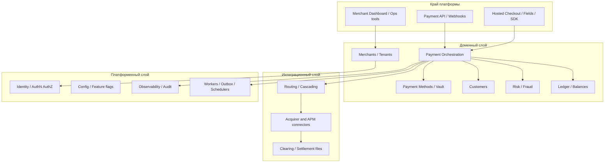
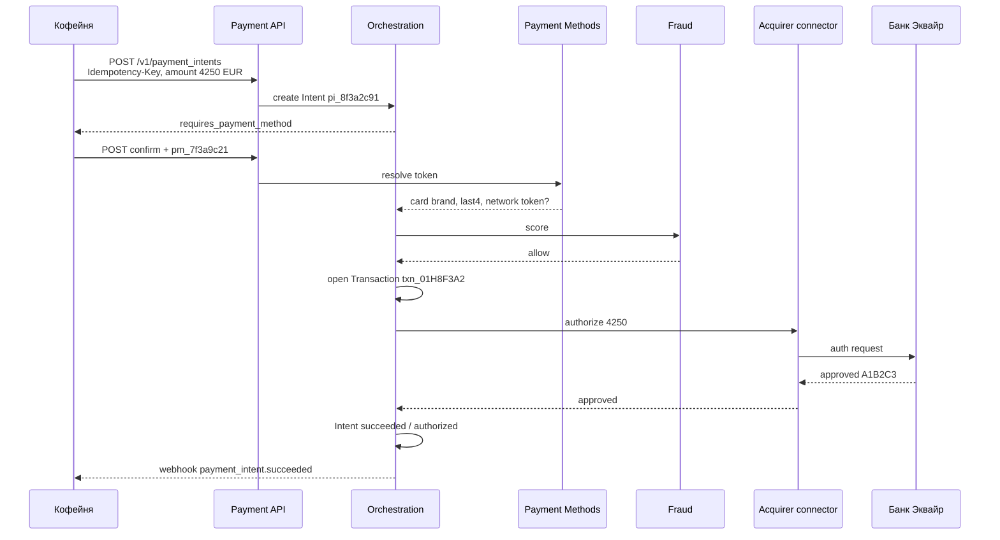
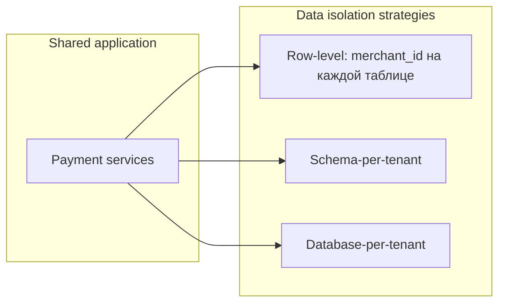
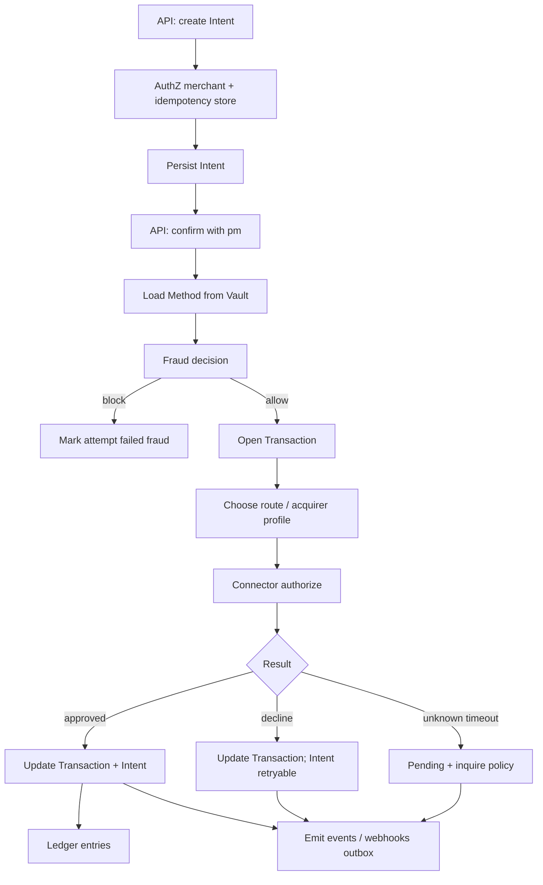
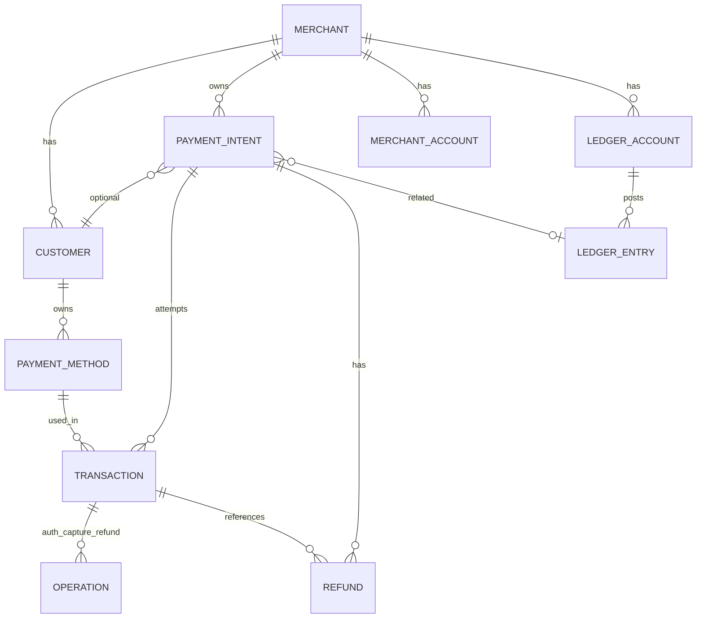

# Глава 20. Архитектура платёжной платформы и доменная модель

К этому моменту у вас уже есть карта местности: кто участвует в платеже ([глава 02](02-ecosystem-participants.md)), как карта живёт в сети ([главы 03](03-bank-card-anatomy.md)–[05](05-card-contexts-and-tokens.md)), как идут auth/capture/settlement ([глава 06](06-payment-lifecycle.md)), как не списать дважды ([глава 07](07-states-async-idempotency.md)), как устроены риск, право и безопасность ([главы 16](16-fraud.md)–[19](19-payment-security-pci.md)). Остаётся вопрос, от которого у инженера начинает чесаться рука: **как это всё собрать в систему**, которую можно сопровождать пять лет, а не переписывать после второго мерчанта.

«Платёжка» — вымышленный PSP в этой книге — не магический чёрный ящик с endpoint `POST /charge`. Это платформа: API для мерчантов, внутренняя доменная модель, сервисы, которые говорят с эквайерами, леджер, fraud, onboarding, payouts. Когда Аня платит **42,50 EUR** за зерно в «Кофейне», снаружи это один JSON и зелёная галочка. Внутри — десяток сущностей, несколько идентификаторов и жёсткие границы между «намерение оплатить», «попытка списать» и «сообщение в банк».

Путаница начинается рано. Команда мерчанта называет всё `Payment`. Команда PSP внутри говорит `Intent`, `Attempt`, `Authorization`, `Capture`. Поддержка ищет по `Transaction ID`, а в логах эквайера — `RRN`. Без общей доменной модели вы получаете систему, где «успешный платёж» означает четыре разных вещи в четырёх сервисах.

Эта глава — про то, **как выглядит платёжная платформа целиком**: слои, сервисы, публичный Payment API, сущности Payment Intent / Payment Order / Transaction, Payment Method, Customer, Merchant, мультитенантность, версионирование API и идентификаторы, без которых нельзя ни отладить инцидент, ни сделать сверку.

## В этой главе

- Платёжная платформа как система слоёв и сервисов
- Payment API: контракт между мерчантом и PSP
- Payment Intent, Payment Order и Transaction — чем отличаются и зачем разделять
- Payment Method, Customer и Merchant как опоры доменной модели
- Мультитенантность: один код — много продавцов
- Версионирование API без боли для интеграторов
- Идентификаторы: Transaction ID, idempotency key и компания вокруг них
- Что проверять в коде и какие грабли ловят почти все

---

## Зачем вообще говорить об «архитектуре платформы»

Если вы строите checkout «Кофейни» и только вызываете чужой PSP, эта глава всё равно нужна: вы проектируете **свою** доменную модель поверх чужого API. Заказ магазина ≠ платёж PSP. Customer в CRM ≠ Customer в vault карт. Без явных границ вы рано или поздно запишете статус эквайера прямо в таблицу `orders` и пожалеете.

Если вы строите саму «Платёжку», ставка выше. Один неверный агрегат («всё есть Payment») через год превращается в:

- невозможность сделать вторую попытку оплаты без нового заказа;
- refund, который не знает, к какому сетевому сообщению относится;
- marketplace, где нельзя честно разделить деньги между продавцами ([глава 26](26-marketplace-and-split-payments.md));
- PCI-scope, размазанный по всем сервисам ([глава 19](19-payment-security-pci.md)).

Архитектура здесь — не про микросервисы ради микросервисов. Это про **границы ответственности и язык**, на котором система говорит о деньгах.

---

## Платёжная платформа целиком: слои

Представим «Платёжку» как пирог. Сверху — то, что видит инженер «Кофейни». Снизу — то, что видит «Банк Эквайр». Посередине — то, за что вы отвечаете перед регулятором, схемой и собственной бухгалтерией.



Словами: мерчант говорит с API и иногда с hosted UI. Оркестрация платежей опирается на методы оплаты, клиентов, риск и леджер. Дальше — маршрутизация на коннекторы к эквайерам и APM. Поперёк всего — аутентификация, конфиги, аудит и фоновые воркеры. Распределённые паттерны (outbox, saga) подробно — в [главе 21](21-distributed-systems-and-money.md); здесь важны **границы**, а не брокер сообщений.

### Слой края (edge)

**Payment API** — основной контракт. REST/JSON сегодня доминирует; иногда GraphQL для dashboard, gRPC внутри. Мерчант создаёт intent, подтверждает, делает capture/refund, читает статусы, подписывается на webhooks.

**Hosted checkout / fields / SDK** — способ принять карту, не раздувая PCI-scope мерчанта. «Кофейня» может вообще не видеть PAN: поля «Платёжки» отдают `pm_…`, а магазин работает только с токенами.

**Dashboard и ops-tools** — для людей: поддержка смотрит timeline платежа, risk-аналитик — правила, финансы — statements. Это не «та же БД в HTML»: права, audit trail и маскирование данных обязательны.

### Доменный слой

Здесь живут сущности, о которых остальная глава: Merchant, Customer, Payment Method, Payment Intent / Order, Transaction (attempt), Refund, Dispute, Balance. Оркестрация знает state machine ([глава 07](07-states-async-idempotency.md)) и вызывает риск, леджер, роутер.

Леджер можно держать отдельным сервисом с более строгими инвариантами — double-entry не любит «потом поправим» ([глава 13](13-ledger-and-reconciliation.md)). Fraud — отдельный контур с собственной latency-политикой: нельзя, чтобы скоринг на 800 мс убивал весь checkout ([глава 16](16-fraud.md)).

### Интеграционный слой

Коннекторы к «Банку Эквайр», к APM, к Open Banking, к file-based settlement. Абстракция «Connector» прячет ISO 8583, SOAP банка и REST кошелька за единым внутренним интерфейсом `authorize / capture / refund / inquire`. Детали протоколов — [глава 22](22-integrations.md). На уровне архитектуры платформы важно одно: **домен не должен знать формат DE#38**.

### Платформенный слой

Аутентификация API-ключей и OAuth, RBAC по тенантам, секреты, feature flags («этому мерчанту включили partial capture»), метрики, трассировка, неизменяемый audit log. Без audit вы не докажете регулятору и схеме, *кто* сделал ручной refund на 42,50 EUR в субботу.

### Монолит, модули или микросервисы?

На старте «Платёжки» часто выигрывает **модульный монолит** с чёткими bounded contexts: Payments, Merchants, Ledger, Risk, Connectors. Микросервисы имеют смысл, когда независимые команды, независимый scale и независимый failure domain того стоят. Деньги не любят «распилили на 40 сервисов и потеряли инвариант». Правило: сначала границы в коде и в голове, потом — в сети.

---

## Сквозной пример: что создаётся, когда Аня платит 42,50 EUR

Зафиксируем идентификаторы, которыми будем пользоваться в главе (иллюстративные, согласованные с духом предыдущих глав):

| Сущность | ID | Где живёт |
|---|---|---|
| Merchant «Кофейня» | `merch_coffeehouse` | «Платёжка» |
| Customer Аня | `cus_anya_001` | «Платёжка» (vault/CRM платежей) |
| Payment Method (карта) | `pm_7f3a9c21` | Vault «Платёжки» |
| Заказ магазина | `ord_coffee_88421` | Бэкенд «Кофейни» |
| Payment Intent | `pi_8f3a2c91` | «Платёжка» |
| Transaction / Attempt | `txn_01H8F3A2` | «Платёжка» |
| Idempotency-Key | `ord_coffee_88421_attempt_1` | Заголовок запроса + store PSP |
| Authorization code | `A1B2C3` | Ответ эмитента |
| RRN | `609182743015` | Сеть / эквайер |

Таймлайн на уровне сущностей:



Словами: сначала появляется **намерение** получить деньги (`pi_…`), привязанное к заказу магазина. Потом подключается **метод** (`pm_…`). Оркестрация открывает **транзакцию-попытку** (`txn_…`), гоняет риск и эквайера, пишет результат обратно в intent. Заказ `ord_coffee_88421` «Кофейня» обновляет у себя — это **её** сущность, не сущность PSP.

Именно это разделение спасает, когда Аня сначала платит картой (decline), потом другой картой (success): один intent, две transaction, один заказ.

---

## Payment API: контракт, а не «обёртка над банком»

Payment API — это продукт. Мерчант платит (буквально, комиссией) за предсказуемость контракта: стабильные статусы, идемпотентность, webhooks, документация, песочница. Если API протекает деталями «Банка Эквайр», каждый раз, когда вы меняете эквайера, ломаются все интеграции.

### Что обычно есть на поверхности

Типичный набор ресурсов (имена варьируются; смысл устойчив):

| Ресурс | Зачем |
|---|---|
| `PaymentIntent` / `Payment` / `PaymentOrder` | Намерение принять оплату |
| `PaymentMethod` | Инструмент: карта, iDEAL, wallet… |
| `Customer` | Покупатель и его сохранённые методы |
| `Refund` | Возврат по успешному платежу |
| `Dispute` / `Chargeback` | Спор (часто read-only + evidence upload) |
| `Payout` / `Balance` | Деньги мерчанту |
| `WebhookEndpoint` | Куда слать события |
| `Merchant` / `Account` | Тенант (иногда только в Connect/platform API) |

Для «Кофейни» минимальный happy path:

1. `POST /v1/payment_intents` — сумма `4250`, валюта `eur`, `metadata.order_id=ord_coffee_88421`.
2. На клиенте — подтверждение с `pm_…` или raw card через hosted fields.
3. При `requires_action` — пройти 3DS ([глава 08](08-3ds-and-sca.md)).
4. Дождаться `succeeded` / `authorized` через sync-ответ, poll или webhook.
5. Отгрузить кофе только после подтверждённого статуса.

```json
{
  "id": "pi_8f3a2c91",
  "object": "payment_intent",
  "amount": 4250,
  "currency": "eur",
  "status": "requires_payment_method",
  "merchant_id": "merch_coffeehouse",
  "customer": "cus_anya_001",
  "metadata": {
    "order_id": "ord_coffee_88421"
  },
  "client_secret": "pi_8f3a2c91_secret_x7k…"
}
```

`client_secret` (или аналог) — способ дать браузеру Ани подтвердить платёж **без** server-side API-ключа мерчанта. Это граница безопасности: publishable/public key + client secret на клиенте; secret key — только на бэкенде «Кофейни».

### Синхронность ответа

API может вернуть финальный статус сразу (карта без 3DS, frictionless) или промежуточный (`processing`, `requires_action`). Контракт обязан это допускать: мерчант не должен писать `if response.ok: order.paid = true` на любой 200. Подробнее про async — [глава 07](07-states-async-idempotency.md); здесь архитектурный вывод: **оркестрация владеет истиной о статусе**, HTTP — лишь транспорт снимка.

### Ошибки API vs отказы платежа

Путают постоянно:

- **4xx/5xx API** — контракт, валидация, auth, лимиты rate, конфликт идемпотентности. Платёж мог не создаться.
- **HTTP 200 + `status=failed` / decline code** — платёж создан, попытка отклонена эмитентом или fraud. Это бизнес-результат, не «сломался API».

Если смешать их в один exception-handler на стороне «Кофейни», поддержка никогда не поймёт, чинить ли интеграцию или говорить Ане «карта отклонена».

### Webhooks как часть API

Webhook — не приятный бонус, а вторая половина контракта. События вроде `payment_intent.succeeded`, `charge.refunded`, `payout.paid` должны быть версионированы, подписаны и документированы так же тщательно, как REST. Иначе мерчант построит систему на sync-ответе и сломается на первом 3DS.

---

## Payment Intent vs Payment Order vs Transaction

Это сердце доменной модели. Названия у вендоров разные; важна семантика трёх уровней.

### Payment Intent — намерение получить деньги

**Payment Intent** (намерение платежа) — объект «мы хотим получить X в валюте Y у этого мерчанта за этот заказ». Он переживает несколько попыток оплаты, 3DS, смену метода. К нему цепляется заказ мерчанта.

Инварианты intent'а (типичные):

- сумма и валюта фиксируются при создании (или меняются явным API *до* первой успешной money-операции);
- у intent'а есть грубый статус: `requires_payment_method` → `requires_confirmation` → `processing` → `succeeded` / `canceled`;
- успешный intent обычно один раз «закрывает» денежное намерение; новая оплата того же заказа после полного fail — либо новый intent, либо новая attempt внутри того же (продуктовый выбор, но он должен быть сознательным).

Для «Кофейни» `pi_8f3a2c91` означает: «за заказ `ord_coffee_88421` нужно 42,50 EUR». Не «вот сообщение ISO 8583».

### Payment Order — тот же смысл, другой акцент

**Payment Order** в некоторых платформах (особенно bank-oriented и enterprise) — почти синоним intent'а: распоряжение принять или отправить платёж. Иногда Order ближе к «платёжному поручению» с несколькими инструкциями (split, gross/net). Иногда это сущность мерчанта («order»), которую PSP ошибочно дублирует у себя.

Практическое правило для «Платёжки»:

- если вы PSP для e-commerce — **Intent** (или просто `Payment` как фасад intent'а) обычно достаточно;
- если вы делаете bank payments / payouts / bulk — слово **Order** может лучше лечь на ISO 20022-мышление;
- не плодите и Intent, и Order как два обязательных слоя без причины — мерчант возненавидит.

В этой книге, когда говорим «логический платёж у PSP», имеем в виду уровень Intent/Order. Когда говорим о конкретной попытке в сети — Transaction/Attempt.

### Transaction (Attempt) — конкретная попытка провести деньги

**Transaction** (часто называют Attempt, Charge, Authorization attempt) — одна попытка исполнить intent: конкретный payment method, конкретный маршрут на эквайера, конкретный ответ сети.

```text
PaymentIntent pi_8f3a2c91  (42,50 EUR, ord_coffee_88421)
├── Transaction txn_01H8F3A2  card pm_7f3a9c21  → declined 51
├── Transaction txn_01H8F3B9  card pm_7f3a9c21  → requires_action (3DS)
│     └── after challenge → authorized A1B2C3 → captured
└── (no more attempts)
```

Зачем отделять:

1. **Аудит и поддержка.** «Почему два списания?» — смотрим две transaction, не один размытый payment.
2. **Retry и cascading.** Smart retry и смена эквайера живут на уровне attempt ([глава 07](07-states-async-idempotency.md), [глава 22](22-integrations.md)).
3. **Сверка.** Clearing file стыкуется с attempt/auth, а не с «намерением».
4. **Refunds и disputes.** Chargeback приходит на конкретную captured transaction / ARN, не на абстрактный intent.

### Слой сетевых операций внутри Transaction

Глубже attempt часто лежит ещё один уровень — операции lifecycle:

- `Authorization`
- `Capture` (в т.ч. partial / multiple)
- `Void` / `Reversal`
- `Refund`

Их можно моделировать как дочерние записи transaction или как event log. Главное — не склеивать «сумма платежа» в одно поле: нужны `authorized_amount`, `captured_amount`, `refunded_amount` ([глава 06](06-payment-lifecycle.md)).

### Как не назвать всё Payment

Антипаттерн:

```text
orders.payment_status = 'ok'
payments.id = ...
payments.raw_acquirer_xml = ...
```

Лучше явная иерархия (имена таблиц иллюстративные):

```text
merchants
customers
payment_methods
payment_intents
  └── payment_transactions (attempts)
        └── payment_operations (auth/capture/refund)  -- опционально
ledger_entries
```

Мерчантскому API можно по-прежнему отдавать упрощённый `Payment`, который = Intent + последняя attempt. Фасад для людей — норма; каша во внутренней модели — нет.

### Сквозной пример: decline, потом успех

1. Аня жмёт «Оплатить». «Кофейня» создаёт `pi_8f3a2c91` с ключом `ord_coffee_88421_attempt_1`.
2. `txn_01H8F3A2` уходит в «Банк Эквайр», эмитент отвечает `51` (недостаточно средств) — soft decline ([глава 09](09-declines-and-response-codes.md)).
3. Intent остаётся `requires_payment_method` / `requires_confirmation`, заказ магазина — `awaiting_payment`.
4. Аня платит другой картой. Новый Idempotency-Key: `ord_coffee_88421_attempt_2`. Новая `txn_01H8F9AA`.
5. Успех. Intent → `succeeded`. Заказ → `paid`.

Если бы «платёж» был одной записью без attempts, шаг 4 превратился бы либо в перезапись истории, либо во второй заказ — оба варианта плохие.

### Когда Intent «толстый», а когда «тонкий»

Два рабочих стиля API:

**Тонкий Intent.** Create почти пустой (сумма, валюта, metadata). Confirm отдельно передаёт method и запускает money movement. Удобно для client-driven checkout: фронт «Кофейни» + SDK «Платёжки» ведут Аню через 3DS.

**Толстый Intent (или one-shot Payment).** Create сразу с method и `confirm=true`. Меньше round-trips для server-to-server (подписка, invoice pay). Хуже для интерактивного 3DS, если не продумать `next_action`.

Оба стиля живут на одной доменной модели. Меняется только то, какие поля обязательны на каком шаге API — не смешивайте это с отказом от Transaction/Attempt внутри.

### Payment Intent и деньги на балансе мерчанта

Успешный Intent не всегда означает «уже можно выводить». Между `succeeded` и available balance — клиринг, сеттлмент, rolling reserve ([глава 12](12-flow-of-funds.md)). В доменной модели платформы это разные проекции одного факта: оркестрация говорит «платёж прошёл», леджер говорит «средства pending». Dashboard «Кофейни», который рисует «баланс += 42,50» в момент webhook `succeeded`, врёт на величину settlement delay — и это уже продуктовый баг, не «так устроен Visa».

---

## Payment Method: инструмент, а не «номер карты в заказе»

**Payment Method** — сохранённый (или одноразовый) способ оплаты, которым можно исполнять intent'ы. Карта Ани после токенизации — `pm_7f3a9c21`. Это не PAN. Это ссылка на данные в vault «Платёжки» (или на network token) плюс метаданные: brand, last4, expiry, country, funding type.

### Зачем отдельная сущность

1. **PCI и безопасность.** PAN/CVV не должны жить в таблице заказов «Кофейни» и не должны размазываться по логам оркестрации ([глава 19](19-payment-security-pci.md)).
2. **Повторные оплаты.** Подписка, one-click, MIT — всё требует reusable method ([глава 05](05-card-contexts-and-tokens.md)).
3. **Полиморфизм методов.** Карта, SEPA Debit, iDEAL, Apple Pay, BNPL — разные данные, один «слот» в intent: `payment_method_id` или `type + details`.
4. **Жизненный цикл инструмента.** Карта истекла, network token обновлён, метод отвязан клиентом — это события method'а, не каждого исторического платежа.

### Типы и дискриминатор

В модели удобен tagged union:

| type | Что хранится (логически) |
|---|---|
| `card` | brand, last4, exp, fingerprint, token refs |
| `sepa_debit` | masked IBAN, mandate id |
| `ideal` | bic / issuers — часто одноразовый flow |
| `apple_pay` / `google_pay` | wallet token / cryptogram context |
| `bnpl` | session / provider reference |

Одноразовые redirect-методы иногда **не** сохраняют как reusable `pm_…`, а живут только внутри attempt. Это нормально: не натягивайте card-on-file модель на iDEAL силой.

### Привязка к Customer

Method обычно принадлежит Customer (`cus_anya_001`) или существует как «detached» до привязки. Для guest checkout «Кофейня» может создать intent без customer, принять карту, опционально создать customer после успеха — если Аня согласилась на сохранение карты.

### Что method не должен содержать

- CVV после авторизации (не хранить);
- полные track data;
- секреты wallet cryptogram дольше, чем нужно для одной auth;
- «универсальный» сырой ответ эквайера на 50 КБ в JSONB «на всякий случай» без политики retention.

Fingerprint карты (хэш) — полезен для fraud velocity и дедупа методов; это не замена токену и не способ «восстановить PAN».

---

## Customer: кто платит глазами платформы

**Customer** в платёжной платформе — не полный профиль человека из CRM «Кофейни». Это платёжный профиль: идентификатор, контакты для receipts/risk, список payment methods, иногда tax/billing address, флаги («не сохранённые карты», «3DS всегда»).

```json
{
  "id": "cus_anya_001",
  "merchant_id": "merch_coffeehouse",
  "email": "anya@example.com",
  "name": "Anna Example",
  "created": "2026-03-12T16:01:00Z",
  "default_payment_method": "pm_7f3a9c21"
}
```

### Зачем он нужен

- привязать несколько `pm_…` к одному человеку;
- считать velocity и ATO-сигналы ([глава 16](16-fraud.md));
- показать «сохранённые карты» в checkout;
- связать историю платежей для поддержки;
- для подписок и MIT — якорь согласия и мандатов.

### Чего Customer не делает

Он не заменяет cardholder в схеме. Эмитент знает Аню как держателя карты; «Платёжка» знает `cus_anya_001` как запись мерчанта `merch_coffeehouse`. Это разные миры. Один человек у двух мерчантов — обычно **два** Customer (если нет platform-wide identity), и это правильно с точки зрения изоляции данных.

### Связь с заказом магазина

«Кофейня» может иметь своего `user_42`. Связь:

```text
Coffeehouse.user_42  ←→  metadata / merchant_customer_id  ←→  cus_anya_001
```

Не сливайте PK магазина с PK «Платёжки». Иначе миграция пользователей и право на забвение (GDPR) превратятся в квест ([глава 18](18-regulation-and-compliance.md)).

### Guest vs registered

Гостевой checkout: Customer опционален или создаётся «эфемерный». После оплаты «Кофейня» решает, создавать ли аккаунт. Не блокируйте платёж обязательной регистрацией без продуктовой причины — conversion скажет спасибо.

---

## Merchant: тенант, договор и конфигурация

**Merchant** — продавец как сущность платформы. Для «Платёжки» `merch_coffeehouse` — это тенант: юридический профиль, KYB-статус, MID у эквайера, тарифы, включённые методы, webhook URL, лимиты, reserves, доступ к dashboard.

Подробный merchant-domain (onboarding, statements, payouts) — [глава 25](25-merchant-domain.md). Здесь — место Merchant в архитектуре.

### Что хранит платформа о мерчанте

| Область | Примеры полей |
|---|---|
| Identity | legal name, country, registration numbers |
| Risk / compliance | KYB status, MCC, expected volumes, restrictions |
| Acquiring | acquirer accounts, MIDs, descriptors |
| Product config | enabled methods, 3DS policy, capture mode (auto/manual) |
| Commercial | pricing profile, fees, reserves |
| Technical | API keys, webhook endpoints, IP allowlists |
| Money | balance accounts, payout schedule, bank accounts |

### Merchant ≠ один MID

У «Кофейни» может быть:

- отдельный MID на EUR domestic;
- другой — на cross-border;
- sandbox MID;
- отдельный аккаунт под subscription billing.

В модели это часто `Merchant` 1→N `MerchantAccount` / `AcquiringProfile`. Routing выбирает профиль на attempt.

### Platform / marketplace merchants

Если «Платёжка» обслуживает маркетплейс, появляются platform account и connected accounts / sub-merchants. Архитектурно это всё ещё Merchant-сущности с разными ролями и графом связей. Деньги и split — [глава 26](26-marketplace-and-split-payments.md); регуляторика PayFac vs marketplace — [глава 02](02-ecosystem-participants.md) и [глава 18](18-regulation-and-compliance.md).

### Конфигурация как данные

Не зашивайте «Кофейня всегда auto-capture» в код. Capture mode, список методов, soft-descriptor, fraud sensitivity — **данные тенанта**. Иначе каждый новый продавец = новый деплой.

---

## Мультитенантность: один код — много продавцов

«Платёжка» по определению мультитенантна: тысячи мерчантов делят платформу. Ошибка изоляции здесь — не «утёк чужой TODO», а **чужие платежи, чужие выписки, чужие карты**.

### Модели изоляции



**Row-level tenancy** (самый частый для PSP среднего размера): в каждой бизнес-таблице есть `merchant_id`, все запросы фильтруют по нему, API-ключ мапится на merchant. Плюсы — операционная простота. Минусы — один баг в WHERE = data leak; нужна железная дисциплина (middleware,强制 RLS в Postgres, тесты на cross-tenant).

**Schema-per-tenant / DB-per-tenant** — для enterprise-клиентов с жёсткими требованиями. Дороже в ops. Иногда гибрид: обычные мерчанты в shared, крупные — выделенные.

### Правила, которые стоит кодировать

1. **Секретный ключ API определяет тенант.** Нельзя передать `merchant_id` в теле и «поработать от имени соседа».
2. **Все ID непрозрачны и глобально уникальны** (`pi_…`, `pm_…`), но **авторизация всё равно проверяет ownership**. Знание чужого `pi_8f3a2c91` не должно давать доступ.
3. **Фоновые джобы** несут `merchant_id` в сообщении; воркер не «выбирает все pending платежи мира» без тенант-контекста в аудите.
4. **Логи и метрики** маркируются `merchant_id`, но PII и карточные данные маскируются.
5. **Поддержка dashboard** — явный break-glass с audit: кто смотрел платёж Ани.

### Шумные соседи (noisy neighbor)

Один мерчант с card-testing атакой может съесть fraud-лимиты и CPU. Нужны per-tenant rate limits, очереди с приоритетами, изоляция пулов коннекторов. Это уже надёжность ([глава 23](23-reliability.md)), но закладывается в архитектуру тенантности.

### Конфиг и feature flags

Мультитенантность — не только данные. Это:

- включить Pix только бразильским мерчантам;
- выкатить новый 3DS flow на 5% трафика «Кофейни»;
- отключить payout конкретному аккаунту при AML-алертах.

Делайте это конфигурацией, а не ветками `if merchant == coffee`.

### Тенантность на уровне ключей и ролей

У «Кофейни» обычно несколько credential'ов:

- `sk_live_…` / `sk_test_…` — server-side secret;
- `pk_live_…` — publishable для браузера;
- ограниченные ключи для партнёров или ERP (только read payments, без payout);
- dashboard-пользователи с RBAC (админ, поддержка, финансы, read-only).

Архитектурно каждый ключ и каждая сессия несут `merchant_id` + scopes. Проверка scope — не «если роль admin», а явный capability: `payments:write`, `payouts:write`, `customers:read`. Иначе стажёр поддержки с «почти админом» сделает массовый refund «чтобы помочь».

Test и live — разные тенант-миры или жёстко разделённые пространства id. Смешать `cus_anya_001` из sandbox с live charge — классика онбординга интегратора.

### Общие справочники vs данные тенанта

BIN-таблицы, списки санкций, курсы FX, каталог APM — shared. Customer, Method, Intent, ключи, webhook secrets — tenant-private. Граница должна быть очевидной в схеме: shared-схема без `merchant_id` не должна содержать PII покупателей. Иначе «оптимизация» join'ов через год станет дырой.

---

## Версионирование API

Платёжный API живёт годами. Мерчанты обновляются медленно. Вы не можете «просто поменять семантику status» во вторник.

### Стратегии

| Подход | Пример | Когда уместен |
|---|---|---|
| URL version | `/v1/payment_intents` | Самый понятный для публичного API |
| Header version | `Pay-Version: 2026-03-01` | Мелкие эволюции без взрыва URL |
| Date-based | как у крупных PSP | Непрерывная эволюция + pinned version у мерчанта |

Частый гибрид: major в URL (`v1` / `v2` при ломающих изменениях), внутри v1 — dated versions для полей и event shapes.

### Что считать breaking change

- удаление/переименование поля;
- изменение смысла статуса (`authorized` больше не означает hold);
- обязательность нового поля без default;
- изменение идемпотентности или кодов ошибок;
- изменение формы webhook так, что старый парсер падает.

Неbreaking: новое опциональное поле, новый статус *если* клиенты уже обязаны иметь default-ветку, новый event type (клиент игнорирует неизвестное — и это надо задокументировать).

### Совместимость webhooks

Версия API мерчанта должна определять **форму событий**, которые он получает. Иначе dashboard на v1, а webhook уже v2 с другой схемой — классический инцидент «деньги есть, заказ не создался».

### Deprecation policy

Честная политика:

1. анонс;
2. период параллельной поддержки;
3. метрики «кто ещё на старой версии»;
4. напоминания;
5. только потом — выключение.

Для платежей «мы предупредили в changelog» недостаточно: нужны письма на technical contacts мерчанта и dashboard-баннер.

### Внутренний API vs публичный

Коннекторы и внутренние сервисы могут эволюционировать быстрее. Несветите внутренние DTO наружу. Anti-corruption layer между доменом и эквайером спасает публичный контракт, когда «Банк Эквайр» меняет SOAP.

### Пример эволюции без боли

«Платёжка» хочет добавить в ответ Intent поле `amount_capturable` (для DMS). Это additive → можно отдать всем на текущей dated version или только тем, кто поднял `Pay-Version` выше даты релиза. Менять `amount` с major units на minor — breaking: либо новый major `/v2`, либо долгий dual-write с явным `amount_decimal` и deprecation старого поля. Деньги и exponent — место, где «маленький рефакторинг поля» превращается в инцидент на 100× ([глава 14](14-currencies-and-fx.md)).

### Контрактные тесты для мерчантов

Держите suite примеров: create intent 42,50 EUR, confirm, webhook body, refund. Прогоняйте его на каждой версии API в CI. Когда ломаете контракт — тест красный *до* того, как красной станет «Кофейня» в понедельник утром. Это дешёвая страховка по сравнению с program manager'ом, который обзванивает топ-мерчантов.

---

## Идентификаторы: нить, на которой держится инцидент

Тема скучная — до первой ночи, когда Аню списали дважды, а вы не можете слинковать логи магазина, PSP и эквайера. Идентификаторы — часть доменной модели, не «деталь БД».

### Карта идентификаторов одного платежа 42,50 EUR

| ID | Кто выдаёт | Для чего |
|---|---|---|
| `ord_coffee_88421` | «Кофейня» | Бизнес-заказ, UX, склад |
| `pi_8f3a2c91` | «Платёжка» | Payment Intent / логический платёж |
| `txn_01H8F3A2` | «Платёжка» | Attempt / Transaction ID |
| `Idempotency-Key` | «Кофейня» (клиент API) | Дедуп side-effect запросов |
| `pm_7f3a9c21` | «Платёжка» | Payment Method |
| `cus_anya_001` | «Платёжка» | Customer |
| `merch_coffeehouse` | «Платёжка» | Merchant / tenant |
| `A1B2C3` | Эмитент | Authorization code |
| `609182743015` | Эквайер/сеть | RRN |
| STAN | Эквайер | Локальный trace в ISO-мире |
| ARN | Сеть после clearing | Поиск в диспутах |
| `evt_…` | «Платёжка» | Webhook event id |

Полный справочник — [глава 28](28-glossary.md). Здесь — как их проектировать.

### Transaction ID

**Transaction ID** в платформе — стабильный уникальный идентификатор attempt'а (`txn_01H8F3A2`). Его свойства:

- глобально уникален в рамках «Платёжки»;
- неизменяем;
- попадает во все логи, webhooks, support UI;
- связывается с внешними id эквайера, когда они появляются (не всегда в момент auth).

Не используйте автоинкремент `42` как публичный Transaction ID: enumeration, коллизии при шардировании, утечка объёмов. Prefixed opaque id (`txn_`, ULID/UUID) удобнее.

Путаница имён: мерчант может называть Transaction ID то, что у вас Intent ID. В документации явно пишите: «наш `payment_intent.id` vs `transaction.id`». В поддержке заведите поиск по всем видам id.

### Idempotency key

**Idempotency key** — ключ логической попытки выполнить side-effecting операцию один раз. Подробная механика — [глава 07](07-states-async-idempotency.md); архитектурные правила:

1. Ключ задаёт **клиент API** (мерчант), а не PSP. PSP хранит mapping key → request hash → response.
2. Scope обычно `(merchant_id, key)` — у разных тенантов ключи не пересекаются.
3. Ключ обязателен на create payment, capture, refund, payout — везде, где повтор опасен.
4. Тот же ключ + то же тело = тот же результат. Тот же ключ + другое тело = конфликт (409).
5. Новая попытка Ани платить после decline = **новый ключ** (новый attempt), не переиспользование.

Пример для «Кофейни»:

```http
POST /v1/payment_intents HTTP/1.1
Authorization: Bearer sk_live_…
Idempotency-Key: ord_coffee_88421_attempt_1
Content-Type: application/json

{
  "amount": 4250,
  "currency": "eur",
  "metadata": {"order_id": "ord_coffee_88421"}
}
```

Хранилище ключей — часть платформы: TTL (например, сутки–недели), статус `in_progress` на время первой обработки, защита от гонок (unique constraint). Это не «кэш ответа», это **предохранитель денег**.

### Correlation и metadata

Помимо системных id, дайте мерчанту `metadata` / `merchant_reference`. Туда кладут `ord_coffee_88421`. Не делайте merchant reference единственным первичным ключом внутри PSP: он не обязан быть уникальным, если мерчант ошибся. Но индексируйте его для поиска.

Внутри платформы прокидывайте **correlation id** / trace id через оркестрацию → коннектор → логи. Когда inquire в банк пойдёт через минуту, вы найдёте ту же цепочку.

### Внешние идентификаторы

RRN, STAN, ARN, auth code появляются на интеграционной границе. Храните их на Transaction/Operation, не на Merchant. Для диспутов ARN критичен ([глава 17](17-chargebacks-and-disputes.md)). Не ждите, что у всех APM будет RRN: у bank transfer будут свои end-to-end id ([глава 10](10-bank-based-methods.md)).

### Стабильные префиксы

Соглашение по префиксам ускоряет жизнь:

| Префикс | Сущность |
|---|---|
| `merch_` | Merchant |
| `cus_` | Customer |
| `pm_` | Payment Method |
| `pi_` | Payment Intent |
| `txn_` | Transaction / Attempt |
| `re_` | Refund |
| `evt_` | Event |
| `wh_` | Webhook endpoint |

Человек в поддержке по строке `pm_…` сразу понимает, что ищет метод, а не платёж.

### Идентификаторы в логах и трассировке

Минимальный набор полей в structured log на каждый hop оркестрации:

```json
{
  "merchant_id": "merch_coffeehouse",
  "payment_intent_id": "pi_8f3a2c91",
  "transaction_id": "txn_01H8F3A2",
  "idempotency_key_hash": "sha256:…",
  "order_id": "ord_coffee_88421",
  "correlation_id": "corr_9aa1…",
  "route": "acq_bank_acquire_eur",
  "event": "authorize.approved"
}
```

Хэшируйте idempotency key в логах, если ключ содержит PII или предсказуемый order id (иногда order id и есть ключ — тогда это уже не секрет, но единообразие хэширования не мешает). Никогда не логируйте client_secret, API secret, PAN, CVV.

### Что отдавать мерчанту в API, а что — только внутрь

Мерчанту: `pi_…`, `txn_…` (или объединённый фасад), `pm_…`, `cus_…`, status, decline codes, client-facing messages.

Внутрь и в ops: RRN, STAN, raw acquirer codes, route id, fraud score, employee id ручного вмешательства.

Смешение этих слоёв в одном публичном JSON — как дать интегратору ружье: он привяжется к RRN, вы смените эквайера, RRN-формат изменится, его сверка умрёт. Если отдаёте сетевые id — помечайте как `optional` / `provider_references` и не обещайте стабильность между маршрутами.

---

## Как сервисы разговаривают внутри: оркестрация платежа

Соберём поток create+confirm для 42,50 EUR на уровне внутренних вызовов (логическом, не обязательно HTTP):



Замечания архитектора:

- **Idempotency store** стоит до тяжёлой работы.
- **Vault** отделён: оркестрация получает минимум данных (brand, last4, token handle), не «весь PAN в переменной на всякий случай».
- **Fraud** может быть sync (жёсткий порог) или async shadow-mode; для денег в проде нужен явный decision.
- **Ledger** лучше обновлять в одной транзакции с доменом или через transactional outbox — иначе статус `succeeded` без проводки ([глава 13](13-ledger-and-reconciliation.md), [глава 21](21-distributed-systems-and-money.md)).
- **Webhook** наружу — из outbox, не из «отправили в HTTP и забыли» внутри запроса мерчанта.

### Синхронные границы и асинхронные хвосты

Публичный confirm может ждать эквайера 2–5 секунд (бюджет таймаутов — [глава 23](23-reliability.md)). Clearing files, settlement, поздние webhooks от APM, обновление network token — хвосты. Архитектура должна допускать, что **доменный статус догоняется событиями**, а не только request/response.

---

## Доменная модель в разрезе данных (логическая ER)



Читать словами: мерчант владеет клиентами, методами (через клиентов), намерениями платежей и счетами леджера. У намерения много попыток; у попытки — операции lifecycle; возвраты связаны с успешным платежом/попыткой. Это не обязательная схема БД — это **ментальная модель**, от которой отталкиваются миграции.

### Поля, которые забывают, а потом добавляют в боли

На Intent: `capture_method`, `confirmation_method`, `statement_descriptor`, `return_url`, `metadata`, `amount_received`, `canceled_at`.

На Transaction: `acquirer_name`, `route_id`, `network_transaction_id` (для последующих MIT), `response_code`, `advice_code`, `latency_ms`, `error_class` (issuer/scheme/technical).

На Method: `fingerprint`, `network_token_status`, `mandate_id`, `wallet_type`.

Без этих полей через год вы будете парсить сырые JSON эквайера regex'ами в Jupyter.

---

## Границы ответственности: что не класть в Payment Orchestration

Оркестрация платежей — соблазнительный god-object. Сопротивляйтесь.

| Concern | Куда |
|---|---|
| KYB / onboarding документы | Merchant / Compliance |
| Бухгалтерский COA и FS-отчёты | Ledger + Finance |
| Правила fraud и списки | Risk |
| ISO 8583 bitmap | Connector |
| HTML страница чекаута | Edge / Hosted UI |
| Расписание payout | Treasury / Payout service |
| PCI key ceremony | Security / HSM ops |

Оркестрация **координирует**, но не становится свалкой. Иначе любое изменение тарифа или AML-правила будет трогать код списания 42,50 EUR.

---

## Для любопытных: зачем PSP копирует «чужие» модели Stripe-подобных API

Индустрия частично сошлась на Intent + Method + Customer не из любви к одному вендору, а потому что модель переживает реальность: ретраи, 3DS, сохранённые карты, webhooks. Можно назвать сущности иначе (`Charge`, `Order`, `Instrument`) — но если вы сольёте intent и attempt, вы изобретёте те же грабли заново. Заимствовать **семантику**, а не копировать слепо каждое поле публичного API конкурента — нормальная инженерная стратегия. Слепое копирование включая устаревшие углы — уже нет.

---

## Врезка: как это бывает в жизни

Команда «Кофейни» два года хранила `psp_payment_id` прямо в `orders` и считала его «номером транзакции». Когда «Платёжка» включила retries внутри одного intent, у одного заказа стало несколько attempt id в отчётах эквайера, а в админке магазина — один. Сверка «по payment_id» разъехалась с settlement file на 18 операциях за день. Чинили не Visa. Чинили доменную модель: добавили таблицу attempts, начали писать `txn_…`, научили саппорт искать по ARN и по order id отдельно. Мораль: **внешний id эквайера и логический id заказа связаны через attempt, а не телепатически**.

---

## Что это значит для инженера

1. **Разведите слои сущностей:** Merchant → Customer → Payment Method → Payment Intent/Order → Transaction/Attempt → Operation. Даже если публичный API упрощает фасад.

2. **Заказ мерчанта и платёж PSP — разные агрегаты.** Связь через metadata / references, не через общую таблицу статусов.

3. **Transaction ID обязателен для каждой money-попытки.** Intent без attempts годится только для демо.

4. **Idempotency-Key — часть архитектуры API**, со store, TTL, конфликтом тел и scope по merchant. Не optional middleware «потом включим».

5. **Мультитенантность по умолчанию:** каждый запрос с tenant context; тесты на cross-tenant access; RLS или эквивалент.

6. **Версионируйте REST и webhooks вместе.** Pin версии у мерчанта. Ломающие изменения — по политике deprecation.

7. **Префиксы id и correlation** заложите в день первый: дешевле, чем reverse-engineering логов после инцидента.

8. **Vault Payment Methods отдельно** от оркестрации и от БД заказов мерчанта; минимизируйте PCI scope ([глава 19](19-payment-security-pci.md)).

9. **Конфиг мерчанта — данные**, не код: методы, capture mode, 3DS policy, routing profiles.

10. **События наружу через outbox**, статусы — через явную state machine ([глава 07](07-states-async-idempotency.md), [глава 21](21-distributed-systems-and-money.md)).

11. **Наблюдаемость:** метрики с `merchant_id`, `method_type`, `route`, но без PAN/CVV; timeline по `pi_` / `txn_`.

12. **Тесты доменной модели:** вторая попытка после decline; конфликт idempotency; чужой merchant не читает `pi_`; refund ссылается на captured attempt; partial capture поля сумм.

13. **Документируйте отображение** Intent/Transaction/Order id для саппорта и мерчантов одной таблицей «какой id где искать».

14. **Не протекайте детали коннектора** в публичный API: смените эквайера — контракт «Кофейни» должен жить.

---

## Типичные ошибки и грабли

**Одна таблица `payments` на всё.** История попыток перезаписывается; cascading и 3DS превращаются в кашу; сверка невозможна.

**Merchant reference как primary key.** Два запроса с одним `order_id` из бага магазина либо ломают уникальность, либо молча склеивают разные оплаты.

**API-ключ в браузере.** Secret key на фронте «Кофейни» = полный контроль над мерчантом. Нужны publishable key + client secret / session.

**Версия API только в Swagger, не в runtime.** Мерчант думает, что на v1, а webhooks уже другие.

**Идемпотентность только на create Intent.** Повторный `POST /refunds` без ключа — двойной возврат Ане.

**Tenant id из тела запроса.** Клиент прислал `merchant_id=merch_other` — и вы ему поверили.

**Customer глобальный на всю «Платёжку» без merchant scope.** Утечка методов между продавцами и GDPR-кошмар.

**Хранение CVV «для удобства повторных charge».** Запрещено политиками схем и PCI; аудитором наказывается.

**Смешение Authorization code с Transaction ID.** Auth code короткий и не уникален глобально; искать по нему без даты/MID — лотерея.

**Публичные sequential id.** Скрейпинг объёмов и чужих ресурсов.

**Оркестрация зовёт эквайера, потом думает про идемпотентность.** При ретрае на обрыве — вторая auth. Сначала store/lock, потом side effect.

**«Временный» raw_response в проде навсегда.** PII, раздувание таблиц, случайный вывод в dashboard без маскирования.

**Один статус на Intent и на Transaction.** Невозможно показать «попытка 1 declined, попытка 2 processing».

**Фича-флаги в коде деплоя без тенанта.** Включили новый flow всем, у половины мерчантов отвалился capture.

**Нет mapping таблицы внешних id.** Settlement file пришёл с RRN, а у вас в БД только `pi_…` — ручной труд на неделю.

**Считают Payment Order сущностью склада.** PSP начинает хранить SKU и слоты доставки — и становится кривой ERP.

**Ломающий rename поля `amount` → `amount_minor` без версии.** «Мелочь», из-за которой у «Кофейни» цены уезжают в 100 раз (exponent).

---

## Итоги главы

1. Платёжная платформа — слоёная система: edge (API/UI), домен, интеграции, платформенные сервисы; границы важнее количества репозиториев.
2. Payment API — продукт со статусами, ошибками, webhooks и идемпотентностью, а не тонкая прокси над банком.
3. **Payment Intent / Payment Order** моделирует намерение получить деньги; **Transaction / Attempt** — конкретную попытку; операции auth/capture/refund живут ещё глубже.
4. **Payment Method** — токенизированный инструмент с жизненным циклом; не кладите карту в заказ.
5. **Customer** — платёжный профиль в scope мерчанта; не путайте с cardholder схемы и с CRM магазина.
6. **Merchant** — тенант с конфигом, рисками, acquiring-профилями и деньгами; часто 1→N account'ов.
7. Мультитенантность требует жёсткой изоляции данных, ключей и логов; ошибка WHERE = инцидент безопасности.
8. Версионирование API и webhooks — обязательная часть платформы; breaking changes без политики deprecation ломают чужой бизнес.
9. **Transaction ID** и **Idempotency-Key** — разные инструменты: первый идентифицирует попытку, второй предотвращает её дублирование при ретраях.
10. Корреляция id (order, intent, txn, RRN/ARN, event) — то, чем вы будете спасать выходные; проектируйте её сразу.
11. Оркестрация координирует vault, risk, routing, ledger и outbox; она не должна стать god-object.
12. Дальше логичный шаг — как эти сервисы живут в распределённой среде, где сообщения дублируются, часы врут, а «ровно один раз» не существует: [глава 21](21-distributed-systems-and-money.md).

---

## Связанные главы

- [Глава 02. Участники платёжной экосистемы](02-ecosystem-participants.md) — роли, которые платформа моделирует и прячет за API
- [Глава 05. CP/CNP, credentials on file, токены](05-card-contexts-and-tokens.md) — природа Payment Method и COF
- [Глава 06. Жизненный цикл карточного платежа](06-payment-lifecycle.md) — auth/capture/refund как операции под Transaction
- [Глава 07. Состояния, webhooks, идемпотентность](07-states-async-idempotency.md) — state machine и механика Idempotency-Key
- [Глава 12. Что происходит с деньгами](12-flow-of-funds.md) — pending/available и почему Intent ≠ баланс
- [Глава 13. Ledger и reconciliation](13-ledger-and-reconciliation.md) — деньги рядом с доменными статусами
- [Глава 14. Валюты и FX](14-currencies-and-fx.md) — exponent и ломающие изменения amount в API
- [Глава 16. Payment fraud](16-fraud.md) — risk как отдельный контур в архитектуре
- [Глава 18. Регуляторика и compliance](18-regulation-and-compliance.md) — KYB мерчанта, данные Customer
- [Глава 19. Безопасность и PCI DSS](19-payment-security-pci.md) — vault, scope, секреты API
- [Глава 21. Распределённые системы и деньги](21-distributed-systems-and-money.md) — outbox, saga, exactly-once
- [Глава 22. Интеграции](22-integrations.md) — коннекторы и маршрутизация под Transaction
- [Глава 23. Надёжность](23-reliability.md) — таймауты, failover, изоляция тенантов
- [Глава 25. Merchant-side](25-merchant-domain.md) — onboarding, balance, payouts подробно
- [Глава 26. Marketplace и split payments](26-marketplace-and-split-payments.md) — граф мерчантов и раздельные бенефициары
- [Глава 28. Глоссарий и идентификаторы](28-glossary.md) — справочник id в одном месте
- [Глава 29. Сквозные сценарии I](29-scenarios-part-1.md) — как сущности ведут себя в сбоях
- [Глава 30. Сквозные сценарии II](30-scenarios-part-2.md) — деньги, диспуты, восстановление состояния
