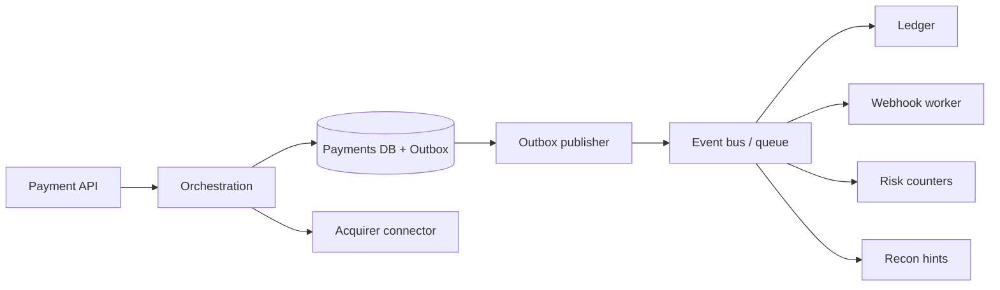
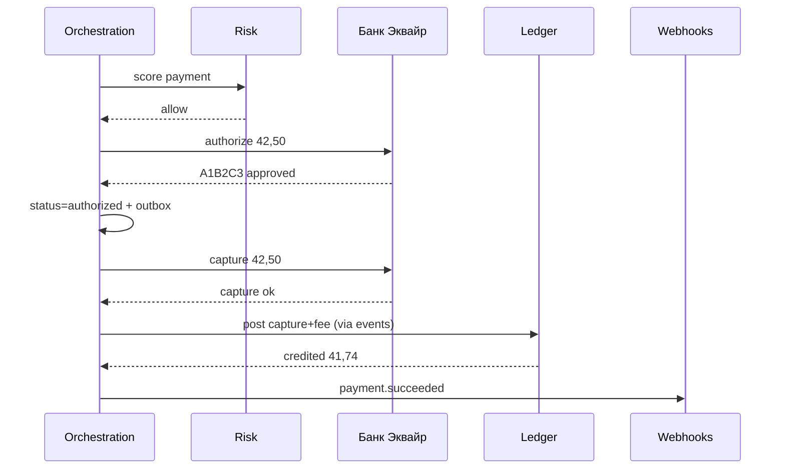
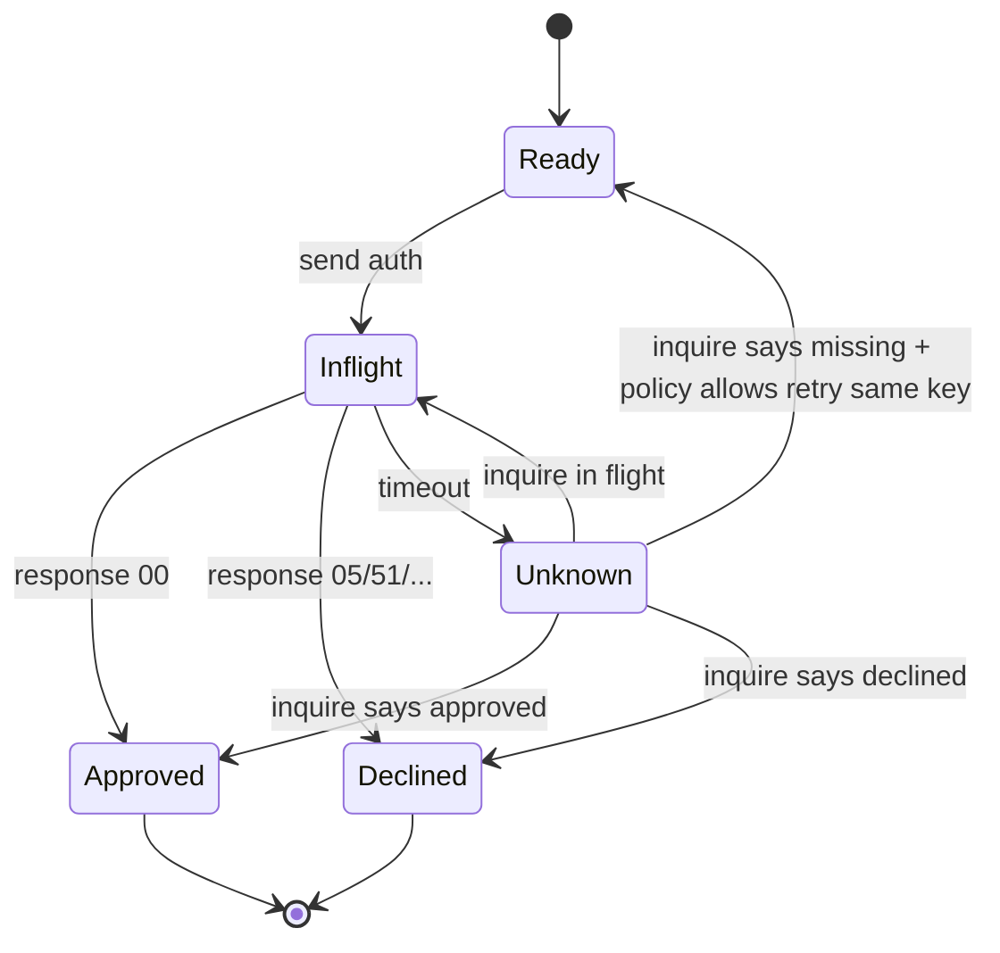
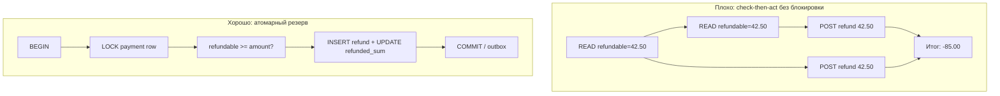
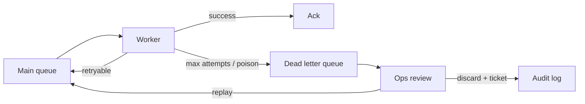
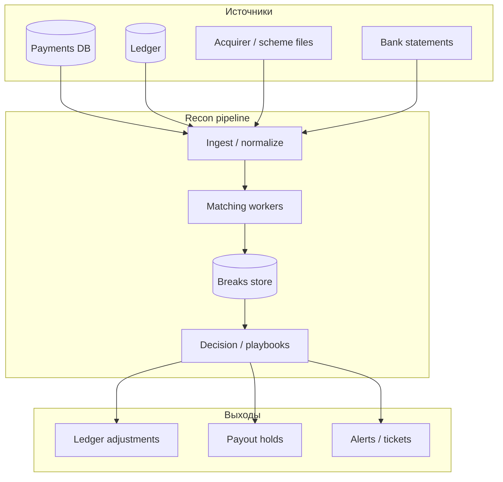

# Глава 21. Распределённые системы и деньги

В [главе 20](20-platform-architecture.md) «Платёжка» наконец обрела форму: слои, Payment Intent `pi_8f3a2c91`, Transaction `txn_01H8F3A2`, vault, risk, ledger, коннекторы. На диаграммах сервисы соединены стрелочками, и кажется, что достаточно «вызвать ledger после capture». В продакшене стрелочка — это сеть. Сеть рвётся. Процесс умирает между двумя `INSERT`. Брокер доставляет одно и то же сообщение три раза. Аня уже видит зелёную галочку, а проводка на 41,74 EUR ещё не существует — или, хуже, существует дважды.

Деньги не прощают распределённых полумер. В обычном CRUD «пользователь дважды поставил лайк» — косметика. В платежах «дважды провели capture» — это либо двойное списание с карты Ани, либо двойное начисление «Кофейне», либо дыра в settlement, которую потом месяц разбирают finance и SRE. Формула из [главы 07](07-states-async-idempotency.md) — *at-least-once + идемпотентные обработчики* — здесь становится не советом про webhooks, а **архитектурным законом платформы**.

Эта глава — про то, как внутри PSP (и у зрелого мерчанта) живут события, очереди, саги, outbox, таймауты и сверка как конвейер. Мы уже умеем говорить о статусах платежа и Idempotency-Key снаружи. Теперь разберём, как не потерять и не удвоить деньги *между своими сервисами*, когда один HTTP-запрос «Кофейни» порождает десяток внутренних побочных эффектов.

## В этой главе

- Event-driven architecture и очереди в платёжной платформе
- Event sourcing: когда журнал событий — источник истины, а когда — ловушка
- Распределённые транзакции: почему 2PC почти никогда, и как работают saga и outbox
- Идемпотентность, at-least-once и миф про exactly-once
- Консистентность, гонки и двойные платежи
- Failure handling: timeouts, retries, dead-letter queues
- Архитектура reconciliation как распределённой системы
- Наблюдаемость money-path: корреляция, метрики-предохранители
- Что проверять в коде — и какие грабли ловят все

---

## Почему деньги и распределёнка конфликтуют

Классическая транзакция БД обещает ACID внутри одного процесса и одной базы. Платёж Ани на **42,50 EUR** за заказ `ORD-2026-0918-0042` этим миром не ограничивается. Даже если оркестрация «Платёжки» — модульный монолит, у неё всё равно есть:

- внешний вызов к «Банку Эквайр» (сеть, чужая БД, чужие таймауты);
- асинхронная доставка webhook «Кофейне»;
- фоновый capture или settlement job;
- запись в леджер ([глава 13](13-ledger-and-reconciliation.md));
- обновление fraud-скора, лимитов мерчанта, метрик.

Каждый из этих шагов может завершиться успехом, ошибкой, таймаутом «неизвестно» или успехом с потерей ответа. Распределённая система умеет одно: **гарантировать доставку хуже, чем хочется бизнесу**. Бизнес хочет «ровно один раз списали и ровно один раз начислили». Физика сети отвечает: «могу пообещать at-least-once или at-most-once; ровно один раз — ваша домашняя работа».

Отсюда три инженерных принципа главы:

1. **Граница транзакции БД не пересекает внешний side effect.** Нельзя открыть `BEGIN`, вызвать эквайера, потом `COMMIT` — и надеяться, что это атомарно.
2. **Эффект денег идемпотентен по бизнес-ключу**, а не по «раз сообщение пришло».
3. **Сверка — не бухгалтерия на выходных, а страховка от дыр в гарантиях доставки.**

Дальше — инструменты, которыми эти принципы воплощают.

---

## Event-driven architecture в платёжной платформе

Event-driven architecture (EDA) — стиль, в котором сервисы реагируют на **события** («что случилось»), а не только на синхронные команды («сделай вот это прямо сейчас»). В платежах события естественны: платёж — это процесс во времени. Auth approved, capture settled, refund created, dispute opened — всё это факты, которые нужно раздать заинтересованным.

Когда Аня успешно проходит auth, оркестрация фиксирует факт и публикует roughly:

```json
{
  "event_id": "evt_9c21a0",
  "type": "payment.authorized",
  "occurred_at": "2026-09-18T10:00:26.412Z",
  "payment_id": "pay_8f3a2c91",
  "payment_intent_id": "pi_8f3a2c91",
  "transaction_id": "txn_01H8F3A2",
  "merchant_id": "merch_coffeehouse",
  "order_id": "ORD-2026-0918-0042",
  "amount": 4250,
  "currency": "EUR",
  "auth_code": "A1B2C3",
  "rrn": "609182743015"
}
```

Подписчики (иллюстративно):

| Подписчик | Что делает с событием |
|---|---|
| Ledger worker | Готовит/подтверждает проводки (часто на capture, иногда зеркалит auth hold) |
| Webhook dispatcher | Кладёт уведомление в outbox для «Кофейни» |
| Risk / velocity | Обновляет счётчики «карта / IP / merchant» |
| Analytics | Пишет в витрину без влияния на деньги |
| Ops timeline | Строит ленту для поддержки |

### Команды и события — не путать

**Команда** — намерение изменить мир: `CapturePayment(pay_8f3a2c91)`. Её можно отклонить («уже captured», «auth expired»).

**Событие** — факт, который уже произошёл: `payment.captured`. Его нельзя «отклонить»; можно только обработать или компенсировать новым фактом (`payment.refunded`).

В платёжном коде смесь убийственна: сервис публикует `payment.captured` *до* того, как эквайер подтвердил capture, «чтобы ускорить UX». Дальше все подписчики живут во лжи. Правило: **событие о деньгах публикуется только после устойчивой записи факта** (в своей БД, с идемпотентным ключом), а не «мы отправили HTTP и нам понравилось».

### Синхронный путь и событийный хвост

Типичный гибрид «Платёжки»:

1. Синхронно (в запросе confirm): валидация, risk decision, вызов эквайера, запись статуса `authorized`/`captured`, запись outbox.
2. Асинхронно: webhooks мерчанту, ledger postings, обновление лимитов, антифрод post-processing, постановка в очередь capture (если DMS).

Ане нужен быстрый ответ. Бухгалтерии нужен полный хвост. EDA как раз отделяет **критический путь checkout** от **побочных эффектов**, не делая checkout ответственным за «доставить всё всем».



Словами: API и оркестрация синхронно договариваются с эквайером и пишут состояние. Дальше publisher читает outbox и раздаёт события. Ledger, webhooks и risk не сидят в том же HTTP-таймауте, что Анин спиннер — но и не имеют права «тихо отстать навсегда» без мониторинга.

### Чем EDA плоха, если её наивно воткнуть

- **Порядок событий** не гарантирован глобально. `payment.refunded` может обогнать `payment.captured` при ретраях и шардировании. Потребитель обязан быть толерантен к порядку или перечитывать каноническое состояние.
- **Схема события версионируется.** Добавили поле `fee_amount` — старые консьюмеры не должны падать. Ломающее изменение — новый `type` или версия payload.
- **Отладка сложнее.** Timeline по `pay_8f3a2c91` / `txn_01H8F3A2` и correlation id обязательны с первого дня, иначе «где потерялось начисление 41,74» превращается в шаманство по пяти логам.

EDA не замена доменной модели из [главы 20](20-platform-architecture.md). Это способ **разнести эффекты** вокруг этой модели.

### Контракт события: версия, совместимость, размер

Событие — API между командами внутри компании. Ломают его так же охотно, как внешний REST, только без changelog'а в Notion.

Практичные правила для `payment.captured` и родственников:

- **Стабильный `event_id`** (ULID/UUID), не «хеш от всего payload» — иначе любое обогащение поля ломает дедуп.
- **Версия схемы** (`schema_version: 3` или суффикс типа `payment.captured.v2`). Консьюмеры должны переживать неизвестные поля.
- **Канонические денежные поля** в minor units + currency (`amount: 4250`, `currency: "EUR"`), как в платёжном API — не float.
- **Ссылки, не гигантские вложения.** В событии — id платежа и суммы; PAN/CVV никогда; тяжёлые evidence для dispute — в object storage по ссылке.
- **Явный `occurred_at` vs `published_at`.** Для сверки и out-of-order важнее время факта, чем время доставки.

Если аналитикам нужен «толстый» денормализованный документ — это отдельный проектор в best-effort топик, а не раздувание money-critical события до 200 КБ JSON на каждый capture.

---

## Очереди: зачем платежам брокер сообщений

Очередь (queue) и шина событий (event bus / log) — транспорт с разными вкусами гарантий. В «Платёжке» обычно живут несколько контуров:

| Контур | Пример | Требования |
|---|---|---|
| Командные jobs | «сделай capture», «отправь payout batch» | Competing consumers, retry, DLQ, видимость сообщения |
| Доменные события | `payment.captured` | Fan-out нескольким подписчикам, дедуп на стороне consumer |
| Файловый конвейер | settlement file → normalize → match | Строгий порядок внутри файла/батча, идемпотентность по строке |
| Webhook egress | доставка «Кофейне» | At-least-once, backoff, подпись, отдельный rate limit per merchant |

### Почему не «просто Kafka на всё»

Kafka-подобные логи хороши как **журнал событий** с replay. Классические очереди (SQS, Rabbit, облачные siblings) — как **рабочие задания** с ack/nack. В платежах часто нужны оба:

- лог — для аудита и проекций («что произошло с `pi_8f3a2c91`»);
- очередь jobs — для «сделай inquiry в эквайер по зависшему `txn_…`».

Ошибка новичка: класть в один топик и «проведи деньги», и «посчитай дашборд». Падение аналитики не должно тормозить ledger. Разделяйте **money-critical** и **best-effort** потоки: разные топики, разные SLO, разные алерты.

### Семантика доставки глазами инженера денег

Брокер почти никогда не даёт exactly-once *вместе с* вашей БД и *вместе с* HTTP к банку. Он даёт:

- **at-most-once** — можно потерять (для денег почти всегда неприемлемо);
- **at-least-once** — можно задублировать (приемлемо, если consumer идемпотентен);
- **«exactly-once» в маркетинге брокера** — обычно означает «между брокером и его клиентским SDK в узких условиях», а не «между эквайером и балансом мерчанта».

Практический вывод: проектируйте деньги под **at-least-once**. Всё остальное — бонус, который нельзя закладывать в инвариант.

### Competing consumers и двойная обработка

Два воркера параллельно читают «проведи fee 0,76 EUR по `pay_8f3a2c91`». Без уникального ключа в леджере оба пройдут. Очередь «честно» отдала сообщение дважды после visibility timeout — классика. Защита не в «настроить prefetch=1», а в **unique constraint / idempotency store** на стороне эффекта.

```sql
-- идея: один fee-posting на платёж
CREATE UNIQUE INDEX uq_ledger_event
  ON journal_entries (event_type, payment_id)
  WHERE event_type IN ('capture', 'fee', 'refund');
```

Синтаксис зависит от СУБД; смысл один: второй воркер получает constraint violation и считает работу уже сделанной, а не «ошибкой мира».

---

## Event sourcing: журнал как источник истины

Event sourcing хранит состояние как последовательность событий. Текущий статус `pi_8f3a2c91` — не строка в таблице, которую UPDATE'ят, а результат применения событий:

```text
PaymentIntentCreated
PaymentMethodAttached
AuthorizationRequested
AuthorizationApproved(A1B2C3)
CaptureRequested
CaptureApproved
FeeAssessed(0.76)
MerchantCredited(41.74)
```

### Где это блестяще ложится на платежи

- **Аудит и споры.** «Почему заказ `ORD-2026-0918-0042` стал paid?» — читаете цепочку, а не догадываетесь по последнему статусу.
- **Временные проекции.** Баланс, timeline поддержки, fraud features — разные read-модели из одного лога.
- **Иммутабельность близка леджеру.** В [главе 13](13-ledger-and-reconciliation.md) journal entries уже ведут себя как финансовый event log.

### Где event sourcing становится дорогим

- **Не каждое поле формы — доменное событие.** Если логировать `ButtonHovered`, утонете.
- **Схема событий эволюционирует болезненно.** Нужны upcasters / версии.
- **Снапшоты обязательны** на длинных агрегатах, иначе каждый GET переигрывает тысячу событий.
- **Внешние side effects нельзя «переиграть» слепо.** Replay `AuthorizationRequested` не должен слать вторую auth в «Банк Эквайр». Side effects выносят в процессоры с идемпотентностью или помечают как already-dispatched.

### Врезка: практичный компромисс «Платёжки»

Многие PSP не строят «чистый» event sourcing на всём домене. Чаще гибрид:

- таблица `payment_intents` / `transactions` как **операционное состояние** (быстрые запросы, state machine из [главы 07](07-states-async-idempotency.md));
- append-only `domain_events` / outbox как **журнал фактов** для интеграций;
- леджер как **отдельный иммутабельный финансовый лог**.

Это не теоретическая чистота. Это способ получить аудируемость денег, не заставляя каждый SELECT баланса переигрывать события с 2019 года.

Если вы всё же идёте в event-sourced агрегат Payment Intent — правило одно: **команда, меняющая деньги, сначала записывает событие в том же ACID-контуре, что и решение «мы это делаем»**, а публикация наружу — через outbox.

---

## Распределённые транзакции: 2PC и почему почти нет

Two-phase commit (2PC) — протокол «сначала все голосуют, потом все коммитят». На бумаге даёт распределённый ACID. В платёжной реальности 2PC почти всегда проигрывает:

1. **Эквайер и карточная сеть не участвуют в вашем 2PC.** Вы не заставите «Банк Эквайр» держать prepare-логин на 42,50 EUR вместе с вашей Postgres.
2. **Блокировки и availability.** Координатор упал в окне commit — участники могут висеть. Для checkout это хуже, чем «потом догоним сверкой».
3. **Гетерогенность.** Очередь, объектное хранилище settlement-файлов, HSM, внешний AML — разные миры; общий XA-транзакционный менеджер — музейный экспонат.

Поэтому в платежах распределённая атомарность строится иначе: **локальная транзакция + надёжная публикация факта + идемпотентные/компенсирующие шаги**.

Иногда 2PC встречается *внутри* одного датацентра между двумя своими БД через XA. Даже там для money-path команды часто предпочитают outbox: проще оперировать, понятнее failure modes. Если у вас уже работает XA на узком участке — не ломайте; но не проектируйте новую платформу вокруг «везде 2PC».

---

## Saga: длинная бизнес-транзакция без распределённого ACID

Saga — последовательность локальных транзакций, где каждый шаг имеет **успешный путь** и (часто) **компенсацию**, если дальше всё сломалось. Это не «магическая транзакция», а явный workflow.

### Сквозной пример: DMS-оплата Ани как saga

Двухстадийная схема (auth, потом capture) из [главы 06](06-payment-lifecycle.md) — готовая сага:



Шаги и компенсации (иллюстративно):

| Шаг | Успех | Если следующий шаг провален |
|---|---|---|
| Risk allow | скоринг записан | — |
| Authorize | hold у Ани, `authorized` | void/reversal auth; intent → failed/canceled |
| Capture | `captured` | retry capture / inquire; если auth истек — объяснить мерчанту, не «тихо» |
| Ledger post | +41,74 payable, +0,76 revenue | retry идемпотентно; алерт если status captured без entry |
| Webhook | «Кофейня» знает | retry доставки; мерчант может poll |

Компенсация — не «rollback волшебством», а **новое бизнес-действие**: void, refund, adjustment entry, ручной тикет. Деньги, уже ушедшие в сеть, нельзя стереть `ROLLBACK` в вашей БД.

### Оркестрация vs хореография

**Оркестрация:** один workflow-сервис явно вызывает шаги («сначала auth, потом capture»). Проще видеть прогресс саги `saga_pay_8f3a2c91`, проще дебажить.

**Хореография:** сервисы реагируют на события друг друга (`authorized` → capture-worker сам решает захватить). Меньше центра, больше сюрпризов порядка и сложных циклов.

Для money-critical путей «Платёжка» обычно оркестрирует явно (особенно auth→capture→ledger), а хореографию оставляет best-effort подписчикам (аналитика, email). Смешивать «кто владеет переходом state machine» между пятью сервисами — способ получить двойной capture.

### Состояние саги нужно хранить

```text
saga_id: saga_txn_01H8F3A2
current_step: capture
status: running
steps:
  - risk: done
  - authorize: done (A1B2C3)
  - capture: in_flight (attempt 2, timeout previous)
  - ledger: pending
  - webhook: pending
```

Без явного состояния после рестарта пода вы либо потеряете шаг, либо начнёте заново и удвоите эффект. Сага — сущность, почти такая же важная, как Transaction.

---

## Transactional outbox: мост между БД и очередью

Проблема: вы записали `status = captured` в Postgres и должны опубликовать `payment.captured` в брокер. Если опубликовать *до* коммита — подписчики увидят событие о несуществующем факте при rollback. Если *после* коммита — процесс может умереть между COMMIT и publish: статус есть, события нет. Ledger не проведёт 41,74. «Кофейня» не получит webhook. Аня уже счастлива. Склад «Кофейни» — нет.

**Transactional outbox** решает ровно это:

1. В одной локальной транзакции БД: обновить платёж + вставить строку в таблицу `outbox`.
2. Отдельный publisher читает outbox и пишет в брокер.
3. После успешной публикации помечает строку sent (или удаляет).
4. Потребители обрабатывают at-least-once идемпотентно.

```sql
BEGIN;

UPDATE transactions
   SET status = 'captured',
       captured_at = now(),
       auth_code = 'A1B2C3'
 WHERE id = 'txn_01H8F3A2'
   AND status = 'authorized';

INSERT INTO outbox (id, aggregate_type, aggregate_id, event_type, payload, created_at)
VALUES (
  'evt_9c21a0',
  'payment',
  'pay_8f3a2c91',
  'payment.captured',
  '{"payment_id":"pay_8f3a2c91","amount":4250,"currency":"EUR"}'::jsonb,
  now()
);

COMMIT;
```

### Inbox — симметричная идея на входе

Когда «Кофейня» (или внутренний сервис) принимает сообщение:

1. В транзакции: записать `inbox(event_id)` + применить эффект.
2. Если `event_id` уже есть — no-op.
3. Потом ack брокеру / ответить 200 webhook'у.

Это тот же принцип, что дедуп webhooks в [главе 07](07-states-async-idempotency.md), только как платформенный паттерн для всех money-consumers.

### Варианты реализации outbox

- **Polling publisher** — `SELECT … FOR UPDATE SKIP LOCKED` раз в N мс. Просто, достаточно для многих PSP.
- **CDC (Debezium и аналоги)** — читает WAL и публикует изменения outbox/таблиц. Меньше лага, больше операционной сложности.
- **Listen/notify** — быстрый сигнал «есть новые строки», но не замена надёжному poll как страховке.

Главное не технология, а инвариант: **нет бизнес-факта без записи, которая гарантирует последующую публикацию**.

### Антипаттерн «dual write»

`db.save(); kafka.send();` без outbox — классический источник «статус есть, леджера нет» и наоборот. Dual write чинят не «ретраями send», а устранением разрыва транзакционных границ.

---

## Идемпотентность внутри платформы

В [главе 07](07-states-async-idempotency.md) идемпотентность разобрана снаружи: Idempotency-Key мерчанта, webhooks, ретраи клиента. Здесь — **внутренний** слой, без которого внешний ключ бесполезен.

### Уровни ключей

| Уровень | Пример ключа | Защищает от |
|---|---|---|
| API мерчанта | `Idempotency-Key: ORD-2026-0918-0042_attempt_1` | Дабл-клик Ани, ретрай SDK |
| Attempt / Transaction | `txn_01H8F3A2` | Повторный confirm того же attempt |
| Сетевая операция | `(MID, STAN, RRN)` / acquirer request id | Повтор ISO8583 к эквайеру |
| Доменное событие | `evt_9c21a0` | Повтор доставки в шине |
| Ledger posting | `ledger:capture:pay_8f3a2c91` | Двойное начисление 42,50 / 41,74 |
| Webhook egress | `wh:pay_8f3a2c91:captured:v1` | Двойная доставка одного и того же факта (тест на стороне мерчанта всё равно нужен) |

Идемпотентность — **свойство эффекта**, не транспорта. Сообщение может прийти сто раз; эффект «начислить 41,74» — один.

### Псевдокод consumer'а леджера

```python
def handle_payment_captured(event):
    key = f"ledger:capture:{event.payment_id}"
    fee_key = f"ledger:fee:{event.payment_id}"

    with db.transaction():
        if not inbox.try_insert(event.event_id):
            return  # уже видели это событие

        if not ledger.exists(key):
            ledger.post_capture(
                idempotency_key=key,
                payment_id=event.payment_id,
                gross=4250,  # 42,50 EUR
            )
        if not ledger.exists(fee_key):
            ledger.post_fee(
                idempotency_key=fee_key,
                payment_id=event.payment_id,
                fee=76,  # 0,76 EUR
            )
        # net payable 41,74 возникает как следствие проводок
```

Заметьте два ключа: на само событие (`event_id`) и на бизнес-эффект (`ledger:capture:…`). Событие могут перепубликовать с новым id при баге publisher'а — бизнес-ключ спасает деньги. Дубликат с тем же id отсекает inbox.

### Идемпотентность и «тот же запрос с другим телом»

Как на API, так и внутри: повтор с тем же ключом, но другой суммой — **конфликт**, не silent overwrite. Worker должен падать в DLQ / алерт, а не проводить 40,00 под ключом от 42,50.

---

## Exactly-once vs at-least-once

Фраза «нам нужно exactly-once» в платежах обычно означает ровно одно из двух:

1. **Ровно один внешний money side effect** (одна успешная auth на attempt, один capture, один ledger capture posting).
2. **Ровно одна доставка байтов по сети** (этого не бывает end-to-end).

Достижимая модель:

> **At-least-once доставка + идемпотентная обработка + дедуп по бизнес-ключу ≈ effectively-once эффект.**

«Эффективно один раз» — то, что можно обещать CFO. «Ровно один раз доставили сообщение через весь интернет» — то, чего нельзя обещать даже себе.

### Где сеть уже дедуплицирует, а где нет

Карточные сети и эмитенты имеют собственные защиты от дублей сообщений (STAN/RRN, window). Это не отменяет ваш слой: ваш коннектор при таймауте не знает, принял ли эквайер запрос. Паттерн:

1. Перед вызовом записать `network_request` со статусом `inflight` и стабильным ключом.
2. Вызвать эквайера.
3. При таймауте — **inquire / status API**, не слепо новый auth с новым ключом.
4. Только после явного decline/ошибки — новый attempt (`txn_…`), новый ключ.

Exactly-once financial processing в смысле продукта — тема соседней [главы 23](23-reliability.md) (надёжность, инциденты). Здесь важен механизм: **не угадывать результат таймаута**.



Словами: таймаут — состояние `Unknown`, а не `Failed`. Из `Unknown` путь один — узнать правду, и только потом решать, можно ли ретраить тот же сетевой ключ.

---

## Консистентность: что можно ослабить, а что нельзя

В распределённых платежах полезна модель: **сильная консистентность на money-core, ослабленная на проекциях**.

| Данные | Модель | Пример |
|---|---|---|
| Статус attempt + идемпотентность сетевого запроса | Strong (single aggregate / row lock) | `txn_01H8F3A2` не уходит в двух auth параллельно |
| Ledger postings | Strong invariant (double-entry) | Σ debit = Σ credit на проводку |
| Merchant available balance (read model) | Read-your-writes желателен; eventual допустим на секунды | Dashboard «Кофейни» |
| Fraud velocity counters | Eventual / approx | «не больше N auth в минуту» с небольшим лагом |
| Аналитика conversion | Eventual | BI за вчера |

### Read-your-writes для мерчанта

После `POST /capture` «Кофейня» делает `GET /payment_intents/pi_8f3a2c91` и должна увидеть актуальный статус. Если GET попал на реплику с лагом — UX-баг и ложные ретраи. Для money API часто читают primary или используют session consistency.

### «Сначала статус, потом деньги» vs «сначала деньги, потом статус»

Два лагеря:

- **Status-first:** оркестрация ставит `captured`, outbox ведёт ledger. Риск: окно «статус без проводки» — ловится internal reconciliation.
- **Ledger-first:** нельзя считать платёж captured для payout, пока нет entry. Риск: окно «деньги в леджере, API ещё processing».

Оба живут. Важно **явно выбрать** и покрыть сверкой уровень 1 ([глава 13](13-ledger-and-reconciliation.md)): нет orphan captured, нет orphan entry. Хуже всего — отсутствие выбранной модели и три сервиса с разными мнениями.

### CAP грубо и по делу

При разделении сети между датацентрами платёжная платформа обычно выбирает **не писать деньги на обе стороны наугад**. Лучше отказать части трафика или уйти в read-only, чем получить split-brain с двумя capture. Мультирегион и DR — снова [глава 23](23-reliability.md); здесь тезис: **для ledger и idempotency store prefer consistency over casual multi-master writes**.

---

## Race conditions: гонки, которые стоят денег

Гонка (race condition) — когда исход зависит от порядка параллельных действий. В платежах они предсказуемы; значит, их можно проектировать явно.

### Гонка 1: двойной confirm

Два параллельных `confirm` на `pi_8f3a2c91`. Защита: уникальный активный attempt, row lock / `UPDATE … WHERE status = 'requires_confirmation' RETURNING`, идемпотентный ключ на confirm.

### Гонка 2: capture vs void

Таймер отмены заказа в «Кофейне» шлёт void; одновременно auto-capture job. Нужна сериализация на агрегате платежа: один победитель, второй получает осмысленную ошибку «illegal transition», а не второй money effect.

### Гонка 3: два refund

Оператор в dashboard и автоматика «partial refund за недовоз» одновременно. Лимит `refundable = captured - refunded` проверяется **в той же транзакции**, что создание refund attempt, с блокировкой строки платежа.

### Гонка 4: webhook vs poll у мерчанта

Не внутри PSP, но бьёт по деньгам лояльности и складу. PSP обязан давать стабильные event id; мерчант — идемпотентные эффекты. Это уже контракт главы 07, но платформа должна документировать at-least-once честно.

### Гонка 5: payout vs chargeback

Payout-job включает `pay_8f3a2c91` в батч на 41,74; параллельно приходит dispute и hold. Без блокировок баланса / «reservation» строк для payout легко выплатить то, что уже надо резервировать. Решение: balance movements только через ledger API с блокировками счетов мерчанта; payout выбирает строки в статусе available и помечает их `reserved_for_payout` атомарно.



Словами: «прочитал — решил — записал» без блокировки агрегата удваивает refund. «Заблокировал — проверил — записал» делает вторую операцию безопасным отказом.

### Оптимистичная vs пессимистичная блокировка

- **Пессимистичная** (`SELECT FOR UPDATE`) — хорошо для редких конфликтов на одном платеже (capture/void/refund).
- **Оптимистичная** (version column) — хорошо для высокой читаемости; при конфликте версии — retry логики.

Для money-aggregates чаще пессимизм на короткой транзакции: проще рассуждать в инциденте.

---

## Duplicate payments: двойные платежи как класс аварий

«Дубликат» — не один баг, а семейство.

### Тип A. Два attempt'а, две успешные auth

Аня нажала дважды, «Кофейня» создала два intent/ключа. Эмитент захолдировал 42,50 **дважды**. Это не сбой Visa — это дырка checkout: нет «один активный платёж на заказ». Лечится продуктом и уникальностью на стороне мерчанта + понятным API PSP.

### Тип B. Один attempt, две сетевые auth

Таймаут + ретрай с **новым** STAN/ключом. Эквайер видит два запроса.Classic money incident. Лечится inflight-записью и inquire.

### Тип C. Одна auth, два ledger posting

Дубль события / отсутствие уникального ключа проводки. У «Кофейни» в available внезапно 83,48 вместо 41,74. Internal recon орёт (если вы её включили).

### Тип D. Один ledger, два payout

Строка баланса попала в два payout-батча. Банк увидел два перевода. Нужны идемпотентные `payout_id` и связка `balance_transaction_id → payout_id` один-к-одному.

### Сквозной разбор: как «Платёжка» не удваивает 42,50

Таймлайн с защитами:

| Время | Событие | Защита |
|---|---|---|
| 10:00:00 | `POST /payment_intents` + Idempotency-Key | API store |
| 10:00:02 | confirm → создан `txn_01H8F3A2`, status inflight | unique open attempt |
| 10:00:03 | timeout от «Банка Эквайр» | не новый txn; inquire |
| 10:00:04 | inquire: approved `A1B2C3` | пишем authorized один раз |
| 10:00:05 | outbox `payment.authorized` | transactional outbox |
| 10:00:06 | publisher шлёт событие дважды | consumer inbox + ledger keys |
| 10:00:10 | capture ok → fee 0,76, credit 41,74 | unique postings |
| 10:00:11 | webhook ×3 | event_id дедуп у «Кофейни» |

Дубликат, пробивший все слои — редкость. Дубликат, пробивший один слой при отсутствии следующего — ежедневная практика индустрии.

---

## Failure handling: как падать, не теряя деньги

Отказоустойчивость платёжной платформы — не «никогда не падать», а «падать в известных состояниях».

### Классы отказов

1. **До side effect** — можно безопасно ответить ошибкой, клиент ретраит с тем же ключом.
2. **После side effect, до фиксации у себя** — худший класс: деньги/холд снаружи есть, внутри нет. Нужны inquiry, reconciliation, ручные playbooks.
3. **После фиксации, до уведомления** — outbox/retries; деньги целы, UX отстаёт.
4. **Частичный успех саги** — компенсация или дожим следующего шага.

### Таблица на неизвестность

```text
if response is timeout:
    mark attempt unknown
    schedule inquire job
    return 202/pending to merchant  # не «failed»
elif response is definite decline:
    mark declined
elif response is approved:
    mark approved + outbox
```

Никогда не мапьте транспортный 504 на `payment.failed` без проверки. Иначе Аня получит «отклонено», повесит новую карту, а старый холд на 42,50 жив — и вы либо спишете дважды при автозахвате, либо утонете в void-операциях.

### Явные poison states

Полезны статусы вроде `needs_attention`, `reconciliation_break`, `capture_uncertain`. Они честно говорят оператору: автомат не знает. Прятать неизвестность в `processing` на трое суток — способ получить сюрприз в settlement.

### Врезка: история с половиной проводки

Пятница, 18:12. У «Платёжки» деплой ledger-worker'а посреди обработки `payment.captured` по Аниному заказу. Воркер успел вставить posting на gross 42,50 и упал до fee 0,76 — а double-entry инвариант был «почему-то» выключен feature-flag'ом на время миграции (уже грабля). Баланс счетов разъехался. Outbox считал событие необработанным (ack не было) и отдал его снова. Второй заход при живом unique на `ledger:capture:…` отскочил, а `ledger:fee:…` прошёл. Итог через 40 секунд: проводки целы, инвариант восстановлен *случайно*. На соседнем платеже unique на fee забыли — и получили два fee. Мораль: **частичный эффект внутри consumer'а обязан быть либо одной БД-транзакцией со всеми postings, либо чередной идемпотентных шагов с явной сагой «ledger_posting_saga»**. «Почти провели» — не состояние, которое можно оставлять без схемы восстановления.

---

## Timeouts: бюджет времени платежа

Таймаут — не «рандомная константа 30s», а **бюджет**, распределённый по цепочке.

Иллюстративный бюджет confirm «Платёжки» (цифры порядка, не догма):

| Участок | Бюджет |
|---|---|
| Risk sync decision | 150–300 ms |
| Vault / crypto | 50–100 ms |
| Acquirer connector + сеть | 2–8 s (зависит от региона/3DS) |
| Запись БД + outbox | 50–200 ms |
| Запас / хвост | остаток |
| Таймаут HTTP к мерчанту | часто 15–30 s суммарно; 3DS выносит в async |

### Правила

- **Внутренний таймаут клиента < таймаут сервера < таймаут апстрима?** Наоборот часто делают аккуратно: ваш клиентский таймаут к эквайеру должен оставлять время на запись Unknown и не должен быть «вечным».
- **Разные таймауты на read и write.** Inquire можно ретраить агрессивнее, чем auth.
- **3DS и redirect не живут в одном синхронном бюджете** — иначе вы всегда будете лгать статусом.

### Врезка: как это бывает в жизни

Ночной релиз увеличил latency fraud-ML с 80 ms до 2 s. Уложились в HTTP-таймаут мерчанта «в среднем», но на пике «Кофейня» обрывала запрос и ретраила. Без идемпотентности это был бы шторм дублей; с идемпотентностью — шторм `pending` и рост inquire-джоб. Чинили не эквайера. Чинили бюджет таймаутов и circuit breaker на risk (деградация: fail-open/fail-closed по политике — уже продукт и риск, [глава 16](16-fraud.md)).

---

## Retries и dead-letter queues

Ретраи спасают от сетевой хлипкости и убивают при неправильной классификации ошибок.

### Что ретраить

| Ошибка | Ретрай? | Как |
|---|---|---|
| Сетевой timeout / 429 / 503 эквайера | Да, осторожно | backoff + jitter; тот же ключ; budget |
| Явный hard decline `05` | Нет | новый attempt только с новой политикой/методом |
| Soft decline `51` | Обычно нет автоматом | smart retry позже — [глава 07](07-states-async-idempotency.md), [глава 09](09-declines-and-response-codes.md) |
| 400 «invalid PAN» | Нет | чинить данные |
| Ledger unique violation | Нет как ошибки | treat as success (уже проведено) |
| Webhook 500 мерчанта | Да | exponential backoff, потом DLQ/ops |

### Backoff и штормы

Синхронный ретрай без jitter при массовом таймауте эквайера добивает эквайера окончательно. Для внутренних очередей: exponential backoff, jitter, **max attempts**, отдельный rate limit на connector.

### Dead-letter queue (DLQ)

DLQ — очередь, куда попадают сообщения после исчерпания ретраев или при неклассифицированной ошибке. Для платежей DLQ — не помойка, а **рабочий список инцидентов**.

Что класть в метаданные DLQ-сообщения:

- `payment_id` / `txn_id` / `event_id`;
- последняя ошибка и стек (без PAN/CVV);
- сколько попыток;
- payload (или ссылка на него);
- момент первой и последней попытки.

Операционный цикл:

1. Алерт на глубину DLQ и возраст головы очереди.
2. Классификация: баг кода / яд-сообщение / апстрим лежал.
3. Fix + replay (идемпотентный!) или discard с тикетом и adjustment.
4. Никогда «purge DLQ» без аудита — вы можете выбросить неначисленный 41,74.



Словами: рабочие сообщения крутятся в основной очереди; яды и исчерпанные ретраи — в DLQ; человек или automations решают replay или списание с аудитом. Replay обязан уважать те же idempotency keys, иначе «починка DLQ» создаст дубликаты.

### Poison message

Сообщение с amount `null`, которое валит consumer exception'ом навсегда. Без DLQ очередь встаёт (в некоторых моделях) или бесконечно ретраится. Валидация schema на входе + DLQ — обязательная пара.

---

## Архитектура reconciliation как распределённой системы

В [главе 13](13-ledger-and-reconciliation.md) сверка — про смысл уровней и matching. Здесь — **как это собрано в пайплайн**, который живёт рядом с outbox и сагами.

### Конвейер



Словами: несколько источников нормализуются к каноническим строкам, матчер строит matches и breaks, решения порождают adjustment'ы, удержания payout и алерты. Это не Excel. Это ещё одна event/queue-система со своими идемпотентными ключами (`recon:file_row:…`).

### Идемпотентный ingest файла

Settlement-файл за 19 сентября могут положить на SFTP дважды. Job обязан ключнуть строки по `(provider, filename, row_hash)` или стабильному id строки провайдера. Повторный ingest не создаёт вторые expected movements.

### Matching как competing consumers

Батч из 100k строк параллелится по партициям (`merchant_id` / hash). Но решение по одной строке — сериализуемо: нельзя двум воркерам одновременно сматчить одну ledger entry двум разным внешним строкам. Используют claim строки break'а (`FOR UPDATE SKIP LOCKED`) или партиционирование без пересечений.

### Связь с outbox доменных событий

Хороший сигнал: когда оркестрация пишет `payment.captured`, она может положить *hint* в recon (`expected_settlement_ref`). Это не замена файлу, а ускорение matching. Hint тоже идемпотентен.

### Контроль перед деньгами наружу

Payout и крупные settlement-действия читают: «есть ли open breaks выше порога?». Архитектурно это **gate** в saga выплаты: шаг `check_recon_gates` перед `submit_bank_transfer`. «Кофейня» с чистым `pay_8f3a2c91` может уехать в partial release, соседний мерчант с break — нет. Это продуктовое решение из главы 13, реализованное как шаг распределённого workflow.

### Internal recon — непрерывный, не ночной

Отдельные jobs (очередь по расписанию):

- captured without ledger entry > N minutes;
- ledger entry without payment;
- duplicate postings (если constraint вдруг сняли миграцией — бывает);
- outbox stuck older than SLA;
- DLQ depth.

Это и есть страховка от дыр at-least-once. Сверка уровня 1 замыкает контур EDA.

### Для любопытных: почему сверка — тоже распределённая транзакция

Matching «строка файла ↔ проводка» сам по себе side effect: вы меняете статус break, возможно создаёте adjustment, возможно отпускаете hold на payout. Делать это «в уме» между тремя UPDATE без outbox — тот же dual write, только в finance-контуре. Зрелый пайплайн:

1. claim break (локальная транзакция);
2. вычислить решение;
3. записать decision + outbox `recon.break_resolved` / `ledger.adjustment_requested`;
4. ledger и payout-gates потребляют идемпотентно.

Иначе два оператора (или два automations) «закроют» один break дважды и разъедут баланс на 0,76 «ручной правкой комиссии».

---

## Наблюдаемость распределённого money-path

Без корреляции распределённая платёжная система необъяснима. Минимум, который стоит заложить вместе с outbox, а не «потом к мониторингу» ([глава 24](24-monitoring-and-operations.md) разберёт метрики шире):

**Идентификаторы в каждом логе и span:** `merchant_id`, `order_id=ORD-2026-0918-0042`, `payment_id=pay_8f3a2c91`, `pi_…`, `txn_…`, `event_id`, `saga_id`, `acquirer_ref` / RRN, `idempotency_key`.

**Метрики-предохранители (иллюстративно):**

| Метрика | Зачем |
|---|---|
| `outbox_oldest_age_seconds` | факт есть, мир не уведомлён |
| `inbox_duplicate_ratio` | здоровье at-least-once (дубли — норма) |
| `attempt_unknown_count` | таймауты без inquire |
| `ledger_lag_vs_captured_seconds` | status-first дыра |
| `dlq_depth` / `dlq_oldest_age` | яды и исчерпанные ретраи |
| `recon_open_breaks` / `match_rate` | можно ли выпускать payout |

**Трейс одного платежа Ани** должен собираться от Payment API через connector, outbox publisher, ledger consumer и webhook egress. Если на каком-то hop correlation id обнуляется — вы чините не «баг Visa», а свою обёртку логирования.

Алерт «latency p99 API» полезен. Алерт «есть captured без ledger > 5 минут» спасает деньги. В распределённых платежах второй важнее первого.

---

## Сквозной пример: 42,50 EUR сквозь распределённый контур

Соберём канонический платёж Ани целиком на уровне внутренних механизмов.

**Входные данные**

| Поле | Значение |
|---|---|
| Заказ | `ORD-2026-0918-0042` |
| Логический платёж | `pay_8f3a2c91` (= intent `pi_8f3a2c91` в модели гл. 20) |
| Attempt | `txn_01H8F3A2` |
| Сумма | 42,50 EUR |
| Auth code | `A1B2C3` |
| Комиссия | 0,76 EUR |
| Net на баланс | 41,74 EUR |

**Шаг 1. API.** «Кофейня» создаёт intent с Idempotency-Key. «Платёжка» пишет строку платежа. Пока без outbox money-событий — только audit `intent.created` (best-effort допустим).

**Шаг 2. Confirm.** Оркестрация в одной транзакции: создаёт `txn_01H8F3A2` в `inflight`, резервирует идемпотентность сетевого запроса. Коммит. *Потом* HTTP к «Банку Эквайр» — уже вне транзакции БД.

**Шаг 3. Timeout.** Ответа нет. Статус `unknown`. В очередь `inquire_jobs` кладётся задание (через outbox!). Мерчанту — `processing`, не fail.

**Шаг 4. Inquire.** Эквайер говорит: approved, `A1B2C3`. Транзакция БД: `authorized` + outbox `payment.authorized`.

**Шаг 5. Capture** (auto). Снова inflight-сеть → успех → `captured` + outbox `payment.captured` (payload с amount 4250).

**Шаг 6. Ledger consumer.** Inbox по `evt_…`, проводки:

- capture gross 42,50;
- fee 0,76;
- net payable 41,74 (через double-entry, как в гл. 13).

Повтор события — no-op.

**Шаг 7. Webhook worker.** Читает outbox egress, подписывает payload, шлёт «Кофейне». 500 → retry → успех. Дубль event_id магазин игнорирует.

**Шаг 8. Settlement file T+1.** Ingest идемпотентен. Match связывает RRN/`txn_…` с ledger. Breaks = 0 по этой строке.

**Шаг 9. Payout.** Gate сверки зелёный. 41,74 входит в payout «Кофейни». Идемпотентный `payout_id`.

Если на шаге 6 ledger лежал в DLQ два часа — internal recon поднимет «captured without entry», payout gate может удержать сумму, поддержка увидит `needs_attention`. Деньги Ани уже списаны; задача платформы — **не сделать хуже** и догнать учёт, а не «создать второй платёж чтобы починить».

---

## Что это значит для инженера

1. **Рисуйте границы транзакций явно.** Что в одном `BEGIN/COMMIT`, что — внешний side effect, что — async. Если на схеме этого нет, в проде будет dual write.

2. **Transactional outbox (или эквивалент CDC) — default для money-событий.** Статус и «надо уведомить мир» рождаются вместе.

3. **Проектируйте под at-least-once.** Inbox + бизнес-ключи на каждый эффект: ledger, fee, webhook egress, payout line, recon row.

4. **Таймаут ≠ decline.** Вводите состояние unknown и inquire. Тестируйте его так же серьёзно, как happy path.

5. **Саги храните как данные.** `current_step`, попытки, компенсации. Рестарт пода не должен начинать auth с нуля.

6. **Сериализуйте конфликтующие money-операции на агрегате.** Capture/void/refund/payout-reserve — под блокировкой или optimistic version.

7. **Разделяйте money-critical и best-effort очереди.** Разные SLO, DLQ, алерты. Падение кликхауса не тормозит capture.

8. **DLQ — продуктовая очередь.** Метрики глубины и возраста; playbooks replay; запрет silently purge.

9. **Recon pipeline — часть платформы.** Идемпотентный ingest, matching workers, breaks store, gate на payout. Ссылка на смысл уровней — [глава 13](13-ledger-and-reconciliation.md); ответственность за доставку фактов до леджера — эта глава.

10. **Корреляция id везде:** `order_id`, `pay_`/`pi_`, `txn_`, `event_id`, `saga_id`, acquirer refs. Без этого распределённая система необъяснима.

11. **Тесты обязательного набора:** дубль сообщения; crash между commit и publish (ломается без outbox); timeout + inquire; параллельный capture/void; повтор settlement file; replay из DLQ без дубля денег.

12. **Не обещайте бизнесу «exactly-once Kafka».** Обещайте «ровно один ledger capture на платёж» и показывайте constraint + сверку.

13. **Документируйте модель консистентности** для API: где read-your-writes, где лаг проекций баланса допустим.

14. **Feature flag на consumer логику** сопровождайте версией обработчика и идемпотентностью — иначе half-deploy удвоит эффект при ретрае старых сообщений.

---

## Типичные ошибки и грабли

**Dual write «БД + брокер».** Классика пропавших webhook'ов и проводок. Лечится outbox.

**2PC «потому что в учебнике»** между своим сервисом и эквайером. Эквайер не ваш ресурс-менеджер.

**Сага без компенсаций и без состояния.** Получаете вечный `processing` и ручной SQL.

**Ретрай auth при таймауте с новым ключом.** Два холда по 42,50 у Ани. Inquire first.

**Уникальность только по `event_id`, но не по бизнес-эффекту.** Перепубликация с новым id удваивает 41,74.

**Уникальность только по бизнесу, но ack брокеру до записи.** Краш → ретрай → повезло, если бизнес-ключ есть; если автор «оптимизировал» и убрал — нет.

**Общая очередь для аналитики и ledger.** Backpressure аналитики останавливает деньги.

**DLQ без алерта.** Тихая полка неначисленных fee; через неделю broken settlement.

**Проклятье «exactly-once» в SDK.** Команда отключает идемпотентность consumer'а «потому что брокер гарантирует». Первая ребалансировка партиций объясняет жизнь.

**Обработка события без перечитывания агрегата.** Out-of-order `refunded` до локального `captured` ломает naive switch. Либо буфер/wait, либо fetch current state + event as signal.

**Долгая транзакция БД вокруг HTTP к банку.** Держите лок на `txn_…` на секунды сети — получите таймауты локов и каскад. Короткий commit inflight → HTTP → короткий commit результата.

**Recon раз в месяц.** Дубликаты живут до выплаты. Нужен непрерывный уровень 1 и ежедневный уровень 2 до payout.

**Replay событий event sourcing в проде с включёнными side effects.** Вторая auth. Side effects — отдельно, с флагами «already dispatched».

**Молчаливый fail-open всех таймаутов risk.** Удобно для conversion, пока не приехал fraud storm; это продуктовый рычаг, его нельзя прятать в «просто retry».

**Один Idempotency-Key на весь заказ навсегда.** После законного нового attempt старый ключ конфликтует или, наоборот, ключ меняют на каждый HTTP-ретрай. Ключ — на логическую попытку, см. [главу 07](07-states-async-idempotency.md) и [главу 20](20-platform-architecture.md).

---

## Итоги главы

1. Деньги в распределённой системе требуют явных границ транзакций: локальный ACID не покрывает вызов эквайера и доставку webhook.
2. Event-driven architecture хорошо разносит побочные эффекты платежа, но события о деньгах публикуются только после устойчивого факта.
3. Очереди для платежей проектируются под at-least-once; money-critical и best-effort потоки разделяют.
4. Event sourcing мощён для аудита и проекций, но слепой replay side effects опасен; часто достаточно гибрида «состояние + outbox + леджер».
5. 2PC почти не спасает: эквайер не в вашей транзакции. Вместо него — saga с компенсациями и transactional outbox.
6. Effectively-once = at-least-once доставка + идемпотентные обработчики + бизнес-ключи (+ сверка как страховка).
7. Консистентность на money-core жёстче, чем на аналитике; split-brain на ledger дороже, чем временный отказ.
8. Гонки capture/void/refund/payout предсказуемы — сериализуйте их на агрегате.
9. Таймаут — это unknown, ретраи — с бюджетом и тем же ключом, DLQ — рабочая очередь с аудитом.
10. Архитектура reconciliation замыкает контур: ingest, match, breaks, gates на payout, continuous internal checks.
11. Канонический платёж Ани на 42,50 EUR (net 41,74) проходит через те же паттерны, что и миллионный день: outbox, inquire, идемпотентный ledger, match в файле.

Дальше книга спустится ещё на уровень ниже по проводам: как «Платёжка» реально говорит с эквайерами, схемами и файлами — ISO 8583, ISO 20022, SFTP и коннекторы. Это [глава 22](22-integrations.md). А чтобы вся эта распределённая красота не умерла вместе с одной зоной доступности — [глава 23](23-reliability.md).

---

## Связанные главы

- [Глава 06. Жизненный цикл карточного платежа](06-payment-lifecycle.md) — auth/capture/settlement как бизнес-шаги саги
- [Глава 07. Состояния, sync/async, webhooks, idempotency, retries](07-states-async-idempotency.md) — внешняя идемпотентность и webhooks
- [Глава 09. Отказы и коды ответов](09-declines-and-response-codes.md) — soft/hard decline и смысл ретраев
- [Глава 12. Что происходит с деньгами](12-flow-of-funds.md) — pending/available и payout
- [Глава 13. Ledger и reconciliation](13-ledger-and-reconciliation.md) — double-entry и уровни сверки
- [Глава 16. Payment fraud](16-fraud.md) — risk на критическом пути и деградация
- [Глава 19. Безопасность платежей и PCI DSS](19-payment-security-pci.md) — подписи webhooks, секреты
- [Глава 20. Архитектура платёжной платформы](20-platform-architecture.md) — доменная модель и границы сервисов
- [Глава 22. Интеграции с банками и схемами](22-integrations.md) — коннекторы и файлы
- [Глава 23. Надёжность платёжных систем](23-reliability.md) — HA, инциденты, exactly-once как цель надёжности
- [Глава 24. Мониторинг и операционная работа](24-monitoring-and-operations.md) — алерты, operational reconciliation
- [Глава 30. Сквозные сценарии II](30-scenarios-part-2.md) — timeout при списании, дубли, расхождение ledger и settlement
