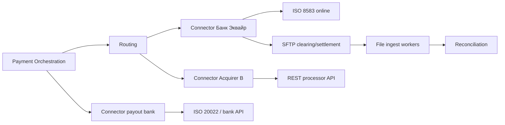
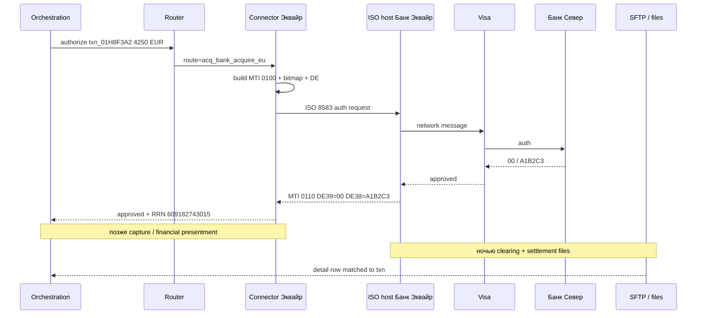
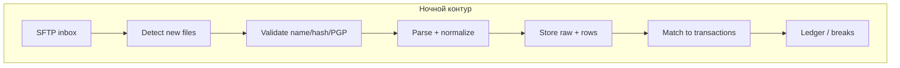

# Глава 22. Интеграции с банками, процессорами и схемами

До этой главы «Платёжка» выглядела почти волшебной. «Кофейня» шлёт JSON на Payment API, Аня видит зелёную галочку, в леджере появляются проводки на 42,50 EUR, а через пару дней на счёт магазина капает 41,74. Внутри платформы ([глава 20](20-platform-architecture.md)) оркестрация открывает `txn_01H8F3A2` и «куда-то» отправляет авторизацию. Вот это «куда-то» — и есть тема главы.

Интеграции — это не «ещё один HTTP-клиент». Это граница, на которой ваш красивый домен встречается с чужими протоколами, чужими cut-off'ами, чужими файлами в три часа ночи и чужой привычкой отвечать `00` в одном поле, а approval code — в другом. Эквайер «Банк Эквайр» может говорить ISO 8583. Банк для выплат — ISO 20022 по SFTP. Один APM — SOAP 2008 года. Другой — REST с webhooks «когда получится». Схемы Visa и Mastercard вообще живут в своём мире сетевых сообщений и клиринговых форматов, до которых PSP часто дотягивается только через процессора.

Если интеграционный слой кривой, мерчант увидит странности раньше, чем вы успеете сказать «мы на связи с банком»: двойные auth, потерянные capture, settlement file, который «не бьётся» с леджером, каскад на второй эквайер, который случайно шлёт ту же сумму без нового STAN. Глава 06 рассказала *что* происходит в жизненном цикле. Глава 13 — *как* сверять деньги. Здесь — *как говорить* с внешним миром так, чтобы lifecycle и reconciliation вообще имели шанс сойтись.

**В этой главе**

- С кем интегрируется PSP: эквайер, процессор, карточные сети
- ISO 8583 подробно: MTI, bitmap, data elements на платеже Ани
- ISO 20022 и банковские API (REST/SOAP) для переводов и отчётов
- SFTP, batch и file-based processing: clearing, settlement, transaction reports
- Абстракции коннекторов и маршрутизация попыток

---

## Зачем интеграциям отдельная глава

Представьте, что оркестрация «Платёжки» зовёт эквайера так:

```text
POST https://bank-acquire.example/v2/charge
{ "amount": 42.50, "pan": "..." }
```

В учебной презентации так и рисуют. В проде «Банк Эквайр» может потребовать:

- TCP/TLS-канал к host-to-host шлюзу;
- сообщение ISO 8583 с правильным MTI, bitmap и набором DE;
- MAC или HSM-подпись полей;
- echo-тест каждые N секунд;
- отдельный канал для file transfer с clearing detail;
- спецификацию на 180 страниц, где DE#25 в e-commerce значит не то, что в POS.

И это ещё «хороший» случай — один эквайер, один регион. Реальная «Платёжка» через пару лет держит пять карточных маршрутов, три банка для payout, двух Open Banking провайдеров и пачку APM. Без **единой абстракции коннектора** и **роутера** каждая новая интеграция размазывает ISO-поля по доменной модели. Через год `PaymentIntent` знает про bitmap — и вы уже не можете сменить эквайера, не переписывая checkout.

Инженерный смысл главы простой: **интеграция — адаптер между вашим языком денег и чужим протоколом**. Домен говорит `authorize(txn_01H8F3A2, 4250, EUR)`. Коннектор переводит это в DE#4 = `000000004250`, MTI `0100`, и обратно — в `approved / A1B2C3 / RRN 609182743015`.



Словами: оркестрация не выбирает MTI. Она выбирает маршрут. Коннектор знает протокол. Файлы приходят отдельным контуром и кормят сверку ([глава 13](13-ledger-and-reconciliation.md)), а не «дописывают статус платежа напрямую из CSV», если вы хотите спать по ночам.

---

## С кем интегрируется «Платёжка»

Три слова из [главы 02](02-ecosystem-participants.md) — эквайер, процессор, схема — на интеграционном уровне означают **разные контракты**. Путать их опасно: вы будете ждать от REST-процессора клиринговый файл схемы или наоборот.

### Эквайер (acquirer)

Эквайер «Банк Эквайр» — сторона, с которой у «Платёжки» (или у мерчанта напрямую) договор на приём карт. Он выдаёт MID, задаёт MCC, держит риск по мерчанту, отправляет операции в сеть и потом получает/отдаёт деньги в сеттлменте схемы.

Интеграция с эквайером обычно включает:

1. **Онлайн-канал** — auth, capture, void, refund, reversal, иногда balance inquiry / account verification.
2. **Офлайн/файловый канал** — clearing presentment (иногда делает сам эквайер «за вас»), settlement reports, fee reports, chargeback files.
3. **Операционный контур** — onboarding MID, лимиты, descriptor, 3DS enrollment, ключи.

Для платежа Ани «Платёжка» в роли PSP почти всегда говорит именно с эквайером (или с процессором эквайера), а не с Visa напрямую. Аня платит 42,50 EUR → коннектор «Банка Эквайр» → сеть → «Банк Север».

### Процессор (processor)

Процессор — технологический слой, который «крутит» сообщения: switch, ISO-host, токенизация, иногда fraud. Эквайер может владеть процессором сам или арендовать у вендора. PSP может интегрироваться:

- **в эквайера**, а тот уже в своего процессора (классика);
- **напрямую в процессора**, который обслуживает нескольких эквайеров (white-label acquiring);
- **в gateway/processor API**, который прячет ISO и отдаёт JSON.

С точки зрения кода коннектор часто выглядит как «интеграция с Acquirer X», хотя за JSON стоит процессор Y, а юридический эквайер — банк Z. В конфиге маршрута храните **оба** имени: `legal_acquirer=bank_acquire`, `processor=acq_host_eu`. Иначе саппорт будет звонить не тому SLA.

Практически интеграция «с процессором» отличается тем, что в одном техническом канале у вас могут жить **несколько юридических эквайеров и сотни MID**. Тогда в каждом запросе вы явно передаёте acquiring institution id / merchant profile, а файлы приходят либо общим inbox'ом с колонкой `acquirer_id`, либо отдельными каталогами на SFTP. Ошибка конфигурации здесь дорогая: платёж Ани уехал с MID чужого юрлица — и settlement, и налоговая отчётность, и chargeback-адрес разъедутся.

### Карточные сети (card networks / schemes)

Схемы (Visa, Mastercard и другие из [главы 04](04-card-networks.md)) задают правила, форматы онлайн-сообщений (часто ISO 8583-семейство с диалектами) и клиринговые потоки. Прямая интеграция PSP со схемой — редкость: нужны членство, сертификации, дата-центры, огромный compliance. Обычно схема «светится» так:

- в полях онлайн-сообщения, которые эквайер/процессор обязан проставить правильно (e-commerce indicators, 3DS data, MIT flags);
- в clearing/settlement файлах и отчётах, которые доходят до вас через эквайера;
- в dispute/chargeback потоках ([глава 17](17-chargebacks-and-disputes.md));
- в network token services ([глава 05](05-card-contexts-and-tokens.md)).

Инженеру PSP важно понимать схему достаточно глубоко, чтобы **не сломать presentment**: неправильный DE с индикатором recurring может дать хороший auth сегодня и chargeback завтра. Но писать свой VisaNet-коннектор «потому что хочется» — почти никогда не старт.

### Другие интеграции рядом

Карты — не единственный провод. Рядом живут:

- **банки для payout / settlement cash** — ISO 20022, host-to-host, иногда SWIFT-обвязка;
- **Open Banking / PIS** — REST + OAuth + redirect ([глава 10](10-bank-based-methods.md));
- **APM и кошельки** — кто во что горазд ([глава 11](11-wallets-bnpl-local-methods.md));
- **3DS Server / Directory Server** — отдельный протокол вокруг auth ([глава 08](08-3ds-and-sca.md));
- **Ethoca/Verifi-подобные** сервисы алертов — снова файлы и API.

Все они подчиняются одному правилу платформы: **свой коннектор, общий внутренний контракт, общие id на Transaction**.

---

## Сквозной платёж на границе интеграции

Зафиксируем идентификаторы, которыми будем собирать сообщения и файлы. Они согласованы с предыдущими главами; в [главе 20](20-platform-architecture.md) логический платёж разделён на Intent и Transaction, в ранних главах часто встречается короткий `pay_8f3a2c91` — считайте его «фасадом» того же платежа.

| Что | Значение |
|---|---|
| Заказ «Кофейни» | `ORD-2026-0918-0042` |
| Payment Intent | `pi_8f3a2c91` (в отчётах/ранних главах — `pay_8f3a2c91`) |
| Transaction / Attempt | `txn_01H8F3A2` |
| Сумма | 42,50 EUR = `4250` minor units |
| Auth code | `A1B2C3` |
| STAN | `000847` |
| RRN | `609182743015` |
| Комиссия PSP (иллюстративно) | 0,76 EUR → зачисление мерчанту 41,74 EUR |
| Эквайер | «Банк Эквайр», MID условный `MID-COFFEE-001` |
| Эмитент | «Банк Север» |
| Схема | Visa (для примера) |

Таймлайн на интеграционной границе:



Дальше разберём, из чего состоит тот самый `build MTI 0100`.

---

## ISO 8583: язык карточного онлайн-мира

ISO 8583 — семейство стандартов для финансовых сообщений обмена (карты, банкоматы, POS, многие e-commerce host'ы). В 2026 году вы редко увидите «чистый ISO из учебника»: у Visa, Mastercard, процессоров и локальных схем — **диалекты** (длина полей, кодировки, обязательность DE, private fields). Но каркас один: **MTI + bitmap(s) + data elements**.

PSP «Платёжка» может никогда не сериализовать ISO сама — если эквайер дал REST. Но даже тогда в сырых логах поддержки, в сертификации и в спорах «кто потерял reversal» вы столкнётесь с теми же полями. Понимать их — профессиональная гигиена.

### MTI — Message Type Identifier

MTI — обычно 4 цифры (иногда с версией стандарта впереди, зависит от диалекта). Он отвечает на вопрос: **что это за сообщение и в какую сторону оно летит**.

Упрощённая логика позиций (классическая раскладка 1987/1993-семейства; конкретные значения уточняйте по спецификации хоста):

| Позиция | Смысл | Пример |
|---|---|---|
| 1 | Версия ISO 8583 | `0` — 1987, `1` — 1993, … |
| 2 | Класс сообщения | `1` — authorization, `2` — financial, `4` — reversal, `8` — network management |
| 3 | Функция | `0` — request, `1` — request response, `2` — advice, `3` — advice response |
| 4 | Кто инициировал / как идёт | часто `0` acquirer, нюансы зависят от версии |

Для платежа Ани типичная пара:

- **Request:** `0100` — authorization request (в DMS: «можно ли захолдировать 42,50?»).
- **Response:** `0110` — authorization request response (`00` + `A1B2C3`).

Если «Платёжка» работает в dual-message и потом шлёт списание:

- capture/financial request может уйти как `0200` (financial transaction request) — или как advice, или вообще уехать только в клиринговый файл без второго онлайн-шага. Это **зависит от договора с эквайером**, не от желания фронтенда «Кофейни».

Другие MTI, которые инженер встречает постоянно:

| MTI (иллюстративно) | Зачем |
|---|---|
| `0400` / `0410` | Reversal request/response — «отзови предыдущее» |
| `0100` + void/completion в DE | Завершение/отмена pre-auth (диалектно) |
| `0800` / `0810` | Network management: sign-on, echo/test, key exchange |
| `0120` / `0130` | Authorization advice — «я уже решил, прими к сведению» |

**Врезка: как это бывает в жизни.** Команда подключила новый эквайер и для timeout после `0100` слала повторный `0100` с новым STAN «на всякий случай». Эмитент одобрил оба. Два hold по 42,50 на карте Ани. Правильный ход после ambiguity — **inquiry** (если хост умеет) или **reversal** `0400` по исходному STAN/RRN, плюс жёсткая идемпотентность на стороне коннектора ([глава 07](07-states-async-idempotency.md), [глава 21](21-distributed-systems-and-money.md)). MTI — не декорация: он кодирует намерение.

### Bitmap — карта «какие поля вообще есть»

После MTI идёт **bitmap** — битовая маска присутствующих data elements. Классика:

- **Primary bitmap** — 64 бита → DE#1…DE#64;
- если бит 1 primary = 1, следует **secondary bitmap** → DE#65…DE#128;
- реже tertiary.

Бит `n` = 1 означает: «в сообщении есть data element номер n». Нет бита — нет поля. Хост парсит строго по bitmap: лишний байт или пропущенное поле — и вы уже в `format error`, а Аня видит «оплата не прошла».

Иллюстрация (учебная, hex primary bitmap):

```text
MTI: 0100
Primary bitmap (hex): 7224058000E08000
```

Разбирать hex руками в проде не надо — это делает codec. Но в дебаге полезно уметь ответить: «а DE#35 (track) у нас выставлен? В CNP e-commerce обычно нет — и слава PCI».

Связка с безопасностью ([глава 19](19-payment-security-pci.md)): bitmap легко выдаёт, тащите ли вы чувствительные DE в логи. Логировать «весь raw ISO» без маскировки PAN (DE#2) и без запрета CVV (часто DE#52/private) — быстрый путь к audit finding.

Bitmap ещё удобен как **контрактный чеклист** при сертификации: спецификация хоста говорит «для e-commerce обязательны DE#18, #22, #25, #48». Ваш тест собирает сообщение и assert'ит, что соответствующие биты primary/secondary выставлены. Упал бит — упал тест, а не прод в Black Friday.

### Data elements (DE) — полезная нагрузка

Data elements — нумерованные поля сообщения. У каждого — тип (numeric, alphanumeric, binary), длина (fixed/LLVAR/LLLVAR), смысл. Ниже — не «полный стандарт», а **рабочий минимум**, без которого нельзя читать лог платежа Ани.

#### Идентификация и трассировка

| DE | Имя (часто) | В примере Ани |
|---|---|---|
| DE#2 | PAN (или токен) | маскируем; last4 `4242` |
| DE#3 | Processing code | покупка goods/services, например `000000` (иллюстративно) |
| DE#4 | Amount, transaction | `000000004250` (12 цифр, minor units) |
| DE#7 | Transmission date/time | UTC stamp хоста |
| DE#11 | STAN | `000847` |
| DE#12 / #13 | Local time / date | время «терминала»/шлюза |
| DE#37 | RRN | `609182743015` |
| DE#38 | Authorization code | `A1B2C3` (в ответе) |
| DE#39 | Response code | `00` approved |
| DE#41 | TID (terminal id) | виртуальный TID шлюза |
| DE#42 | MID (card acceptor id) | `MID-COFFEE-001` |
| DE#49 | Currency code | `978` (EUR) |

STAN (DE#11) — короткий системный trace number, уникальный в окне дня/узла у эквайера. RRN (DE#37) — retrieval reference, длиннее, им пользуются при поиске операции. Authorization code (DE#38) — короткий код эмитента; **не** глобально уникален. Искать «просто по A1B2C3» без даты и MID — лотерея ([глава 20](20-platform-architecture.md)).

#### Суммы, валюты, «частичные» миры

DE#4 — сумма операции в минорных единицах с фиксированной шириной. Для EUR exponent = 2, поэтому 42,50 → 4250. Ошибки здесь классические: передать `42.50` как строку в numeric field, забыть padding, перепутать major/minor, отправить USD-код при EUR-сумме.

Иногда в ответе или в completion появляются другие amount-поля (settlement amount, cardholder billing amount) — особенно при FX и DCC ([глава 14](14-currencies-and-fx.md)). Коннектор обязан знать, **какое** amount сверять с `txn_01H8F3A2.amount`.

#### Карта, точка приёма, e-commerce

| DE | Зачем |
|---|---|
| DE#14 | Expiry |
| DE#22 | POS entry mode — как считали карту (chip, contactless, manual/CNP…) |
| DE#25 | POS condition code |
| DE#18 | MCC | у «Кофейни» в примере книги — food-related MCC |
| DE#43 | Card acceptor name/location — влияет на statement descriptor у Ани |
| DE#35 | Track 2 — в CP; в чистом CNP обычно нет |

Для CNP критичны индикаторы электронной коммерции и 3DS: они могут жить в DE#48 (private / national additional data), в TLV-структурах или в отдельных поляках диалекта. Сломали индикатор — получили decline или, хуже, auth без нужного liability shift ([глава 08](08-3ds-and-sca.md)).

#### Приватные и дополнительные данные

DE#48, DE#60–63, DE#120+ — зона, где каждый процессор хранит «своё»: 3DS cavv/xid, wallet cryptogram, installed payment indicators, merchant advice, network tokens. Codec коннектора здесь толще, чем «просто LLVAR string»: часто внутри — TLV со словарём тегов схемы.

#### Processing code и «что мы вообще пытаемся сделать»

DE#3 (processing code) — частый источник путаницы у инженеров, пришедших из REST. В JSON вы пишете `type: refund`. В ISO это может быть отдельный MTI **или** тот же класс сообщений с другим processing code / function code. Коннектор обязан иметь таблицу «внутренняя операция → (MTI, DE#3, другие обязательные DE)». Без таблицы через полгода у вас пять способов отправить refund, из которых два молча делают sale.

#### Response code и merchant advice

DE#39 — ответ. `00` — хорошо; `51`, `05`, `14` и десятки других — отказы разной природы ([глава 09](09-declines-and-response-codes.md)). Иногда рядом (в private DE или в отдельных полях сети) приходит **Merchant Advice Code**: «не ретрай», «ретрай позже», «спроси новую карту». Коннектор нормализует это в `error_class` + `retry_advice`, чтобы smart retry оркестрации не гадал по сырой строке.

### Как выглядит auth Ани «почти по-взрослому»

Ниже — **иллюстративный** разбор, не дамп реального хоста. Цель — связать доменные поля с DE.

**Request `0100` (сокращённо):**

```text
MTI: 0100
DE#2:  411111******4242          # PAN/token, в логах маска
DE#3:  000000                    # purchase
DE#4:  000000004250              # 42,50 EUR
DE#7:  0918090015                # MMDDhhmmss (иллюстративно)
DE#11: 000847                    # STAN
DE#14: 2912                      # YYMM expiry
DE#22: 812                       # CNP / e-com entry mode (диалектно)
DE#25: 59                        # e-commerce condition (диалектно)
DE#37: 609182743015              # RRN (иногда генерит эквайер)
DE#41: TERMCOF01
DE#42: MID-COFFEE-001
DE#49: 978
DE#48: [3DS + ecom TLV...]
```

**Response `0110`:**

```text
MTI: 0110
DE#11: 000847
DE#37: 609182743015
DE#38: A1B2C3
DE#39: 00
DE#4:  000000004250
...
```

Коннектор мапит это во внутренний результат:

```json
{
  "transaction_id": "txn_01H8F3A2",
  "payment_intent_id": "pi_8f3a2c91",
  "outcome": "approved",
  "response_code": "00",
  "authorization_code": "A1B2C3",
  "stan": "000847",
  "rrn": "609182743015",
  "acquirer_reference": "acq_9f2aa01",
  "raw_mti": "0110"
}
```

Сырой ISO наружу «Кофейне» не отдают. Мерчанту — статус intent/transaction и стабильные id платформы.

### Кодировки, MAC, сессии

Реальные хосты добавляют обвязку:

- **ASCII vs EBCDIC vs BCD** для разных DE;
- **TPDU / length headers** на TCP;
- **MAC** (message authentication) по выбранным полям, ключи в HSM;
- **sign-on** (`0800`) после рестарта канала;
- **echo** для keep-alive;
- дуплексные соединения, sticky routing на конкретный node id.

Это уже не «бизнес платежа», но без этого коннектор падает в 03:00 после ротации ключей. Держите network-management отдельным подмодулем коннектора, не смешивайте с `authorize()`.

### Для любопытных: почему «REST эквайера» всё равно про ISO

Многие современные эквайеры дают JSON API. Под капотом шлюз всё равно собирает ISO или сетевой диалект. Поэтому в ответе REST вы внезапно видите `rrn`, `stan`, `auth_code`, `response_code` — призраки DE#37/11/38/39. Сохраняйте их на Transaction: файл клиринга и chargeback придут именно с ними, а не с вашим `pi_8f3a2c91`.

---

## ISO 20022: когда банк говорит XML/JSON «по-взрослому»

ISO 8583 — про карточный онлайн (и родственные host-сообщения). **ISO 20022** — про современный язык финансовых сообщений в банках и платёжных системах: кредитовые переводы, прямые дебеты, выписки, статусы. В Европе вы живёте с ним в SEPA; в корпоративных host-to-host он вытесняет старые MT-сообщения; регуляторы и инфраструктура постепенно делают его дефолтом.

Для «Платёжки» ISO 20022 чаще всплывает не в «Аня нажала Оплатить», а в:

- **payout** «Кофейне» 41,74 EUR на IBAN;
- **settlement** нетто от эквайера на ваш settlement-счёт;
- **camt.053 / camt.052** — выписки для сверки уровня «банк» ([глава 13](13-ledger-and-reconciliation.md));
- **pain.001** — платёжные поручения, которые вы отдаёте банку;
- **pain.002** — статусы принятия поручений;
- **pacs.008 / pacs.004** — межбанковские кредитовые / return (часто уже «внутри» банка или CSM).

### Зачем инженеру разбираться, если «банк дал API»

Потому что API банка часто — тонкая обёртка над теми же бизнес-сообщениями. Поля `EndToEndId`, `InstrId`, `TxId`, `ReconciliationId` из 20022 внезапно становятся ключами matching. Если вы запихнёте в `EndToEndId` случайный UUID и потеряете его — поздравляю, строка выписки на 41,74 никак не связалась с payout.

Иллюстративный фрагмент идеи pain.001 (упрощённо, не полная схема):

```xml
<!-- иллюстративно, сокращено -->
<CstmrCdtTrfInitn>
  <PmtInf>
    <PmtInfId>PMTINF-20260919-01</PmtInfId>
    <CdtTrfTxInf>
      <PmtId>
        <EndToEndId>PO-991-COFFEE-4174</EndToEndId>
      </PmtId>
      <Amt>
        <InstdAmt Ccy="EUR">41.74</InstdAmt>
      </Amt>
      <Cdtr>
        <Nm>Coffeehouse Sp. z o.o.</Nm>
      </Cdtr>
      <CdtrAcct>
        <Id><IBAN>DE89....</IBAN></Id>
      </CdtrAcct>
    </CdtTrfTxInf>
  </PmtInf>
</CstmrCdtTrfInitn>
```

На выписке camt.053 вы ищете `PO-991-COFFEE-4174` (или банк обрежет reference — заложите нормализацию). Нетто дня от эквайера 18_420,55 EUR матчится уже не на платёж Ани, а на batch settlement ([глава 13](13-ledger-and-reconciliation.md)).

### ISO 20022 vs ISO 8583 — не враги

| | ISO 8583 мир | ISO 20022 мир |
|---|---|---|
| Типичный use case | card auth/financial online | bank transfers, statements, ACH/SEPA-like |
| Единица | message с DE | XML/JSON business message + rich structured data |
| Скорость | сотни мс | от секунд (instant) до суток (batch) |
| Связь с Аней | hold 42,50 на карте | payout 41,74 магазину / SEPA от покупателя |

Одна платёжная компания живёт в обоих мирах. Коннекторы разные; леджер и reconciliation — общие.

### Набор сообщений, который реально трогает PSP

Не нужно учить весь каталог ISO 20022. Для инженера «Платёжки» достаточно уверенно различать роли:

- **pain.*** (payment initiation) — *вы* инициатор поручений в обслуживающий банк;
- **pacs.*** (payments clearing & settlement) — межбанковский слой; часто видите косвенно;
- **camt.*** (cash management) — выписки и уведомления о движениях по счёту;
- **pacs.004 / return-подобные потоки** — возвраты и recall; влияют на payout и SEPA-сценарии.

Версии схем (например, pain.001.001.09 vs более старые) ломают парсеры. Версионируйте XSD в репозитории коннектора так же серьёзно, как OpenAPI карточного REST.

---

## REST и SOAP bank APIs: когда банк притворяется SaaS

Не всё, что связано с банком, — ISO на TCP. В 2026 году нормальны три слоя:

1. **Классический host-to-host** (ISO 8583 / proprietary) — эквайринг и часть corporate banking.
2. **Файловый обмен** — отчёты, pain/camt, clearing detail.
3. **HTTP API** — REST JSON, иногда SOAP/XML «как двадцать лет назад, но с TLS 1.2».

### REST: удобство и ловушки

REST-эквайер или bank API выглядит дружелюбно:

```http
POST /v1/payments HTTP/1.1
Authorization: Bearer ...
Idempotency-Key: txn_01H8F3A2_auth
Content-Type: application/json

{
  "amount": 4250,
  "currency": "EUR",
  "merchant_id": "MID-COFFEE-001",
  "card_token": "tok_…",
  "capture_method": "manual",
  "reference": "txn_01H8F3A2"
}
```

Ответ:

```json
{
  "id": "acq_9f2aa01",
  "status": "authorized",
  "authorization_code": "A1B2C3",
  "network_reference": "609182743015",
  "response_code": "00"
}
```

Ловушки те же, что у любого внешнего API, плюс денежные:

- **идемпотентность** — ключ обязателен; иначе retry после timeout создаст второй auth;
- **семантика статусов** — `processing` ≠ `authorized`; не мапьте всё в `succeeded`;
- **partial approval** — редкость, но бывает: запросили 4250, одобрили меньше;
- **поздние webhooks** от процессора — статус догоняет после HTTP 200;
- **sandbox ≠ prod** по кодам ошибок и по скорости файлов.

Коннектор REST всё равно обязан сохранить `acq_9f2aa01`, RRN-подобные поля и сырой response code для сверки и диспутов.

### SOAP: не мёртв, просто раздражает

Крупные банки и локальные схемы до сих пор отдают WSDL. Особенности:

- жёсткие XSD, сюрпризы с timezone и decimal separators;
- WS-Security / клиентские сертификаты;
- один «логически синхронный» вызов, который внутри банка становится async;
- версия endpoint'а раз в пятилетку, зато с breaking change без semver.

Абстракция коннектора спасает домен от SOAP-адa: оркестрация не должна знать про `soap:Envelope`.

### Bank API для выплат и Open Banking

Payout-коннектор и PIS-коннектор — разные звери:

- payout: вы — клиент банка, инициируете credit transfer «Кофейне»;
- Open Banking PIS: покупатель авторизует платёж в своём банке, вы получаете статус ([глава 10](10-bank-based-methods.md)).

Оба могут быть REST. Оба требуют осторожного хранения consent/token и статусной машины. Не пытайтесь запихнуть PIS в «карточный» коннектор только потому, что оба называются `authorize`.

---

## SFTP, batch и file-based processing

Онлайн-сообщение отвечает на вопрос «можно ли / приняли ли». **Файлы** отвечают на вопросы «что попало в клиринг», «сколько нам должны нетто», «какие fee списали», «какие chargeback открыли». Игнорировать файловый контур — значит иметь красивые статусы `captured` и дырявую кассу.

### Зачем SFTP до сих пор жив

- объёмы: сотни тысяч строк detail в сутки;
- операционная привычка банков и схем;
- аудит: файл как неизменяемый артефакт дня;
- слабая связность: ваш онлайн лёг на час — файл всё равно сформируют по cut-off.

Типичный пайплайн:



Словами: сначала **сырой файл** сохраняем как есть (replay!), потом парсим в нормализованные строки, потом matching, потом проводки/breaks. Никогда не «парсить на лету и сразу UPDATE payments» без идемпотентного ключа `file_id + row_id`.

### Cut-off, именование, перекладки

Эквайер обещает: «settlement detail за операционный день D лежит до 06:00 D+1». Реальность:

- файл `SETTLE_20260919.csv` пришёл в 06:40;
- в 09:15 пришёл `SETTLE_20260919_v2.csv` — корректировка;
- в имени дата — processing date, а value date внутри строк другая.

Коннектор файлов обязан:

- понимать **версионность** (v2 заменяет или дополняет?);
- логировать `arrival_time`, `cut_off`, `file_version`;
- не удалять v1 из object storage — сверка любит историю.

### PGP, ключи, antifreeze

Файлы часто PGP-encrypted. Ключи ротируют. Отдельный runbook: «что делать, если утром файл не дешифруется». Это ops ([глава 24](24-monitoring-and-operations.md)), но закладывается в дизайн ingest: алерт «expected file missing» важнее алерта «CPU 70%».

---

## Clearing и settlement files

В [главе 06](06-payment-lifecycle.md) clearing — оформление обязательств в схеме, settlement — нетто-расчёты. На интеграции это **конкретные артефакты**.

### Clearing / presentment detail

После capture операция Ани должна появиться в финансовом потоке. Иногда PSP сам генерирует presentment через API эквайера; чаще эквайер/процессор делает это сам, а вам присылает **отчёт о том, что ушло в клиринг**.

Иллюстративная строка (нормализованный CSV):

```text
row_id,record_type,provider_txn_id,rrn,arn,auth_code,amount_minor,currency,mti_or_function,value_date
1848291,presentment,acq_9f2aa01,609182743015,74123456789012345678901,A1B2C3,4250,EUR,sale,2026-09-19
```

Появился **ARN** (Acquirer Reference Number) — длинный id, критичный для chargeback. Сохраняйте ARN на операции capture/presentment, не только RRN.

### Settlement reports

Settlement report говорит: «за цикл вот нетто на ваш settlement account / вот разложение». Часто два уровня:

1. **Summary** — нетто 18_420,55 EUR, дата value date, id батча.
2. **Detail** — каждая операция (покупка Ани + тысячи других) с gross, interchange, scheme fee, net.

Именно detail кормит matching к `txn_01H8F3A2` / `pay_8f3a2c91`. Summary кормит сверку с банковской выпиской.

Не путайте:

| Сумма | Смысл |
|---|---|
| 42,50 | gross операции Ани |
| 41,74 | то, что «Кофейня» увидит после **вашей** комиссии 0,76 — это продуктовый прайсинг PSP, не обязательно строка схемы |
| net в IC++ отчёте | gross − interchange − scheme − acquirer fee … |

Сверять 41,74 со строкой Visa — популярный способ сломать себе утро. 41,74 живёт в вашем леджере fee; в acquirer detail ищите 4250 (и отдельно fee reports).

### Chargeback и exception files

Отдельные файлы/API: first chargeback, representment outcomes, RDR-подобные автоматические refunds. Их тоже заводят коннектором файлового/dispute-типа. Разбор процесса — [глава 17](17-chargebacks-and-disputes.md); здесь важно: **тот же `file_id + row_id` идемпотентности**.

---

## Transaction reports: мост между онлайн и бухгалтерией

«Transaction report» — зонтичное имя для всего, чем эквайер/процессор описывает операции за период. Сюда входят:

- authorization logs (иногда отдельно от settlement);
- captured/settled transactions;
- declines (для аналитики, не для денег);
- fees and interchange breakdown;
- payout / transfer confirmations.

### Зачем они, если есть webhooks и БД

Потому что:

1. Webhook мог потеряться, а файл — нет (или наоборот — оба врут по-разному, отсюда breaks).
2. Финансы и risk хотят **полный срез дня**, а не event stream.
3. Mercant-facing statements «Платёжки» часто собираются из внутреннего леджера, но **контролируются** внешним report'ом.

### Пример дня, когда Аня — одна из строк

```text
# acquirer_transactions_2026-09-18.csv (фрагмент)
provider_txn_id,merchant_mid,type,amount,currency,auth_code,rrn,status,settlement_date
acq_9f2aa01,MID-COFFEE-001,capture,42.50,EUR,A1B2C3,609182743015,settled,2026-09-19
```

Нормализатор приводит `42.50` → `4250`, даты → ISO, status → enum. Matcher находит `txn_01H8F3A2` по `provider_txn_id=acq_9f2aa01` (как в [главе 13](13-ledger-and-reconciliation.md)).

### Merchant-facing vs acquirer-facing reports

Не отдавайте «Кофейне» сырой файл эквайера с чужими мерчантами и полными ARN-логиками без нужды. Соберите **свой** statement: `pi_…`, order `ORD-2026-0918-0042`, gross 42,50, fee 0,76, net 41,74. Внутри ops оставьте связь на acquirer row.

---

## File-based processing как дисциплина

Файлы — не «парсер на коленке». Это подсистема со своими инвариантами.

### Идемпотентность ingest

Повторная загрузка того же settlement file не должна:

- повторно провести +42,50 в леджер;
- создать второй break;
- пометить txn settled дважды с разными batch id без явной коррекции.

Ключ: хэш файла + стабильный `row_id` провайдера (или композит полей, если row_id нет — зафиксируйте алгоритм).

### Схема нормализации

Все коннекторы файлов сходятся в **каноническую строку**:

```text
CanonicalSettlementRow:
  provider, file_id, row_id,
  provider_txn_id, rrn, arn, stan, auth_code,
  type, amount_minor, currency,
  gross_minor, fee_minor, net_minor,
  value_date, processing_date,
  raw_payload_ref
```

Дальше matching общий. Иначе каждый коннектор изобретает свою сверку — ад.

### Очереди и dead-letter

Битая строка (непарсируемый amount) не должна стопорить весь файл. Положили в DLQ, файл пометили `partial`, алерт на ops. Политика: «сколько partial допустимо до эскалации».

### Онлайн vs файл: кто хозяин статуса

Антипаттерн: файл ночью переводит платёж из `captured` в `settled`, а днём webhook эквайера делает то же самое другим кодом. Лучше:

- онлайн-коннектор владеет операционными статусами auth/capture;
- файл владеет **settlement facts** и reconciliation flags;
- доменный статус `settled` появляется когда matcher уверен (или по явному событию процессора, если оно надёжнее файла — зафиксируйте source of truth в ADR).

---

## Абстракции коннекторов

Пора собрать код в голову. Коннектор — модуль (или сервис) с двумя лицами: **внутренний контракт платформы** и **внешний протокол**.

### Внутренний контракт

Оркестрация хочет примерно такое (псевдокод):

```python
class AcquiringConnector(Protocol):
    def authorize(self, req: AuthRequest) -> AuthResult: ...
    def capture(self, req: CaptureRequest) -> CaptureResult: ...
    def void(self, req: VoidRequest) -> VoidResult: ...
    def refund(self, req: RefundRequest) -> RefundResult: ...
    def reverse(self, req: ReverseRequest) -> ReverseResult: ...
    def inquire(self, req: InquireRequest) -> InquireResult: ...
```

`AuthRequest` несёт `transaction_id`, сумму, currency, payment method handle, MCC/MID profile, 3DS result, idempotency key, routing metadata. **Не** несёт bitmap.

`AuthResult` несёт outcome, response_code, auth_code, rrn, stan, provider_txn_id, latency, raw_ref (ссылка на encrypted blob), error_class (`issuer` / `scheme` / `technical`).

Для APM — другой протокол (`create_redirect`, `handle_callback`), но оркестрация всё равно мыслит attempts.

### Что прячет адаптер

| Внутри коннектора | Снаружи (домен) |
|---|---|
| ISO codec / SOAP client / REST SDK | `authorize()` |
| Ключи MAC, client certs | secret ref в vault |
| Mapping DE39 → decline taxonomy | нормализованный response_code + class |
| Специфичные timeout'ы хоста | бюджет оркестрации |
| Парсер settlement CSV/XML | CanonicalSettlementRow |

### Версии и сертификация

Смена версии хоста эквайера — мини-проект: регрессионные тезы на golden messages (auth approve/decline, partial capture, refund, reversal after timeout), сертификация scheme, иногда PCI re-assessment. Храните **fixture сырых сообщений** (с маской PAN) в репозитории коннектора.

### Мультиэквайринг без копипасты

Плохо: `if acquirer == "bank_acquire": build_0100() elif ...` в оркестрации.

Хорошо: `ConnectorRegistry.get("bank_acquire_eu")`, общий интерфейс, per-connector config (MID list, supported features: partial_capture=true, refund_same_day=false).

Feature flags на коннекторе важны: «этот хост не умеет incremental auth» должно быть данными, а не сюрпризом в проде.

### Наблюдаемость коннектора

Метрики: success rate, latency p99, technical decline rate, timeout rate, file arrival delay — **с лейблом connector/route**. Трейс: `pi_ → txn_ → provider_txn_id`. Логи: без PAN/CVV, с MTI и DE39.

Отдельно мониторьте **контрактные** сигналы: доля ответов без RRN, рост `format error`, echo-fail на host-to-host, очередь неотправленных reversal. Это симптомы интеграции, а не «клиенты передумали покупать кофе».

### Коннекторы не только для карт

Тот же паттерн работает для:

- APM redirect (`create_session` → `parse_callback` → `inquire`);
- Open Banking PIS;
- payout bank;
- file-only провайдеров (некоторые cash vouchers живут почти без онлайн auth).

Ошибка — назвать всё `CardConnector` и пихать iDEAL в `authorize()` с пустым PAN. Лучше семейство интерфейсов с общим «AttemptResult» и разными командами. Оркестрация всё равно оперирует Transaction; меняется только порт адаптера.

---

## Маршрутизация (routing)

Роутер решает: **какой коннектор (и какой MID/профиль) исполнит эту Transaction**. Это не то же самое, что cascading после decline ([глава 07](07-states-async-idempotency.md)): сначала выбор маршрута, потом исполнение, потом политика «что делать при отказе».

### Зачем несколько маршрутов

- география и local acquiring ([глава 27](27-cross-border-payments.md));
- стоимость (IC++, blended) ([глава 15](15-fees-and-economics.md));
- approval rate по BIN/issuer;
- лимиты и ёмкости эквайера;
- поддержку метода (Amex только на маршруте B);
- рисковые правила (high-risk MCC только на эквайере с аппетитом);
- резервный канал при деградации ([глава 23](23-reliability.md)).

Для «Кофейни» в EEA с картой «Банка Север» роутер выбирает `bank_acquire_eu` — низкий cross-border friction, привычный settlement в EUR.

### Как выглядит решение на платеже Ани

Упрощённо:

```text
merchant=merch_coffeehouse, amount=4250 EUR, scheme=visa,
issuer_country=DE, merchant_country=PL (условно для примера магазина),
method=card, mcc=5499, 3ds=frictionless_ok, risk=low
→ candidates: [bank_acquire_eu, processor_backup_eu]
→ score: bank_acquire_eu wins (local-ish EUR settlement + better auth rate 7d)
→ route_id=rt_coffee_visa_eu_primary
→ connector=bank_acquire_eu, mid_profile=MID-COFFEE-001
```

Если primary в circuit breaker ([глава 23](23-reliability.md)), роутер может сразу отдать backup **до** первой попытки — это failover routing, не cascade после decline.

### Входы решения

```text
RoutingInput:
  merchant_id, amount, currency,
  bin_or_scheme, country_issuer, country_merchant,
  method_type, mcc, is_recurring, has_3ds,
  merchant_preferences, risk_score
```

Выход: `route_id`, `connector_id`, `mid_profile`, `reason` (для аудита: `lowest_cost`, `highest_auth_rate`, `forced_merchant_override`).

### Правила vs скоринг

На старте — таблица правил («EUR + Visa + EEA → acq A»). Позже — взвешенный score с учётом live auth rate. Опасно оптимизировать только cost: дешёвый маршрут с approval rate −3% съест маржу «Кофейни» сильнее, чем сэкономит interchange.

Держите **ограничители**: max share трафика на новый маршрут, kill-switch, список BIN, которые нельзя уводить с sticky MIT-маршрута. Роутер без ограждений — это A/B тест на деньгах клиентов.

### Cascading и новый STAN

Если первая попытка decline soft и политика говорит cascade:

1. Закрываем `txn_01H8F3A2` как declined.
2. Открываем **новый** Transaction `txn_…` с новым idempotency key.
3. Роутер выбирает другой connector.
4. Новый STAN/RRN — обязательны. Повтор того же сетевого ключа на другом хосте — хаос.

Никогда не каскадируйте «молча» внутри одного txn id, если внешние id уже заняты — сверка и саппорт проклянут.

### Sticky routing и MIT

Для рекуррента (MIT) схема часто требует привязку к первоначальной network transaction id / route. Роутер обязан уметь **force route** «как в первый CIT», иначе subsequent могут сыпаться.

### Тестирование маршрутизации

Юнит-тесты на таблицу правил + shadow mode в проде («какой route выбрали бы, не исполняя») + мониторинг auth rate по `route_id`. Без этого «улучшение» маршрутизации необратимо портит конверсию в пятницу вечером.

---

## Склеиваем: путь данных платежа Ани через интеграции

1. «Кофейня» создаёт заказ `ORD-2026-0918-0042`, через API — Intent `pi_8f3a2c91`.
2. Оркестрация открывает `txn_01H8F3A2`, роутер выбирает `bank_acquire_eu`.
3. Коннектор собирает `0100` (или REST-эквивалент), шлёт в «Банк Эквайр».
4. Ответ `0110` / JSON: `00`, `A1B2C3`, RRN `609182743015`, provider id `acq_9f2aa01`.
5. Capture (DMS) — отдельный вызов коннектора; операция становится кандидатом в clearing.
6. Ночью SFTP: presentment/settlement detail содержит строку на 4250 EUR.
7. Ingest нормализует, matcher склеивает с `txn_01H8F3A2`, леджер закрывает receivable в составе нетто.
8. Комиссия 0,76 уже в вашем прайсинге; payout-коннектор позже инициирует 41,74 «Кофейне» через pain/API банка.
9. camt.053 подтверждает уход 41,74 — сверка уровня банка.

Любой обрыв на шагах 3–7 лечится не «повторить POST из Postman», а **inquire + идемпотентный replay + файл как источник фактов**.

### Мини-таймлайн артефактов

| Когда | Артефакт интеграции | Куда пишется |
|---|---|---|
| T+0 онлайн | ISO `0100/0110` или REST auth | raw blob + поля на `txn_01H8F3A2` |
| T+0 / T+минуты | capture request/response | operation `capture` + provider refs |
| Ночь D+0/D+1 | clearing/settlement detail row 4250 | CanonicalSettlementRow + match |
| D+1…D+n | merchant payout pain/API 41,74 | payout attempt + EndToEndId |
| После payout | camt.053 line | bank reconciliation match |

Если колонка «куда пишется» пустая для нового коннектора — вы ещё не готовы к продакшену, даже если sandbox auth зелёный.

---

## Что это значит для инженера

1. **Считайте интеграции отдельным bounded context.** Домен не знает MTI и XSD; коннектор не знает про loyalty points «Кофейни».

2. **Храните внешние id на Transaction/Operation:** provider_txn_id, STAN, RRN, ARN, auth code, file row refs. Без них нет ни сверки, ни chargeback.

3. **Один внутренний интерфейс — много адаптеров.** Новый эквайер = новый коннектор + конфиг маршрута, не fork оркестрации.

4. **Онлайн и файлы — два канала одной правды.** Спроектируйте ingest до первого продакшен-платежа, не «потом прикрутим CSV».

5. **Идемпотентность на границе:** ключ на auth/capture/refund и `file_id+row_id` на отчётах. Timeout без inquire — главный генератор двойных hold.

6. **Нормализуйте всё в minor units и ISO currency codes** на входе коннектора. Float из CSV эквайера — quarantine.

7. **Маскируйте DE#2 и запретите CVV в логах и raw archives**, которые видит весь ops. Raw ISO кладите в encrypted blob с ACL.

8. **Роутинг аудируйте.** Пишите `route_id` и reason на каждую попытку. Иначе нельзя объяснить падение auth rate.

9. **Golden message tests** на каждый коннектор: approve, decline 51, decline 05, timeout→reversal, partial capture, refund, settlement row match.

10. **Алерты на файлы:** missing file, late file, decrypt fail, match rate drop — рядом с latency API.

11. **Не протекайте диалект эквайера в публичный API** «Кофейни». Смена маршрута не должна ломать их сверку заказов.

12. **Документируйте source of truth:** что делает статус `settled` — webhook процессора или matched settlement file?

13. **Заложите feature matrix** коннектора (supports_partial_capture, supports_online_refund, supports_inquire). Оркестрация читает матрицу.

14. **Связывайте payout references с ISO 20022 EndToEndId** так, чтобы человек и matcher находили 41,74 без шаманства.

---

## Типичные ошибки и грабли

**Сериализация ISO «на глаз».** Один неправильный LLVAR length — и хост отвечает format error. Берите проверенный codec, покрывайте фикстурами.

**Повтор auth с новым STAN после timeout без inquire/reversal.** Два hold по 42,50. Аня в ярости, эмитент тоже.

**Считать REST эквайера бесконечно идемпотентным.** Без Idempotency-Key он создаст две операции. Ваш ключ `txn_01H8F3A2_auth` должен доехать.

**Сверка net 41,74 со строкой gross 42,50.** Классика путаницы fee PSP и scheme fees.

**Парсинг settlement с `UPDATE` платежей.** Replay файла удваивает мир. Только append + идемпотентные эффекты.

**Один общий HTTP-timeout на все коннекторы.** Карточный host хочет 3–5 с, банк pain — 30 с, SFTP list — иначе. Бюджеты разные.

**Каскад на второй эквайер тем же RRN «для удобства сверки».** Удобство закончится судом двух клирингов. Новые попытки — новые id.

**Логирование полного bitmap-сообщения в ELK.** PAN утёк. PCI scope расширился на весь кластер логов.

**Игнор v2 файла.** Утром сверили v1, днём эквайер прислал коррекцию на −0,04 по другой операции — ваш break ageing врёт.

**Роутинг только по цене.** Approval rate просел на BIN «Банка Север», конверсия «Кофейни» тоже — вы «сэкономили» на себестоимость и потеряли оборот.

**Файловый job в том же деплое, что и online API, без изоляции.** Рестарт подов на релизе оборвал half-written parse; статус файлов рассинхронился. Нужны lease/locking и clear state machine ingest.

**SOAP-дату `2026-09-18T00:00:00` без зоны** принять как UTC. Value date съехал — batch не сматчился с выпиской.

**Смешать connector errors и issuer declines в одной метрике.** Технический outage эквайера выглядит как «клиенты бедные». Разделяйте error_class ([глава 09](09-declines-and-response-codes.md), [глава 24](24-monitoring-and-operations.md)).

**Надеяться, что схема «сама» пришлёт вам clearing.** Без членства у вас только то, что отдаёт эквайер/процессор. Требуйте detail files в договоре — не в надежде.

---

## Врезка: как это бывает в жизни

В пятницу «Платёжка» включила второй эквайер для 10% трафика «Кофейни». Онлайн-коннектор оттестировали. Файловый — «успеем на следующей неделе». Суббота: auth/capture блестящие, леджер растёт, а settlement account не досчитывается на тысячи евро. Причина: операции ушли в клиринг нового MID, а matcher смотрел только inbox старого SFTP. Деньги нашлись; нервы — нет. Мораль: **маршрут в проде без файлового контура этого же маршрута — не canary, а бухгалтерский квест**.

---

## Итоги главы

1. Интеграции — адаптер между доменным языком PSP и чужими протоколами; домен не должен знать DE#38.
2. Эквайер, процессор и схема — разные роли и разные контракты; прямая интеграция со схемой редка.
3. ISO 8583 строится из MTI, bitmap и data elements; на платеже Ани это `0100/0110`, STAN `000847`, RRN `609182743015`, auth `A1B2C3`.
4. Диалекты хостов важнее «абстрактного стандарта» — золотые фикстуры и сертификация обязательны.
5. ISO 20022 обслуживает банковские переводы и выписки; EndToEndId для payout 41,74 — ключ сверки.
6. REST/SOAP не отменяют денежную семантику: идемпотентность, статусы, внешние id.
7. SFTP и batch несут clearing/settlement truth; ingest идемпотентен и хранит сырьё.
8. Transaction reports — мост к reconciliation; не путайте gross 42,50 и merchant net 41,74.
9. Коннекторы реализуют единый внутренний интерфейс; роутер выбирает маршрут по цене, approval rate, гео и риску.
10. Дальше логичный шаг — **надёжность**: что делать, когда выбранный эквайер лежит, а деньги уже могли списаться ([глава 23](23-reliability.md)).

---

## Связанные главы

- [Глава 02. Участники платёжной экосистемы](02-ecosystem-participants.md) — эквайер, процессор, схема, PSP
- [Глава 04. Карточные сети и схемы](04-card-networks.md) — правила и роль сетей
- [Глава 06. Жизненный цикл карточного платежа](06-payment-lifecycle.md) — auth/capture/clearing/settlement как процесс
- [Глава 07. Состояния, webhooks, idempotency, retries](07-states-async-idempotency.md) — ретраи и каскад на границе
- [Глава 09. Отказы и коды ответов](09-declines-and-response-codes.md) — DE#39 и taxonomy decline
- [Глава 10. Банковские переводы и Open Banking](10-bank-based-methods.md) — SEPA/PIS-интеграции
- [Глава 12. Что происходит с деньгами](12-flow-of-funds.md) — settlement of funds и payout
- [Глава 13. Ledger и reconciliation](13-ledger-and-reconciliation.md) — matching файлов и проводок
- [Глава 14. Валюты и FX](14-currencies-and-fx.md) — presentment vs settlement currency в отчётах
- [Глава 15. Комиссии и экономика](15-fees-and-economics.md) — IC++ и разложение fee в файлах
- [Глава 17. Chargebacks и disputes](17-chargebacks-and-disputes.md) — ARN и exception files
- [Глава 19. Безопасность платежей и PCI DSS](19-payment-security-pci.md) — ключи, HSM, маскирование card data
- [Глава 20. Архитектура платёжной платформы](20-platform-architecture.md) — слой коннекторов в платформе
- [Глава 21. Распределённые системы и деньги](21-distributed-systems-and-money.md) — outbox, exactly-once, failure handling
- [Глава 23. Надёжность платёжных систем](23-reliability.md) — failover коннекторов и DR
- [Глава 24. Мониторинг и операционная работа](24-monitoring-and-operations.md) — метрики интеграций и файлов
- [Глава 27. Международные платежи](27-cross-border-payments.md) — local vs cross-border acquiring
- [Глава 29. Сквозные сценарии I](29-scenarios-part-1.md) — сбои интеграции в сюжетах
- [Глава 30. Сквозные сценарии II](30-scenarios-part-2.md) — недоступность acquirer и расхождение settlement
