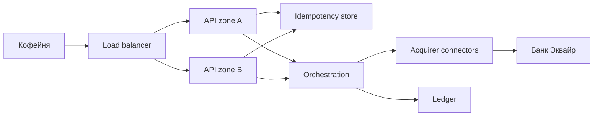
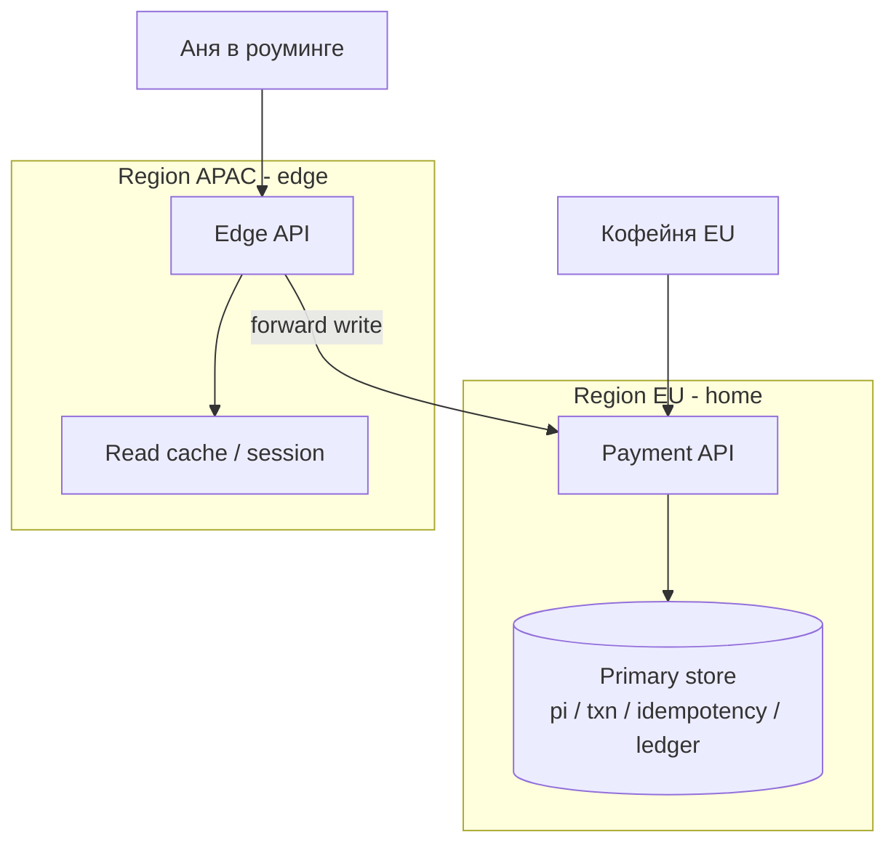
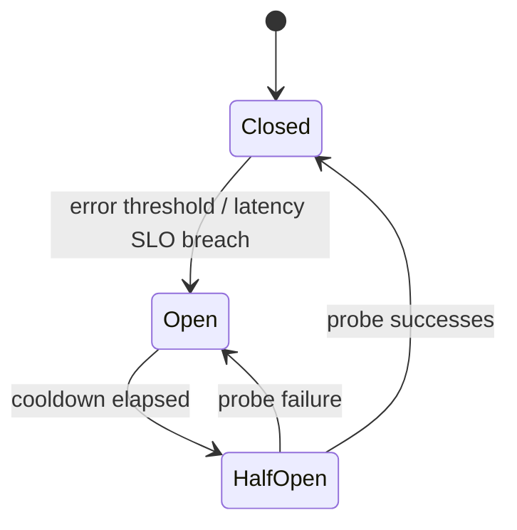
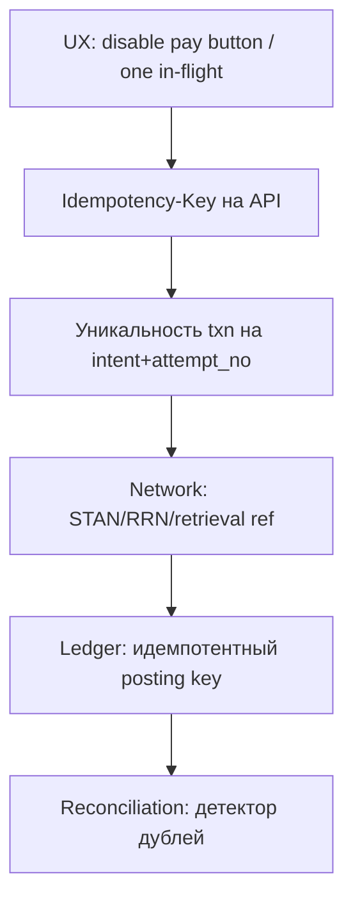
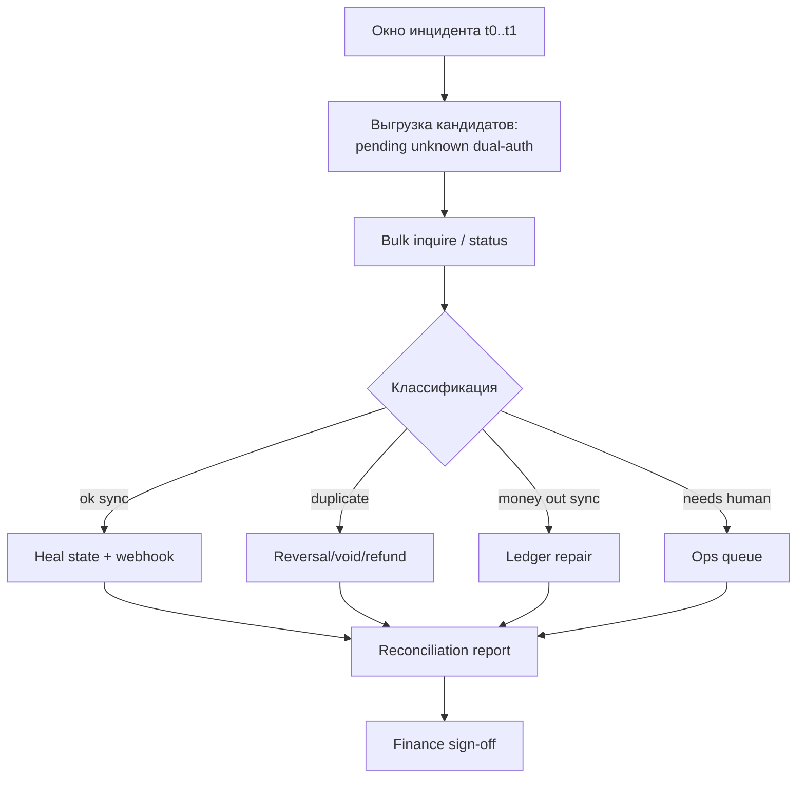
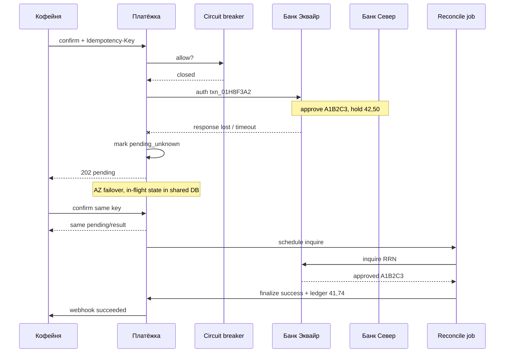

# Глава 23. Надёжность платёжных систем

Аня нажала «Оплатить» в «Кофейне». Заказ `ORD-2026-0918-0042` на **42,50 EUR**. «Платёжка» отправила авторизацию в «Банк Эквайр», эмитент «Банк Север» ответил `A1B2C3`, hold на карте встал. И в этот момент у «Платёжки» умер один из датацентров: API gateway перестал отвечать, оркестрация в регионе A зависла на полузаписи, webhook «Кофейне» не ушёл. Аня видит спиннер. Мерчант видит timeout. Эмитент уже захолдировал деньги.

В обычном SaaS «сервис недоступен» — неприятно. В платежах это развилка с деньгами: **деньги могли уже сдвинуться**, а ваш процесс — ещё нет. Надёжность здесь не про красивый график uptime 99,99%. Она про то, чтобы после любого сбоя система могла честно ответить: сколько раз списали Аню, в каком статусе `pi_8f3a2c91` / `txn_01H8F3A2`, что должен леджер «Кофейне» (41,74 EUR net), и можно ли отдавать зерно.

В [главе 07](07-states-async-idempotency.md) мы разобрали состояния, webhooks и идемпотентность. В [главе 13](13-ledger-and-reconciliation.md) — леджер и сверку. В [главе 20](20-platform-architecture.md) — доменную модель. В [главе 21](21-distributed-systems-and-money.md) — очереди, outbox и гонки. Эта глава — про **инженерную устойчивость**: high availability, failover, DR/BCP, multi-region, circuit breakers, бюджет таймаутов и ретраев, graceful degradation, защиту от дублей, «exactly-once» для денег, инциденты и сверку после аварии. Без этого платформа умеет принимать платежи в солнечный день и теряет деньги (или доверие) в дождливый.

## В этой главе

- Что значит high availability для PSP и почему «пять девяток API» — не вся история
- Failover, disaster recovery и business continuity: разные горизонты одной боли
- Multi-region: зачем, какой ценой и где активный-активный режим ломает деньги
- Circuit breakers, бюджет таймаутов/ретраев и graceful degradation
- Duplicate prevention и практический exactly-once финансового эффекта
- Инциденты, incident management и reconciliation после аварии

---

## Надёжность в платежах — это про деньги, а не только про HTTP 200

Классический SRE измеряет availability как долю успешных запросов. Для «Платёжки» этого мало. Запрос `POST /v1/payment_intents/.../confirm` может вернуть `504 Gateway Timeout`, а авторизация у «Банка Эквайр» уже быть `approved` с кодом `A1B2C3`. С точки зрения HTTP — failure. С точки зрения денег — success с потерянным ответом.

Поэтому надёжность платёжной системы считают сразу в нескольких плоскостях:

1. **Доступность приёма** — может ли мерчант создать/подтвердить платёж.
2. **Корректность финансового эффекта** — деньги списаны ровно один раз (или ноль раз), а не «полтора».
3. **Восстанавливаемость состояния** — после сбоя можно узнать истину и довести процесс до конца.
4. **Непрерывность бизнеса мерчанта** — «Кофейня» может торговать хоть в деградированном режиме.
5. **Целостность учёта** — леджер и settlement после инцидента сходятся ([глава 13](13-ledger-and-reconciliation.md)).

Если вы оптимизируете только п.1, вы неизбежно сломаете п.2: агрессивные ретраи «чтобы API был живее» порождают двойные auth. Если оптимизируете только п.2 без п.3, получите «безопасный отказ» при каждом timeout — и Аня уйдёт к конкуренту, хотя деньги уже на hold.

### Врезка: как это бывает в жизни

Пятница, 18:40. Пик продаж. У эквайера «Банк Эквайр» растёт latency с 200 мс до 8 секунд. Таймаут коннектора «Платёжки» — 5 секунд. Оркестрация ретраит три раза без inquire. За 20 минут — сотни «unknown» попыток, десятки реальных двойных холдов, саппорт «Кофейни» в огне, Аня пишет в чат: «списали дважды за одну пачку Эфиопии». Формально API «Платёжки» был доступен (200 OK на create intent). Финансово система была **ненадёжной**.

---

## High availability: что именно должно быть «всегда вверх»

**High availability (HA)** — способность системы оставаться работоспособной при отказе отдельных компонентов. Для платёжной платформы HA — не один кластер Kubernetes с тремя репликами. Это набор критических путей с разными SLA (Service Level Agreement, договорёнными обязательствами по качеству сервиса).

### Критические пути «Платёжки»

Разложим путь оплаты Ани на куски и спросим: что обязано жить, а что может подождать.

| Путь | Пример | Если лежит | Жёсткость |
|---|---|---|---|
| Payment API (create/confirm/status) | `POST confirm` для `pi_8f3a2c91` | «Кофейня» не принимает оплату | Критично |
| Acquirer connector + routing | auth в «Банк Эквайр» | нельзя провести карту | Критично |
| 3DS / ACS redirect orchestration | challenge | часть платежей не завершится | Высокая |
| Webhook delivery | `payment_intent.succeeded` | заказ «зависает», но деньги могут быть ок | Высокая (есть polling) |
| Ledger posting | проводка +41,74 pending | риск рассинхрона баланса | Критично для денег |
| Fraud scoring online | score перед auth | либо fail-open, либо fail-closed | Политика |
| Settlement file ingest | ночной клиринг | T+1 боль бухгалтерии | Важно, не realtime |
| Merchant dashboard | графики | неудобно, торговля жива | Средняя |
| Marketing site / docs | документация | почти никто не заметит ночью | Низкая |

HA-дизайн начинается с честного списка: **что нельзя потерять ни на минуту**. Для «Платёжки» это обычно: принятие платежа, запись результата попытки (`txn_…`), идемпотентное хранилище ключей, возможность inquire/reversal к эквайеру, и путь доведения статуса до мерчанта (webhook или polling).

### Сколько девяток и о чём они

«99,9%» в год — это порядка 8–9 часов недоступности. «99,99%» — около часа. Цифры иллюстративные; важнее **что именно** вы клянётесь мерчанту в SLA.

Плохой SLA: «API available 99,95%». Хороший: «успешный `GET /payment_intents/{id}` в регионе EU в течение X мс; create/confirm принимаются; при деградации эквайера включается cascading/деградированный режим по документации». Иначе юристы мерчанта посчитают каждый 500 как простой, а вы будете спорить, что «деньги-то проводились».

### Технические кирпичи HA (без магии)

Для критического пути типичный набор:

- несколько инстансов stateless API за load balancer;
- БД с синхронной/квазисинхронной репликой и понятным failover;
- очереди с репликацией и DLQ ([глава 21](21-distributed-systems-and-money.md));
- отдельные пулы для «горячего» confirm и «холодного» reporting, чтобы отчёт «Кофейни» за год не убил checkout;
- health checks, которые проверяют **зависимости**, а не только «процесс жив».

Health check «HTTP 200 от `/health`» при мёртвой БД идемпотентности — опасная ложь: балансировщик продолжит слать трафик в узел, который принимает платежи и не может их запомнить.



Словами: мерчант ходит в балансировщик, за ним несколько зон API, общее хранилище идемпотентности и оркестрация, которая говорит с эквайерами и леджером. HA — когда отказ одного API-инстанса или одной зоны не рвёт этот путь и не создаёт «вторую правду» о платеже.

---

## Failover: переключение без потери смысла платежа

**Failover** — автоматическое или полуавтоматическое переключение нагрузки с отказавшего компонента на резервный. В платежах опасен не сам failover, а **момент переключения**, когда состояние операции неизвестно.

### Виды failover, которые встречаются у PSP

#### Инстанс → инстанс

Упал под Kubernetes. Новый под поднялся. Если сессии платежа лежат в Redis/БД, а не в памяти пода — Аня даже не заметит. Если 3DS-сессия или «in-flight auth correlation» жили только в памяти — заметит очень громко.

#### Зона → зона (AZ, availability zone — зона доступности)

Датацентр/зона A потеряла сеть. Трафик уходит в зону B. Требование: данные, без которых нельзя продолжить платёж (intent, txn, idempotency key, connector outstanding ops), либо реплицированы синхронно, либо вы **осознанно** отказываете новые write до восстановления.

#### Коннектор → коннектор / эквайер → эквайер

«Банк Эквайр» не отвечает. Маршрутизация переключает BIN Ани на запасной эквайер (cascading — [глава 07](07-states-async-idempotency.md)). Это failover бизнес-пути, не железа. Цена: другие комиссии, другие 3DS-профили, другой risk appetite.

#### Primary DB → standby

Самый страшный класс. При асинхронной репликации failover может «откатить» последние секунды записей. Если среди них был `txn_01H8F3A2 = approved`, а реплика этого не видела, новый primary может решить, что попытки не было — и при ретрае создать вторую авторизацию.

### Правило неизвестного исхода

Любой failover во время in-flight операции обязан оставлять платёж в состоянии, из которого система умеет выйти:

- `pending` / `unknown` на уровне attempt;
- фоновый **inquire** (status query) к эквайеру по STAN/RRN/network id;
- при необходимости **reversal** / void, если мерчанту уже отдали failure, а в сети auth жив ([глава 06](06-payment-lifecycle.md));
- запрет «слепого» нового auth с тем же бизнес-смыслом без проверки.

Для заказа Ани это выглядит так:

1. Confirm `pi_8f3a2c91` ушёл в зону A.
2. Зона A умерла после отправки auth, до записи ответа.
3. Failover на зону B.
4. Повтор confirm с тем же Idempotency-Key не создаёт новый `txn_`, а поднимает существующий `txn_01H8F3A2` в `pending_review`.
5. Воркер inquire получает от эквайера: approved `A1B2C3`.
6. Intent переходит в успех, webhook уходит «Кофейне».

Если шаг 4 создать новый `txn_` «потому что в реплике пусто» — получите второй hold 42,50 EUR.

### Автоматический vs ручной failover

Автомат хорош для stateless слоёв. Для БД денег и для «переключить весь clearing на другой регион» часто нужен **человек с runbook**: слишком высока цена split-brain — ситуации, когда несколько узлов одновременно считают себя главным и независимо меняют состояние. Зрелая команда заранее решает: что фолверится само за 30 секунд, а что — только по решению incident commander — руководителя ликвидации инцидента.

### Что сохранить в общем хранилище до failover

Минимальный набор, без которого переключение зоны превращает платежи в лотерею:

- Payment Intent и актуальный статус (`pi_8f3a2c91`);
- Transaction/attempt с network references (`txn_01H8F3A2`, STAN, RRN, auth code если уже есть);
- Idempotency-Key → ответ/состояние;
- outbox событий (webhooks, ledger commands), иначе «успех» останется только в умершей зоне;
- признаки in-flight: «auth отправлен, ответа нет» — самое дорогое знание в системе.

Если хотя бы пункт про in-flight живёт только в памяти пода, failover формально «успешен», а финансово вы слепы.

---

## Disaster recovery и business continuity: когда горит не под, а здание

**Disaster recovery (DR)** — восстановление ИТ-систем после крупного отказа (потеря региона, порча данных, длительный outage провайдера облака). **Business continuity plan (BCP)** — шире: как компания продолжает оказывать платёжную услугу (или контролируемо её приостанавливает), пока ИТ восстанавливается. DR — про RPO/RTO. BCP — ещё про людей, договоры, связь с эквайерами, поддержку мерчантов и регулятора.

### RPO и RTO без самообмана

- **RPO (Recovery Point Objective)** — сколько данных допускается потерять по времени. RPO = 0 для платёжного journal почти обязателен на практике: «потеряли минуту записей о capture» означает дыру в леджере и ручную археологию.
- **RTO (Recovery Time Objective)** — за сколько система должна снова принимать платежи. RTO = 15 минут для confirm API достижим. RTO = 15 минут для «полностью сверены все settlement файлы» — фантазия.

Иллюстративные цели для вымышленной «Платёжки»:

| Компонент | RPO | RTO | Комментарий |
|---|---|---|---|
| Payment Intent / Transaction store | ~0 (sync/quorum) | 5–15 мин | нельзя терять attempts |
| Idempotency keys | ~0 | вместе с API | иначе дубли |
| Ledger | ~0 | 15–60 мин | можно принимать платежи в degraded mode с отложенным posting — опасно, нужна политика |
| Webhook outbox | секунды | часы на догон | at-least-once догонит |
| Analytics / BI | часы | сутки | не блокер торговли |
| Полный multi-acquirer routing | зависит | часы | можно жить на одном эквайере |

### DR-стратегии

#### Cold standby

Резервный регион почти выключен. Дешёво. RTO большой. Подходит для отчётности, не для карточного authorize path.

#### Warm standby

Реплики крутятся, трафик не идёт. Переключение — смена DNS/anycast + promote БД. Реалистичный путь для многих PSP mid-size.

#### Hot / active-active

Оба региона принимают трафик. Максимально дорого и сложно для **денег**: нужна либо строгая общая консистентность (и тогда «два региона» почти врут), либо шардирование по мерчантам/валютам с жёсткими границами.

### BCP: что делать бизнесу, пока DR крутится

BCP «Платёжки» отвечает на вопросы, которые ночью задаёт CEO «Кофейни»:

- Принимаем ли мы новые платежи? Все методы или только часть?
- Что говорим мерчантам в status page?
- Кто звонит в «Банк Эквайр» и схему?
- Как обрабатываем payouts: задерживаем, режем лимиты, пропускаем только vetted?
- Нужно ли уведомить регулятора / банк-спонсор (зависит от лицензии и договора — это уже зона compliance, [глава 18](18-regulation-and-compliance.md))?
- Где runbook для «остановить capture, оставить только auth» или наоборот?

BCP без регулярных учений — файл в Confluence. Раз в квартал полезно прогонять tabletop — обсуждение аварийного сценария по ролям без реального отключения инфраструктуры: «регион EU-West исчез в 11:00, идёт пик, в полёте 2000 pending txn — что делаем первые 30 минут».

---

## Multi-region: ближе к покупателю, дальше от простой истины

**Multi-region** — размещение платформы в нескольких географических регионах. Мотивы честные: latency для 3DS и checkout, устойчивость к отказу региона, data residency, локальный эквайринг.

### Задержки, которые чувствует Аня

Карточный authorize path и так проходит через сеть и эмитента. Лишние 150–200 мс на ваш API редко убивают конверсию сами по себе. Но если 3DS challenge, redirect и webhook ходят через океан туда-сюда, UX разваливается. Держать edge API и 3DS return URL близко к пользователю — разумный multi-region use case.

### Где жить «истине» о платеже

Главный вопрос multi-region: **где каноническая запись** `pi_8f3a2c91` и `txn_01H8F3A2`?

Варианты:

1. **Регион-дом мерчанта.** «Кофейня» в EU — все её платежи пишутся в EU primary. Другие регионы — edge/proxy. Проще для consistency.
2. **Регион по гео покупателя.** Аня в поездке в Азии платит в азиатский edge, а запись асинхронно едет в EU. Риски: задержки, конфликты, сложный inquire.
3. **Шард по `merchant_id` / `payment_intent_id`.** Active-active на уровне шардов. Работает, если никогда не пишете один и тот же intent из двух регионов без координации.

Анти-паттерн: active-active запись одного и того же idempotency key в две БД без распределённого консенсуса. Вы получите два `txn_` на один ключ при сетевом партишне — классический split-brain платежей.



Словами: edge в APAC принимает трафик Ани и кэширует сессии, но **запись** платежа и идемпотентности форвардится в домашний EU, где лежит каноническое хранилище. Так вы покупаете latency на чтении/UX, не жертвуя единой правдой о 42,50 EUR.

### Мультирегион и файлы

Clearing/settlement часто привязаны к SFTP и «банковскому дню» конкретного эквайера ([глава 22](22-integrations.md)). Переключение региона API не должно означать «а файлы теперь забирает другой бот и дублирует ingest». Ingest settlement — отдельный HA/DR контур с идемпотентностью файлов и строк.

---

## Circuit breakers: остановить каскад, пока он не съел платформу

**Circuit breaker (предохранитель)** — паттерн, который при серии ошибок перестаёт вызывать зависимость на время и сразу возвращает отказ/fallback, давая системе восстановиться. В платежах предохранитель стоит между оркестрацией и каждым внешним миром: эквайер, fraud vendor, 3DS server, FX rate provider, sanctions screening.

### Зачем именно платежам

Без breaker'а картина такая: «Банк Эквайр» деградировал до 10 секунд на ответ. Все потоки confirm держат соединения. Пул потоков/воркеров исчерпан. Даже `GET status` и payout API легли. Упал не эквайер — упала **вся** «Платёжка» из-за одного коннектора.

С breaker'ом: после N ошибок или роста latency контур `acquirer_bank_acquire` открывается. Новые auth на этот маршрут либо идут в cascading на другой эквайер, либо быстро получают `provider_unavailable`, либо кладутся в очередь smart retry — по политике. Остальные контуры (другие эквайеры, refund inquire, dashboard) живут.

### Состояния предохранителя



- **Closed** — звоним как обычно, считаем ошибки.
- **Open** — не звоним, сразу fallback.
- **Half-open** — пускаем ограниченный probe-трафик; если ок — закрываем, если нет — снова open.

### Настройка, которая не убивает деньги

Breaker на эквайере нельзя открывать по любому decline. Decline `05`/`51` — это **бизнес-ответ**, не авария зависимости ([глава 09](09-declines-and-response-codes.md)). В метрику breaker'а кладут:

- таймауты;
- connect errors;
- HTTP 5xx / ISO unable-to-process технического класса;
- рост latency выше бюджета.

Не кладут: soft/hard decline эмитента, fraud reject вашей собственной машины, валидационные 4xx.

Отдельные breaker'ы: на каждый эквайер, на каждый fraud vendor, на 3DS directory. Глобальный «один breaker на весь outbound» слишком грубый: упал мелкий APM — и вы отрубили Visa.

### Врезка: для любопытных

Иногда ставят **bulkhead** (переборки): отдельные пулы потоков/соединений на эквайера. Даже если breaker запоздал, «Банк Эквайр» не съест все коннекты к «другому банку» и к БД. Bulkhead + breaker + timeout — тройка, без которой cascading из главы 07 превращается в усиление шторма.

---

## Timeouts и бюджет ретраев: сколько времени и попыток у одного платежа

В [главе 07](07-states-async-idempotency.md) мы уже говорили, что ретраи бывают на клиенте, у мерчанта и у PSP. Здесь — про **бюджет**: суммарное время и число попыток, которые система имеет право потратить, прежде чем признать исход неизвестным или провальным.

### Таймаут — это продуктовое решение

Слишком короткий таймаут к эквайеру (например, 2 секунды) → много `unknown` → много inquire/reversal → лишняя нагрузка и ложные failure для Ани. Слишком длинный (30 секунд) → потоки заняты, «Кофейня» сама отваливается раньше, пользователь жмёт ещё раз.

Иллюстративный бюджет для card confirm «Платёжки» (не норма, а скелет мышления):

| Этап | Бюджет | Комментарий |
|---|---|---|
| Fraud sync score | 150–300 мс | дальше — fail-open/closed по политике |
| Acquirer auth | 3–8 с | зависит от региона и 3DS |
| Общий sync ответ мерчанту | 10–25 с | дальше — `pending` + webhook |
| Inquire после unknown | 2–5 попыток за 15 мин | backoff |
| Client/merchant retry | вложен в idempotency | не умножает auth |

### Вложенные таймауты

Классическая ошибка: таймаут «Кофейни» 10 с, таймаут API gateway «Платёжки» 15 с, таймаут коннектора 20 с. Мерчант уже ретраит, а коннектор всё ещё ждёт первый ответ. Бюджеты должны сужаться **снаружи внутрь**: клиент > edge > orchestration > connector.

```text
Merchant timeout:     |---------- 12s ----------|
PSP gateway:          |--------- 11s ---------|
Orchestration:        |-------- 10s --------|
Acquirer connector:   |------ 8s ------|
```

Если connector длиннее merchant — вы гарантированно производите дублирующие ретраи.

### Бюджет ретраев как единый ресурс

Представьте счётчик на `pi_8f3a2c91` / attempt:

- merchant HTTP retries с тем же Idempotency-Key — **не** новая попытка списания;
- PSP technical retry того же network request — только если протокол и идемпотентность эквайера это позволяют;
- smart retry / cascading — **новая** attempt (`txn_…`), с лимитом;
- клиентский дабл-клик — должен попасть в тот же key.

Полезное правило: у одного заказа `ORD-2026-0918-0042` есть лимит «дорогостоящих» попыток (реальные auth в сеть), отдельно от лимита «дешёвых» (GET status, webhook redelivery).

Псевдокод бюджета:

```python
def confirm_with_budget(intent_id, idem_key, payload, budget):
    # budget.remaining_ms, budget.max_network_auths
    record = idempotency.begin(idem_key, payload)
    if record.completed:
        return record.response

    if budget.max_network_auths <= 0:
        return pending_or_fail("budget_exhausted")

    with deadline(budget.remaining_ms):
        try:
            result = acquirer.authorize(payload)
            return idempotency.complete(idem_key, result)
        except Timeout:
            outcome = acquirer.inquire(payload.network_refs)
            if outcome.unknown:
                schedule_inquire_job(intent_id)
                return idempotency.complete(idem_key, status="pending")
            return idempotency.complete(idem_key, outcome)
```

---

## Graceful degradation: лучше хромать, чем лечь пластом

**Graceful degradation** — способность системы при отказе части функций продолжать полезную работу в урезанном виде, вместо полного падения. Для платежей это не «показать старую HTML-страницу», а осознанные продуктовые режимы.

### Примеры деградации у «Платёжки»

| Отказ | Полный стоп (плохо) | Деградация (лучше) |
|---|---|---|
| Fraud ML vendor down | все платежи 503 | fail-open с жёсткими rules / fail-closed только high-risk MCC |
| Один эквайер down | карты не работают | cascading на второй; часть BIN временно unavailable |
| 3DS directory latency | все SCA-платежи висят | exemption path где законно; остальные — честный pending |
| FX rate feed stale | multi-currency мёртв | торговать только в settlement currency; DCC выключить |
| Webhook workers lag | «платежи не работают» | API и capture живы; status page: «задержка уведомлений, поллите API» |
| Dashboard/analytics | паника в Slack | checkout не трогаем |
| Ledger async lag | стоп продаж | принимать auth, delayed posting с алертом risk/finance (только если политика утверждена) |

### Fail-open vs fail-closed

Fail-open означает продолжить работу без ответа отказавшей проверки, fail-closed — остановить зависимую операцию. Это **риск-политика**.

- **Fail-closed** на sanctions/AML screening: не провели платёж — переживи недополученную выручку. Провели в обход — регуляторный инцидент.
- **Fail-open** на «красивости» fraud ML при живых rules: потеряете чуть больше на fraud, сохраните оборот «Кофейни».
- **Fail-closed** на идемпотентность store: лучше 503, чем принять два списания.

Запишите матрицу явно. Иначе в инцидент ночью каждый инженер выберет свой характер.

### Деградация глазами «Кофейни»

Мерчанту нужна прозрачность: feature flag `cards_visa_mastercard_only`, `payouts_delayed`, `webhooks_degraded` на status page и в API (`system_health` / response headers). Тихий degrade, о котором мерчант узнаёт из твитов покупателей, — антипаттерн.

На уровне UX «Кофейни» деградация тоже имеет цену. Если «Платёжка» временно не принимает American Express, чекаут должен сразу спрятать Amex, а не показать ошибку после ввода карты. Если webhooks задерживаются — магазин включает усиленный polling статуса `pi_…` с тем же backoff, что и обычно, а не раз в 100 мс. Деградация PSP без деградации клиента мерчанта всё равно выглядит как «у вас всё лежит».

### Для любопытных: chaos и game day в платежах

Имеет смысл иногда **намеренно** ломать некритичные зависимости в staging (и очень осторожно — в prod-like): убить fraud vendor на 15 минут, задержать webhook workers, поставить искусственный latency 3 секунды на один эквайер. Цель — проверить, что breaker открылся, cascading сработал, бюджет ретраев не взорвался, а inquire-воркер поднял `pending_unknown`. Chaos без идемпотентных щитов и без наблюдаемости — просто способ устроить инцидент заранее.

---

## Duplicate prevention: война с двумя списаниями

Дубликат в платежах — не «два одинаковых лога». Это **два финансовых эффекта** там, где бизнес хотел один: два hold по 42,50, два capture, два payout на один invoice, два refund.

### Откуда берутся дубли

1. Дабл-клик Ани / refresh / retry SDK.
2. Timeout + повтор «Кофейни» без Idempotency-Key.
3. At-least-once очередь: два воркера обработали одно сообщение capture.
4. Webhook доставлен дважды, мерчант каждый раз создаёт отгрузку и… иногда повторный capture.
5. Cascading: первый эквайер на самом деле одобрил, а вы уже ушли во второй.
6. Failover/split-brain хранилища ключей.
7. Ручной «перепровести» из админки без ключа.

Базовые щиты — из [главы 07](07-states-async-idempotency.md) и [главы 20](20-platform-architecture.md): Idempotency-Key на write API, уникальные constraint на `(merchant_id, idempotency_key)`, идемпотентные воркеры, дедуп webhooks по `event_id`. Здесь добавим то, что относится к надёжности платформы.

### Слои защиты



Словами: даже если UI подвёл, ключ API должен спасти; даже если ключ обошли, attempt numbering не даст вторую «тихую» попытку; сеть и леджер имеют свои ключи; сверка ловит то, что проскочило.

### Практические инварианты

- Один успешный capture на один authorized `txn_` (кроме осознанного multiple capture).
- Один `event_id` webhook обрабатывается один раз на стороне мерчанта **и** не порождает второй финансовый эффект на стороне PSP.
- Повтор outbox-сообщения `ledger.post(capture, pi_8f3a2c91)` не создаёт вторую проводку 41,74.
- Админское «retry payment» всегда создаёт **новый** `txn_` с аудитом, никогда не «дописывает success» в старый без inquire.

### Сквозной пример: Аня и двойной клик во время деградации

1. Аня жмёт «Оплатить», сеть мобильная плохая.
2. «Кофейня» шлёт confirm с `Idempotency-Key: ORD-2026-0918-0042-pay-1`.
3. «Платёжка» создаёт `txn_01H8F3A2`, получает `A1B2C3`, но ответ мерчанту обрывается (деградация edge).
4. Фронт показывает ошибку; Аня жмёт снова.
5. «Кофейня» **обязана** послать тот же key (не новый).
6. «Платёжка» возвращает тот же `pi_8f3a2c91` / success.
7. Леджер уже имеет posting key `capture:txn_01H8F3A2` — второй раз 41,74 не начисляет.

Если на шаге 5 магазин сгенерирует новый key «потому что новый клик» — щиты L1–L2 падают, и дальше только L3+ (если вы запрещаете второй confirm на succeeded intent) или ручной refund.

---

## Exactly-once financial processing: честная версия мифа

В распределённых системах **exactly-once delivery** в общем виде недостижима или сводится к маркетингу. То, что нужно платежам, звучит иначе: **exactly-once financial effect** — побочный денежный эффект операции применяется один раз, несмотря на at-least-once доставку сообщений и ретраи.

### Формула, которая работает

```text
at-least-once transport
+ идемпотентный обработчик
+ детерминированный ключ эффекта
+ запись результата до/вместе с сайд-эффектом (outbox/inbox)
= практический exactly-once effect
```

Разбор для capture платежа Ани:

1. Оркестрация решает: capture `txn_01H8F3A2` на 42,50 EUR.
2. В outbox пишется событие `CaptureRequested` **в одной транзакции БД** со сменой статуса attempt ([глава 21](21-distributed-systems-and-money.md)).
3. Воркер читает событие (может прочитать дважды).
4. Перед вызовом эквайера берёт lock по `txn_01H8F3A2` / проверяет «capture уже sent/succeeded».
5. Зовут эквайера с идемпотентным retrieval ref, если протокол позволяет.
6. Результат пишется; ledger entry с ключом `je_capture_8f3a` / `capture:txn_01H8F3A2`.
7. Повтор события на шаге 3 видит терминальный статус и выходит.

### Где exactly-once особенно критичен

| Операция | Цена дубля |
|---|---|
| Authorization | двойной hold, злость Ани, риск partial auth confusion |
| Capture | двойное списание / dispute |
| Refund | двойной возврат, дыра в балансе мерчанта |
| Payout | двойной перевод на р/с «Кофейни» |
| Ledger fee 0,76 | искажение P&L (profit and loss, отчёта о прибылях и убытках) и баланса |
| Chargeback debit | двойной минус мерчанту |

### Чего не обещать в маркетинге API

Фраза «exactly-once webhooks» почти всегда ложь. Обещайте: **at-least-once delivery + unique event id + идемпотентная семантика ресурсов**. Мерчант должен писать обработчики идемпотентно — и вы тоже.

### Сомнительные «усилители», которые не заменяют дизайн

- Распределённые транзакции 2PC между вами и банком — их нет в реальном карточном мире.
- «Глобальный singleton воркер» — не масштабируется и всё равно падает между send и commit.
- Надежда на unique index «на всякий случай» без явной модели ключа эффекта — сработает до первого естественного повторного бизнес-события (partial refund ×2 законных).

---

## Инциденты: как ломаются платёжные системы

Инцидент в платежах — любое событие, которое угрожает доступности приёма, корректности денег, безопасности или регуляторным обязательствам сильнее обычного бага. «Медленный dashboard» — скорее событие. «Двойные capture на 2% трафика» — инцидент уровня P1 — высшего приоритета в иллюстративной шкале этой главы, — даже если API «зелёный».

### Типовая таксономия

1. **Availability** — не создаётся intent, не проходит confirm, массовые 5xx.
2. **Latency** — checkout не укладывается в бюджет, растёт abandonment.
3. **Correctness** — дубли, потерянные статусы, «успех» мерчанту при decline, наоборот.
4. **Money movement** — payouts ушли дважды / не ушли; settlement не сходится.
5. **Dependency** — эквайер/схема/3DS/cloud region.
6. **Security/compliance** — утечка, ложное срабатывание fraud на весь трафик, sanctions feed.
7. **Poison data** — кривой файл клиринга кладёт ingest.

### Сквозной инцидент: 18 сентября, платёж Ани как симптом

Таймлайн (иллюстративный):

| Время | Что произошло |
|---|---|
| 14:02 | Latency «Банк Эквайр» > 6 с |
| 14:03 | Растут timeout'ы коннектора; breaker ещё closed (плохой порог) |
| 14:05 | «Кофейня» ретраит confirm; часть без стабильного key (баг SDK) |
| 14:10 | Появляются двойные auth; Аня пишет в поддержку |
| 14:12 | On-call видит рост `acquirer_timeout` и `auth_per_intent > 1` |
| 14:15 | Breaker open + cascading на backup acquirer |
| 14:20 | Stop the bleeding: feature flag «запрет auto-retry без inquire» |
| 14:40 | Inquire/reversal job по всем `unknown` |
| 16:00 | Список затронутых `pi_` / заказов выгружен мерчантам |
| D+1 | Reconciliation с settlement file: поиск дублей и missing |

Платёж Ани `pay_8f3a2c91` / `pi_8f3a2c91` в этой аварии мог оказаться в любом из классов: чистый success, success с потерянным webhook, double hold, auth + reversal, «Кофейня думает failed / эмитент держит money». Надёжная платформа **различает** эти классы метриками и runbook'ами, а не одним алертом «error rate > 2%».

---

## Incident management: как тушить, не размазав деньги ещё сильнее

**Incident management** — организованный процесс обнаружения, сдерживания, устранения и разбора инцидента. В платежах к обычному SRE-процессу добавляются финансовые и клиентские ритуалы.

### Роли

- **Incident commander** — решения, приоритеты, коммуникация; не обязан сам чинить коннектор.
- **Tech lead / responders** — митигации в коде/флагах/инфре.
- **Payments ops / risk** — решение: стопать payouts? fail-closed fraud? держать captures?
- **Comms** — status page, письма топ-мерчантам вроде «Кофейни».
- **Finance/reconciliation** — параллельно готовит сверку, не ждёт «потом».

### Severity, заточенная под деньги

| Severity | Пример | Цель |
|---|---|---|
| P1 | Полный down приема в регионе; массовые дубли списаний | сдержать эффект минут, не часов |
| P2 | Один эквайер down, cascading работает; задержка webhooks 30+ мин | деградация под контролем |
| P3 | Ошибки settlement ingest, dashboard, редкие дубли | рабочее время + runbook |
| P4 | Косметика, единичные кейсы | тикет |

P1 «деньги неправильно» иногда важнее P1 «API 502». Калибруйте так, чтобы on-call будили и по correctness, не только по availability.

### Stop the bleeding раньше, чем root cause

Порядок мышления:

1. **Остановить усиление** — breaker, выключить вредный retry, заморозить payouts, отключить ядовитый маршрут.
2. **Стабилизировать приём** — degraded mode, backup acquirer, clear status page.
3. **Привести в известность неизвестное** — inquire по pending/unknown.
4. **Компенсировать** — reversal/void/refund/manual ledger adjustment с аудитом.
5. **Искать root cause** — уже после того, как кровь остановлена.

Анти-паттерн: «давайте быстро задеплоим большой фикс», пока ретраи ещё жгут дубли. Сначала флаг, потом причина.

### Коммуникация

Мерчанту не нужна ваша гипотеза про GC pause. Нужно:

- что сломано (confirm? webhooks? payouts?);
- с какого времени;
- что делать магазину (поллить API? не повторять оплату без статуса?);
- когда следующий update.

Внутри — timeline в war room: факты, гипотезы отдельно, решения с временем. После инцидента это станет постмортемом.

### Postmortem без театра

Хороший разбор отвечает:

- какой финансовый blast radius (сколько `txn_`, сумма, мерчанты);
- какие щиты не сработали (почему breaker не открылся);
- какой детект сработал поздно;
- какие идемпотентные дыры закрыть;
- какие игры/учения провести.

Без blame-культуры, но и без «уникального стечения обстоятельств» на третий раз подряд.

Отдельно зафиксируйте **customer remediation**: кому возвращаете деньги автоматически, кого письменно предупреждаете про двойной hold, как «Кофейня» видит список затронутых `ORD-…` в кабинете. Инцидент, после которого мерчант сам неделю собирает жалобы Ань в Excel, вы проиграли даже при идеальном root cause analysis.

---

## Reconciliation после инцидента: вернуть правду о деньгах

Даже идеальный failover не отменяет сверку. После аварии **reconciliation** — не ночная рутина из [главы 13](13-ledger-and-reconciliation.md), а аварийный контур восстановления финансовой истины.

### Что сверять в первые часы

1. **Internal:** payment state machine vs ledger. Есть ли `captured` без проводки? Проводка без capture? Две проводки fee 0,76 на один `txn_`?
2. **Provider:** ваши `txn_` / RRN / auth code vs журнал эквайера / схемы за окно инцидента.
3. **Merchant-facing:** что «Кофейня» считает оплаченным (`ORD-2026-0918-0042`) vs что у вас в `pi_8f3a2c91`.
4. **Bank:** если задеты payouts — р/с vs payout journal.

### Классы находок после аварии

| Находка | Симптом | Типичное лечение |
|---|---|---|
| Missing internally | у эквайера auth `A1B2C3`, у вас нет success | дописать состояние из inquire; провести ledger; webhook |
| Missing in provider | у вас success, у эквайера пусто | не врать мерчанту; выяснить; возможно mark failed + компенсации |
| Duplicate auth | два approve на один заказ | void/reversal лишнего; refund если capture; извинения Ане |
| Amount mismatch | 42,50 vs 4250 minor unit bug | стоп продукта; корректирующие проводки |
| Orphan hold | Аня видит hold, заказ failed | reversal; контроль TTL hold |
| Webhook gap | деньги ок, магазин не отгрузил | redelivery; инструмент «переотправить события» |
| Ledger drift | pending «Кофейни» ≠ sum операций | repair entries с audit, не UPDATE строк |

### Операционный конвейер post-incident



Словами: берёте все подозрительные операции окна, массово уточняете исход у эквайера, раскладываете по классам, лечите автоматом что безопасно, остальное — в очередь людей, в конце — отчёт и подпись finance, что день снова сходится.

### Пример ремонта для Ани

Факты после inquire:

- эквайер: auth approved `A1B2C3`, RRN `609182743015`, сумма 4250 EUR minor;
- «Платёжка»: `txn_01H8F3A2` был `pending_unknown`, второй `txn_01H8F9ZZ` — тоже auth approved (дубль из-за бага ключа);
- «Кофейня»: заказ `ORD-2026-0918-0042` в `awaiting_payment`.

Лечение:

1. Оставить каноном `txn_01H8F3A2`, intent → succeeded/captured по правилам продукта.
2. По `txn_01H8F9ZZ` — reversal/void (если ещё не capture) или refund (если успели).
3. Ledger: одна цепочка на 42,50 / fee 0,76 / net 41,74; дубль не постить.
4. Webhook `payment_intent.succeeded` (+ отдельное событие о reversal второй попытки, если мерчант его видел).
5. Запись в incident report: сумма риска, время hold у Ани, нужен ли proactive customer message.

Без сверки вы «почините API» и уйдёте спать, оставив Ане двойной hold до истечения authorization lifetime.

### Сколько это стоит

Цена плохой post-incident reconciliation — не зарплата дежурного. Это chargeback'и и жалобы, ручные выплаты, потерянные мерчанты, регуляторные вопросы при систематических «потерянных» деньгах, и недели finance-ада. Автоматизация inquire + классификатор дублей окупается на первом же серьёзном outage эквайера.

---

## Склейка: один платёж и три отказа инфраструктуры

Соберём историю, где надёжность видна целиком.

**Исходные данные:** заказ `ORD-2026-0918-0042`, intent `pi_8f3a2c91`, сумма 42,50 EUR, ключ `ORD-2026-0918-0042-pay-1`, комиссия 0,76, net 41,74, эмитент «Банк Север», эквайер «Банк Эквайр».



Словами: деньги у эмитента встали сразу; «Платёжка» не угадала ответ из-за обрыва; вместо слепого нового auth она сохранила pending, пережила failover на общей БД, на повтор ключа отдала тот же процесс, дожала истину inquire'ом, провела леджер и только потом сказала «Кофейне» webhook'ом, что можно отдавать кофе.

Это и есть надёжность: не «никогда не бывает timeout», а «timeout не порождает финансовый хаос».

---

## Что это значит для инженера

1. **Проектируйте критический путь отдельно.** Checkout/confirm, inquire/reversal, ledger, webhook outbox — разные SLO и разные бюджеты. Не мешайте их одним пулом с выгрузкой отчётов.

2. **Идемпотентность — часть HA.** Реплика API без общего store ключей создаёт дубли сильнее, чем даунтайм. Тестируйте failover вместе с повторным confirm.

3. **Таймауты согласуйте снаружи внутрь.** Нарисуйте бюджет на доске до первого продакшен-инцидента. Метрика: `timeouts_where_downstream_later_succeeded`.

4. **Breaker по техническим ошибкам, не по decline.** Иначе вы «защититесь» от эмитента и убьёте оборот.

5. **У каждого in-flight платежа должен быть путь к истине.** Inquire, reconciliation ID, связь `txn_` ↔ RRN/STAN/auth code. Без этого multi-region и failover — театр.

6. **Feature flags для деградации готовьте заранее.** `disable_smart_retry`, `acquirer_X_off`, `payouts_pause`, `webhooks_delay_notice` — не пишутся в 14:12 с нуля.

7. **Алерты на correctness.** `avg_auth_attempts_per_succeeded_intent`, `duplicate_capture_keys`, `ledger_vs_payments_gap`, `orphan_holds_count` — рядом с latency/error rate ([глава 24](24-monitoring-and-operations.md)).

8. **Репетируйте DR/BCP.** Tabletop с деньгами: «2000 unknown, payouts через час, status page пустой» — лучший тест, чем только failover Postgres в staging.

9. **Админки опаснее багов.** Ручной retry без ключа эффекта — главный генератор дублей после инцидента. Любое ручное действие — с audit и идемпотентным ключом.

10. **Договоритесь с продуктом про fail-open/closed.** Инженер в 3 ночи не должен импровизировать AML-политику.

---

## Типичные ошибки и грабли

1. **Считать uptime API = надёжность платежей.** Зелёные 200 при двойных холдах.

2. **Таймаут мерчанта короче таймаута коннектора.** Гарантированный retry storm.

3. **Ретраи на всех слоях без общего бюджета.** 3×3×3 = 27 сетевых попыток на одну Аню.

4. **Failover БД с асинхронной репликой без процедуры unknown.** Потерянные approved — фабрика дублей.

5. **Active-active multi-region на одном idempotency keyspace без консенсуса.** Split-brain.

6. **Circuit breaker, который считает issuer decline за ошибку провайдера.** Ложный open, падение конверсии.

7. **Graceful degradation без статус-пейджа.** Мерчанты сами устраивают DDoS ретраями.

8. **«Exactly-once очередь» как единственная защита.** Без идемпотентного ключа эффекта очередь всё равно ударит дважды.

9. **Лечить инцидент только рестартом подов.** Не запустив inquire и сверку.

10. **Чинить леджер через UPDATE balance.** После аварии нужны reverse/repair entries, иначе reconciliation навсегда кривая ([глава 13](13-ledger-and-reconciliation.md)).

11. **Остановить приём и забыть про payouts/refunds.** Односторонний freeze иногда опаснее: растут negative balance и chargeback'и.

12. **Не логировать correlation id через failover.** Постмортем превращается в фольклор.

13. **Автоматический cascading при unknown на первом эквайере.** Второй approve + первый approve = двойной hold.

14. **BCP как PDF без контактов эквайера и без права включить флаг.** В час X документ бесполезен.

---

## Итоги главы

1. Надёжность платёжной системы измеряется деньгами и восстанавливаемостью состояния, а не только процентом HTTP 200.
2. HA строится вокруг критических путей: accept payment, запомнить attempt, узнать исход, сообщить мерчанту, провести леджер.
3. Failover безопасен только вместе с моделью `unknown` и inquire/reversal.
4. DR задаёт RPO/RTO; BCP — как бизнес и мерчанты живут, пока DR идёт.
5. Multi-region полезен для latency и устойчивости, но каноническая правда о `pi_`/`txn_` должна быть одна.
6. Circuit breakers и bulkhead спасают от каскада; настраиваются по техническим сбоям, не по decline.
7. Таймауты и ретраи подчиняются единому бюджету; иначе слои усиливают шторм.
8. Graceful degradation — заранее описанные режимы с честной коммуникацией.
9. Практический exactly-once effect = at-least-once + идемпотентность + ключ эффекта + outbox/inbox.
10. Инцидент заканчивается не зелёным графиком, а сверкой и финансовым sign-off.

Дальше логично посмотреть, **как увидеть**, что всё это работает или разваливается: метрики, дашборды, алерты и on-call в платежах — [глава 24](24-monitoring-and-operations.md). А конкретные аварии «эквайер недоступен», «timeout при уже совершённом списании», «восстановление после падения» ещё раз сойдутся в сценариях [главы 30](30-scenarios-part-2.md).

---

## Связанные главы

- [Глава 06. Жизненный цикл карточного платежа](06-payment-lifecycle.md) — auth/capture, reversal после timeout
- [Глава 07. Состояния, webhooks, idempotency, retries](07-states-async-idempotency.md) — ключи, ретраи, cascading
- [Глава 09. Отказы и коды ответов](09-declines-and-response-codes.md) — decline ≠ технический сбой
- [Глава 13. Ledger и reconciliation](13-ledger-and-reconciliation.md) — учёт и сверка как финансовая истина
- [Глава 18. Регуляторика и compliance](18-regulation-and-compliance.md) — когда инцидент касается лицензии и уведомлений
- [Глава 20. Архитектура платформы и доменная модель](20-platform-architecture.md) — `pi_` / `txn_`, идентификаторы
- [Глава 21. Распределённые системы и деньги](21-distributed-systems-and-money.md) — outbox, саги, гонки, DLQ
- [Глава 22. Интеграции с банками и схемами](22-integrations.md) — коннекторы, файлы, inquire на проводе
- [Глава 24. Мониторинг и операционная работа](24-monitoring-and-operations.md) — метрики, алерты, on-call
- [Глава 30. Сквозные сценарии II](30-scenarios-part-2.md) — недоступность эквайера, timeout со списанием, восстановление
