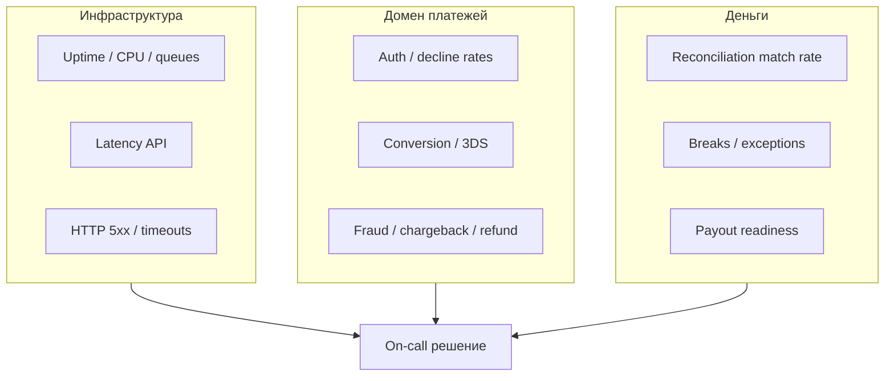
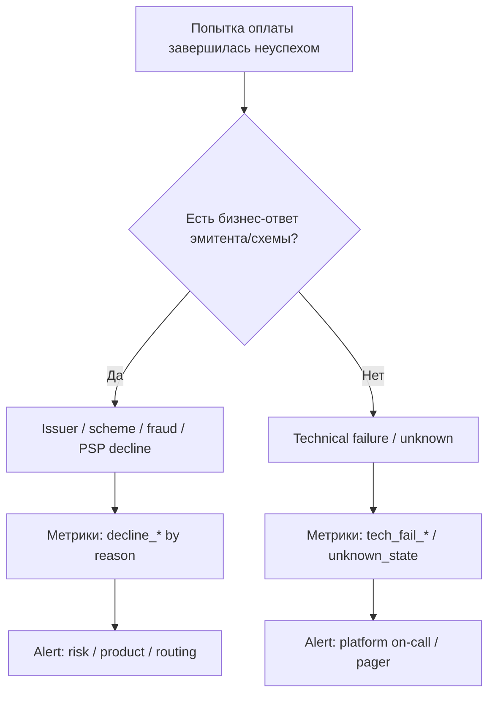
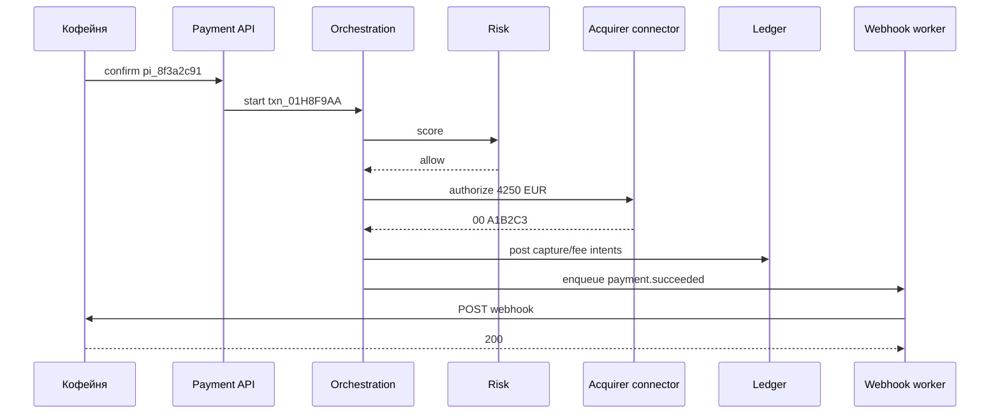
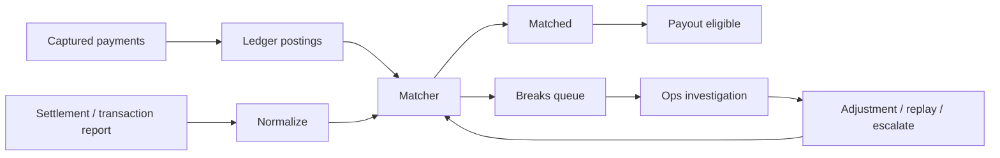

# Глава 24. Мониторинг и операционная работа

Аня заплатила в «Кофейне» **42,50 EUR**. Для неё история закончилась зелёной галочкой. Для инженера «Платёжки» история только начинается — и она длится дольше, чем кажется. Через минуту нужно понять, не просела ли доля одобренных авторизаций (auth rate) на BIN «Банка Север» — диапазоне номеров его карт. Через час — дошёл ли webhook до «Кофейни». Через сутки — совпал ли settlement-файл с леджером по `pay_8f3a2c91` / `pi_8f3a2c91` / `txn_…`. Через неделю — не выросла ли доля chargeback (chargeback ratio) у продавцов с MCC 5499 — кодом категории бизнеса. Через месяц — не стали ли refunds «Кофейни» выглядеть как массовый возврат дефектного товара или как злоупотребление возвратами ([глава 16](16-fraud.md)).

Мониторинг платёжной системы — это не «те же Grafana-дашборды, что у обычного CRUD, плюс пара графиков». Обычный сервис падает — пользователи злятся, вы чините. Платёжный сервис «почти падает» страшнее: деньги могут уже уехать, статусы разъехаться, а зелёная галочка на экране Ани оказаться ложью или, наоборот, честным успехом, который мерчант так и не увидел. Дежурный в платежах отвечает не только за uptime, но и за **денежную правду**: кто кому сколько должен прямо сейчас.

В [главе 23](23-reliability.md) мы говорим, как система выживает при сбоях. Здесь — как вы **видите**, что происходит, как отличаете «эмитент отказал» от «у нас отвалился коннектор», как строите алерты, которые будят по делу, и как операционная сверка (operational reconciliation) становится частью on-call, а не «задачей бухгалтерии на понедельник». Архитектура сущностей и идентификаторов — в [главе 20](20-platform-architecture.md); леджер и три уровня сверки — в [главе 13](13-ledger-and-reconciliation.md). Эта глава — про то, чем вы смотрите на живую систему каждый день.

## В этой главе

- Почему платёжные метрики особенные и как их считать без самообмана
- Success, auth, decline, conversion, 3DS, fraud, chargeback, refund, latency и failure rate
- Issuer decline vs technical decline — разные миры для дашбордов и алертов
- Observability: логи, трейсы, метрики и корреляция по `pi_` / `txn_` / RRN
- Дашборды для продукта, риска, финансов и дежурного
- Алертинг: пороги, burn rate, quiet hours и антипаттерны
- Operational reconciliation как ежедневный операционный контур
- On-call в платежах: плейбуки, эскалации и «денежные» инциденты
- Что проверять в коде и какие грабли ловят почти все команды

---

## Зачем платежам свой мониторинг

Представьте обычный HTTP-сервис: 99,9% успешных ответов, p99 = 120 мс. Красиво. Теперь те же цифры у платёжного API «Платёжки»:

- «успешный HTTP 200» может нести `status: declined` — для SRE всё зелёное, для «Кофейни» конверсия умерла;
- «ошибка 500» может прилететь *после* того, как эмитент уже одобрил холд 42,50 EUR — для HTTP это failure, для денег это «неизвестное состояние»;
- рост latency с 800 мс до 3 с на checkout «всего лишь» режет конверсию на проценты, а проценты от оборота — это уже деньги;
- падение success rate на 2 пункта в пятницу вечером может быть либо инцидентом эквайера, либо нормальным всплеском insufficient funds у зарплатных карт до получки.

Поэтому в платежах полезно держать в голове три плоскости мониторинга одновременно:

1. **Инфраструктурная** — живы ли сервисы, очереди, БД, коннекторы (то, чему учит классический SRE).
2. **Платёжно-доменная** — что происходит с попытками оплаты: approve, decline, challenge, fraud block, timeout.
3. **Денежная** — сходятся ли леджер, settlement и банк; нет ли расхождений сверки (breaks) перед payout; не текут ли обязательства.

Если у вас настроены только CPU и HTTP error rate, вы слепы во второй и третьей плоскостях. Если смотрите только «конверсию checkout», вы слепы к техническим сбоям, которые маскируются под «покупатель передумал». Если смотрите только сверку раз в месяц — деньги уже уехали не туда.



Словами: дежурный смотрит не на один график, а на пересечение «жива ли система», «как ведут себя платежи» и «сходятся ли деньги». Инцидент почти всегда лежит на стыке двух плоскостей.

---

## Словарь метрик: что считать и как не обмануть себя

Метрики в платежах легко назвать и трудно определить. Две команды «Платёжки» могут спорить час про «упал success rate», и выяснится, что одна делит успехи на *все* попытки, а другая — на *попытки, дошедшие до эмитента*. Обе правы в своей системе координат. Обе опасны, если цифры смешаны на одном дашборде без подписи.

Ниже — рабочие определения, которыми пользуются инженеры «Платёжки». Числа иллюстративные. Важно не зазубрить формулы, а понять **знаменатель** и **момент фиксации**.

### Success rate и authorization rate

**Authorization rate (auth rate)** — доля попыток, которые получили одобрение эмитента (approve + auth code вроде `A1B2C3`), среди попыток, которые *дошли до эмитента* (или, в более широкой версии, среди всех отправленных в эквайер). Auth rate отвечает на вопрос: «насколько охотно банки одобряют наш трафик на этом маршруте / MCC / гео / типе карты?»

**Success rate** в продуктовом смысле часто шире: доля заказов или Payment Intent'ов, которые в итоге дошли до `succeeded` / `captured` (с учётом 3DS, ретраев, второй карты). Success rate отвечает на вопрос «Кофейни»: «какой процент покупателей, начавших оплату, реально заплатил?»

Путаница рождается здесь:

| Метрика | Типичный числитель | Типичный знаменатель | Что скрывает |
|---|---|---|---|
| Auth rate (network) | approve от эмитента | попытки с ответом эмитента | технические сбои, fraud-block до сети |
| Auth rate (attempt) | approve | все Transaction / Attempt | смешивает issuer и technical |
| Intent success | Intent в `succeeded` | созданные Intent'ы | брошенные формы, где карты даже не вводили |
| Checkout conversion | оплаченные заказы | сессии checkout / «Оплатить» | UX магазина + PSP + банк |

Для платежа Ани на 42,50 EUR:

- Intent `pi_8f3a2c91` (в ранних главах — фасад `pay_8f3a2c91`) создан;
- первая попытка `txn_01H8F3A2` получила soft decline `51` — для auth rate это decline, для Intent ещё не финал;
- после пополнения счёта или оплаты другой картой Intent стал `succeeded` — для success rate это успех.

Если вы алертите только на auth rate attempt-уровня, вы можете «не заметить», что Intent'ы всё равно закрываются за счёт ретраев. Если алертите только на Intent success, вы можете проспать деградацию эквайера, которую спасает cascading ([глава 07](07-states-async-idempotency.md)).

Практичное правило: **считайте оба слоя** и подписывайте на дашборде, какой именно.

### Decline rate и разложение отказов

**Decline rate** = отказы / попытки. Само по себе число почти бесполезно: рост с 12% до 18% может означать «эмитенты злятся», «мы лучше ловим fraud», «сломали маппинг кодов» или «подключили мерчанта с ужасным MCC».

Поэтому decline rate всегда режут по таксономии из [главы 09](09-declines-and-response-codes.md):

- issuer decline;
- scheme decline;
- acquirer / PSP decline (конфиг, лимиты, MID);
- fraud decline (риск-движок);
- technical failure (таймаут, 5xx, неизвестный статус).

На дашборде «Платёжки» для «Кофейни» в пятницу вечером это может выглядеть так (иллюстративно, за час, 1 000 попыток):

| Класс | Кол-во | Доля | Что делать дежурному |
|---|---:|---:|---|
| Approve | 820 | 82% | норма |
| Issuer decline | 120 | 12% | смотреть коды / BIN / soft vs hard |
| Fraud decline | 25 | 2,5% | проверить false positive / attack |
| PSP / acquirer decline | 15 | 1,5% | конфиг, лимиты, MID |
| Technical failure | 20 | 2% | **инцидент**, если выше базы |

Смешать все «не-approve» в один decline rate — способ проспать technical spike внутри «нормального» бизнес-decline.

### Conversion rate: чей это KPI?

**Conversion** в платежах — слово-хамелеон. Продакт «Кофейни» считает «дошёл до thank-you page». PSP считает «Intent succeeded». Risk считает «approve минус fraud block». Finance считает «settled net».

Для операционного мониторинга полезны минимум три воронки:

1. **Checkout funnel** — открыл форму → ввёл карту → получил результат → success.
2. **Auth funnel** — submit → (optional 3DS) → issuer response → capture.
3. **Money funnel** — captured → cleared → settled → available → paid out.

Аня на 42,50 EUR проходит все три. Но алерт «conversion упала» без указания воронки запускает бессмысленный war room: продукт чинит кнопку, SRE смотрит CPU, финансист ждёт settlement file.

### 3DS challenge rate и связанные метрики

После SCA и 3DS2 ([глава 08](08-3ds-and-sca.md)) отдельный набор метрик стал обязательным:

- **3DS eligibility / request rate** — доля попыток, где вообще стартовали 3DS;
- **frictionless rate** — доля 3DS без challenge (ACS «узнал» держателя);
- **challenge rate** — доля с challenge (OTP, biometric, app);
- **challenge completion rate** — доля начатых challenge, которые Аня довела до конца;
- **3DS failure / timeout rate** — ACS недоступен, пользователь бросил, браузерный поток сломался;
- **liability shift coverage** — доля успешных auth с переносом ответственности за определённые fraud-споры на эмитента (для споров, не для realtime SRE; условия — в [главе 08](08-3ds-and-sca.md)).

Почему это важно операционно: рост challenge rate на 10 пунктов «всего лишь» ухудшает UX, но на графике auth rate может выглядеть как «всё ок» — если вы смотрите только финальные approve среди *завершённых* попыток и игнорируете брошенные challenge. Классический самообман: challenge rate вырос, completion упал, Intent success просел, auth rate «сетевых» ответов стабилен — и дежурный смотрит не туда.

Для «Кофейни» в Европе типичная картинка (порядок величин, не норматив): часть трафика frictionless, часть challenge, часть exemption. Мониторьте **по стране эмитента, по exemption type, по устройству**. Иначе вы усредните Польшу с Нидерландами и ничего не увидите.

### Fraud rate: какой именно?

В [главе 16](16-fraud.md) fraud — отдельная вселенная. Для мониторинга зафиксируем разные «fraud rate», которые нельзя склеивать:

- **Fraud block rate** — доля попыток, отклонённых вашим (или эквайерским) риск-движком *до* или *вместо* нормального issuer path.
- **Fraud loss rate** — доля оборота / числа транзакций, которые потом оказались мошенническими (часто через chargeback reason codes fraud).
- **False positive rate** — доля честных платежей, убитых правилами (оценка через appeals, повторные успешные оплаты, ручную разметку).
- **Attack signals** — card testing velocity, всплеск declines `14`/`04`/`07` на одном MID, spike новых карт с одного IP/device.

Операционный смысл: spike fraud *block* rate ночью может быть правильной защитой от carding — будить CEO не надо, будить fraud on-call — надо. Spike fraud *loss* с лагом в 30 дней — уже другой контур (не realtime pager, а weekly risk review).

### Chargeback rate и refund rate

**Chargeback / dispute rate** — обычно считают как число chargeback к числу успешных транзакций (или к объёму) за окно. Схемы смотрят на ratio и программы мониторинга ([глава 17](17-chargebacks-and-disputes.md)). Для SRE это **медленная** метрика: chargeback прилетает через дни и недели после `pay_8f3a2c91`. Алертить pager'ом на суточный шум бессмысленно; алертить risk/ops на приближение к порогу программы — обязательно.

**Refund rate** — доля успешных платежей, по которым сделали refund (полный/частичный), по числу или сумме. Рост refund rate у «Кофейни» может быть:

- сезонным (пересорт зерна, логистика);
- багом (двойной capture → массовые возвраты);
- fraud/friendly fraud (сначала success, потом «верните»);
- операционным кошмаром (саппорт жмёт refund без причины в CRM).

Мониторьте refund rate **по мерчанту, MCC, методу, причине** (если собираете). Отдельно — **refund failure rate** и latency refund'ов: «деньги списали, вернуть не можем» — отдельный класс инцидентов с очень злым UX.

### Latency и failure rate: не только HTTP

**Latency** в платежах надо резать по этапам, иначе p99 API = 2,1 с ничего не объясняет:

| Этап | Что измеряем | Типичный порядок (иллюстративно) |
|---|---|---|
| Merchant → PSP API | время до синхронного ответа | десятки–сотни мс |
| PSP internal (risk, vault, ledger write) | до вызова эквайера | десятки–сотни мс |
| Acquirer / network / issuer | auth round-trip | сотни мс – пара секунд |
| 3DS challenge | от start до completion | секунды–минуты (это UX-время) |
| Webhook delivery | до ACK мерчанта | секунды, с ретраями — минуты |
| Capture / clearing ack | асинхронно | минуты–часы |

Для платежа Ани полезный таймлайн в трейсе:

```text
t+0ms     Intent create pi_8f3a2c91
t+40ms    risk score OK
t+55ms    route → Банк Эквайр
t+920ms   issuer approve A1B2C3
t+980ms   sync response to Кофейня
t+1100ms  webhook payment.succeeded attempt #1
t+1400ms  merchant ACK 200
```

Если p99 «всего API» вырос из-за 3DS challenge — это не инцидент сети, это продуктовая реальность. Если вырос acquirer round-trip при стабильном internal — смотрите коннектор и банк, не Kubernetes.

**Failure rate** тоже нужно специфицировать:

- HTTP 5xx rate API;
- timeout rate к эквайеру;
- webhook failure rate (4xx/5xx/timeout мерчанта);
- worker / outbox lag failure (события не применяются);
- unknown-state rate (отправили auth, ответа нет — худший класс).

Unknown-state — отдельная метрика и отдельный алерт. Это не decline. Это «возможно, деньги Ани уже под холдом, а мы не знаем».

---

## Issuer decline vs technical decline: разные миры мониторинга

[Глава 09](09-declines-and-response-codes.md) объясняет смысл различия. Здесь — **как это жить в метриках, дашбордах и on-call**.

### Две разные тревоги

**Issuer decline spike.** Эмитенты стали чаще говорить «нет». Возможные причины: атака card testing (много `14`/`54`), смена antifraud у крупного банка, просадка exemption strategy, плохой MCC-микс нового мерчанта, сезонный insufficient funds. Дежурный инженер *инфраструктуры* часто здесь бессилен. Нужны risk, product, routing. Алерт должен падать в канал `#payments-risk-ops`, а не будить только SRE.

**Technical decline / technical failure spike.** Таймауты, 5xx процессора, TLS, «недоступен Банк Эквайр», рост unknown-state. Это классический reliability-инцидент ([глава 23](23-reliability.md)). Нужны failover, circuit breaker, статус-страница для мерчантов, возможно — пауза новых MIT. Алерт — в pager on-call платформы.

Если обе метрики свалены в `declined_total`, вы получите одно из двух: либо постоянный шум от нормальных issuer declines, либо слепоту к техническому сбою на фоне «обычных» 12% отказов.



### Как классифицировать на границе

На практике классификация грязная. Эквайер иногда отдаёт общий `05` и на fraud банка, и на свои внутренние проблемы. Таймаут может случиться *после* approve на стороне эмитента. Поэтому в операционной модели «Платёжки»:

1. Нормализуйте ответы коннектора в внутренний enum: `approved`, `issuer_declined`, `scheme_declined`, `acquirer_declined`, `fraud_blocked`, `technical_error`, `unknown`.
2. Храните **сырой** код провайдера рядом — для расследований и сверки с банком.
3. Считайте метрики по нормализованному классу, а дашборд drill-down — по сырому коду.
4. Для `unknown` запускайте inquire / status check — запрос текущего статуса у эквайера — и отдельный playbook, не «retry authorize сразу».

### Иллюстрация на платеже Ани

Сценарий A. `txn_01H8F3A2` → код `51` insufficient funds. Это issuer decline. Метрика `issuer_decline{code="51", merchant="coffee"}` +1. Auth rate падает. Technical failure — нет. On-call не будим, если нет аномального spike по BIN.

Сценарий B. `txn_01H8F9AA` ушёл в «Банк Эквайр», через 12 с — timeout, статус Intent `processing`. Метрика `acquirer_timeout` +1, `unknown_state_open` +1. Это technical. Будим. Запускаем inquire. Не создаём слепо вторую auth без идемпотентности ([глава 07](07-states-async-idempotency.md)).

Сценарий C. Риск «Платёжки» заблокировал попытку score 92/100 до эквайера. Это fraud decline. В auth rate эмитента не попадает (и правильно). В conversion «Кофейни» — попадает. Дашборды обязаны показывать оба взгляда.

---

## Observability: как увидеть один платёж целиком

Метрики говорят «что-то не так». Observability отвечает «почему с *этим* платежом». В платежах цена плохого трейсинга — ручной труд саппорта и часы в Excel на каждый инцидент.

### Три столпа — и четвёртый денежный

Классика: metrics, logs, traces. В PSP к ним почти всегда добавляют **audit / financial event log**: неизменяемую ленту доменных событий (`authorized`, `captured`, `refund_requested`, `ledger_posted`, `webhook_delivered`), по которой можно восстановить историю `pi_8f3a2c91` без археологии по пяти БД.

### Корреляция идентификаторов

Без склейки id observability бесполезна. Для канонического платежа Ани держите в каждом логе/спане максимум из доступного:

| ID | Где рождается | Зачем в логах |
|---|---|---|
| `ORD-2026-0918-0042` | «Кофейня» | поддержка магазина |
| `pi_8f3a2c91` / `pay_8f3a2c91` | PSP Intent | логический платёж |
| `txn_01H8F3A2` | PSP Attempt | конкретная попытка |
| Idempotency-Key | мерчант / PSP | дедуп ретраев |
| Auth code `A1B2C3` | эмитент | короткий, не уникален глобально |
| RRN / STAN | эквайер / сеть | сверка с банком |
| ARN | clearing | chargeback / representment |
| `trace_id` | ваша платформа | сквозной трейс |
| `merchant_id` | тенант | изоляция и агрегаты |

Правило: **поиск по одному id должен открывать timeline**. Если саппорт умеет искать только по `ORD-…`, а эквайер прислал только RRN — вы проиграли операционку ещё на этапе дизайна ([глава 20](20-platform-architecture.md), [глава 28](28-glossary.md)).

### Что логировать — и чего нельзя

Логируйте:

- нормализованный статус и класс отказа;
- маршрут (эквайер, MID, схема);
- тайминги этапов;
- результат risk score (без лишнего PII);
- результат доставки webhook (код, попытка, latency);
- id проводок леджера / break id сверки.

Не логируйте (и не кладите в метки метрик):

- полный PAN, CVV, track data;
- сырые 3DS challenge-данные сверх необходимости;
- секреты API, client_secret Intent'а;
- полные PII «на всякий случай» в high-cardinality labels.

Кардинальность (cardinality) — число разных комбинаций меток и, соответственно, временных рядов метрики — отдельный убийца observability. Метка `card_last4` + `amount` + `email_hash` на каждой метрике превратит Prometheus в пепел. High-cardinality уезжает в логи и трейсы; в метриках оставляйте `merchant_id` (осторожно при огромном числе мерчантов), `method_type`, `route`, `country`, `decline_class`, `http_status`.

### Пример трейса успешного платежа



Словами: один `trace_id` связывает API, риск, коннектор, леджер и доставку webhook. Когда «Кофейня» пишет «денег нет, а у Ани списали», вы ищете `pi_8f3a2c91` и видите: auth был, webhook упал на 500, ретраи ещё идут, заказ в магазине не обновлён. Это не «баг Visa». Это наблюдаемый разрыв на стыке.

### Synthetic checks и canaries

Помимо реальных платежей Ани, «Платёжка» гоняет:

- **synthetic auth** в тестовой среде эквайера (не путать с продом на живых картах без разрешения);
- **canary-трафик** малой доли мерчантов на новый коннектор;
- **контрактные ping'и**: доступность Directory Server / ACS health (где доступно), SFTP settlement, webhook endpoint самих себя.

Canary без метрик decline_class бесполезен: выкат «успешен» по HTTP, а issuer decline на новом MID улетел в потолок.

---

## Дашборды: разные экраны для разных ролей

Один «бог-дашборд» из 80 панелей — способ никого не информировать. В «Платёжке» обычно живут несколько рабочих мест.

### Экран дежурного (on-call)

Цель: за 30 секунд понять, есть ли инцидент и какого он класса.

Минимальный набор:

- traffic (attempts / intents) now vs week ago;
- approve rate, issuer decline rate, technical failure rate, unknown_state;
- p50/p95/p99 auth latency по маршрутам;
- error rate коннекторов и circuit breaker state;
- webhook success / lag;
- outbox / queue lag;
- reconciliation: open breaks count, match rate за последний цикл (если цикл уже был);
- top merchants by technical failure (не по обороту — по инцидентности).

Цвета простые: technical и unknown — красные пороги; issuer decline — жёлтые с контекстом; бизнес-метрики вроде refund — на другом экране.

### Экран продукта / коммерции

- Intent success / checkout conversion по мерчантам и методам;
- 3DS challenge rate и completion;
- soft decline recovery rate (сколько `51`/`65` потом стали success);
- влияние cascading: доля success со 2–3 маршрута;
- APM vs cards mix.

### Экран риска

- fraud block rate, score distribution;
- velocity anomalies;
- chargeback ratio rolling 30/90 дней к порогам программ;
- rule hit counts и false positive appeals.

### Экран финансов / ops money

- settlement file arrived? on time?
- match rate уровней 1–3 ([глава 13](13-ledger-and-reconciliation.md));
- aging breaks (сколько часов/дней открыты);
- payout batches ready / held;
- merchant balances vs bank balance drift;
- fee / net: для контроля — средний take, аномалии комиссии (например, внезапно fee 0 на потоке).

### Drill-down до одного платежа

С любого графика — переход к sample id. Клик по spike technical failure открывает список `txn_…` с причинами. Клик по break сверки открывает `pay_8f3a2c91`, строку файла и проводку леджера. Если дашборд не умеет в drill-down, он годится для слайдов, но не для ночи дежурства.

### Врезка: как это бывает в жизни

У «Кофейни» в понедельник утром «всё красное»: success rate −8 пунктов. War room. Через 40 минут выясняется: маркетинговая акция привела аудиторию с prepaid-картами и лимитами, issuer decline `51`/`61` вырос, technical стабилен, эквайер жив. Чинили не то. Правильный дашборд показал бы breakdown по decline_class за первую минуту. Сорок минут — это потерянные заказы и лишний кортизол.

---

## Алертинг: разбудить человека вовремя

Алерты в платежах легко превратить в ночной шум. Тогда дежурный начинает игнорировать pager — канал срочного вызова дежурного — и просыпает настоящий unknown-state на крупном мерчанте.

Ниже `page` означает срочный вызов дежурного, а severity / Sev — уровень серьёзности инцидента. Runbook или плейбук — инструкция с конкретными действиями и контактами.

### Принципы

1. **Алерт = действие.** Если на алерт нельзя ответить плейбуком («смотреть / эскалировать / митировать»), это не алерт, а график.
2. **Разделяйте классы.** Technical failure и unknown_state — page. Issuer decline anomaly — ticket/Slack с SLA. Chargeback ratio — email/risk calendar.
3. **Смотрите на базу, не на абсолют.** 15% issuer decline ночью у продавца одежды и других текстильных товаров может быть нормой; 15% technical — почти никогда.
4. **Мультиоконность.** Spike на 1 минуте при низком трафике «Кофейни» в 04:00 — шум. Burn rate показывает скорость расходования допустимого бюджета ошибок; multi-window проверяет её одновременно на коротком и длинном окнах. Это снижает ложные подъёмы ([глава 23](23-reliability.md)).
5. **Тенантная изоляция.** Алерт «у мерчанта X technical 40%» не должен выглядеть как «у всей Платёжки конец света», если X — 0,3% трафика… но должен будить, если X — топ-10 оборота.

### Что обычно page'ит

| Сигнал | Почему page | Первый шаг |
|---|---|---|
| Technical failure rate выше базы N минут | деньги/статусы под ударом | проверить коннектор, circuit, статус эквайера |
| Unknown-state открытые растут | риск двойных списаний / зависших холдов | inquire, стоп агрессивных ретраев |
| Auth latency p99 / timeouts к эквайеру | конверсия и таймауты мерчантов | failover / degrade |
| Webhook lag критичный для топ-мерчантов | заказы не обновляются | ретраи, статус-пейдж, ручной replay |
| Settlement file missing past cut-off | payout под угрозой | эскалация банку/операциям |
| Reconciliation match rate ниже порога перед payout | риск выплатить неправду | hold payout unmatched |
| Ledger invariant / balance drift internal | дыра в обязательствах | stop writes? investigate urgently |
| Certificate / secret expiry | внезапный total outage завтра | ротация |

### Что обычно не page'ит (но алертит днём)

- плавный рост challenge rate;
- рост refund rate без сбоя refund API;
- chargeback ratio на горизонте недель;
- единичные decline от нового BIN;
- faux alert «CPU 70%» без платёжного эффекта.

### Антипаттерны алертов

- Алерт на raw `declined` без класса.
- Алерт на success rate Intent без учёта сезонного трафика и без сравнения с past week.
- Отдельный pager на каждый мерчант (тысячи страниц).
- Алерт без runbook link.
- Тихий алерт в канал на 200 человек — все думают, что «кто-то уже смотрит».

### Пример политики для «Платёжки»

Иллюстративно:

- technical_failure_rate > 1,5% за 5 минут при > 200 попытках → page severity 1;
- unknown_state_open > 50 или рост > 20 за 10 минут → page severity 1;
- issuer_decline_rate > baseline+10 п.п. за 15 минут на топ-маршруте → Slack `#payments-ops` severity 2, auto-create Jira;
- match_rate_provider < 99% после обработки файла → Slack `#money-ops`, блок auto-payout;
- chargeback_ratio_30d > 0,7× программного порога → risk email weekly + dashboard banner.

Пороги калибруйте своими данными. Чужие «лучшие практики» без вашей базы — декорация.

---

## Operational reconciliation: сверка как операция, не как бухгалтерия

[Глава 13](13-ledger-and-reconciliation.md) разбирает три уровня сверки и matching. Здесь — **как это встроить в ежедневную операционку и мониторинг**.

### Чем operational reconciliation отличается от «месячного закрытия»

Месячное закрытие интересует CFO. Operational reconciliation интересует дежурного *сегодня до payout*:

- файл эквайера за вчера пришёл и распарсился?
- match rate достаточный, чтобы выпускать выплаты?
- сколько breaks открыто, какого типа, на какие суммы?
- платёж Ани `pay_8f3a2c91` (net 41,74 после fee 0,76) matched или висит?
- есть ли duplicates / missing_in_ledger / missing_in_provider?

Это realtime (или near-realtime) контроль конвейера денег, а не отчёт «в целом квартал красивый».



Словами: только matched (или явно разрешённые исключения) должны становиться «готовы к payout». Breaks — это очередь работы людей и автоматики, с SLA и алертами.

### Метрики сверки, которые стоит светить

- **file_arrival_delay** — насколько позже cut-off пришёл файл;
- **parse_error_count** — битые строки, неожиданные currency exponents;
- **match_rate** = matched / (matched + breaks) за цикл;
- **breaks_by_type** — missing_in_provider, missing_in_ledger, amount_mismatch, duplicate, fee_mismatch;
- **break_aging** — p50/p95 возраста открытого break;
- **unmatched_amount_sum** — денежный риск, не только штуки;
- **auto_resolve_rate** — сколько breaks закрывает робот (поздний webhook, late capture);
- **payout_held_merchants** — кого задели.

Для платежа Ани amount_mismatch на копейки после FX — один тип ада; missing_in_provider при том, что Intent `succeeded` — другой (возможно, capture не ушёл в clearing).

### Связь с алертингом и on-call

Operational reconciliation порождает особый класс инцидентов: **денежных**. Они редко выглядят как HTTP 500. Чаще — «match rate 96,4%», «файл не пришёл», «fee в файле 0,80 вместо ожидаемых 0,76». Severity может быть выше, чем у кратковременного spike latency: неправильный payout чинится письмами и компенсациями неделями.

Плейбук (упрощённо):

1. Подтвердить, что файл тот (дата, MID, среда).
2. Оценка: сумма unmatched vs порог риска.
3. Решение: partial payout (только matched) или полный hold.
4. Топ breaks по сумме — в работу сначала.
5. Коммуникация затронутым мерчантам: честный статус, не тишина.
6. Постобзор: дыра в коннекторе, в маппинге id, в fee engine?

### Типы breaks и что они обычно значат

Не все breaks одинаково страшны. Операционка «Платёжки» учит читать тип раньше, чем открывать Excel.

| Тип break | Симптом | Частая причина | Типичное действие |
|---|---|---|---|
| `missing_in_provider` | У нас `succeeded`, в файле нет строки | Capture не ушёл / другой MID / файл неполный | Inquire, проверить batch capture, эскалация эквайеру |
| `missing_in_ledger` | Строка в файле есть, у нас нет проводки | Потеряли событие, двойной мир статусов | Доиграть outbox, ручная posting с тикетом |
| `amount_mismatch` | 42,50 vs 42,51 или FX-хвост | Exponent, округление, DCC, частичный capture | Сверить minor units; не «поправить SQL-ом баланс» |
| `fee_mismatch` | fee 0,76 у нас vs 0,90 в файле | Тариф, IC++ сюрприз, неверный pricing profile | Финансы + конфиг тарифа; payout policy |
| `duplicate` | Две строки на один `txn_…` | Повтор файла, повторный clearing | Дедуп по RRN/ARN; не начислять дважды |
| `status_conflict` | У нас refunded, в файле presentment | Гонка refund vs clearing | Таймлайн события, возможно late presentment |

Для Ани на 42,50 EUR самый «здоровый» исход — отсутствие break. Самый коварный — `missing_in_provider` при живом холде у «Банка Север»: мерчант думает, что заказ оплачен (если вы рано отправили webhook), а в сеттлмент-мире платежа нет. Operational monitoring обязан ловить такие дыры **до** того, как «Кофейня» отправит зерно и закроет смену.

### Автоматизация vs руки

Робот сверки хорошо закрывает:

- поздний файл, который просто опоздал на час;
- повторно присланный файл (идемпотентный import);
- delayed webhook, после которого статус догнал строку провайдера;
- копеечные FX-расхождения в пределах допуска (явный tolerance, не «ну почти»).

Руки нужны, когда:

- сумма break'ов выше порога риска;
- break на токене/MID, который никогда не матчился (системная дыра);
- duplicate с уже ушедшим payout;
- fee_mismatch массовый — признак бага тарификации, а не одной Ани.

Метрика `auto_resolve_rate` без `manual_break_aging` врёт: робот может «закрывать» всё подряд, заметая системный баг под ковёр. Смотрите оба.

### Сквозной пример: утро после дня Ани

18 сентября Аня платит 42,50 EUR, заказ `ORD-2026-0918-0042`, Intent `pi_8f3a2c91`, успешный attempt с auth `A1B2C3`. Fee 0,76, к балансу «Кофейни» ожидается 41,74.

19 сентября, 06:40. Worker сверки:

- файл «Банка Эквайр» на месте;
- строка с RRN платежа найдена, amount 42,50, fee в файле 0,76;
- леджер: receivable (требование PSP к эквайеру) закрыт, merchant payable (обязательство перед продавцом) +41,74, revenue (выручка PSP от комиссии) +0,76;
- match OK.

Параллельно три других платежа «Кофейни» — amount_mismatch на 0,01 из-за округления FX (другая валюта presentment). Match rate дня 99,7%. Auto-payout разрешён. Дежурный получил только digest, не pager.

Альтернативная ветка: fee в файле 0,90, у нас 0,76. Break `fee_mismatch` на `pi_8f3a2c91`. Сумма маленькая, но если таких сотни — это баг тарифного движка. Алерт `#money-ops`. Payout «Кофейни» можно не холдить целиком, если политика позволяет выпускать gross-matched и разбирать fee отдельно — главное, чтобы политика была **явной**.

---

## On-call в платежах: дежурство про деньги

On-call платёжной платформы ближе к совмещению SRE, payment ops и иногда risk, чем к чистому «рестартуй под».

### Кто дежурит и какие ротации

Типичная схема зрелой «Платёжки»:

- **Platform on-call** — сервисы, коннекторы, latency, technical failure, деплои.
- **Money / ops on-call** (часто business hours + escalation) — сверка, payout, settlement files, breaks.
- **Risk on-call** — атаки, fraud spikes, rule emergencies.
- **Support L2** — ручной разбор платежей мерчантов, не заменяющий инженера на unknown-state.

На старте всё это может быть одним человеком. Тогда критично сузить pager: только technical/unknown/money-cutoff, иначе выгорание гарантировано.

### Анатомия инцидента

1. **Detect** — алерт или жалобы мерчантов («Кофейня»: «оплаты висят»).
2. **Triage** — класс: infra / issuer / fraud / money.
3. **Mitigate** — failover маршрута, включить degrade (скрыть метод), hold payout, freeze MIT, feature flag.
4. **Communicate** — статус для топ-мерчантов, внутренний канал, не «мы смотрим» без ETA.
5. **Recover** — добить unknown через inquire, доставить webhooks, закрыть breaks.
6. **Reconcile after** — обязательный шаг: после технического сбоя сверить, что леджер и провайдер согласны ([глава 23](23-reliability.md), [глава 13](13-ledger-and-reconciliation.md)).
7. **Postmortem** — с цифрами: сколько платежей, сколько денег под риском, сколько двойных холдов, сколько ручных refund.

### Плейбук: timeout при оплате Ани

Симптом: «Кофейня» получила 504 от «Платёжки» на confirm, Аня видит ошибку, в приложении «Банка Север» — pending 42,50.

Действия:

1. Найти `pi_…` / idempotency key заказа `ORD-2026-0918-0042`.
2. Проверить, создан ли `txn_…` и ушёл ли authorize.
3. Если ушёл — **не** жать «повторить оплату» слепо; сделать inquire к эквайеру.
4. Если approve есть — довести статус до success, дослать webhook, сказать мерчанту показать успех / не повтор.
5. Если approve нет — безопасно предложить повтор с новым idempotency key.
6. Метрика unknown_state для этого случая должна была алертить раньше жалобы; если нет — дыра в детектировании.

### Плейбук: просадка auth rate

1. Breakdown decline_class.
2. Если technical — уйти в technical playbook.
3. Если issuer — топ кодов, топ BIN, топ merchant, гео.
4. Сравнить с yesterday/last week same hour.
5. Проверить: не включили ли принудительный 3DS / не выключили exemption; не сменился ли descriptor; не уехал ли MCC.
6. Эскалация risk/product; инфраструктуру не «рестартить для галочки».

### Плейбук: missing settlement file

1. Подтвердить ожидание файла (календарь, cut-off, праздники банка).
2. Проверить SFTP/API job, сертификаты, диск.
3. Связь с эквайером.
4. Решение по payout: delay vs partial на уже имеющихся matched циклах.
5. Коммуникация мерчантам про задержку выплат — лучше раньше, чем после дедлайна зарплат их сотрудников.

### Документация дежурства

У каждого алерта — runbook на 1–2 экрана: симптомы, графика, SQL/запросы поиска id, критерии severity, кому звонить в банке, как включить failover. Runbook без «как проверить один платёж Ани» бесполезен: абстрактные советы «проверьте логи» в 03:00 не работают.

Минимум в runbook на Sev-1 technical failure:

```text
1. Открыть on-call dashboard → панель decline_class
2. Если technical/unknown доминирует → статус коннекторов
3. Найти 5 sample txn_id из алерта
4. Для каждого: timeline + inquire к эквайеру
5. Решение: failover route / feature-flag method off / status page
6. Коммуникация #incidents + топ-мерчантам в течение 15 мин
7. После mitigate: очередь unknown_state → close or escalate
8. Перед resolve инцидента: mini-recon (ledger vs provider sample)
```

Если шаг 8 пропущен, инцидент «закрыт» для SRE и открыт для денег.

### Severity: деньги vs удобство

Грубое, но рабочее правило «Платёжки»:

| Severity | Пример | Реакция |
|---|---|---|
| Sev-1 | unknown_state растёт; эквайер down на >X% трафика; payout cut-off под угрозой с большим unmatched | page immediately |
| Sev-2 | auth latency деградировала, conversion страдает, но статусы финальны; issuer decline anomaly на крупном BIN | business hours escalate / Slack urgent |
| Sev-3 | challenge rate вырос, refund rate странный, файл опоздал в пределах soft SLA | ticket, дневной разбор |
| Sev-4 | косметика дашбордов, единичные жалобы без метрического подтверждения | backlog |

Споры «это Sev-1 или нет» решайте **денежным риском и обратимостью**, не громкостью чата. Три минуты 502 на read-only dashboard мерчанта — не Sev-1. Три минуты массовых timeout на authorize при живых холдах — Sev-1, даже если CPU зелёный.

### Коммуникация наружу

Мерчанты ненавидят туман. Шаблон статуса при technical-инциденте:

- что сломано (метод / регион / эквайер), без внутренних имён сервисов;
- с какого времени;
- что делать покупателю (не долбить оплату / подождать / другая карта);
- что вы гарантируете по уже созданным Intent'ам (проверяете дубли, не будет двойного списания без разбора);
- следующий update через N минут.

«Кофейня» в инциденте должна узнать от вас раньше, чем от Ани в поддержке. Мониторинг жалоб саппорта — тоже сигнал, но запаздывающий; не стройте детектирование только на тикетах.

### Game days и тенистые учения

Раз в квартал «Платёжка» устраивает game day: симулируют timeout эквайера, потерянный settlement file, spike `14` как card testing, зависший webhook worker. Цель — не победить сценарий идеально, а проверить:

- сработали ли алерты за разумное время;
- нашли ли люди timeline платежа за <5 минут;
- не предложил ли кто-то «просто ретраить authorize» на unknown;
- ушёл ли hold payout автоматически при низком match rate.

Без учений плейбуки гниют. С учениями on-call перестаёт быть лотереей памяти старшего инженера.

### Врезка: для любопытных — error budget в платежах

Идея SRE error budget переносится криво, если считать только HTTP availability. Полезнее завести **несколько бюджетов**:

- availability API;
- technical failure budget (доля попыток);
- unknown-state budget (штуки × время жизни);
- money freshness budget (задержка сверки/payout vs SLA).

Можно сжигать API-бюджет на смелый деплой, но нельзя сжигать money freshness перед payroll-днями мерчантов. Продуктовые приоритеты тогда спорят числами, а не характерами.

---

## Сквозной день мониторинга: 18 сентября, «Кофейня»

Склеим метрики, алерты и сверку вокруг одного дня, когда Аня купила зерно.

### День (T+0)

| Время | Событие | Что видит мониторинг |
|---|---|---|
| 14:02:11 | Создан `pi_8f3a2c91` на 42,50 EUR, заказ `ORD-2026-0918-0042` | intents_created +1 |
| 14:02:12 | `txn_01H8F3A2` → issuer `51` | issuer_decline{code=51} +1 |
| 14:02:45 | Аня пополнила счёт; новая попытка, 3DS challenge | challenge_started +1 |
| 14:03:10 | Challenge OK, approve `A1B2C3` | approve +1, challenge_completed +1 |
| 14:03:11 | Webhook `payment.succeeded` ACK 200 | webhook_success +1 |
| 14:03:12 | Ledger: +42,50 receivable / payable; fee 0,76 | postings ok |
| 14:10 | Короткий spike timeouts эквайера на 2% | page? нет — ниже порога и <3 мин |
| 18:40 | Card testing на другом мерчанте | fraud_block spike → risk Slack |

Итог дня для «Кофейни»: Intent Ани успешен, net к балансу 41,74 pending. Auth rate дня слегка ниже из-за `51`, technical в норме.

### Ночь / утро (T+1)

| Время | Событие | Что видит мониторинг |
|---|---|---|
| 02:00 | Capture/clearing batch | jobs ok |
| 06:15 | Settlement file arrived (+15 мин к SLA) | file_arrival_delay warn |
| 06:45 | Match `pi_8f3a2c91` OK, fee 0,76 | match_rate 99,8% |
| 07:00 | Payout eligible включает 41,74 | payout_ready |
| 09:00 | Digest on-call: без Sev-1 | человек пьёт кофе, не тушит пожар |

### Альтернативная плохая ветка

На `txn_…` — timeout, webhook не создан, «Кофейня» показывает ошибку, эмитент холдит 42,50. Метрики: technical_failure +1, unknown_state_open +1. Через 5 минут порог — page. Дежурный делает inquire, находит approve `A1B2C3`, закрывает Intent как success, шлёт webhook, открывает инцидент «ложные ошибки клиентам при реальных холдах». Без классификации technical vs issuer этот кейс утонул бы в общем decline rate.

---

## Метрики глазами мерчанта и глазами PSP

«Кофейня» в своём кабинете видит урезанную проекцию: success rate за день, отказы «карта отклонена», сумма captured, pending balance, payout. Внутри «Платёжки» те же 42,50 EUR разложены на attempt'ы, маршруты, fee 0,76, match status, webhook attempts.

Два слоя нельзя смешивать в одном KPI-договоре без перевода:

- мерчантский «у нас 91% оплат проходит» часто = Intent success / checkout started;
- ваш внутренний auth rate на маршруте «Банк Эквайр» может быть 84%, потому что cascade и вторая карта спасают Intent;
- мерчант не обязан знать про technical vs issuer, но **ваш** саппорт обязан — иначе L1 будет советовать «введите карту ещё раз» на unknown-state.

Практический вывод для API и dashboard продавца ([глава 25](25-merchant-domain.md)): показывайте понятный статус и безопасный следующий шаг, а внутри тикета L2 храните `result_class`, route и inquire-результат. Мониторинг PSP обслуживает обе аудитории разными экранами, одним набором событий.

Отдельно следите за **расхождением того, что видит мерчант, с внутренней правдой**. Классика: кабинет рисует «оплачено» по первому webhook, а attempt ещё `processing` после частичного сбоя. Метрика `merchant_status_divergence` (если можете её оценить по polling API мерчантов или по саппорт-тегам) — ранний индикатор продуктового вранья.

---

## Организация данных для мониторинга

Чтобы всё выше работало, данные нужно проектировать заранее — «потом добавим labels» не взлетает.

### Событийная модель

Каждая попытка пишет доменное событие (в outbox или analytics stream):

```json
{
  "event": "payment_attempt_finished",
  "ts": "2026-09-18T14:03:10.221Z",
  "merchant_id": "merch_coffee_01",
  "payment_intent_id": "pi_8f3a2c91",
  "transaction_id": "txn_01H8F9AA",
  "order_id": "ORD-2026-0918-0042",
  "amount": 4250,
  "currency": "EUR",
  "method_type": "card",
  "route": "acq_bank_acquire_eu",
  "result_class": "approved",
  "issuer_response_code": "00",
  "auth_code": "A1B2C3",
  "latency_ms": {
    "risk": 18,
    "acquirer": 860,
    "total_sync": 980
  },
  "three_ds": {
    "applied": true,
    "flow": "challenge",
    "liability_shift": true
  },
  "trace_id": "tr_9c2e…"
}
```

Здесь `amount: 4250` — 42,50 EUR в центах; `result_class` — нормализованный класс результата, `issuer_response_code` — сырой код ответа эмитента, а `auth_code` — код одобрения. `three_ds.applied` отмечает участие 3DS, `flow` — его сценарий, `liability_shift` — применимость переноса ответственности. `latency_ms` хранит длительности этапов в миллисекундах. Из таких событий считаются почти все доменные метрики. Сырые HTTP-метрики API остаются, но не заменяют `result_class`.

### SLI / SLO на языке платежей

Напомним: SLI — измеряемый показатель качества, SLO — целевое значение этого показателя ([глава 23](23-reliability.md)). Примеры SLI:

- доля попыток без technical_failure;
- доля unknown_state, закрытых за < N минут;
- доля webhook, доставленных за < 30 с;
- доля settlement-циклов с match_rate ≥ 99%;
- доля payout, ушедших до cut-off.

SLO — договорённость с бизнесом. «Кофейня» как клиент PSP может видеть публичный status и uptime API; внутри вы держите жёстче money SLI.

### Хранение и ретенция

Realtime метрики — короткое окно. Агрегаты по мерчантам для risk и программ схем — месяцы. Сырые события попыток — согласно политике данных и PCI/GDPR ([глава 18](18-regulation-and-compliance.md), [глава 19](19-payment-security-pci.md)): без чувствительных данных в аналитическом озере «потому что удобно».

---

## Что это значит для инженера

1. **Разведите метрики по классам результата.** `approved` / `issuer_declined` / `fraud_blocked` / `technical_error` / `unknown` — обязательный enum в домене, не строка «failed» в одном поле.

2. **Считайте Intent success и Attempt auth отдельно.** Ретраи и cascading маскируют проблемы маршрута; воронка магазина маскирует технические дыры.

3. **Режьте latency по этапам.** Отдельно risk, acquirer, 3DS, webhook. Оптимизация «среднего API» без разреза — терапия не тому органу.

4. **Кладите корреляционные id в логи с первого дня.** `pi_`, `txn_`, order id, RRN, trace_id. Поиск «по сумме 42,50 вчера» — не стратегия.

5. **Алерты привязывайте к плейбукам.** Особенно unknown-state, settlement file, match rate before payout.

6. **Operational reconciliation — часть платформы.** Метрики match_rate и break_aging живут рядом с auth rate, а не в Excel финансиста.

7. **Онколл учите денежным сценариям.** Inquire после timeout, hold payout, partial release, коммуникация мерчанту — тренируйте в game days.

8. **Не взрывайте cardinality метрик PAN/email.** High-cardinality — в трейсы и searchable logs с маскированием.

9. **Canary и деплой смотрите через decline_class.** Зелёный HTTP после выката коннектора ничего не доказывает.

10. **После инцидента всегда сверка.** Reliability без reconciliation after — способ оставить тихие двойные холды и дыры в балансе.

11. **Дашборды по ролям.** Дежурный, risk, money, product — разные вопросы, разные экраны.

12. **Пишите события попыток структурированно.** Метрики задним числом из textarea логов — археология, не инженерия.

---

## Типичные ошибки и грабли

**Один decline rate на всё.** Технический сбой тонет в issuer `51`. Дежурный видит «ну, отказы подросли» и спит. Деньги Ани под холдом.

**Success rate = HTTP 200.** API вежливо отдаёт `declined` с 200. SRE-дашборд зелёный, «Кофейня» орёт.

**Алерт на конверсию ночью при низком трафике.** Три отказа из десяти попыток — «−30%», page в 03:00, ложный вызов, наутро игнор настоящих алертов.

**Нет метрики unknown_state.** Есть только success/fail. Timeout после отправки auth учитывается как fail, продукт предлагает Ане «попробовать ещё раз» — второй холд.

**Сверка раз в месяц.** Payout каждый день. Расхождение ловят, когда мерчанты уже потратили деньги.

**Drill-down без id mapping.** График красивый, а открыть `txn_…` по RRN из письма банка нельзя.

**Метки метрик с `merchant_id` × `bin` × `response_code`.** Стоимость monitoring-инфры превышает стоимость инцидентов.

**On-call без money escalation.** SRE починил CPU, файл сверки не пришёл, выплаты не ушли, об этом узнали из Twitter клиентов.

**Игнор webhook lag.** Auth rate идеален, заказы у «Кофейни» висят в `awaiting_payment`, курьеры стоят, поддержка вручную тыкает «проверить статус».

**Смешение auth code и transaction id в поиске.** `A1B2C3` находится у пяти платежей за день — саппорт обновляет не тот.

**Fraud block rate прячут в issuer decline.** Потом «улучшают auth rate», выключая правила, и ловят carding.

**Canary только на synthetics в sandbox.** В проде новый MID режут эмитенты, synthetics зелёные.

**Нет сравнения с past week same hour.** Понедельник после зарплаты всегда отличается от воскресенья. Алерт без сезонности врёт.

**Ручной refund саппортом без метрик reason.** Refund rate растёт, все думают про качество кофе, а баг двойного charge.

**Статус-страница врёт «all green»**, пока technical failure 8% на одном эквайере, потому что смотрят только edge API.

---

## Итоги главы

1. Мониторинг платежей — три плоскости сразу: инфраструктура, доменные исходы попыток, денежная сходимость.
2. Auth rate, Intent success, decline rate, conversion, 3DS challenge, fraud, chargeback, refund, latency и failure rate полезны только с явным знаменателем и классом результата.
3. **Issuer decline и technical failure — разные метрики, разные алерты, разные люди.** Смешать их — способ проспать инцидент.
4. Observability в PSP стоит на корреляции id (`pi_` / `txn_` / RRN / trace) и доменном timeline, а не только на CPU.
5. Дашборды должны отвечать на вопросы ролей: дежурный, риск, деньги, продукт — не «все панели мира».
6. Алерт обязан вести к действию и плейбуку; unknown-state и money cut-off важнее декоративных графиков.
7. **Operational reconciliation** — ежедневный операционный контур с match_rate, breaks и влиянием на payout, а не месячный ритуал.
8. On-call в платежах включает inquire, hold выплат, коммуникацию мерчантам и обязательную сверку после сбоя.
9. Данные для метрик проектируют в событиях попыток заранее; high-cardinality и PCI-чувствительное — держать вне labels.
10. Дальше логичный сдвиг взгляда — на сторону продавца целиком: онбординг, кабинет, лимиты, выплаты и то, как мерчант видит те же деньги и статусы в своём домене: [глава 25](25-merchant-domain.md).

---

## Связанные главы

- [Глава 06. Жизненный цикл карточного платежа](06-payment-lifecycle.md) — какие этапы измерять в таймлайне
- [Глава 07. Состояния, webhooks, идемпотентность](07-states-async-idempotency.md) — ретраи, webhooks и почему unknown опасен
- [Глава 08. 3-D Secure и SCA](08-3ds-and-sca.md) — challenge rate и completion
- [Глава 09. Отказы и коды ответов](09-declines-and-response-codes.md) — таксономия decline и soft/hard
- [Глава 12. Что происходит с деньгами](12-flow-of-funds.md) — pending/available и payout в картине мониторинга
- [Глава 13. Ledger и reconciliation](13-ledger-and-reconciliation.md) — три уровня сверки, matching, breaks
- [Глава 15. Комиссии и экономика](15-fees-and-economics.md) — fee 0,76 / net 41,74 и аномалии комиссий
- [Глава 16. Payment fraud](16-fraud.md) — fraud rate, false positive, атаки
- [Глава 17. Chargebacks и disputes](17-chargebacks-and-disputes.md) — медленные метрики ratio и программ схем
- [Глава 18. Регуляторика и compliance](18-regulation-and-compliance.md) — AML-мониторинг рядом, но не вместо ops-метрик
- [Глава 19. Безопасность и PCI DSS](19-payment-security-pci.md) — что нельзя логировать
- [Глава 20. Архитектура платформы](20-platform-architecture.md) — `pi_` / `txn_` и карта идентификаторов
- [Глава 21. Распределённые системы и деньги](21-distributed-systems-and-money.md) — outbox, лаги, exactly-once
- [Глава 22. Интеграции](22-integrations.md) — коннекторы и файлы settlement как источники сигналов
- [Глава 23. Надёжность](23-reliability.md) — failover, инциденты, сверка после аварии
- [Глава 25. Merchant-side](25-merchant-domain.md) — как те же метрики видит продавец
- [Глава 28. Глоссарий и идентификаторы](28-glossary.md) — RRN, ARN, auth code в справочнике
- [Глава 29. Сквозные сценарии I](29-scenarios-part-1.md) — потерянный webhook, отказы, таймауты
- [Глава 30. Сквозные сценарии II](30-scenarios-part-2.md) — аварии денег и расхождение ledger/settlement
