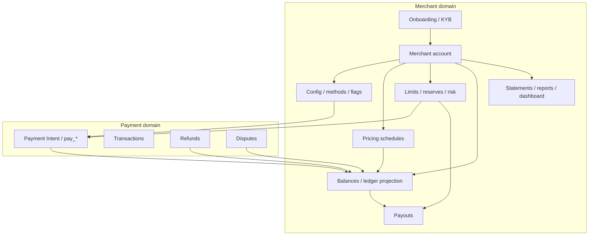
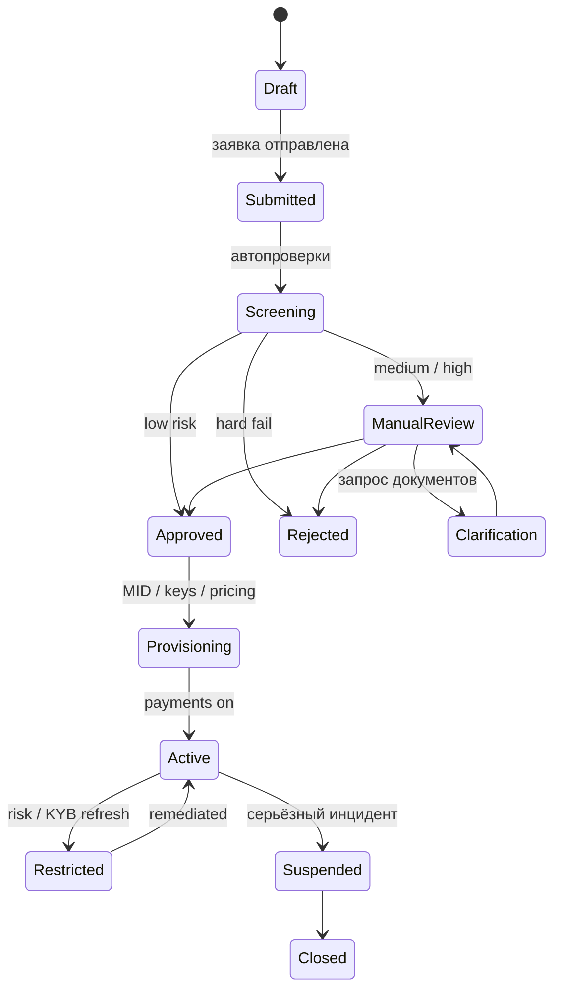
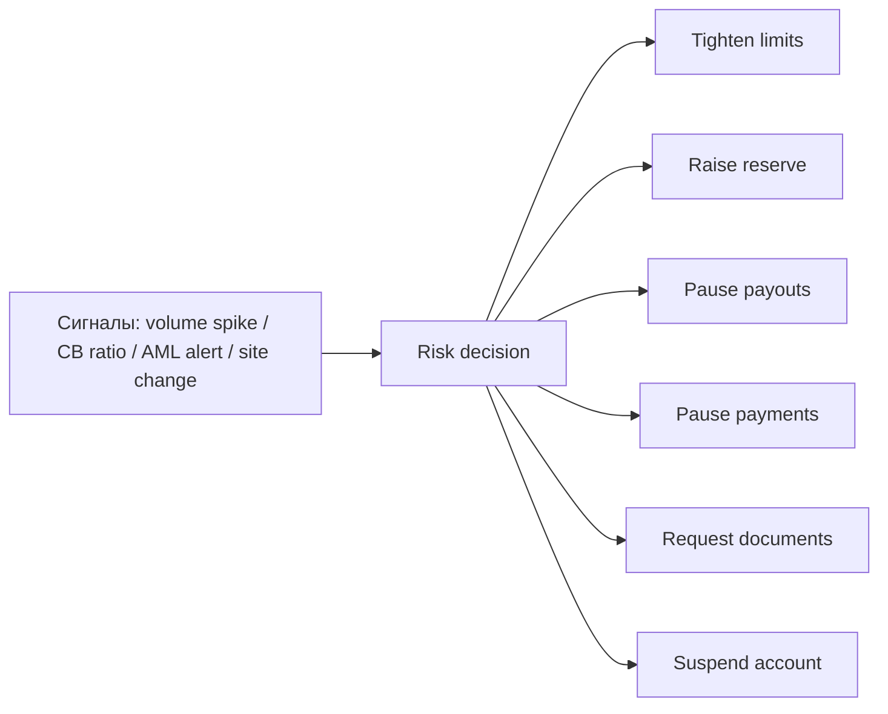
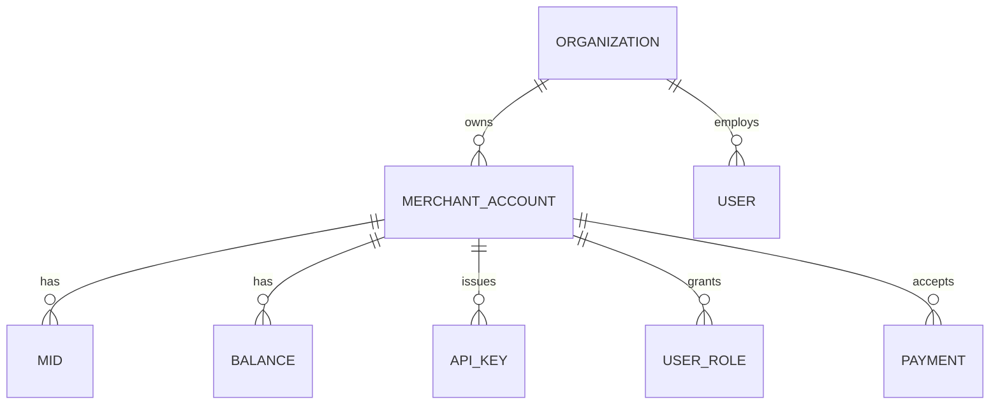
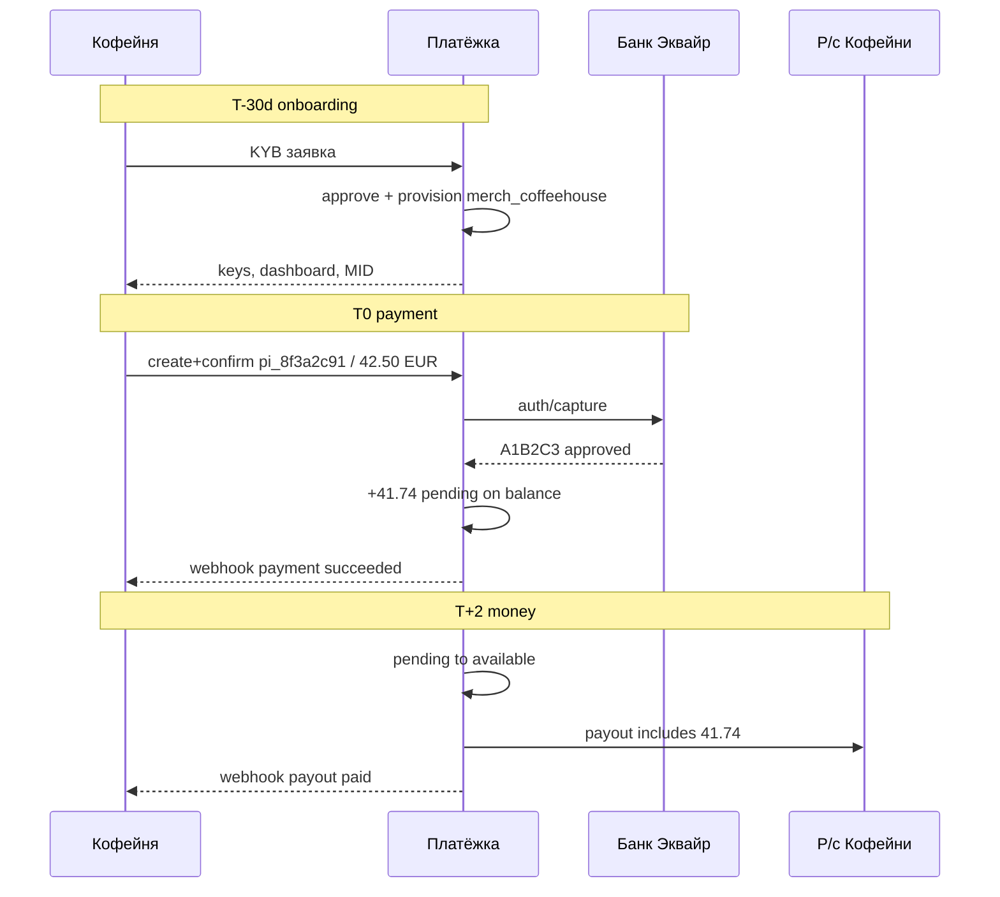

# Глава 25. Merchant-side: всё про продавца

До этой главы продавец в нашей истории чаще был «той стороной API»: «Кофейня» создаёт платёж, получает webhook, ждёт деньги. Но для PSP «Платёжка» мерчант — не клиент checkout. Мерчант — **тенант платформы**: юридическое лицо, тариф, MID у эквайера, лимиты, баланс, payout-расписание, риск-профиль и набор кнопок в dashboard, которыми кто-то в три часа ночи нажмёт «Refund».

Когда Аня платит **42,50 EUR** за заказ `ORD-2026-0918-0042`, зелёная галочка — лишь верхушка. Под ней у «Кофейни» появляется (или не появляется) право считать эти деньги своими: сначала как pending на merchant balance, потом как available, потом как кусок дневного payout. Параллельно живут комиссия **0,76 EUR**, зачисление **41,74 EUR**, возможность partial refund, риск chargeback и правила, которые «Платёжка» выставила ещё на onboarding — задолго до первой чашки зерна.

В [главе 20](20-platform-architecture.md) Merchant уже мелькал как сущность доменной модели рядом с Payment Intent и Customer. В [главе 12](12-flow-of-funds.md) мы разобрали физический путь денег и корзины баланса. В [главе 18](18-regulation-and-compliance.md) — KYB и compliance-угол онбординга. Здесь соберём **merchant-domain целиком**: от заявки «хотим принимать карты» до statements, reporting, multi-merchant архитектуры и тех граблей, из-за которых саппорт PSP ненавидит понедельник сильнее, чем decline code `51`.

Если вы строите checkout магазина — эта глава объяснит, почему «баланс в кабинете» не равен р/с и почему refund иногда «не проходит», хотя платёж зелёный. Если вы строите саму «Платёжку» — это карта продукта и данных, без которой платежи превращаются в SaaS с дырявой кассой.

## В этой главе

- Onboarding и merchant account: как продавец становится тенантом
- Конфигурация, pricing, лимиты и резервы как ручки риска и продукта
- Balance, payout, refund и disputes глазами мерчанта (и его инженера)
- Statements, reporting и dashboard — три разных «правды» об одних деньгах
- Multi-merchant архитектура: холдинги, бренды, ключи и изоляция
- Что проверить в коде и какие грабли ловят почти все

---

## Зачем выделять merchant-domain

Платёжная платформа без сильной модели мерчанта выглядит так: таблица `merchants(id, name, api_key)`, и всё остальное «как-нибудь в конфиге». Через полгода выясняется, что:

- у одного юрлица три сайта и два MID;
- тариф поменяли задним числом, и fee за сентябрь пересчитался неправильно;
- payout ушёл на старый IBAN, потому что KYB-апдейт «ещё в Jira»;
- support сделал refund с баланса, которого уже не было;
- marketplace-продавец видит чужие заказы из-за дырки в `WHERE merchant_id`.

Merchant-domain отвечает на вопросы, которые Payment Intent не обязан знать: **кому** принадлежит этот платёж как бизнес-обязательство, **по каким правилам** с него берётся комиссия, **когда** деньги можно вывести, **какие** методы и страны разрешены, **что** делать, если риск или compliance говорят «стоп».



Словами: onboarding рождает account; account несёт конфиг, тарифы и лимиты; платежи и споры двигают баланс; payout забирает available; отчёты читают проекции. Граница важна: оркестрация платежа не должна «знать слишком много» про UBO, но обязана спросить «можно ли этому мерчанту принять 42,50 EUR картой из Польши».

Врезка: как это бывает в жизни. Команда «Кофейни» интегрировала sandbox за выходные, получила live-ключ в пятницу вечером и в субботу утром пустила трафик. Первые платежи прошли. В понедельник payout не ушёл: статус аккаунта был `restricted` — не подтвердили бенефициара счёта. API при этом честно принимал оплаты. Продукт сказал «баг выплат». Compliance сказал «так и задумано». Инженер, который не разделил `payments_enabled` и `payouts_enabled`, провёл выходные в Slack.

---

## Merchant onboarding: вход в систему (№152, №153)

**Merchant onboarding** — процесс, в котором продавец из «компании с сайтом» становится обслуживаемым мерчантом: с проверенной идентичностью, договором, риск-рейтингом, MID (или набором MID) и правом принимать деньги. Тема №152–153 пересекается с [главой 18](18-regulation-and-compliance.md): там — *почему* регулятор и банк требуют KYB/UBO/sanctions; здесь — *как* это выглядит как продукт и как данные ложатся в систему.

### Это не «Sign up»

Регистрация в Notion занимает минуту. Онбординг в платежах — underwriting. «Платёжка» (и стоящий за ней эквайер «Банк Эквайр») отвечает схемам и регулятору за то, *кого* пустили в сеть. Fake merchant с красивым лендингом — классический вход в carding и bust-out: принять оборот, вывести payout, исчезнуть до волны chargeback.

Поэтому продуктовый компромисс выглядит так:

1. Собрать заявку (компания, сайт, MCC, ожидаемый оборот, география, представители, UBO).
2. Прогнать автопроверки (реестры, санкции, дубликаты, website crawl, device/fingerprint заявителя).
3. Выставить risk rating и решение: auto-approve / manual review / reject.
4. Подписать договор и disclosures (юридический контур — не в этой книге как гайд; инженеру важно: статус «договор accepted» — событие в системе).
5. Выделить merchant account, ключи, sandbox, webhook endpoints.
6. Привязать acquiring (MID/TID, descriptor, MCC) и банковский сценарий payout.
7. Включить методы и лимиты **поэтапно**.
8. Держать ongoing due diligence: документы истекают, сайт меняется, UBO меняется.



### Что собираем в данных (продуктовый минимум)

Для «Кофейни» в системе «Платёжки» после онбординга появляется не одна строка, а пакет:

| Блок | Примеры полей | Зачем |
|---|---|---|
| Legal entity | название, страна, reg number, адрес | KYB, договоры, tax reporting |
| People | directors, UBO, signatory + KYC-статусы | кто контролирует бизнес |
| Business profile | MCC, URL, описание, avg ticket, monthly volume | risk + scheme fit |
| Bank account | IBAN/BIC, verification status | payout destination |
| Acquiring | MID(s), descriptor, MCC у эквайера | auth/clearing path |
| Commercial | pricing schedule, payout policy, reserves | деньги |
| Access | users, roles, API keys, webhook URLs | продукт |

Средний ticket «specialty coffee ~40 EUR» и платёж Ани на 42,50 EUR выглядят согласованно. Если в KYB написано «зерно розница», а через месяц average ticket прыгает до 900 EUR и появляются BIN из стран, которых не было в профиле, — это уже не «рост бизнеса», а сигнал для risk/AML ([глава 16](16-fraud.md), [глава 18](18-regulation-and-compliance.md)).

### Verification банковского счёта

Пока счёт не верифицирован, принимать платежи иногда можно (зависит от политики), а **выводить** — почти никогда не стоит. Методы проверки зависят от страны: confirmation of payee, micro-deposit, выписка, реестровая сверка имени получателя. Инженерно это отдельный статус `bank_account.status = unverified | pending | verified | rejected`, а не булевый `iban_filled`.

### Два лица онбординга

Мерчант в dashboard видит: «Нужен документ», «Аккаунт активен», «Выплаты временно ограничены». Внутренний аналитик видит: risk rating, причины manual review, notes, screening hits, scheme MID status. **Не отдавайте внутренний compliance-субстатус в публичный Merchant API без фильтра.** Паттерн из [главы 18](18-regulation-and-compliance.md) здесь обязателен: публичный `account_status` + безопасные reason codes (`documents_required`, `payout_delayed`) vs приватный `compliance_substatus`.

### Ongoing — часть онбординга, растянутая во времени

Онбординг не заканчивается в день `Active`. Документы истекают, директор уходит, сайт внезапно продаёт не кофе. Периодический refresh и event-driven review (смена IBAN, резкий рост объёма, рост chargeback ratio) должны иметь владельца в коде: jobs, статусы, блокировки payout, аудит. Иначе «проверили один раз» становится сюжетом для партнёрского банка.

### Что отдаёт onboarding API (иллюстративно)

Мерчанту после submit не нужен «успех = сразу live». Честный контракт:

```json
{
  "merchant_id": "merch_coffeehouse",
  "onboarding_status": "manual_review",
  "requirements_due": [
    {"code": "company.tax_id_document", "status": "past_due"},
    {"code": "person.ubo_identity", "status": "currently_due"}
  ],
  "capabilities": {
    "card_payments": "pending",
    "payouts": "inactive"
  },
  "next_action": "upload_documents"
}
```

Пока `card_payments=pending`, checkout в проде либо недоступен, либо ограничен sandbox. Путать «аккаунт создан» с «можно принимать деньги» — любимая ошибка интеграторов и половина тикетов первой недели.

### Сколько это «стоит» по времени

Для low-risk EU-кофейни с чистым реестром auto-approve может уложиться в минуты–часы (плюс ожидание верификации счёта). Для high-risk MCC или нестандартной структуры владения — дни и недели manual review. Продукт, который обещает «API key за 5 минут» всем подряд, либо врёт маркетингом, либо перекладывает риск на эквайера — и эквайер это однажды заметит.

Инженерный вывод: SLA онбординга измеряйте раздельно — `time_to_account_created`, `time_to_payments_enabled`, `time_to_payouts_enabled`. Одна метрика «time to onboard» скрывает, на каком гейте люди застревают.

---

## Merchant account: тенант, а не «запись в CRM»

**Merchant account** (счёт / аккаунт продавца у PSP) — операционная сущность, от имени которой принимаются платежи, крутятся балансы и уходят payout. В «Платёжке» у «Кофейни» это, для примера, `merch_coffeehouse`.

Путаница начинается с языка:

- **Merchant** в схеме/эквайере — часто = MID + договор эквайринга.
- **Merchant account** у PSP — тенант продукта: может иметь несколько MID, несколько брендов, несколько балансов по валютам.
- **Legal entity** — юрлицо; одно юрлицо может владеть несколькими merchant accounts (или наоборот — platform с sub-merchants; об этом [глава 26](26-marketplace-and-split-payments.md)).

### Что обязан уметь account

1. **Идентичность в системе** — стабильный `merchant_id`, не email основателя.
2. **Статусы платёжного контура** — отдельно для приёма (`payments_enabled`), выплат (`payouts_enabled`), API (`api_enabled`), dashboard login.
3. **Привязку к acquiring** — один или много MID; sandbox vs live.
4. **Владение данными** — все `pi_…` / `pay_…`, customers, keys принадлежат account (или явно связаны графом platform → connected account).
5. **Коммерческие правила** — pricing, payout schedule, reserves, limits.
6. **Audit** — кто менял IBAN, тариф, статус, лимиты.

```json
{
  "merchant_id": "merch_coffeehouse",
  "legal_entity_id": "le_coffee_eu_01",
  "display_name": "Кофейня",
  "status": "active",
  "capabilities": {
    "card_payments": true,
    "sepa_debit": false,
    "payouts": true
  },
  "default_currency": "EUR",
  "mcc": "5499",
  "statement_descriptor_prefix": "COFFEE",
  "pricing_schedule_id": "price_blended_eu_cards_v3",
  "payout_schedule": "daily_business_day",
  "mids": [
    {"acquirer": "bank_acquire", "mid": "MID428817", "region": "EEA", "env": "live"}
  ]
}
```

Поля иллюстративные. Смысл настоящий: account — **агрегат конфигурации и прав**, а не только display name.

### Merchant ≠ один MID

Как уже намекали в [главе 20](20-platform-architecture.md):

- отдельный MID на domestic EUR e-commerce;
- иногда отдельный на cross-border или другой MCC;
- sandbox MID, который нельзя смешивать с live в отчётах;
- исторический MID после миграции эквайера — ещё долго нужен для поиска старых ARN.

В данных: `merchant_id` (тенант) 1—* `acquirer_account` / MID. Платёж Ани `pay_8f3a2c91` (в архитектурной модели [главы 20](20-platform-architecture.md) — Intent `pi_8f3a2c91` и attempt `txn_01H8F3A2`) несёт и `merchant_id`, и конкретный `mid` маршрута.

### Capabilities вместо гигантского enum статуса

Антипаттерн: один статус `ACTIVE` / `BLOCKED`. Лучше набор capabilities и ограничений:

- карты CNP — да;
- payout — да, но threshold 100 EUR;
- instant payout — нет;
- refunds — да, но не в negative без approve;
- новые страны — нет.

Тогда risk может выключить payout, не убивая checkout, или наоборот: заморозить приём, оставив доступ к statements для бухгалтера.

---

## Конфигурация мерчанта: ручки, от которых зависит прод

**Конфигурация** — всё, что меняет поведение платформы для конкретного account без деплоя: методы оплаты, 3DS-политика, capture mode, webhook endpoints, statement descriptor, feature flags, branding hosted checkout, язык receipts, список разрешённых валют.

### Слои конфигурации

```text
Platform defaults
  → Pricing plan defaults
    → Merchant account overrides
      → Per-MID / per-method overrides
        → Request-level hints (где безопасно)
```

Пример: глобально «Платёжка» поддерживает Apple Pay. У «Кофейни» флаг `wallets.apple_pay = true`. На конкретном запросе checkout может попросить только card. Request-level не должен расширять права сверх account («разрешить payout на левый IBAN из тела запроса» — никогда).

### Что обычно крутят в первый месяц жизни мерчанта

| Ручка | Зачем «Кофейне» | Риск, если сломать |
|---|---|---|
| Capture mode (auto/manual) | Списывать после сборки заказа | Auth истек, capture failed, товар уже уехал |
| 3DS / SCA policy | Конверсия vs fraud / liability | Лишний friction или лишний fraud |
| Payment methods | Локальные методы = конверсия | Включили high-risk метод без underwriting |
| Statement descriptor | Узнаваемость в SMS банка Ани | Chargeback «не узнаю платёж» |
| Webhook URL + secret | Асинхронная правда | Дубликаты, подделки, тишина |
| Idempotency / timeout budget | См. [главу 07](07-states-async-idempotency.md) | Двойные списания |
| Currencies | EUR сейчас, PLN «потом» | FX-сюрпризы в балансе |

### Statement descriptor — мелочь с дорогим хвостом

Аня в приложении «Банка Север» должна узнать оплату. Если видит `PLATEZHKA*SOMETHING`, а помнит «Кофейню», растет вероятность friendly fraud и лишних обращений в банк ([глава 17](17-chargebacks-and-disputes.md)). Конфиг дескриптора — часть merchant-domain: префикс PSP + имя магазина, длина и алфавит по правилам схем, отдельное значение для Soft Descriptor vs billing descriptor. Менять его должен не junior из поддержки без аудита.

### Конфиг как данные с версиями

Не храните критичные правила только в YAML на диске деплоя. Для тарифов, лимитов, reserves и method availability нужны:

- `effective_from` / `effective_to`;
- автор изменения и reason;
- возможность ответить: «какой конфиг действовал 18 сентября 2026, когда прошёл `pay_8f3a2c91`?».

Иначе спор по fee через два месяца превращается в археологию Slack.

### Webhooks как часть конфигурации мерчанта

Для «Кофейни» webhook endpoint — не «настройка интеграции», а продолжение account:

- URL (и иногда несколько URL по типам событий);
- secret для подписи;
- список подписок (`payment_intent.succeeded`, `charge.refunded`, `payout.paid`, `account.updated`);
- политика ретраев на стороне PSP;
- статус здоровья endpoint (последний success/fail).

Событие `account.updated` недооценено: когда risk ставит `payouts_enabled=false`, мерчантский бэкенд должен узнать об этом не из тикета CFO «где деньги». Подпись, replay-защита и идемпотентная обработка — [глава 07](07-states-async-idempotency.md) и [глава 19](19-payment-security-pci.md); в merchant-domain важно, что **endpoint принадлежит account** и ротация secret — операция с audit.

### Feature flags vs договорные capabilities

«Включили partial capture этому мерчанту» может быть:

- **capability из underwriting/договора** — юридически и рисково разрешено;
- **feature flag инженерии** — код готов, rollout по проценту.

Смешивать их в одном булевом поле опасно: флаг выключили при инциденте — и внезапно «Кофейня» теряет то, что было в договоре, без понятного статуса в dashboard. Лучше: `capability` (политика) × `feature_available` (техника) → эффективное право в runtime.

---

## Pricing: сколько «Кофейня» платит за приём денег

Экономика комиссий подробно разобрана в [главе 15](15-fees-and-economics.md). Здесь — **как тариф живёт на мерчанте** и как его не сломать в коде.

### Pricing schedule на account

У «Кофейни» в примере книги — blended-пакет порядка **1,2% + 0,25 EUR** на e-commerce карты в EUR. На платеже Ани:

- gross: 42,50 EUR;
- fee: ≈ 0,76 EUR;
- net на баланс: 41,74 EUR.

В системе это не три константы в коде оркестрации, а ссылка `pricing_schedule_id` + правило расчёта fee engine:

```text
payment pay_8f3a2c91 / pi_8f3a2c91
  → resolve schedule(merch_coffeehouse, method=card, region=EEA, time)
  → compute fee(4250) = 76
  → post balance credit net 4174 (+ fee revenue 76)
```

### Blended, IC++, гибриды — с точки зрения merchant-domain

- **Blended** — мерчанту одна понятная ставка; PSP внутри жуёт interchange/scheme. Проще dashboard, сложнее маржа при плохом миксе карт.
- **IC++** — в отчёте видны компоненты; нужен другой UI statements и другой support playbook («почему вчера 0,9%, сегодня 1,8%»).
- **Гибрид** — blended на consumer domestic, иначе — на commercial/cross-border.

Merchant-domain обязан знать *какая модель включена*, какие валюты/методы покрыты, есть ли отдельные fee за refund, chargeback, payout, FX, 3DS. Иначе finance «Кофейни» сверит только MDR с карты и удивится строке `dispute_fee`.

### Версионирование тарифа

Правило: **не мутировать прошлые fee**. Если с 1 октября ставка меняется, сентябрьские `balance_transaction` остаются как были. Новая schedule с `effective_from`. Пересчёт прошлого — отдельный adjustment с явным reason, не тихий UPDATE.

### Оценка vs факт

На checkout иногда показывают estimated fee. Фактическая fee после auth/clearing (особенно в IC++) может отличаться. API и dashboard должны различать `fee_estimated` и `fee_actual`, иначе бухгалтер построит модель на песке.

---

## Balance: касса мерчанта внутри PSP

**Merchant balance** — логический остаток средств продавца у «Платёжки». Подробный поток денег, pending/available, held funds и negative balance — в [главе 12](12-flow-of-funds.md); проводки — в [главе 13](13-ledger-and-reconciliation.md). Здесь — продуктовый контракт merchant-domain.

### Что видит «Кофейня»

После успешного capture по заказу Ани на балансе появляется net **41,74 EUR** (не 42,50). Сначала часто `pending`, затем `available` по политике availability (для примера — к дате вроде `2026-09-20`).

```json
{
  "merchant_id": "merch_coffeehouse",
  "currency": "EUR",
  "pending": 4174,
  "available": 0,
  "reserve": 0,
  "lifetime_gross_volume": 4250,
  "source_payment": "pay_8f3a2c91",
  "order_id": "ORD-2026-0918-0042"
}
```

Суммы в минорных единицах. В UI — с экспонентой валюты ([глава 14](14-currencies-and-fx.md)).

### Balance transaction как атом отчётности

Мерчанту недостаточно «баланс = 12 480,22». Нужна лента движений:

| Тип | Пример | Влияние |
|---|---|---|
| `charge` / `capture` | платёж Ани | +41,74 (pending→available) |
| `fee` | MDR 0,76 | часто уже вычтена в net; иногда отдельной строкой |
| `refund` | возврат зерна | −сумма возврата |
| `dispute` / `chargeback` | спор | −сумма (− fee) |
| `payout` | вывод на IBAN | −available |
| `reserve_hold` / `reserve_release` | rolling reserve | перекладка корзин |
| `adjustment` | ручная коррекция | ± с обязательным reason |

Связь с платежом Ани: balance transaction ссылается на `pay_8f3a2c91` (и/или `pi_…` / `txn_…`). Без этой связи statement бесполезен для сверки заказа `ORD-2026-0918-0042`.

### Несколько балансов

Ключ почти всегда `(merchant_id, currency)`. EUR-баланс «Кофейни» не смешивается с тестовым USD из промо. Marketplace добавит ещё измерения (seller account) — см. [главу 26](26-marketplace-and-split-payments.md).

### Negative balance — не «баг отображения»

Refunds и chargebacks могут увести баланс ниже нуля, если payout уже ушёл. Merchant-domain должен:

- уметь показать negative честно;
- уметь остановить payout / включить recovery;
- иногда автосписать с следующего оборота;
- эскалировать в risk, если дыра растёт.

Тикет «у нас −320 EUR, это ваши глюки» — нормальная жизнь, не аномалия.

---

## Payout: как деньги доезжают до р/с

**Payout** (выплата) — перевод available-средств на банковский счёт мерчанта. Это отдельный объект со статусами, а не побочный эффект `payment.succeeded`. Денежный и казначейский разбор — в [главе 12](12-flow-of-funds.md); здесь — как payout встроен в merchant-domain.

### Политики на account

| Политика | Типичный смысл |
|---|---|
| Daily | каждый рабочий день после cut-off |
| Weekly | раз в неделю |
| Threshold | когда available ≥ N |
| Manual | мерчант жмёт «Вывести» |
| Instant (платно) | ускоренный rail за fee |

«Кофейня» в сквозном примере живёт на daily. Платёж Ани попадает в payout не как отдельный SCT на 41,74, а как строка внутри суммы дня (вместе с другими заказами, минус refunds, минус reserve).

### Объект payout

```json
{
  "payout_id": "po_77c1de",
  "merchant_id": "merch_coffeehouse",
  "amount": 81240,
  "currency": "EUR",
  "status": "in_transit",
  "arrival_date": "2026-09-20",
  "destination": "bankacc_coffee_iban",
  "statement_descriptor": "PLATEZHKA PAYOUT 2026-09-19",
  "includes_example": ["btx_91aa02"]
}
```

`btx_91aa02` в [главе 12](12-flow-of-funds.md) — balance transaction по платежу Ани. Бухгалтер спрашивает: «В какой выплате сидит `pay_8f3a2c91`?» Ответ должен быть join'ом, а не телепатией.

### Статусы, которые нельзя схлопнуть

1. `pending` / `created` — собрали внутри PSP.
2. `in_transit` — отправили в банк.
3. `paid` — считаем доставленным (с оговорками рельса).
4. `failed` / `returned` — IBAN, AML, return от банка.
5. `canceled` — отменили до отправки (редко, но бывает).

Webhook'и `payout.paid` / `payout.failed` — часть контракта с мерчантом, наравне с payment events ([глава 07](07-states-async-idempotency.md)).

### Блокировки payout — first-class feature

Payout может быть на паузе при:

- незавершённом KYB / смене UBO;
- sanctions hit;
- fraud review мерчанта;
- превышении chargeback ratio;
- negative balance;
- ручном hold compliance.

Это не «ошибка cron». Это состояние account: `payouts_enabled=false` + reason. Dashboard обязан показывать человеческий текст; внутренности AML — только ролям compliance.

### Идемпотентность выплат

Дневной job без ключа `payout:{merchant_id}:{business_day}` — способ отправить деньги дважды. Merchant-domain и ledger должны сходиться: повторный запуск не создаёт второй `po_…` на те же balance transactions ([глава 21](21-distributed-systems-and-money.md), [глава 23](23-reliability.md)).

---

## Refund с стороны мерчанта

Жизненный цикл void/refund на карточном рельсе — в [главе 06](06-payment-lifecycle.md). Здесь — **операции и продукт для продавца**.

### Зачем мерчанту refund как сущность

Аня получила зерно с дефектом. «Кофейня» делает возврат. Для магазина это:

- действие в dashboard или API `POST /refunds`;
- изменение статуса заказа у себя;
- движение баланса у PSP;
- ожидание, что у Ани на карте появится credit (сроки зависят от эмитента).

Для «Платёжки» refund — отдельный объект, привязанный к исходному платежу/attempt, с суммой ≤ captured, с идемпотентностью, с fee policy (возвращаем ли MDR).

### Partial refund — норма, не экзотика

Частичный возврат 10,00 EUR из 42,50 — обычный сценарий (недовоз, скидка после оплаты). Модель:

- исходный `pay_8f3a2c91` / `pi_8f3a2c91` остаётся;
- создаётся `re_…` на 1000 minor units;
- баланс мерчанта уменьшается (если net уже был начислен — коррекция; если ещё pending — тоже коррекция, но другой timing);
- можно сделать несколько partial, пока сумма refunds ≤ captured.

### Откуда берутся деньги на refund

Если available хватает — списываем с баланса. Если нет (уже выплатили payout) — уходим в negative или отказываем / ставим в очередь, пока не появится оборот. Продуктовое решение должно быть **явным в договоре и в API**, а не сюрпризом в проде.

### Refund vs chargeback

Refund — инициатива мерчанта (или PSP по политике). Chargeback — инициатива держателя/эмитента через схему ([глава 17](17-chargebacks-and-disputes.md)). Merchant-domain показывает оба, но разными объектами и разными сроками. Авто-refund при early dispute (RDR-подобные программы) — отдельный флаг конфигурации: удобно против ratio, но бьёт по марже.

### Права и аудит

Кто может делать refund на 42,50 EUR? Роль `finance` / `support_refunds` / API key scope `refunds:write`. Каждый ручной refund — audit: actor, reason, payment id, amount. Без этого «кто вернул Ане деньги в субботу» не восстановить.

### Иллюстративный refund по заказу Ани

```json
{
  "refund_id": "re_4c21aa09",
  "payment_id": "pay_8f3a2c91",
  "payment_intent_id": "pi_8f3a2c91",
  "transaction_id": "txn_01H8F3A2",
  "amount": 1000,
  "currency": "EUR",
  "status": "succeeded",
  "reason": "requested_by_customer",
  "merchant_reference": "ORD-2026-0918-0042-partial-1",
  "balance_transaction_id": "btx_refund_4c21"
}
```

Сумма 10,00 EUR из 42,50. Оставшиеся 32,50 captured остаются; повторный partial возможен, пока сумма refunds не превысит captured. Если «Кофейня» по ошибке шлёт полный refund дважды с разными Idempotency-Key — второй должен получить отказ `already_refunded` / insufficient remaining, а не увести баланс в сюрприз.

### Сроки и ожидания UX

Карточный refund не равен «у Ани уже на карте через 3 секунды». PSP может быстро сказать `refund.succeeded` (принять обязанность), а эмитент покажет credit через 1–10 рабочих дней — зависит от банка и рельса. Merchant dashboard, который обещает «мгновенно у покупателя», провоцирует повторные обращения в поддержку «деньги не пришли» — хотя с вашей стороны всё корректно. Пишите в UI два времени: *принято PSP* и *обычно видно у банка*.

---

## Disputes глазами продавца

Полный lifecycle chargeback — [глава 17](17-chargebacks-and-disputes.md). В merchant-domain споры — это **рабочее место** и денежные последствия на account.

### Что нужно мерчанту в продукте

1. Список открытых disputes с дедлайнами evidence.
2. Карточка спора: reason code (в понятном языке), сумма, связанный платёж `pay_8f3a2c91`, заказ `ORD-2026-0918-0042`, auth code `A1B2C3` как подсказка для поиска.
3. Загрузка evidence (трек, инвойс, переписка, proof of delivery).
4. Статусы: needs_response / under_review / won / lost / expired.
5. Денежный след: hold, списание, fee, возврат hold при win.

### Деньги спора на балансе

Пока идёт dispute, PSP часто делает hold на сумму риска. Если спор проигран — chargeback debit и часто dispute fee. Если выигран — release hold. Merchant dashboard, который показывает только «−42,50» без reason `dispute_lost`, провоцирует тикеты «вы украли выручку».

### Chargeback ratio как свойство account

Схемы смотрят на долю споров. Превышение программ мониторинга бьёт по MID и по всему account: лимиты, резервы, отключение метода. Merchant-domain должен считать и показывать (хотя бы internally) dispute rate; наружу — аккуратно, без паники, но с предупреждением «вы приближаетесь к порогу».

### Операционный ритм споров

Споры — это очередь с SLA, не «раздел FAQ». Для команды «Кофейни» (даже маленькой) нужны:

- уведомление (email/webhook `dispute.created`) с дедлайном;
- шаблоны evidence под типичные reason codes их MCC;
- связь с внутренней системой заказов по `ORD-2026-0918-0042` / metadata;
- эскалация: если дедлайн через 48 часов, а evidence пустой — алерт человеку, не только badge в UI.

PSP может помочь автосбором (доставка из интеграции курьера, копия checkout), но не должен молча проигрывать споры «потому что мерчант не зашёл в кабинет». Хотя бы noisily escalate.

### Деньги: hold до решения

Пока спор открыт по платежу Ани на 42,50, available «Кофейни» может уменьшиться на сумму риска (иногда плюс reserve под fee). Если спор выигран — hold снимается. Если проигран — debit и часто отдельная dispute fee (порядок величин в [главе 15](15-fees-and-economics.md) и [главе 17](17-chargebacks-and-disputes.md); здесь важно отразить строки в balance и statement). Проиграть спор и не увидеть fee отдельной строкой — способ подорвать доверие finance.

---

## Risk на мерчанте: не только fraud покупателя

[Глава 16](16-fraud.md) в основном про fraud на стороне карты/покупателя. У мерчанта свой контур риска:

- **Merchant fraud** — намеренный bust-out, laundering через «магазин».
- **Friendly fraud / high dispute rate** — даже честный бизнес может быть токсичен по economics.
- **Operational risk** — плохое fulfillment → refunds/chargebacks.
- **Compliance risk** — смена деятельности, санкции, слабый KYB refresh.

### Risk rating как поле account

`risk_tier = low | medium | high` (или скор) влияет на:

- скорость onboarding;
- availability delay;
- rolling reserve;
- лимиты объёма;
- ручной review крупных payout;
- доступность методов (BNPL, cross-border).

Рейтинг меняется со временем. История изменений обязательна.

### Действия risk-engine по мерчанту



Словами: сигнал не обязан сразу убивать MID. Часто достаточно сузить лимиты или поставить payout на паузу. Жёсткая подвеска — когда ущерб или регуляторный риск уже не терпят.

### Разделение fraud покупателя и risk мерчанта

Платёж Ани могут отклонить score'ом карты. Это не делает «Кофейню» плохим мерчантом. Наоборот, волна declines на одном MID при нормальном остальном портфеле может значить атаку card testing *через* магазин. Merchant-domain хранит агрегаты: auth rate, fraud rate, velocity по shop, чтобы risk видел картину account, а не только один `txn_…`.

---

## Limits: потолки, без которых underwriting бессмысленен

**Лимиты** — числовые ограничения на активность мерчанта. Они появляются, потому что доверие зарабатывается оборотом, а ущерб от плохого мерчанта измеряется деньгами, уже ушедшими в payout.

### Типичный набор

| Лимит | Пример смысла |
|---|---|
| Max amount per payment | не больше X за одну операцию |
| Daily / monthly volume | потолок оборота |
| Daily payout amount | потолок вывода |
| Refund ratio / count | защита от аномальных возвратов |
| Country / BIN allowlist | география приёма |
| New card velocity | анти-carding на checkout |
| Number of bank account changes | анти-захват кассы |

Для новой «Кофейни» иллюстративно: monthly volume cap 50 000 EUR, max ticket 500 EUR, payout T+2 вместо T+1. Платёж Ани на 42,50 проходит спокойно. Попытка принять 8 000 EUR «корпоративный заказ» может упереться в ticket limit и потребовать ручного raise.

### Hard vs soft limits

- **Hard** — API возвращает отказ, платёж не создаётся / не авторизуется.
- **Soft** — пропускаем, но создаём alert / ручную очередь / временный hold payout.

Продуктово: hard на явных потолках договора; soft — на аномалиях «подозрительно, но возможно».

### Лимиты в коде

Храните лимиты как данные account/risk policy, проверяйте в одном месте (policy service) до дорогих вызовов эквайера. Логируйте `limit_id` в отказе — иначе support не поймёт, *какой* потолок сработал. Не путайте лимит мерчанта с лимитом карты у эмитента: `51` от «Банка Север» — не ваш volume cap.

### Как поднимать лимиты

Рост «Кофейни» — нормальный повод поднять monthly cap с 50 000 до 200 000 EUR. Процесс должен быть таким же управляемым, как onboarding: заявка → данные (фактический оборот, CB ratio, fulfillment) → решение risk → новая policy version с `effective_from`. Тихий ручной UPDATE лимита в БД без тикета и аудита — дыра и в контроле, и в расследованиях.

Отказ в raise тоже ценен: иногда правильный ответ — «сначала снизьте dispute rate», а не «откроем кран».

### Сообщение мерчанту при упоре в лимит

API-ответ вроде `limit_exceeded` без деталей бесит интегратора. Лучше стабильный код + безопасные поля: какой класс лимита (`max_amount`, `monthly_volume`), порог, что делать (`contact_support`, `retry_next_period`). Не раскрывайте внутренние fraud-пороги, которые помогают атакующему подобрать обход.

---

## Reserves: подушка под будущий chargeback

**Reserves** подробно разобраны в [главе 12](12-flow-of-funds.md). В merchant-domain резерв — коммерческо-рисковый параметр account.

### Виды, которые надо различать в API

1. **Rolling reserve** — процент от оборота на N дней (например, 10% на 90 дней).
2. **Fixed reserve** — держать не ниже суммы X.
3. **Minimum balance** — не выплачивать ниже порога «на refunds».
4. **Event hold** — точечная заморозка под dispute/расследование (это уже held funds, не «reserve formula»).

Если на платеже Ани net 41,74 и rolling reserve 10%, в reserve уходит порядка 4,17, к более быстрому available — 37,57 (иллюстрация из [главы 12](12-flow-of-funds.md)). Для specialty coffee с низким риском резерв может быть нулевым — и это тоже конфиг, а не «забыли включить».

### Прозрачность

Мерчант имеет право понимать:

- сколько в reserve;
- когда release;
- почему reserve появился (новый MCC, рост CB, требование эквайера).

Скрытый резерв без строки в statement — источник недоверия и оттока.

---

## Statements: «выписка», которой верят финансы

**Statement** (выписка / акт расчётов за период) — документ и/или набор данных, который finance «Кофейни» использует как источник для бухгалтерии: оборот, комиссии, возвраты, споры, выплаты, резервы, итог к перечислению.

### Чем statement отличается от ленты платежей

Список `succeeded` платежей — операционный. Statement — **финансовый период**:

- период с cut-off;
- gross volume;
- fees (с разбивкой, если IC++);
- refunds / chargebacks / adjustments;
- reserve movements;
- net settled / paid out;
- ссылки на payout id.

Платёж Ани попадёт в statement того периода, к которому относится settlement/balance recognition — не обязательно «календарный день клика Оплатить».

### Форматы

- PDF для людей и архива;
- CSV/JSON для ERP;
- иногда отдельный tax invoice на услуги PSP.

Генерируйте statement **иммутабельно** на закрытый период. Перегенерация с другими цифрами без version/amendment — кошмар аудита.

### Сверка «Кофейни»

Типичный цикл бухгалтера:

1. Взять statement «Платёжки» за 18–19 сентября.
2. Найти net по заказам (включая `ORD-2026-0918-0042` → `pay_8f3a2c91` → 41,74).
3. Сверить сумму payout на р/с.
4. Разнести fees на счета затрат.

Если merchant-domain не отдаёт стабильные id и суммы в minor units, этот цикл ломается, и вас будут ненавидеть кварталами.

---

## Reporting: аналитика, которая не врёт слишком сильно

**Reporting** шире statement: воронки, методы, география, auth rate, 3DS challenge rate, fraud, cohort'ы. Часть метрик пересекается с [главой 24](24-monitoring-and-operations.md) (там — взгляд ops/PSP). Здесь — что нужно **продавцу** и как это не перепутать.

### Слои отчётности мерчанта

| Слой | Вопрос | Опасность путаницы |
|---|---|---|
| Commerce | Сколько заказов оплачено? | Заказ ≠ платёж, попытки retry |
| Payments ops | Какой auth / decline rate? | Soft vs hard decline |
| Money | Сколько available / paid out? | Gross vs net |
| Risk | CB ratio, fraud rate | Окно времени и scheme rules |
| Product | Конверсия checkout / 3DS | Считать уникальные intent, не клики |

### Канон для платежа Ани в отчётах

Чтобы цифры сходились между главами и системами:

| Поле | Значение |
|---|---|
| Order | `ORD-2026-0918-0042` |
| Payment (фасад / исторический id) | `pay_8f3a2c91` |
| Payment Intent | `pi_8f3a2c91` |
| Transaction / attempt | `txn_01H8F3A2` (успешный; могли быть и другие attempts) |
| Auth code | `A1B2C3` |
| Gross | 42,50 EUR |
| Fee | 0,76 EUR |
| Net | 41,74 EUR |

Отчёт «GMV за день» должен объявить, считает ли он gross captured, gross authorized или net. Иначе маркетинг и CFO будут спорить о 0,76 × N платежей.

### Экспорт и API отчётов

Крупному мерчанту нужен не только UI-график, но и:

- фильтры по дате *события* vs дате *available*;
- выгрузка за период > UI pagination;
- стабильные колонки версионированного export schema.

Ломающий изменение колонки CSV без версии — тихий инцидент в ERP клиента.

---

## Dashboard: UI как поверхность домена

**Merchant dashboard** — человеческий интерфейс к merchant-domain. Это не «админка над SQL». Это продукт с ACL, audit, маскированием данных и разными ролями.

### Главные зоны

1. **Home / balance** — pending, available, reserve, ближайший payout, алерты (документы, споры).
2. **Payments** — поиск по order id, `pay_` / `pi_` / `txn_`, last4, сумме, статусу; timeline события.
3. **Refunds & disputes** — очереди с дедлайнами.
4. **Payouts & bank accounts** — история, статусы, смена IBAN через verification.
5. **Reports & statements** — периоды, выгрузки.
6. **Settings** — team, keys, webhooks, methods, branding, 3DS.
7. **Onboarding / compliance** — незакрытые требования (read-only причины).

### Роли

| Роль | Может | Не должна |
|---|---|---|
| Owner | всё критичное | — |
| Developer | keys, webhooks, sandbox | менять payout IBAN без контроля |
| Finance | statements, payouts view, refunds | читать AML notes |
| Support | lookup платежа, limited refund | выдавать новые secret keys |
| Read-only analyst | отчёты | любые money actions |

Секретный ключ API, показанный в UI один раз, и возможность rotate — обязательны. Логи просмотра ключей — тоже.

### Timeline платежа — лучший экран поддержки

Для `pay_8f3a2c91` / `pi_8f3a2c91` timeline roughly:

1. created (order `ORD-2026-0918-0042`);
2. requires_payment_method / confirmed;
3. risk check;
4. authorized `A1B2C3`;
5. captured;
6. balance pending +41,74;
7. available;
8. included in payout `po_…`.

Если позже dispute — события 9+. Саппорт «Кофейни» и саппорт «Платёжки» должны видеть согласованную историю (с разной глубиной полей).

### Не смешивать merchant UI и internal ops UI

Внутренний инструмент риск-аналитика «Платёжки» может показывать score, SAR hints, linked accounts. Это другой продукт. Утечка внутреннего UI в merchant build — и compliance, и security инцидент.

---

## Multi-merchant архитектура

**Multi-merchant** здесь — не только «у PSP много клиентов» (это мультитенантность [главы 20](20-platform-architecture.md)), а ещё и случаи, когда *один бизнес-клиент* или *одна платформа* оперирует многими merchant accounts.

### Сценарии

1. **Холдинг** — «Кофейня Group» с юрлицами в DE и NL, два `merch_…`, общая родительская организация в dashboard.
2. **Мультибренд** — один legal entity, несколько брендов/сайтов, иногда несколько descriptor/MID.
3. **Franchise / retail chain** — много точек, нужна сводная отчётность и раздельные лимиты.
4. **Platform / marketplace** — платформа и connected accounts / sub-merchants ([глава 26](26-marketplace-and-split-payments.md)).
5. **PayFac** — ещё жёстче ответственность и onboarding sub-merchants ([глава 02](02-ecosystem-participants.md), [глава 18](18-regulation-and-compliance.md)).

### Модель данных (логическая)



Словами: организация группирует аккаунты; деньги, ключи и платежи живут на account; пользователи могут иметь роли на уровне org (read all) или account (operate one).

### Жёсткие правила изоляции

1. API-ключ определяет account (или явный scoped access), а не параметр `merchant_id` из тела от недоверенного клиента.
2. Поиск по `pay_8f3a2c91` всегда проверяет ownership.
3. Сводный org-dashboard читает *разрешённые* accounts через ACL, не через `WHERE 1=1`.
4. Payout destination привязан к account и его KYB, не к «любому IBAN холдинга».
5. Pricing и reserves — per account (иногда inherit from org template, но с фиксацией версии).

### Ключи и окружения

Sandbox `merch_coffeehouse_test` и live `merch_coffeehouse` — разные миры. Перепутать ключи в CI — классика: тестовые деньги в live-отчётах или live-charge в стенде. Префиксы ключей (`sk_test_…` / `sk_live_…`) и раздельные webhook secrets обязательны.

### Когда заводить второй merchant account

Имеет смысл, если отличаются:

- юрлицо или налоговый контур;
- MCC / риск-профиль;
- валюта settlement / страна acquiring;
- потребность в раздельных statements для франчайзи;
- регуляторное разделение (разные лицензионные entity у PSP).

Не плодите аккаунты ради «удобства команд»: каждый account — стоимость onboarding, мониторинг и сверка.

### Platform user vs merchant user

В multi-merchant мире появляются два типа людей:

- **сотрудник «Кофейни»** — работает в одном или нескольких собственных accounts;
- **сотрудник платформы/PSP** — видит портфель, но только через internal tools с другим audit и другим legal basis.

Не используйте один и тот же login pipeline и одни JWT claims для обоих. Иначе «удобный импёрсонатор» для саппорта PSP случайно окажется доступен партнёру-маркетплейсу.

### Консолидированная отчётность без смешения денег

Холдинг хочет один PDF «группа за сентябрь». Деньги при этом по-прежнему на отдельных balances и payout на разные IBAN. Архитектурно:

- **reporting rollup** — read-model с ACL;
- **money movement** — строго per account.

Склеивать balances «для удобства» в один available — почти всегда ошибка: chargeback одного бренда не должен молча съедать кассу другого без явного договора о взаимозачёте.

### Иллюстративный граф для группы «Кофейня»

```text
org_coffee_group
├── merch_coffeehouse      (DE, MCC 5499, EUR, MID428817)
│     keys: sk_live_…_shop
│     balance EUR: … включает +41,74 от Ани
├── merch_coffee_wholesale (DE, B2B, другой pricing)
└── merch_coffee_pl        (PL, local acquiring, PLN balance)
users:
  owner@coffee → org admin
  finance@coffee → read statements all + payouts on DE shops
  dev@coffee → keys only merch_coffeehouse
```

Платёж Ани живёт только под `merch_coffeehouse`. Сводный дашборд группы может показать его в rollup GMV, но refund и dispute — только в контексте этого account.

---

## Сквозной пример: «Кофейня» от заявки до payout с платежом Ани

Соберём одну историю, чтобы merchant-domain перестал быть набором терминов.

### T−30 дней: onboarding

1. Основательница подаёт заявку: specialty coffee, MCC 5499, сайт, ожидаемый оборот, avg ticket ~40 EUR.
2. Авто-KYB находит компанию и UBO, sanctions clean, сайт живой, политики возврата на месте.
3. Risk: `low` / `medium-low` → auto-approve с консервативными лимитами.
4. Provisioning: `merch_coffeehouse`, MID `MID428817` у «Банка Эквайр», pricing `1,2% + 0,25 EUR`, payout daily, reserve 0%.
5. Верификация IBAN проходит.
6. Выдаются live keys, webhook endpoint, dashboard users.

### T0: платёж Ани

| Шаг | Что происходит |
|---|---|
| Заказ | `ORD-2026-0918-0042` на 42,50 EUR |
| Intent / payment | `pi_8f3a2c91` / фасад `pay_8f3a2c91` |
| Attempt | `txn_01H8F3A2` |
| Auth | `A1B2C3` от «Банка Север» |
| Capture | success |
| Fee | 0,76 EUR |
| Net | 41,74 EUR → pending balance |

Конфиг account разрешил cards EUR CNP. Лимиты не сработали. Fraud по карте — allow ([глава 16](16-fraud.md)).

### T+2: деньги

Pending → available (без reserve). Daily payout job включает `btx` платежа Ани в `po_77c1de` вместе с другими операциями дня. На р/с «Кофейни» приходит сумма дня; 41,74 спрятаны внутри.

### T+5: partial refund (развилка)

Аня возвращает часть набора. Refund 10,00 EUR:

- баланс −10,00 (fee policy — по договору; иногда fee не возвращается);
- заказ в магазине обновлён;
- в statement периода появится строка refund, связанная с исходным платежом.

### Альтернативный плохой конец

Если бы на onboarding стоял rolling reserve 10% и payout pause из-за документов — Аня всё равно могла бы успешно оплатить, а «Кофейня» увидела бы net в pending/reserve без прихода на р/с. Это не баг Visa. Это merchant-domain работает как надо — при условии, что UI честно объясняет *почему*.



---

## Что это значит для инженера

1. **Смоделируйте Merchant Account как агрегат**, а не как строку в таблице пользователей. Статусы, capabilities, MID, pricing, bank accounts, limits — явные сущности со связями и историей.

2. **Разделите payments_enabled и payouts_enabled.** Приём и вывод — разные риски. Тесты: платёж проходит при paused payout; payout API отвечает понятной ошибкой.

3. **Любое денежное движение мерчанта — через balance transactions / ledger**, с ссылкой на payment/refund/dispute/payout. Запретите «просто прибавить поле balance».

4. **Pricing версионируйте.** Fee для `pay_8f3a2c91` должна объясняться schedule, действовавшим в момент расчёта. Пересчёты — только adjustments.

5. **Онбординг — state machine в коде**, не чеклист в Notion. Храните причины отказов и запросов документов; наружу отдавайте безопасное подмножество.

6. **Идемпотентность на payout и refund** обязательна. Ключи, повтор webhook, повтор job — отработанные сценарии ([глава 07](07-states-async-idempotency.md)).

7. **ACL и tenant isolation** на каждом запросе dashboard/API. Org-level rollups не отменяют проверку membership. Тесты на cross-merchant access — в CI, не «потом».

8. **Семантика отчётов документируйте:** gross vs net, event time vs available time, Intent vs Transaction. На одном платеже Ани зафиксируйте эталонные цифры 42,50 / 0,76 / 41,74 для регрессионных фикстур.

9. **Смена IBAN = чувствительная операция:** re-verification, cooling period, алерт risk, audit. Это частый вектор захвата кассы.

10. **Dashboard timeline платежа** стройте из тех же событий, что и webhook/ledger. Расхождение UI и API — дефект, не «особенность фронта».

11. **Лимиты проверяйте централизованно** и возвращайте стабильные коды причин. Логируйте срабатывания для support.

12. **Готовьте export statements** как контракт интеграций ERP. Версионируйте схему колонок.

13. **Не смешивайте sandbox и live** в одной проекции отчётов и одном пуле id без префиксов.

14. **Для platform/marketplace** заранее заложите граф accounts и scopes — дешевле, чем миграция после первого connected account ([глава 26](26-marketplace-and-split-payments.md)).

---

## Типичные ошибки и грабли

**«У нас же Active, почему нет выплат?»** Смешали статус аккаунта с capabilities. Платежи шли, IBAN не verified — payout корректно стоял.

**Баланс += gross в момент webhook `succeeded`.** Показали «Кофейне» +42,50 вместо +41,74 pending. Через два дня сверка взорвалась на величину всех fee.

**Один MID на всё и навсегда.** Сменили эквайера — потеряли историю поиска, descriptor и отчётность. Не завели сущность acquirer_account.

**Тариф поправили UPDATE'ом.** Старые fee «переехали». CFO мерчанта пришёл с statement, который больше не воспроизводится.

**Refund без проверки баланса и без идемпотентности.** Двойной клик в dashboard — два возврата Ане и negative на account.

**Пayout job без списка included balance transactions.** Невозможно ответить, в какой выплате сидит платёж Ани; reconciliation вручную.

**Merchant_id из тела запроса.** Клиент подставил чужой id. Это не баг мерчанта — это дыра PSP.

**Внутренние AML-комментарии в merchant API.** Утечка процесса расследования и потенциальный compliance-кошмар.

**Лимиты только на сумме платежа.** Забыли daily volume и payout velocity — bust-out уводит дневной оборот до срабатывания человека.

**Dashboard считает GMV по числу webhook'ов.** Дубликаты webhook раздули выручку ([глава 07](07-states-async-idempotency.md)).

**Смена дескриптора без мысли о chargeback.** Аня не узнала «COFE PLT» в SMS — спор «не заказывала».

**Org-admin видит все ключи всех дочерних brands без step-up auth.** Уволившийся подрядчик уносит live secret.

**Путают rolling reserve и held funds в одной цифре `reserved`.** Нельзя автоматизировать release и нельзя объяснить мерчанту причину.

**Мультибренд на одном account без раздельных descriptor/MCC**, когда бизнесы уже разные по риску. Underwriting думал, что это кофе; по факту рядом цифровые подписки.

**Отчёт «по дате заказа» смешали с «по дате available»** в одном графике без подписи. Споры finance vs product на месяцы.

---

## Итоги главы

1. **Merchant-domain — центр продукта PSP**, не приложение к Payment API. Платежи живут *на* account с правилами, деньгами и риском.

2. **Onboarding (№152–153)** — underwriting и state machine: KYB, sanctions, сайт, счёт, лимиты, ongoing review. Compliance-детали — в [главе 18](18-regulation-and-compliance.md), продуктовые статусы и capabilities — здесь.

3. **Merchant account ≠ один MID.** Тенант, юрлицо, acquiring accounts и бренды связаны, но не тождественны.

4. **Конфигурация и pricing версионируются.** Иначе нельзя объяснить fee 0,76 на платеже Ани и нельзя честно поменять тариф.

5. **Balance и payout** — отдельные сущности: pending/available/reserve, идемпотентные выплаты, связь balance transaction ↔ payment ↔ payout.

6. **Refund и disputes** бьют по балансу и по риску account; им нужны права, дедлайны, audit и честные статусы в dashboard.

7. **Limits и reserves** — договорные ручки доверия; без них onboarding либо опасен, либо бесконечно ручной.

8. **Statements и reporting** отвечают на разные вопросы; путаница gross/net и осей времени — главный источник «у вас отчёты врут».

9. **Dashboard — поверхность домена с ACL**, а не таблица из БД. Timeline платежа должен совпадать с ledger и webhooks.

10. **Multi-merchant** требует графа organization → accounts, жёсткой изоляции и явной модели ключей; marketplace-углубление — дальше.

Следующая глава переносит фокус с одного продавца на платформы, где продавцов много и деньги надо **делить**: split payments, connected accounts, комиссии площадки и особая регуляторная зона marketplace — [глава 26](26-marketplace-and-split-payments.md).

---

## Связанные главы

- [Глава 02. Участники платёжной экосистемы](02-ecosystem-participants.md) — merchant, PSP, PayFac, MoR
- [Глава 06. Жизненный цикл карточного платежа](06-payment-lifecycle.md) — auth, capture, refund
- [Глава 07. Состояния, webhooks, идемпотентность](07-states-async-idempotency.md) — асинхронный контракт с мерчантом
- [Глава 12. Что происходит с деньгами](12-flow-of-funds.md) — balance, payout, reserves, held funds
- [Глава 13. Ledger и reconciliation](13-ledger-and-reconciliation.md) — проводки и сверка
- [Глава 15. Комиссии и экономика](15-fees-and-economics.md) — MDR, blended, IC++, fee 0,76
- [Глава 16. Payment fraud](16-fraud.md) — fraud vs риск мерчанта
- [Глава 17. Chargebacks и disputes](17-chargebacks-and-disputes.md) — споры и evidence
- [Глава 18. Регуляторика и compliance](18-regulation-and-compliance.md) — KYB/AML-угол onboarding
- [Глава 20. Архитектура платформы](20-platform-architecture.md) — Merchant в доменной модели, `pi_` / `txn_`, мультитенантность
- [Глава 24. Мониторинг и операции](24-monitoring-and-operations.md) — метрики, соседние к merchant reporting
- [Глава 26. Marketplace и split payments](26-marketplace-and-split-payments.md) — много бенефициаров поверх merchant-domain
