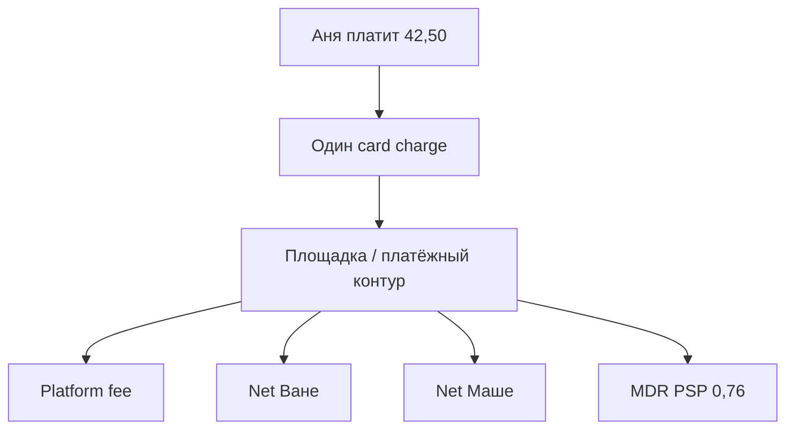
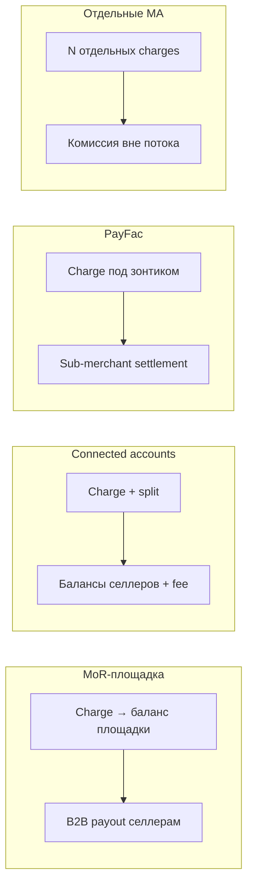
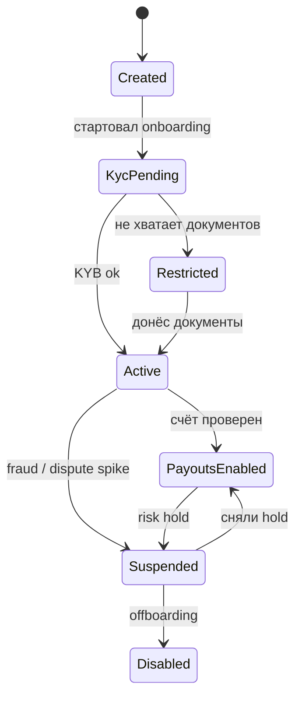
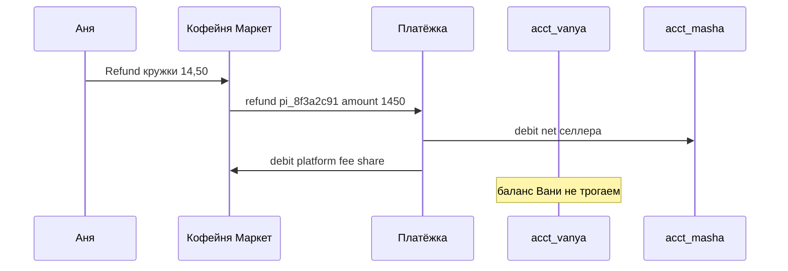
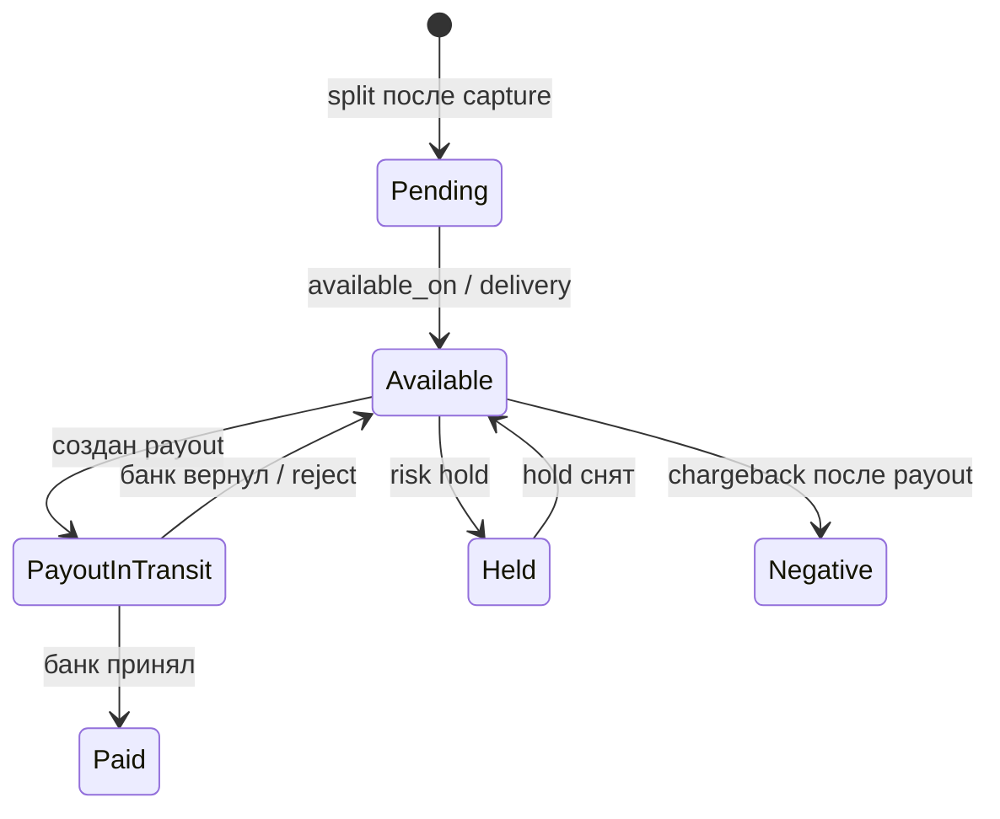
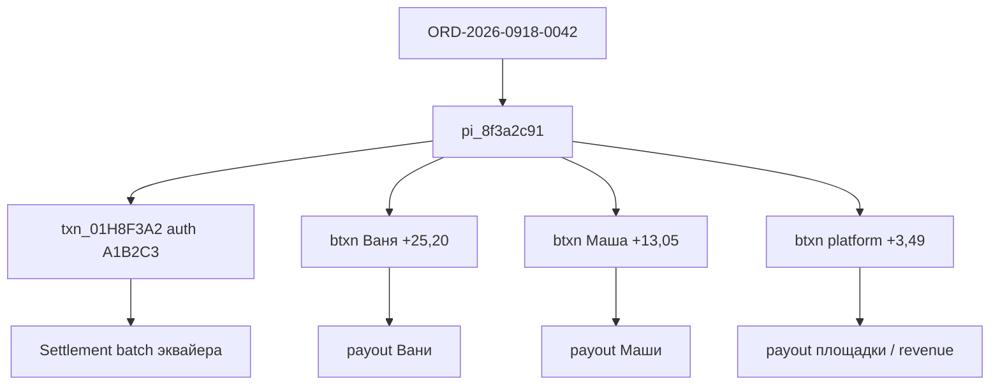
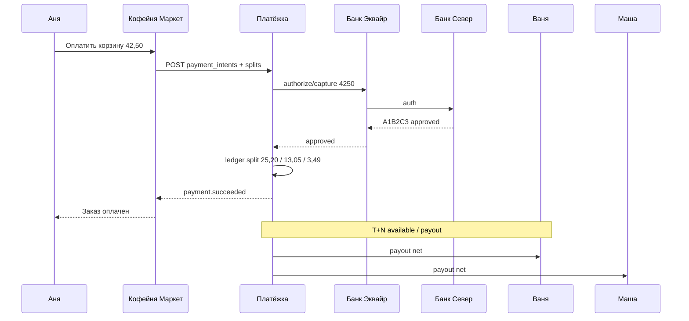

# Глава 26. Marketplace и split payments

До этой главы «Кофейня» была одним продавцом: Аня платит 42,50 EUR, PSP «Платёжка» принимает деньги, эквайер «Банк Эквайр» гоняет авторизацию в «Банк Север», на балансе мерчанта появляется net 41,74. Всё понятно: один бенефициар, один payout, одна сверка.

Теперь представим, что «Кофейня» выросла. На витрине уже не только своё зерно, а ещё обжарщик Ваня и мастер Маша с кружками. Аня кладёт в корзину килограмм эфиопской арабики у Вани и керамическую кружку у Маши — суммарно те же **42,50 EUR**, заказ `ORD-2026-0918-0042`. Для Ани checkout один. Для платформы — внезапно три вопроса, на которые обычный «один merchant account» не отвечает: **кому принадлежат деньги**, **как их разделить**, **когда можно выплатить селлерам**, и не стала ли площадка случайно платёжным учреждением, пока продуктовая команда радовалась фиче «split».

Эта глава — про marketplace и platform payments: модели (MoR, connected accounts, PayFac, «свои» merchant accounts), split payments и multiple beneficiaries, sub-merchants, комиссию площадки, seller payouts, эскроу против «просто процессинга», сверку маркетплейса и ту регуляторную грань, за которой вы уже не «просто витрина». Роли участников и разница PSP / PayFac / MoR уже разобраны в [главе 02](02-ecosystem-participants.md); поток денег и payout — в [главе 12](12-flow-of-funds.md); леджер — в [главе 13](13-ledger-and-reconciliation.md). Здесь мы собираем это в **платформенный паттерн**, где бенефициаров несколько.

Если спроектировать split «как процент в cron-job после webhook», вы получите зелёные платежи, красные балансы селлеров и звонок от compliance. Если спроектировать правильно — один `pi_8f3a2c91` спокойно кормит двух продавцов, площадку и отчёт CFO.

**В этой главе**

- Чем marketplace-платёж отличается от обычного merchant payment
- Модели: MoR-площадка, connected accounts, PayFac, отдельные merchant accounts
- Sub-merchants, connected accounts и граф бенефициаров
- Split payments, multiple beneficiaries, commission splitting и platform fee
- Seller payouts: расписание, холды, negative balance селлера
- Escrow vs payment processing — продуктовая и юридическая развилка
- Marketplace reconciliation: как свести один charge с тремя балансами
- Регуляторные аспекты: когда платформа уже не «просто посредник»
- Сквозной пример корзины Ани на 42,50 EUR с разложением денег

---

## Почему обычный платёж здесь ломается

В [главе 06](06-payment-lifecycle.md) жизненный цикл карточного платежа заканчивается тем, что мерчант получает (после комиссий) net. В [главе 20](20-platform-architecture.md) доменная модель честно говорит: у Payment Intent один владелец-тенант — `merch_coffeehouse`. Marketplace ломает оба упрощения.

### Что видит Аня

Один checkout. Одна сумма 42,50 EUR. Один statement descriptor вроде `COFFEEMKT*ORD0042` (или имя площадки — зависит от модели и правил схемы). Один refund-запрос в поддержку «Кофейни Маркет», если кружка приедет разбитой.

### Что должна видеть платформа

Минимум:

| Сущность | Пример |
|---|---|
| Заказ площадки | `ORD-2026-0918-0042` |
| Строки заказа | Ваня 28,00 EUR; Маша 14,50 EUR |
| Платёж | `pay_8f3a2c91` / `pi_8f3a2c91` + attempt `txn_01H8F3A2` |
| Auth code | `A1B2C3` |
| Бенефициары | `acct_vanya_roast`, `acct_masha_mugs`, `plat_coffee_market` |
| Комиссия площадки | platform fee 4,25 EUR (для примера — 10% GMV) |
| Комиссия PSP | 0,76 EUR → «в систему» входит 41,74 |
| Выплаты селлерам | отдельные payout / transfer с собственным статусом |

Пока в БД есть только `orders.paid = true` и `psp_payment_id`, вы уже потеряли информацию, без которой нельзя ни выплатить Ване, ни ответить на chargeback по кружке Маши, ни доказать регулятору, чьи это были деньги в пятницу вечером.



Словами: покупатель платит один раз; внутри деньги **ветвятся**. Ветвление — это и есть split. Вопрос главы: на каком слое оно происходит (юридическом, карточном, леджерном) и кто за него отвечает.

---

## Marketplace / platform payments: что это вообще

**Marketplace** (маркетплейс) — бизнес, где площадка сводит покупателя с множеством продавцов (sellers / vendors). Платёжный смысл маркетплейса: принять деньги за чужие (или частично чужие) товары/услуги и **распределить** их между участниками сделки.

**Platform payments** — более широкий термин: любая платформа (SaaS для ресторанов, билетный агрегатор, фриланс-биржа, «Кофейня Маркет»), которая принимает платежи не только «за себя», а за экосистему подключенных бизнесов. Marketplace — частный случай platform payments с витриной и корзиной; SaaS-PayFac — соседний случай без «корзины от двух селлеров», но с тысячами sub-merchants.

Зачем это появилось инженерам платежам? Потому что бизнес сказал: «Хотим как Amazon / Booking / Etsy — один чекаут, много продавцов». Без платёжного слоя получается либо:

1. каждый селлер принимает сам (плохой UX, Аня платит два раза), либо
2. площадка принимает всё на свой счёт и «потом разберёмся» (быстро, дёшево на старте — и регуляторно опасно).

Платёжная индустрия ответила продуктами вроде connected accounts / split payments / marketplace settlement: принять один charge, разложить обязательства по бенефициарам, выплатить селлерам по правилам, оставить площадке комиссию.

### Чего marketplace-платёж требует сверх обычного

1. **Граф участников** — platform account + N seller accounts, статусы KYB, банковские реквизиты, лимиты.
2. **Инструкции split** — кто сколько получает с каждой операции (и что делать при refund/chargeback).
3. **Отдельные балансы** — у площадки и у каждого селлера свой available/pending ([глава 12](12-flow-of-funds.md)).
4. **Политика холдов** — «не платить Ване, пока заказ не delivered» vs «платить сразу после capture».
5. **Сверка** — один settlement-файл эквайера против множества внутренних transfer'ов.
6. **Юридическая модель** — кто Merchant of Record, кто хранит деньги, кому нужна лицензия.

Пункт 6 нельзя «добавить потом». Он определяет, какие пункты 1–5 вообще легальны в вашей юрисдикции.

### Marketplace vs «просто мультимерчантный PSP»

PSP «Платёжка» уже обслуживает много мерчантов: «Кофейню», соседний чайный магазин, подписочный сервис. Это **мультитенантность** ([глава 20](20-platform-architecture.md)), не marketplace. Разница:

- у обычного PSP каждый платёж принадлежит **одному** тенанту-мерчанту;
- у marketplace один платёж покупателя порождает обязательства перед **несколькими** бенефициарами внутри одной коммерческой сделки (корзина, комиссия площадки, иногда логист).

Если Аня платит только Ване через витрину, а площадка потом выставляет Ване отдельный invoice за комиссию — это ближе к «витрине + биллинг», чем к split payment. Оба паттерна встречаются; путать их в одной таблице `payments` без поля `platform_context` — путь к неправильной отчётности.

---

## Четыре модели: как площадка может принимать деньги

На практике команды путают маркетинговые названия PSP с юридическими моделями. Ниже — четыре рабочих полюса. Реальные продукты часто гибридны; инженеру важно знать, **в каком полюсе вы живёте сегодня**.

### Модель A: площадка — Merchant of Record

Площадка сама продаёт Ане. Ваня и Маша — поставщики. В эквайринге merchant — «Кофейня Маркет». Деньги приходят на баланс площадки целиком (net 41,74 после MDR). Потом площадка платит Ване и Маше как контрагентам по договору поставки — обычным банковским переводом из своей казны или через payout-API, но это уже **её** обязательство поставщикам, не «доля в card charge».

Плюсы: простой карточный контур (как у обычного мерчанта), один MID, проще statement descriptor. Минусы: площадка — продавец для потребителя (налоги, consumer law, chargeback на неё), селлеры не «принимают платежи», а получают B2B-оплату. Для цифровых товаров и глобальных продаж это часто сознательный выбор через MoR-партнёра ([глава 02](02-ecosystem-participants.md)).

### Модель B: connected accounts / destination charges

Площадка интегрирует PSP с «Connect»-подобным продуктом (публичные примеры моделей — у крупных PSP; детали API у каждого свои). У Вани и Маши — **connected accounts**: онбординг, KYB, свой баланс, свой payout на IBAN. Площадка создаёт платёж от имени платформы, указывает split: application fee себе, остальное — на connected accounts (сразу transfer'ами или через баланс платформы с последующими переводами).

Карточный merchant of record в глазах схемы может быть площадкой, селлером или зависеть от типа charge (direct vs destination) — это уже договорённость PSP и спонсора. Инженерная суть: **бенефициары явны в платёжном объекте**, а не в Excel после пятницы.

### Модель C: PayFac — субмерчанты под зонтиком

Площадка (или её платёжный партнёр) — Payment Facilitator. Ваня и Маша — **sub-merchants**. Эквайер/схема смотрят на PayFac как на ответственного за портфель. Onboarding субмерчантов, мониторинг fraud/chargeback ratio, лимиты — обязанность зонтика. Это близко к SaaS «сайт под ключ для кофеен» из [главы 02](02-ecosystem-participants.md). Marketplace может быть PayFac, но не обязан: PayFac — карточная/схемная конструкция ответственности, marketplace — бизнес-роль.

### Модель D: у каждого селлера свой полноценный merchant account

Самый «чистый» и самый тяжёлый UX: Аня на checkout платит отдельно Ване и отдельно Маше (или платформа оркестрирует два Payment Intent). У каждого — свой MID, свой эквайринг. Площадка берёт комиссию вне карточного потока (инвойс селлеру) или через отдельный fee-collection.

Плюсы: регуляторно проще для площадки («мы только витрина»). Минусы: два (N) платежа, два 3DS, кошмар корзины, частичные отказы («кружка оплачена, зерно — decline»), ад поддержки.



Словами: от A к D растёт «чистота» отделения денег селлеров от площадки и одновременно — сложность checkout и операционок. Большинство зрелых маркетплейсов в Европе на 2026 живут в зоне B или C через лицензированного PSP/PayFac, а не в самодельном «приняли на ООО и потом SEPA селлерам».

---

## Sub-merchants и connected accounts

Оба термина описывают **продавца внутри платформы**, но пришли из разных словарей.

### Sub-merchant

**Sub-merchant** (субмерчант) — термин карточных схем и PayFac-программ: маленький продавец, которого зарегистрировал Payment Facilitator. У субмерчанта есть идентификатор в системе PayFac/эквайера, часто отдельный descriptor-фрагмент, MCC, лимиты объёма. Схема требует определённый уровень due diligence. Превысил chargeback ratio по портфелю — страдает зонтик.

Для инженера sub-merchant — запись в merchant registry с ролью `sub_merchant`, ссылкой на `platform_id`, статусом KYB (`pending` / `active` / `restricted` / `rejected`), привязкой к внутреннему `seller_id` маркетплейса.

### Connected account

**Connected account** — продуктовый термин платформенных API PSP: аккаунт, «подключённый» к platform account. Connected account может соответствовать субмерчанту в схемном смысле, а может быть просто балансовым кошельком бенефициара в леджере PSP — зависит от того, как PSP упаковал compliance.

Практически в «Платёжке» для «Кофейни Маркет»:

| ID | Роль |
|---|---|
| `plat_coffee_market` | Platform account (площадка) |
| `acct_vanya_roast` | Connected account / sub-merchant Вани |
| `acct_masha_mugs` | Connected account / sub-merchant Маши |
| `merch_coffeehouse` | Исторический «обычный» мерчант (если свой магазин ещё жив) |

Архитектурно это всё ещё Merchant-сущности с разными ролями и графом связей — как намекала [глава 20](20-platform-architecture.md). Деньги и права доступа (Ваня не должен читать платежи Маши) — часть той же модели.

### Онбординг селлера — платёжная фича

Селлер не «просто пользователь с галочкой verified». Чтобы получать payout:

1. KYB юрлица / ИП / физлица (зависит от региона и порогов) — [глава 18](18-regulation-and-compliance.md), [глава 25](25-merchant-domain.md).
2. UBO, санкционный скрининг.
3. Банковский счёт (IBAN) с проверкой владения.
4. Согласие с условиями площадки и платёжного провайдера.
5. Настройка payout schedule, валюты, иногда tax forms.

Пока `acct_vanya_roast.status != payouts_enabled`, split на него либо запрещён, либо уходит в escrow/hold площадки — и это должно быть **явным** состоянием в API, а не тихим `null` в cron.



Словами: селлер проходит воронку статусов; право получать деньги — отдельный флаг, не синоним «аккаунт создан».

---

## Split payments и multiple beneficiaries

**Split payment** (разделённый платёж) — механика, при которой одна оплата покупателя порождает несколько денежных обязательств перед разными бенефициарами.

**Multiple beneficiaries** — обобщение: получателей может быть два (площадка + селлер), три (два селлера + площадка), больше (логистика, чаевые, страхование, affiliate). Инженерная модель должна переживать N бенефициаров, а не `if (seller2)`.

### Когда фиксируется split

Есть два семейства:

1. **Upfront split** — инструкции заложены в момент create/confirm Payment Intent: «из 4250: 425 площадке, 2520 Ване, 1305 Маше» (цифры ниже уточним с MDR).
2. **Delayed split** — сначала всё на баланс платформы (или escrow), split/transfer выполняются позже по событию (shipped, delivered, спор истёк).

Upfront проще для селлера («деньги уже мои pending»). Delayed нужен, когда риск доставки/фрода высокий или регуляторно нельзя сразу считать средства доступными селлеру.

### Как выглядят инструкции (иллюстративный JSON)

Площадка создаёт намерение на те же 42,50 EUR, что и в каноничном примере книги, но с массивом бенефициаров. В терминах [главы 20](20-platform-architecture.md) это всё ещё `pi_8f3a2c91`; `pay_8f3a2c91` — привычный «зонтичный» id платежа из ранних глав.

```json
{
  "id": "pi_8f3a2c91",
  "amount": 4250,
  "currency": "eur",
  "platform_account": "plat_coffee_market",
  "metadata": {
    "order_id": "ORD-2026-0918-0042"
  },
  "transfer_group": "ord_2026_0918_0042",
  "splits": [
    {
      "beneficiary": "acct_vanya_roast",
      "amount": 2520,
      "description": "line_beans_ethiopian"
    },
    {
      "beneficiary": "acct_masha_mugs",
      "amount": 1305,
      "description": "line_mug_ceramic"
    },
    {
      "beneficiary": "plat_coffee_market",
      "amount": 425,
      "type": "platform_fee",
      "description": "commission_10pct"
    }
  ]
}
```

Проверка инварианта на входе: `sum(splits) == amount` (4250). Если нет — 400 до эквайера. После успешного capture и MDR 0,76 «в системе» останется 41,74; кто «съест» комиссию PSP — отдельное продуктовое правило (ниже).

### Partial capture и split

Если заказ отгружают частями ([глава 06](06-payment-lifecycle.md) — multiple/partial capture), split должен уметь жить на уровне **capture**, а не только intent. Иначе вы захватили 28,00 за зерно Вани, а инструкции всё ещё делят полные 42,50 — и Маша получает призрак денег за недоставленную кружку.

Практическое правило: каждая денежная операция (capture, refund, chargeback) несёт свой набор split-lines или ссылку на правила пересчёта.

### Refund и chargeback при нескольких бенефициарах

Аня вернула только кружку (14,50). Кто теряет деньги?

- С баланса Маши: 13,05 (её net) + доля platform fee 1,45?
- Platform fee возвращается пропорционально?
- MDR 0,76 PSP часто **не** возвращает полностью — дыра остаётся у площадки или у селлера по договору.

Chargeback на весь заказ 42,50 ещё злее: деньги уже могли уйти payout'ом Ване. Тогда у `acct_vanya_roast` возникает **negative balance**, площадка тянет reserve, PSP тянет площадку ([глава 12](12-flow-of-funds.md), [глава 17](17-chargebacks-and-disputes.md)). Без модели «clawback / negative balance / reserve per seller» маркетплейс банкротит сам себя на первом же дружественном фроде.



Словами: частичный возврат бьёт только по затронутым бенефициарам; полный chargeback может ударить по всем, кто уже получил payout.

### Кто «виноват» в споре с точки зрения денег

Правило нужно зафиксировать в договоре площадки с селлерами **до** первого диспута:

1. **Line-level liability** — спор по кружке бьёт Машу и долю platform fee по этой линии; зерно Вани неприкосновенно.
2. **Order-level solidarity** — редко, но бывает: площадка списывает пропорционально всем, если нельзя выделить товар (цифровой бандл).
3. **Platform absorbs** — площадка покрывает chargeback fee из своего take rate, чтобы не разругаться с топ-селлерами; экономически это страховка, её надо закладывать в unit economics ([глава 15](15-fees-and-economics.md)).

Инженерно храните на каждой split-leg флаг `liable_for_dispute` и ссылку на `line_item_id`. Иначе fraud-команда через три недели будет искать виновного в Slack.

---

## Commission splitting и platform fee

**Platform fee** (комиссия площадки, application fee) — доля GMV или фиксированная плата, которую маркетплейс удерживает за свод, витрину, поддержку, маркетинг. Это **коммерческое** вознаграждение площадки, не путать с MDR/PSP fee.

**Commission splitting** — правила, как из gross платежа вычисляются platform fee и net селлеров (и иногда ещё доли логиста, партнёра, налога как отдельной линии — осторожно с налоговой моделью, к юристам).

### Иллюстративный разрез заказа Ани

| Статья | Сумма EUR |
|---|---|
| Зерно Вани (gross line) | 28,00 |
| Кружка Маши (gross line) | 14,50 |
| **Итого charge Ани** | **42,50** |
| Platform fee 10% от GMV | 4,25 |
| Net коммерческий Ване (28,00 − 2,80) | 25,20 |
| Net коммерческий Маше (14,50 − 1,45) | 13,05 |
| MDR «Платёжки» (пример 1,2% + 0,25) | 0,76 |
| **Зачислено в контур после MDR** | **41,74** |

Кто платит 0,76? Допустим, площадка **абсорбирует** PSP fee из своей комиссии (частый B2B-договор «селлеру обещан чистый % от цены полки»):

| Бенефициар | Итог на баланс |
|---|---|
| Ваня | +25,20 |
| Маша | +13,05 |
| Площадка | +4,25 − 0,76 = **+3,49** |
| **Сумма** | **41,74** |

Инвариант сходится с каноном книги: после комиссий PSP в системе 41,74. Разница с одномерчантным кейсом «Кофейни» лишь в том, что 41,74 **разрезаны** на три баланса, а не лежат одним куском на `merch_coffeehouse`.

Альтернатива: PSP fee пропорционально размазывают по селлерам. Тогда цифры другие, договор другие, support-скрипты другие. Главное — **одно правило в коде и в оферте**, а не «как получилось в Excel».

### Типы тарифов площадки

- **Percent of GMV** — 10% от цены товара (наш пример).
- **Fixed per order** — 0,50 EUR с заказа.
- **Tiered** — 12% до оборота X, потом 8%.
- **Category-based** — за зерно 8%, за посуду 12%.
- **Take rate + payment cost pass-through** — селлер видит «платёжные» и «площадочные» строки отдельно.

В леджере platform fee лучше проводить отдельным `event_type=platform_fee`, а не вычитать «на глаз» при payout. Иначе сверка из [главы 13](13-ledger-and-reconciliation.md) не ответит на вопрос: «Сколько мы заработали на `ORD-2026-0918-0042`?»

### Алгоритм split: от корзины к центам

Практичный пайплайн, который стоит закодировать явно:

1. Взять line items заказа в minor units: `[2800, 1450]`, сумма `4250`.
2. Для каждой линии посчитать `platform_fee_i` по тарифу категории (округление — banker's или half-up, но **одно** на всю платформу).
3. `seller_net_i = line_i - platform_fee_i`.
4. Проверить `sum(seller_net) + sum(platform_fee) == amount`.
5. Отдельным шагом решить, кто несёт PSP MDR `76`: списать с platform fee, размазать пропорционально `seller_net`, или выставить селлерам отдельной строкой `payment_cost`.
6. Записать результат как immutable split plan, привязанный к `pi_8f3a2c91` (или к конкретному capture id).

Если step 5 «решили потом в голове», через квартал unit economics площадки будет врать: вы либо доплачиваете селлерам из своего кармана, либо недоплачиваете и копите скрытый долг.

### Gross vs net pricing для селлера

Селлер думает ценой полки. Если Ваня выставил 28,00 «что получит покупатель», комиссия вычитается из него (net to seller). Если Ваня выставил 28,00 «что получу я», площадка должна накрутить fee сверху — и Аня увидит другую сумму. Путаница gross/net — источник тикетов «почему мне пришло не 28». В API и в UI кабинета селлера показывайте обе колонки: `buyer_price`, `platform_fee`, `net_to_seller`, `payment_costs` (если есть).

### Для любопытных: affiliate и «четвёртый» бенефициар

Иногда в split просят добавить ещё партнёра: блогер привёл Аню, ему 2% от зерна Вани. Технически это ещё одна leg в том же платеже или отдельный transfer с баланса площадки после того, как fee уже начислен. Второй вариант чаще спокойнее: affiliate не становится card beneficiary, не усложняет chargeback-математику и живёт в обычном accounts payable. Первый вариант соблазнителен «всё в одном JSON» — и взрывается, когда refund кружки не должен трогать комиссию блогера за зерно. Проектируйте граф бенефициаров с типами ролей (`seller`, `platform`, `affiliate`, `logistics`), а не плоским списком «просто люди».

---

## Seller payouts

**Seller payout** — вывод available-баланса селлера на его банковский счёт (или на карту/кошелёк — реже и регуляторно тяжелее). Это тот же класс операций, что merchant payout в [главе 12](12-flow-of-funds.md), только масштаб: вместо одного IBAN «Кофейни» — тысячи IBAN Ваней.

### Жизненный цикл денег селлера

1. Capture / split → credit `pending` на `acct_vanya_roast`.
2. По политике available_on (T+N, или после delivery event) → `available`.
3. По расписанию payout (daily/weekly, threshold 20 EUR, …) → banking credit transfer.
4. Banking success → debit available, статус payout `paid`.
5. Banking fail (неверный IBAN) → деньги возвращаются на available, статус `failed`, алерт.



### Зачем холды на селлере

Площадка не хочет платить Ване мгновенно после auth, если:

- товар ещё не отправлен (риск non-delivery chargeback);
- селлер новый (высокий fraud onboarding risk);
- по селлеру растёт dispute rate;
- есть rolling reserve на уровне connected account.

**Held funds** селлера — не «баг задержки», а риск-инструмент. В кабинете Вани должна быть честная строка: «4,17 EUR в резерве до 2026-12-18», а не просто «баланс меньше, чем продажи».

### Negative balance

Ваня получил payout 25,20. Через три недели chargeback на зерно. Леджер:

- debit `acct_vanya_roast` на сумму спора + fee;
- если available не хватает — баланс уходит в минус;
- следующие продажи сначала гасят минус;
- при стойком минусе — clawback с площадки, потом PSP тянет площадку.

Без автоматики negative balance команда будет вручную «просить Ваню вернуть деньги» — и проиграет.

### Идентификаторы выплаты

Для заказа Ани payout Вани может выглядеть так (иллюстративно):

```json
{
  "id": "po_vanya_20260920_01",
  "account": "acct_vanya_roast",
  "amount": 2520,
  "currency": "eur",
  "status": "in_transit",
  "arrival_date": "2026-09-20",
  "included_balance_transactions": [
    "btxn_split_8f3a_vanya"
  ]
}
```

Связь `po_*` ↔ `btxn_*` ↔ `pi_8f3a2c91` ↔ `ORD-2026-0918-0042` — обязательна. Иначе бухгалтер Вани и саппорт площадки никогда не сойдутся.

### Расписания и пороги: не одно число на всех

Типичная матрица (иллюстративно):

| Сегмент селлера | Available | Payout | Threshold | Reserve |
|---|---|---|---|---|
| Новый (менее 30 дней / менее 10 заказов) | после delivery + 7 дней | weekly | 50 EUR | 20% на 90 дней |
| Стандарт | T+2 после capture или после delivery | daily | 20 EUR | 10% на 90 дней |
| Trusted / high volume | T+1 | daily / instant* | 5 EUR | 5% или 0 |

\*Instant payout — отдельный продукт с комиссией и лимитами; это не «просто ускорили SEPA», а казначейское решение PSP/площадки о кредите ликвидности.

Правила лучше хранить как policy engine (`seller_risk_tier` → параметры), а не размазывать `if` по коду payout-джоба. Иначе через год никто не объяснит, почему Маше удержали 13%, а Ване — нет.

### Что селлер должен видеть в API и кабинете

Минимум прозрачности, без которой поддержка утонет:

- список balance transactions с `order_id`, `payment_id`, типом (`charge_split`, `platform_fee`, `refund`, `dispute`, `payout`, `reserve_hold`, `reserve_release`);
- текущие `pending`, `available`, `held`, `reserved`;
- ближайший ожидаемый payout и причины, почему сумма меньше «продаж за неделю»;
- статус KYB и что блокирует вывод.

Скрыть fee «чтобы не пугать» — плохая идея: Ваня всё равно увидит разницу на р/с и напишет тикет. Лучше честная математика в духе канона 42,50 → 41,74, только с колонкой platform fee.

---

## Escrow vs payment processing

Слово **эскроу (escrow)** в стартап-питчах звучит солидно. В платежах оно часто означает две разные вещи — и путаница дорогая.

### Payment processing с отложенным split

Площадка принимает платёж через лицензированный PSP. Деньги юридически идут по правилам safeguarding/client money лицензиата. Площадка **не** «держит чужие деньги на своём ООО-счёте», а даёт инструкцию PSP: не переводить Ване, пока статус заказа не `delivered`. Это **продуктовый холд** поверх платёжного процессинга, а не классический эскроу-счёт адвоката.

### Настоящий / заявленный escrow

Классический эскроу: нейтральная сторона держит средства до условия (подпись акта, delivery confirmation). В цифровых маркетплейсах «эскроу» часто = баланс pending до события. Регулятор смотрит на **факты**: чьё юрлицо контролирует счёт, можно ли площадке тратить эти деньги на свой payroll, есть ли лицензия на платёжную услугу / e-money.

### Красные флаги «мы просто эскроу»

- Деньги селлеров лежат на расчётном счёте площадки в обычном банке и смешиваются с операционными.
- Продукт обещает «кошелёк баланса» покупателям и селлерам без EMI/PI-партнёра.
- Split делается бухгалтером раз в неделю SEPA-платежами «по ощущениям».
- В оферте — «агент», в коде — `company_bank_account += amount`.

Инженерный вывод: если продукт говорит escrow / wallet / hold for sellers — это **требование к лицензионной архитектуре**, а не только к статусной модели заказа. Детали лицензий — [глава 18](18-regulation-and-compliance.md); здесь запомните развилку:

| | Processing + hold у PSP | Самодельный «эскроу» на р/с площадки |
|---|---|---|
| Кто владеет клиентскими деньгами | Лицензиат (PSP/банк) по правилам | Фактически площадка (риск) |
| Split | API бенефициаров / transfers | Ручные платежи |
| Регуляторный профиль | Обычно модель platform/PSP | Часто «неосознанная платёжная услуга» |
| Сверка | Леджер PSP + ваш order ledger | Ад и Excel |

Не давайте юридических гарантий в UI copy. Формулировки «мы гарантируем сохранность средств» — зона counsel.

### Когда hold до delivery оправдан

Держать net Маши в `held`, пока курьер не подтвердил вручение кружки, — разумно для physical goods с долгим SLA. Для digital download «hold 14 дней» часто бессмыслен: товар уже у Ани, а кэш-флоу селлера убит. Политика hold должна зависеть от **категории товара / MCC / risk tier**, а не быть глобальной константой `HOLD_DAYS=14`. И событие release должно быть идемпотентным: два webhook `delivered` подряд не создают два release на 13,05.

---

## Marketplace reconciliation

Обычная сверка мерчанта: платежи ↔ settlement PSP ↔ payout на р/с ([глава 13](13-ledger-and-reconciliation.md)). У маркетплейса появляется **четвёртое измерение** — селлеры.

### Три (четыре) уровня

1. **Внутренний леджер платформы** — заказы, split-lines, platform fee, статусы.
2. **Леджер / отчёты PSP** — charges, transfers, refunds, fees, account balances.
3. **Банк площадки** — payout площадке (если есть) и операционный счёт.
4. **Банки селлеров** — то, чего у вас нет в прямом доступе; есть только payout confirmations и тикеты «мне не пришло».

### Почему ломается matching

Один card settlement batch на стороне эквайера содержит `pay_8f3a2c91` на 42,50 gross / 41,74 net. Внутри платформы из него родились три balance transactions и потом два seller payout (возможно, в разные дни и вперемешку с другими заказами). Matcher уровня «сумма дня = сумма платежей» **недостаточен**.

Нужны ключи:

- `payment_id` / `pi_*` / `txn_*`
- `transfer_group` / `order_id`
- `balance_transaction_id`
- `connected_account_id`
- `payout_id`
- auth / ARN для диспутов



Словами: заказ якорит платёж; платёж якорит attempt и settlement; от платежа веером идут balance transactions; те собираются в payout'ы. Потеря любого ребра — дыра в сверке.

### Типичные расхождения маркетплейса

| Симптом | Частая причина |
|---|---|
| GMV заказов ≠ сумме charges | Отменённые заказы, offline-оплаты, ручные invoice |
| Сумма split ≠ amount платежа | Баг округления, забытая line доставки |
| Балансы селлеров ≠ обязательствам | Refund провели в заказе, не в леджере |
| Payout селлера «лишний» | Дважды включили один btxn (нет идемпотентности) |
| Platform revenue «не сходится» | Fee считают от gross, а деньги после MDR |

### Округление — враг N-way split

42,50 на трёх бенефициаров в минорных единицах ещё терпимо. 19,99 на семь affiliate-долей — классика: сумма долей 1998 или 2000 вместо 1999. Стратегии:

- считать в minor units (центах);
- остаток округления (“remainder penny”) отдавать площадке или крупнейшему бенефициару **детерминированно**;
- покрыть property-тестом: `sum(splits) == amount` для тысяч random корзин.

Без этого reconciliation будет ловить «копейку» каждый день — и правильно сделает.

---

## Регуляторные аспекты: когда вы уже не «просто платформа»

Повторим оговорку [главы 18](18-regulation-and-compliance.md): это учебник для инженеров, не юрконсультация. Ниже — **сигналы**, когда counsel должен сесть за стол до релиза, а не после письма от банка.

### Вопрос регулятора (упрощённо)

«Оказываете ли вы платёжную услугу / храните ли деньги третьих лиц / выпускаете ли электронные деньги?»

Если площадка:

- принимает оплату от Ани на **свой** счёт;
- обещает Ване «мы вам потом переведём»;
- контролирует, когда и сколько отправить;
- смешивает средства разных селлеров;

то велик шанс, что по факту это ближе к платёжной услуге / money remittance / e-money, чем к «информационному посреднику».

### Когда модель обычно спокойнее (не гарантия)

- Платежи принимает лицензированный PSP; площадка — platform в его программе.
- Деньги селлеров на safeguarded accounts лицензиата.
- Площадка получает platform fee как коммерческое вознаграждение.
- Селлеры прошли KYB у PSP/PayFac.
- Площадка не даёт селлерам «тратить баланс внутри экосистемы» как универсальные e-money.

### Когда модель обычно опаснее

- Самодельный escrow на р/с ООО.
- Buyer wallets + seller wallets внутри продукта без EMI.
- Мгновенные «выводы» селлерам по миру из общего пула без партнёра.
- PayFac-поведение (онбординг субмерчантов, агрегированный MID) без регистрации/спонсорства схемы.

### PSD2 / PSD3-PSR и серые зоны

На момент написания (2026) Европа как раз дожимает обновление рамки вокруг платёжных услуг и открытого банкинга. Тренд для платформ предсказуем: **меньше серых зон** для marketplace/wallet, больше требований к прозрачности и лицензированию. Инженерный ответ на неопределённость закона — проектировать так, чтобы смена юрмодели (стали агентом PI, подключили EMI) не требовала выбрасывать леджер и граф аккаунтов.

### Карточные схемы и marketplace

Отдельно от государства — правила Visa/Mastercard и программы PayFac / Marketplace. Они задают:

- как регистрировать продавцов;
- какие дескрипторы допустимы;
- лимиты и мониторинг;
- ответственность за fraud в портфеле.

Игнорировать схемные гайды «потому что у нас же PSD» нельзя: эквайер отключит MID быстрее, чем регулятор напишет акт.

### Практический чеклист перед фичей «split»

1. Есть письменная модель от counsel: кто MoR, кто платёжный агент, чьи клиентские деньги.
2. PSP-контракт явно покрывает platform / connected accounts / marketplace.
3. KYB селлеров включён в onboarding-воронку продукта.
4. Леджер умеет negative balance и clawback.
5. UI не обещает банковскую гарантию эскроу, которой нет.
6. Audit log: кто изменил split post-factum (ручные корректировки — зона злоупотреблений).

---

## Сквозной пример: корзина Ани на 42,50 EUR

Склеим историю целиком. Герои те же; сцена — маркетплейс.

### Участники и идентификаторы

| Роль | Кто | ID |
|---|---|---|
| Покупатель | Аня, карта «Банк Север» | — |
| Площадка | «Кофейня Маркет» | `plat_coffee_market` |
| Селлер 1 | Обжарщик Ваня | `acct_vanya_roast` |
| Селлер 2 | «Кружки Маши» | `acct_masha_mugs` |
| Заказ | Корзина | `ORD-2026-0918-0042` |
| Payment Intent | «Платёжка» | `pi_8f3a2c91` (он же логический `pay_8f3a2c91`) |
| Transaction | Attempt | `txn_01H8F3A2` |
| Auth code | Эмитент | `A1B2C3` |
| PSP / эквайер | «Платёжка» → «Банк Эквайр» | — |

### Состав заказа

| Line | Селлер | Gross |
|---|---|---|
| Эфиопская арабика 1 кг | Ваня | 28,00 EUR |
| Кружка керамическая | Маша | 14,50 EUR |
| **Итого** | | **42,50 EUR** |

Platform fee: 10% → 2,80 с Вани + 1,45 с Маши = **4,25**.  
MDR «Платёжки»: **0,76** (абсорбирует площадка).  
Итог на балансах: Ваня **25,20**, Маша **13,05**, площадка **3,49**. Сумма **41,74**.

### Таймлайн

| Время | Событие |
|---|---|
| 18.09.2026 10:00:00 | Аня оформляет `ORD-2026-0918-0042`, checkout единый |
| 10:00:01 | Площадка создаёт `pi_8f3a2c91` с splits и Idempotency-Key |
| 10:00:02 | Confirm → `txn_01H8F3A2` → «Банк Эквайр» → Visa → «Банк Север» |
| 10:00:03 | Approve `A1B2C3`; при DMS следом capture (или auto-capture) |
| 10:00:03 | Webhook `payment.succeeded` на площадку; заказ «оплачен» |
| 10:00:04 | Леджер: pending кредиты на три аккаунта (25,20 / 13,05 / 3,49) |
| 19.09 | Clearing/settlement цикл схемы и эквайера ([глава 06](06-payment-lifecycle.md), [глава 12](12-flow-of-funds.md)) |
| 20.09 | `available_on`: балансы селлеров становятся available (если нет delivery-hold) |
| 20.09 11:00 | Payout Вани и Маши (если threshold/schedule позволяют) — или позже, если холд до delivery |
| 21.09 | Аня получает зерно; кружка ещё в пути |
| 22.09 | Кружка доставлена; если был escrow-hold на Машу — release |
| +21 день | (ветка риска) Аня оспаривает кружку → debit Маши / площадки |

### Поток сообщений



### Проводки (схема уровня идей)

В духе [главы 13](13-ledger-and-reconciliation.md), одна атомарная пачка после capture (минорные единицы):

```text
Entry je_capture_split_8f3a
  Debit   1100 card_settlement_receivable     4250
  Credit  2100.acct_vanya.pending             2520
  Credit  2100.acct_masha.pending             1305
  Credit  2100.plat_coffee.pending             425

Entry je_fee_psp_8f3a
  Debit   2100.plat_coffee.pending              76
  Credit  3000 revenue_processing_fees          76
```

После этого pending: Ваня 25,20; Маша 13,05; площадка 3,49. PSP fee сидит в revenue. Когда придёт фактический settlement нетто от эквайера, receivable закроется отдельной проводкой по батчу — уже без «разрезания» на Аню вручную.

### Что видит каждый в кабинете

- **Аня:** списание ~42,50, дескриптор площадки, заказ из двух позиций.
- **Ваня:** продажа +28,00 gross, fee −2,80, net +25,20 pending → available → в payout `po_…`.
- **Маша:** аналогично по 14,50 / 1,45 / 13,05.
- **Площадка:** GMV +42,50, commission +4,25, payment cost −0,76, net take +3,49; плюс операционный контроль KYB/risk.
- **Саппорт:** ищет по `ORD-2026-0918-0042` или `pi_8f3a2c91`, видит оба селлера и attempt `txn_01H8F3A2` с `A1B2C3`.

Если саппорт видит только «оплачено 42,50» без split — вы недоделали доменную модель, а не «PSP плохо логирует».

---

## Врезка: как это бывает в жизни

Команда маркетплейса запустила split за выходные: при `payment.succeeded` cloud function писала `seller.balance += line.total * 0.9`. Platform fee нигде не было как сущности — «ну 10% просто не начисляем». PSP fee игнорировали. Refund делали полной отменой заказа в OMS, не трогая балансы. Через шесть недель CFO сверил: сумма балансов селлеров на 18 тысяч больше, чем money на safeguarded-счёте PSP. «Лишние» деньги уже частично ушли payout'ами. Чинили леджером, заморозкой выплат и ручным negative balance. Мораль: **split без double-entry и без связи с реальным settlement — это генератор долга перед селлерами из воздуха**.

---

## Что это значит для инженера

1. **Модель денег первично, API вторично.** Сначала зафиксируйте: MoR / connected / PayFac / отдельные MA. От этого зависят onboarding, дескрипторы, PCI, налоговые и consumer-law потоки. Endpoint `POST /splits` не спасёт неверную юрмодель.

2. **Граф аккаунтов — first-class.** `platform_id`, `connected_account_id`, статусы KYB и `payouts_enabled` должны жить в домене, с RBAC: селлер видит только своё ([глава 20](20-platform-architecture.md)).

3. **Инвариант split на каждой операции.** Create, capture, refund, chargeback — везде `sum(legs) == operation_amount` (с явной политикой remainder). Тесты на multi-seller корзину обязательны.

4. **Не мешайте platform fee и PSP MDR.** Разные `event_type`, разные строки отчёта, разные P&L. Канон 0,76 / 41,74 должен объясняться в числах вместе с комиссией площадки.

5. **Pending / available / held / negative — на каждого селлера.** Скопировать один `merchant.balance` int из MVP — недостаточно. Смотрите [главу 12](12-flow-of-funds.md).

6. **Идемпотентность transfers и payouts.** Повтор webhook не должен удваивать Ване 25,20 ([глава 07](07-states-async-idempotency.md)). Ключ: `order_id + seller_id + event_type` или id balance transaction от PSP.

7. **Delivery-hold — отдельное событие.** OMS говорит `delivered`; платёжный контур делает `release`. Не поллите статус заказа из payment-воркера без outbox/saga ([глава 21](21-distributed-systems-and-money.md)).

8. **Сверка маркетплейса четырёхуровневая.** Постройте отчёты: order GMV, charges, splits, seller payouts, platform revenue. Алертьте break > N центов ([глава 13](13-ledger-and-reconciliation.md), [глава 24](24-monitoring-and-operations.md)).

9. **Chargeback playbook per seller.** Evidence, кто отвечает, чей баланс дебитовать, что если payout уже ушёл. Связка с [главой 17](17-chargebacks-and-disputes.md).

10. **Onboarding селлера = платёжный пайплайн.** Документы, санкции, IBAN check, лимиты на первые N дней. Feature flag «может продавать» ≠ «может выводить».

11. **Наблюдаемость.** Метрики: split_failure_rate, payout_fail_rate, negative_balance_accounts, avg_time_to_available, platform_take_rate_bps. Трассировка по `pi_` / `txn_` / `acct_`.

12. **Не обещайте escrow в UI**, пока counsel и лицензия не сказали «да». Продуктовый hold у PSP называйте hold/pending — честнее и безопаснее.

---

## Типичные ошибки и грабли

**Принять всё на счёт площадки „временно“.** Временное становится постоянным. Регулятор и банк-партнёр смотрят на факты, не на Jira-эпик «migrate to Connect Q4».

**Считать marketplace и PayFac синонимами.** Можно быть маркетплейсом без PayFac и PayFac без публичной витрины. Путаница ломает onboarding и переговоры с эквайером ([глава 02](02-ecosystem-participants.md)).

**Split только в OMS, не в платёжном леджере.** Заказы сходятся, деньги — нет. Источник истины по деньгам — ledger postings, привязанные к payment events.

**Игнорировать PSP fee при обещании селлеру „90% от цены“.** 90% от 42,50 = 38,25 селлерам, плюс вы обещали себе 4,25, плюс PSP взял 0,76 → дыра. Либо absord в take rate, либо пишите net of payment costs в оферте.

**Округление без remainder-политики.** Копейка на каждом заказе × миллион заказов = расследование с CFO.

**Один payout schedule на всех.** Новый селлер с high risk и топ-селлер с историей — разные холды и пороги. Иначе либо фрод уведёт деньги, либо хорошие селлеры уйдут из-за кэш-флоу.

**Refund в OMS без денежных ног.** Статус заказа `refunded`, балансы селлеров живы — вы подарили маржу из кармана площадки.

**Ручной „пересплит“ без аудита.** Менеджер поправил доли после спора селлеров. Через месяц невозможно объяснить chargeback и налоговую картину.

**Смешать buyer wallet и seller balance в одной таблице без типов счетов.** Завтра AML и лицензия спросят «чьи это обязательства» — и ответа в схеме БД не будет.

**Забыть statement descriptor и support.** Аня видит `PLATCOFFEE`, пишет в банк, банк открывает dispute, селлеры ни при чём, ratio площадки растёт. Дескриптор и кто отвечает в письме — часть платёжного дизайна.

**Тестировать только happy-path одной корзины.** Обязательные кейсы: два селлера; refund одной line; chargeback после payout; KYB не завершён; payout IBAN reject; duplicate webhook; partial capture.

**Строить „свой эскроу“ на операционном IBAN.** Быстрый go-to-market, долгий разговор с надзором. Подключайте лицензированный контур.

---

## Итоги главы

1. Marketplace-платёж — это один charge покупателя и **несколько денежных бенефициаров**; обычный merchant account этого не выражает.
2. Выберите явную модель: MoR-площадка, connected accounts, PayFac или отдельные merchant accounts — и не смешивайте их в голове команды.
3. Sub-merchant и connected account — продавцы внутри платформы; onboarding и `payouts_enabled` — часть продукта.
4. Split payments требуют инварианта суммы, политики на refund/chargeback и устойчивости к partial capture.
5. Platform fee ≠ MDR PSP; в примере Ани 4,25 комиссии площадки и 0,76 PSP дают понятный разрез к 41,74.
6. Seller payouts наследуют pending/available/held/negative; clawback обязателен.
7. Escrow как слово в лендинге опасен; processing + hold у лицензиата — другой зверь, чем деньги на р/с ООО.
8. Marketplace reconciliation связывает заказ → платёж → split legs → seller payouts; без id-графа сверка мертва.
9. Регуляторная грань «просто витрина / платёжная услуга» определяется фактами контроля над деньгами — counsel до релиза.
10. Каноничный платёж Ани `ORD-2026-0918-0042` / `pi_8f3a2c91` / `A1B2C3` остаётся тем же card flow — меняется только **разрез обязательств** после успеха.

Дальше логичный шаг — выйти за пределы «одной страны и одного эквайера»: как выглядят международные платежи, local vs cross-border acquiring и почему селлер в другой валюте ломает даже аккуратный split. Этому посвящена [глава 27](27-cross-border-payments.md).

---

## Связанные главы

- [Глава 02. Участники платёжной экосистемы](02-ecosystem-participants.md) — PSP, PayFac, MoR, marketplace как роль
- [Глава 06. Жизненный цикл карточного платежа](06-payment-lifecycle.md) — auth, capture, refund
- [Глава 07. Состояния, webhooks, idempotency](07-states-async-idempotency.md) — дубликаты событий и ключи идемпотентности
- [Глава 12. Что происходит с деньгами](12-flow-of-funds.md) — balance, payout, reserve
- [Глава 13. Ledger и reconciliation](13-ledger-and-reconciliation.md) — проводки и сверка
- [Глава 15. Комиссии и экономика платежей](15-fees-and-economics.md) — MDR, take rate
- [Глава 17. Chargebacks и disputes](17-chargebacks-and-disputes.md) — споры после payout
- [Глава 18. Регуляторика и compliance](18-regulation-and-compliance.md) — лицензии, KYB, safeguarding
- [Глава 20. Архитектура платёжной платформы](20-platform-architecture.md) — Intent, Transaction, merchant graph
- [Глава 21. Распределённые системы и деньги](21-distributed-systems-and-money.md) — saga/outbox для release по delivery
- [Глава 25. Merchant-side](25-merchant-domain.md) — onboarding и кабинет продавца
- [Глава 27. Международные платежи](27-cross-border-payments.md) — следующий шаг после домашней площадки
