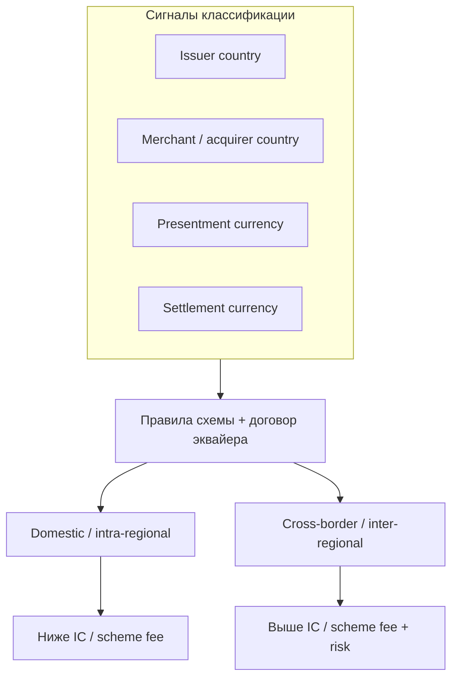
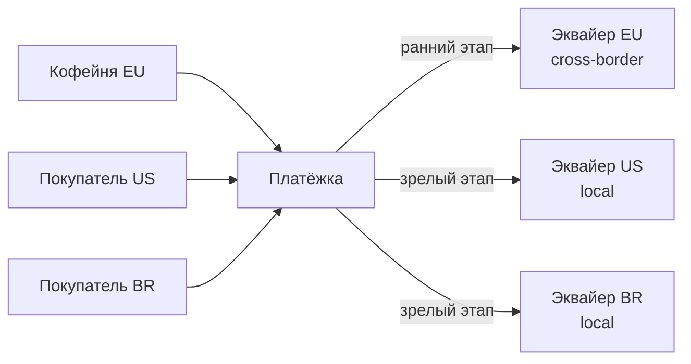
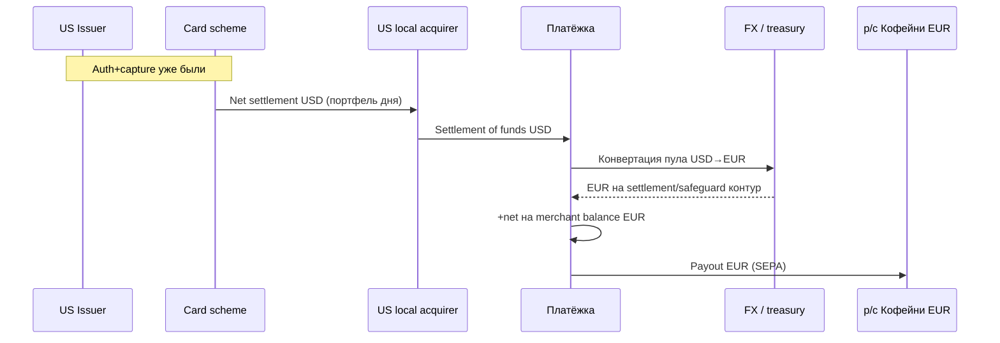
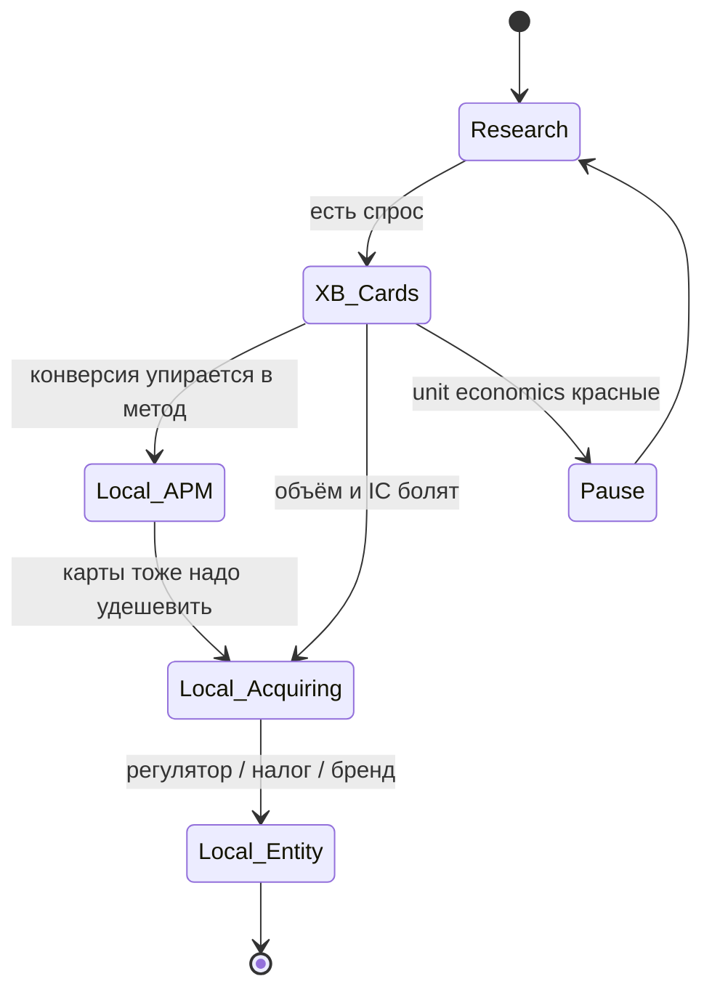
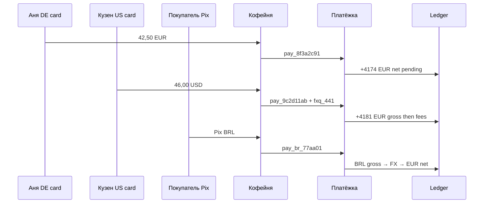

# Глава 27. Международные платежи

Аня платит в «Кофейне» **42,50 EUR**. Карта «Банка Север», магазин в еврозоне, эквайер «Банк Эквайр», PSP «Платёжка». Для неё это «просто оплата». Для индустрии это **domestic**, то есть внутренний, сценарий: покупатель, мерчант и расчётный контур живут в одной логической зоне. Зелёная галочка за полторы секунды, комиссия порядка **0,76 EUR**, на баланс «Кофейни» уходит **41,74 EUR** — знакомый разрез из [главы 12](12-flow-of-funds.md) и [главы 15](15-fees-and-economics.md).

Теперь сменим одну деталь. Та же «Кофейня» начинает продавать зерно в США и Бразилии. Покупатель в Сан-Паулу платит реалами через Pix. Покупатель в Нью-Йорке — картой US-эмитента, а «Кофейня» хочет settlement в EUR на европейский IBAN. Кузен Ани выбирает цену в USD на витрине, а подруга в Варшаве платит картой PLN по цене в евро. Внезапно одна товарная позиция (SKU) порождает **платёжные коридоры** — маршруты между конкретными странами, валютами и банковскими системами: разные валюты, разные эквайеры, разные лицензии, разные сроки денег, разные fraud-паттерны и разные ответы саппорту на вопрос «где мои 42,50?».

Международные платежи — не «добавить флаг страны в форму». Это смена плоскости: domestic vs cross-border, local acquiring vs эквайринг «издалека», settlement через схему или через корреспондентов, зоопарк локальных методов и матрица регуляторов. Валюты и FX мы уже разобрали в [главе 14](14-currencies-and-fx.md); здесь — **география денег**: кто где принимает, кто где рассчитывается, как выбрать стратегию выхода на рынок, не утонув в комиссиях и compliance.

**В этой главе**

- Чем domestic отличается от international — и почему «одна схема карт» ещё не делает платёж домашним
- Local acquiring против cross-border acquiring: конверсия, цена, риск, инженерия маршрутизации
- Как устроен международный settlement и где деньги реально «зависают»
- Где в коридоре живёт FX (и почему это не дубль главы про валюты, а география решений)
- Корреспондентский банкинг: SWIFT, nostro/vostro, цепочки банков
- Международные и локальные методы как обязательная часть go-to-market
- Региональные регуляции: что меняется за границей одной лицензии
- Стратегия выхода на рынок: фазы, make-or-buy, метрики успеха и типичные провалы

---

## Domestic vs international: граница, которую любят путать

Когда продукт говорит «мы принимаем международные карты», инженер часто слышит «Visa/Mastercard везде». Это правда лишь наполовину. Карточная сеть глобальна, но **классификация операции** — domestic или cross-border / international — зависит от правил схемы и от того, **где** стоят участники сделки относительно друг друга.

### Что обычно считают «домашним»

Упрощённо (детали зависят от схемы и региона, это не юридическое определение):

- **Domestic** — эмитент и мерчант (точнее, эквайер / country of merchant) относятся к одной стране или к одной договорной зоне, которую схема считает внутренней.
- **Intra-regional** — например, внутри Европейской экономической зоны (EEA): часто отдельные ставки interchange и scheme fees, ближе к «домашним», но не всегда идентичны строго national domestic.
- **Cross-border / inter-regional** — эмитент и мерчант в разных зонах; ставки выше, fraud-скоринг злее, иногда жёстче SCA/аутентификация.

Платёж Ани `pay_8f3a2c91` на заказ `ORD-2026-0918-0042`: карта EEA-эмитента, мерчант в еврозоне, presentment EUR. В учебном каноне книги это **domestic/intra-EEA** consumer debit. Auth code `A1B2C3`, MDR blended порядка **0,76**, net **41,74**. В доменной модели [главы 20](20-platform-architecture.md) тот же логический платёж выглядит как Intent `pi_8f3a2c91` и attempt `txn_…` — дальше в этой главе для сквозности держим привычный `pay_8f3a2c91`, помня про разделение Intent/Transaction.

### Откуда берётся путаница

Граница «международности» живёт сразу в нескольких справочниках:

1. **BIN / эмитентская страна** — где выпущена карта (точнее, где схема считает issuer country).
2. **Merchant country / acquirer BIN country** — где зарегистрирован мерчант и через какого эквайера идёт приём.
3. **Presentment currency** — в какой валюте показали сумму сети ([глава 14](14-currencies-and-fx.md)).
4. **Settlement currency** — в чём считают участника и мерчанта.
5. **Billing currency покупателя** — что спишет эмитент со счёта Ани (может отличаться от presentment).

Можно получить «международный вкус» без смены страны мерчанта: польская карта платит EUR-цену на сайте «Кофейни» в Германии — presentment EUR, конвертация у эмитента в PLN, а классификация для interchange может быть intra-EEA, не «Мексика → Япония». И наоборот: европейский мерчант с **cross-border acquiring** из другой страны иногда платит как за международный поток даже локальным покупателям — потому что эквайер «не там».



Словами: «международность» — не одно булево поле `is_foreign=true`, а **функция от набора признаков**, которую вычисляет схема и отражает эквайер в отчётах. В вашей БД это лучше хранить явно: `issuer_country`, `merchant_country`, `acquiring_region`, `cross_border_flag` (как пришло от процессора), `fx_involved`. Иначе через полгода аналитика скажет «у нас 12% international», а finance — «по scheme reports 31%», и оба будут правы по своим определениям.

### Зачем инженеру это знать до go-to-market

Потому что от флага зависят:

- **цена** платежа ([глава 15](15-fees-and-economics.md): сценарий corporate credit cross-border уже показал, как fee раздувается);
- **approval rate** — эмитенты чаще режут «чужой» MCC/гео;
- **3DS / SCA** — exemptions и friction живут по регионам ([глава 08](08-3ds-and-sca.md));
- **fraud score** — внезапный US→EU на новой карте выглядит иначе, чем Аня из соседнего города ([глава 16](16-fraud.md));
- **chargeback reason codes и сроки** — программы схем региональны ([глава 17](17-chargebacks-and-disputes.md));
- **payout и налоги/отчётность** — куда и в какой валюте уходят деньги мерчанту.

### Врезка: как это бывает в жизни

«Кофейня» открыла доставку в UK. Сайт тот же, checkout тот же, эквайер тот же — европейский MID. Британские карты после Brexit для части потоков перестали быть «почти domestic EEA». Approval rate просел на несколько пунктов, MDR вырос, саппорт завалили тикетами «почему с карты сняло больше, чем на сайте» (FX эмитента). Продукт думал, что «добавили shipping country». Finance увидел другой unit economics. Мораль: **смена географии покупателя без смены acquiring-стратегии — это уже международный продукт**, даже если код checkout не трогали.

---

## Local acquiring vs cross-border acquiring

Эквайринг (acquiring) — приём карточных платежей от имени мерчанта через банк-эквайер или процессора ([глава 02](02-ecosystem-participants.md)). **Где** этот эквайер «сидит» относительно покупателя — одна из самых дорогих развилок международного бизнеса.

### Cross-border acquiring: «принимаем мир из одного MID»

Классический старт для европейской «Кофейни»: один договор с «Платёжкой», один европейский эквайер «Банк Эквайр», один settlement в EUR. Покупатель из США платит картой US-банка. Авторизация идёт через схему; операция часто классифицируется как **cross-border**. Это работает. Миллионы магазинов так живут годами.

Плюсы:

- быстрый запуск: одна интеграция, один KYB, один payout-контур;
- проще бухгалтерия мерчанта (всё в EUR);
- меньше юридических сущностей.

Минусы:

- выше interchange / scheme fees на межрегиональных потоках (порядок: заметно дороже domestic; точные базисные пункты (bps; 100 bps = 1 процентный пункт) зависят от схемы, продукта карты, MCC — не выдумываем тарифы);
- ниже approval rate: эмитент видит «зарубежный мерчант»;
- statement descriptor и локальные ожидания покупателя хуже;
- в некоторых странах регулятор или схема косо смотрят на агрессивный cross-border приём локального объёма без local presence;
- FX: если presentment в EUR, а карта в USD — конвертация у эмитента (или DCC, если включили — осторожно, [глава 14](14-currencies-and-fx.md)).

### Local acquiring: «принимаем как местный»

**Local acquiring** — приём через эквайера в стране (или зоне) покупателя: бразильский объём — через бразильского эквайера, японский — через японского, и т.д. Мерчант может оставаться европейским юрлицом, а acquiring — быть локальным через партнёров PSP (модель зависит от лицензий и договоров). Либо у мерчанта появляется local entity.

Плюсы:

- выше конверсия и auth rate на локальных картах;
- ближе к domestic тарифам;
- лучше под локальные правила (налоги на чеке, местного 3DS-провайдера, локальный descriptor);
- проще добавить **локальные методы** на том же контуре (Pix рядом с картами BR).

Минусы:

- много интеграций или толстый слой оркестрации у PSP;
- много settlement-валют и FX на хвосте к «домашнему» балансу мерчанта;
- KYB/лицензии/налоговая связь с местной юрисдикцией (nexus) сложнее;
- сверка и support: «почему payout в BRL пришёл не тем курсом».



Словами: на старте весь мир может течь в европейский эквайер. На зрелости «Платёжка» маршрутизирует US-карты на US-acquiring, BR — на BR, а европейских Ань оставляет на «Банк Эквайр». Для «Кофейни» API тот же; внутри — **routing table**.

### Как PSP выбирает маршрут

Типичные входы в decision:

- BIN → issuer country / product;
- billing country / IP / shipping (осторожно: fraud и privacy);
- валюта checkout;
- MCC и risk tier мерчанта;
- стоимость маршрута (IC++ estimate) vs ожидаемый uplift конверсии;
- доступность local MID (онбординг мерчанта на локального эквайера может быть async: дни, не секунды);
- fallback: если local down — cross-border, или наоборот soft-decline cascade ([глава 07](07-states-async-idempotency.md)).

Иллюстративный фрагмент внутреннего решения (не API провайдера):

```json
{
  "payment_id": "pay_8f3a2c91",
  "order_id": "ORD-2026-0918-0042",
  "amount": 4250,
  "currency": "EUR",
  "issuer_country": "DE",
  "merchant_country": "DE",
  "acquiring_route": "eu_bank_acquire_domestic",
  "cross_border": false,
  "auth_code": "A1B2C3",
  "estimated_mdr_minor": 76,
  "net_to_merchant_minor": 4174
}
```

Тот же заказ, но карта US:

```json
{
  "payment_id": "pay_c7e19b02",
  "order_id": "ORD-2026-1003-0117",
  "amount": 4250,
  "currency": "EUR",
  "issuer_country": "US",
  "merchant_country": "DE",
  "acquiring_route": "eu_bank_acquire_cross_border",
  "cross_border": true,
  "presentment_currency": "EUR",
  "cardholder_billing_hint": "USD_via_issuer_fx",
  "note": "illustrative: higher IC/scheme; auth rate risk elevated"
}
```

А если «Платёжка» уже включила US local acquiring и витрина умеет USD:

```json
{
  "payment_id": "pay_a91f44d0",
  "order_id": "ORD-2026-1003-0118",
  "amount": 4600,
  "currency": "USD",
  "issuer_country": "US",
  "merchant_country": "DE",
  "acquiring_route": "us_local_acq_partner",
  "cross_border": false,
  "settlement_to_merchant": {
    "currency": "EUR",
    "fx_quote_id": "fxq_882",
    "mode": "quoted_lock"
  }
}
```

Здесь domestic/cross-border на уровне **карты↔эквайер** может стать local, а международность «переезжает» в **FX settlement мерчанту** — уже территория [главы 14](14-currencies-and-fx.md).

### Что ломается на практике

- Включили local acquiring, но забыли **отдельный MID / descriptor** — покупатель видит чужое имя, растут friendly fraud disputes.
- Роутинг смотрит только на IP: VPN Ани из Берлина гонит её на «бразильский» мир — decline + плохой UX.
- Local onboard «завис» в `pending`, а checkout уже предлагает «локальную цену» — платежи падают в technical decline.
- Сверка: один день продаж «Кофейни» раскладывается на три settlement file трёх эквайеров плюс FX — без `payment_id`/`txn_id` mapping ад ([глава 13](13-ledger-and-reconciliation.md)).

---

## Международный settlement: когда деньги пересекают границы

Settlement (расчёты) в карточной вселенной мы уже видели: clearing-файлы, net settlement схемы, потом PSP → merchant balance → payout ([глава 06](06-payment-lifecycle.md), [глава 12](12-flow-of-funds.md)). В международном мире добавляются **слои валют, корреспондентов и календарей**.

### Три разных «settlement», которые путают в одном тикете

1. **Scheme settlement** — нетто между членами карточной сети за цикл (часто T+1 по банковским дням схемы; зависит от региона и продукта).
2. **Acquirer ↔ PSP settlement of funds** — когда эквайер/процессор зачисляет портфель на счета «Платёжки».
3. **Merchant payout** — перевод available с баланса PSP на р/с «Кофейни» (SCT, wire, local rail).

Международность может сидеть в любом из трёх. Пример: local US acquiring дал scheme settlement в USD на счёт партнёра в США; «Платёжка» конвертирует пул в EUR; «Кофейня» получает EUR-payout. Покупатель давно увидел списание; мерчант ждёт хвост FX и cut-off.



Словами: карта могла быть «локальной» в США, а деньги «Кофейни» всё равно прошли международный казначейский хвост. Инженеру нельзя красить весь путь одним статусом `settled`.

### Календари, cut-off и «пропавшие» дни

Domestic SEPA Instant payout «Кофейни» может уйти за секунды. Cross-border wire в другую валюту — через корреспондентов с cut-off'ами. Плюс:

- праздники страны эквайера ≠ праздники страны мерчанта ≠ праздники валюты settlement;
- scheme settlement calendar ≠ дата валютирования FX (value date), на которую приходится расчёт по валютной сделке;
- rolling reserve в одной валюте при payout в другой — отдельная боль учёта.

Практическое правило продукта: в API и кабинете показывайте **ожидаемую дату available** и **валюту баланса** явно. «Settled» без currency и value date — ложь удобной формы.

### Мультивалютные балансы мерчанта

Международная «Кофейня» часто получает:

- EUR balance (домашний);
- USD balance (если оставляют выручку в USD под закупки);
- иногда BRL/GBP как транзитные.

Payout policy: автоконвертация в EUR каждый день vs держать multi-currency wallets. Это продуктово-казначейское решение, но оно обязано быть в доменной модели: `balance(merchant_id, currency)`, а не один `amount`. Леджер и сверка — [глава 13](13-ledger-and-reconciliation.md).

### Сквозной денежный контраст: domestic Аня vs US-покупатель

| | Аня (domestic EUR) | Покупатель US (cross-border EUR presentment) |
|---|---|---|
| Заказ | `ORD-2026-0918-0042` | `ORD-2026-1003-0117` |
| Платёж | `pay_8f3a2c91` | `pay_c7e19b02` |
| Сумма на сайте | 42,50 EUR | 42,50 EUR |
| Auth | `A1B2C3` | другой код |
| Классификация | domestic/intra-EEA | cross-border |
| Что видит покупатель | 42,50 EUR | ~USD по курсу эмитента |
| MDR (иллюстр.) | 0,76 → net 41,74 | выше (порядок: ближе к «дорогому» сценарию гл. 15) |
| Settlement мерчанту | EUR без FX | EUR, но дороже fee; FX на стороне buyer |
| Типичный риск | низкий | выше false positive fraud / decline |

Цифры fee для US-кейса намеренно не фиксируем «до цента»: они зависят от product карты и договора. Важно направление: **тот же SKU, другая география эмитента — другая экономика**.

### FX на стыке коридоров (тема на границе с главой 14)

Международный платёж почти всегда тащит за собой валютный вопрос, даже когда «Кофейня» клянётся, что «мы только в евро». Разложим четыре типичных места, где появляется FX — подробно механика курсов, спредов и DCC живёт в [главе 14](14-currencies-and-fx.md); здесь важна **география решения**.

1. **Issuer FX.** Presentment в EUR, карта в PLN/USD: эмитент конвертирует для выписки покупателя. «Кофейня» и «Платёжка» могут вообще не знать точную сумму в billing currency — и не должны обещать её в UI как «факт».
2. **Acquirer / scheme multi-currency.** Local acquiring в USD, а позиция PSP в EUR: конвертация на стороне участника или казначейства PSP после settlement of funds.
3. **Merchant FX / quoted lock.** Витрина в USD, баланс мерчанта в EUR: котировка `fxq_…` в момент оплаты (сюжет C из главы 14).
4. **Payout FX.** Баланс в BRL, перевод на EUR-IBAN «Кофейни»: курс на дату payout, не на дату покупки — если продукт не зафиксировал иначе.

Для инженера правило одно: у платежа в данных может быть **несколько денежных проекций** (presentment, cardholder billing hint, scheme settlement, merchant balance, payout). Международный баг №1 — обновить одну и забыть остальные при refund. Refund «на полную» по presentment 46,00 USD при уже сконвертированном EUR-балансе требует явной policy: locked rate vs settle-time rate vs mid + markup заново. Без policy саппорт будет угадывать, а леджер — расходиться.

Иллюстративно для кузена (не новый канон книги, а ветка):

```text
presentment:     46,00 USD
merchant lock:   41,81 EUR (fxq_441)
MDR:             ~0,88 EUR
net balance:     ~40,93 EUR
refund full:     вернуть 46,00 USD покупателю;
                 списать с EUR-баланса по той же fxq_441 (если policy = lock)
```

Если policy = «курс на день refund», net «Кофейни» пляшет: выиграли или проиграли на спреде. Это не «баг Visa» — это продукт treasury, который надо закодировать до первого международного refund.

---

## Корреспондентский банкинг: SWIFT, nostro и vostro

Карточные схемы умеют прятать межбанковский хлам внутри своего settlement. Но как только речь о **банковских переводах** между странами, payout в «неудобную» валюту, B2B-оплате поставщику зерна в третьей стране или о возврате не через карточный refund, а через wire — на сцену выходит **correspondent banking**.

### Зачем вообще корреспонденты

Не у каждого банка есть прямой счёт в каждой валюте и прямой клиринг с каждым банком мира. Банк A в стране X держит счёт в банке B в стране Y (или в международном хабе) и через него платит в валюте Y. Банк B может привлечь банк C. Цепочка **intermediary banks** — норма, не баг.

Для «Платёжки» это объясняет три операционных факта:

1. **Стоимость payout** в «редкую» валюту выше не только из-за FX markup, но и из-за комиссий цепочки (иногда снимаемых из суммы перевода).
2. **SLA** плавает: тот же EUR→USD через сильного корреспондента предсказуемее, чем выплата в банк с двумя посредниками.
3. **Расследование** «где деньги» требует банковских reference, а не только вашего `payout_id` в Postgres.

Карточный settlement крупных схем часто обходит «ручной» SWIFT на каждую покупку Ани: схема и её расчётный банк делают неттинг. Но **merchant payout** в не-SEPA мир, **withdraw** marketplace-селлеру в другую страну, **B2B** поставщику и **return** по некоторым APM снова выталкивают вас в корреспондентский контур.

### Nostro и vostro — один счёт, два взгляда

В [главе 12](12-flow-of-funds.md) уже мелькнуло; здесь — рабочая глубина.

- **Nostro** (от nostro, «наш»): счёт **нашего** банка, открытый **в другом** банке. «Банк Эквайр» говорит: «наш nostro в USD у корреспондента в Нью-Йорке».
- **Vostro** (vostro, «ваш»): тот же счёт глазами банка-корреспондента: «ваш vostro у нас».

Это не два разных кошелька. Это **бухгалтерская оптика**. Путаница nostro/vostro в казначейских тикетах классика: операционист пишет «денег нет на nostro», имея в виду недостаток ликвидности на счёте у корреспондента; разработчик ищет баг в payout-сервисе.

```text
Банк Эквайр (EU)                    US Correspondent Bank
─────────────────                    ─────────────────────
Актив: Nostro USD  ───────────────►  Пассив: Vostro of Bank Acquire
       (наш счёт у вас)                      (ваш счёт у нас)
```

### SWIFT: сообщения, не деньги

**SWIFT** — сеть обмена финансовыми сообщениями между банками (и не только). Важная мантра: **SWIFT сам по себе не двигает деньги**. Он передаёт инструкции и статусы. Деньги двигаются по счетам (в т.ч. nostro/vostro) и по клиринговым системам валют.

Исторически в cross-border wires доминировали MT-сообщения (например, платёжные MT103 и подобные). Индустрия постепенно мигрирует на **ISO 20022** для многих коридоров и систем — богаче данные, лучше структурированное назначение платежа (structured remittance), меньше неструктурированного текста в реквизитах. Для инженера PSP это значит: коннекторы payout/wire должны переживать **разные диалекты** и уметь хранить UETR — сквозной идентификатор международного банковского перевода — и end-to-end id для трейсинга ([глава 22](22-integrations.md) про интеграции глубже).

Типичный путь EUR→USD payout поставщику «Кофейни»:

1. «Платёжка» инициирует перевод со своего банка.
2. Банк отправителя списывает EUR (или сразу USD с nostro).
3. Если нужен USD — FX внутри банка или у брокера.
4. Сообщение SWIFT уходит корреспонденту; возможно, через intermediary.
5. Корреспондент кредитует банк получателя / финальный банк.
6. Бенефициар видит зачисление — иногда через 1–3+ банковских дня, иногда быстрее в «richer» коридорах.

Где «зависает»:

- cut-off пропущен — уедет следующим днём;
- AML stop на стороне любого банка цепочки;
- неверный IBAN/account/BIC — return, дни потеряны;
- нехватка ликвидности на nostro в нужной валюте;
- комиссия банка-посредника «съела» сумму (если не оговорено, кто оплачивает комиссии цепочки, — и даже тогда возможны сюрпризы).

### Что это значит для статуса payout в продукте

Не сводите международный payout к `pending|succeeded|failed`. Минимум ближе к:

- `submitted` — мы отдали инструкцию банку;
- `accepted_by_bank` — банк взял в работу;
- `in_correspondent_network` — ушло в цепочку (если есть трейс);
- `credited_beneficiary` — подтверждено зачисление (если канал даёт);
- `returned` / `rejected` — возврат с причиной.

Webhooks мерчанту должны быть честны: «мы отправили» ≠ «деньги у бенефициара». Иначе саппорт «Кофейни» будет обещать поставщику кофе то, чего ещё нет на счёте в Аддис-Абебе.

### Врезка: для любопытных — gpi и прозрачность

Крупные банки подключают сервисы трейсинга платежей (в экосистеме SWIFT — продукты вроде gpi): сквозной UETR, статусы по цепочке, иногда подтверждение credit. Для PSP это снижает «чёрный ящик», но не отменяет nostro-ликвидность и AML. Если ваш банк-партнёр трейс не отдаёт в API — ваш статусный автомат всё равно останется дырявым; заложите ручной ops-процесс и SLA.

---

## Международные платёжные методы: карта — не билет в страну

Карты Visa/Mastercard — мощный глобальный слой. Но **доля checkout** в многих странах держится на локальных рельсах: bank redirect, instant account-to-account, кошельки, boleto/OXXO-подобные ваучеры, BNPL. [Глава 10](10-bank-based-methods.md) и [глава 11](11-wallets-bnpl-local-methods.md) разбирают механику методов; здесь — **зачем они обязательны в международной стратегии**.

### Почему «только карты» проигрывает локально

- В Нидерландах без iDEAL-подобного метода вы странный магазин.
- В Бразилии Pix для многих сценариев удобнее и дешевле карты.
- В Индии UPI — воздух рынка.
- В части Латама cash-voucher всё ещё критичен для audience без карты.
- В US ACH/account-to-account и кошельки конкурируют за recurring и средний чек (AOV, average order value).

Конверсия — не «плюс 2% в A/B». Иногда это **входной билет**: без метода вас просто не выбирают.

### Как международный checkout собирается из кубиков

«Платёжка» для глобальной «Кофейни» показывает методы не списком из 80 кнопок, а **по правилам**:

```text
if shipping_country == BR and amount < limit:
    offer Pix, local cards (BR acquiring), optional Boleto
elif billing_country in EEA:
    offer cards (EU acq), Open Banking / SEPA-based where relevant
elif country == US:
    offer cards (US local if onboarded), Apple/Google Pay, ACH for some SKUs
else:
    offer cards via best available route + major wallets
```

Правила зависят от risk, лицензии, валюты цены, наличия локального юрлица. Инженер хранит **capability matrix**: `(country, currency, method, acquiring_route, license_entity) → enabled`.

### Payout-методы тоже «международные»

Приём — полдела. Вывести продавцу в местной валюте, заплатить маркетплейс-селлеру в другой стране ([глава 26](26-marketplace-and-split-payments.md)), вернуть покупателю на локальный счет — отдельные рельсы. Refund карты ≠ return по Pix; сроки и финальность разные ([глава 10](10-bank-based-methods.md)).

### Сквозной мини-пример: один SKU — три страны

Набор зерна ценой «как 42,50 EUR»:

| Рынок | Checkout | Acquiring / rail | Что видит покупатель | Хвост к «Кофейне» |
|---|---|---|---|---|
| DE (Аня) | Card EUR | EU domestic | 42,50 EUR | net ~41,74 EUR |
| PL | Card, цена EUR | intra-EEA | PLN у эмитента | EUR balance |
| BR | Pix BRL | local BR A2A | BRL мгновенно | FX BRL→EUR + local fees |
| US | Card USD | US local | 46,00 USD (пример гл. 14) | FX USD→EUR |

Один каталог. Четыре денежных машины. Если в аналитике всё схлопнуть в `SUM(amount)` без currency и method — получите бессмыслицу.

---

## Региональные регуляции: паспорт не бесконечный

[Глава 18](18-regulation-and-compliance.md) разобрала PSD2/PSD3, лицензии PI/EMI, KYC/AML, санкции. Международный угол — **мультипликатор**: каждый новый коридор добавляет строку в матрицу `entity × country × product`.

### Что обычно всплывает при выходе «за свой двор»

**Лицензирование и агентские схемы.** Европейский passporting — механизм работы в других странах EEA на основании домашней лицензии и предусмотренных уведомлений — одно ([глава 18](18-regulation-and-compliance.md)). UK после Brexit — отдельный контур. США — state money transmitter / федеральные ожидания, часто через партнёра-банка или лицензированного спонсора. Латам и Азия — локальные платёжные лицензии, иногда обязательный local partner. «У нас PI в Литве, значит мир открыт» — опасный слайд для инвестора, не архитектура.

**SCA и аутентификация.** Европа требует SCA с exemptions. Другие регионы — свои 3DS-ожидания, локальные OTP, biometric mandates. Один fraud-engine на всех без regional policies будет либо душить конверсию, либо пропускать мусор.

**Валютный контроль и capital controls.** В части юрисдикций выводить выручку за рубеж нельзя «как SEPA». Нужны документы, квоты, локальный settlement. Это ломает мечту «все балансы сразу в EUR на головную компанию».

**Налоги и отчётность на checkout.** Отображение местных косвенных налогов (VAT/GST), фискальные чеки, электронные счета — часто соседствуют с платежами в интеграции магазина. Платежный статус `succeeded` не заменяет фискальный документ.

**Санкции и географические запреты.** OFAC и локальные списки; запрет обслуживания определённых стран; merchant category restrictions. Hit на payout в «плохую» юрисдикцию — hard stop, не retry ([глава 18](18-regulation-and-compliance.md)).

**Данные.** Cross-border transfer персональных данных, локализация, subprocessors. Карточные данные — ещё и PCI scope ([глава 19](19-payment-security-pci.md)).

**Потребительское право и chargeback culture.** В US дружественный fraud и expectations по disputes могут отличаться от EEA. Политика refund «Кофейни» должна учитывать локальные нормы — иначе scheme programs накажут ratio.

### Regulatory entity в доменной модели

Международная «Платёжка» почти неизбежно — **группа юрлиц**:

- EU PI/EMI для европейского acquiring и safeguarding;
- US-партнёр или licensed entity для US money movement;
- local entities/partners в BR/IN/… .

Каждый платёж и каждый баланс обязаны знать `regulatory_entity_id`. Иначе вы не ответите регулятору, чей это оборот, и не разложите safeguarding. В JSON compliance-контекста (иллюстративно):

```json
{
  "payment_id": "pay_a91f44d0",
  "regulatory_entity": "platezhka_us_partner",
  "merchant_id": "merch_coffeehouse",
  "corridor": "US_local_acq_to_EU_merchant",
  "licenses_applied": ["us_partner_sponsored"],
  "sanctions_screen": "clear",
  "data_residency_hint": "us_card_data_in_us_pci_scope"
}
```

### Врезка: как это бывает в жизни

Команда включила «весь Латинскую Америку» одной фичей: карты cross-border + надежда. Через квартал: высокий decline, один крупный chargeback-spike по стране с незнакомым reason code pattern, payout мерчанту застрял из-за currency control, а юристы спросили, на каком основании вообще принимали локальных потребителей без local disclosure. Выключали рынок дольше, чем включали. Дешевле был пилот одной страны с local partner.

### Региональные «диалекты» (обзорно, без юриспруденции)

Ниже — инженерная карта внимания, не консультация. Перед запуском коридора нужна локальная правовая оценка.

**EEA / EU.** PSD2 и эволюция к PSD3/PSR на момент написания; SCA; PI/EMI; passporting внутри союза с оговорками; safeguarding client funds; сильный акцент на Open Banking. Domestic-платёж Ани живёт здесь комфортно.

**United Kingdom.** Отдельный регуляторный контур после Brexit; собственная линия Open Banking; для EU-PSP это уже «другая страна» в матрице entity, даже если язык тот же и карты те же.

**United States.** Карточный мир привычен, но money transmission, state licenses, ACH-правила, OFAC-центричность санкционного скрининга и consumer protection вокруг банковских рельсов отличаются от европейского PI-мышления. Часто EU-PSP идёт через sponsor bank / licensed partner, а не «пасспортирует литовскую лицензию в Техас».

**Латинская Америка.** Локальные мгновенные системы (Pix как яркий пример), высокий вес локальных методов, в ряде стран — currency control и местные платёжные лицензии. Cross-border cards alone дают «галочку страны», но не долю рынка.

**Индия и Южная Азия.** UPI и локальные мандаты; данные и localisation; onboarding мерчантов с местной спецификой. Глобальный checkout без UPI для consumer-сегмента часто бессмыслен.

**Африка и MENA.** Фрагментация рельсов и валют, мобильные деньги как first-class метод в ряде рынков, санкционные и корреспондентские ограничения на USD-коридоры — payout может упираться в banking connectivity сильнее, чем в ваш API.

**Азия-Тихоокеанский регион за пределами «простых» хабов.** Национальные схемы карт рядом с Visa/Mastercard, кошельки с огромной долей checkout, иногда требование local entity для приёма. «Один JSON на весь APAC» — фантазия.

Архитектурный вывод тот же, что в [главе 18](18-regulation-and-compliance.md), но жёстче: `compliance_profile = f(entity, country, product, corridor, method)`. Хардкод европейских SCA-exemption'ов на US ACH или на Pix — способ получить и штраф, и смешной decline rate одновременно.

---

## Стратегия выхода на рынок: как не открыть «весь мир» сразу

Международные платежи — программа, не toggle. Ниже — рабочий каркас, которым пользуются зрелые PSP и крупные мерчанты; числа — иллюстративные ориентиры, не обещание ROI.

### Фаза 0 — честно измерить, зачем вам страна

Вопросы до первой интеграции:

- Какой объём и AOV ожидаем через 6–12 месяцев?
- Какие методы дают ≥80% локального e-com в нише?
- Нужен ли local entity или хватит cross-border + партнёр?
- Куда мерчант хочет settlement (локально vs HQ currency)?
- Какой unit economics после IC/scheme/FX/chargeback reserve?

Если ответ «потому что конкурент написал на сайте 195 стран» — это маркетинг, не платёжная стратегия.

### Фаза 1 — cross-border cards как разведка

Минимальный вход:

1. Оставить европейский acquiring.
2. Включить нужные валюты витрины или принимать foreign cards в EUR/USD.
3. Настроить 3DS/fraud под elevated cross-border risk.
4. Завести аналитику: auth rate, effective MDR, fraud, FX cost по `issuer_country`.
5. Ограничить high-risk MCC/страны.

Плюс: быстро. Минус: потолок конверсии и маржи. Для «Кофейни» с единичными US-заказами — нормально. Для половины оборота в BR — нет.

### Фаза 2 — локальные методы без полного local acquiring

Часто PSP даёт Pix/iDEAL/… через локальных партнёров, пока карты ещё cross-border. Смотрите на **settlement currency и сроки available**: метод «мгновенный» для покупателя может быть T+N для мерчанта.

### Фаза 3 — local acquiring в приоритетных коридорах

Критерии зрелости коридора (пример эвристики):

- стабильный объём выше порога, где uplift auth rate окупает интеграцию;
- предсказуемый fraud;
- понятный payout path;
- готовность мерчанта к multi-currency balance или FX.

Тогда «Платёжка» онбордит «Кофейню» на US/BR MID, переключает routing, отдельно настраивает reconciliation.

### Фаза 4 — локальное юрлицо / полноценный market play

Склады, локальные цены с налогом, локальный MoR иногда, наём support на языке, отдельные резервы. Это уже не «платежный коннектор», а бизнес-экспансия. Платежи — necessary but not sufficient.



### Make-or-buy для «Платёжки» и для «Кофейни»

**Мерчант «Кофейня»:** почти всегда buy — один PSP (или два для redundancy), оркестрация методов через него. Прямые договоры с десятью эквайерами имеют смысл у гигантов.

**PSP «Платёжка»:** buy локальных процессоров/банков как connectors; make — routing, ledger, fraud orchestration, merchant UX, reconciliation. Пытаться «напилить свой эквайринг» в каждой стране — путь к вечной сертификации.

### Метрики успеха выхода

Не «страна в списке enabled». А:

- payment success rate по методу и BIN country;
- effective take rate / MDR после FX;
- time-to-available и payout failure rate;
- chargeback ratio локального портфеля;
- доля локальных методов в successful GMV;
- cost of compliance ops на 1000 платежей;
- support ticket rate «wrong amount / FX / where is money».

### Типовая дорожная карта на примере «Кофейни»

1. **Сейчас:** DE/EEA, `pay_8f3a2c91`-мир, net 41,74, один EUR payout.
2. **Квартал +1:** UK и US cards cross-border, USD price list для US, FX lock как в [главе 14](14-currencies-and-fx.md), отдельные fraud rules.
3. **Квартал +2:** PL/NL локальные bank methods через «Платёжку».
4. **Квартал +3:** US local acquiring для карт + Apple/Google Pay, USD balance опционально.
5. **Позже:** BR Pix + local cards, отдельный corridor owner в ops.

Каждый шаг — с stop-условием: если auth rate US < порога и fraud > порога, не идём в local entity, чиним оффер и риск.

### Сколько это стоит «по порядку величин» (иллюстративно)

Цифры ниже — чтобы калибровать ожидания команды, не прайс-лист:

- **Включить cross-border cards** на существующем эквайере: недели интеграции/конфига, основной cost — рост IC/scheme и падение auth rate, плюс fraud ops.
- **Добавить один локальный APM** через партнёра PSP: порядок от нескольких недель до пары месяцев с учётом KYB, тестов refund/return и саппорт-скриптов.
- **Local acquiring в одной стране:** месяцы (сертификации, MID onboarding, settlement reports, сверка), отдельный человек на corridor ops.
- **Собственное юрлицо + лицензия:** многие месяцы и существенный burn на legal/compliance; имеет смысл, когда GMV и маржа коридора это окупают.

Ошибка стартапа-мерчанта — сравнивать только MDR «2% vs 2,4%» и игнорировать engineering + ops cost PSP, который всё равно окажется в цене или в качестве. Ошибка PSP — обещать sales'ам «50 стран в Q3» при команде из двух integration engineers.

### Организационная обвязка

Международные платежи ломаются не только в коде:

- **Corridor owner** — человек, который знает банковские праздники, эскалации эквайера и «почему Pix вчера мигал».
- **Runbook на rail** — что делать при деградации local acquirer, как переключить traffic на резервный cross-border маршрут (XB fallback), кого звонить.
- **Локализованный support playbook** — шаблоны про issuer FX, delays payout, разницу refund vs chargeback.
- **Финансовый календарь** — value dates, cut-offs, кто мониторит nostro-liquidity у banking ops.

Без этого даже идеальный routing-сервис превращается в тикеты в три часа ночи по Берлину о проблеме в Сан-Паулу.

---

## Сквозной пример: международный день «Кофейни»

Соберём один операционный день, чтобы все слои встретились в леджере.

### Утро: domestic Аня

| Поле | Значение |
|---|---|
| Заказ | `ORD-2026-0918-0042` |
| Платёж | `pay_8f3a2c91` (Intent `pi_8f3a2c91`) |
| Сумма | 42,50 EUR |
| Auth | `A1B2C3` |
| Route | EU domestic |
| Fee | 0,76 EUR |
| Net | 41,74 EUR |

Таймлайн знаком: auth → capture → clearing → settlement → pending → available → payout в EUR.

### День: кузен в US, цена 46,00 USD

| Поле | Значение |
|---|---|
| Заказ | `ORD-2026-1002-0188` |
| Платёж | `pay_9c2d11ab` |
| Presentment | 46,00 USD |
| Route | US local acquiring (фаза 3) |
| FX quote | `fxq_441` → 41,81 EUR на баланс |
| MDR | иллюстративно 1,5% + 0,25 → net порядка 40,93 EUR |

Покупатель видит USD. «Кофейня» думает EUR. Схема считает US local. Treasury «Платёжки» закрывает USD-позицию.

### Вечер: São Paulo, Pix

| Поле | Значение |
|---|---|
| Заказ | `ORD-2026-1002-0210` |
| Платёж | `pay_br_77aa01` |
| Метод | Pix |
| Сумма | BRL-эквивалент витрины |
| Финальность | быстрая на стороне покупателя |
| Available мерчанту | после AML + FX BRL→EUR по правилам коридора |



Словами: три успешных покупки одного бренда. Три разных денежных двигателя. Сверка дня — не «сумма чеков», а **набор коридоров** с разными value dates. Именно поэтому международный merchant dashboard, который рисует одну цифру «оборот», без разбивки по currency/method/route, опасен для CFO.

Иллюстративный кусок внутреннего settlement summary. `value_date` — дата валютирования, суммы с суффиксом `_minor` — в минорных единицах. Во второй строке `fee_minor` и `net_minor` выражены в EUR, как и `settlement`, а исходная сумма покупателя находится в `presentment`:

```json
{
  "merchant_id": "merch_coffeehouse",
  "value_date": "2026-10-03",
  "lines": [
    {
      "payment_id": "pay_8f3a2c91",
      "corridor": "EEA_domestic_card",
      "gross_minor": 4250,
      "currency": "EUR",
      "fee_minor": 76,
      "net_minor": 4174
    },
    {
      "payment_id": "pay_9c2d11ab",
      "corridor": "US_local_card_fx_to_EUR",
      "presentment": {"amount": 4600, "currency": "USD"},
      "settlement": {"amount": 4181, "currency": "EUR"},
      "fee_minor": 88,
      "net_minor": 4093
    },
    {
      "payment_id": "pay_br_77aa01",
      "corridor": "BR_pix_fx_to_EUR",
      "status": "pending_fx_value_date",
      "note": "illustrative - waiting BRL pool convert"
    }
  ]
}
```

---

## Что это значит для инженера

1. **Моделируйте коридор явно.** Не только `currency`, но `issuer_country`, `merchant_country`, `acquiring_route`, `cross_border`, `regulatory_entity`, `method_rail`. Отчёты и fee engine должны читать эти поля.

2. **Routing — отдельный сервис с аудитом.** Решение «куда слать auth» логируйте с reason code: `bin_country`, `cost_score`, `auth_rate_score`, `mid_status`. Без аудита вы не отладите падение конверсии после «небольшого» изменения таблицы.

3. **Разделяйте статусы scheme settlement, FX value date и merchant available.** Один boolean `settled` в международной книге — источник бухгалтерских войн.

4. **Multi-currency ledger с первого иностранного платежа.** Даже если продукт «конвертируем всё в EUR», проводки должны помнить исходную валюту и FX metadata ([глава 13](13-ledger-and-reconciliation.md), [глава 14](14-currencies-and-fx.md)).

5. **Capability matrix методов версионируйте как конфиг.** Включение Pix в стране — изменение матрицы + лицензионная проверка, не hardcode в checkout UI.

6. **Payout state machine для wires богаче, чем для SEPA Instant.** Заложите returned/unclaimed и ручные ops-кейсы; храните банковские reference / UETR.

7. **Fraud и мониторинг операций (TM, transaction monitoring) — per corridor.** Thresholds, которые работают на Ане в Берлине, сожгут Бразилию или наоборот. Метки `corridor` в features обязательны ([глава 16](16-fraud.md)).

8. **Онбординг на local MID — async процесс.** Checkout не должен обещать метод, пока `acquiring_account.status != active`.

9. **Сверка: N файлов эквайеров + реестр валютных сделок (FX blotter) + банковские выписки по выплатам в форматах MT/camt ([глава 22](22-integrations.md)).** Matching key — ваш `payment_id`/`txn_id`, прокинутый в reconciliation id. Иначе международный день не закроется.

10. **Тесты:** suite на domestic 42,50 EUR (`pay_8f3a2c91`, net 41,74); cross-border card; local acq + FX to EUR; APM local; payout wire returned. Это контракт продукта, не «милые фикстуры».

11. **Наблюдаемость:** дашборды success/auth/decline **разрезом** `route`, `issuer_country`, `method`, не только global KPI ([глава 24](24-monitoring-and-operations.md)).

12. **Документация для саппорта:** шпаргалка «почему сумма в выписке покупателя ≠ цена сайта» и «почему payout T+3» экономит половину тикетов при экспансии.

---

## Типичные ошибки и грабли

**«Международность = есть Visa».** Карта глобальна, acquiring и методы — нет. Без local strategy конверсия упрётся в потолок.

**Один MID на весь мир навсегда.** Удобно бухгалтерии в первый месяц; на масштабе — дорогой IC и злые эмитенты.

**Смешать presentment FX и acquiring locality в одной куче.** Команда «починила курс», а падал auth rate из-за cross-border flag. Разведите диагнозы.

**Показать метод до готовности лицензии/MID.** Маркетинг радуется, платежи падают, репутация метода в UI страдает.

**Считать SWIFT «проводом денег».** Искать баг в API, когда сообщение ушло, а nostro пустой или AML держит цепочку.

**Единый fee display «2%» на всех странах.** Effective cost коридоров разный; мерчант принимает плохое бизнес-решение, потом винит PSP.

**Игнорировать currency controls.** «Автоматический daily sweep в EUR» внезапно незаконен или операционно невозможен.

**Refund всегда картой, даже если платили APM.** Часть рельсов требует return на тот же метод; часть — ручной wire. Политика возвратов должна знать `method_rail`.

**Глобальный fraud threshold.** После запуска новой страны false positive съедает uplift от local acquiring — и вы «не понимаете, зачем платили за локальный MID».

**Нет owner коридора.** Когда BR сломался в праздник Бразилии, on-call в Европе смотрит только EU dashboards. Нужен runway: calendar, contacts, playbooks per rail.

**Сверка по сумме и дате без id.** В domestic ещё везло; в multi-acquirer FX-дне — гарантированный ад.

**Обещать покупателю «списание ровно 42,50» при чужой currency карты.** Честно говорите про issuer FX / возможный DCC; иначе chargeback «incorrect amount».

---

## Итоги главы

1. **Domestic vs international** — не маркетинг, а классификация схемы и договоров; от неё зависят цена, риск и auth rate. Платёж Ани `pay_8f3a2c91` на 42,50 EUR с net 41,74 — эталон домашнего мира.

2. **Cross-border acquiring** быстро открывает страны; **local acquiring** покупает конверсию и себестоимость ценой сложности routing и settlement.

3. **Международный settlement** — цепочка scheme → acquirer/PSP → FX → merchant payout с разными календарями; не один статус.

4. **Корреспонденты и SWIFT** объясняют банковские хвосты: nostro/vostro — ликвидность и оптика счетов; SWIFT — сообщения, не магический перевод.

5. **Локальные методы** часто важнее «ещё одной схемы карт»; capability matrix — часть платформы.

6. **Регуляторика умножается на коридоры:** entity, лицензии, SCA, санкции, валютный контроль, данные.

7. **Выход на рынок — фазы** от XB-разведки до local entity, с метриками и stop-условиями, а не список флагов стран.

8. **Инженерия:** явные поля коридора, async MID onboarding, multi-currency ledger, богатые статусы payout, сверка по стабильным id.

9. **Один SKU — много денежных машин.** Если аналитика этого не видит, международный рост будет «успешным» в слайдах и убыточным в cash.

Дальше книга уходит в справочник и сквозные сценарии: в [главе 28](28-glossary.md) термины и идентификаторы соберутся в одном месте, а в [главе 29](29-scenarios-part-1.md) и [главе 30](30-scenarios-part-2.md) международные развилки встретятся с отказами, диспутами и авариями уже как полные истории.

---

## Связанные главы

- [Глава 02. Участники платёжной экосистемы](02-ecosystem-participants.md) — эквайер, PSP, схемы
- [Глава 04. Карточные сети и схемы](04-card-networks.md) — правила и региональность схем
- [Глава 06. Жизненный цикл карточного платежа](06-payment-lifecycle.md) — auth, capture, clearing, settlement
- [Глава 07. Состояния, webhooks, idempotency](07-states-async-idempotency.md) — retries и каскады маршрутов
- [Глава 08. 3-D Secure и SCA](08-3ds-and-sca.md) — аутентификация по регионам
- [Глава 10. Банковские переводы и Open Banking](10-bank-based-methods.md) — SEPA, ACH, Pix/UPI, PIS
- [Глава 11. Кошельки, BNPL и локальные методы](11-wallets-bnpl-local-methods.md) — APM как класс
- [Глава 12. Что происходит с деньгами](12-flow-of-funds.md) — счета, net settlement, payout
- [Глава 13. Ledger и reconciliation](13-ledger-and-reconciliation.md) — учёт и сверка хвостов
- [Глава 14. Валюты и FX](14-currencies-and-fx.md) — presentment/settlement, курсы, DCC
- [Глава 15. Комиссии и экономика](15-fees-and-economics.md) — IC, MDR, cross-border дороже
- [Глава 16. Fraud](16-fraud.md) — риск международных паттернов
- [Глава 17. Chargebacks и disputes](17-chargebacks-and-disputes.md) — диспуты и программы схем
- [Глава 18. Регуляторика и compliance](18-regulation-and-compliance.md) — лицензии, AML, санкции
- [Глава 20. Архитектура платформы](20-platform-architecture.md) — Intent/Transaction, идентификаторы
- [Глава 22. Интеграции](22-integrations.md) — ISO-сообщения, файлы, коннекторы
- [Глава 24. Мониторинг](24-monitoring-and-operations.md) — метрики по разрезам
- [Глава 25. Merchant-side](25-merchant-domain.md) — баланс, payout, конфигурация мерчанта
- [Глава 26. Marketplace и split payments](26-marketplace-and-split-payments.md) — выплаты многим бенефициарам
- [Глава 28. Глоссарий](28-glossary.md) — термины и идентификаторы
- [Глава 29. Сквозные сценарии I](29-scenarios-part-1.md) — путь платежа и отказы
- [Глава 30. Сквозные сценарии II](30-scenarios-part-2.md) — деньги, диспуты, аварии
