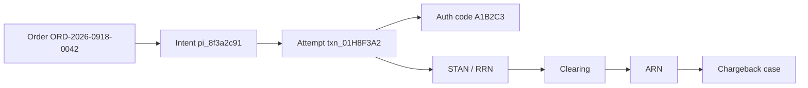

# Глава 28. Глоссарий и идентификаторы

К концу книги в голове инженера обычно живёт два словаря одновременно. Один — «нормальный»: Payment Intent, webhook, soft decline. Второй — «ночной»: ARN, RRN, STAN, DE39, MID, statement descriptor. Пока платёж Ани на **42,50 EUR** зелёный и тихий, словари не сталкиваются. Как только «Кофейня» пишет в поддержку «деньги списались, заказа нет», а эмитент отвечает «дайте ARN», выясняется: все говорят про один платёж и никто не имеет в виду один и тот же идентификатор.

Эта глава — справочник, к которому можно вернуться из любой другой. Здесь допускается формат «термин → пояснение», но не «Термин — сухое определение из ISO». У каждого слова есть: зачем оно появилось, где встречается в системе, пример значения на сквозном платеже Ани, типичные путаницы и ссылка на главу с подробностями. Если вы читаете книгу впервые — не зубрите глоссарий целиком. Используйте его как карту: открыли тикет поддержки → нашли, какой id нужен какому участнику → пошли в нужную главу.

Каноничный сквозной платёж этой книги (цифры иллюстративные, согласованы между главами):

| Что | Значение |
|---|---|
| Заказ «Кофейни» | `ORD-2026-0918-0042` |
| Логический платёж у PSP (ранние главы) | `pay_8f3a2c91` |
| Payment Intent / Transaction (модель [гл. 20](20-platform-architecture.md)) | `pi_8f3a2c91` / `txn_01H8F3A2` |
| Сумма | 42,50 EUR (`4250` минорных единиц) |
| Authorization code | `A1B2C3` |
| RRN | `609182743015` |
| STAN | `000847` |
| Комиссия PSP (пример) | 0,76 EUR |
| Зачисление мерчанту | 41,74 EUR |

Почему в одних главах `pay_…`, а в других `pi_…` + `txn_…`? Исторически команда мерчанта и даже документация PSP часто зовут всё «payment id». В доменной модели платформы это **два** объекта: намерение получить деньги и конкретная попытка списания. Глоссарий держит оба имени и явно говорит, когда они расходятся.

## В этой главе

- Роли экосистемы: кто есть кто и чем их путают
- Платёжные идентификаторы: от order id до ARN
- Коды ответов, отказов и диспутов
- Деньги и учёт: суммы, балансы, леджер, сверка
- Риск, споры, безопасность и токены
- Методы оплаты и технические понятия платформы
- Сравнительные таблицы похожих id и карта «кому какой id нести в поддержку»

---

## Как пользоваться этим глоссарием

Термины сгруппированы по смыслу, не по алфавиту. Алфавитный поиск в Markdown-файле сделает `Ctrl+F` быстрее любого оглавления. Внутри группы порядок примерно такой: сначала роли и «большие» сущности, потом id и коды, которыми эти роли обмениваются.

Для каждого важного идентификатора отвечаем на четыре инженерных вопроса:

1. **Кто его выпускает?** (магазин, PSP, эквайер, схема, эмитент)
2. **На каком этапе он появляется?** (create intent, auth, clearing, dispute…)
3. **Где его хранить?** (Intent, Transaction/Attempt, Operation, Dispute case)
4. **Кому его показывать?** (покупателю, мерчанту, саппорту эквайера, схеме)

Если ответа «хранить везде» — это уже запах беды: вы смешали слои и завтра не сможете сменить эквайера, не сломав сверку «Кофейни».

### Сквозной снимок: один платёж — много имён

```text
Аня / выписка банка:     "COFFEEHOUSE.EU  42,50 EUR" + иногда укороченный ref
Заказ «Кофейни»:         ORD-2026-0918-0042
PSP Intent:              pi_8f3a2c91  (в ранних главах: pay_8f3a2c91)
PSP Attempt:             txn_01H8F3A2
Эмитент:                 auth code A1B2C3, response 00
Эквайер/сеть (online):   RRN 609182743015, STAN 000847, MID/TID
После clearing:          ARN (длинный, для диспутов)
Леджер PSP:              entry_… на capture 42,50 + fee 0,76 → payable 41,74
Баланс «Кофейни»:        +41,74 available (после pending/T+N)
```

Дальше — сами термины.

---

## Роли

### Cardholder (держатель карты)

Тот, кому эмитент выпустил карту или токенизированный инструмент. В книге это **Аня** и карта «Банка Север». В системе мерчанта cardholder часто **не** равен `Customer`: мама платит картой сына, сотрудник — корпоративной. Для fraud и chargeback спор «я не платил» — это спор держателя с эмитеномтом, а не с «Кофейней». Пример в данных: у эмитента — PAN/токен и имя на карте; у PSP — `cus_anya_001` как запись покупателя мерчанта. Путаница: считать, что «пользователь сайта = cardholder» всегда. Подробнее: [Глава 02](02-ecosystem-participants.md).

### Merchant (продавец / мерчант)

Организация, которая принимает оплату за товар или услугу. У нас — интернет-магазин **«Кофейня»**, в платформе `merch_coffeehouse`. Мерчант владеет заказом, доставкой и отношением с покупателем (если не MoR). В API он видит Intent/Transaction и баланс; в схеме его знают через MID и MCC. Путаница: «мерчант = MID» (у одного юрлица может быть несколько MID). Подробнее: [Глава 02](02-ecosystem-participants.md), [Глава 25](25-merchant-domain.md).

### Issuer (эмитент)

Банк или лицензированная организация, выпустившая карту и ведущая счёт/лимит держателя. **«Банк Север»** решает: approve/decline, hold, 3DS, потом отвечает в диспуте. В онлайне эмитент почти невидим мерчанту — виден только через response code и auth code. Путаница: «банк покупателя» vs «банк продавца» (это разные роли). Подробнее: [Глава 02](02-ecosystem-participants.md), [Глава 06](06-payment-lifecycle.md).

### Acquirer (эквайер)

Банк или организация, которая подключает мерчанта к карточной схеме и принимает auth/clearing/settlement на стороне продавца. В книге — **«Банк Эквайр»**. Эквайер назначает MID/TID, шлёт сообщения в схему, получает settlement. PSP часто стоит *перед* эквайером: мерчант говорит с «Платёжкой», а «Платёжка» — с эквайером. Путаница: называть эквайером любой «банк в договоре», даже если это только settlement-банк EMI. Подробнее: [Глава 02](02-ecosystem-participants.md).

### Scheme / card network (карточная сеть / платёжная система)

Правила, бренд и рельсы между эмитентами и эквайерами: Visa, Mastercard, Мир и др. Схема маршрутизирует auth, задаёт clearing/settlement, reason codes диспутов, fees и monitoring programs. Мерчант схему «в лицо» почти не видит, но её правила ломают conversion сильнее любого рефакторинга checkout. Путаница: scheme = processor = PSP. Подробнее: [Глава 04](04-card-networks.md).

### Processor (процессор)

Технологическая фабрика обработки: ISO 8583 / сетевые протоколы, соединение со схемами, суточные файлы, иногда antifraud-коннекторы. Работает от имени эквайера (acquiring processor) или эмитента (issuer processor). Граница с эквайером размыта: крупный банк процессит сам; процессор продаёт «эквайринг под ключ» через банк-спонсор. Путаница: «мы интегрировались с Visa» — обычно вы интегрировались с процессором/эквайером. Подробнее: [Глава 02](02-ecosystem-participants.md), [Глава 22](22-integrations.md).

### Gateway (платёжный шлюз)

Технический вход: принять карточные данные/токен от мерчанта, нормализовать запрос, отдать процессору/эквайеру. Gateway сам по себе не обязан быть эквайером и не обязан вести merchant balance. В e-commerce «gateway» часто — маркетинговое имя продукта, за которым спрятан PSP. Путаница: договор «на gateway» без понимания, кто несёт settlement и chargeback risk. Подробнее: [Глава 02](02-ecosystem-participants.md).

### PSP (Payment Service Provider)

Провайдер, который даёт мерчанту единый API, onboarding, методы, отчёты, часто баланс и payout — поверх одного или нескольких эквайеров/рельсов. В книге — вымышленная **«Платёжка»**. Для инженера «Кофейни» PSP — основной контрагент. Для схемы PSP может выглядеть как технический провайдер, PayFac или лицензированный институт — зависит от модели. Путаница: «PSP = эквайер» (не всегда). Подробнее: [Глава 02](02-ecosystem-participants.md), [Глава 20](20-platform-architecture.md).

### PayFac (Payment Facilitator)

Модель, где фасилитатор onboards «подмерчантов» под своим мастер-MID / спонсорским эквайером, берёт на себя часть underwriting и compliance. Удобно для мелких продавцов и платформ; тяжело по риску и регуляторике. Путаница: любая платформа с split payments = PayFac (не факт; marketplace может быть другой юридической конструкцией). Подробнее: [Глава 02](02-ecosystem-participants.md), [Глава 26](26-marketplace-and-split-payments.md).

### Merchant of Record (MoR)

Юридический продавец в чеке и в схеме: тот, кто «продал» товар покупателю с точки зрения платежа. Иногда MoR — сам бренд («Кофейня»), иногда — платформа/PSP, который перепродаёт. От MoR зависят налоги, chargeback liability narrative, statement descriptor и кто отвечает саппорту Ани «куда деньги ушли». Путаница: думать, что MoR всегда совпадает с brand name на сайте. Подробнее: [Глава 02](02-ecosystem-participants.md).

### Marketplace / platform

Площадка с несколькими продавцами: покупатель платит платформе (или через connected accounts), деньги потом сплитируются. Это не просто «много MID», а отдельная доменная и регуляторная история. Подробнее: [Глава 26](26-marketplace-and-split-payments.md).

---

## Платёжные идентификаторы

### Order ID / merchant reference

Идентификатор заказа в мире мерчанта. У «Кофейни» — `ORD-2026-0918-0042` (в архитектурных примерах [гл. 20](20-platform-architecture.md) иногда фигурирует другой иллюстративный `ord_coffee_88421` — смысл тот же: **магазинный** id). Живёт в системе управления заказами (OMS), письмах клиенту, складе. В PSP обычно кладут в `metadata.order_id` / `merchant_reference`. Путаница: сделать order id единственным ключом идемпотентности *и* первичным ключом платежа в PSP — коллизии и повторные оплаты ломают сверку. Подробнее: [Глава 07](07-states-async-idempotency.md), [Глава 20](20-platform-architecture.md).

### Payment ID / pay_…

В ранних главах книги логический платёж у «Платёжки» зовётся `pay_8f3a2c91`: удобный «один номер для саппорта». В зрелой доменной модели это имя часто становится фасадом над Intent (или устаревшим синонимом). Если в тикете пишут «payment id», уточняйте: intent или attempt. Пример: `pay_8f3a2c91`. Подробнее: [Глава 06](06-payment-lifecycle.md), [Глава 20](20-platform-architecture.md).

### Payment Intent (pi_…)

Намерение получить сумму Y в валюте Z за заказ мерчанта. Переживает несколько попыток, 3DS, смену карты. Пример: `pi_8f3a2c91` на 42,50 EUR к заказу `ORD-2026-0918-0042`. Статус Intent — «логически оплачен / нет», а не «вот ISO-сообщение». Путаница: считать Intent = одна авторизация в банке. Подробнее: [Глава 20](20-platform-architecture.md).

### Payment Order

Тот же смысл «хотим получить деньги», другой акцент именования (часто в API банков/процессоров и в enterprise-интеграциях). В книге Intent и Order — близнецы по роли; важно не плодить третью сущность без нужды. Подробнее: [Глава 20](20-platform-architecture.md).

### Transaction ID / Attempt (txn_…)

Конкретная попытка провести деньги: один auth (или одна bank-redirect сессия) с маршрутом, кодами, RRN. Пример: `txn_01H8F3A2`. У одного Intent их может быть несколько (decline 51, потом успех). Refunds и chargebacks цепляются к captured attempt / ARN, не к абстрактному «заказу». Путаница: один `psp_payment_id` в таблице `orders` мерчанта на все attempts — классика разъехавшейся сверки. Подробнее: [Глава 07](07-states-async-idempotency.md), [Глава 20](20-platform-architecture.md).

### Idempotency Key

Ключ логической попытки выполнить side-effecting операцию ровно один раз (создать Intent, confirm, refund). Пример заголовка: `Idempotency-Key: ORD-2026-0918-0042_attempt_1`. Хранится в store PSP вместе с хэшем запроса и ответом. Это **не** Transaction ID и не order id (хотя order id часто *входит* в ключ). Путаница: новый ключ на каждый retry сети → дубли платежей; тот же ключ на другую сумму → конфликт. Подробнее: [Глава 07](07-states-async-idempotency.md), [Глава 20](20-platform-architecture.md).

### MID (Merchant ID)

Идентификатор торговой точки / мерчантского контракта у эквайера (иногда «виден» схеме через эквайера). Это не `merch_coffeehouse` внутри тенанта «Платёжки»: у одного юрлица может быть пачка MID — EUR domestic, cross-border, отдельный для high-risk метода, sandbox. Fraud ratio, carding-алерты и лимиты схем часто считаются **на MID**. В тикете эквайеру MID обязателен вместе с RRN/датой: без него вы ищете иголку в чужом стоге. Путаница: один MID на всю жизнь мерчанта; искать платёж «по MID» без времени и суммы. Подробнее: [Глава 02](02-ecosystem-participants.md), [Глава 20](20-platform-architecture.md).

### TID (Terminal ID)

Идентификатор физического терминала или логического «терминала» шлюза в e-commerce (виртуальный TID). В ISO-обмене ходит рядом с MID и помогает эквайеру локализовать поток. Покупатель Аня TID почти никогда не видит; саппорт эквайера — да. Путаница: считать TID аналогом Transaction ID PSP или order id. Подробнее: [Глава 06](06-payment-lifecycle.md), [Глава 22](22-integrations.md).

### Authorization code (auth code)

Короткий код одобрения от эмитента при approve. Пример: `A1B2C3` (часто 6 алфавитно-цифровых символов). Его любят показывать в письмах «ваш платёж одобрен», в приложении банка и в админке «Кофейни». Для инженера это **атрибут успешного auth-события**, а не суррогат первичного ключа: пространство короткое, переиспользование и коллизии на длинном горизонте возможны. Искать операцию «по A1B2C3» без даты, суммы и MID — лотерея; нормальная связка — auth code + UTC window + amount + MID/RRN. На decline auth code обычно нет (нечего одобрять). Путаница: смешивать с Transaction ID PSP или с RRN. Подробнее: [Глава 06](06-payment-lifecycle.md), [Глава 09](09-declines-and-response-codes.md).

### STAN (Systems Trace Audit Number)

Короткий трассировочный номер в мире ISO 8583 (часто 6 цифр), уникальный в окне дня/терминала/потока, а не «навсегда во Вселенной». Пример для платежа Ани: `000847`. Эквайер и процессор используют STAN, чтобы склеить request/response и корректно сделать reversal, если online-ответ потерялся. В REST-мире PSP STAN часто прячется внутри коннектора, но на Attempt его всё равно стоит сохранить: ночной разбор «у нас timeout, у них approve» без STAN/RRN превращается в чтение чайных листьев. Путаница: использовать STAN как ARN или как публичный id мерчанта. Подробнее: [Глава 06](06-payment-lifecycle.md), [Глава 22](22-integrations.md).

### RRN (Retrieval Reference Number)

Ссылочный номер операции на стороне эквайера/сети для retrieval и online-трассировки. Пример: `609182743015`. Появляется на auth-пути (или формируется эквайером рядом с ним) и часто возвращается в ответе процессора, в transaction reports и в UI эквайерского кабинета. Для инженера PSP RRN — главный **мост** между вашим `txn_01H8F3A2` и миром банка, пока ещё нет ARN. В тикете эквайеру «деньги списали, заказа нет» несут RRN + сумму + время + MID. Для chargeback после клиринга схема обычно хочет уже ARN, но без сохранённого RRN вы можете не найти, *какой* clearing-record ваш. Путаница: RRN = ARN = Transaction ID «Платёжки». Подробнее: [Глава 06](06-payment-lifecycle.md).

### ARN (Acquirer Reference Number)

Длинный идентификатор clearing-записи, который становится доступен **после** клиринга (не в первую миллисекунду sync-ответа auth). Именно им схемы и дески эмитентов любят искать операцию в диспутах: chargeback «прилетает» с привязкой к clearing / ARN, а не к вашему красивому `pi_8f3a2c91`. Поэтому mapping `txn_… ↔ ARN` (и дальше к order id) — обязательная инженерия, не «nice to have». Формат и момент появления зависят от схемы и эквайера; в APM-мире ARN может не существовать вовсе. Путаница: рисовать кнопку «скопировать ARN» сразу после approve; ждать ARN в webhook `payment.authorized`. Подробнее: [Глава 06](06-payment-lifecycle.md), [Глава 17](17-chargebacks-and-disputes.md).

### Statement descriptor

Текст (или его основа), который Аня видит в банковской выписке и push-уведомлении эмитента. Различают hard descriptor — закреплённый за мерчантом текст — и soft descriptor — динамический текст для операции, а также правила схем/эквайеров по длине, префиксам и допустимым символам — детали зависят от канала. Для «Кофейни» здравый пример духа: `COFFEEHOUSE.EU`. Descriptor — антифрод-инструмент против friendly fraud: если в выписке `PAY*X7K2`, Аня не узнаёт покупку зерна и открывает dispute. Это не order id и не место «зашить ORD-2026-0918-0042 целиком» (часто не влезет и не везде поддерживается динамика). Путаница: считать descriptor косметикой маркетинга. Подробнее: [Глава 16](16-fraud.md), [Глава 17](17-chargebacks-and-disputes.md), [Глава 25](25-merchant-domain.md).

### BIN / IIN

Первые цифры PAN, идентифицирующие эмитента и часто продукт карты (Bank Identification Number / Issuer Identification Number — по сути об одном диапазоне). По BIN схема маршрутизирует auth к «Банку Север», PSP режет geo/product-правила, fraud смотрит «этот BIN сегодня тестируют». Зная BIN, вы ещё не знаете полный PAN — и не должны хранить PAN «чтобы вытащить BIN»; BIN/last4 достаточно для многих ops-сценариев. Путаница: логировать полный PAN ради удобного BIN lookup. Подробнее: [Глава 03](03-bank-card-anatomy.md).

### MCC (Merchant Category Code)

Четырёхзначный код категории бизнеса, который эквайер/схема приписывают мерчанту. В сквозном примере «Кофейни» — `5499` (miscellaneous food stores; иллюстративно). MCC двигает interchange, риск-профиль, доступность exemptions SCA, иногда сам факт acceptance. «Поставим более выгодный MCC» без согласования — путь к штрафам и переразбору onboarding. Путаница: MCC = внутренний `category` в каталоге интернет-магазина. Подробнее: [Глава 03](03-bank-card-anatomy.md), [Глава 15](15-fees-and-economics.md).

### PAN (Primary Account Number)

Номер карты — то, что люди называют «номером на пластике». Относится к данным держателя карты (CHD) в контуре стандарта PCI DSS; в нормальной архитектуре мерчант его не хранит. Пример отображения: `4242 **** **** 4242`. Путаница: логировать PAN в plaintext «на час для дебага». Подробнее: [Глава 03](03-bank-card-anatomy.md), [Глава 19](19-payment-security-pci.md).

### Payment Method ID (pm_…)

Идентификатор сохранённого или одноразового инструмента оплаты у PSP (карта-токен, SEPA mandate ref, wallet instrument). Пример духа: `pm_7f3a9c21`. Не содержит CVV. Путаница: считать pm_ = network token = PAN. Подробнее: [Глава 05](05-card-contexts-and-tokens.md), [Глава 20](20-platform-architecture.md).

### Customer ID (cus_…)

Запись плательщика в тенанте мерчанта на стороне PSP. Пример: `cus_anya_001` у `merch_coffeehouse`. Не заменяет cardholder у эмитента. Подробнее: [Глава 20](20-platform-architecture.md).

### End-to-end ID / bank payment reference

В банковских рельсах (SEPA и др.) — свой сквозной reference, не RRN. Для pay-by-bank и SCT Inst сверка идёт по этим id и IBAN/сумме/дате. Путаница: требовать ARN у Open Banking платежа. Подробнее: [Глава 10](10-bank-based-methods.md).

### IBAN

Международный номер банковского счёта. Нужен для SCT/SDD, payouts, сверки с банком. В данных — чувствительный идентификатор счёта (не CHD, но PII/финансовые данные). Подробнее: [Глава 10](10-bank-based-methods.md), [Глава 12](12-flow-of-funds.md).

### Event ID / webhook delivery id

Идентификатор события и/или попытки доставки webhook. Нужен, чтобы отличать «тот же факт» от «повторная доставка»: `event_id` сохраняется при повторе, delivery id идентифицирует конкретную доставку. Путаница: идемпотентность только по `pi_…` без типа события → повторный credit на балансе. Подробнее: [Глава 07](07-states-async-idempotency.md).

---

## Сравнительная таблица: ARN vs RRN vs STAN vs auth code vs Transaction ID

| Идентификатор | Кто выдаёт | Когда появляется | Типичная длина / вид | Глобально уникален? | Главное применение | Частая путаница |
|---|---|---|---|---|---|---|
| Transaction ID (`txn_…`) | PSP | В момент attempt | Opaque prefixed id | Да, внутри PSP | Логи, API, retries, mapping | = auth code |
| Authorization code | Эмитент | При approve | Часто 6 символов (`A1B2C3`) | Нет | Человек/выписка/письмо | Primary key платежа |
| STAN | Эквайер/терминал | Online ISO-обмен | Часто 6 цифр (`000847`) | Нет (окно уникальности) | Matching/reversal в процессоре | = RRN |
| RRN | Эквайер/сеть | Online / отчёты | Часто 12 цифр (`609182743015`) | Практически для поиска операции | Retrieval, сверка online↔файл | = ARN |
| ARN | Сеть/эквайер после clearing | После клиринга | Длинная строка | Да для clearing-записи | Chargeback, scheme support | Есть сразу после auth |

Правило инженера: **в БД PSP на attempt храните все, что пришло**; наружу мерчанту отдавайте стабильные `pi_`/`txn_`; в схему/эквайерский саппорт несите RRN/ARN + сумму + дату + MID.



Словами: заказ порождает Intent, Intent порождает Attempt, Attempt получает online-коды (auth/STAN/RRN), clearing добавляет ARN, диспут цепляется к ARN и через mapping возвращает вас к `txn_` и заказу.

---

## Коды

### Response code

Код ответа авторизации из рельсов карточной сети/процессора (в ISO 8583 классически смотрят элемент данных №39, DE39): `00` — approve, `51` — недостаточно средств, `05` — do not honor, и дальше зоопарк. Это *сырая* правда канала, не UX-текст для Ани. Даже если публичный API «Платёжки» отдаёт `failure_code: "insufficient_funds"`, сырой response code обязан лежать в `raw` / на Attempt: без него вы не поспорите с эквайером и не построите адекватную аналитику soft/hard. Путаница: один и тот же `05` у разных эмитентов трактовать одной политикой retry. Подробнее: [Глава 09](09-declines-and-response-codes.md).

### Decline code

Прикладная, нормализованная метка отказа для мерчанта, dashboard и метрик: `insufficient_funds`, `fraud_blocked`, `authentication_required`, `do_not_retry`. Собирается из response code + Merchant Advice + собственного слоя PSP (например, «отсекли своим antifraud до схемы»). Decline code — часть **публичного контракта** API: менять семантику без versioning — способ сломать smart retries у всех интеграторов сразу. Путаница: считать decline code = DE39 один в один. Подробнее: [Глава 09](09-declines-and-response-codes.md), [Глава 20](20-platform-architecture.md).

### Reason code

Самое скользкое слово в платёжном чате. В момент оплаты люди иногда так называют response/decline. В мире споров **chargeback reason code** — это код причины диспута у схемы (fraud, goods not received, duplicate billing…). Другая стадия жизненного цикла, другие файлы, другие деньги. Если в документации или в тикете написано просто «reason code» — остановите разговор и уточните контекст: auth или chargeback. Иначе час спора гарантирован. Подробнее: [Глава 09](09-declines-and-response-codes.md), [Глава 17](17-chargebacks-and-disputes.md).

### Merchant Advice Code (MAC)

Подсказка схемы/эмитента: стоит ли ретраить и при каких условиях. Должна побеждать жадность роутера «cascading на другой эквайер». Путаница: игнорировать MAC и долбить hard decline. Подробнее: [Глава 09](09-declines-and-response-codes.md).

### Soft decline vs hard decline

Soft: имеет смысл повторить при изменении условий (другая карта, позже, с 3DS). Hard: не долбить тот же инструмент. Серые зоны (`05`) лечатся advice и политикой. Подробнее: [Глава 09](09-declines-and-response-codes.md).

### AVS / CVV result codes

AVS (Address Verification Service) проверяет адрес держателя, CVV — защитный код карты. Результаты этих проверок — отдельные поля, не всегда равны «decline». Approve с CVV fail бывает; это сигнал риска, не синоним response code. Подробнее: [Глава 09](09-declines-and-response-codes.md), [Глава 16](16-fraud.md).

### HTTP status vs payment status

`200 OK` с телом `status: declined` — не успех оплаты. `402`/`409` — про API-контракт, не про эмитента. Путаница: `if response.ok: order.paid = true`. Подробнее: [Глава 07](07-states-async-idempotency.md), [Глава 20](20-platform-architecture.md).

---

## Деньги и учёт

### Authorization hold

Резерв средств/лимита у эмитента после approve. Деньги ещё не «у продавца». Окно hold ограничено; без capture/completion резерв спадёт. Пример: на карте Ани −42,50 pending. Подробнее: [Глава 06](06-payment-lifecycle.md), [Глава 12](12-flow-of-funds.md).

### Capture

«Захват» авторизованной суммы в клиринговый поток: single / partial / multiple. После capture начинается путь к settlement. Путаница: capture = деньги уже на расчётном счёте «Кофейни». Подробнее: [Глава 06](06-payment-lifecycle.md).

### Clearing

Обмен клиринговыми записями/файлами между участниками схемы: фиксация обязательств. Здесь часто рождается ARN. Подробнее: [Глава 06](06-payment-lifecycle.md), [Глава 22](22-integrations.md).

### Settlement

Фактические расчёты деньгами (часто net): схема ↔ банки, эквайер ↔ PSP/мерчант. Тайминги T+N зависят от договора и продукта. Подробнее: [Глава 06](06-payment-lifecycle.md), [Глава 12](12-flow-of-funds.md).

### Void

Отмена авторизации до capture: hold снимается, в клиринг покупка не должна уйти. Не путать с refund. Подробнее: [Глава 06](06-payment-lifecycle.md).

### Reversal

Сообщение/сценарий «предыдущая операция должна быть отменена/сторнирована» в сетевом смысле (timeout, partial reversal и т.п.). Близко к void по эффекту для пользователя, но другой механизм и другие грабли идемпотентности. Подробнее: [Глава 06](06-payment-lifecycle.md), [Глава 22](22-integrations.md).

### Refund

Возврат по инициативе мерчанта/MoR: credit на карту/метод. У возврата свои id и свой clearing. Пример: partial refund 10,00 EUR с `txn_01H8F3A2`. Подробнее: [Глава 06](06-payment-lifecycle.md), [Глава 17](17-chargebacks-and-disputes.md).

### Interchange

Комиссия в открытой схеме, которую сторона эквайера/мерчанта платит стороне эмитента (упрощённо; есть исключения). Кусок unit economics. Подробнее: [Глава 15](15-fees-and-economics.md).

### Scheme fee

Сборы сети (assessment / network fee). Отдельная строка экономики, не «то же, что interchange». Подробнее: [Глава 15](15-fees-and-economics.md).

### MDR / blended / IC++

MDR (Merchant Discount Rate) — плата продавца за приём карточных платежей. Модели цены для мерчанта: blended MDR «всё в одной ставке» vs IC++ (interchange + scheme + acquirer markup прозрачно). В примере Ани комиссия «Платёжки» 0,76 EUR → зачисление 41,74 — иллюстративный разрез. Подробнее: [Глава 15](15-fees-and-economics.md).

### Merchant balance: pending vs available

Pending — признали обязательство, но ещё нельзя выплатить (T+N, reserve). Available — можно включить в payout. Ошибка продукта: `+= 42,50` в момент webhook `succeeded`. Подробнее: [Глава 12](12-flow-of-funds.md), [Глава 13](13-ledger-and-reconciliation.md).

### Payout

Выплата мерчанту пачкой или по расписанию с баланса PSP/эквайера на IBAN. У выплаты свой bank reference. Подробнее: [Глава 12](12-flow-of-funds.md), [Глава 25](25-merchant-domain.md).

### Rolling reserve / held funds

Rolling reserve удерживает долю поступлений на заданный срок; held funds — средства, недоступные по отдельной причине, например из-за открытого спора. Оба уменьшают available, но освобождаются по разным правилам. Подробнее: [Глава 12](12-flow-of-funds.md), [Глава 25](25-merchant-domain.md).

### Ledger (леджер)

Учётная книга с проводками: финансовая правда обязательств. Не заменяется таблицей `payments`. Пример: capture 42,50 + fee 0,76 → обязательство PSP перед продавцом (payable) 41,74. Подробнее: [Глава 13](13-ledger-and-reconciliation.md).

### Double-entry

Каждая проводка балансируется: Σ debit = Σ credit. Ловит дыры раньше CFO. Подробнее: [Глава 13](13-ledger-and-reconciliation.md).

### Journal entry / posting

Атомарная запись движения между счетами (`entry_id`, `event_type=capture|fee|refund…`). Иммутабельность: ошибки сторнируют новой проводкой, не UPDATE. Подробнее: [Глава 13](13-ledger-and-reconciliation.md).

### Reconciliation (сверка)

Сопоставление правд: внутренний леджер ↔ статусы, леджер ↔ отчёт эквайера, леджер ↔ банк. Matching по id+сумма+дата. Подробнее: [Глава 13](13-ledger-and-reconciliation.md), [Глава 24](24-monitoring-and-operations.md).

### Presentment currency vs settlement currency

Валюта, в которой показали/авторизовали операцию покупателю, vs валюта расчётов. FX и markup живут на разнице. Подробнее: [Глава 14](14-currencies-and-fx.md).

### Minor units / exponent

Суммы в API лучше как целые минорные единицы: `4250` при exponent 2 = 42,50 EUR. JPY exponent 0 — классическая ловушка. Подробнее: [Глава 14](14-currencies-and-fx.md).

### DCC (Dynamic Currency Conversion)

Конвертация в валюту карты в момент оплаты «на кассе/в шлюзе» с отдельным курсом/маржей. Покупатель видит одну сумму, экономика — другую. Подробнее: [Глава 14](14-currencies-and-fx.md).

### FX markup

Надбавка PSP/банка к рыночному курсу. Часто спрятана в «удобной» мультивалютности. Подробнее: [Глава 14](14-currencies-and-fx.md), [Глава 15](15-fees-and-economics.md).

---

## Риск и споры

### Fraud score / risk decision

Внутренняя оценка и решение (allow / review / block) до или вместо auth. Fraud block может не иметь RRN — до схемы запрос не дошёл. Путаница: показывать Ане «карта отклонена банком», когда отказала «Платёжка». Подробнее: [Глава 16](16-fraud.md).

### Velocity checks

Лимиты частоты/суммы на карту, device, IP, MID. Режут card testing. Подробнее: [Глава 16](16-fraud.md).

### Card testing / carding

Перебор и проверка украденных PAN мелкими auth. Жжёт fraud metrics MID. Подробнее: [Глава 16](16-fraud.md), [Глава 19](19-payment-security-pci.md).

### Friendly fraud

Держатель оспаривает легитимную покупку («не узнаю списание»). Descriptor и evidence — главное оружие. Подробнее: [Глава 16](16-fraud.md), [Глава 17](17-chargebacks-and-disputes.md).

### Chargeback (возвратный платёж)

Принудительный возврат через схему по инициативе эмитента/держателя. Стоит сумму + fee + операционку + риск ratio. Пример кейса цепляется к ARN исходной покупки Ани. Подробнее: [Глава 17](17-chargebacks-and-disputes.md).

### Dispute / representment

Dispute — спор по платежу; evidence — доказательства продавца. Representment — повторное предъявление операции с этими доказательствами для оспаривания chargeback; pre-arbitration и arbitration — дальнейшие стадии разбирательства по правилам схемы. Подробнее: [Глава 17](17-chargebacks-and-disputes.md).

### Chargeback reason code

Код причины диспута у схемы — не response code auth. Подробнее: [Глава 17](17-chargebacks-and-disputes.md).

### Chargeback ratio / monitoring programs

Доля споров; при порогах — штрафы, резервы, риск отключения MCC/MID. Подробнее: [Глава 17](17-chargebacks-and-disputes.md).

### RDR / Ethoca / Verifi-подобные сервисы

Ранние алерты и автоматизация «вернуть до chargeback». Снижают ratio, но требуют процессов. Подробнее: [Глава 17](17-chargebacks-and-disputes.md).

### Liability shift

Перенос ответственности за fraud (часто после успешного 3DS) с мерчанта на эмитента — по правилам схемы и условиям. Не индульгенция на все reason codes. Подробнее: [Глава 08](08-3ds-and-sca.md).

---

## Безопасность и токены

### PCI DSS

Стандарт безопасности данных держателя карты: scope (область систем и процессов под действием стандарта), уровни проверки, SAQ (анкета самооценки) / RoC (отчёт о проверке), требования к хранению и обработке данных держателя карты (CHD). Способ уменьшить scope — не трогать PAN (hosted fields, tokenizer). Подробнее: [Глава 19](19-payment-security-pci.md).

### CHD (Cardholder Data)

PAN и чувствительные данные карты. CVV — authentication data, хранить после auth нельзя. Подробнее: [Глава 03](03-bank-card-anatomy.md), [Глава 19](19-payment-security-pci.md).

### CVV / CVC

Код на карте для CNP. Передаётся в auth, не сохраняется. Путаница: «сохраним CVV для MIT» — запрещено и бессмысленно для network tokens. Подробнее: [Глава 03](03-bank-card-anatomy.md), [Глава 05](05-card-contexts-and-tokens.md).

### Tokenization / PSP token

Замена PAN на токен у PSP (`pm_…`). Удобно мерчанту, scope меньше. Подробнее: [Глава 05](05-card-contexts-and-tokens.md), [Глава 19](19-payment-security-pci.md).

### Network token (VTS / MDES и аналоги)

Токен схемы/кошелька с криптограммой, часто лучше authorization rates. Не равен PSP-токену один в один. Подробнее: [Глава 05](05-card-contexts-and-tokens.md), [Глава 11](11-wallets-bnpl-local-methods.md).

### HSM / key management

Аппаратный модуль и жизненный цикл ключей шифрования/криптограмм. Без дисциплины ключей токенизация — театр. Подробнее: [Глава 19](19-payment-security-pci.md).

### Webhook signature / replay protection

Подпись тела webhook и защита от повтора старых payload. Подробнее: [Глава 07](07-states-async-idempotency.md), [Глава 19](19-payment-security-pci.md).

### Client secret

Секрет Intent для подтверждения на клиенте (checkout). Не логировать, не класть в CRM. Пример духа: `pi_8f3a2c91_secret_…`. Подробнее: [Глава 20](20-platform-architecture.md).

### API key / secret rotation

Ключи мерчанта к Payment API. Утечка = carding на вашем MID. Test vs live не смешивать. Подробнее: [Глава 19](19-payment-security-pci.md), [Глава 20](20-platform-architecture.md).

---

## Методы и контексты оплаты

### CP vs CNP

Card Present (карта/телефон у терминала) vs Card Not Present (интернет, MOTO). Разные fraud-профили, 3DS, interchange. Платёж Ани в «Кофейне» — CNP e-commerce. Подробнее: [Глава 05](05-card-contexts-and-tokens.md).

### MOTO

Mail Order / Telephone Order — карта диктуется/вводится оператором. Отдельные правила и риски. Подробнее: [Глава 05](05-card-contexts-and-tokens.md).

### CIT / MIT

Customer-Initiated vs Merchant-Initiated Transaction: кто инициировал списание. Важно для SCA exemptions и stored credentials. Подробнее: [Глава 05](05-card-contexts-and-tokens.md), [Глава 08](08-3ds-and-sca.md).

### Credentials on file / recurring / installment

Сохранённые реквизиты и серии списаний (подписка, рассрочка, unscheduled). Нужны правильные индикаторы в auth. Подробнее: [Глава 05](05-card-contexts-and-tokens.md).

### 3-D Secure / EMV 3DS

Протокол аутентификации держателя (frictionless / challenge). Участники: 3DS Server, Directory Server, ACS. Подробнее: [Глава 08](08-3ds-and-sca.md).

### SCA (Strong Customer Authentication)

Регуляторное требование сильной аутентификации (PSD2 и наследники) с exemptions. Не синоним «всегда показать challenge». Подробнее: [Глава 08](08-3ds-and-sca.md), [Глава 18](18-regulation-and-compliance.md).

### Authentication vs Authorization

Authentication — «это тот человек / фактор». Authorization — «эмитент резервирует сумму». Путать их — классика багов «3DS прошёл, а денег нет» / наоборот. Подробнее: [Глава 08](08-3ds-and-sca.md).

### APM (Alternative Payment Method)

Всё, что не «классический PAN на форме»: кошельки, pay-by-bank, ваучеры, локальные методы. У каждого свой id и финальность. Подробнее: [Глава 11](11-wallets-bnpl-local-methods.md).

### SEPA SCT / SCT Inst / SDD

Кредитовый перевод, мгновенный перевод и прямой дебет в еврозоне. Push vs pull, разные возвраты и отзывы. Подробнее: [Глава 10](10-bank-based-methods.md).

### Open Banking PIS / AIS / VRP

Инициация платежа, доступ к счетам, переменные повторяемые платежи — под согласием и SCA банка. Подробнее: [Глава 10](10-bank-based-methods.md), [Глава 18](18-regulation-and-compliance.md).

### BNPL

Buy Now Pay Later: кредитный/рассрочечный слой поверх checkout. Деньги мерчанту и долг покупателя — разные потоки. Подробнее: [Глава 11](11-wallets-bnpl-local-methods.md).

### Digital wallet (staged / pass-through)

Staged-кошелёк сначала пополняют (funding), затем тратят его баланс (spend). Pass-through-кошелёк передаёт токенизированный инструмент в обычный платёжный контур, как Apple Pay / Google Pay. Подробнее: [Глава 11](11-wallets-bnpl-local-methods.md).

### SMS vs DMS

Single-message vs Dual-message: auth+capture одним сообщением или раздельно. Влияет на void/partial capture. Подробнее: [Глава 06](06-payment-lifecycle.md).

---

## Технические понятия платформы

### Payment state machine

Явная модель статусов Intent/Attempt и допустимых переходов. Источник истины для оркестрации. Подробнее: [Глава 07](07-states-async-idempotency.md).

### Webhook

Асинхронный HTTP-колбек о смене статуса. Бывают дубликаты, переупорядочивание, задержки. Подробнее: [Глава 07](07-states-async-idempotency.md).

### Smart retries / cascading

Повтор попытки с политикой (время, MAC, смена маршрута/эквайера). Cascading без чтения hard decline = дорогой шум. Подробнее: [Глава 07](07-states-async-idempotency.md), [Глава 09](09-declines-and-response-codes.md).

### Exactly-once vs at-least-once

At-least-once означает доставку хотя бы один раз с возможными повторами; exactly-once — один эффект обработки. В распределённых системах доставка обычно at-least-once; финансовый exactly-once достигается идемпотентностью и леджером, не магией очереди. Подробнее: [Глава 21](21-distributed-systems-and-money.md).

### Outbox pattern

Надёжная публикация событий: сначала запись в БД outbox в той же транзакции, что доменный факт, потом доставка. Подробнее: [Глава 20](20-platform-architecture.md), [Глава 21](21-distributed-systems-and-money.md).

### ISO 8583 / MTI / DE

Классический карточный обмен: MTI (Message Type Indicator) задаёт тип сообщения, DE (Data Elements) — его поля; bitmap отмечает, какие поля присутствуют. RRN/STAN/response живут здесь. Подробнее: [Глава 22](22-integrations.md).

### ISO 20022

Современные XML/JSON-сообщения для банковских платежей и отчётности. Сосед ISO 8583, не замена во всех карточных контурах. Подробнее: [Глава 22](22-integrations.md).

### KYC / KYB / UBO

KYC — проверка личности клиента, KYB — проверка бизнеса, UBO — конечный человек, владеющий бизнесом или контролирующий его. Эти проверки нужны при onboarding. Без этого нет нормального MID. Подробнее: [Глава 18](18-regulation-and-compliance.md), [Глава 25](25-merchant-domain.md).

### AML / sanctions screening

Мониторинг отмывания и санкционных списков на платежах и участниках. Подробнее: [Глава 18](18-regulation-and-compliance.md).

### PI / EMI

Payment Institution и Electronic Money Institution — типы лицензий в EU-логике. Влияют на safeguarding и модель денег. Подробнее: [Глава 18](18-regulation-and-compliance.md).

### Multitenancy

Один код платформы — много мерчантов-тенантов с изоляцией данных и ключей. `pi_8f3a2c91` чужого тенанта нельзя читать по угадыванию id. Подробнее: [Глава 20](20-platform-architecture.md).

### Correlation / trace id

Технический id распределённой трассировки (OpenTelemetry и др.). Полезен ops, но эквайеру его не несут вместо RRN. Подробнее: [Глава 20](20-platform-architecture.md), [Глава 24](24-monitoring-and-operations.md).

---

## Словарная карта: какой идентификатор нести в поддержку

Когда Аня звонит в «Кофейню», а «Кофейня» эскалирует в «Платёжку», а «Платёжка» — в «Банк Эквайр», каждый хоп понимает *свой* язык. Ниже — практическая карта.

| К кому идёте | Что дать в первую очередь | Что добавить | Чего обычно недостаточно |
|---|---|---|---|
| Саппорт «Кофейни» / OMS | `ORD-2026-0918-0042`, email/телефон Ани | Сумма 42,50 EUR, время, маска карты | Сырой RRN |
| Саппорт PSP «Платёжка» | `pi_8f3a2c91` или `pay_8f3a2c91`, лучше ещё `txn_01H8F3A2` | Order id, сумма, валюта, UTC timestamp | Только auth code |
| Эквайер / процессор | RRN `609182743015`, MID, дата-время auth, сумма | STAN `000847`, auth `A1B2C3`, TID | Только `pi_…` |
| Схема / chargeback desk | ARN (+ reason code кейса) | Сумма, дата clearing, MID | Только order id магазина |
| Эмитент «Банк Север» (через Аню) | Дата, сумма, statement descriptor `COFFEEHOUSE.EU` | Маска PAN, auth code если есть в приложении банка | Внутренний `txn_` PSP |
| Банк settlement / payouts | Bank reference выплаты, IBAN, сумма нетто (напр. пачка с 41,74…) | Дата value date | Card RRN |
| Fraud/AML внутри PSP | `txn_…`, device/session ids, merchant id | Score, rules fired, IP (если законно) | Публичный order id alone |
| 3DS / ACS разбор | 3DS correlation / ACS trans id (как отдал провайдер) | `txn_…`, timestamp challenge | ARN (его ещё может не быть) |

### Врезка: как это бывает в жизни

Тикет: «Списали 42,50, заказа нет». Аня прислала скрин выписки с `COFFEEHOUSE.EU`. Саппорт магазина нашёл заказ `ORD-2026-0918-0042` в статусе `pending`. В «Платёжке» Intent `pi_8f3a2c91` = `succeeded`, attempt `txn_01H8F3A2` с RRN. Выяснилось: webhook до магазина не дошёл, идемпотентный replay починил заказ за минуты. ARN для этого тикета был не нужен. Через месяц тот же `txn_` всплыл в chargeback — и уже без ARN в mapping таблице саппорт схемы был бы глухим телефоном.

### Мини-алгоритм для on-call

1. Есть order, нет pay_/pi_? → сначала PSP search по `merchant_reference`.
2. Есть pi_, несколько txn_? → не гадайте: смотрите captured/settled attempt.
3. Спор/chargeback? → ARN обязателен; параллельно поднимите evidence по order.
4. «Банк пишет, что операции нет»? → проверьте, дошёл ли запрос до эквайера (fraud block / timeout / не тот MID).
5. Никогда не просите Аню «назовите STAN» — она его не видит.

---

## Сквозной пример: карточка корреляции платежа Ани

Иллюстративный JSON, который стоит иметь во внутренней ops-карточке (не обязательно в публичном API целиком):

```json
{
  "merchant_id": "merch_coffeehouse",
  "order_id": "ORD-2026-0918-0042",
  "payment_intent_id": "pi_8f3a2c91",
  "legacy_payment_id": "pay_8f3a2c91",
  "transaction_id": "txn_01H8F3A2",
  "amount": 4250,
  "currency": "EUR",
  "authorization_code": "A1B2C3",
  "rrn": "609182743015",
  "stan": "000847",
  "arn": null,
  "mid": "MID_COFFEE_EUR_001",
  "mcc": "5499",
  "statement_descriptor": "COFFEEHOUSE.EU",
  "fee_amount": 76,
  "net_to_merchant": 4174,
  "provider_references": {
    "acquirer": "bank_acquire",
    "scheme": "visa"
  }
}
```

После clearing поле `arn` заполняется; после fee posting леджер знает, почему на балансе не 42,50, а 41,74. Пока `arn` = `null`, chargeback desk схемы ещё не ваш собеседник по этому ключу — но online-разбор с эквайером по RRN уже возможен.

---

## Что это значит для инженера

1. **Спроектируйте таблицу корреляции id на уровне Attempt**, не «потом в Excel». Order ↔ Intent ↔ txn ↔ RRN/STAN/auth ↔ ARN ↔ ledger entry ↔ payout line.
2. **Разделите публичный и провайдерский слой id** в API: стабильные `pi_`/`txn_` vs optional `provider_references`.
3. **Не используйте auth code как primary key.** Индексируйте для поиска, ключуйте по opaque id.
4. **Нормализуйте коды**, но храните сырьё: response, advice, acquirer text, scheme reason.
5. **Descriptor и MCC — продуктовые рычаги**, не «мелкий конфиг»: они бьют по fraud и экономике.
6. **Сверка обязана уметь матчить** settlement file без человеческого перевода «это наш pay_…».
7. **Документируйте карту поддержки** внутри runbook: кто какой id понимает.
8. **В логах** хэшируйте секреты и idempotency keys с PII; никогда не логируйте PAN/CVV/client_secret.
9. **Тесты:** повтор webhook, второй attempt после soft decline, поиск диспута по ARN, смена эквайера с сохранением mapping.
10. **Онбординг команды:** полчаса с этой главой + один живой тикет экономят недели хаоса.

---

## Типичные ошибки и грабли

**Один столбец `external_id` на всё.** Туда по очереди писали order id, RRN и ARN — и потеряли историю attempts.

**Смешение Authorization code с Transaction ID.** Короткий код эмитента красиво выглядит в UI и ужасно работает как ключ шардирования и поиска.

**Ожидание ARN в синхронном ответе auth.** Его ещё нет; UI «скопировать ARN» врёт.

**Отдача сырого RRN как единственного id мерчанту.** Сменили маршрут — формат/наличие поплыли, сверка мерчанта умерла.

**Идемпотентность = order id навсегда.** Повторная оплата после hard decline требует нового ключа attempt, иначе клиент не может заплатить никогда.

**Тикет в эквайер только с `pi_…`.** Они не обязаны знать ваш namespace.

**«Reason code» без уточнения** в API и в чате саппорта — люди спорят час, имея в виду DE39 и chargeback code одновременно.

**Баланс += gross amount.** Забыли fee 0,76 — «Кофейня» думает, что богаче на 0,76 EUR × N платежей.

**Нет mapping на APM.** Искали RRN у SEPA Instant — его нет; нужен end-to-end id.

**Показ внутренних processor codes покупателю.** Или пугаете человека, или подсказываете fraud'еру.

---

## Итоги главы

1. В платежах у одной покупки Ани на 42,50 EUR закономерно живут **много идентификаторов** — это не баг нейминга, а разные границы систем.
2. `pay_8f3a2c91` удобен как разговорный ярлык; в платформе его стоит раскладывать на **Intent `pi_…` и Attempt `txn_…`**.
3. **Auth code, STAN, RRN, ARN, Transaction ID** — разные роли; сравнительная таблица выше — шпаргалка on-call.
4. Коды тоже слоистые: **response / decline / MAC / chargeback reason** нельзя сваливать в одно поле `reason`.
5. Деньги в голове мерчанта (42,50) и на балансе (41,74) расходятся на **fee и тайминг settlement** — леджер обязан это объяснить.
6. В поддержку несут **тот id, который понимает адресат**; карта в этой главе — часть runbook, не «приятное приложение».
7. Безопасность словаря: токены и secrets — не «ещё одни id для логов».
8. Глоссарий не заменяет главы-разборы: он **указатель**. Нашли термин — идите в связанную главу за механизмом.
9. Дальше книга переходит от словаря к действию: сквозные сценарии, где эти id сталкиваются в реальных авариях и спорах.

Следующая остановка — [Глава 29](29-scenarios-part-1.md): путь платежа, отказы и сбои интеграции на живых историях, уже без остановки «что такое RRN».

---

## Связанные главы

- [Глава 02. Участники платёжной экосистемы](02-ecosystem-participants.md) — роли Acquirer/Issuer/PSP/PayFac/MoR
- [Глава 03. Банковская карта: анатомия](03-bank-card-anatomy.md) — PAN, BIN, MCC, CVV
- [Глава 05. CP/CNP, credentials on file, токены](05-card-contexts-and-tokens.md) — CIT/MIT, network tokens
- [Глава 06. Жизненный цикл карточного платежа](06-payment-lifecycle.md) — auth/capture/clearing, RRN/STAN/ARN
- [Глава 07. Состояния, webhooks, идемпотентность](07-states-async-idempotency.md) — Idempotency Key, webhooks
- [Глава 08. 3-D Secure и SCA](08-3ds-and-sca.md) — authentication vs authorization, liability shift
- [Глава 09. Отказы и коды ответов](09-declines-and-response-codes.md) — response/decline/MAC
- [Глава 10. Банковские переводы и Open Banking](10-bank-based-methods.md) — IBAN, end-to-end id
- [Глава 12. Что происходит с деньгами](12-flow-of-funds.md) — pending/available, payout
- [Глава 13. Ledger и reconciliation](13-ledger-and-reconciliation.md) — проводки и сверка
- [Глава 15. Комиссии и экономика](15-fees-and-economics.md) — interchange, MDR, fee 0,76
- [Глава 16. Payment fraud](16-fraud.md) — score, velocity, friendly fraud
- [Глава 17. Chargebacks и disputes](17-chargebacks-and-disputes.md) — ARN, reason codes
- [Глава 18. Регуляторика и compliance](18-regulation-and-compliance.md) — KYC/KYB, PI/EMI
- [Глава 19. Безопасность и PCI DSS](19-payment-security-pci.md) — токены, CHD, API security
- [Глава 20. Архитектура платформы](20-platform-architecture.md) — Intent/Transaction, карта id
- [Глава 29. Сквозные сценарии I](29-scenarios-part-1.md) — применение словаря в сюжетах
- [Глава 30. Сквозные сценарии II](30-scenarios-part-2.md) — диспуты, деньги, аварии
