# Глава 29. Сквозные сценарии I: путь платежа, отказы, сбои интеграции

До этой главы книга разбирала платежи по слоям: жизненный цикл, состояния, 3DS, отказы, деньги, леджер, fraud, архитектура. Каждый слой сам по себе понятен. А потом приходит понедельник, Аня жмёт «Оплатить», бэкенд «Кофейни» перезапускается, webhook отвечает 502, Аня обновляет страницу — и вы уже не в учебнике, а в тикете «списали дважды / не списали / статус странный».

Эта глава — **сборник сквозных сценариев**, где те же 42,50 EUR, те же герои и те же идентификаторы живут целиком: от кнопки до проводок и до решения инженера. Здесь нет новой теории ради теории. Здесь — «что видит каждый», «какие JSON и статусы», «что делать» и «как не надо». Вторая порция сценариев (chargeback, payout, аварии провайдера, рассинхрон леджера) — в [главе 30](30-scenarios-part-2.md).

Каноничный сквозной платёж книги, к которому мы возвращаемся:

| Поле | Значение |
|---|---|
| Покупатель | Аня, карта «Банка Север» |
| Мерчант | «Кофейня» |
| PSP | «Платёжка» |
| Эквайер | «Банк Эквайр» |
| Заказ | `ORD-2026-0918-0042` |
| Платёж | `pay_8f3a2c91` |
| Сумма | 42,50 EUR (`4250` минорных единиц, здесь центов) |
| Auth code | `A1B2C3` |
| Комиссия (иллюстративно) | 0,76 EUR |
| Net к балансу | 41,74 EUR |
| RRN | `609182743015` |

Где сценарий ломает happy path, появляются соседние id (`pay_…`, другие заказы) — иначе нельзя показать отказ, повтор и false positive. Теория статусов — [глава 06](06-payment-lifecycle.md) и [глава 07](07-states-async-idempotency.md); здесь они работают в сюжете.

**В этой главе**

- Полный путь карточного платежа и «чистый» успешный кейс
- Отказ эмитента и технический сбой — разные миры
- Потерянный и дублированный webhook, повторная оплата клиентом
- Auth без capture и refund
- Платёж в другой валюте, 3DS, fraud-блок и ложная блокировка
- Сводная таблица сценариев и инженерный чеклист

---

## Как читать сценарии

У каждого сценария одна и та же «анатомия»:

1. **Ситуация** — живой сюжет, зачем это бывает.
2. **Таймлайн / диаграмма** — кто кому что сказал.
3. **Что видит каждый** — Аня, «Кофейня», «Платёжка», «Банк Эквайр», «Банк Север».
4. **Состояния и данные** — статусы, JSON, иногда проводки леджера.
5. **Что делать инженеру** — код, мониторинг, саппорт, тесты.
6. **Как не надо** — грабли, которые уже кто-то наступил.

Промежуточные выводы после групп сценариев — не «повторим теорию», а сжатые правила, которые стоит вынести на стикер у монитора.

---

## Сценарий: полный путь платежа

Тема №304. Это не «ещё один happy path», а **карта координат**: от клика Ани до денег на балансе «Кофейни». Без неё остальные сценарии выглядят как отдельные баги. С картой — как развилки одной дороги.

### Ситуация

18 сентября 2026, 12:00. Аня в браузере оформляет набор зерна на 42,50 EUR. Карта дебетовая Visa «Банка Север», покупка CNP, e-commerce. «Кофейня» работает через hosted fields «Платёжки», так что PAN не задерживается у мерчанта ([глава 19](19-payment-security-pci.md)). Capture у «Кофейни» ручной: сначала склад подтверждает наличие, потом списание. Двухсообщная (DMS) логика: авторизация резервирует сумму, отдельный capture передаёт её на списание ([глава 06](06-payment-lifecycle.md)).

### Таймлайн

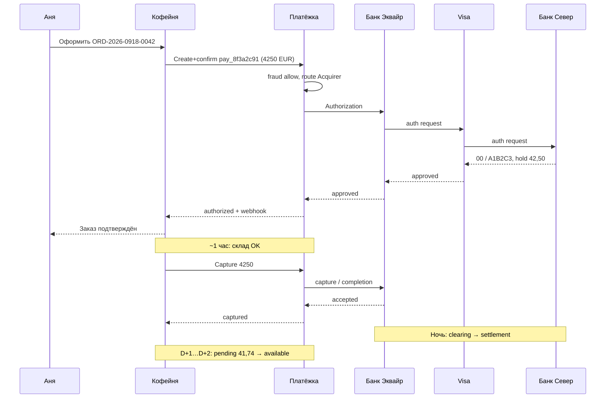

Словами: онлайн-часть занимает секунды и заканчивается `authorized` плюс hold у Ани. Capture через час включает операцию в финансовый конвейер. Клиринг и сеттлмент схемы — батч; на баланс «Кофейни» падает **net 41,74**, не 42,50 ([глава 12](12-flow-of-funds.md), [глава 15](15-fees-and-economics.md)).

| Время | Событие | Статус у PSP |
|---|---|---|
| 12:00:00 | Аня жмёт «Оплатить» | — |
| 12:00:01 | Создан `pay_8f3a2c91` | `created` → auth in flight |
| 12:00:03 | Approve `A1B2C3` | `authorized` |
| 13:05:00 | Capture | `captured` |
| Ночь D+0 | Clearing file | `captured` (ARN появляется) |
| D+1…D+2 | Merchant balance | pending → available 41,74 |

### Что видит каждый

| Участник | Что видит |
|---|---|
| **Аня** | «Заказ оплачен», в приложении банка — pending/hold 42,50, потом списание; statement descriptor вроде `COFFEE*ORDER …` |
| **«Кофейня»** | Заказ `ORD-2026-0918-0042` → `paid` после auth (их продуктовое правило); capture job; в кабинете PSP — net 41,74 pending |
| **«Платёжка»** | Объект `pay_8f3a2c91`, auth code, RRN, события `payment.authorized` / `payment.captured`, проводки capture+fee |
| **«Банк Эквайр»** | Auth request/response, затем capture/presentment в сторону схемы |
| **«Банк Север»** | Auth approve, hold; позже posting по клирингу |

### Состояния и данные

```json
{
  "id": "pay_8f3a2c91",
  "order_id": "ORD-2026-0918-0042",
  "amount": 4250,
  "currency": "EUR",
  "status": "captured",
  "amount_authorized": 4250,
  "amount_captured": 4250,
  "authorization_code": "A1B2C3",
  "rrn": "609182743015",
  "network": "visa",
  "fee": { "amount": 76, "currency": "EUR" },
  "net": { "amount": 4174, "currency": "EUR" }
}
```

В JSON `amount_authorized` — одобренная сумма, `amount_captured` — переданная на списание, `fee` — комиссия, `net` — зачисление продавцу после комиссии. Все денежные поля здесь в центах.

Проводки леджера «Платёжки» (как в [главе 13](13-ledger-and-reconciliation.md)): `acquirer_receivable` — требование к эквайеру, `mch_coffee.pending` — пока недоступное к выплате обязательство перед магазином, `revenue_fees` — выручка PSP от комиссии.

```text
Entry je_capture_8f3a
  Debit   1100 acquirer_receivable     42,50
  Credit  2100 mch_coffee.pending      41,74
  Credit  3000 revenue_fees             0,76
```

### Что делать инженеру

- Различать фазы: `authorized` ≠ деньги на р/с мерчанта; `captured` ≠ available; available ≠ payout на IBAN.
- Хранить цепочку id: `order_id` ↔ `payment_id` ↔ RRN/ARN ↔ balance transaction ↔ payout.
- Алерт «authorized слишком долго без capture».
- Не рисовать в UI мерчанта «+42,50» — рисовать gross/fee/net.

### Как не надо

Считать зелёную галочку Ани финалом денег. Отгружать физический товар по `authorized` без политики hold/expiry. Искать 42,50 отдельной строкой в bank statement «Кофейни» — там агрегированный payout.

### Врезка: три «успеха», которые не совпадают по часам

В 12:00:03 Аня уже считает покупку совершённой. В 13:05 «Платёжка» считает операцию финансовой (`captured`). В D+2 бухгалтер «Кофейни» наконец видит 41,74 в available. В D+3 на р/с магазина приходит payout, в котором эти 41,74 спрятаны среди десятков других строк. Если саппорт, склад и бухгалтерия говорят «успех» про разные часы — вы получите три разных тикета на один `pay_8f3a2c91`. Заведите в runbook таблицу «кто что имеет право называть оплаченным» и повесьте её рядом с дашбордом статусов.

---

## Сценарий: успешный платёж

Тема №305. Короткий «чистый» кейс: всё синхронно, без 3DS challenge, auto-capture, webhook дошёл с первой попытки. Нужен как **эталон**, с которым сравнивают поломки.

### Ситуация

Тот же заказ и сумма. «Кофейня» включила `capture_method: automatic`. Fraud score низкий. ACS — сервер аутентификации эмитента — не зовут (или 3DS проходит без дополнительного действия Ани, frictionless; [глава 08](08-3ds-and-sca.md)). HTTP-ответ «Платёжки» уже финальный.

### Таймлайн

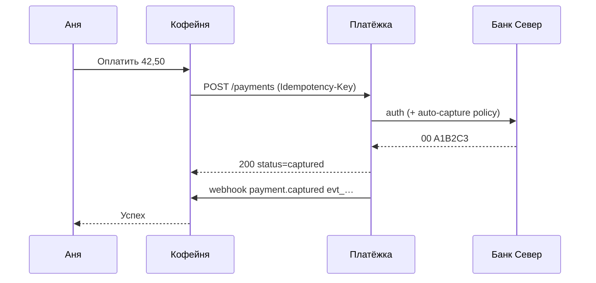

### Что видит каждый

| Участник | Что видит |
|---|---|
| **Аня** | Один спиннер, одна галочка, один hold/списание 42,50 |
| **«Кофейня»** | Sync `captured` + webhook; заказ `paid`; бонусы лояльности начислены один раз |
| **«Платёжка»** | Одна попытка `txn_…`, один event_id webhook |
| **Эквайер / эмитент** | Approve; дальше обычный clearing |

### Состояния и данные

```json
{
  "event_id": "evt_cap_8f3a2c91_01",
  "type": "payment.captured",
  "payment_id": "pay_8f3a2c91",
  "status": "captured",
  "amount": 4250,
  "currency": "EUR",
  "authorization_code": "A1B2C3"
}
```

Ответ мерчанту и webhook согласованы: один и тот же `payment_id`, один статус. Идемпотентность: повтор POST с тем же `Idempotency-Key` вернёт тот же объект, не вторую авторизацию ([глава 07](07-states-async-idempotency.md)).

### Что делать инженеру

- Happy path обязан быть покрыт e2e: create → confirm → webhook → order paid → ledger entry.
- Даже при sync-ответе обрабатывайте webhook идемпотентно: at-least-once никто не отменял.
- Return URL, если есть, только hint: источник истины — API/webhook.

### Как не надо

Писать `if (httpStatus === 200) order.paid = true` без чтения `status`. Игнорировать webhook «потому что sync уже есть» — сломается на 3DS и на любом async-методе.

### Для любопытных: зачем эталонный сценарий в CI

Команда «Платёжки» гоняет контрактный тест на каждый merge в payment-api: создать платёж 42,50 EUR с фиксированным idempotency key в песочнице эквайера, дождаться `captured`, принять webhook, проверить, что повтор webhook не создаёт вторую ledger entry. Когда кто-то «упростит» статусы или сломает подпись webhook, краснеет не прод в пятницу, а пайплайн. Мерчантский SDK «Кофейни» может гонять зеркальный сценарий против staging «Платёжки». Эталон №305 — не скучный happy path из онбординга, а сторож регрессий.

---

## Сценарий: отказ банка

Тема №306. Эмитент сказал «нет». Деньги не холдированы (в типичном decline). Это **доменный** отказ, не сетевой глюк.

### Ситуация

Аня снова покупает на 42,50 EUR, но на карте после вчерашнего ужина не хватает доступного остатка. «Банк Север» отвечает ISO `51` (insufficient funds) — иллюстративный soft decline ([глава 09](09-declines-and-response-codes.md)). Fraud «Платёжки» платёж пропустил: проблема не в риске, а в балансе.

Платёж этой попытки: `pay_51decl01` (каноничный `pay_8f3a2c91` оставляем для успехов). Заказ тот же или новый — у «Кофейни» политика «один активный платёж на заказ».

### Таймлайн

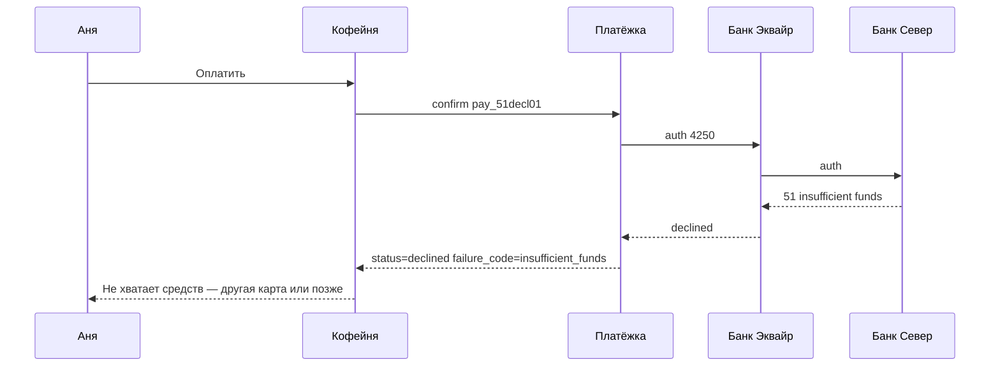

### Что видит каждый

| Участник | Что видит |
|---|---|
| **Аня** | Понятный отказ без «Error 51»; карта не списана |
| **«Кофейня»** | Заказ `awaiting_payment`; можно предложить другой метод |
| **«Платёжка»** | `declined`, raw `iso_response_code=51`, пустой auth code |
| **«Банк Эквайр»** | Отказ эмитента, транзакция не идёт в capture |
| **«Банк Север»** | Decline; hold нет (типично) |

### Состояния и данные

```json
{
  "id": "pay_51decl01",
  "order_id": "ORD-2026-0918-0042",
  "status": "declined",
  "failure_code": "insufficient_funds",
  "failure_class": "issuer_decline",
  "soft_hard": "soft",
  "authorization_code": null,
  "raw": {
    "iso_response_code": "51",
    "merchant_advice": "retry_later"
  }
}
```

В леджере merchant payable **нет**. Максимум — аудит/метрика попытки.

### Что делать инженеру

- Нормализовать код наружу (`insufficient_funds`), сырой ISO хранить в `raw`.
- Soft: предложить другую карту / повторить позже; **не** долбить авто-retry каждые 300 мс.
- Метрика `issuer_decline_rate` отдельно от `technical_failure_rate`.
- UX не светить мошеннику карту «отклонена как fraud», если это `51`.

### Как не надо

Каскадить на другой эквайер после явного issuer soft/hard без чтения Merchant Advice Code. Мапить все отказы в «что-то пошло не так». Ретраить hard decline (`stolen_card`, do-not-retry) тем же PAN.

---

## Сценарий: технический сбой

Тема №307. Таймаут на пути к эквайеру или от эквайера. Это **не** `declined`. Состояние может быть неизвестным: auth мог пройти, а ответ потеряться.

### Ситуация

12:00:02. «Платёжка» отправила auth по `pay_8f3a2c91` в «Банк Эквайр». На 15-й секунде коннектор не получил ответ — circuit/timeout. Мерчанту нельзя честно сказать «отклонено»: возможно, «Банк Север» уже поставил hold.

### Таймлайн

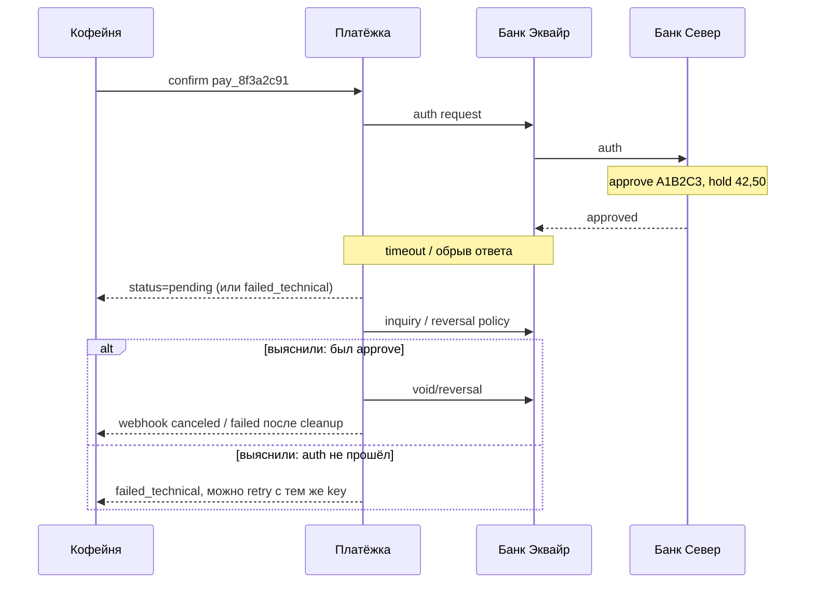

Ветки разбора — из [главы 06](06-payment-lifecycle.md) (timeout + reversal) и [главы 07](07-states-async-idempotency.md).

### Что видит каждый

| Участник | Что видит |
|---|---|
| **Аня** | Долгий спиннер / «обрабатываем»; иногда hold в банке при «ошибке» в магазине — паника в саппорт |
| **«Кофейня»** | Не `paid`; нельзя отгружать; нужен poll статуса |
| **«Платёжка»** | `pending`/`processing` + job reconcile; нельзя молча создать второй auth |
| **Эквайер** | Возможно, approve уже есть в журнале |
| **Эмитент** | Hold может висеть, пока не придёт void/reversal или expiry |

### Состояния и данные

```json
{
  "id": "pay_8f3a2c91",
  "status": "pending",
  "pending_reason": "acquirer_timeout",
  "failure_class": "technical",
  "last_acquirer_attempt_at": "2026-09-18T12:00:02Z",
  "reconciliation": {
    "state": "in_progress",
    "action": "inquiry_then_reverse_if_approved"
  }
}
```

После успешного reversal:

```json
{
  "id": "pay_8f3a2c91",
  "status": "canceled",
  "cancellation_reason": "technical_timeout_reversal",
  "authorization_code": "A1B2C3"
}
```

Да, auth code может быть известен *после* того, как мерчант уже видел «ошибку». Это нормально для technical path.

### Что делать инженеру

- Статус `technical` / `pending` ≠ `declined` в API и дашбордах.
- Повтор create/confirm — **только** с тем же idempotency key; иначе двойной hold.
- Inquiry — запрос эквайеру о результате операции; reversal — её отмена на сетевом уровне. Для этой связки обязателен runbook; алерт на рост timeout к «Банку Эквайр».
- Саппорт-скрипт: «проверьте приложение банка; если hold есть — мы снимаем; не жмите оплатить ещё раз».

### Как не надо

Отдать мерчанту `declined` «чтобы UI был простой». Автоматически открыть новую попытку без ключа. Игнорировать «осиротевшие» approve в отчёте эквайера до следующей сверки через три дня.

### Врезка: как это бывает в жизни

Пятница, 19:40. Алерт: рост p99 latency к «Банку Эквайр». Он-колл видит волну `pending` у топ-мерчантов. Часть Ань уже с hold в «Банке Север», часть — без. Если дежурный включит «ретрай всех pending новым payment_id», к субботе у вас двойные холды и очередь refund. Правильный ход: заморозить cascading на новые маршруты без inquiry, поднять runbook reconcile, писать мерчантам шаблон «не предлагайте оплатить снова, статус уточняем». Деньги здесь вторичны относительно **дисциплины неизвестности**.

---

## Сценарий: потерянный webhook

Тема №308. Деньги и статус у PSP уже финальные. У мерчанта — тишина, потому что endpoint ответил 5xx или лежал на деплое.

### Ситуация

Auto-capture прошёл: `pay_8f3a2c91` = `captured`. Webhook #1 на `https://coffee.example/webhooks/platjozka` → 502 (релиз «Кофейни»). Аня на return URL видит спиннер. Классика из вступления [главы 07](07-states-async-idempotency.md).

### Таймлайн

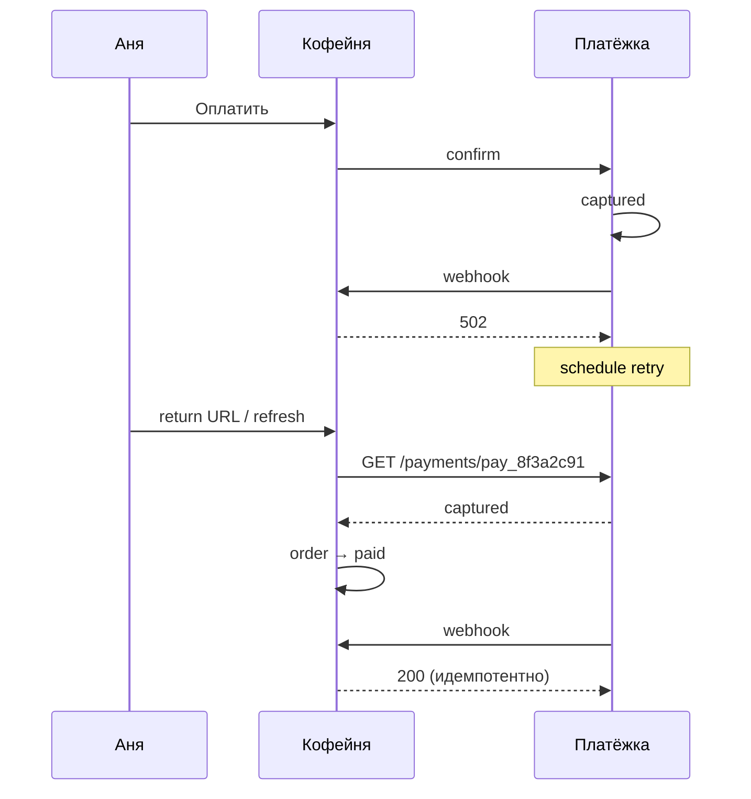

### Что видит каждый

| Участник | Что видит |
|---|---|
| **Аня** | Сначала неопределённость; после refresh — успех (если магазин умеет poll) |
| **«Кофейня»** | Разрыв: PSP `captured`, заказ ещё `awaiting_payment`, пока не сходит GET |
| **«Платёжка»** | Успешный платёж; webhook delivery `failed` → retries |
| **Банки** | Обычный успешный auth/capture; им всё равно до HTTP мерчанта |

### Состояния и данные

Таблица рассинхрона:

| Момент | PSP | Заказ «Кофейни» | Аня |
|---|---|---|---|
| T+0 capture | `captured` | `awaiting_payment` | спиннер |
| T+2s GET | `captured` | `paid` | успех |
| T+60s webhook retry | `captured` | `paid` (без повторного эффекта) | — |

```json
{
  "event_id": "evt_cap_8f3a2c91_01",
  "delivery_attempt": 3,
  "http_response": 200,
  "payment_id": "pay_8f3a2c91",
  "type": "payment.captured"
}
```

### Что делать инженеру

- Webhook = сигнал перечитать ресурс, не единственная истина.
- После return URL бэкенд мерчанта обязан сделать GET статуса.
- Мониторинг: `webhook_success_rate`, очередь ретраев, возраст undelivered.
- Дедуп по `event_id` (или эквиваленту).

### Как не надо

Полагаться только на webhook без poll/reconcile job. Считать «нет webhook = нет оплаты» и предлагать Ане платить снова. Отвечать 200 на webhook до успешной записи эффекта — и терять событие при падении сразу после 200 (лучше: сначала идемпотентно применить, потом 200; либо outbox — [глава 21](21-distributed-systems-and-money.md) в общей картине).

---

## Сценарий: дублированный webhook

Тема №309. At-least-once: одно и то же событие приходит дважды (retry после медленного 200, или PSP и мерчант одновременно «дожали»).

### Ситуация

`payment.captured` по `pay_8f3a2c91` уже обработан: заказ `paid`, лояльность +100 зёрен, складское резервирование создано. Через 45 секунд — тот же `event_id` ещё раз (или тот же `payment_id`+`type` без стабильного event_id — хуже, но бывает).

### Таймлайн

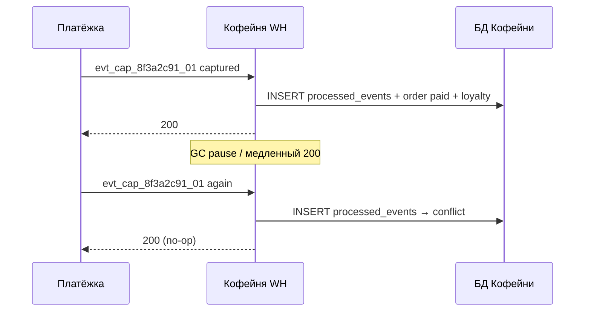

### Что видит каждый

| Участник | Что видит |
|---|---|
| **Аня** | Один заказ, одна галочка (если дедуп сработал) |
| **«Кофейня»** | При баге — двойные бонусы / двойная отгрузка |
| **«Платёжка»** | Две доставки одного события, платёж один |
| **Банки** | Одна финансовая операция |

### Состояния и данные

```sql
-- идея ограничения
CREATE UNIQUE INDEX uq_webhook_event ON processed_webhook_events(event_id);

-- эффект лояльности один раз на платёж
CREATE UNIQUE INDEX uq_loyalty_per_payment ON loyalty_grants(payment_id);
```

```json
{
  "event_id": "evt_cap_8f3a2c91_01",
  "payment_id": "pay_8f3a2c91",
  "type": "payment.captured",
  "processing": "duplicate_ignored"
}
```

Леджер PSP на повтор webhook capture тоже обязан быть идемпотентен: `idempotency_key = ledger:capture:pay_8f3a2c91` ([глава 13](13-ledger-and-reconciliation.md)).

### Что делать инженеру

- Дедуп на уровне события **и** на уровне бизнес-эффекта (`payment_id` + действие).
- Тест: «доставить webhook дважды подряд» — обязательный.
- Не строить уникальность только на `(order_id, event_type)` без event_id: два разных capture/refund сломают модель.

### Как не надо

`UPDATE orders SET bonus = bonus + 100` на каждый webhook. Отвечать 500 на дубликат «потому что уже paid» — PSP будет ретраить вечно.

---

## Сценарий: повторная оплата клиентом

Тема №310. Аня не злодейка и не тестировщик идемпотентности. Она человек: спиннер, страх, F5, вторая кнопка.

### Ситуация

Первая попытка ушла в `pay_8f3a2c91` и на самом деле `captured`, но UI показал ошибку (потерян ответ / потерян webhook). Аня жмёт «Оплатить» снова. Без защиты — второй платёж `pay_9aa1bb02`, второй hold, потом слёзы и два refund.

### Таймлайн

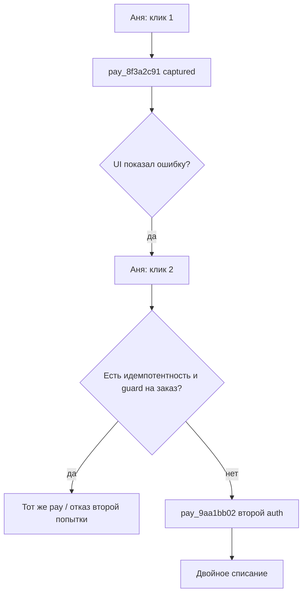

Правильный путь:

1. Клиент/бэкенд шлёт тот же `Idempotency-Key` (`ord_ORD-2026-0918-0042_attempt_1`) → PSP возвращает существующий `pay_8f3a2c91`.
2. Дополнительный guard: «у заказа уже есть `captured` payment» → не создавать новую попытку.
3. Если нужен именно **новый** attempt (другая карта после decline) — новый ключ `…_attempt_2`, явно.

### Что видит каждый

| Участник | При защите | Без защиты |
|---|---|---|
| **Аня** | Один заряд 42,50 | Два hold/списания |
| **«Кофейня»** | Один `paid` | Два платежа на один order |
| **«Платёжка»** | Один объект | Два объекта, два clearing |
| **Эмитент** | Один auth | Два auth |

### Состояния и данные

```json
{
  "idempotency_key": "ord_ORD-2026-0918-0042_attempt_1",
  "request_hash": "sha256:…",
  "response_payment_id": "pay_8f3a2c91",
  "status": "captured"
}
```

Частичный уникальный индекс у мерчанта (идея): один «живой» платёж на заказ, кроме `declined`/`canceled`/`failed`.

### Что делать инженеру

- Idempotency key на все write: create, capture, refund.
- UI: disable button, клиентский debounce — помогают, но **не заменяют** серверный ключ.
- Саппорт: искать платежи по `order_id`, не только по email Ани.
- После инцидента двойной оплаты — один заказ, один «главный» payment, второй — void/refund по runbook.

### Как не надо

Генерировать новый UUID ключа на каждый клик «на всякий случай». Прятать side effect в GET «синхронизируй и при необходимости создай платёж».

### Сквозной мини-разбор двойного клика

| Шаг | Без защиты | С защитой |
|---|---|---|
| Клик 1 | `pay_8f3a2c91` captured | то же |
| UI ошибка | Аня не видит успех | то же |
| Клик 2 | новый key → `pay_9aa1bb02` | тот же key → тот же `pay_8f3a2c91` |
| Эмитент | два hold по 42,50 | один hold |
| Саппорт через час | «верните второе списание» | тикета нет |
| Леджер | две capture-проводки + два fee | одна |

Цена бага — не «неудобный UX», а ручной refund, negative balance, если payout уже ушёл, и удар по trust Ани к «Кофейне» (хотя виноват интегратор).

---

## Промежуточный вывод: статусы, webhooks и повторы

К этому месту видно правило трёх правд:

1. **Правда сети/эмитента** — был ли approve и hold.
2. **Правда PSP** — статус `pay_…` и леджер.
3. **Правда мерчанта** — статус заказа и побочные эффекты.

Они разъезжаются на timeout, 502 и двойном клике. Сходятся через idempotency, GET после return URL, дедуп webhook и reconcile. Отказ эмитента — про карту; technical — про неизвестность. Смешать их в одном `failed` — способ чинить не то.

Второе правило: **сначала классифицируй, потом ретрай**. Issuer soft (`51`) → другая карта или позже. Issuer hard → стоп. Technical → inquiry/idempotent retry. Fraud block → не долбить той же сессией. Lost webhook → GET, не новый charge. Путаница классов превращает один инцидент Ани в три разных «лечения» одновременно.

---

## Сценарий: auth без capture

Тема №311. Авторизация прошла, capture не сделали (забыли, склад отказал, hold протух). Для Ани «как будто купила»; для «Кофейни» — дыра.

### Ситуация

12:00 — `pay_8f3a2c91` → `authorized`, `A1B2C3`, hold 42,50. «Кофейня» ставит заказ `paid` и… ждёт ручной capture от склада. Склад находит, что сорта нет. Менеджер отменяет заказ в ERP, но **не** шлёт void в «Платёжку». Через несколько дней hold у Ани спадает сам; в админке висит `authorized` вечность; денег нет; отзыв — одна звезда.

`expires_at` — срок авторизации в модели PSP; `capture_deadline_internal` ниже — более ранний внутренний дедлайн магазина. Это разные даты: внутренний запас нужен, чтобы успеть обработать сбой capture.

Альтернатива: склад подтвердил, но capture-job упал и никто не смотрит алерт «authorized > 24h».

### Таймлайн

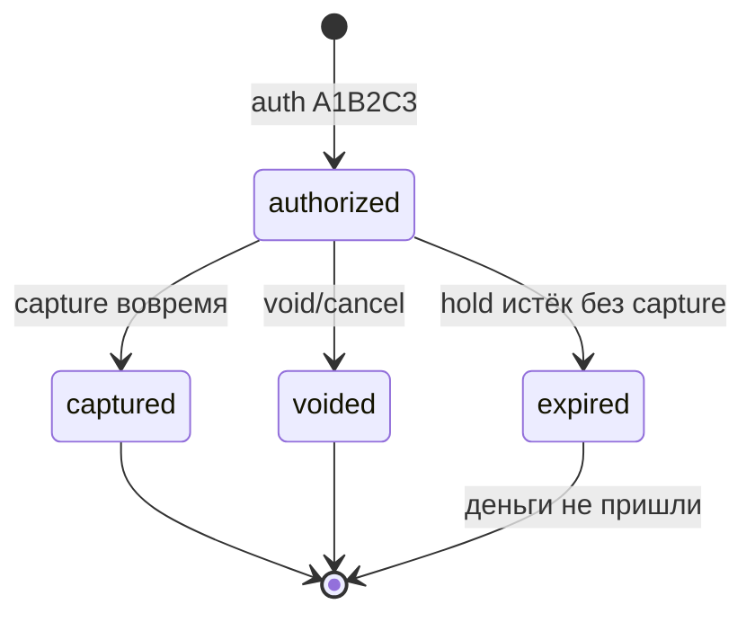

### Что видит каждый

| Участник | Что видит |
|---|---|
| **Аня** | Сначала hold; потом hold исчез; товара нет или «оплачено» враньё |
| **«Кофейня»** | Заказ «оплачен» в своей БД при `authorized` у PSP — ловушка |
| **«Платёжка»** | `authorized`, expires_at приближается; net на балансе ещё нет |
| **Эквайер** | Auth без presentment / с late capture risk |
| **Эмитент** | Hold, затем auto-release |

### Состояния и данные

```json
{
  "id": "pay_8f3a2c91",
  "status": "authorized",
  "amount_authorized": 4250,
  "amount_captured": 0,
  "authorization_code": "A1B2C3",
  "expires_at": "2026-09-25T12:00:03Z",
  "capture_deadline_internal": "2026-09-20T12:00:03Z"
}
```

Правильная отмена:

```json
{
  "id": "pay_8f3a2c91",
  "status": "voided",
  "amount_authorized": 4250,
  "amount_captured": 0
}
```

В леджере при зрелой политике на auth merchant payable нет — void почти ничего не сторнирует в деньгах к выплате. Если продукт ошибочно начислил pending на auth — void обязан сторно сделать.

### Что делать инженеру

- Не отгружать необратимый товар только по `authorized`, если политика бизнеса не явная.
- Метрика и алерт: `authorized_without_capture_age`.
- Отмена заказа → автоматический void API.
- Внутренний capture deadline короче худшего эмитентского hold.

### Как не надо

Смешивать SMS и DMS в голове: ждать `succeeded`, когда провайдер отдаёт `authorized` и ждёт ваш capture — или наоборот слать capture в SMS, где уже всё списано. Делать capture «когда-нибудь потом» без мониторинга.

---

## Сценарий: refund

Тема №312. Capture уже был. Аня получила кофе, но один сорт не тот — «Кофейня» возвращает 10,00 EUR (partial) или всю сумму 42,50 (full). Это не void и не chargeback ([глава 06](06-payment-lifecycle.md), [глава 17](17-chargebacks-and-disputes.md)).

### Ситуация

D+5. `pay_8f3a2c91` давно `captured`, net 41,74 уже в available (или даже в payout). Менеджер жмёт «Вернуть 10,00». PSP создаёт `ref_8f3a_01`.

### Таймлайн

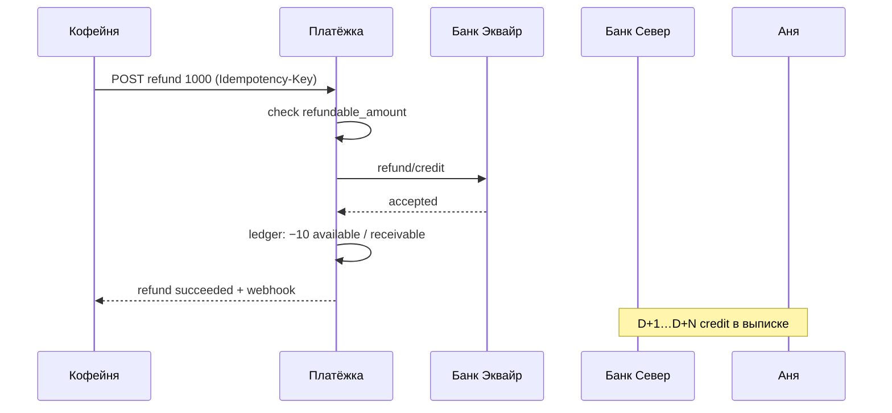

### Что видит каждый

| Участник | Что видит |
|---|---|
| **Аня** | Не мгновенно: credit на карту с лагом эмитента; сумма 10,00 (full — 42,50) |
| **«Кофейня»** | Баланс −10,00 (и возможно fee-политика); заказ `partially_refunded` |
| **«Платёжка»** | Отдельный объект refund; `refundable_amount` уменьшен |
| **Эквайер / эмитент** | Credit presentment; не «правка» старой auth |

### Состояния и данные

```json
{
  "payment_id": "pay_8f3a2c91",
  "status": "captured",
  "amount_captured": 4250,
  "amount_refunded": 1000,
  "refundable_amount": 3250,
  "refunds": [
    {
      "id": "ref_8f3a_01",
      "amount": 1000,
      "currency": "EUR",
      "status": "succeeded",
      "reason": "wrong_sku"
    }
  ]
}
```

Проводка (упрощённо, available уже есть):

```text
Entry je_refund_8f3a_p1
  Debit   2000 mch_coffee.available    10,00
  Credit  1100 acquirer_receivable     10,00
```

Если available уже ушёл в payout — баланс может уйти в минус ([глава 12](12-flow-of-funds.md)).

Full refund 42,50:

```json
{
  "amount_refunded": 4250,
  "refundable_amount": 0,
  "payment_status_view": "refunded"
}
```

Политика комиссии: часто MDR не возвращают полностью — в отчёте это видно отдельно.

### Что делать инженеру

- `refundable_amount` считать транзакционно; идемпотентность на refund.
- Не путать void (до capture) и refund (после).
- UX Ане: «вернуть на карту за N дней», не «мгновенно».
- Тесты: partial, full, double refund race, refund > captured.

### Как не надо

Два оператора жмут refund без ключа — уход в отрицательный баланс и ручной ад. Делать «refund» через новый auth на отрицательную сумму в самодельном коннекторе. Обещать chargeback-защиту вместо нормального refund window.

Полный refund после того, как Аня уже открыла диспут, — отдельная политика: иногда лучше закрыть через refund и снизить риск chargeback fee, иногда уже поздно и идёт evidence ([глава 17](17-chargebacks-and-disputes.md)). В этой главе важно не смешать кнопки в админке: void / refund / accept dispute — три разных пути денег.

---

## Сценарий: платёж в другой валюте

Тема №316. Presentment ≠ settlement. Кузен Ани из США платит **46,00 USD** за тот же набор; «Кофейня» живёт в EUR ([глава 14](14-currencies-and-fx.md)).

### Ситуация

Витрина `.com` показывает 46,00 USD. Settlement «Кофейне» — EUR. «Платёжка» конвертирует с markup (иллюстративно 1,5%). На баланс падает порядка **41,80 EUR** после FX и MDR — цифры учебные, не тариф реального контракта.

Платёж: `pay_9c2d11ab`, заказ `ORD-2026-1002-0188`.

### Таймлайн

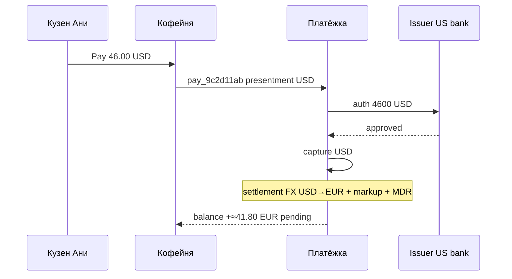

### Что видит каждый

| Участник | Что видит |
|---|---|
| **Покупатель** | 46,00 USD на чеке магазина; в выписке банка — USD или billing currency банка |
| **«Кофейня»** | В UI честнее «≈ EUR, курс при settlement»; в итоге ~41,80 EUR net |
| **«Платёжка»** | Две суммы: presentment USD, settlement EUR; fx_rate, markup_bps |
| **Эквайер** | Операция в USD presentment; settlement позиция по правилам договора |
| **Эмитент** | Auth в USD (или конвертация в валюту счёта держателя — уже его курс) |

### Состояния и данные

```json
{
  "payment_id": "pay_9c2d11ab",
  "order_id": "ORD-2026-1002-0188",
  "status": "captured",
  "presentment": { "amount": 4600, "currency": "USD", "exponent": 2 },
  "settlement": { "amount": 4180, "currency": "EUR", "exponent": 2 },
  "fx": {
    "pair": "USD/EUR",
    "rate": "0.9090",
    "mid_market_rate": "0.9227",
    "markup_bps": 150,
    "rate_timestamp": "2026-10-02T14:03:11Z"
  }
}
```

Суммы — целые минорные единицы; курс — decimal/string, не float. `rate` — применённый курс USD→EUR, `mid_market_rate` — рыночный ориентир, `markup_bps` — надбавка в базисных пунктах (150 bps = 1,5%), `rate_timestamp` — время фиксации курса.

Refund через неделю: курс мог уехать. Политика продукта: refund в presentment currency исходного платежа (типично) vs фиксированный EUR — это продуктовое решение, его надо задокументировать до первого злого тикета.

### Что делать инженеру

- Поля presentment/settlement/fx раздельно даже когда currency совпадает.
- Не складывать USD и EUR в одном `SUM(amount)`.
- Отчёт мерчанту: gross presentment, FX, fee, net settlement.
- Тесты округления half-even/банкёрское — как договорились с эквайером.

### Как не надо

Хранить деньги в `float`. Показывать «+46 USD на баланс» при EUR-settlement. Делать DCC «втихую» без явного согласия держателя — и репутационные, и scheme-риски.

---

## Сценарий: 3DS

Тема №317. Аутентификация до (или вокруг) авторизации. Аня проходит challenge; без серверного результата легко «потерять» успех ([глава 08](08-3ds-and-sca.md)).

### Ситуация

Европейская экономическая зона (EEA), платёж по инициативе покупателя (CIT), сумма 42,50 EUR. Исключение из требования усиленной аутентификации (exemption) не прошло / исключение на основе анализа риска операции (TRA) не заявлено ([глава 08](08-3ds-and-sca.md)). ACS «Банка Север» требует challenge. Платёж: снова `pay_8f3a2c91`, статус сначала `requires_action`. На диаграмме AReq/ARes — запрос и ответ аутентификации, CReq — запрос интерактивной проверки, RReq — серверное сообщение с итогом. DS — Directory Server, сервер карточной сети, который направляет 3DS-запрос к ACS ([глава 08](08-3ds-and-sca.md)).

### Таймлайн

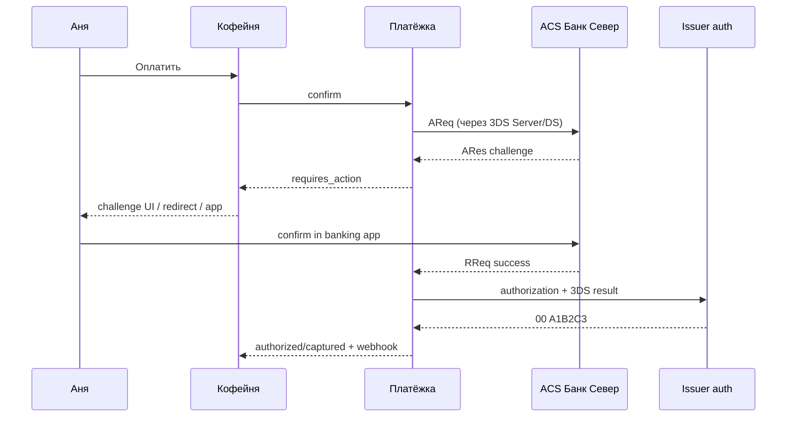

Frictionless-вариант: ARes сразу success, Аня challenge не видит — но 3DS *был*, для аналитики это отдельный bucket.

### Что видит каждый

| Участник | Challenge | Frictionless |
|---|---|---|
| **Аня** | Push/OTP банка | Почти обычный спиннер |
| **«Кофейня»** | `requires_action`, потом финал | Сразу финал или короткий pending |
| **«Платёжка»** | Оркестрация 3DS + auth | То же без CReq |
| **ACS эмитента** | Решение challenge | Risk allow |
| **Эмитент auth** | Auth после authn | Auth после authn |

Liability shift при успешном 3DS (в рамках правил схемы) — про fraud-chargeback позже, не про «деньги уже у мерчанта».

### Состояния и данные

```json
{
  "id": "pay_8f3a2c91",
  "status": "requires_action",
  "next_action": {
    "type": "redirect_to_acs",
    "redirect_url": "https://acs.bank-sever.example/challenge/…"
  },
  "authentication": {
    "protocol": "EMV_3DS_2",
    "flow": "challenge",
    "trans_status": "C"
  }
}
```

После успеха:

```json
{
  "id": "pay_8f3a2c91",
  "status": "captured",
  "authorization_code": "A1B2C3",
  "authentication": {
    "flow": "challenge",
    "trans_status": "Y",
    "eci": "05",
    "liability_shift": true
  }
}
```

`trans_status` — результат 3DS: `C` здесь означает требование challenge, `Y` — успешную аутентификацию. ECI — передаваемый в авторизацию индикатор контекста электронной покупки и результата аутентификации; `liability_shift` отражает применимость переноса ответственности по правилам схемы. Значения ECI/trans_status — иллюстративные по смыслу; в проде сверяйте с документацией схемы/PSP.

### Что делать инженеру

- Return URL ≠ истина: ждать серверный результат / статус PSP (RReq path).
- Метрики: challenge rate, challenge success, frictionless rate, abandonment.
- Browser data в 3DS2 собирать аккуратно — иначе ACS шлёт всех в challenge.
- После challenge не открывать второй payment «на всякий случай» без guard.

### Как не надо

Считать frictionless «3DS выключен» в аналитике. Игнорировать таймаут challenge и оставлять платёж вечно в `requires_action` без cancel. Показывать Ане банковский жаргон ACS.

Связка с другими сценариями этой главы: во время challenge легко поймать №308 (webhook/result потерян) и №310 (Аня жмёт «назад» и оплачивает снова). Guard «один активный payment на заказ» плюс poll статуса после return URL здесь критичны сильнее, чем в frictionless SMS-потоке.

---

## Сценарий: fraud-блокировка

Тема №318. Риск-движок «Платёжки» режет **до** сети. Эмитент даже не узнаёт. Для Ани (или для злоумышленника с её утёкшим PAN) — отказ; природа — `fraud_rejected` ([глава 16](16-fraud.md), [глава 09](09-declines-and-response-codes.md)).

### Ситуация

Ночь. С одного device fingerprint — 12 попыток разных PAN за 8 минут на чеках ~40 EUR (card testing). Очередная попытка на 42,50 EUR с новым PAN. Hard rule velocity срабатывает до эквайера.

Платёж: `pay_fr9block`, заказ `ORD-2026-0918-0099`.

### Таймлайн

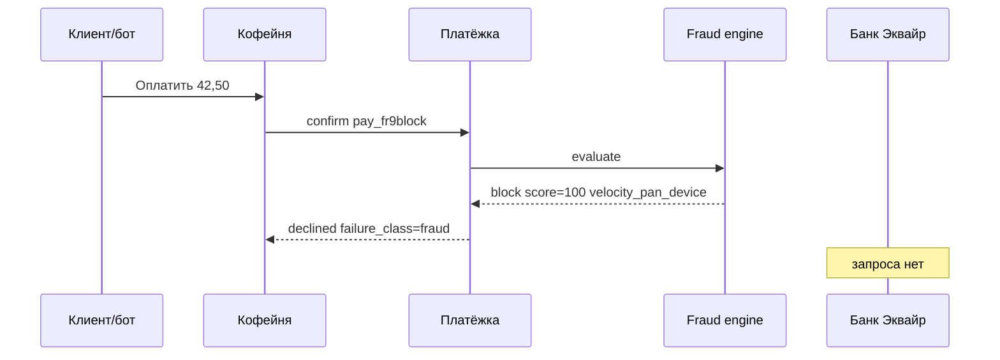

### Что видит каждый

| Участник | Что видит |
|---|---|
| **Покупатель** | Отказ; хороший UX — нейтральный, без подсказки «как обойти» |
| **«Кофейня»** | `declined` / `fraud_rejected`; заказ не paid |
| **«Платёжка»** | Decision log: rules, score, features snapshot |
| **Эквайер / эмитент** | Тишина — auth не было |

### Состояния и данные

```json
{
  "id": "pay_fr9block",
  "status": "declined",
  "failure_code": "fraud_rejected",
  "failure_class": "fraud",
  "fraud": {
    "score": 100,
    "decision": "block",
    "reasons_internal": ["velocity_pan_device_1h"],
    "policy_version": "2026-09-12.3",
    "features_snapshot_id": "fs_88aa21"
  },
  "raw_network": null
}
```

Наружу мерчанту/Ане — без детального reason, который учит атакующего. Внутрь — полный audit.

### Что делать инженеру

- Класс `fraud` отдельно в метриках и retry-политике (обычно **не** ретраить тем же device/PAN автоматически).
- Сохранять snapshot признаков для dispute/audit через недели.
- Step-up 3DS как альтернатива hard-block на mid score — продуктовый рычаг.
- Алерты на всплеск block rate по мерчанту/BIN.

### Как не надо

Мапить fraud в `insufficient_funds` «чтобы звучало мягче» — убивает аналитику и саппорт. Блокировать без логирования version правил. После block всё равно слать auth «из любопытства».

---

## Сценарий: ложная блокировка

Тема №319. False positive: честная Аня, плохие признаки. Конверсия и бренд страдают сильнее, чем «сэкономленный» chargeback на 42,50 ([глава 16](16-fraud.md)).

### Ситуация

Аня в роуминге. IP — другая страна. Device новый (сбросила телефон). BIN карты — домашний. Правило `geo_mismatch + new_device → block` без учёта returning customer и низкой суммы. Score 82, threshold 80 → block. Кофе она купит у конкурента.

Платёж: `pay_fp_anya01`, заказ `ORD-2026-0918-0042`.

### Таймлайн

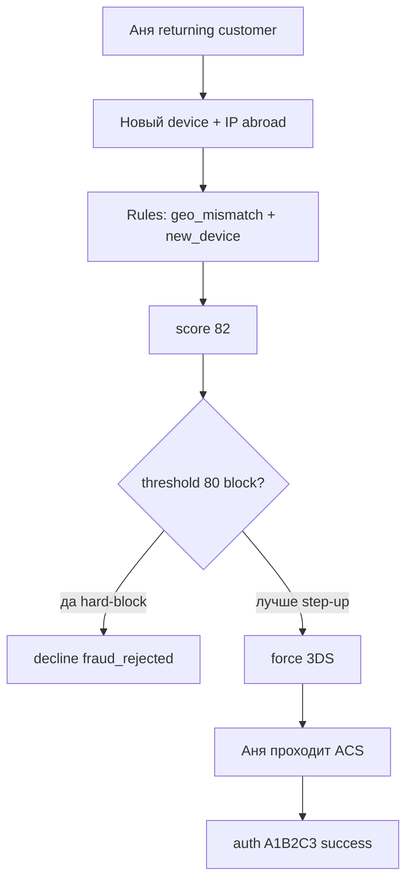

### Что видит каждый

| Участник | При false positive block | При step-up вместо block |
|---|---|---|
| **Аня** | «Карта не работает», уходит | Challenge — раздражение, но покупка |
| **«Кофейня»** | Потерянный заказ, тикет | Успех с 3DS |
| **«Платёжка»** | FP в отчёте risk | Challenge + allow |
| **Эмитент** | Не участвовал | Auth после 3DS |

### Состояния и данные

```json
{
  "id": "pay_fp_anya01",
  "status": "declined",
  "failure_code": "fraud_rejected",
  "fraud": {
    "score": 82,
    "decision": "block",
    "reasons_internal": ["geo_mismatch", "new_device"],
    "customer_segment": "returning_low_ticket",
    "false_positive_likely": true
  }
}
```

Постфактум разбор (через неделю, Аня написала в поддержку и подтвердила личность):

```json
{
  "review": {
    "label": "false_positive",
    "action": "whitelist_device_pending",
    "rule_change": "returning_low_ticket → step_up_not_block"
  }
}
```

### Что делать инженеру

- Метрика **false positive rate** рядом с fraud rate; сегменты по сумме и типу клиента.
- Shadow mode / canary для новых жёстких правил.
- White signals: история без CB, известный customer id, низкий ticket → понижать score или step-up.
- Саппорт: путь «это точно я» → ручной review / one-time allow с audit (осторожно, с лимитами).

### Как не надо

Оптимизировать только fraud loss → 0. Включать `BIN_country != IP_country → block` перед маркетинговой кампанией в новой стране без shadow period. Спорить с маркетингом без цифр стоимости FP (ложной блокировки) vs FN (пропущенного мошенничества).

### Врезка: экономика одного false positive

Грубо и иллюстративно: набор зерна даёт «Кофейне» порядка нескольких евро маржи после себестоимости и MDR. Один пропущенный fraud на 42,50 плюс chargeback fee может стоить десятки евро. Но если правило режет 2% честных returning customers в пиковой кампании на тысячах заказов, сумма потерянной маржи и LTV легко обгоняет «сэкономленные» chargeback. Поэтому сценарии №318 и №319 нельзя разводить только моралью «мошенников надо резать». Нужны сегменты, пороги и те же цифры, о которых говорит [глава 16](16-fraud.md): ожидаемый убыток, не только fraud rate.

---

## Сводная таблица сценариев

| № | Сценарий | Ключевой статус / исход | Главный риск | Первое действие инженера |
|---|---|---|---|---|
| 304 | Полный путь | `authorized` → `captured` → net 41,74 | Путаница фаз денег | Карта id и таймингов |
| 305 | Успех | `captured` + webhook | Ложная простота sync | E2E + идемпотентный WH |
| 306 | Отказ банка | `declined` issuer `51` | Вредный retry/cascade | Soft/hard + MAC |
| 307 | Техсбой | `pending` technical | Двойной auth / осиротевший hold | Inquiry + reversal |
| 308 | Потерянный WH | PSP `captured`, заказ нет | Повторная оплата | GET после return URL |
| 309 | Дубль WH | тот же `event_id` | Двойные эффекты | Дедуп события и эффекта |
| 310 | Повтор клика | тот же key / guard | Двойное списание | Idempotency + order guard |
| 311 | Auth без capture | `authorized` → expiry | Товар/деньги разъехались | Алерт + void при отмене |
| 312 | Refund | `refunded` / partial | Negative balance, гонки | `refundable_amount` + key |
| 316 | Другая валюта | presentment ≠ settlement | Округление, UX баланса | Раздельные суммы + FX |
| 317 | 3DS | `requires_action` → auth | Потеря результата challenge | Серверный статус, не только redirect |
| 318 | Fraud-блок | `fraud_rejected` до сети | Обход / шум | Audit snapshot, класс fraud |
| 319 | Ложный блок | FP на честной Ане | Потеря конверсии | Step-up, сегменты, FP-метрика |

---

## Что это значит для инженера

Сквозной сценарий — это ваш контрактный тест платформы. Имеет смысл держать **suite**:

1. Happy path 42,50 EUR → `pay_8f3a2c91` → ledger 41,74.
2. Issuer decline `51` без проводок payable.
3. Timeout → pending → reconcile.
4. Webhook 502 → retry → GET sync.
5. Webhook ×2 → один эффект.
6. Double click → один payment.
7. Authorized без capture → алерт.
8. Partial refund 10,00.
9. USD presentment / EUR settlement.
10. 3DS challenge + RReq.
11. Fraud velocity block.
12. Returning customer FP → ожидание step-up (политика).

В мониторинге режьте серии: `issuer_decline`, `technical_failure`, `fraud_block`, `webhook_delivery_fail`, `authorized_aging`, `fx_conversion_errors`. Одна «decline rate» — тупой нож.

В саппорте заведите карточки: «Аня видит hold, магазин — ошибку» (technical/lost WH); «отклонено, hold нет» (issuer/fraud); «два списания» (idempotency).

Доменная модель из [главы 20](20-platform-architecture.md) помогает: Intent/Payment, Attempt/Transaction, отдельный Refund. Сценарии выше ломаются именно на границах этих сущностей.

---

## Типичные ошибки и грабли

**Один статус на все беды.** `failed` и для `51`, и для timeout, и для fraud — потом невозможно ни ретраить, ни алертить.

**Отгрузка по webhook без проверки подписи и статуса API.** Подделанный «успех» или устаревший payload.

**Леджер только от sync-ответа, статусы — от webhook** (или наоборот) без идемпотентного схождения — внутренний break уровня 1 сверки.

**Канонический платёж в тестах с float `42.50`.** Начните с minor units `4250` — как в проде.

**Сценарии только на стейдже без ACS/эквайер-песочницы.** 3DS и timeout всплывут в проде первым же релизным вечером.

**Считать главу 29 чеклистом «мы всё покрыли».** Chargeback, negative balance, down acquirer, timeout-после-списания, рассинхрон ledger/settlement — это [глава 30](30-scenarios-part-2.md).

---

## Итоги главы

1. Полный путь платежа Ани — это секунды онлайна и дни денег: `authorized` → `captured` → clearing → net **41,74** на балансе, не 42,50 на р/с отдельной строкой.
2. Успешный sync-платёж не отменяет webhook и идемпотентность — at-least-once никуда не делся.
3. Отказ банка (`51` и компания) — про карту и soft/hard retry; технический сбой — про неизвестность и reversal.
4. Потерянный webhook лечится GET/reconcile; дублированный — дедупом события и эффекта.
5. Повторная оплата клиентом — главный бытовой генератор двойных списаний; ключ и guard на заказ обязательны.
6. Auth без capture — тихий убийца фулфилмента; void и алерты старения — не опция.
7. Refund — новая кредитовая операция с `refundable_amount`, а не «минус к auth».
8. Другая валюта = несколько сумм в одном платеже; float и один `amount` без контекста — путь к сверке в Excel.
9. 3DS добавляет фазу `requires_action`; истина — серверный результат, не только браузерный return.
10. Fraud-блок до сети спасает от card testing; ложная блокировка честной Ани стоит конверсии — измеряйте FP и предпочитайте step-up там, где hard-block избыточен.

Дальше — [глава 30](30-scenarios-part-2.md): chargeback, нехватка денег у продавца, payout, недоступность эквайера/провайдера, timeout при уже совершённом списании, множественный приём, восстановление после падения и расхождение леджера с settlement. Там деньги спорят громче, а ночные дежурства длиннее.

---

## Связанные главы

- [Глава 06. Жизненный цикл карточного платежа](06-payment-lifecycle.md) — auth, capture, void, refund, тайминги
- [Глава 07. Состояния, webhooks, idempotency](07-states-async-idempotency.md) — state machine, дубли, ретраи
- [Глава 08. 3-D Secure и SCA](08-3ds-and-sca.md) — challenge, frictionless, liability shift
- [Глава 09. Отказы и коды ответов](09-declines-and-response-codes.md) — issuer vs technical, soft/hard
- [Глава 12. Что происходит с деньгами](12-flow-of-funds.md) — pending/available, net 41,74
- [Глава 13. Ledger и reconciliation](13-ledger-and-reconciliation.md) — проводки capture/fee/refund
- [Глава 14. Валюты и FX](14-currencies-and-fx.md) — presentment vs settlement
- [Глава 16. Payment fraud](16-fraud.md) — score, block, false positives
- [Глава 17. Chargebacks и disputes](17-chargebacks-and-disputes.md) — когда refund уже не спасает
- [Глава 20. Архитектура платёжной платформы](20-platform-architecture.md) — Intent, Transaction, идентификаторы
- [Глава 30. Сквозные сценарии II](30-scenarios-part-2.md) — диспуты, деньги, аварии
