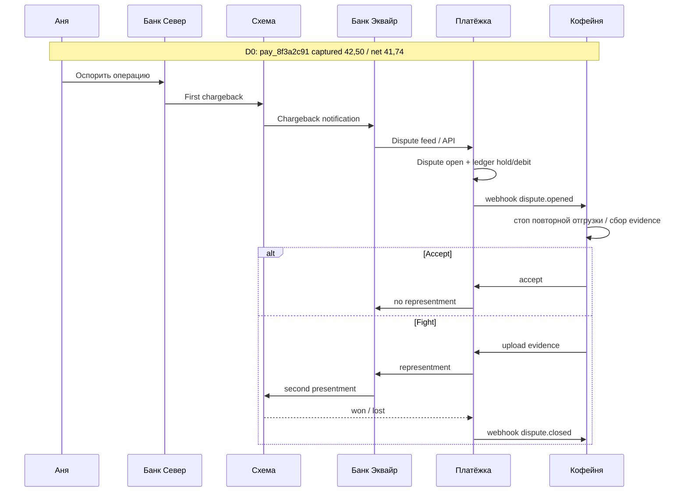
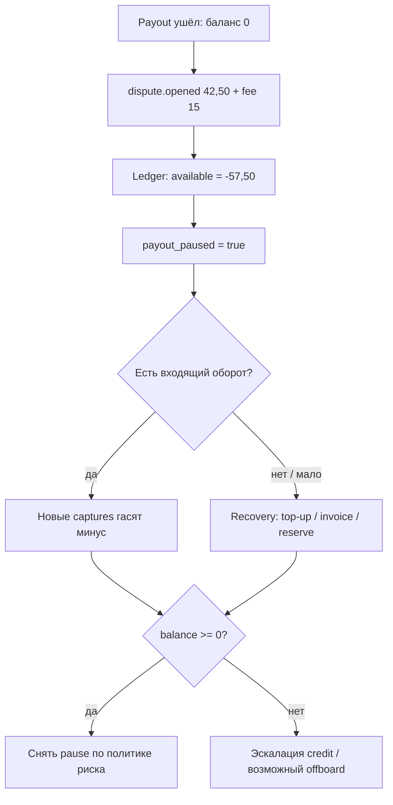
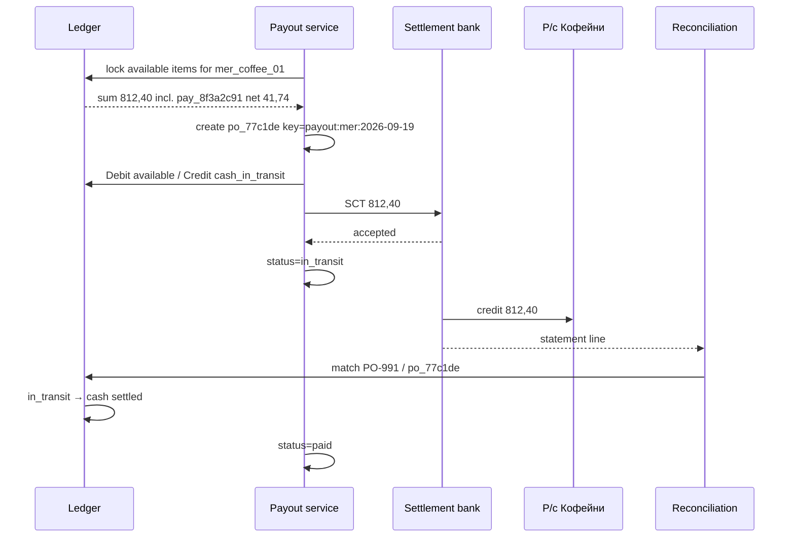
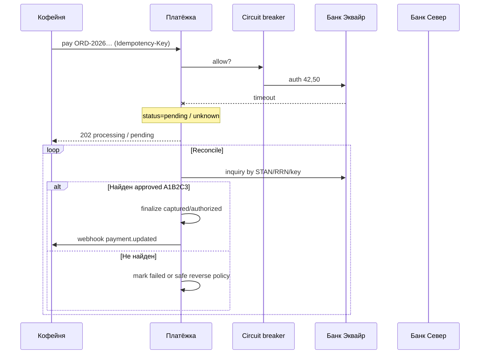
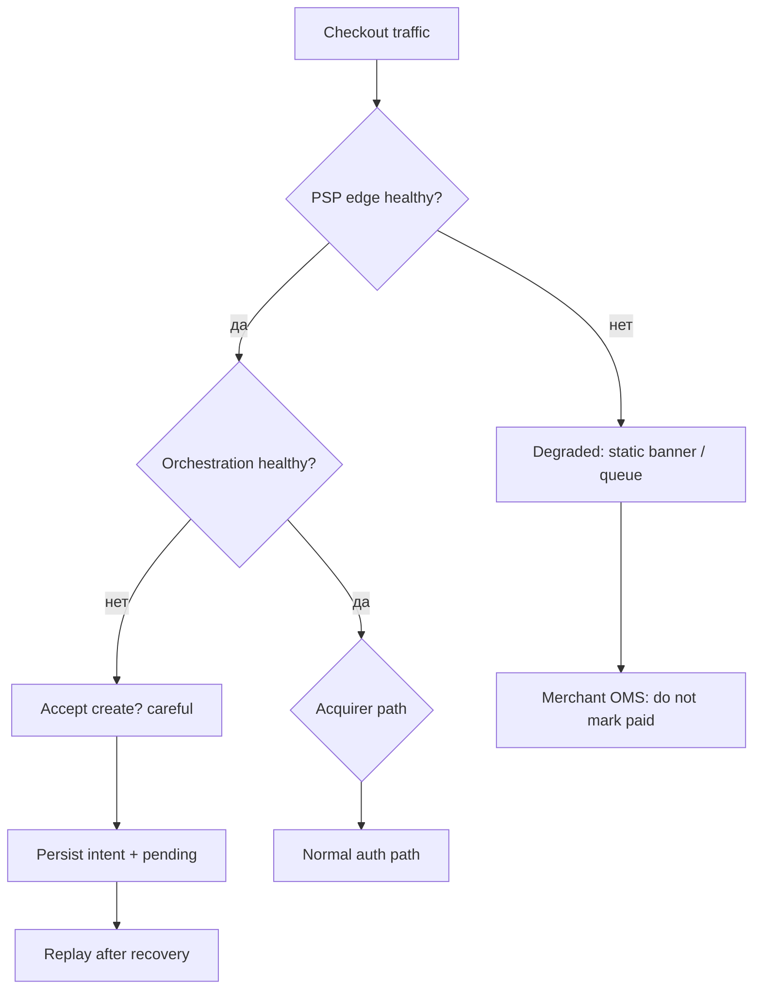
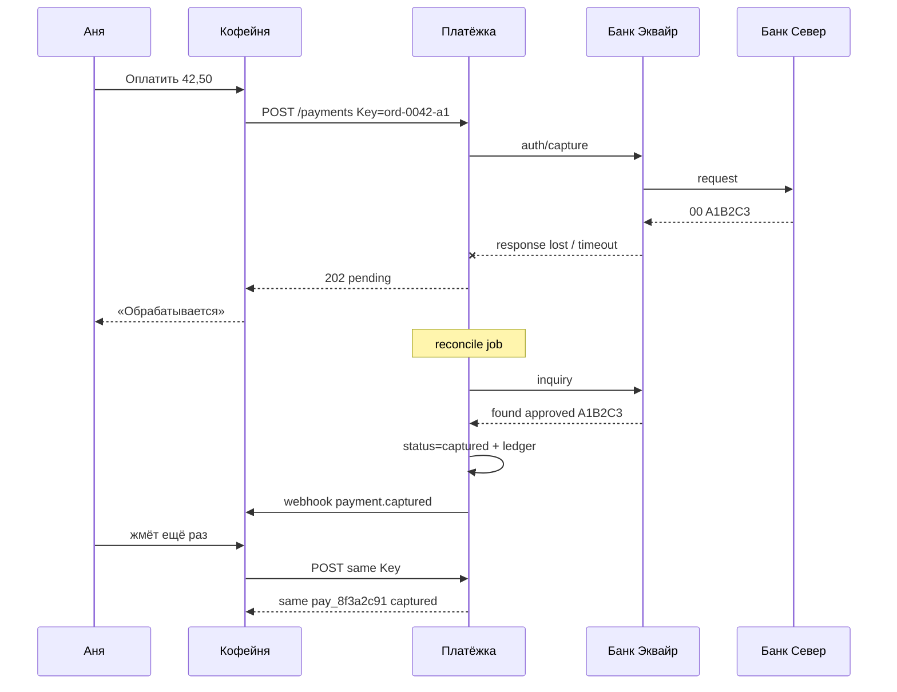
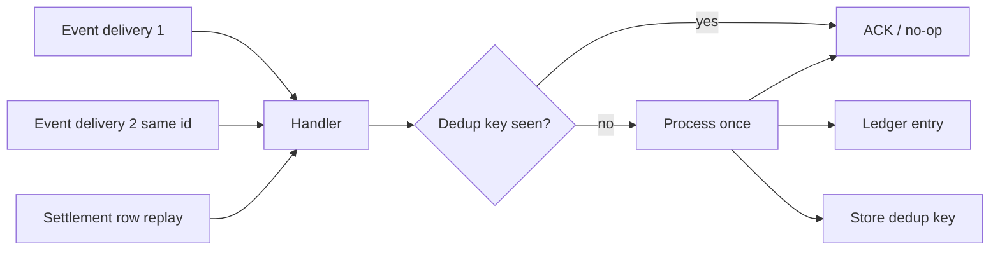
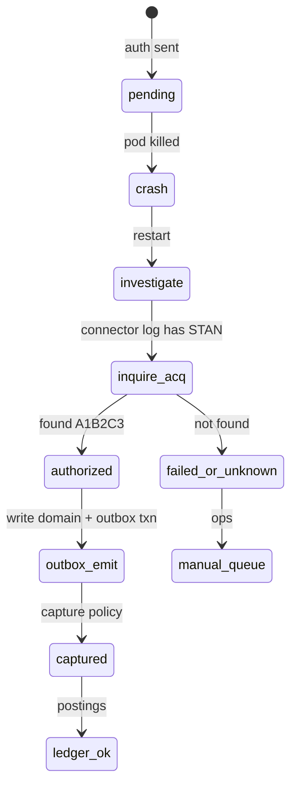
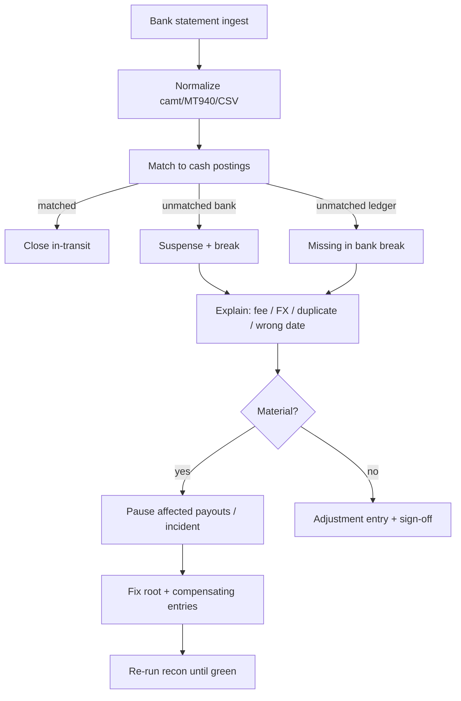

# Глава 30. Сквозные сценарии II: деньги, диспуты и аварии

В [главе 29](29-scenarios-part-1.md) мы гоняли платёж Ани по «нормальным» веткам: успех, отказ, потерянный webhook, 3DS, fraud-блок. Там ломались **данные о факте оплаты**. Здесь ломаются **деньги и доступность**: chargeback забирает уже выплаченную выручку, эквайер молчит в пик распродажи, таймаут врёт, что списания не было, леджер и банковская выписка расходятся на сумму, от которой болит голова у CFO.

Это финальная глава книги. Не потому что после неё «больше нечему учиться», а потому что всё предыдущее — карта, lifecycle, леджер, риск, архитектура — существует ради одной вещи: **когда в проде одновременно горят деньги, статусы и люди, вы понимаете, куда смотреть**. Сценарии ниже — не экзамен на зубрёжку терминов. Это ночные истории, в которые вы рано или поздно попадёте. Лучше попасть с runbook'ом в голове, чем с `UPDATE balances SET amount = …` в руках.

Сквозной якорь тот же: Аня, заказ `ORD-2026-0918-0042`, платёж `pay_8f3a2c91`, 42,50 EUR, auth code `A1B2C3`, комиссия порядка 0,76 EUR, net к «Кофейне» 41,74 EUR. PSP — «Платёжка», эквайер — «Банк Эквайр», эмитент — «Банк Север». Теория chargeback — в [главе 17](17-chargebacks-and-disputes.md), поток денег — в [главе 12](12-flow-of-funds.md), леджер и сверка — в [главе 13](13-ledger-and-reconciliation.md). Здесь — как это выглядит, когда всё происходит сразу.

## В этой главе

- Сводная карта сценариев №313–315 и №320–325
- Chargeback на уже «успешном» платеже Ани
- Нехватка денег у продавца, чтобы покрыть chargeback
- Вывод денег продавцом (payout) как отдельный денежный конвейер
- Недоступность эквайера и недоступность платёжного провайдера
- Network timeout при уже совершённом списании
- Одна и та же транзакция, пришедшая несколько раз
- Восстановление состояния платежа после падения сервиса
- Расхождение внутреннего ledger и settlement банка
- Картина целиком: как вся книга сходится в одну систему

---

## Сводная карта сценариев

| № | Сценарий | Главный удар | Где «правда» | Первая реакция |
|---|---|---|---|---|
| 313 | Chargeback | баланс мерчанта, ratio, дедлайн evidence | схема / dispute object | открыть кейс, стоп двойного refund |
| 314 | Нехватка денег под CB | negative balance, кредитный риск | леджер + risk hold | pause payout, recovery |
| 315 | Вывод денег (payout) | р/с мерчанта vs available | payout + bank rail | идемпотентный батч, сверка |
| 320 | Acquirer недоступен | конверсия, очередь indeterminate | inquiry / reconcile | circuit breaker, не слепой retry |
| 321 | Provider недоступен | весь checkout | статус `pending`, degraded UX | fail soft, очередь, статус-страница |
| 322 | Timeout при списании | риск двойного charge | сеть + idempotency | inquire, не «ещё раз списать» |
| 323 | Дубль одной txn | двойные проводки / заказы | дедуп ключи | exactly-once на стороне приёма |
| 324 | Падение сервиса | рассинхрон state machine | rebuild из логов/событий | reconcile job, не ручной SQL |
| 325 | Ledger ≠ bank settlement | дыра в cash / suspense | три уровня reconciliation | стоп payout до explain |

Общий инвариант для всех девяти: **статус в API, деньги в леджере и деньги в банке — три разных слоя**. Сценарий «успешен», только когда вы можете объяснить все три и связать их идентификаторами.

---

## Сценарий: chargeback (№313)

### Ситуация

18 сентября Аня купила набор зерна за 42,50 EUR. Всё прошло красиво: `authorized` с кодом `A1B2C3`, потом `captured`, net 41,74 ушёл на баланс «Кофейни», payout доехал до р/с. Кофе смолот, отзыв — пять звёзд.

3 октября Аня смотрит выписку «Банка Север», видит `COFFEE*ORDER …` и думает: «Подождите, это в сентябре? Или чужая покупка?» Звонит в банк. Эмитент открывает спор. Через пару дней «Платёжка» шлёт «Кофейне» webhook `dispute.opened`. Деньги, которые бухгалтер уже разнёс как выручку, начинают движение обратно. Плюс иллюстративный dispute fee порядка 15 EUR. Плюс дедлайн на evidence. Плюс нервный звонок: «Почему у нас минус, если заказ доставили?»

Chargeback здесь — не «баг». Это принудительный механизм схемы, который [глава 17](17-chargebacks-and-disputes.md) разбирает целиком. В этом сценарии нам важно увидеть **сквозной удар по системе**: OMS, баланс, леджер, саппорт, ratio.

### Таймлайн



Словами: спор рождается у эмитента, проходит схему и эквайера, «Платёжка» материализует объект `Dispute` и двигает деньги на балансе мерчанта, а «Кофейня» либо принимает убыток, либо бьётся evidence в срок.

Иллюстративный календарь:

| День | Событие | Деньги «Кофейни» |
|---|---|---|
| D0 (18.09) | Capture `pay_8f3a2c91` | +41,74 pending → later available |
| D2 | Payout включает 41,74 | available → 0 по этой сумме; деньги на р/с |
| D15 | `dispute.opened`, reason «не получил» / fraud — как скажет эмитент | −42,50 (или hold) и −fee ~15 |
| D15…D25 | Сбор evidence / accept | баланс уже «плохой», исход спора открыт |
| D30 | `won` → +42,50 обратно (fee часто нет) или `lost` → убыток зафиксирован | финальная экономика платежа |

### Что видит каждый участник

**Аня.** В банке — «спор открыт» / кредит или pending claim. В «Кофейне» она может параллельно писать в чат «где мой возврат». Важно не обещать второй refund, пока не сверены статусы.

**«Кофейня».** Webhook `dispute.opened`, дедлайн `evidence_due_by`, в кабинете заказ `captured` + dispute `needs_response`. OMS должен остановить повторную отгрузку и подтянуть трек/POD. Бухгалтер видит минус на балансе PSP, хотя р/с уже «съел» payout.

**«Платёжка».** Сущность `Dispute` связана с `pay_8f3a2c91`, reason code, scheme, сроки. Леджер проводит списание/hold. Risk видит вклад в chargeback ratio. Ops видит SLA до evidence.

**«Банк Эквайр» / схема.** Клиринговая запись chargeback, потом возможно representment. Для них это портфельный риск MID, не «тикет Ани».

**«Банк Север».** Ведёт кейс держателя. Решение по evidence или accept влияет на то, вернётся ли сумма эмитенту окончательно.

### Состояния, проводки и данные

Платёж остаётся `captured` (успех оплаты не «откатывается» в `authorized`). Рядом появляется dispute:

```json
{
  "dispute_id": "dp_4c91aa",
  "payment_id": "pay_8f3a2c91",
  "order_id": "ORD-2026-0918-0042",
  "amount": { "currency": "EUR", "value": 4250 },
  "status": "needs_response",
  "reason_code": "13.1",
  "reason_category": "product_not_received",
  "evidence_due_by": "2026-10-12T23:59:59Z",
  "auth_code": "A1B2C3"
}
```

(Reason code здесь иллюстративный ярлык категории; в проде нормализуйте коды схемы в свой `reason_category`, как в [главе 17](17-chargebacks-and-disputes.md).)

Упрощённые проводки при открытии (смысл как в [главе 13](13-ledger-and-reconciliation.md)):

```text
Entry je_cb_open_8f3a
  Debit   mch_coffee.available     42,50   # или held, по политике
  Credit  acquirer_receivable      42,50
Entry je_cb_fee_8f3a
  Debit   mch_coffee.available     15,00
  Credit  dispute_fee_payable      15,00
```

Если available уже ушёл в payout — баланс уходит в минус (следующий сценарий). При `won` — обратная проводка на сумму спора; fee часто остаётся стоимостью «входного билета».

Ключевые поля для матчинга: `payment_id`, ARN/RRN, auth code `A1B2C3`, amount, MID, даты окна.

### Что делать инженеру (runbook)

1. **Принять нотификацию идемпотентно.** Ключ `dispute_id` / `(scheme, case_id)`. Повторный feed не должен создать второй debit.
2. **Связать с платежом.** По ARN → `provider_txn_id` → `pay_8f3a2c91`. Unmatched — в ручную очередь, не «списать с ближайшего заказа на 42,50».
3. **Заблокировать опасные действия.** Запретить ручной full refund при открытом dispute без явного override и сверки `refundable_amount` / уже списанного CB.
4. **Обогатить кейс.** 3DS logs, delivery proof, emails, IP/device, statement descriptor — в один пакет для ops.
5. **Посчитать экономику fight vs accept.** Для 42,50 EUR часто рационален accept ([глава 17](17-chargebacks-and-disputes.md)); система должна отдать win-probability и cost, а не мораль.
6. **Соблюсти дедлайн.** Алерты за 48/24/6 часов до `evidence_due_by`. Опоздание = проигрыш по процессу.
7. **Провести исход.** `won` / `lost` / `accepted` — отдельные события леджера и webhooks. Обновить OMS.
8. **Постмортем ratio.** Один кейс Ани безобиден; кластер «not received» за неделю — баг фулфилмента или descriptor, не «неудачный клиент».

### Как не надо делать

- Делать refund «чтобы Аня успокоилась», не проверив, что CB уже списал сумму — получите двойной возврат.
- Хранить evidence в личном Google Drive менеджера с TTL 14 дней.
- Считать GMV по `captured` без late chargebacks — отчёт врёт через месяц.
- Биться до арбитража по чеку 42,50 EUR «из принципа».
- Ставить на платеже `status=chargebacked` вместо отдельного `Dispute` — потеряете историю и частичные споры.

---

## Сценарий: у продавца недостаточно денег для chargeback (№314)

### Ситуация

Та же Аня, тот же chargeback на 42,50 + fee. Но «Кофейня» уже вывела всё available. На балансе у «Платёжки» — ноль. Приходит спор. Леджер честно пишет: available −57,50 → **negative balance**. Магазин должен PSP. Автоматический payout встаёт. Риск спрашивает: это разовый кейс или начало волны friendly fraud после удачной рекламной кампании?

Это момент, когда dispute workflow встречается с **кредитным риском портфеля**. [Глава 12](12-flow-of-funds.md) объясняет negative balance; [глава 17](17-chargebacks-and-disputes.md) прямо отсылает сюда. Здесь — операционная пьеса.

### Таймлайн



Словами: минус — не «ошибка UI», а долг мерчанта. Система обязана перестать отдавать деньги наружу и начать recovery, пока минус не закрыт или пока риск не принял осознанное исключение.

Иллюстративные цифры после серии событий за неделю:

| Событие | Delta available | Баланс после |
|---|---|---|
| Старт недели | — | 120,00 |
| Daily payout | −120,00 | 0,00 |
| CB Ани 42,50 + fee 15 | −57,50 | −57,50 |
| Ещё два CB по 40 EUR + fees | −110,00 | −167,50 |
| Новые продажи net +90 | +90,00 | −77,50 |

### Что видит каждый участник

**«Кофейня».** Кабинет: «баланс −77,50 EUR», payout disabled, баннер «покройте задолженность». В интернет-банке при этом могут быть «живые» деньги с прошлых выплат — отсюда ярость: «У нас же деньги на счёте!» Да, на *их* р/с. Не на балансе PSP.

**«Платёжка».** Risk: `negative_balance`, `payout_paused`, возможно raised reserve на новых продажах. Treasury смотрит, не кредитует ли платформа мерчанта из своего кармана слишком глубоко. Finance готовит invoice/top-up instructions.

**Аня.** Ей всё равно: банк уже вернул/вернёт по спору. Её UX не должен зависеть от того, что у мерчанта минус.

**Эквайер.** Если минусы массовые по MID — давление на PSP: reserve, лимиты, termination threat.

### Состояния, проводки и данные

```text
# после CB при нулевом available
Entry je_cb_neg
  Debit   mch_coffee.available     42,50   # уходит в отрицательное сальдо
  Credit  acquirer_receivable      42,50

# долг мерчанта можно явно отразить
# available < 0  ⇒  receivable_from_merchant = |available|
```

Флаги мерчанта (иллюстративно):

```json
{
  "merchant_id": "mer_coffee_01",
  "available": { "currency": "EUR", "value": -7750 },
  "payout_status": "paused",
  "pause_reason": "negative_balance",
  "recovery": {
    "method": "offset_future_captures",
    "top_up_requested": true,
    "invoice_id": "inv_neg_2026_10"
  }
}
```

Платёж Ани: `captured` + dispute `lost`/`open`. Отдельно — credit exposure на мерчанте.

### Что делать инженеру (runbook)

1. **Провести CB в леджер даже при нуле.** Нельзя «подождать, пока появятся деньги» — иначе расхождение с эквайером.
2. **Немедленно pause payout** (идемпотентный флаг + audit: кто/когда/почему).
3. **Включить offset.** Новые net captures сначала гасят минус, потом снова копят available.
4. **Запросить top-up**, если политика требует покрытие быстрее, чем оборот. Это банковский перевод *от* мерчанта *на* safeguarding/settlement контур PSP — отдельная операция с matching.
5. **Не маскировать минус** в UI нулём «чтобы не пугать». Пугать правильно; врать нельзя.
6. **Связать с risk playbook.** Порог авто-pause, порог эскалации, порог offboarding — конфиг, не хардкод в SQL.
7. **Защитить новые выплаты идемпотентностью.** Когда минус закрыт, первый payout после unpause не должен «догнать» старые дубли.
8. **Коммуникация.** Шаблон письма мерчанту: сумма долга, из чего сложилась (список dispute_id), как погасить, что с продажами (обычно принимать платежи можно).

### Как не надо делать

- `UPDATE balance SET amount = 0` «временно», чтобы прошёл payout.
- Продолжать daily payout «ну у них же оборот будет».
- Гасить минус из rolling reserve без проводки и reason — потом не объяснить аудиту.
- Блокировать *приём* платежей при небольшом минусе без политики: иногда это убивает единственный способ самопогашения.
- Игнорировать серию CB как «три тикета саппорта» — это credit event.

---

## Сценарий: вывод денег продавцом (№315)

### Ситуация

Пятница, 10:05. «Платёжка» собирает daily payout для «Кофейни». В available лежит, среди прочего, net 41,74 от Ани и ещё пачка заказов. Итого иллюстративно 812,40 EUR. Создаётся `po_77c1de`, уходит SCT на IBAN магазина с descriptor `PLATEZHKA PAYOUT 2026-09-19`. Бухгалтер ждёт деньги «сегодня». Инженер думает: «Ну перевод же, что там ломаться».

Ломается многое: неверный IBAN после смены р/с, двойной запуск cron, cut-off банка, risk pause, payout `in_transit` на выходные, return от банка получателя через два дня. Вывод денег — **отдельный платёжный продукт**, не побочный эффект `succeeded` ([глава 12](12-flow-of-funds.md), [глава 25](25-merchant-domain.md)).

### Таймлайн



Словами: payout забирает конкретный список balance transactions, двигает леджер, отправляет банк, и только после matching выписки становится по-настоящему `paid`.

### Что видит каждый участник

**«Кофейня».** В кабинете payout `in_transit` → `paid`, arrival_date. В интернет-банке — одна сумма 812,40, не 41,74. Искать платёж Ани надо в payout report, не в bank statement по сумме заказа.

**«Платёжка».** Список включённых `balance_transaction_id`, идемпотентный ключ дня, статус рельса, risk gates.

**Банк PSP.** Исходящий SCT; возможны cut-off и returns.

**Бухгалтерия мерчанта.** Сверка: сумма payout report ≈ кредит в выписке; расшифровка net/fee внутри отчёта PSP.

### Состояния, проводки и данные

Статусы payout: `created` → `in_transit` → `paid` | `failed` | `returned`.

```json
{
  "payout_id": "po_77c1de",
  "merchant_id": "mer_coffee_01",
  "amount": { "currency": "EUR", "value": 81240 },
  "status": "in_transit",
  "idempotency_key": "payout:mer_coffee_01:2026-09-19",
  "includes": [
    { "payment_id": "pay_8f3a2c91", "net": 4174, "fee": 76 },
    { "payment_id": "pay_…", "net": 77066 }
  ],
  "statement_descriptor": "PLATEZHKA PAYOUT 2026-09-19"
}
```

Проводки (упрощённо):

```text
Entry je_payout_po_77c1de
  Debit   mch_coffee.available     812,40
  Credit  cash_in_transit          812,40

# после bank confirm / statement match
Entry je_payout_settle
  Debit   cash_in_transit          812,40
  Credit  cash_settlement_bank     812,40
```

### Что делать инженеру (runbook)

1. **Строить payout только из available**, не из `SUM(captured)`. Учитывать reserve, held, negative offset.
2. **Явный include-list** транзакций в payout — иначе невозможно ответить «куда делся net Ани».
3. **Идемпотентный ключ** `merchant_id + business_day` (или threshold-batch id). Повтор cron не создаёт второй SCT.
4. **Risk gate до отправки в банк.** `payout_paused`, KYC hold, sanctions — hard stop.
5. **In-transit в леджере.** Не списывать cash «наугад» до выписки и не оставлять available «как было» после отправки.
6. **Обработать return.** IBAN reject → деньги обратно на available, статус `returned`, тикет мерчанту обновить реквизиты (с KYC).
7. **Сверка уровня 3.** Каждая bank line исходящих ↔ payout batch ([глава 13](13-ledger-and-reconciliation.md)).
8. **Мониторинг.** Возраст `in_transit` > N часов, объём stuck payouts, duplicate-key collisions.

### Как не надо делать

- `SELECT sum(amount) FROM payments WHERE status='succeeded' AND day=today` как сумма выплаты.
- Запускать payout-job без уникального ключа «потому что cron раз в день».
- Обещать мерчанту «мгновенно на р/с» для карточного available без Instant rail и treasury-модели.
- Матчить bank credit 41,74 к платежу Ани, игнорируя, что payout агрегированный.
- Чинить returned payout повторной отправкой на тот же битый IBAN в цикле.

---

## Сценарий: acquirer недоступен (№320)

### Ситуация

Чёрная пятница для «Кофейни» (ну, чёрная суббота распродажи зерна). Очередь на checkout. «Платёжка» шлёт auth в «Банк Эквайр» — и получает таймауты, 503, обрыв TCP. Часть запросов могла дойти и породить auth у эмитента; часть — нет. Аня видит спиннер. Маркетинг видит падение conversion. On-call видит красный dashboard latency.

Недоступность эквайера — это не «выключили оплату». Это **зона indeterminate outcomes**: вы не знаете, жив ли hold на карте Ани, пока не спросите. Теория retries и circuit breaker — [глава 07](07-states-async-idempotency.md), [глава 21](21-distributed-systems-and-money.md), [глава 23](23-reliability.md); интеграции — [глава 22](22-integrations.md).

### Таймлайн



Словами: при недоступности эквайера вы не подтверждаете заказ как оплаченный и не долбите auth без ключей; вы переходите в reconcile/inquiry и, если нужно, в деградацию (другой эквайер / метод / честное «оплата временно недоступна»).

### Что видит каждый участник

**Аня.** Долгая загрузка или «платёж обрабатывается». При плохом UX она жмёт ещё раз — отсюда необходимость идемпотентности на заказе.

**«Кофейня».** Рост `pending`, падение success rate, тикеты «деньги списали / заказ не создался».

**«Платёжка».** Error budget эквайера, circuit open, очередь inquiry, возможно cascading на backup acquirer.

**«Банк Эквайр».** Со своей стороны может видеть всплеск запросов и сам включать защиту — слепой retry storm ухудшает ситуацию.

### Состояния, проводки и данные

- Платёж: `pending` / `processing` (не `failed` сразу после первого timeout).
- Attempt `txn_…` с `last_error=acquirer_timeout`, сохранёнными STAN/RRN/idempotency key.
- Леджер: **нет** capture-posting, пока нет подтверждённого успеха.
- Если inquiry нашёл auth `A1B2C3` — довести state machine и только потом пост в ledger.
- Если auth «осиротел» (у сети есть, у вас не было финала) — reverse/void policy по правилам эквайера.

### Что делать инженеру (runbook)

1. **Объявить инцидент** с scope: какой эквайер, какие MID/методы, error rate, начало.
2. **Открыть circuit breaker** после порога (fail-fast), чтобы не добивать хвост.
3. **Запретить UX «оплата не прошла — спишите ещё раз»** без того же Idempotency-Key / того же intent.
4. **Запустить reconcile worker:** inquiry по всем `pending` старше T секунд.
5. **Каскад осторожно:** backup acquirer только если политика и KYC позволяют; новая attempt — новый network request, но тот же business key заказа.
6. **Коммуникация мерчантам:** status page / banner; лучше честный degraded mode, чем миллион indeterminate.
7. **После восстановления:** догнать все pending, сверить с settlement file следующего цикла, проверить orphan auths.
8. **Постмортем:** бюджет таймаутов, нет ли клиента, который ретраил без ключа и создал двойные holds.

### Врезка: как это бывает в жизни

«Банк Эквайр» объявил maintenance на 02:00–04:00. Команда «Платёжки» забыла сдвинуть cron smart-retry для MIT-подписок на зерно. В три ночи тысяча попыток ловит 503, клиентский SDK ретраит без jitter, circuit не открыт. К утру у эквайера жалобы на шторм, у половины подписчиков — двойные holds (тем, кому первый запрос всё-таки прошёл). Разбор занимает два дня inquiry. Мораль: календарь maintenance эквайера — часть вашего on-call runbook, а не письмо, которое кто-то «видел в пятницу».

### Как не надо делать

- Сразу отвечать мерчанту `failed` на timeout и разрешать новый charge без inquiry.
- Ретраить sync auth в лоб с интервалом 50 мс «чтобы починилось».
- Считать 503 эквайера эквивалентом decline `05` — это разные миры ([глава 09](09-declines-and-response-codes.md)).
- Переключать 100% трафика на backup без прогрева и лимитов — убить и второй канал.
- Игнорировать MIT/recurring отдельно от one-shot checkout: ночной шторм подписок часто больнее дневного пика e-commerce.

---

## Сценарий: payment provider недоступен (№321)

### Ситуация

Другая авария: недоступна сама «Платёжка» (или её Payment API / checkout.js), а не эквайер. Для «Кофейни» это выглядит ещё страшнее: некуда слать `POST /payments`, виджет не грузится, webhooks не уходят. Эквайер может быть здоров — но до него очередь не доходит.

Разница с №320 принципиальна: **вы — точка отказа для мерчанта**. Нужны статус-страница, деградация, сохранность идемпотентных ключей и план «что происходит с платежами, которые уже ушли в сеть до падения».

### Таймлайн



Словами: при падении провайдера мерчант не должен «угадывать» успех. Либо честный отказ принять оплату, либо безопасный приём намерения с отложенной обработкой — и никогда `order.paid=true` без подтверждённого источника истины.

### Что видит каждый участник

**Аня.** «Оплата временно недоступна» или вечный спиннер (плохой вариант).

**«Кофейня».** 5xx от API, рост abandoned carts, саппорт завален скринами. Если у мерчанта кэш «последнего успешного ответа» — риск ложных отгрузок.

**«Платёжка».** SRE: какой слой упал (edge, API, DB, queue, ledger). Возможна частичная деградация: читать статусы можно, создавать платежи — нет.

**Эквайер.** Может видеть обрыв mid-flight по уже принятым auth — потом прилетят inquiry от recover-процесса.

### Состояния, проводки и данные

- Новые intent'ы: либо не создаются, либо `created`/`pending` без списания.
- In-flight: после рестарта — обязательный reconcile с эквайером (см. сценарии 322 и 324).
- Webhooks: накопились в outbox или потеряны — at-least-once redelivery после восстановления ([глава 07](07-states-async-idempotency.md)).
- Леджер: если упал *после* внешнего capture и *до* posting — классический orphan `captured` без entry → internal recon alert.

### Что делать инженеру (runbook)

1. **Определить blast radius:** API write path / read path / webhooks / payout / только один AZ.
2. **Включить статус-страницу и коммуникацию** до того, как Twitter (ну ладно, чат мерчантов) сделает это за вас.
3. **Fail closed на деньги:** не подтверждать оплату из client-side «успеха».
4. **Сохранить outbox/очередь** — не чистить «чтобы быстрее поднялось».
5. **После UP:**  
   - health checks зелёные;  
   - прогнать reconcile in-flight;  
   - доставить webhooks;  
   - проверить orphan payments vs ledger (уровень 1 сверки);  
   - точечно помочь топ-мерчантам с застрявшими заказами.
6. **Мерчантский runbook** заранее в доке: polling статуса, идемпотентность, как отличить «PSP down» от decline.
7. **Не запускать payout** в первые N минут после частичного восстановления, пока не зелёный internal recon.

### Частичная деградация: читать можно, писать нельзя

Частый и правильный режим: `GET /payments/{id}` и кабинет статусов живы, а `POST /payments` и capture отвечают 503 с кодом `psp_degraded`. Тогда «Кофейня» может догнать уже начатые оплаты Ани (если до падения запрос ушёл) и не плодить новые indeterminate. В контракте API это лучше заложить заранее: отдельный machine-readable `error_code`, Retry-After, публичный status component `payments_create`. Иначе каждый мерчант изобретёт свой парсер текста «try again later».

### Как не надо делать

- Чинить «на живую» прод, параллельно вручную ставя заказам `paid` по скринам от клиентов.
- Отключить идемпотентность «временно, для производительности».
- Скрыть инцидент и надеяться, что 15 минут никто не заметит.
- Перезапустить все поды и забыть про сообщения в DLQ.
- Открывать write-path наружу раньше, чем зелёные checks на ledger и outbox consumer lag.

---

## Сценарий: network timeout при уже совершённом списании (№322)

### Ситуация

Самый коварный родственник таймаута. «Платёжка» отправила auth+capture (или SMS) в «Банк Эквайр». «Банк Север» одобрил `A1B2C3`, деньги по факту сети списаны/захолдированы. Ответ по дороге назад потерялся: timeout на коннекторе. HTTP к «Кофейне» вернул `pending` или ещё хуже — клиентский SDK решил, что можно «попробовать снова».

Аня видит «ошибку». Нажимает «Оплатить» ещё раз. Без защиты — второй hold или второе списание. С защитой — тот же `pay_8f3a2c91` / тот же Idempotency-Key возвращает уже успешный результат. Это сердце [главы 07](07-states-async-idempotency.md) и распределённых денег ([глава 21](21-distributed-systems-and-money.md)).

### Таймлайн



Словами: сеть уже «да», клиент ещё «не знаю». Источник истины — inquiry/reconcile и идемпотентный повтор, а не эмоции кнопки «Оплатить».

### Что видит каждый участник

**Аня.** В приложении банка — операция/hold 42,50. На сайте — неопределённость. Идеальный UX: «платёж обрабатывается, не платите повторно», плюс автообновление статуса.

**«Кофейня».** Заказ `awaiting_payment`, потом внезапно webhook `captured`. Опасность — отгрузить дважды, если параллельно создали второй заказ.

**«Платёжка».** Attempt в `pending`, затем догон до `captured`; одна ledger entry на capture.

**Эмитент.** Одна одобренная операция (в хорошем исходе). В плохом — две.

### Состояния, проводки и данные

До inquiry:

| Слой | Состояние |
|---|---|
| PSP payment | `pending` |
| Эквайер/эмитент | approved `A1B2C3` |
| Merchant order | `awaiting_payment` |
| Ledger | нет capture |

После reconcile:

| Слой | Состояние |
|---|---|
| PSP | `captured`, auth `A1B2C3` |
| Ledger | +42,50 receivable / +payable; fee 0,76; net 41,74 pending |
| Order | `paid` по webhook/GET |

Идемпотентный ключ магазина: например `ORD-2026-0918-0042:pay:v1`. Ключ PSP на сеть: связка merchant+key → `pay_8f3a2c91`.

### Что делать инженеру (runbook)

1. **Классифицировать ошибку как indeterminate**, не как decline.
2. **Не создавать новую попытку списания** для того же заказа без политики; повторять с тем же key.
3. **Inquiry** по идентификаторам сети (RRN/STAN/retrieval ref), сохранённым *до* вызова или возвращённым частично.
4. **Если найден success** — финализировать локально, пост в ledger с `idempotency_key=ledger:capture:pay_8f3a2c91`, отправить webhook.
5. **Если не найден за SLA** — safe reverse / mark failed по политике; документировать риск late find.
6. **Клиентский UX:** блокировать кнопку, пока `pending`; показывать статус из GET, не из «ошибки HTTP».
7. **Алерты:** число indeterminate, время до reconcile, доля timeout→success (это ваш реальный «скрытый успех»).
8. **Тесты:** chaos «drop response after approve» в staging обязателен.

### Как не надо делать

- `catch (Timeout) { createPayment(...) }` без того же key.
- Считать HTTP 500 = денег нет.
- Подтверждать заказ на клиенте по «банковскому пушу», не сверив PSP.
- Писать capture в ledger дважды, потому что webhook и reconcile гонятся — без уникального ключа проводки.

---

## Сценарий: одна transaction получена несколько раз (№323)

### Ситуация

At-least-once — нормальная модель мира: webhooks, очереди, SFTP settlement файлы, retry коммита offset'а. «Платёжка» получает одно и то же событие «capture по `pay_8f3a2c91` успешен» трижды: от retry webhook'а эквайера, от повторной выгрузки файла и от ручного «переложи файл в inbox». Наивный обработчик трижды плюсует 41,74 «Кофейне». Бухгалтер счастлив один день. На второй день сверка уровня 2 орёт, а на третий — negative surprise, когда приходит сторно.

Дубль может быть и на стороне мерчанта: один и тот же webhook `evt_…` доехал дважды, заказ отгрузили дважды. Или Аня создала два intent на один `ORD-2026-0918-0042` — это уже не «дубль сообщения», а дубль бизнес-операции ([глава 07](07-states-async-idempotency.md), [глава 21](21-distributed-systems-and-money.md)).

### Таймлайн



Словами: обработчик обязан отличать «ещё раз то же» от «ещё одна операция». Ключ дедупа — часть контракта, не afterthought.

### Что видит каждый участник

**Мерчант.** Либо два webhook'а с одним `event_id` (безопасно при дедупе), либо два разных `payment_id` на один заказ (опасно).

**PSP.** В логах три delivery, в БД одна проводка. Если нет — internal break «double post».

**Эквайер.** Может честно прислать дубль файла; это ваша проблема идемпотентности ingest'а.

### Состояния, проводки и данные

Уровни дедупа:

| Уровень | Ключ | Защищает от |
|---|---|---|
| Транспорт | `event_id` / Kafka offset+partition | повторной доставки |
| Домен платежа | `payment_id + event_type` | двойного capture handler |
| Леджер | `ledger:capture:pay_8f3a2c91` | двойной journal entry |
| Settlement ingest | `file_id + row_id` | повторной загрузки файла |
| Заказ мерчанта | `order_id` уникальный paid intent | двух оплат одного заказа |

Пример безопасного приёма webhook:

```python
def on_acquirer_event(evt):
    if not dedup.insert_once(evt.event_id):
        return 200  # already processed
    payment = payments.get(evt.payment_id)
    apply_transition(payment, evt)  # state machine guards
    ledger.post(
        idempotency_key=f"ledger:{evt.type}:{payment.id}",
        lines=...
    )
    return 200
```

### Что делать инженеру (runbook)

1. **Разделить симптомы:** один `event_id` дважды vs два `payment_id` vs две строки settlement на один ARN.
2. **Проверить уникальные ограничения** в БД — они должны существовать *до* инцидента, не после.
3. **Если деньги уже удвоили:** сторно лишней проводки (новая entry, не UPDATE), hold payout при необходимости, объяснить break.
4. **Если мерчант дважды отгрузил:** это OMS-баг дедупа webhook; помочь данными, не «тихим» вторым chargeback.
5. **Файлы settlement:** replay должен быть no-op; метрика `duplicate_row_skipped`.
6. **Нагрузка на идемпотентность:** хранить response на Idempotency-Key достаточно долго для ретраев клиента.
7. **Тест:** redelivery storm в CI на критических хендлерах.

### Сквозной пример: три доставки одного capture

1. `14:01:00` — эквайер шлёт webhook `capture.ok` для `pay_8f3a2c91`; handler пишет ledger net +41,74, кладёт `event_id=evt_91`.
2. `14:01:08` — мерчантский endpoint «Кофейни» ответил 502 → PSP ретраит тот же `evt_91`; дедуп на стороне «Кофейни» по `event_id` делает no-op (заказ уже `paid`).
3. `D+1 06:10` — settlement file содержит строку `acq_9f2aa01` capture 4250; ingest с ключом `file_id+row_id` не создаёт вторую проводку, только закрывает receivable (match).

Если на шаге 1 уникального ключа леджера не было, шаг 3 всё равно когда-нибудь всплывёт: либо double payable «Кофейне», либо amount break на сверке. Дедуп на одном слое недостаточен — нужны все три.

### Как не надо делать

- Дедуп «в памяти пода» без общего store — при двух репликах пропустите дубль.
- Использовать только сумму+дату как ключ («все 42,50 за день»).
- Удалять ключи дедупа через час «чтобы таблица не росла».
- Путать повтор webhook с новой attempt: для attempt нужен новый id, но бизнес-ограничение на заказ — отдельно.
- «Идемпотентность потом, сейчас надо ship'нуть коннектор» — потом = инцидент на сумме дня.

---

## Сценарий: восстановление состояния платежа после падения сервиса (№324)

### Ситуация

Деплой orchestration-сервиса «Платёжки» в 14:02. В 14:02:03 падает под в середине саги: в эквайер auth уже ушёл, ответ `A1B2C3` записали в лог коннектора, а доменный статус `pay_8f3a2c91` так и остался `pending`. Outbox с событием `payment.authorized` не флагнулся. Ledger ничего не знает. После рестарта in-memory state пуст. Классика распределённых систем: **процесс умер между двумя записью**.

Восстановление — не «поднять под». Это процедура **rebuild истины** из долговременных следов: БД, outbox, логи коннектора, inquiry к эквайеру, settlement later ([глава 21](21-distributed-systems-and-money.md), [глава 23](23-reliability.md)).

### Таймлайн



Словами: после падения вы не угадываете статус — вы собираете доказательства и прогоняете платёж через те же переходы state machine, что и в счастливом пути, только из reconcile-режима.

### Что видит каждый участник

**Аня.** Возможный холд без подтверждения заказа — звонок в саппорт.

**«Кофейня».** Заказ висит; GET `/payments/pay_8f3a2c91` долго отдаёт `pending`.

**On-call PSP.** Список in-flight payments на момент деплоя, отставание outbox, DLQ.

### Состояния, проводки и данные

Минимальный набор следов для восстановления:

1. Строка payment + attempt в БД (даже если статус промежуточный).
2. Outbox/inbox таблицы с sequence.
3. Connector audit: request/response, STAN, RRN, raw code.
4. Идемпотентные ключи.
5. Позже — settlement file как финальный судья денег.

Транзакционный идеал: **доменный переход + outbox insert** в одной DB-транзакции; публикация в очередь — отдельно. Тогда рестарт просто досылает outbox. Если коннектор ходил вовне *до* записи результата — нужен inquiry (сценарий 322).

### Что делать инженеру (runbook)

1. **Запретить хаотичные ручные UPDATE статусов** в первый час — только через reconcile tools с audit.
2. **Снять список at-risk:** `pending`/`processing` старше T, незакрытый outbox, ошибки деплоя.
3. **Для каждого:**  
   - прочитать connector audit;  
   - inquiry к эквайеру;  
   - применить переход через state machine API (`apply_event`), не SQL;  
   - добить ledger posting с идемпотентным ключом;  
   - дослать webhooks.
4. **Сверить уровень 1:** нет `captured` без journal entry; нет entry без payment.
5. **Проверить мерчантов** с высокой частотой checkout в окно инцидента — точечные тикеты.
6. **Заморозить payout**, если есть сомнение в двойных/пропущенных postings.
7. **Постмортем инженерии:** почему внешний вызов был вне паттерна outbox/saga; добавить test kill -9 mid-flight.
8. **Коммуникация:** внутренний timeline инцидента + external status для крупных мерчантов.

### Минимальный tooling, без которого восстановление — шаманство

Зрелая «Платёжка» держит внутренний admin/ops API (с жёстким RBAC и audit):

- `POST /ops/payments/{id}/reconcile` — inquiry + apply_event;
- `GET /ops/inflight?since=` — список at-risk;
- `POST /ops/ledger/repost` — идемпотентный догон posting по `payment_id+event_type`;
- экспорт «пакет для эквайера»: STAN/RRN/auth code/timestamps.

Без этого on-call открывает пять дашбордов и Excel. С этим — один runbook и воспроизводимый след для постмортема и регулятора.

### Как не надо делать

- «По логам вроде успех — поставь captured» руками в БД без ledger.
- Переигрывать всю сагу с нуля новым auth «для чистоты».
- Чистить outbox таблицу как «мусор после рестарта».
- Деплоить ledger и orchestration одновременно без expand/contract и без усиленного recon.
- Давать junior-саппорту прямой SQL write на `payments` «на время инцидента».

---

## Сценарий: расхождение внутреннего ledger и settlement банка (№325)

### Ситуация

Утро понедельника. Job сверки уровня 3: остаток по счёту `1000 cash_settlement_bank` в леджере «Платёжки» — 1_250_430,22 EUR. Выписка банка-партнёра — 1_250_388,48 EUR. Разница **41,74 EUR**. Кто-то в чате шутит: «О, ровно net Ани». Шутка перестаёт быть шуткой, когда matching показывает: payout `po_77c1de` в леджере уже `paid`, а в выписке кредита мерчанту нет — зато есть необъяснённый wire, или наоборот.

Расхождение ledger ↔ bank settlement — не бухгалтерский каприз. Это сигнал, что **операционная правда о деньгах разъехалась с банковской**. Пока break открыт, опасно гонять крупные payout и закрывать день. Теория трёх уровней — [глава 13](13-ledger-and-reconciliation.md); файлы и выписки — [глава 22](22-integrations.md); ops — [глава 24](24-monitoring-and-operations.md).

### Таймлайн



Словами: автомат матчит; человек объясняет; деньги наружу не отпускают, пока неясный остаток выше порога.

Иллюстративный день с «ароматом Ани»:

| Источник | Сумма | Смысл |
|---|---|---|
| Ledger expected outgoing | −812,40 | payout «Кофейни» `po_77c1de` |
| Bank | −812,40 | ok, matched |
| Ledger fee expense | −12,00 | bank fee пакета |
| Bank | −12,00 + отдельная строка −0,00? | ок |
| Ledger capture receivable close | связано с net днём | |
| Break | **41,74** | posting available→… без парной bank-линии *или* двойной credit мерчанту |

Частый реальный класс: вы провели release available и «как бы» payout в cash, а SCT не отправили (упал адаптер). Или отправили, банк вернул, return не провели. Или сравнили gross 42,50 с net 41,74 и назвали это «дырой».

### Что видит каждый участник

**Recon analyst.** Очередь breaks: `amount_mismatch`, `missing_in_bank`, `missing_in_ledger`, `duplicate`.

**Treasury.** Не понимает, можно ли сегодня платить мерчантам.

**«Кофейня».** Может вообще ничего не видеть — или видит задержку payout, если вы правильно поставили паузу.

**CFO PSP.** Хочет объяснить 41,74 до sign-off дня.

### Состояния, проводки и данные

Правила:

- Не матчить «похожую» сумму 41,74 к «похожей» строке без ID — рядом может быть другой мерчант с тем же net.
- In-transit счета снимают ложную панику по T+0/T+1.
- Любое исправление — **adjustment journal entry** с ticket_id, не правка старой строки.
- Suspense (`5100` в модели [главы 13](13-ledger-and-reconciliation.md)) держит неразнесённое, пока человек не объяснил.

Пример разбора:

```text
Break BR-2026-09-22-014
  type: missing_in_bank
  ledger_ref: je_payout_po_77c1de
  amount: 812,40 EUR
  ageing: 18h
  action: check SCT status at bank → found rejected IBAN
  fix: Entry je_payout_return
        Debit  cash_in_transit 812,40
        Credit mch_coffee.available 812,40
       payout.status = returned
```

А «41,74» часто оказывается: fee 0,76 учли в одном слое и не учли в другом; или кусок rolling reserve / held funds без парного bank movement; или ручной adjustment вчера, который тронул только леджер.

### Что делать инженеру (runbook)

1. **Алерт по порогу** `|ledger_cash − bank| > X` или ageing break > SLA → инцидент, не «тикет на пятницу».
2. **Остановить исходящие payout** (или снизить лимит), пока material break не объяснён.
3. **Классифицировать break** (missing/duplicate/amount/timing/fee/FX).
4. **Собрать три артефакта:** ledger entries, bank lines, provider settlement summary за день.
5. **Не «подгонять» остаток** ручной проводкой без root cause — иначе завтра +2× дыра.
6. **Компенсирующие entries** после finding; повторный прогон matching.
7. **Sign-off:** match rate, open breaks, EUR at risk — как в [главе 13](13-ledger-and-reconciliation.md).
8. **Если break = реальный убыток** (банк fee, scheme fine) — провести expense явно, научить систему ожидать такие строки.
9. **Связь с уровнем 2:** иногда «банк не виноват», виноват незакрытый acquirer receivable; идите вниз по слоям, не гадайте на уровне cash.

### Как не надо делать

- Закрывать день, «чуть-чуть не сошлось, потом разберём».
- Приравнивать любую разницу 41,74 к платежу Ани без ключей.
- Править баланс SQL, чтобы сверка позеленела.
- Автоматически склеивать fuzzy match с низкой уверенностью на исходящих payout.
- Игнорировать копейки месяцами — на копейках растут округления FX ([глава 14](14-currencies-and-fx.md)).

---

## Что это значит для инженера

Девять сценариев сжимаются в несколько инженерных привычек.

**Моделируйте деньги отдельно от HTTP.** Timeout, 503 и «упал под» ничего не говорят о том, прошла ли операция в сети. Для этого есть inquiry, settlement и идемпотентные ключи.

**Леджер — закон, статус — мнение, выписка — суд.** State machine платежа, journal entries и bank statement должны сходиться через сверку. Любая ручная правка одного слоя без двух других — будущий инцидент.

**Chargeback и payout — first-class flows.** Это не админские кнопки. У них свои статусы, дедлайны, runbook'и и метрики (CB ratio, payout stuck, negative balance ageing).

**Degradation лучше тихой порчи.** Честно выключить checkout при мёртвом эквайере безопаснее, чем принимать заказы в indeterminate и отгружать зерно в долг неизвестности.

**Runbook пишется до аварии.** В три часа ночи вы не изобретаете дедуп — вы открываете чеклист и идёте по нему. Сценарии этой главы — заготовки таких чеклистов.

**Наблюдаемость денежного контура.** Кроме latency API нужны: indeterminate count, orphan captured, ledger≠payment, open recon breaks EUR, negative merchants count, dispute SLA breaches ([глава 24](24-monitoring-and-operations.md)).

---

## Типичные ошибки и грабли

**Путать недоступность эквайера и decline.** Decline — бизнес-ответ. Timeout — дыра в знании. Retry-политика разная.

**Лечить CB саппортским refund без сверки.** Двойной возврат — классика дороже самого спора.

**Считать payout «просто SEPA».** Без include-list, идемпотентности и in-transit вы либо заплатите дважды, либо потеряете объяснение для бухгалтера.

**Восстанавливать прод SQL-ом.** Обходите state machine — получаете статус, который нельзя повторить из событий, и леджер, который врёт.

**Верить первому matching по сумме.** 41,74 — слишком «удобное» число; без `payout_id` / `provider_txn_id` вы склеите чужие жизни.

**Не ставить pause payout при material recon break.** Выплаченные наружу ошибочные деньги возвращать больнее, чем задержать вывод на час.

**Забыть, что мерчантский р/с ≠ merchant balance.** Сценарий №314 рождается ровно из этой путаницы у всех: продукта, саппорта и иногда инженера on-call.

**Наблюдать только success rate checkout.** Можно иметь зелёную конверсию и красный cash break — и узнать об этом от банка, а не от алерта.

---

## Картина целиком

Если закрыть книгу на этой главе, в голове должна сложиться не груда акронимов, а **одна движущаяся картина**.

На поверхности — Аня и кнопка «Оплатить» на 42,50 EUR. Под кнопкой — токены и PCI-границы ([главы 03](03-bank-card-anatomy.md)–[05](05-card-contexts-and-tokens.md), [19](19-payment-security-pci.md)), аутентификация 3DS ([глава 08](08-3ds-and-sca.md)), маршрутизация к эквайеру и схеме ([главы 02](02-ecosystem-participants.md), [04](04-card-networks.md), [22](22-integrations.md)). Онлайн-ответ `A1B2C3` — ещё не деньги на р/с «Кофейни»; это разрешение и холд. Дальше lifecycle: capture, clearing, settlement ([глава 06](06-payment-lifecycle.md)). Параллельно — state machine, webhooks, идемпотентность ([глава 07](07-states-async-idempotency.md)), чтобы реальность Ани, магазина и банка снова сошлась после обрыва.

Деньги текут своим руслом: net settlement схемы, merchant balance, pending/available, payout, reserve, negative ([глава 12](12-flow-of-funds.md)). Каждый сдвиг обязательства должен оставить след в леджере двойной записью, а сверка — поймать ложь между «мы думаем», «эквайер пишет» и «банк показывает» ([глава 13](13-ledger-and-reconciliation.md)). Комиссии и FX объясняют, почему из 42,50 живыми остаются 41,74 и почему «та же сумма» в другой валюте — уже другая история ([главы 14](14-currencies-and-fx.md)–[15](15-fees-and-economics.md)).

Риск смотрит на поток до и после: fraud-скоринг ([глава 16](16-fraud.md)), chargeback и ratio ([глава 17](17-chargebacks-and-disputes.md)). Право и лицензии определяют, *имеете ли вы право* вообще держать эти балансы ([глава 18](18-regulation-and-compliance.md)). Инженерия собирает это в платформу с Intent/Transaction, очередями, хаосом таймаутов и DR ([главы 20](20-platform-architecture.md)–[23](23-reliability.md)), а мониторинг не даёт узнать о беде от клиента первым ([глава 24](24-monitoring-and-operations.md)). Поверх — продукт для мерчанта, маркетплейсы, cross-border ([главы 25](25-merchant-domain.md)–[27](27-cross-border-payments.md)). Словарь — чтобы в инциденте все называли ARN одним именем ([глава 28](28-glossary.md)). Сценарии ([главы 29](29-scenarios-part-1.md)–[30](30-scenarios-part-2.md)) — тренажёр, где картина оживает.

Что остаётся с собой инженеру? Три вопроса на любой алерт:

1. **Что думает наша state machine?**  
2. **Что думает леджер?**  
3. **Что подтверждает внешний мир — сеть, эквайер, банк, схема?**

Пока ответы не согласованы, вы не имеете права ни на смелый retry, ни на успокаивающий SQL, ни на обещание CFO «всё сходится». Зато когда согласованы — платёж Ани на 42,50 EUR перестаёт быть магией API и становится тем, чем он всегда был: коротким замыканием доверия между людьми, банками и вашим кодом.

Книга заканчивается здесь. Работа — нет. Каждый новый инцидент будет рифмоваться с одним из сценариев. Удачи. И да пребудут с вами идемпотентные ключи.

---

## Итоги главы

1. **Chargeback** — отдельный lifecycle поверх `captured`: деньги, fee, evidence, ratio; платёж не «откатывается» в прошлое состояние.
2. **Нехватка денег под CB** превращает спор в negative balance и credit recovery: pause payout, offset, top-up — с проводками, не с костылями.
3. **Payout** — самостоятельная денежная операция с include-list, идемпотентностью и bank reconciliation; 41,74 Ани внутри пачки 812,40.
4. **Недоступность эквайера** создаёт indeterminate outcomes → circuit breaker + inquiry, а не слепой retry.
5. **Недоступность провайдера** — fail closed на отметку «оплачено» и жёсткий post-recovery reconcile.
6. **Timeout при уже совершённом списании** лечится идемпотентностью и догоном истины, никогда — «списать ещё раз».
7. **Дубли сообщений** нормальны при at-least-once; exactly-once *эффект* строится ключами на транспорте, домене и леджере.
8. **Падение сервиса** требует rebuild из audit/outbox/inquiry через state machine, а не ручного статуса в БД.
9. **Ledger ≠ bank** — инцидент казначейства: классификация break, pause исходящих, compensating entries, sign-off дня.
10. **Картина книги едина:** карта участников → путь платежа → деньги и учёт → риск и право → платформа → сценарии, в которых всё это сталкивается с реальностью.

---

## Связанные главы

- [Глава 06. Жизненный цикл карточного платежа](06-payment-lifecycle.md) — auth/capture/settlement, на которых стоят все сценарии
- [Глава 07. Состояния, webhooks, идемпотентность](07-states-async-idempotency.md) — pending, retries, дедуп, timeout
- [Глава 09. Отказы и коды ответов](09-declines-and-response-codes.md) — чем decline отличается от технической ошибки
- [Глава 12. Что происходит с деньгами](12-flow-of-funds.md) — balance, payout, reserve, negative
- [Глава 13. Ledger и reconciliation](13-ledger-and-reconciliation.md) — проводки и три уровня сверки
- [Глава 15. Комиссии и экономика](15-fees-and-economics.md) — откуда 0,76 и цена chargeback
- [Глава 17. Chargebacks и disputes](17-chargebacks-and-disputes.md) — теория спора, evidence, ratio
- [Глава 20. Архитектура платформы](20-platform-architecture.md) — Intent, Transaction, идентификаторы
- [Глава 21. Распределённые системы и деньги](21-distributed-systems-and-money.md) — saga, outbox, exactly-once
- [Глава 22. Интеграции](22-integrations.md) — коннекторы, файлы settlement
- [Глава 23. Надёжность](23-reliability.md) — failover, инциденты, reconcile после аварии
- [Глава 24. Мониторинг и операции](24-monitoring-and-operations.md) — метрики и on-call
- [Глава 25. Merchant-side](25-merchant-domain.md) — кабинет, payout, баланс продавца
- [Глава 28. Глоссарий и идентификаторы](28-glossary.md) — ARN, RRN, auth code и остальные нити
- [Глава 29. Сквозные сценарии I](29-scenarios-part-1.md) — путь платежа, отказы, сбои интеграции
